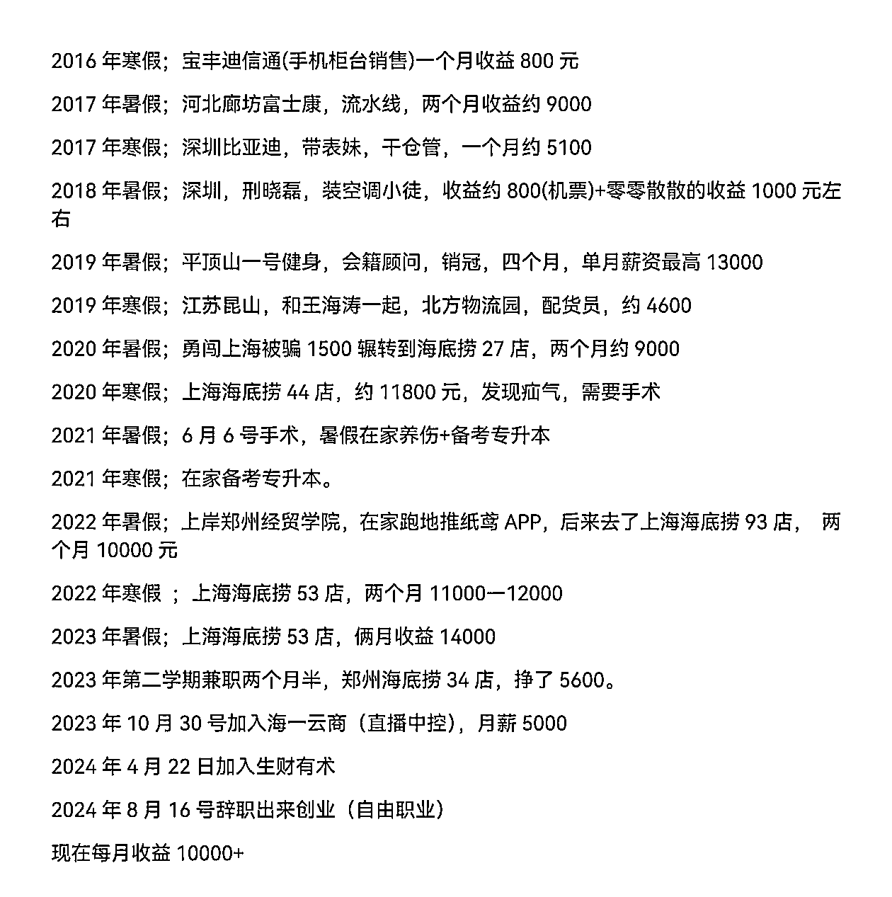
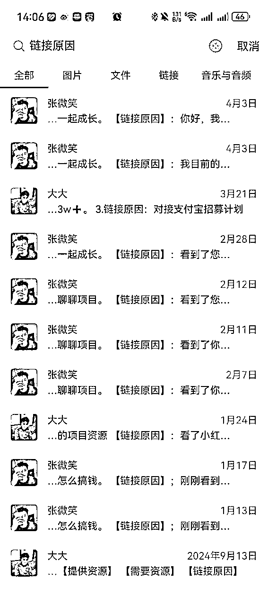
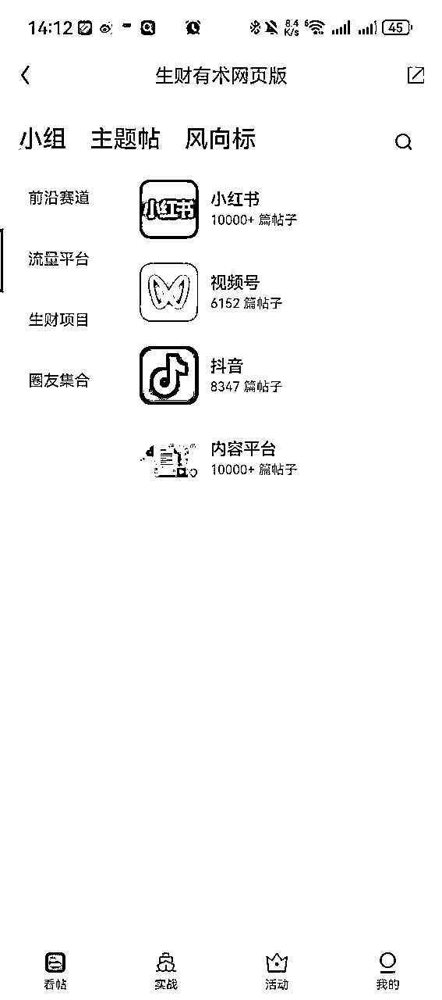
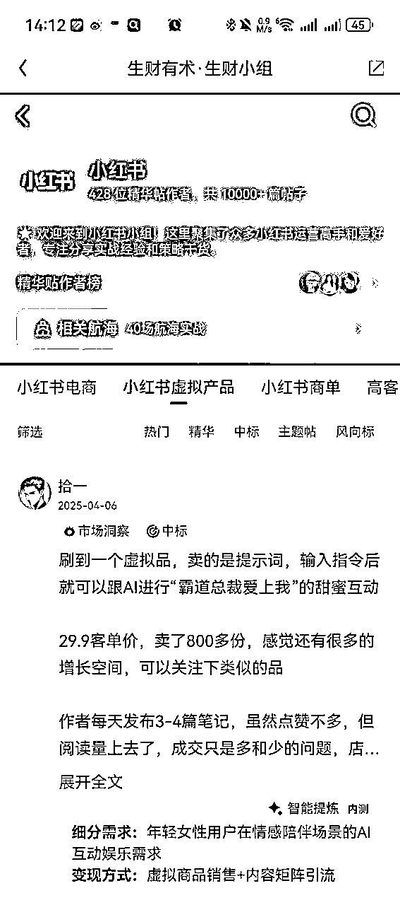

# 没背景没人脉，毕业一年也能靠龙哥盟走出0-1

# 先说我是谁

嗨，我是来自河南的赚钱圈友张微笑。去年大学毕业，到现在在圈子里待满一年，现在以自由职业者的身份做📕虚拟资料的生意。

同龄人还在迷茫要往哪走的时候，赚钱给了我一份清晰的前进感。我很明确自己要往哪里去。赚钱把普通人赚钱的门槛拉得很低，以前的我只是个餐厅服务员，在富士康流水线上当螺丝钉，用体力换工资的典型“天选打工仔”。

正是赚钱让我看到了普通人也能操作的赚钱路径，也是在这里被很多圈友一路带。别先怀疑自己能不能行，先动手干，卡住再找人问就是了。下面是我日常里用赚钱的一些实操心得，分享给你参考。

# 给新入圈的朋友，一份我的使用笔记

### 主要是给刚进来怕自己做不成的你，帮你拿到第一个对市场收费的能力。

大概会聊到：

1. 哪些信息差能直接变成钱。
2. 做项目时最容易踩的坑。
3. 怎么请到真正做过的前辈搭把手。
4. 怎么让自己越来越值钱。

## 1. 先认同信息差的价值

想做生意、想创业赚钱，第一步是搞清楚当下什么事儿能赚钱。

第二步是看这个事儿的试错成本能不能扛住，就算翻车也不会把生活质量拖垮。

拿龙哥盟来说，几千块的成本就能接触到几万条干货。反观线下摆摊、开店，一个门面下来成本就是几倍到十几倍。

有人会问，那直接去网上买个项目不香吗？我只能说，真的能稳定赚钱的项目，人家干嘛要卖给你，还不自己招人放大。赚钱自带的搜索功能基本能扒出互联网上90%的玩法，找到了原始作者，通过鱼丸牵线，自己跟着复盘。做着做着卡点了，给原作者发个红包请教一下就行了。

创业本质就是不断解决问题的过程，不是把一本方法论买回来供着。手册再全，实操中也会有一堆问题等着你去破。

## 2. 专注力比聪明更重要

看到一个想做的标的，就用一两个月时间all in。起步阶段别急着创新，先老老实实照着原作者的步骤走。别问为什么，先做到位。因为新手很难理解每一步的深意，而你能看到的大结果背后，基本都有杠杆加持，那个杠杆可能是AI、兼职团队、员工或资金。

## 3. 主动链接，比闷头更高效

圈子的力量不能小看。项目推进到瓶颈期，主动求助是加速器。

我自己的做法是，每个月都会找鱼丸帮忙介绍2-3个同赛道的圈友，加🛰️保持交流，同步一手动态，互相取经。

找不到同行？赚钱小组就是入口。以手机网页版为例，在这里就能筛选到相关小组。

和别人请教，最忌白嫖。诚意不用多贵，一个66或88的红包就能表达态度。大家都不喜欢被占便宜，适当的付出反而能换来干货，帮你绕开弯路。说白了就是个双向筛选，你用付费筛选出真正有价值的信息，对方用你的付费筛选出真正有诚意的人。

另外，多发起线下碰面很值。组织一次聚会，你自然要把所有人拉进🛰️群，人脉就扩了。而且你能听到很多线上听不到的真实想法。

聚会成本也很低，几个人吃顿饭几十到两百块搞定，还能补心态。面对面聊完，你会更相信自己也能做到。

## 4. 真诚是放大器

赚钱有几万人，消息传得很快。做一件不地道的事，很快就会被知道。反过来，经营好真诚的人设，大佬和同行会主动来找你合作。

持续输出内容也很重要。真诚地发帖，展示你的专业和气质，就能吸引到志同道合的人。实在没什么硬技能，那就做利他，先帮别人。比如当志愿者，主动参与圈友组织的聚会，影响力自然就起来了。

## 5. 给自己一个清晰的标签

帖子别写太长，短平快才是现在的信息习惯。

举个例子，我是怎么让龙哥注意到我的。我就用了两句话：你们公司很有价值，我以前是刷盘子洗碗的，今天能出来创业，多亏你们。

我给自己贴的标签是「草根创业者」，富士康拧螺丝、海底捞洗碗的经历，就是一段段爽文。关键是你要主动讲好自己的故事，用最简洁的方式把人设立住。

## 6. 入圈后的副作用

加入赚钱后，看世界的视角会变。以前刷抖音只图个快乐，现在会自动拆解：这个账号怎么变现的？

拆解变现逻辑的快感，早就超过了单纯的娱乐。

## 7. 最后几句掏心窝的

创业都是滚着爬着往前走，上面说到的只是水面上的部分。路上还有很多坑等你自己踩，但一定要敢问比你强的人，也敢承认自己的不足。

关于副业这件事，我吃过亏：副业稳定跑三个月以上，并且月收入达到主业的五倍，才考虑辞职。收入不稳就辞职，后面决策全会变形。

可以考虑把标准化的环节交给在校大学生来做，解放你的时间。

还有，别频繁换赛道。大多数项目都需要时间沉淀和加杠杆后才会有体面回报。