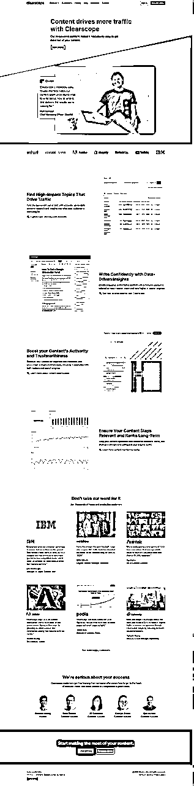
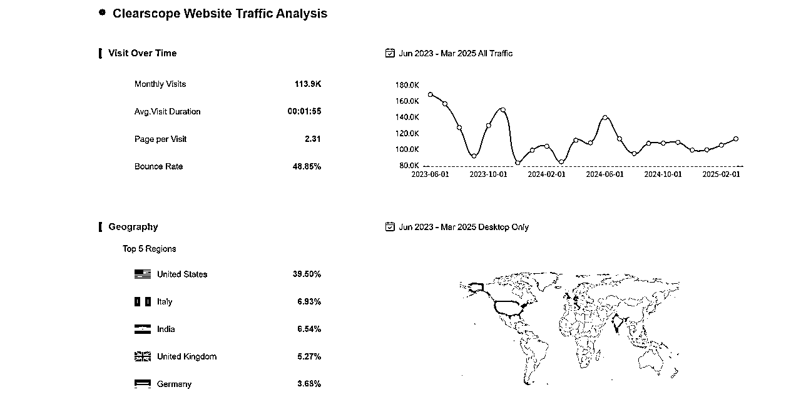
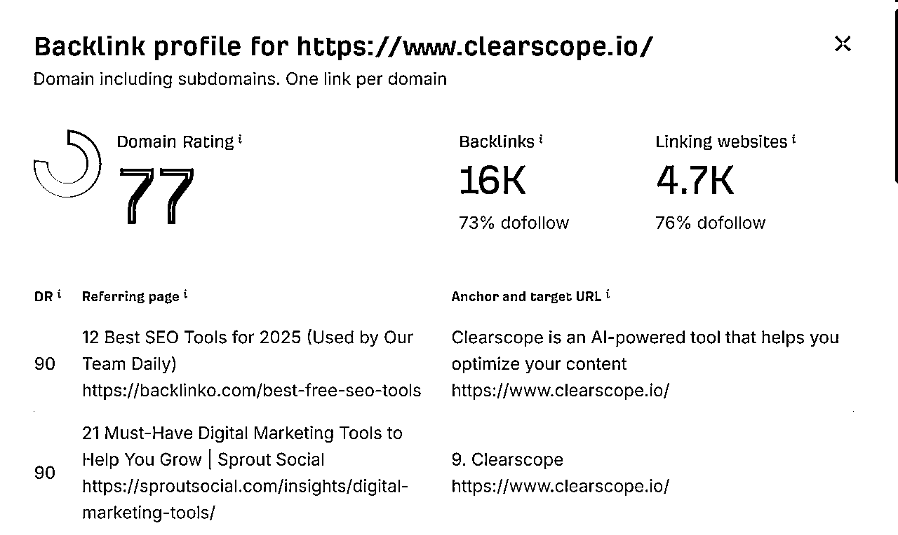
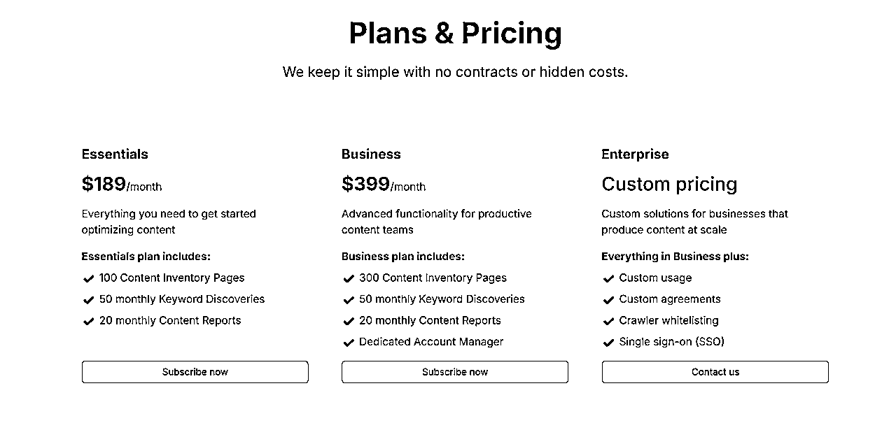
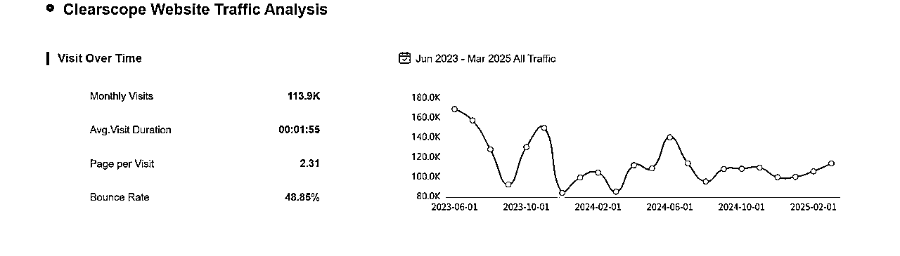

# ('501 Clearscope', (2, 16))

看到这款产品的时候，我确实愣了一下——网站标题直接写着“No.1”，这种底气在圈子里还挺少见。但深入了解后发现，做这个产品的人确实是懂行的，而且它的商业模式很可能主要靠大客户订单撑着。我研究过不少AI SEO内容工具，坦白说大多数在社交媒体渠道的效果很一般，但这款获得的评价却相当正面。只要它形成了一整套可复用的标准流程，根本不需要操心流量问题。让我好奇的是，这么好的产品，为什么最近网站流量反而在往下走呢？

它给自己的定位是“内容优先的SEO平台”，简单说就是帮营销团队把自然流量做大，手段是内容优化、关键词挖掘、流程管理和效果监控。

我看了下它的加载页面，是这么个状态：

官网流量数据在这里：  
外链的情况和数量则在下面这张图里：

先聊聊它解决的问题。简单一句话：现在做内容的人太多了，想靠一篇文章冲上搜索首页越来越难，大家都在同质化的内容里挣扎。Clearscope的思路是先分析搜索结果页里排在前面的那些内容，找出它们用了哪些词、写了多长、结构怎么安排，再给出针对性的写作建议。这样一来，创作者不用再靠感觉猜搜索引擎喜欢什么。它还有个内容清单功能，能追踪你老文章目前的表现，哪篇过时需要更新了会提醒你，避免内容老化导致的排名下滑。把一个原本需要大量手工操作的过程自动化，这是它最核心的价值。

什么人会买它？范围还挺广的。内容营销团队是最主要的一批用户，他们要用它来规划选题、写稿和优化页面；SEO从业者把它当关键词研究和竞争对手分析的工具；数字营销机构用它给甲方出优化内容；自由撰稿人靠它确保稿子能被搜索引擎抓到；像IBM、Adobe、Shopify这类内容需求量很大的公司也在用，用来统一大规模做内容优化。基本上，你想靠内容获取搜索流量，都用得上。

那用户为什么必须用它？最直接的理由就是排名确实能上去。它给出的关键词建议和优化方向是跟着数据走的，不少用户反映优化完以后排名和流量都有肉眼可见的提升。其次是省时间，有用户反馈说每篇文章能省出1.5到3个小时。它还会拆解竞争对手的内容覆盖面，把你漏掉的话题补上，确保你的内容更完整。它给的建议也是跟着最新搜索趋势走的，内容更权威也更可信。另外，它跟Google Docs、WordPress和Word集成得很好，你写稿的时候不用来回切平台，直接在编辑器里就能看优化建议。长期来看，它的监控功能保证你的内容一直在更新状态，排名不容易掉。

用户对它的评价整体是偏正面的，但也有些值得注意的批评声。

支持者喜欢它的地方是：界面非常直观，新手也能快速上手，团队培训成本低；对排名的提升效果有大量案例背书；客服响应很快，态度也很好；内容优化的时间大幅缩短，团队效率上去了；它能提供基于真实数据的具体建议，不是那种空的套话；和常用工具的集成让整个创作流程顺畅不少。

吐槽主要集中在价格上。订阅费确实不算便宜，对于个人或预算有限的小团队，这个价位可能会劝退一部分人。还有用户觉得它的关键词发现功能不够强大，跟专业的找词工具还是有差距；虽然它宣称自己是AI驱动，但其实主攻的是优化，并不提供AI写作或自动生成内容大纲的功能；也有用户觉得报告部分略复杂，更新速度没有达到他们想要的“实时”；也有人指出它过于强调关键词密度，而谷歌其实早就不把关键词密度当回事了。

各大平台的评分方面，G2给的4.9/5、TrustRadius的8.0/10、GetApp的4.9/5。Webflow的案例显示，用它们的内容等级优化后，非品牌关键词的有机流量增长了130%。

那它是怎么找到这些用户的？它自己的产品就是用内容营销和SEO拉来的流量。官网博客常年更新优化策略相关的干货，等于先给潜在客户“上了一课”。还有口碑效应，用户觉得好用，自然会在论坛和社媒上分享。它网站上放了大量客户案例和成功故事，各种规模的公司都能对上号，这种真实的标杆效应本身就带量。它还会出现在各种数字营销和SEO行业的线下活动上，创始人Bernard Huang本来就是这个圈子的名人，这也算是一种变相的达人营销。此外，它还经常组织网络研讨会，请行业专家分享，免费的教育内容既赚了专业形象，又沉淀了用户。搜索引擎广告虽然没有明确提到，但大概率也是它的获客渠道之一。

按照Toolify.ai的估算，它每月访问量大概在10.6万。这个数据仅供参考，一般这类第三方工具的估算都不一定完全准确，想拿更靠谱的数据可能得看Ahrefs。

再说说它的生意经。它走的是订阅制，不提供免费试用，基本套餐是这么设计的：

具体的套餐细节我在这儿：

Essentials版本每月189美元，功能比较基础，适合刚入门的人；Business版每月399美元，给了更高的报告和页面额度，还有专属客户经理；Enterprise版就得找销售聊了，按需求定制。

收入这块我也算了一笔账：

按113.9K的月访问量，每次访问看2.31页，倒推出来独立访客大概是4.93万。假设转化率保守按1%算，再拍一个粗略的套餐比例——60%的入门用户、30%的中级用户、10%的企业用户，按企均月费1000美元估一估，MRR大概是16.2万美元。当然，这只是一个粗略的估算，实际情况可能有出入。而且市面上目前还没有完全对标的同类产品，也算是一片蓝海。

最后说说我从这个产品里学到的一些新认知。

一个是它的内容等级系统很讲究，把内容分成了从A++到F-的档次。创作者一眼就能知道自己离顶级内容有多远，该往哪个方向补。这种颗粒度的划分方式挺聪明的。

另一个是它对LSI关键词的运用，这也让我对搜索引擎理解语义的能力有了更深的认识。原来关键词不是堆越多越好，而是要把相关的词在合适的语境下自然地带出来。

再一个是内容清单管理的价值。我以前觉得内容发布完就算结束了，但它告诉你SEO是一个持续运营的过程，老文章不更新就会掉排名，定期维护是必须的。

还有一点挺有意思的是，它用到了IBM Watson的自然语言理解技术来做内容分析和元数据提取，这让我看到了AI技术在内容优化里实打实的应用潜力。网络研讨会这个拉新方式也值得借鉴，通过免费内容输出，塑造品牌的专业权威感，比硬广要更能让人记在心里。

不过它的有些做法，看起来简单，想复制其实挺难的。比如跟IBM Watson这种级别的AI服务做深度集成，硬门槛非常高，没有足够的技术积累和资源投入很难做到。再比如它最核心的竞争力——持续抓取并分析各语言各地区的搜索结果数据，这背后是一个庞大的数据工程，需要大量的服务器资源和算法维护。这两件事，基本把个人玩家和小团队挡在了门外。

在内容优化赛道里，Clearscope 的成功路径其实很清晰，也很重。

它首先拿下了一批头部企业客户。IBM、Adobe、Shopify 这类大客户的认可，并不是靠广告砸出来的，而是靠长期积累的品牌信任、能服务企业级复杂需求的定制化方案，以及一支专业的销售和客户成功团队在背后持续加持。

其次，它把服务体验做成了壁垒。响应快、专业度高的客户支持，加上大量投入的免费培训体系，让用户用得顺手、离不开。这种高标准的服务支撑，背后是人力和体系成本的持续投入。

再者，它坚持了高价策略并且活了下来。Clearscope 在同类产品中定价偏上，但依然保持了较高的用户满意度，这说明产品本身的价值感和用户体验确实支撑得起这个价格。

如果只能用一句话来概括它的卖点，我会这样说：
Clearscope：人工智能驱动的内容优化平台，助您轻松创作高排名、全面的内容，显著提升自然流量和 SEO 效果。

如果要做一个解决同样问题的替代品，我会选择避开正面硬刚，而是从差异化切入：

先从价格门槛入手。Clearscope 的价格对中小团队和个人创作者并不友好，我会尝试更亲民的定价或按需付费模式，让产品能覆盖更广的人群。

再把创作闭环做完整。Clearscope 更偏重优化，我会把 AI 写作助手深度融合进来，从选题、资料收集、内容生成到后期优化一站式完成。

在分析维度上做加法。除了关键词覆盖和可读性，还可以加入外链机会识别、Schema 标记建议、网站结构诊断等更全面的 On-Page 分析。

降低体验门槛。Clearscope 目前没有免费试用，我会设计更慷慨的免费增值版本或较长试用期，让用户先感受到价值再付费。

聚焦垂直场景。Clearscope 面向大众市场，可以选择深耕特定内容形态，比如电商详情页、技术文档，或聚焦医疗、金融等垂直行业，做更定制化的解决方案。

技术上寻求新突破。比如更精细的语义理解模型、基于用户行为的个性化内容推荐、语音搜索优化等，形成对手没有的功能亮点。

不过要复制这条路，难度很高。

做类似产品需要跨领域的高水平团队，涵盖自然语言处理、机器学习、Web 开发、API 集成和数据分析。还要有能支撑海量搜索数据抓取、存储和处理的弹性基础设施，以及合规可用的数据源。

此外，还需要投入大量研发做与 Google Docs、WordPress、Microsoft Word 等创作工具的无缝集成，建立专业的客户支持体系，以及懂 SEO 和内容营销的营销销售团队来推动增长。

资金消耗点很分散：人员薪资、服务器和数据采集成本、营销推广费用，以及持续的研发投入。市场也并不友好，已有 Clearscope、Surfer SEO、MarketMuse、Frase 等成熟玩家，它们占据了品牌心智和用户基础。

想进入这个市场，需要一个足够清晰的差异化价值主张，要么在功能创新上领先，要么在价格或体验上明显更好，还要面对建立信任的长期过程，SEO 从业者对工具的准确性和稳定性要求极高，获客成本也可能非常高。

用户从哪里来？可以从几个方向入手：

通过 LinkedIn、行业媒体、SEO 社区和精准付费广告触达内容营销人员和营销机构；用干货内容营销建立专业形象；用免费增值或试用降低首次使用门槛；与关键词研究、分析平台、CMS 等工具建立战略合作；与行业 KOL 合作做影响者营销；运营社区收集反馈并形成口碑；提供主动式客户支持提升复购和推荐；清晰传达差异化卖点；启动 Beta 测试和早期用户计划积累种子用户；同时建立推荐激励机制。

至于个人契合度，这个品类对 SEO 内容的实战经验和行业话语权要求很高。没有这些背景，就需要从其他角度补齐，难度可想而知。

我认可 Clearscope 对内容优化价值的判断，我也相信内容优化在数字营销中不可替代。对于长期迭代，即使前半年没有正向反馈，我也会通过行业趋势研究、竞品分析、用户需求推演来保持方向，并在积极寻找各种渠道与用户对话，把反馈快速沉淀到产品改进中。

结论是这样的：Clearscope 憑借易用性、关键词洞察和良好的集成，成为预算充足的大型组织和内容团队的首选。它的强项是界面友好和优化效率，它的短板是价格高、AI 写作能力有限、页面分析深度不足，这也正是后来者的机会窗口。

内容优化市场正因搜索流量价值提升而持续扩张。直接对标 Clearscope 需要重投入，但若能在价格、AI 写作整合或细分市场深耕上形成差异化，找到更贴合用户痛点的价值主张，依然有机会切入。核心始终在于对用户需求的洞察、持续的创新投入和对客户满意度的坚守。