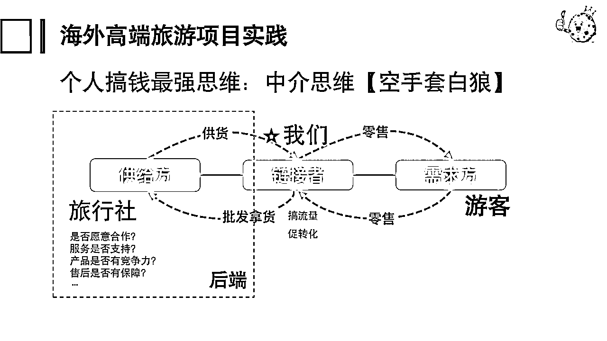
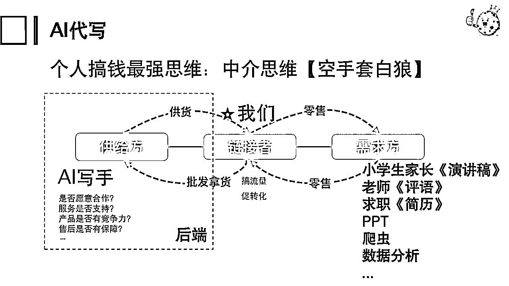
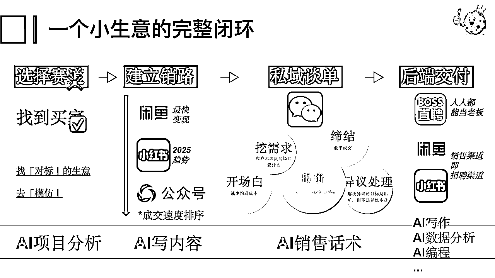
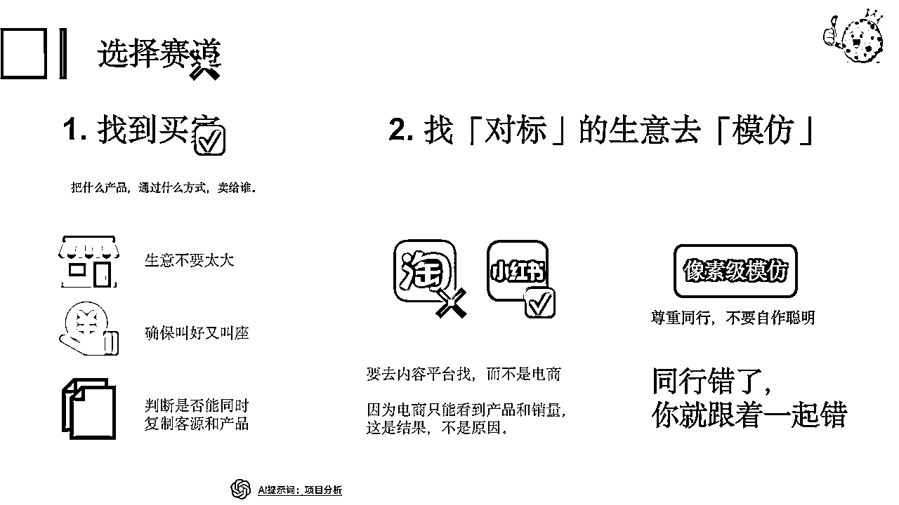
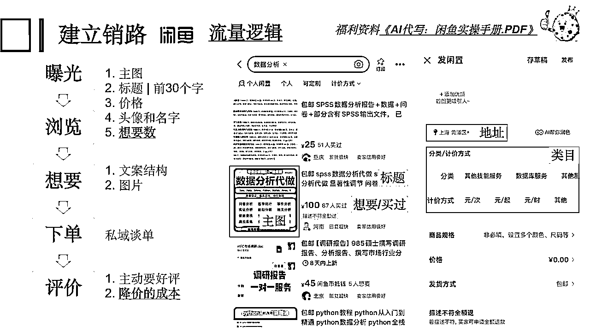
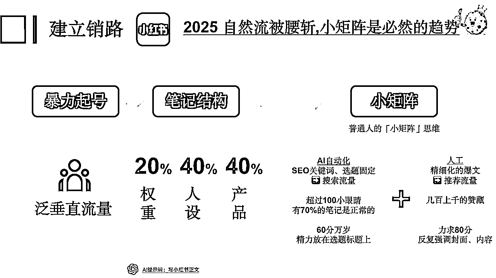
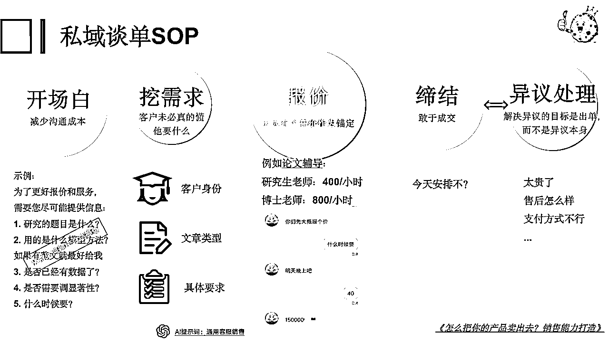
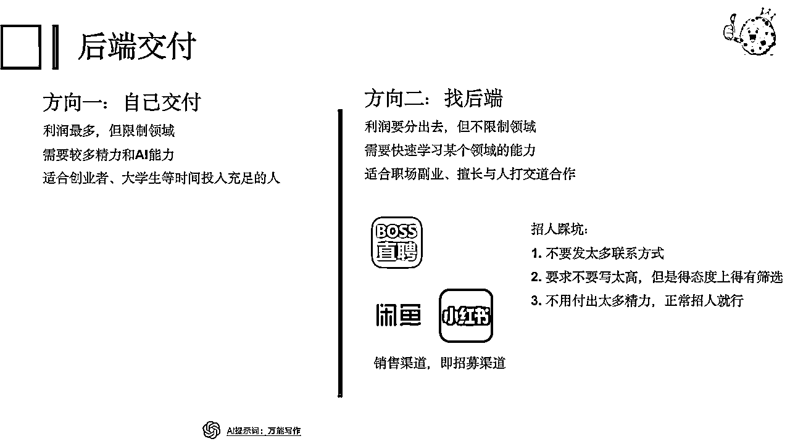

# 用 AI 代写 + 中介打法 = 爆款生意 —— 7 天跑通并拿到第一笔收入
作者：龙哥

各位好，我是龙哥。今天聊一个我验证过的思路：中介模型。副标题讲的就是 7 天内把一家小生意启动起来并产生现金流。

这背后是我亲自操盘 AI 代写的一手经历，我记得咸鱼上线第一周就到账了首单。当时金额不大，几十块的体量，但回路极短，立刻能判断方向可不可行。这个赛道我持续做了一年，积累够厚，今天做一次系统复盘。不是教你如何一年百万，而是把我走过的经验抽象成一个可复制的零到一闭环模型。

2024 年初我就入场 AI 代写，起初发现单价太低，后来把重心拉回我熟稔的领域：数据分析，为客户解决分析上的痛点。虽然本职就是分析师，但副业时间有限，实际执行都是交给合作伙伴完成的。

这就是今天的主线——中介逻辑。前端搞定客源，后端熟练私域成交，这套方法论通用度极高，几乎能套在各类项目上。

按照这套打法，我已先后试过演讲稿、简历、PPT、PowerBI、Python、网站搭建、数据分析等多个品类，任一赛道都能做成高客单。尤其适合技能型生意，掌握之后依托自身能力或转包出去，月入数千没难度。

本次以「数据分析代做」为例，把中介模型的运转拆开讲，帮你快速搭建业务并实现早期回款。

## 一个小生意必须具备的闭环

先把全貌铺开，无论规模大小，一个生意都绕不开以下几环。

首先是选品定方向，你打算做哪类业务。对新手而言，我强烈建议对标抄袭，找一个已经验证能成交的模式做像素复制。因为别人已证明能卖，抄路成功率远高于空想。

方向敲定后要造渠道，核心是把曝光变客户。像📕很热，但成交周期偏长。最快的是咸鱼，它是纯交易场，你挂上服务，点进来的人目的性就是购买，路径极短。

获取到询盘后必须拉进私域成交，这一步本质是销售。会谈单与不会谈单的人，收入差距能到十倍。

我以前带过客服，客户嫌 700 太贵不想要，对方直接回一句好的结束。我气到亲自接手，了解预算后拆解需求，做定制化调整，最后 500 多拿下。

成交后进入履约。这里有个分叉：自营还是外包？AI 代写的场景，客户要演讲稿，你是自己写还是派单？这是策略选择。

整体来看，单人难以全包，但我建议至少完整跑一遍，才能找到成长期优势。我现在团队我负责引流，旅游合伙人负责成交，一年能做百万级业绩。

若每环都觉得难，就用 AI 工具补位。每环都有对应的 AI 方案，我也整理好了可直接用的提示词。

接下来逐项拆解。

## 选赛道❌ 找需求方 ✅

在赛道选择上我划了叉，因为创业第一步考虑的不是我擅长做什么，而是市场在买什么。

我第二本关于 AI 数据分析的书正在写作，和合著者聊案例时，他想写电商案例。我的视角是去看正在做训练营、卖课的人，他们学员为啥掏钱，这才是真实付费群体。

说到底，要想清楚你打算用什么形态，把什么东西卖给哪群人。

若你脑中有一个从未验证过的点子，比如开发一个 app，请别碰。你是在做产品，不是在找买家。

怎样 7 天内起步并盈利？我归纳了三点：

第一，业务要小。普通人做小生意更容易启动，一人公司或超级个体都是围绕一个小痛点赚钱。比如 AI 代写就是帮客户写一篇稿子，数据分析就是解决一个具体项目，都能快速回血。

第二，避开叫好不卖座。AI 代写初期我做便宜演讲稿，一天 20-30 块，交付耗时虽每天十几单，但赚不到钱，这就是典型的叫好不卖座。后来我尝试提价到一篇 100 多，情况才改善。

第三，赛道要能复制客源和产品。能看到同行的获客方式和产品形态，说明门槛不高，可以快速进入。

找对标很关键。去内容平台找，不要只看淘宝。淘宝只能看到结果，内容平台能看到从 0 到 1 的启动过程。📕就能看出内容是怎么一步步起来的。

像素级模仿要尊重同行，不要自作聪明。99% 的创新都是坑。比如同行笔记里有错别字，我们就跟着写，可能是为了规避平台审核的经验。

## 建立渠道，拉流量

方向确定后就要搭建获客渠道。

咸鱼货架电商：读懂电商流量逻辑

咸鱼最快变现。它是货架电商，每天上架产品，有人买就成交。

分享一份干货资料：AI 代写在咸鱼上的实操方法。咸鱼的流量核心就五步：曝光→浏览→咨询→成交→评价。哪里流失严重，就说明哪里的内容要改。

上架时地址会影响流量和成交。一般就发客户所在地区，但要注意：比如上海高校的高客单需求，商家地址在小城市，客户会怀疑能不能搞定，所以要谨慎。

📕兴趣电商

📕现在变了，去年 10 月后自然流被砍，很多人笔记小眼睛不到 100 很正常，因为平台主推付费。普通人想快成交，还是走自然流，需要做矩阵，一个人运营 5-10 个号可行。

2025 年做📕有三个关键。

一是暴力起号，几天内拉权重。核心是做泛垂直流量。垂直流量是明确有需求的人，比如需要数据分析辅导的大学生。泛垂直是整个大学生群体。我会先发大学生过年怎么回家的这类共鸣内容，让账号和人群打上标签，等权重起来后再发营销内容。

二是日常笔记结构。我用的是 2-4-4 模型：20% 发权重笔记拉泛垂直流量，40% 发人设笔记建立信任，比如我是汉语言研究生，平时分享读诗词、获奖经历；剩余 40% 发干货和硬核营销。用户看完干货点进主页看到人设，私域转化率会高很多。

三是矩阵配合 AI 自动化。AI 负责铺长尾搜索词，比如春节、元宵、清明等节点演讲稿主题，让用户有需求时能搜到我，这些内容做到 60 分就行，小眼睛 100 以上即可。人工则做封面网感强、剧情丰富的内容，做到 80 分以上。

## 私域成交方法

客户进私域后怎么成交，我总结了一套五步销售法：开场白→挖需求→报价→缔结→异议处理。

1️⃣ 固定开场白，减少沟通成本

加🛰️后不要上来就问你需要什么。很多客户只是询价，没需求，前期沟通全是浪费。用模板把问题列清楚，比如我做数据分析，会先发一张标准问卷，让客户按 1 2 3 4 5 回答。对方不回复，大概率不是真客户，节省时间。

2️⃣ 挖需求，客户不一定知道自己要什么

要确认三件事：客户身份是谁，文章类型是什么，具体要求是什么。一点点把需求挖出来。

3️⃣ 报价，用高价做锚点

报价是利润核心。每次给两个价做锚定。比如毕业论文辅导，研究生老师 400/小时，博士老师 800/小时。客户自会选择，提升 30% 利润很常见。做演讲稿也是，本科老师 50，研究员 100，实际交付一样。

另外要看人下菜碟。翻朋友圈，如果客户经常出国旅行，预算大就报高价；艺术生学费高也能承受高价。

4️⃣ 缔结，敢于逼单

客户考虑不回就追问：是不是有顾虑，价格还是预算问题？可以适当优惠促成。

5️⃣ 异议处理

需求和价格都谈妥后，别再闲聊，直接问今天是否安排。遇到异议就分类解决：贵、售后、付款方式。用话术化解后再次回到缔结：今天安排吗？

## 搭建后端履约体系

成交后有两条路。

自己交付，利润最高，但领域受限，需要大量时间，适合全职或大学生。

走中介思维找后端，利润分出去，但领域不设限，只要能找到合适的人就能做。需要快速学习领域知识，用 AI 快速理解需求，比如述职报告包含哪些部分，也需要很强的沟通能力来管理后端。

找后端渠道首选 Boss 直聘，销售渠道也能变招募渠道。咸鱼上可以直接私聊同行合作，谈分成比例。📕也可以，但容易违规。

中介最怕后端绕过你直接接单。现在可以用企业🛰️防加好友功能，避免客户和后端私联。个人也能注册企业🛰️，虽然群数量有限，但足够从 0 到 1 跑通流程。

## 最后，坑点与成长路径

完整闭环个人很难全包。对普通人来说，要么抓流量 + 绑定后端合伙人签合同；要么掌控后端 + 招代理解决前端。先把整个链路走通，找到自己的优势，再持续深挖。