# 如何借助赚钱 AI 小组，拥抱 AI 变现机会？

先自报家门：小鱼。龙哥盟第4号员工，到这个月正好五年。

这些年做过几件小事：《赚钱日历》和《项目精选》小报童，都出自我们团队，两个产品加起来卖出了25万多册；带过会员运营，统筹过418项目，搭过新渠道，也在情报研究组扎过一段。眼下我在社区内容部管理赚钱小组，日常琢磨的是怎么帮圈友在各自垂直领域钻得更深。

回头看，我的业务方向其实换了好几轮。每次换方向，头几个月都会别扭，遇到一团乱麻的问题也想躲。但有一个体会越来越深：变化是常态，陌生是常态，真正的机会恰恰都长在你不熟悉的土壤里。面对智能化浪潮，最重要的不是先搞懂所有技术，而是先给自己一个信念——你学得动，也用得起来。

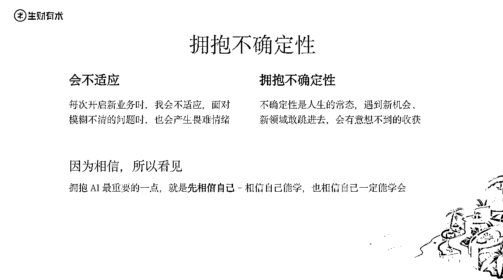

最近因为岗位调整，我集中翻了一遍社区里关于AI的精华帖和风向标，发现圈友的困惑高度一致，大致有三类：

第一，智能工具一轮接一轮地出，到底怎么跟上节奏？
第二，别人已经用这套技术换到钱了，我连门往哪开都还不知道，怎么办？
第三，各种赚钱案例看了一箩筐，轮到自己动手，依然无从下手。

所以今天这篇，我想把看到的、听到的、以及团队正在做的事，一次性摊开来讲。主要内容分成三个部分：

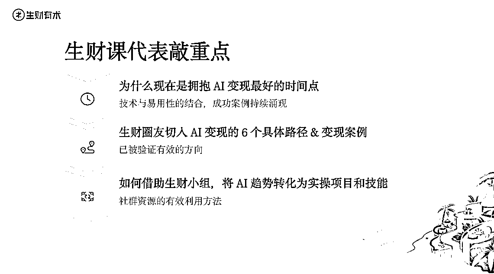

先讲时机。

## 为什么说，现在才是上车的最好节点

“AI一定是大趋势”，这句话在圈友里没什么争议。我想聊的是更具体的判断：没有背景的人靠它赚钱，最好的节点就是当下。

为什么？

两年前，大模型还不趁手。你想让它干点正经事，得懂提示词工程，得有一定的技术底子，不然产出的东西根本没法用。现在完全不一样了。DeepSeek这一代模型出来以后，只要你会把问题问清楚，给你的回答就已经达到专业级的水准。技术成熟度和使用友好度第一次同时在线，这是一个很重要的信号。

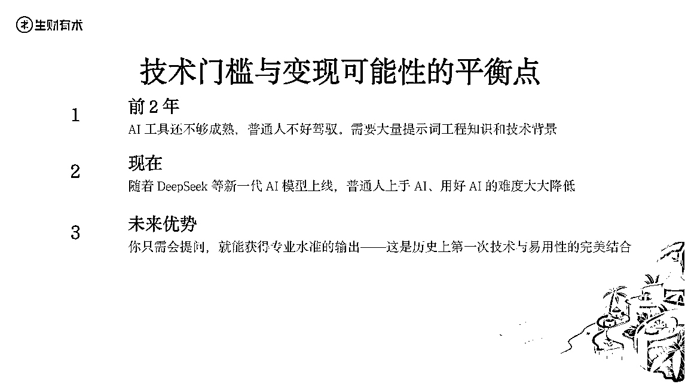

另一个信号是，行业内已经有不少成功样本：
- 刘小排，前阵子刚上过程前朋友圈的访谈，他做了几十个智能工具，年营收接近千万；
- 阿彪，一个小团队做出来的智能产品，年利润破了千万，甚至能和字节跳动的产品正面打；
- 大漠，从留学行业转行出海做智能产品，好几款进了海外榜单前100，最高排名第17；
- 花生，单枪匹马开发的应用，登上过App Store付费榜首；
- 裘裘笔记，两个月完成转型，转做AIGC设计，并拿到头部公司的Offer；
- 汤姆CC，04年出生的年轻人，春节期间做DeepSeek相关内容涨粉30万，一个多月接了50多个商务单。

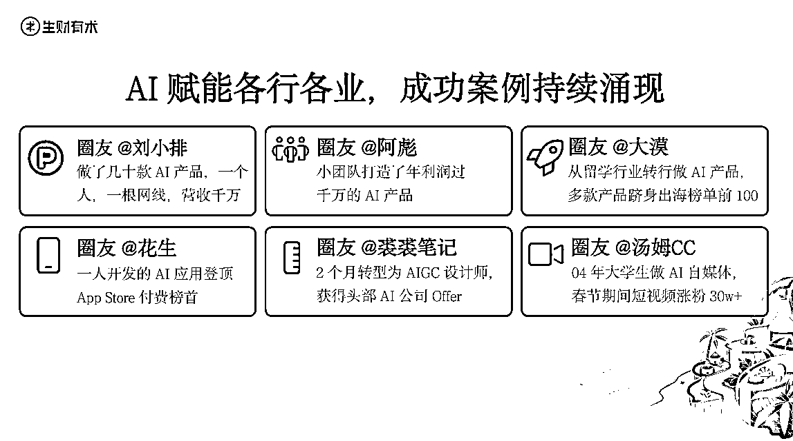

注意，这些人里不少都不是技术背景。他们和许多圈友一样，从零开始，跑着跑着就跑到了前面。

这就是智能化时代最迷人的地方：以前单打独斗，产出是有上限的，现在借助工具，单兵也能打出集团军的效果——认知更快迭代，成长更快发生，收入更快增长。

从ChatGPT发布算起，这场商业浪潮其实才刚起头。最佳入场时点未必是第一批吃螃蟹的人，而是当模式已被验证、方向已经清晰的今天。现在进场，正好赶上这波胜算最高的阶段。

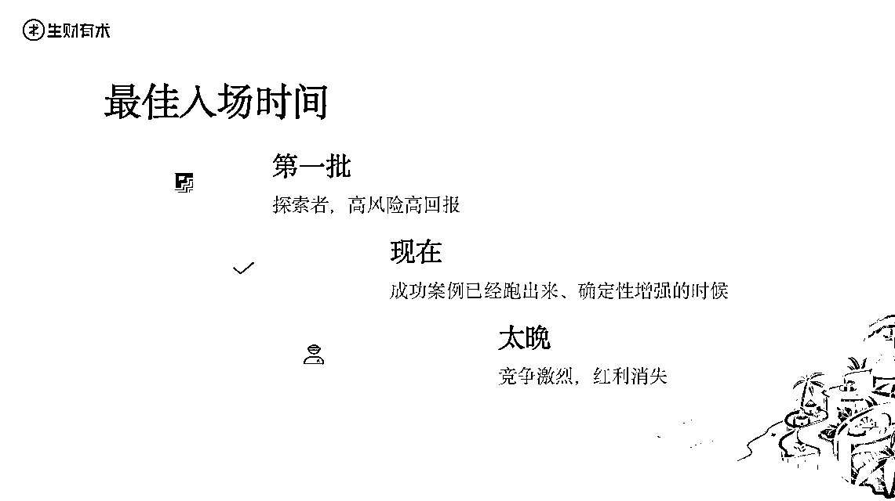

现在把脚迈进来，就是在为接下来的五年铺路。

## 六条被验证的路，以及路上跑通的人

接下来这部分，是大家真正关心的：具体怎么干？

我整理了六条路径，它们都被验证过。验证标准有三条：有人完整跑通过；跑通的人不是一两个；其中有人的成绩相当亮眼。

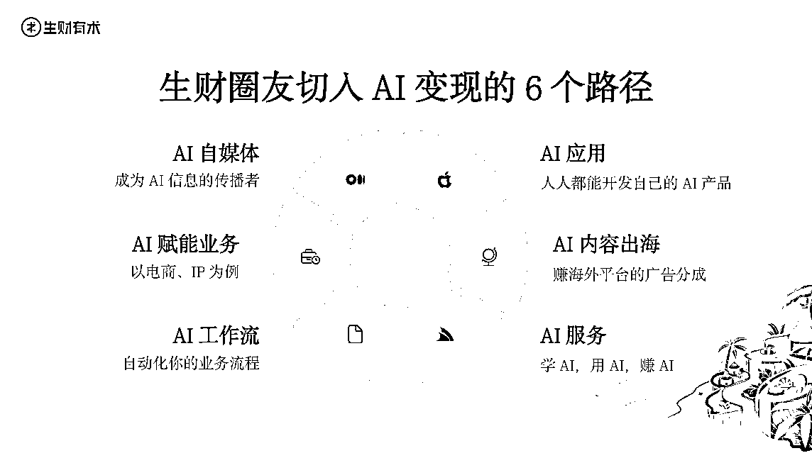

你可以看看自己的情况，从最顺手的开始。

### 第一条：做AI相关内容，赚信息差的钱

用一个词概括，就是做“人工智能知识的搬运工+翻译官”：把最新产品、实用技巧、行业动态整理成内容，让更多外行看懂，平台和品牌方都会为这种价值买单。

这个赛道最近的爆发力，大家有目共睹。春节的时候，视频平台上满是AI相关的内容。DeepSeek的提示词怎么用、有哪些隐藏提问方式、怎么让它产出视频脚本、写商品推荐语、做各种业务演示，这类内容轻轻松松就能拿到大量流量。

- 谁适合做：对信息敏感、本身就爱分享的人
- 需要什么：基础内容创作能力，会拿手机拍视频就够
- 门槛高不高：不高。不用精通AI，比读者多懂一点就行
- 多久能变现：三到六个月

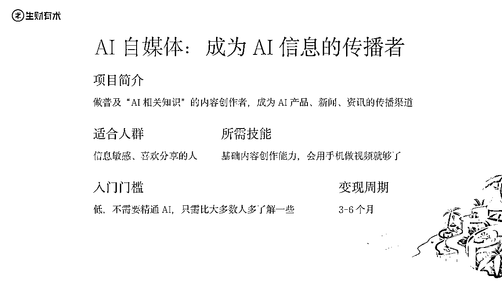

虽然热度已经持续了一阵，但我还是那句话：现在进场依然不算晚。

几个内部信号，一并透露给圈友：
一是品牌方预算依然充裕。智能产品还在密集上新，每个产品都需要内容渠道去讲、去推。光字节跳动就有飞书、Trae、扣子、火山方舟等好几条业务在寻找内容合作伙伴；
二是供给仍然不足。传统图文账号接广告越来越难，AI方向的内容号反而报价水涨船高，很多合作的刊例价能达到单次阅读的5倍以上。有圈友在小红书、即刻这类社区，也被大厂主动找来合作，基本没有还价余地；
三是海外市场几乎空白。不少AI公司在苦寻海外推广资源，英文区的优质创作者又贵又难约，X、YouTube Shorts、Instagram Reels、TikTok这些渠道，都还大有空间。

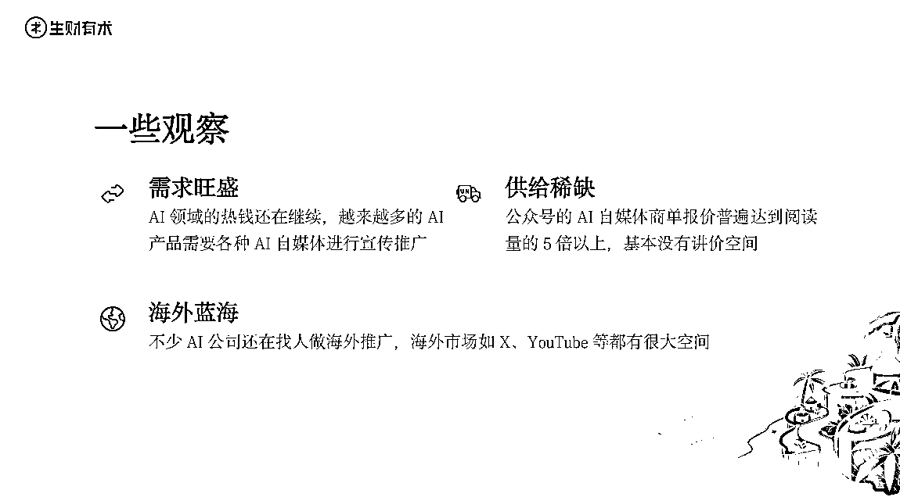

社群里的案例也很多。说几个有代表性的。

Ann是最早试水AI内容的圈友之一，也是三月航海的教练。她的起点非常偶然：发现豆包可以用来检查作业、跟小朋友互动，就在抖音发了几条视频，当时根本没想着变现。结果发到第四条，品牌方自己来了。之后半年，她先后和豆包、九章随时问、纳米AI搜索、AI Mate、猫箱、豆包爱学、即梦、夸克、今日头条、百度等品牌合作。她的原话是：“去年10月之前，我的内容跟AI没有半点关系。如果我能做到，你们也一定可以。”

（Ann的星球帖：《【项目实操】AI教育+抖音，1个月接7条广告过程分享》）

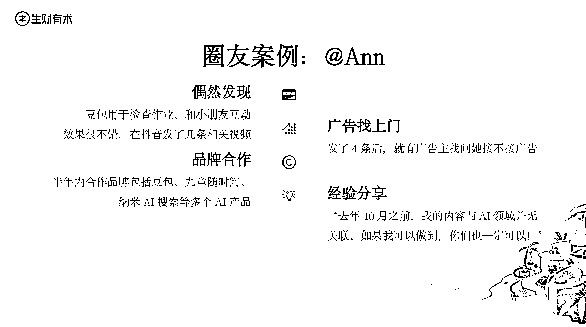

再比如蘑菇。许多人以为接商单得先有粉丝量，她用行动证明了这是个误区。她的首条视频发出去，就拿到300多赞藏和首个商单，而那会儿她的账号才20来个粉丝。她从一开始就想得很清楚：不打造个人IP，只做一个能接广告的号。后来她又发了7条，其中3条来自品牌投放。

（蘑菇的星球帖：《做AI自媒体账号发布第一条视频后接到了商单》）

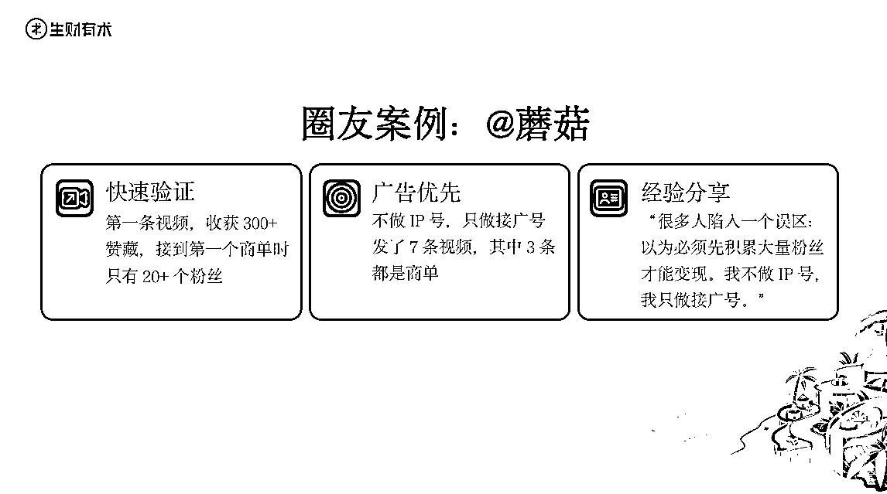

最后是汤姆CC。这位04年出生的年轻人，春节期间围绕DeepSeek做内容，直接涨粉30万，一个多月里50多个合作主动找来。当时DeepSeek卡顿严重，全网都在教大家怎么访问不卡。等这个选题做烂了之后，他立刻转向具体怎么操作、有哪些隐藏玩法，连续做出了多个百万、千万播放的爆款。因为内容方向偏提效，后来还有机构邀他去讲线下分享，收入来源比单纯接广告更丰富了。

（汤姆CC的星球帖：《春节期间制作DeepSeek系列视频：从0到1的AI自媒体成长经验分享》）

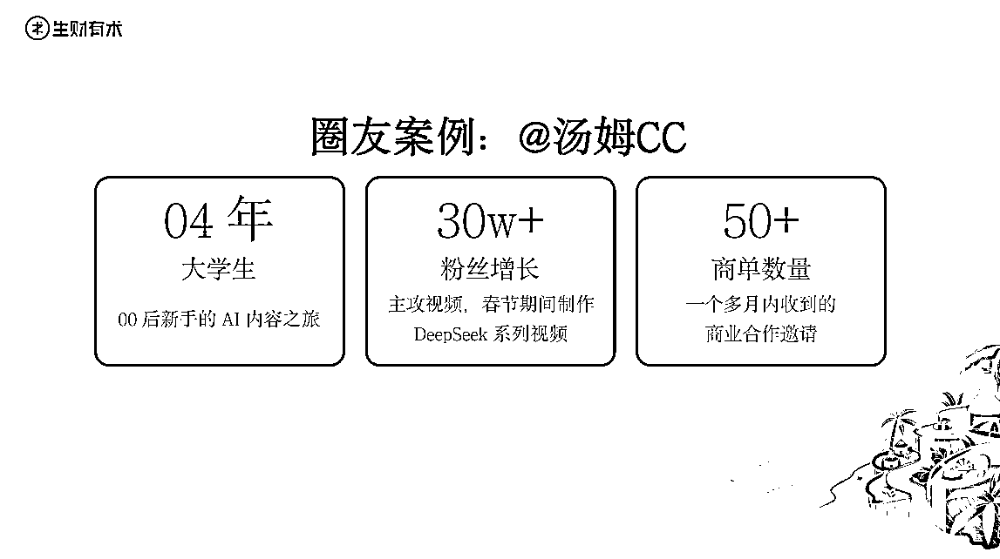

信息过载的年代，能当好“过滤器”的人，价值不亚于“生产者”。做AI内容，不要求你是专家，只要比读者多懂一丢丢，就已经具备了起跑条件。

我们团队也看好这个方向，已经和几位圈友联合成立了AI方向的MCN。等渠道稳定下来，我们会把稳定合作分发给圈友，让大家专心把内容做好。

### 第二条：自己做智能产品，把想法变成应用

23年，资金还集中在基础模型厂商手里；24年下半年开始，资本的目光明显转向了应用层。

去年11月，龙哥在超级标里立了一个智能应用专项。

所谓智能应用，并不神秘：利用智能编程、智能设计等工具，快速做出一个网站、App或插件，解决某个真实问题。

很多人一听“编程”两个字就想退。但事实是，开发软件的技能壁垒已经被大幅削平。以前做一个产品，需要专业的工程能力和设计能力，成本高、周期长。现在借助智能化工具，一个没有技术背景的人，经过短期学习，也能独立把产品做出来。

- 谁适合做：有产品意识，对技术有基本了解的人
- 需要什么：产品意识、用户需求洞察能力
- 门槛高不高：中等，需要学一下智能编程工具
- 多久能变现：三到十二个月

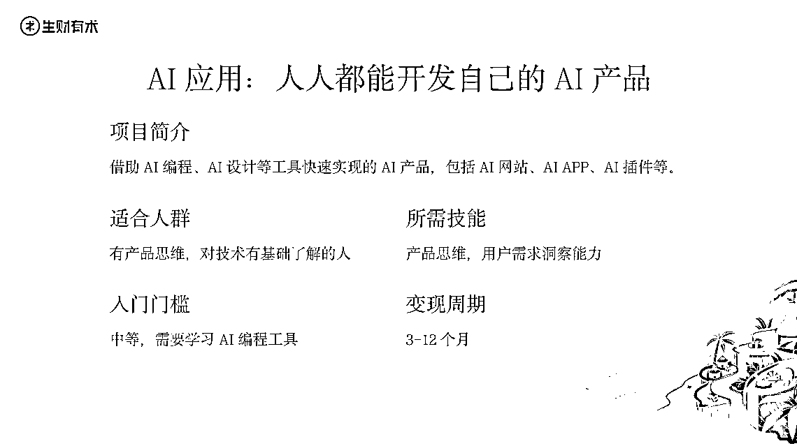

这个方向有几个明显趋势。

第一，垂直场景往往比通用应用更容易打开市场。通用工具竞争惨烈，用户付费意愿也低。相反，如果你解决的是某个具体场景里的具体痛点，用户会很愿意掏钱。赚钱方式不外乎三种：按月订阅、按API调用量计费、按照产出的数量多少和水平高低来报价。举一个我自己的例子，今天这份分享的PPT就是AI做的。前面8页免费，要继续生成就得付费。我试用完直接付款，因为价值看得见，转化顺畅得无话可说。

第二，竞争焦点从“技术”转移到了“产品”和“用户”。技术门槛拉平之后，会写代码已经不是优势，能找到真实需求、快速迭代、把体验做好，才是真正的壁垒。

第三，试验成本降到了历史最低。过去做一个可用版本要几个月，现在几天甚至几小时就能上线。这意味着你可以同时试多个方向，用市场反馈来筛选，而不是闭门造车。

第四，“公开建造”模式在国内被玩出了新花样，最典型的就是小红书。想做一个产品，先在小红书搜一搜需求热度；上线前，发条笔记试探反馈；做出来了，再发一条宣布。第一波种子用户就这么聚起来了，运气好还能引发自然传播。

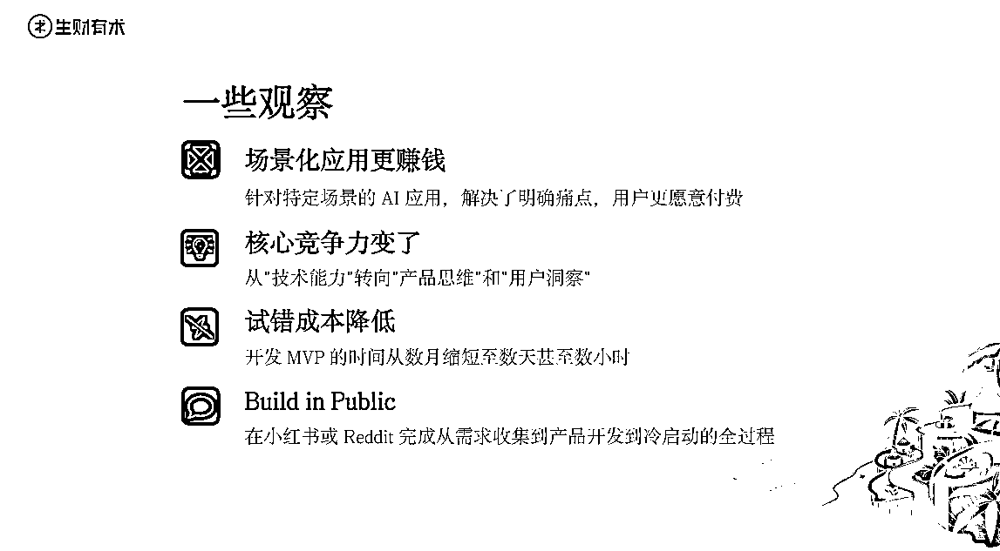

小红书最近推出的“独立开发者大赛”，里面就有不少产品是靠这套打法跑出来的。

花生的“小猫补光灯”就是个标准范本。他的出发点很小：另一半剪视频时提到，想找一个女生专用的补光卡片。他跑到小红书搜“补光”，发现类似需求的热度很高，于是用Cursor快速开发并上线。上线后发的一条笔记拿下了118万阅读、7.3万赞，带来3万多次App下载。产品最高冲到App Store分类榜第20名；付费版“小猫补光灯Pro”更是6小时登顶付费榜第一。

（花生的星球帖：《AI博主花生分享小红书爆火App开发经历》）

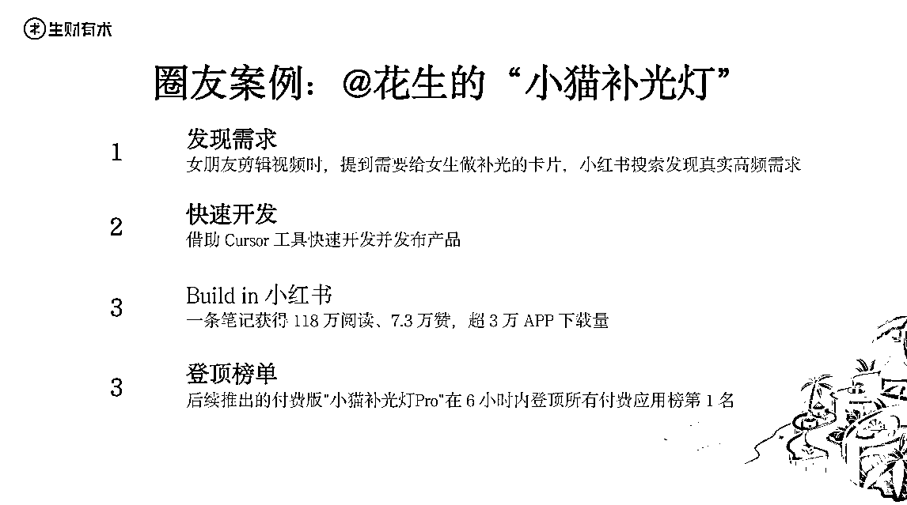

说到智能应用，绕不开的标杆是刘小排。他上程前朋友圈时，很多人记住了那幅画面：一根网线，一串数字员工，一年收入上千万。

他投身智能产品后的首个项目叫Raphael AI，发布一个月，月活就冲过100万，同时排在AIGC产品全球增长榜第15名。没做SEO，没投广告，全靠用户自己传。

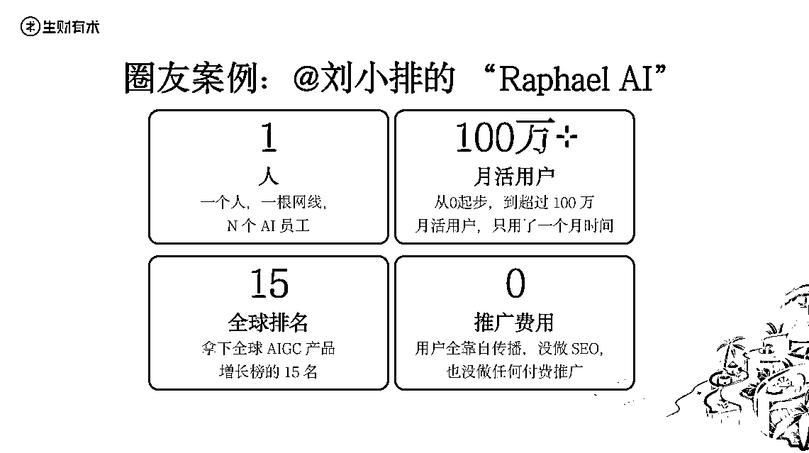

有人问：智能绘图已经那么卷了，为什么他还能做成？答案其实很简单——他让一大群原本不碰智能绘画工具的人，忽然发现自己也能画。这个人群的规模，比想象中大得多。

顺便透露个消息：刘小排正在和我们一起筹备一门面向海外市场的智能产品课程，同时，他会以SCAI实验室联合创始人的身份，孵化一群想做智能应用的圈友。想参与的朋友可以去看许老师的招募帖：《SCAI实验室正式开放申请》。

一个只要有清晰的创意，就能把产品做出来、靠它获得收入的时代，是真的来了。

### 第三条：做智能视频出海，赚海外流量分成

过去一年多，多模态模型的能力肉眼可见地在涨，文本、图像、语音、视频的生成质量都上了一个台阶。

尤其是视频生成模型。快手可灵、MiniMax海螺、字节即梦，这些国内产品放到国际市场上也都是第一梯队的。它们直接拉低了高品质内容的生产门槛——过去拍一条像样的片子，要真人出镜、要现场布景、要复杂的剪辑，现在靠几样智能工具就能单兵完成。

所以，第三条适合大众的路径也就浮出水面了：智能生成内容去海外赚收益，具体落点是YouTube Shorts。

一句话：用智能工具制作视频，发到海外视频平台，靠播放量赚流量分成。

- 谁适合做：对海外平台感兴趣、想尝试智能视频创作的人
- 需要什么：基础的智能工具操作能力、内容策划能力
- 门槛高不高：中等，需要熟悉智能视频工具和海外平台的玩法
- 多久能变现：三到六个月

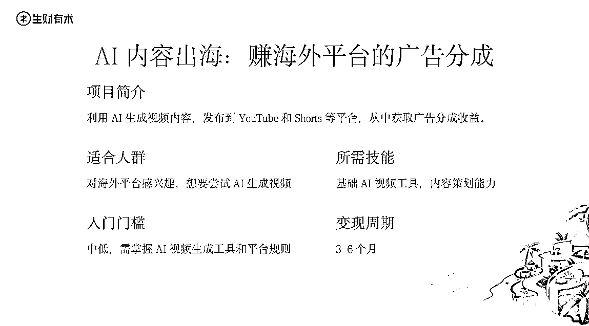

几个观察供大家参考。

平台给的机会确实实在。YouTube为了跟TikTok竞争，给Shorts开通了流量分成，而且对AI生成的内容一视同仁，不限流。目前萌娃方向、萌宠方向、音乐方向、故事方向的内容，在Shorts上都很受欢迎。

智能技术对内容出海的改造，可以浓缩成三点：一是生产门槛大幅下降。不用真人出镜、不用现场布景、不用复杂剪辑，热门视频的卖点，用智能工具就能还原；二是生产效率直线上升。从脚本、画面到后期，单个作品可以压缩到一个钟头完成，做内容的人只需要把时间和精力花在创意上；三是创作边界被彻底打开。上天入地、随意变身、各种奇珍异兽，以前想都不敢想的画面，现在工具直接帮你画出来。

赛场上的格局也在微妙变化。短期来看，参考现成的AI爆款内容，是进入这个领域最快的捷径；长期来看，AI和人工创意结合的内容会更具竞争力，对纯AI内容、纯人工内容都会形成压制。现在进场、持续打磨，能攒下不小的领先身位。

（此部分信息来源于龙哥盟YouTube实战深海圈手册）

案例方面，去年12月，社区办了一场3000多人参加的YouTube Shorts航海活动，之后又推出了深海圈产品。才几个月，已经有一批圈友跑出了成绩：
- As，先后试过猫咪跳舞、治愈系动物、动物预警等方向，最终找到突破口，做出好几条数十万播放的内容，并开通了两个YPP高级账户；
- 逸凡风顺，深耕智能动物预警和智能动物救援赛道，他通过复盘总结出这类内容的爆款逻辑——激发用户的同情心与情绪共鸣。现在账号已实现稳定的美金收益；
- 六只猫，陆续尝试过才艺表演、AI猫咪故事、动物预警、国风人物走秀、从Reddit搬运热门帖改编、影视解说等六个内容方向，最后终于找到适合自己的路线，两个账号均已达到YPP高级条件；
- NaNa，拥有多年互联网运营背景，她看中这个项目能同时积累AI技能和创造美金收入。持续投入后，她已经赚到超过3000美金，全网涨粉10万+，总播放量突破5000万。

YouTube Shorts小组直达链接：https://scys.com/groupV2/164

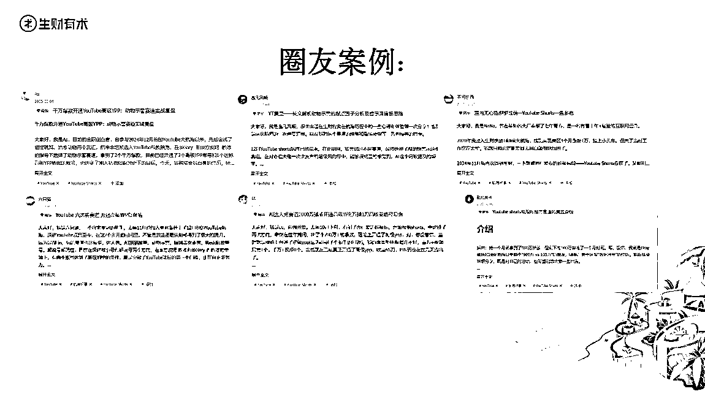

内容出海的版图，正被AI重新绘制。你今天上传的一条短片，可能连接着几百万海外观众，以及品牌方的钱包。

最后说一个暖心的细节。教练团核心成员之一的Gary，最初就是因为在赚钱看到Shorts这个项目才决定下场试试。他把自己实操的过程写成长文发在社群里，后来被加精，他也因此获得了传术师身份。去年12月底来杭州参加传术师见面会，Gary让龙哥记住了他。再后来，他受邀担任深度陪跑教练，带出了全员YPP的成绩。现在，我们在YouTube的深海圈项目上，后续还有更多合作在推进。

（Gary的星球帖：《致未来黑暗中的我，三个月以来的创业感悟：分享、链接、“弱关系”的贵人和愿力》）

这次就先聊到这里。社区里关于智能化的小组，还有大量实操细节和最新风向，值得你进去慢慢翻。如果你已经开始行动，欢迎回来分享你的进度——你走过的路，也许会变成后来者的地图。

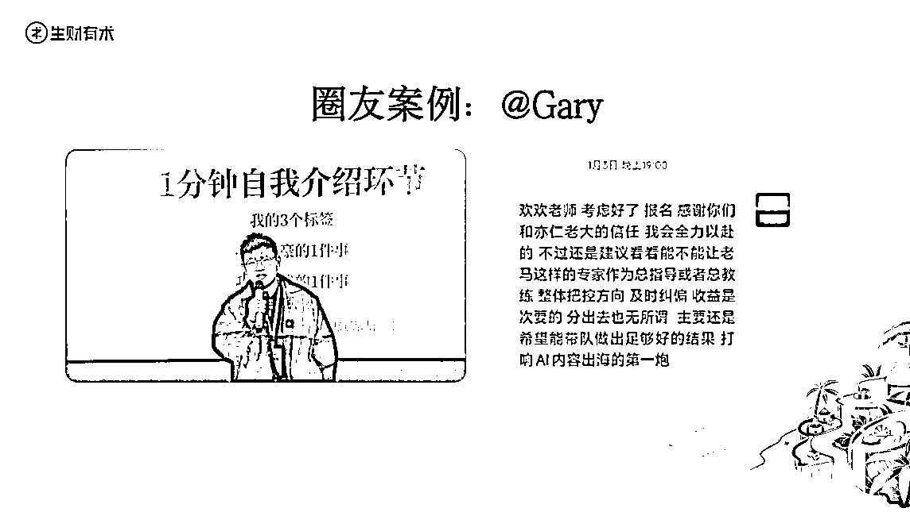

今年社区的关键词是“看见”。我们做了几件事来放大它：团队成员到线下见面，开设人物展示栏目，把鱼丸头像换成真人照……希望更多伙伴从名单里走到台前。

个人层面也一样。主动分享、参加活动、在能留下痕迹的地方持续发声，被大家看到的机会便会增加，后面的可能性也会越来越宽。

### 智能服务：学会、用顺、变现

很多朋友第一次接触生成式内容，是从“文生图”开始的。早在 2021 年 12 月，就有会员在社区拆解过一款绘图工具。

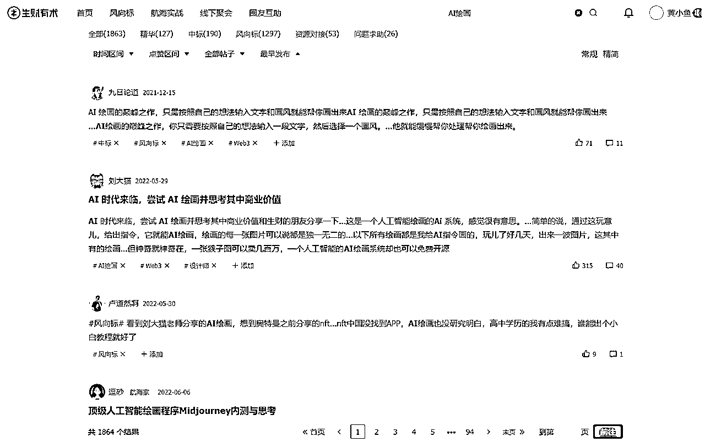

围绕“画图”这件事，后来长出了一批可以收费的服务：

*   旧照片翻新
*   艺术化二维码
*   电商海报落地
*   室内方案出图
*   模糊图高清化
*   品牌虚拟人制作
*   网店换装展示
*   人物换脸特效
*   ……

说白了，智能服务就是：把学到手的生成式技能，变成替客户完成的交付物，并换取收入。

这条赛道的延展性很强，多留意身边的具体场景，很容易找到能切入的需求点。在闲鱼、淘宝搜“代做”类关键词，也能看到大量被验证过的需求。

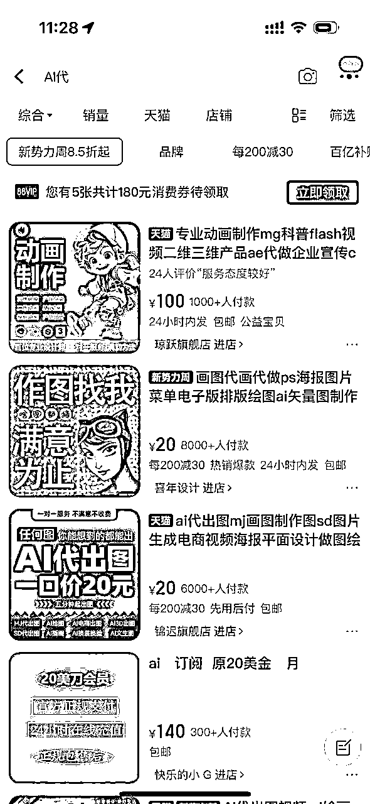

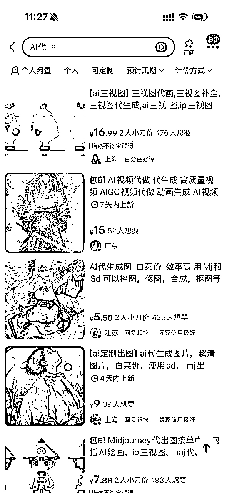

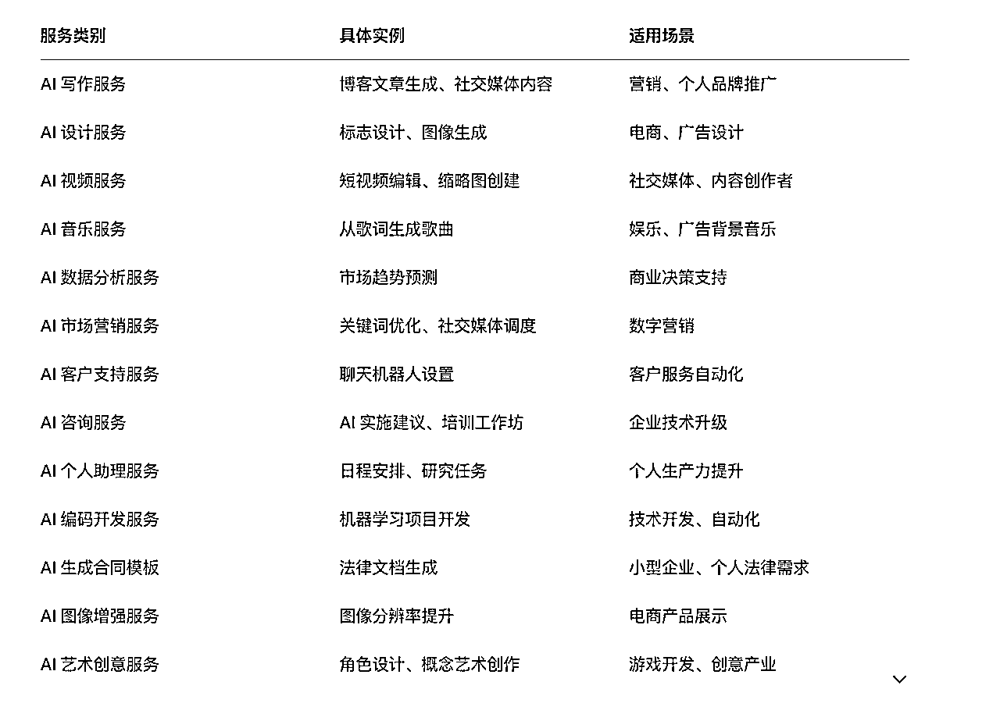

*   适合谁：有专业背景、愿意和客户打交道的人
*   要备什么：熟练使用生成式工具，并懂一点本领域知识
*   门槛：不高，会用工具就能起步
*   回报周期：一个月到三个月

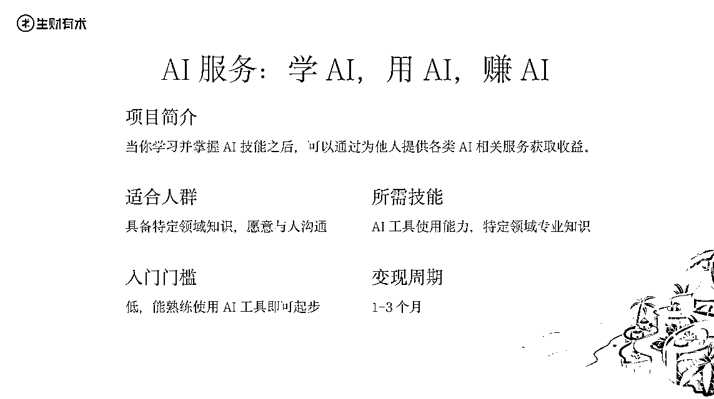

#### 几个趋势信号

*   服务在变细：用户需求越来越具体，智能服务也就越切越垂直。人都有惰性，愿意花钱换时间，所以“人 + 模型”的组合会成为服务交付的常态。
*   价格两级分化：低门槛的文案代写越来越便宜，结合专业能力的咨询越来越贵。已经有公司只做“毕业设计”这一个细分，一年做到 4000 万营收；也有会员做企业端培训，一场收费 10 万。
*   从个人变团队：智能服务既能当副业，也可以滚成工作室、公司。早两年跟着社区做文案外包的会员，现在不少已经带团队了。

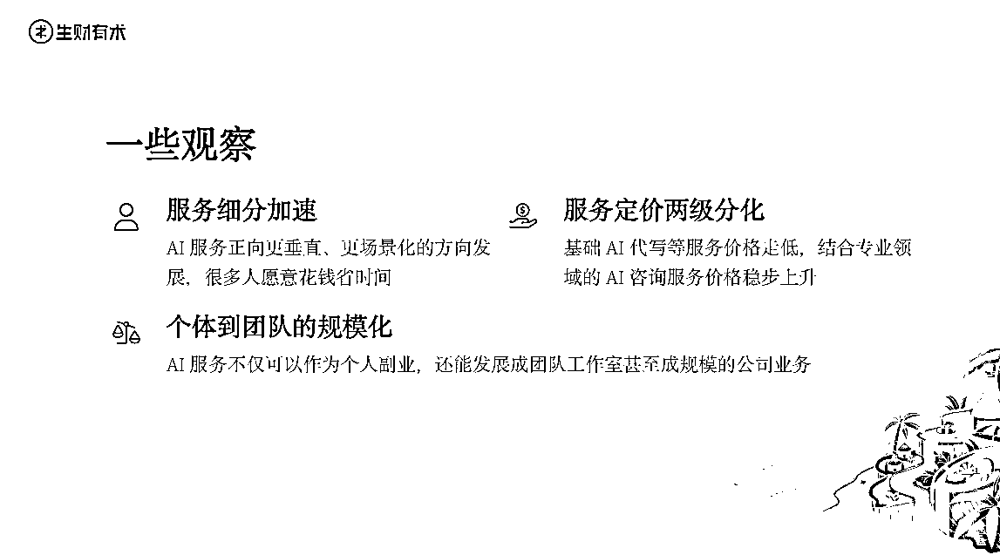

#### 会员案例

会员@李白 入圈 5 年，产品经理干了 7 年。他跟着航海做智能代写，2 个多月赚了 4 万多。

他的路径很有参考性：先在淘宝搜“写作”“文章”，给排名靠前的店铺投简历；边接单边攒模板、优化流程，真正做到边学边赚。等专业形象立住了，第二周又开了闲鱼店，把重心放到自营流量上，独立跟进客户和交付，形成完整闭环。

@李白的复盘帖：《新手做智能文案代工，60天赚4w+》

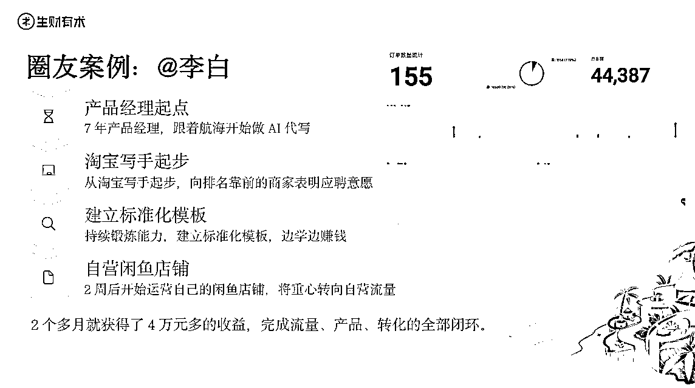

会员@Daemon 在风向标里看到有人出售 Coze 工作流，想到自己是产品经理，逻辑架构是强项。他虽然不会写代码，但可以让大模型辅助开发，于是进入 Agent 开发赛道，最后签下 2000 多单。

@Daemon的复盘帖：《不会写代码，我用大模型接到 2000+ 订单》

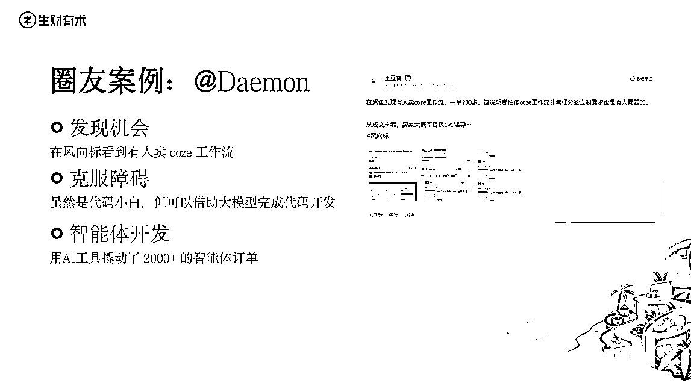

生成式技能也能帮人转型。会员@裘裘笔记 原来是短视频老师，看到生成式技术对设计行业的冲击后，决定放弃稳定工作，转做生成式设计师。

她 60 天里完成了三件事：入门三周，接到入行后的第一笔订单；持续练习并分享心得，一个月涨到 1000 多粉丝；两个月后，拿到一家头部科技公司的生成式设计师 Offer。

@裘裘笔记的复盘帖：《60天从短视频老师变成生成式设计师》

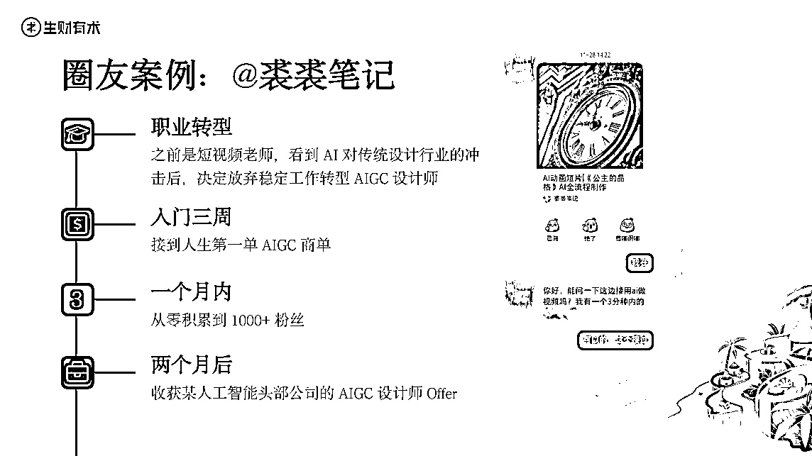

智能服务拼的不只是技术，更是专业能力、服务意识和解决真问题的水平。最终胜出的，不是会用新工具的人，而是能把新工具用在真实商业场景里的人。

### 智能工作流：把重复工作交给自动化

剪映 & Capcut 的产品经理说过：“大模型加开源平台，让 ComfyUI、Coze 这类产品成为创作工具。内容创作者可以通过节点自由搭建流程，满足不同需求，更高效地完成作品。”

这也是社区里出现很多“生成式 + 小红书”“生成式 + 公众号”“生成式 + 视频号”玩法的原因——大家都在用自动化流程，把效率抬高 10 倍。

一整套流程搭好之后，原来要忙一两天的任务，现在几分钟就能跑完。技术正在改变我们的工作方式。

*   适合谁：有专业经验、想提高产出效率的人
*   要备什么：会用基础生成式工具，能梳理流程，会一点编程更好
*   门槛：中等，需要懂自己的业务，知道哪些环节值得优化
*   回报周期：约一个季度

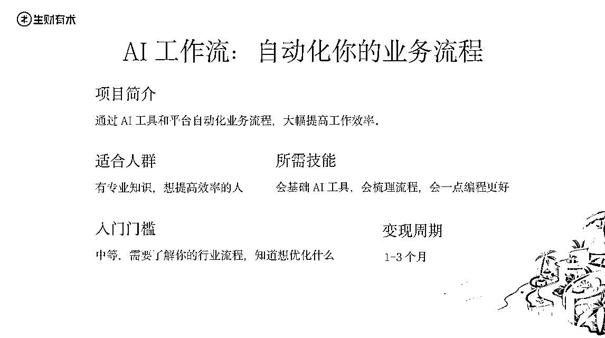

#### 几个趋势信号

*   需求在爆发：中小企业、个人创业者都在想办法，用更少资源做更多事情。
*   门槛在降低：ComfyUI、Coze 这类无代码平台，让普通人也能搭出复杂的自动化流程。
*   缺的不是工具，是成套打法。你懂行业、懂需求，做出的流程既可以自己用，也可以卖给同行。

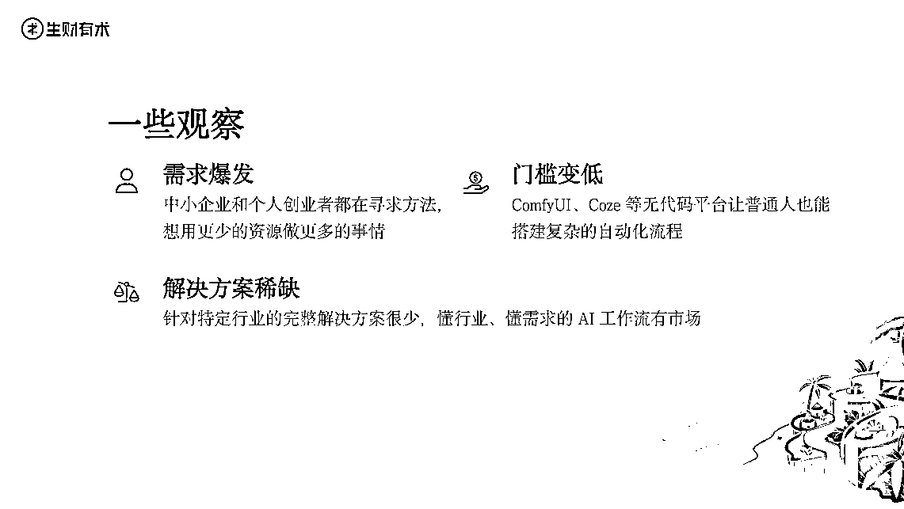

#### 会员案例

会员@富贵 的公司做小红书高客单线索业务。她说过一句很直白的话：“我们不看外面那些概念有多热，不能带来经营产出的智能化，都是自我感动。”

她分享的《把小红书图文标题自动同步到飞书表格》，用快捷指令调用 API 执行 Coze 流程，已经有不少会员照着搭出来了。

@富贵的复盘帖：《把小红书图文标题自动同步到飞书表格》

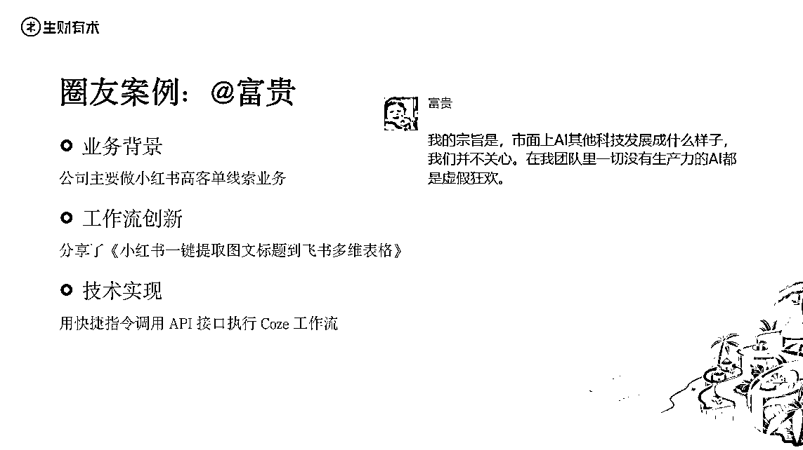

新一期航海家俱乐部启动时，会员@阿甜 在社群里分享了一套数字人口播全平台自动更新方案。

这套方案来自她老公的搭建：先抓热榜内容，看什么话题有机会；导入飞书后让模型改写；再用数字人生成口播视频；接着自动剪辑、批量上传。原本要花 1 个多小时，现在 5-10 分钟搞定。分享结束后，就有多位航海家付费购买整套方案。

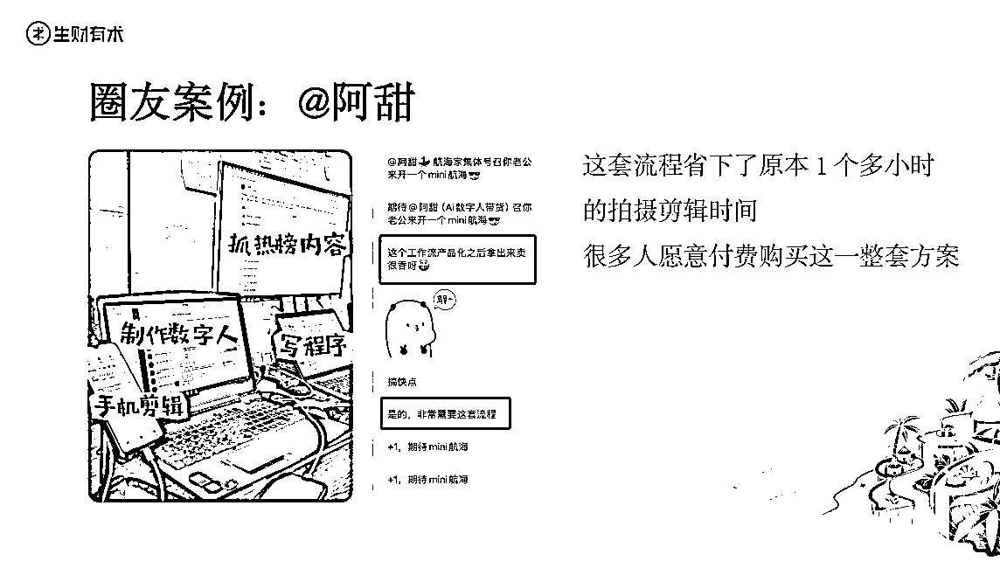

掌握自动化，就是告别重复劳动，用 10 倍速推进你的业务计划。

### 用生成式技术升级现有业务：电商与 IP

生成式技术不只影响内容创作，也在重塑多个行业。对老手来说，它是提效器；对新手来说，它是低门槛的入场券。

对社区会员来说，把智能工具和现有业务结合，优化产品与服务，是最自然的切入方式。下面以两个热门领域为例：电商和 IP。

*   适合谁：正在做电商/个人 IP 的人，或想快速进入这些领域的新人
*   要备什么：行业基础知识、会用智能工具、愿意重新梳理业务流程
*   门槛：中低，有业务基础的人很快能上手
*   回报周期：存量业务马上见效，新业务几周到几个月见效

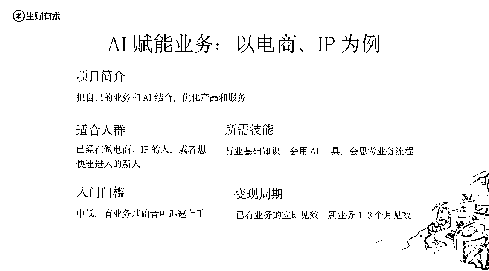

#### 电商场景

3 月航海里有一个选题，叫“生成式电商”。航海手册里写了不少明确场景：

1.  模特换装：拍一次基础模特图，就能快速展示不同款式；
2.  商品换背景：同一商品在不同使用环境里的效果；
3.  试用图生成：快速产出用户使用产品的画面；
4.  模特换脸：按目标人群做不同风格、年龄的模特；
5.  模特换脸视频：用动态内容展示商品使用效果。

这些操作，直接缩短了产品上新周期。

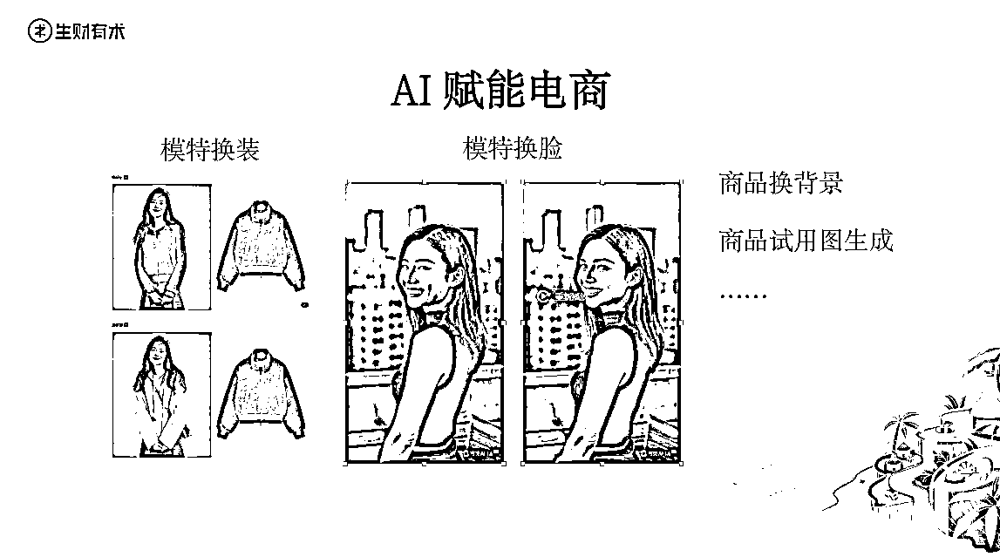

每周，社区视频号都有“对谈智能玩家”栏目，合伙人坤汀最近对话了电商智能化领域的头部玩家。从选品、关键词、SEO、内容到营销，每个环节都能借助智能工具提效。

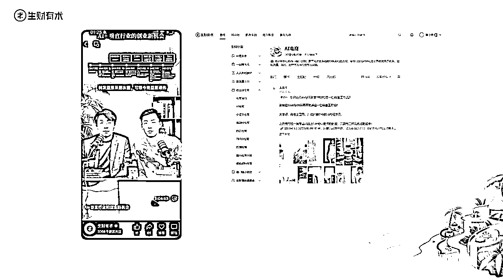

社区小组里也单独开了一个“智能电商”板块，感兴趣的会员可以去翻一翻。

#### IP 场景

3 月航海还有一道选题，叫“智能 IP”。

在社区看来，大多数个体都应该经营个人 IP。如今雷军、周鸿祎、江南春等企业家都在做老板 IP，因为 IP 是建立用户信任成本最低、效率最高的方式。生成式工具又进一步降低了普通人做 IP 的门槛。

很多人困扰于定位，其实可以让模型当“陪聊教练”：告诉它你的诉求、优势、资源，在反复对话中，定位常常会逐渐清晰。

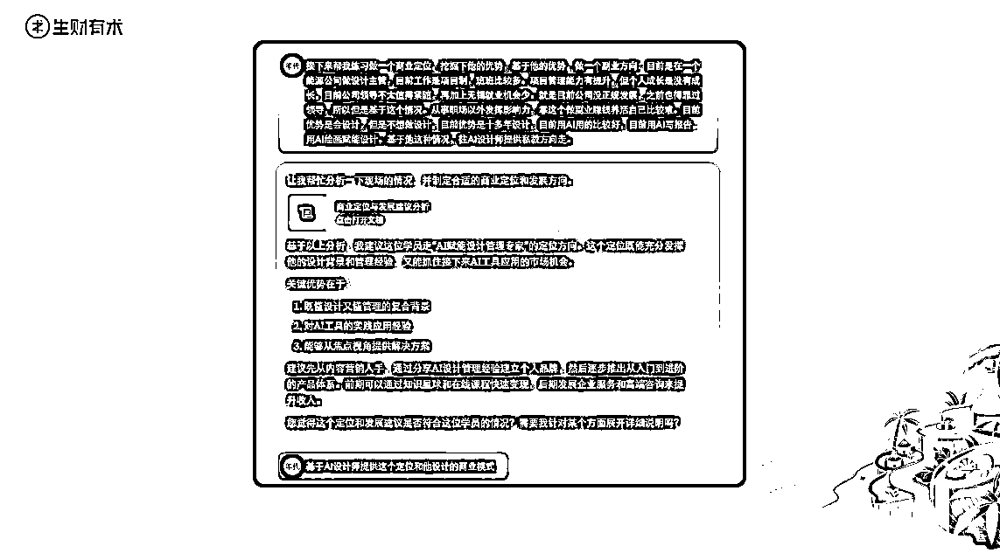

内容生产也可以大量交给生成式工具：

*   写作：公众号文章、小红书文案、私域动态
*   作图：文章配图、活动海报、个人 IP 形象、红包封面
*   做视频：脚本、配音、数字人口播、图文动画

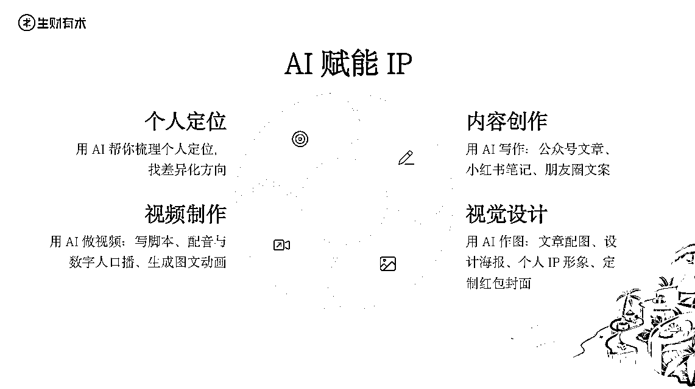

以前每天写 10 条私域动态已经不错了，现在用生成式工具可以轻松写出 30-50 条，质量还普遍更稳。

未来商业竞争的核心，不是谁更拼命，而是谁能用智能工具重构业务。落后的人，可能要用 10 倍努力去追别人 100 倍的效率。

最后小结：

*   纯新手，可以从智能代做和智能内容入手，边学边输出；
*   已有业务的人，可以用自动化流程重新检查每个环节，找到可提效的点；
*   想长期深耕的人，可以选择更有门槛、更持久的赛道，比如智能内容出海、智能应用。

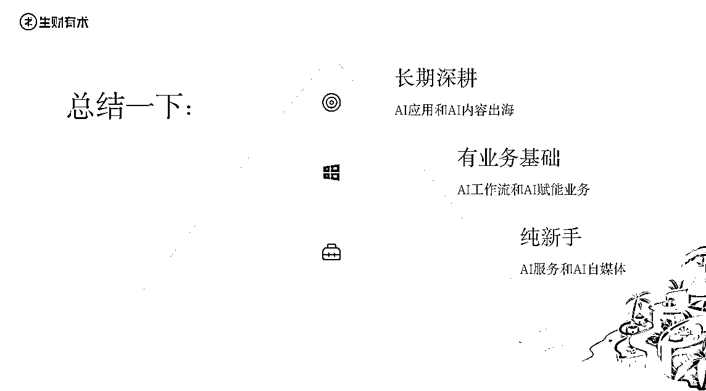

### 四、如何借力社区，把趋势变成落地能力

前面讲了路径和案例，最后从官方角度画重点：会员怎么用好社区，把趋势转化成技能和收入。

#### 看风向标，感知趋势

想找钱，先看风向标。它能把社区里最新的赚钱信号推到会员面前，减少信息盲区。

日常可以打开智能板块，感受潮水方向。前面提到的 @Daemon，正是在风向标里看到案例，才接到了第一单。

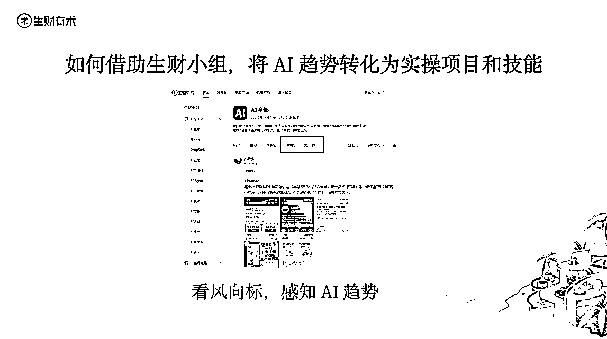

时间有限的会员，可以直接看龙哥标记的“超级机会”标签。

他说过大致这样的话：“不需要很多成本，一万块左右，多一点十万上下，总之不是重投入。靠一个具体的认知差或机会，小团队或能力不差的个体，努力做有机会做到 100 万甚至更多。”

今天分享的几个方向，基本都是这个标签认证过的赛道。不少会员也是看到标签就直接进场，拿到了不错的结果。

*   智能内容：接住智能领域热钱和广告投放的机会
*   智能视频出海：把生成视频发到 YouTube/Shorts，赚广告分成
*   智能应用：从百万到亿级的想象空间
*   智能代做：把学会的技能，卖给有需求的人

#### 刷小组内容，建立框架

以前在社区看内容，问题在于所有主题混在一起。后来有了小组，不同主题被切分清楚；进入智能主题小组，看到的就是围绕生成式技术的垂直内容。

集中刷聚合内容的好处是，能快速建立自己的认知框架。比如社区联合办公空间的负责人许老师，看完小组内容后，再找新项目方向，判断就快了很多。

这个板块内还有二级分类：Manus、DeepSeek，以及智能应用、智能写作等热门项目，都有单独入口。

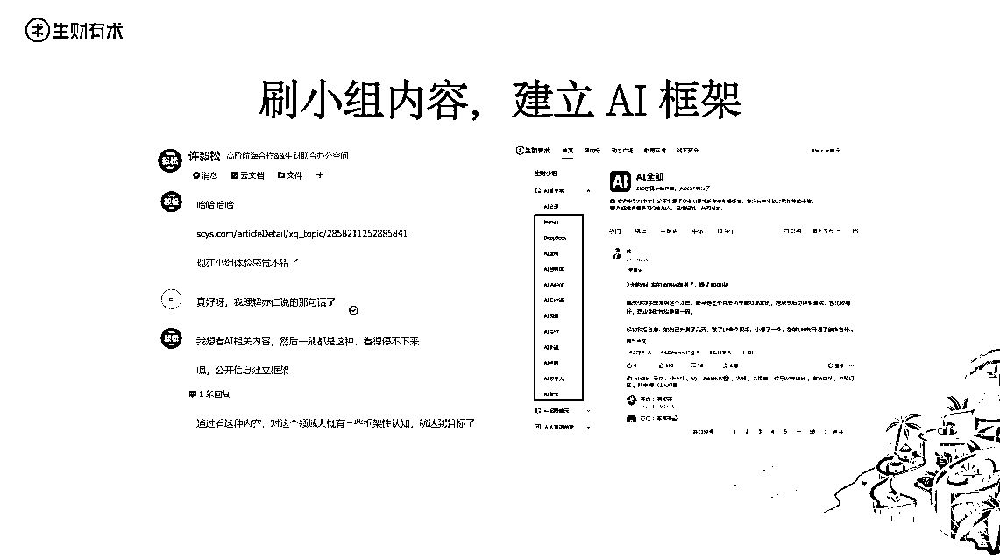

经过会员自发分享、官方悬赏征集、定向约稿，板块里已经沉淀 8790 篇帖子，诞生 270 位精华帖作者。强烈建议抽时间把精华内容过一遍。

你会发现，很多人在进阶路上都遇到过卡点；看看他们如何思考、如何解决，会很有启发。

#### 动手上船，参与航海

板块里不只有内容，还把过去和正在进行的智能实战都聚合在了一起。

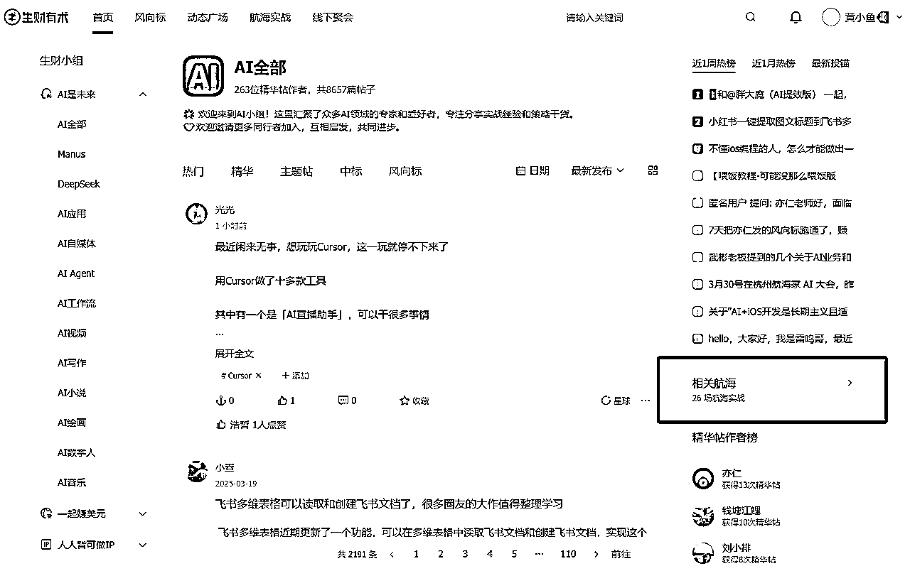

从 2022 年 11 月第一场文生图主题航海，到 ChatGPT 与海外工具、ChatGPT 与自媒体，再到 Sora、智能编程、智能特效直播、Coze、智能写作……累计已有超过 3 万人次的会员参与过智能实战。

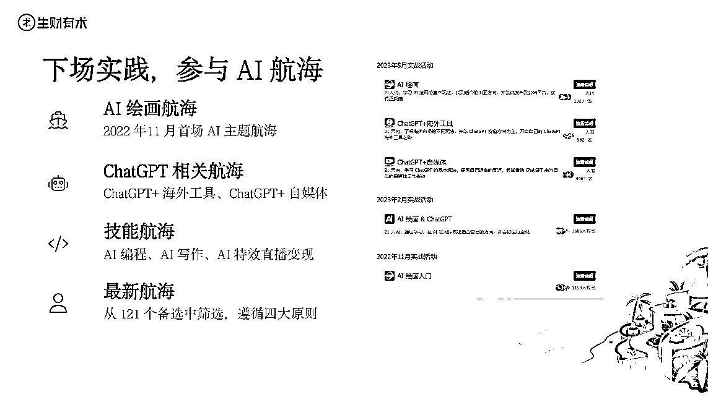

我们相信，在正确方向下持续行动，结果会自然发生。航海要做的，就是帮你选好方向，再营造一个行动场域。最新一期 3 月航海，从 121 个候选选题里按四个原则筛出来：空间大、有 10 倍潜力、反馈快、低成本切入。

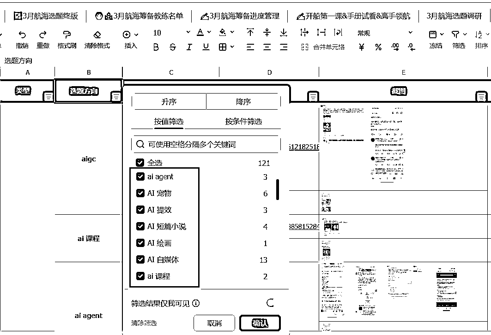

参与航海，可以在行动中提升认知、掌握技能、积累经验、链接伙伴与资源，让这条路走得更稳。

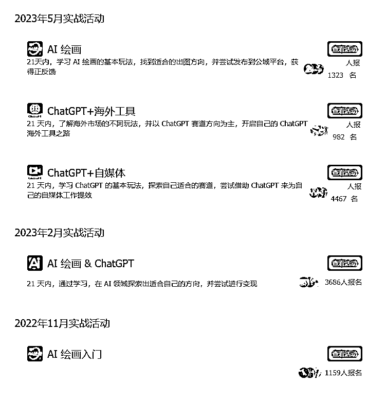

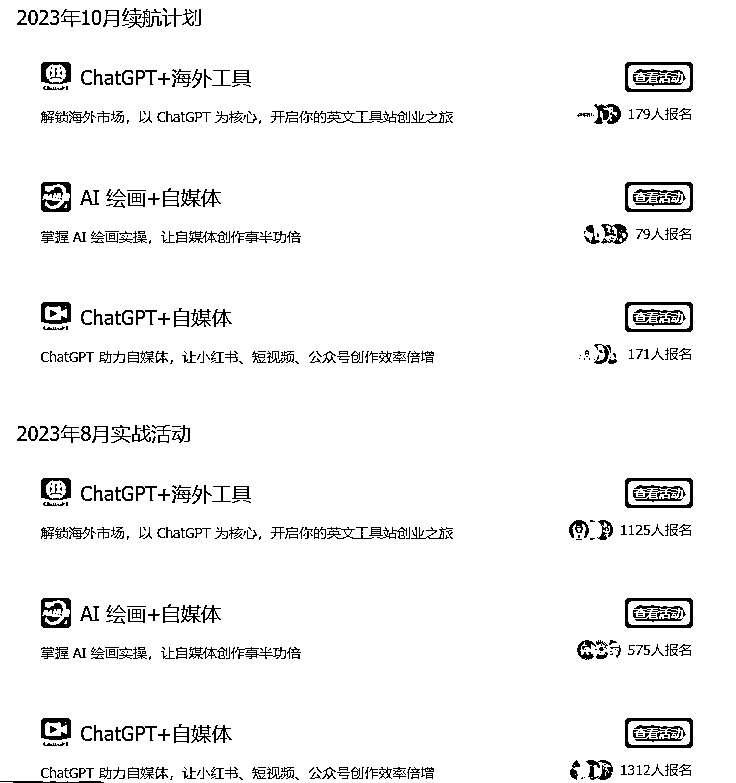

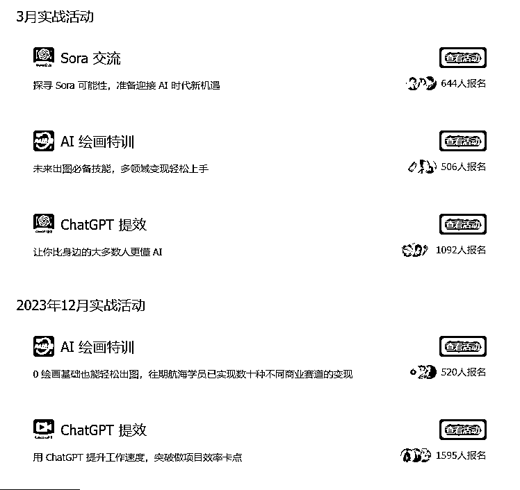

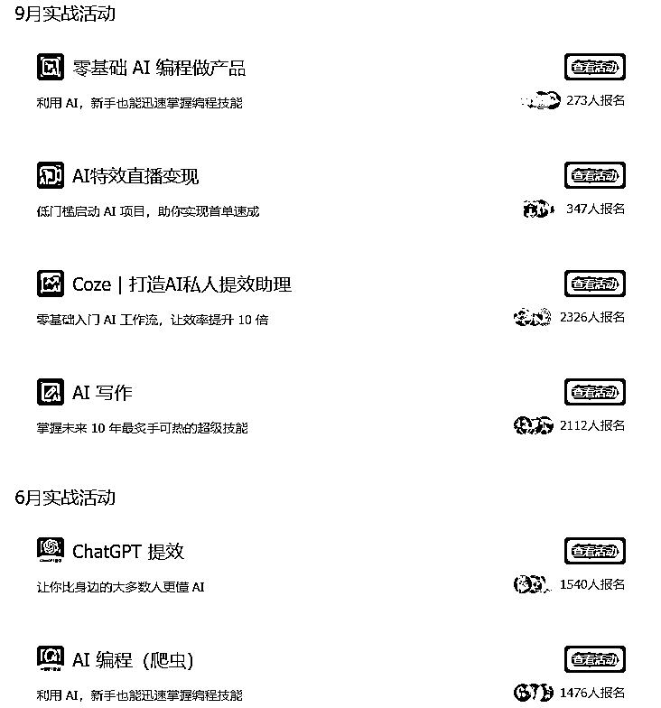

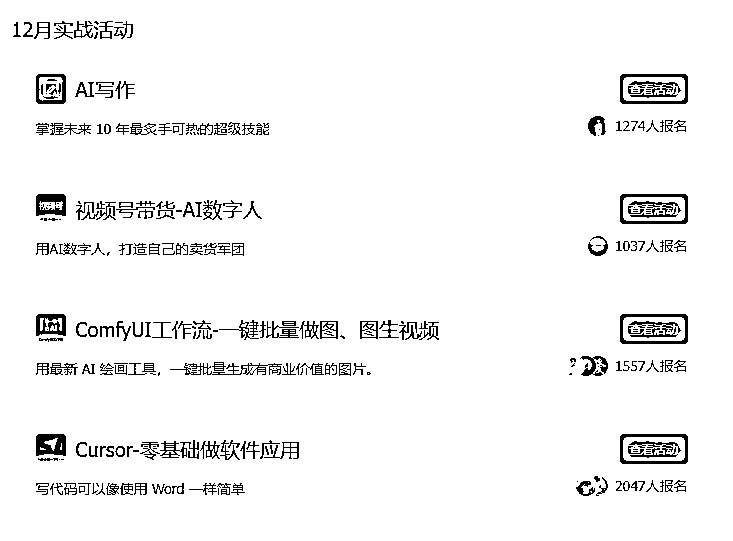

#### 把经验分享出来

更重要的是：当你学会这些技能、做完项目、跑通闭环，一定要把过程分享出来，让大家看到你的进展。

今天提到的不少案例作者，都是因为持续输出优质内容，才拿到更多机会。比如 Gary 的产品被 SCAI Lab 投资，林悦己的产品被投资人看中，裘裘成了大会嘉宾，Ann 成了航海教练……

#### 加入传术师俱乐部

社区正在加速拥抱新技术。我们正在筹建一个聚集顶级智能玩家的社群——传术师俱乐部。

当你在智能领域做出一定成绩，这里会提供更深度的交流与合作机会。

想象一下，一群持续研究新技术的人聚在一起，会碰撞出什么。

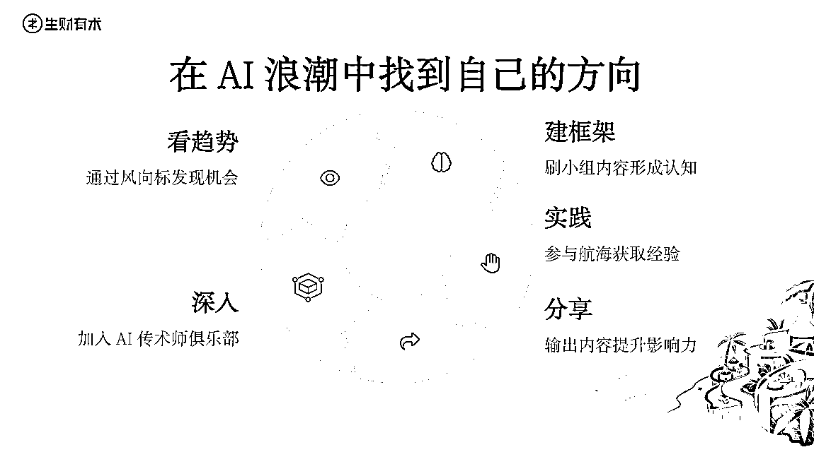

以上就是今天的全部分享。祝大家在这一轮技术浪潮里，找到自己的方向。

