# 《零基础21天突破，AI＋拆书的道与术》

> 来源：[https://eqc9f6vzuhv.feishu.cn/docx/WtTfdUgUooI8Ygx11PhcxlwanEd](https://eqc9f6vzuhv.feishu.cn/docx/WtTfdUgUooI8Ygx11PhcxlwanEd)

工具已经普及时，拆书这门手艺为何仍要保留？

这个问题被问得很频，也被理解得很浅。换个生活化的比方说：家里的语音导航能给出最短路线，它能教人学会开车吗？

诸位好，我是坚持拆书写作八年的实操者，也是以「微拆写作法」产出上百篇十万加、并担任AI拆书教学的导师。

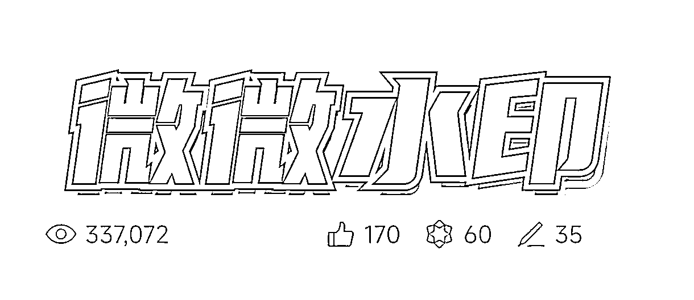

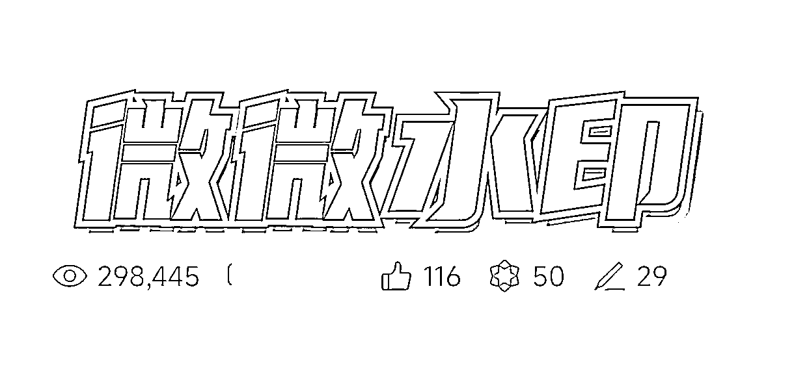

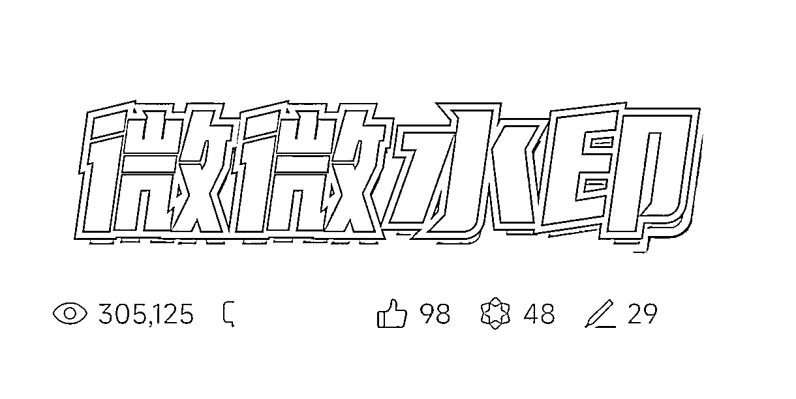

愿这篇分享能帮助仍热爱阅读写作、在技术浪潮里感到不安、甚至因工具而动摇信心的伙伴，真正厘清智能化、接纳智能化、善用智能化，使其成为随身的智囊。

下面将从智能与拆书的“道”与“术”切入，解析二者如何配合，以及怎样实现人与机协同拆解，顺应时代节奏，提升阅读、拆解、写作的能力。

【末段有智能拆书的实操流程，记得收藏】

# 一、人工拆书路线的【道】

不久前有同好来问：“现在用智能工具十秒内就能读完一本书，我为何还要苦学拆解技巧？”

这类疑问很普遍，十个人里至少有六七个会掉进同一坑。我没有直给答案，反问：

“拿到能自动切菜的机器，就能当主厨了吗？”

在AIGC的时代，拆书功夫反而更关键。这是普通人切换到快车道的核心门槛。好比拿到超跑引擎，却没有驾驶经验，依旧跑不快。

拆书的价值不在于读完，而在于让知识沉淀成身体记忆。

举个身边真实案例。先前同事用工具拆《金字塔原理》去汇报，当场被批思路混乱。具体经过：

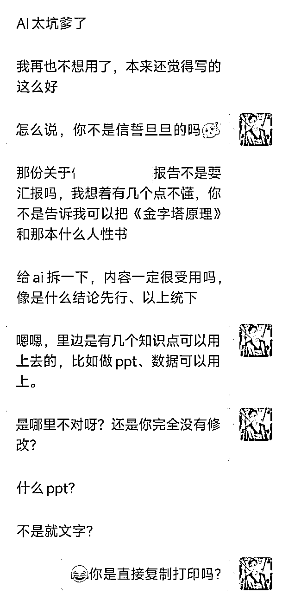

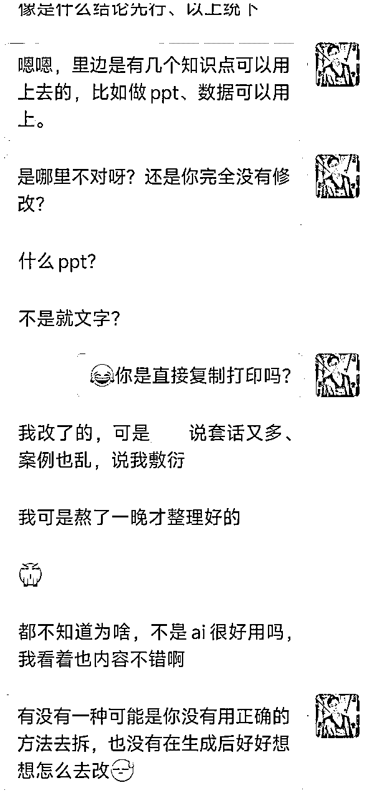

简单说，他让工具给出“先讲结论、总分结构”的表面话术。汇报时依旧混乱，因为工具没教他：

* 如何把“先讲结论”落地成具体的PPT标题？
* 如何用“总分结构”梳理老板最关心的成本数据？

这就是只会让机器切菜，却不会自己炒菜的后果。

要真正驾驭智能拆书，必须明白工具不是无底口袋。它很灵，但非万能。用工具拆书时要打开人性视角。

## 一、拆书是思维力的健身房

从同事案例能看出，智能工具能瞬间给答案，却替代不了人对知识的深度内化。

拆书的核心在于提问—拆解—关联的循环，进而建立个人逻辑系统与批判思维。

比如用SCQA框架拆章节，需要主动追问作者底层思路是什么，如何迁移到现实场景，这个环节工具无法代劳。

用生活场景说明。去超市挑酸奶。

若没拆书能力，多半会问工具：“按国家膳食指南，酸奶怎么挑？”

工具会回一堆教科书标准：蛋白含量、碳水含量、配料排序。

现实是，你站在货架前，所有产品都写着生牛乳，最后挑了最贵的，回家一口差点吐出来，稠得像胶。

若已有拆书功底，思维会从“直说模式”转向“击痛点模式”。提示词会变成：

“我是健身新手，预算有限，请依据膳食指南相关页，对比A、B、C三款低温酸奶的性价比。”

此时得到的回复会更细、更贴合。

拆书培养的思维还会常用一个追问手段：刨根问底。比如“书里强调低温保存，办公室没冰箱怎么办？”

于是能得到更完整的补充：

* 书中写低温活菌更多，工具会补充常温酸奶钙含量相当；
* 健身期可选控糖款；
* 日常食用可选大众款配蜂蜜；
* 还能用图像工具做个选择决策树贴冰箱。

选酸奶就像选对象，光看体检报告不够，得试着处得舒服。

没拆书基础，只能让工具给你成分表；有拆书基础，才能让它教你怎么过日子。

## 二、拆书是知识内化的必经环节

信息过载的网络，内容扑面而来已让人消化不良。如今智能浪潮袭来，更像站在自助餐前，看似丰盛实则吸收不良。

即便工具能瞬间生成书摘笔记，真正的内化从来不是搬运，而是像拆解精密仪器般的深度加工。

要让书中内容从“信息仓储”升级为“认知系统”，必须掌握拆书方法论，跳出知识速食陷阱。

拆书强调对金句、案例、观点的深度剖析，而非复述。

以《原子习惯》四步法为例，工具能提炼提示-渴求-反应-奖励的框架，但拆书教练能敏锐捕捉到第四步身份认同的深层意义。

当学员说想通过早起提升自律，教练不会停在定闹钟，而是追问：“你想成为什么样的人？这个习惯如何定义新身份？”

正是拆书的追问，才能在知识土壤埋下种子，把被动接收转为主动建构。

认知科学指出知识内化有三步：编码、深度加工、提取应用。

工具擅长前两步，第三步的个性化干预是人类智慧的战场。

当用户在反应环节卡住，教练会结合场景设计干预方案：用“如果-那么”条件反射替代模糊计划，并通过环境设计降低启动成本。

这种能力本质是把显性知识转化为隐性能力。

就像陶艺家塑形，拆书教练通过提问引导学员看清逻辑脉络：“案例成功要素在你的工作中能如何迁移？”“改一个变量结果会怎样？”这些问题像思维手术刀，直达本质。

真正的学习革命在于意识到知识不是现成商品，而是需要亲手锻造的工具。拆书方法论教我们的不仅是读书，更是在信息洪流中建立认知坐标。

当智能成为高效助手，人类更需要“为什么”的洞察力、“怎么做”的创造力，以及把知识转为行动的能力。

这才是应对不确定性的核心竞争力。

专业拆书家的能力模型可供参考：

学习时建立“拆书追问清单”：

* 该知识点撼动了我哪些原有认知？
* 在我的典型场景里，哪一环最易偏差？
* 如何设计不超过三步的小实验来验证理论？
* 哪些跨域知识能增效？

深度拆解本质是在构建个人的认知免疫系统。当海量知识被加速涌入时，需要机器效率，也需要人类批判与创造。

学习跃迁发生在“把书本DNA重组为个人操作系统”的过程中，这也是智能时代终身学习者必须掌握的元能力。

## 三、拆书是抵御工具依赖症的护城河

过度依赖工具不仅导致思维懒惰，更会悄悄退化提问、联结、感知人性的能力。

就像长期代步会腿部萎缩，过度依赖也会削弱前额叶负责的推理与情感处理。

斯坦福2023年追踪显示，过度依赖工具解题的学生脱离环境后，数学推理能力下降41%，逻辑链构建效率降低34%。

认知心理学指出，当思维外包，大脑神经网络会像闲置肌肉一样萎缩。

更危险的是，工具生成的“完美答案”消解了直面真实世界的勇气。就像《活着》里展现的生命韧性，在工具生成的成功学里被简化成公式。

拆书能帮助从“答案消费者”转为“问题设计者”。经典的三维拆解法就能激活深度处理：

横向拆解文本结构，纵向挖掘文化基因，立体构建现实联结。

这种情感深度内容工具无法生成，拆书却可以培养对人性复杂性的感知力。

复旦大学要求论文核心部分禁用生成内容、浙江大学研发的检测系统准确率达92%，这些是制度护城河。

根本防御是培养慢思考能力。就像《活着》展示的，在急速变迁中，看似低效的情感沉淀构成了抵御异化的铠甲。

当工具能瞬间生成答案，人类要提出更尖锐的问题；当工具能高效处理数据，人类要守护情感温度。

这种在拆解经典中培育的认知免疫力，是数字时代保持人性坐标的锚点。

拆书，是抵御工具依赖症最坚固的护城河，在理性与感性的交汇处重建人类思维尊严。

当然这不意味着完全排斥智能拆书。要拒绝的是非此即彼的极端。

智能拆书是数据智能与知识工程的融合，能通过构建动态知识图谱、训练认知模型、优化语义理解，重塑知识解构底层逻辑。

也就是说：智能拆书实现了知识解构的三重突破。

# 二、智能拆书领域的【道】

尽管工具没有人类特有的情感认知维度，但其知识联结速度远超人类，且每72小时自动迭代，形成不断进化的认知生态。

工具在知识解构上的突破不是简单效率提升，而是认知范式的重构。

例如在认知维度，通过预训练语言模型捕捉文本深层语义网络；在效率维度，借助并行计算实现万级文本同步解析；在形态维度，利用动态知识图谱完成结构化知识自动生成。

这种跃迁拓展了人类对知识本质的理解。

因此需要借助工具的理性，融合人类的感性，实现理性与感性共振，既有速度又有温度。

## 一、智能化是维度升级的三角支架

人类拥有感性王牌，但在时间成本上，智能化地位无可撼动。

一本30万字的著作，人类深度解读需200小时，工具可压缩至秒级。

这种能力重构了知识获取范式，打破认知深度、效率指数、知识保鲜三个维度。

### 1、认知维度

以《原则》为例，书中有268条准则，传统解读只能线性进行。工具通过自然语言处理与知识图谱结合，能瞬间建立准则关联矩阵，如同50位专业评论人同时工作，不仅识别显性层级，还能捕捉隐性逻辑。

通俗说就是用“语言翻译器”+“知识地图”，把规则织成网。

它会自动跨界关联，比如分析投资原则时拉入心理学决策偏差理论，构建跨学科框架。这不是划重点，而是像搭乐高一样把知识点拼成立体结构。

智能拆书像给大脑装了知识导航系统，从单点认知升级到系统思维。

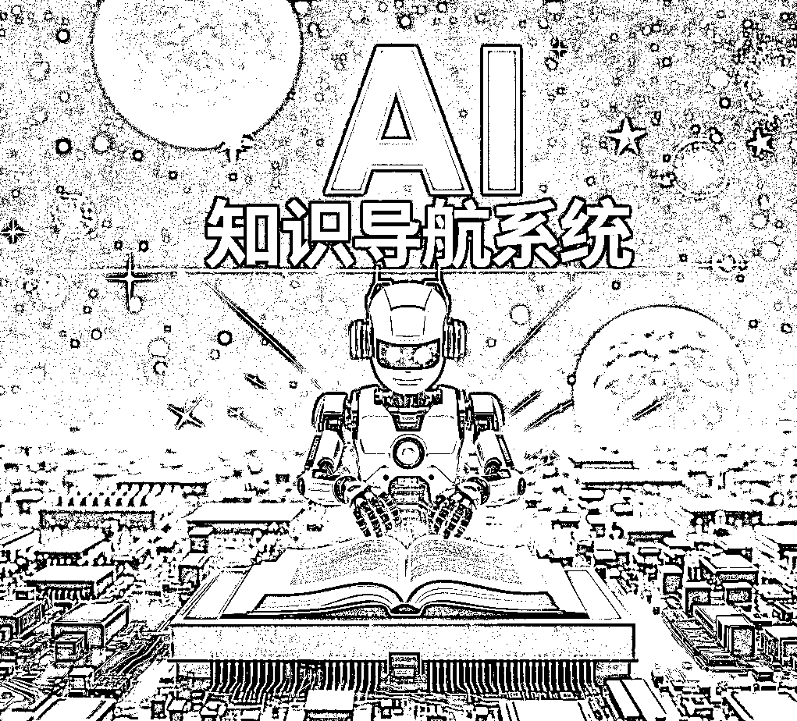

### 2、效率维度

《三体》三部曲拆解案例完美展现效率奇迹：37秒生成人物关系网、文明演进轴与核心概念树。

37秒等于人类200小时。它能在眨眼间生成关系网、时间表、概念树，比追一部剧还快。

工具的阅读姿势很叛逆，人类是线性翻阅，工具是把整书扔进知识搅拌机，同时分析剧情、哲学梗与科幻设定。

这种提升源于阅读过程的重构，通过机器学习算法同时解析叙事结构、主题隐喻与科学设定，转化为可视化图谱。

实验数据显示工具处理专业书籍速度是人工的17倍，并能自动生成练习题，打通学与用的环节。

它像知识外卖员，不仅送达，还做营养搭配，你只需品尝消化。

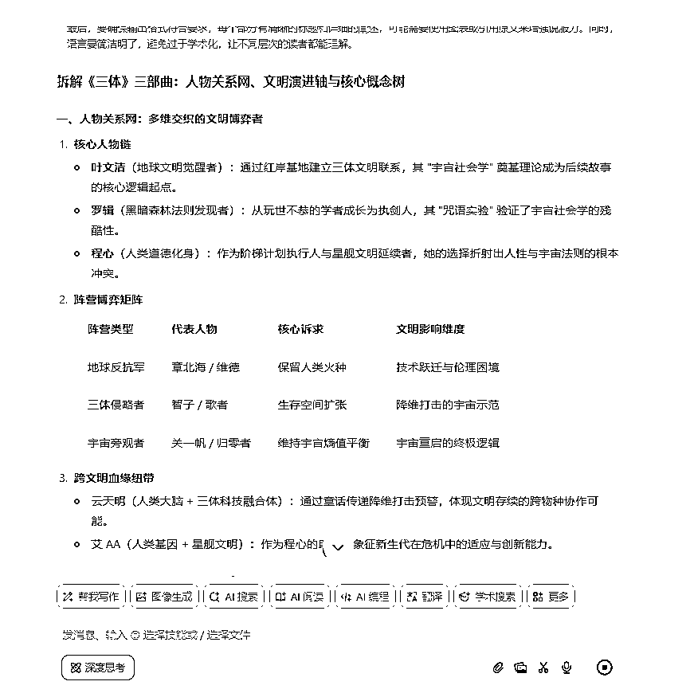

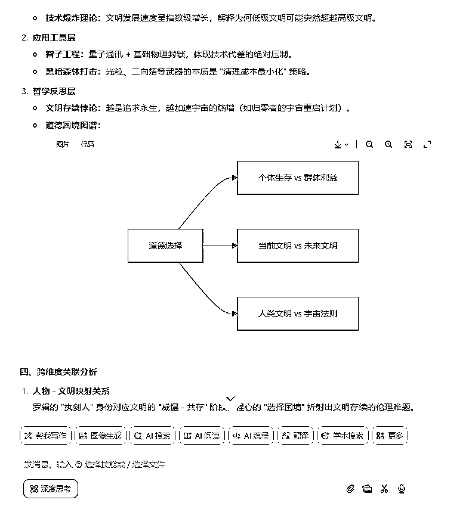

### 3、知识保鲜

传统纸质笔记静态，智能知识库动态。每3天自动升级，像APP自动更新，实时捕捉行业最新动态。

这构建了自我迭代的生态系统。分析科技竞争时，工具会从量子计算领域拽出新发现，把历史与前沿串成线索。

智库研究显示，工具信息新鲜度比人类快40%，决策建议准确率提升28%。

纸质笔记会变成老古董，而工具给旧书配上实时弹幕。

智能拆书的价值在于推动认知方式变革。阅读从信息积累转向认知重构，从被动接受转向主动探索。

例如针对青少年，工具会根据认知特点调整呈现方式，通过AR结合星象与物理原理，提升参与度。

这种个性化服务重塑教育公平。随着技术迭代，它将深度融入知识管理与决策支持，成为个体认知进化的核心驱动力。

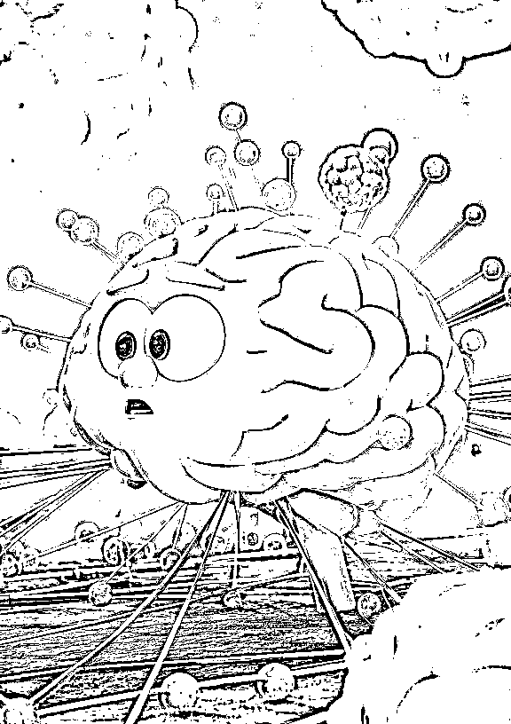

## 二、智能化是三大核心路径的杠杆

如今，“啃完一本书”已经跟不上知识更新的速度。AI 给我们带来的变化在于：它让读书的重心从“逐字消化”转向“按需取用”——通过算法把信息拆开、筛选、重组，让理论迅速变成可执行的方案。打个比方，读者手里得到的是一份高浓度的“知识营养液”，喝下去不仅能快速吸收，还能直接变成能力。

### 一、从文本到地图：AI 的结构化解构
在阅读《认知觉醒》这类偏重认知科学的作品时，AI 不会按部就班逐行扫读。它首先构造一张三维概念关系图，把“元认知—潜意识—心流”标在核心位置，随后将书中 27 种学习方法归入“接收—转换—产出”三个维度。整个过程可以概括为三个方面：

- 焦点识别：从文本里捕捉重要性最高的术语，并把它们摆在逻辑空间的对应位置；
- 同型归纳：按模式相似程度把方法放进同一类别；
- 跨界对照：让《原则》《心流》等书里的关键论述与当前内容互相补充，建立参照系。

信息经此处理后，会呈现出清晰的网络结构，学习者对全书脉络的掌握效率普遍可提高 30% 以上。

### 二、从厚重到精炼：AI 的主题压缩术
面对《人类简史》这种时间跨度极大的著作，AI 的处理方式更像“榨取核心”。它用“虚构叙事 × 协作规模”这个简短模型，解释人类社会组织不断扩大的根本机制，并在此基础上生成多种辅助工具：

- 历史态势矩阵：把农业革命、工业革命和科技革命分别放入优势、劣势、机会、威胁四个象限；
- 36 张重点卡：通过逐层提炼，把全书的精华压缩为便携式知识盒；
- 动态演化图谱：根据最新的考古发现和 AI 伦理议题，更新重大事件的因果链条。

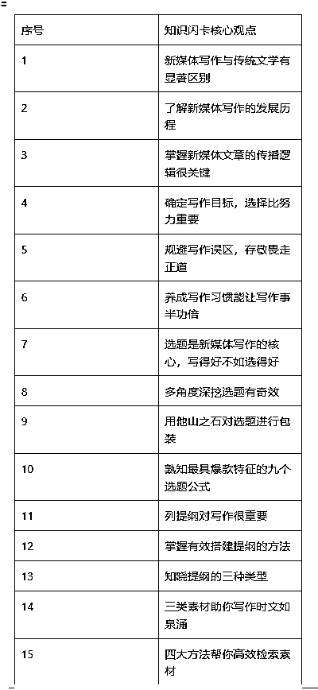

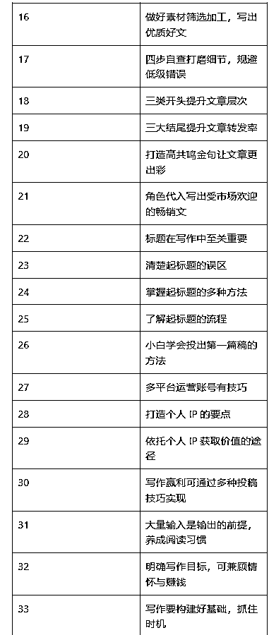

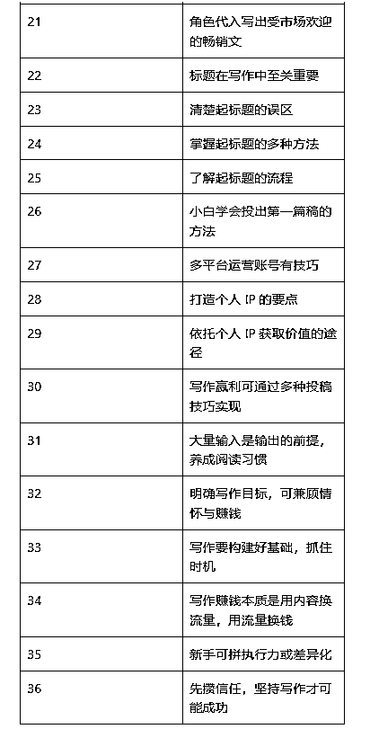

在保留约 85% 重点内容的同时，这套方法使信息密度增长近 5 倍；其真正的价值在于识别历史走向中的“关键节点”，让人绕开庞杂细节，直接抵达核心。

### 三、从知道到做到：AI 的场景转化力
阅读《非暴力沟通》时，AI 把“好好说话”从理念变成了一整套训练系统。

它能模拟 12 种生活场合——职场背锅、儿童情绪失控、亲友借钱等，并给出含有 200 多个走向的沟通决策树。向上级争取加薪时，你可以从三种说法中做选择：

- 直白型：“我加班很多，应该加薪 30%。”
- 同理型：“这半年我交付了三项成果（观察），感到自己的工作被认可（感受），我希望薪资能匹配这些贡献（需要），能否在季度考核后重新评估（请求）？”
- 数据支撑型：借助薪酬数据与个人绩效，生成完整话术。

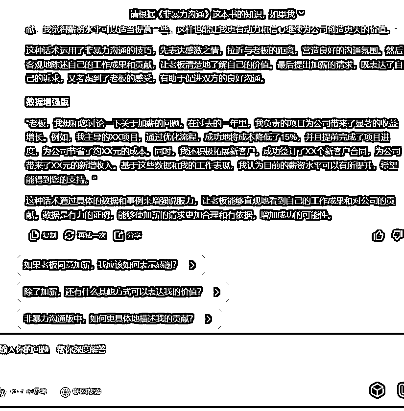

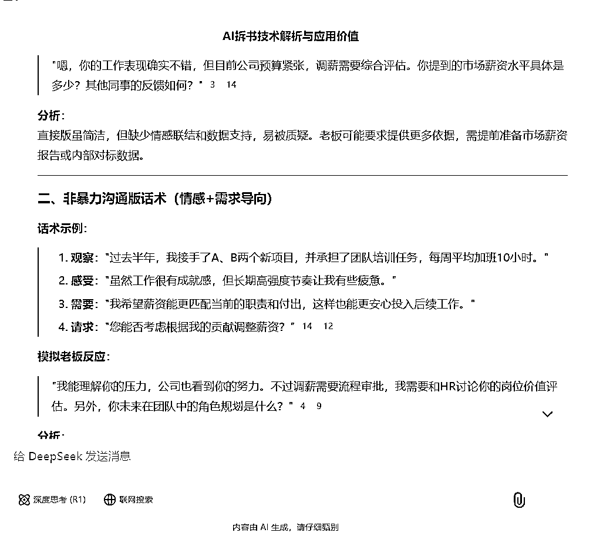

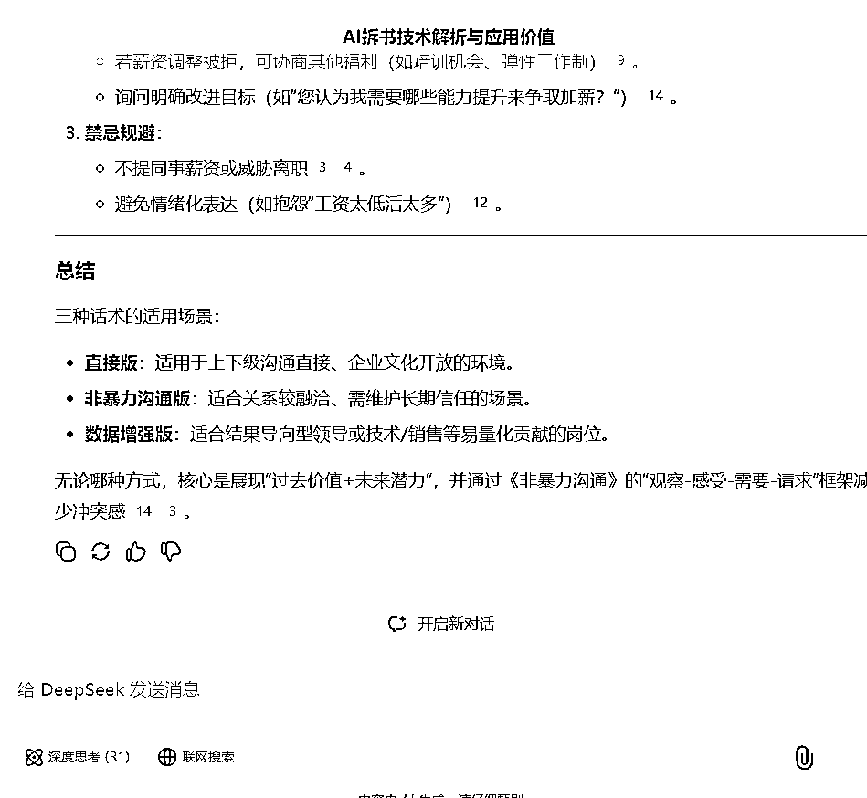

每条路径都会有即时反馈：直白型可能显示“易引发抵触”，同理型则给出对方的回应预演。这样，每一次开口都成了一堂微型谈判课。

在此基础上，AI 还将四要素转化为每日打卡表单，让用户持续记录自己的表达并打分，定期生成带语音解读的分析报告。若某个维度长期偏低，系统会自动推荐书中相应章节，并设计 21 天的阶梯式训练：前 7 天只做事实描述，中 7 天加入感受，后 7 天完整使用四要素。经过此类训练，沟通能力的提升速度往往是传统共读活动的 3~5 倍，原因就是“输入—实践—校正”的链条从未断裂。

### 四、个人成长的加速引擎
AI 解书落到个体身上，会带来三方面显著变化。

首先是效率的刷新。过去读完 5 本专业书需要数月，现在借助 AI 可在 5 分钟内生成全书大纲。学生拆《战略管理》时，会发现六成内容属于重复案例，于是转而聚焦核心章节，复习效率至少翻三倍；职场人拆解《领导力梯队》等 10 本管理著作，可以得到一套个性化的领导力提升方案，每周只要投入 3 小时补足团队激励等短板；创业者分析 20 份行业报告，3 小时就能梳理出对手的产品矩阵，原本外包给咨询公司的任务如今可以自己完成。

其次是创造力的释放。自媒体从业者将 10 本爆款书和 100 篇热文交给 AI 后，系统会抽象出“痛点挖掘 + 情绪调动”的写作框架，产出速度提高 70%—100%。产品经理从用户体验类书籍中提取设计决策模型，大大减少试错次数；教育工作者融合 20 本专著，即可生成“线上微课 + 线下工作坊 + 社群互动”的混合式课程框架。

再次是思维结构的升级。AI 解析《思考，快与慢》可以给出认知偏误自查清单；解析《穷查理宝典》可以建立跨学科的决策检查矩阵，把逆向、概率、发散等思考方式链接到一起；解析《反脆弱》可以设计抗压训练，把项目失败转变成组织学习的机会。

当这些变化同时发生，AI 解书便从单一工具走向生态系统：它既能同时识别文字、图片、声音等多类信息，又能按照用户画像推荐学习路径。设想一下，一个青少年读者在阅读《沙丘》时，AI 不仅分析文本，还生成行星气候模型，引导他进入沉浸式探索。这种体验已经远远超越“读书”，成为一种伴随式认知进化。

### 五、人工拆书：掌握结构，才能驾驭内容
无论 AI 多么高效，思考的主体仍然是人。真正的拆解能力，来自对结构的敏感与重构。

传统读法倾向于按页码顺序推进，从一个章节进入下一个章节，容易陷入“只见树木不见森林”。更有效的方法是逆向推导：先通过目录和关键词还原作者的构建意图，再逐层验证每一部分的作用。

以《新媒体写作创富》为例，我们先用“俯瞰法”把全书分为三层：

- 根基层——前 2 章，处理写作心态与基本动作；
- 业务层——第 3 至 7 章，对应选题、提纲、素材、修改、标题五大环节；
- 转化层——第 8 至 10 章，关注多平台运营、私域积累和个人 IP 打造。

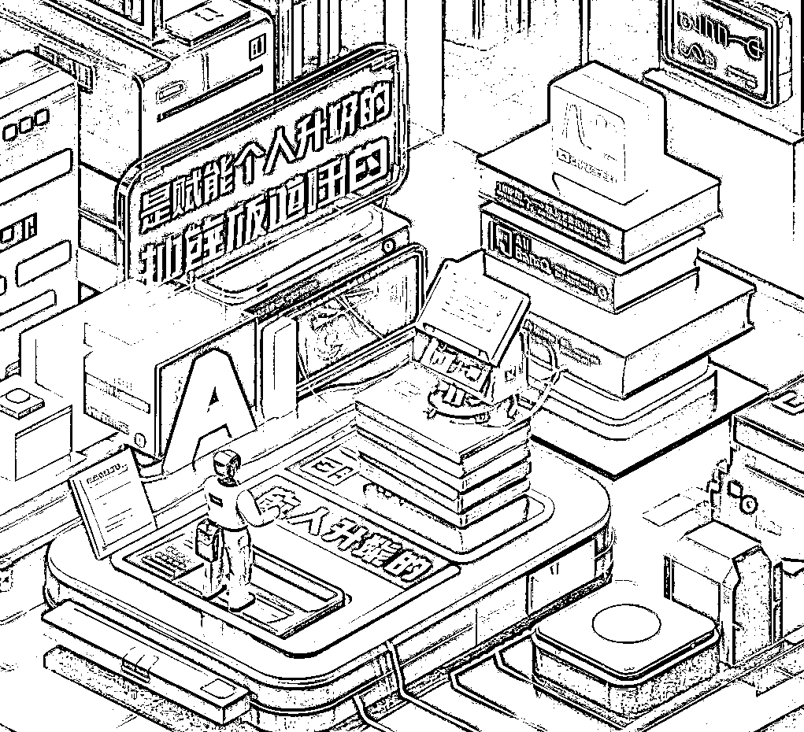

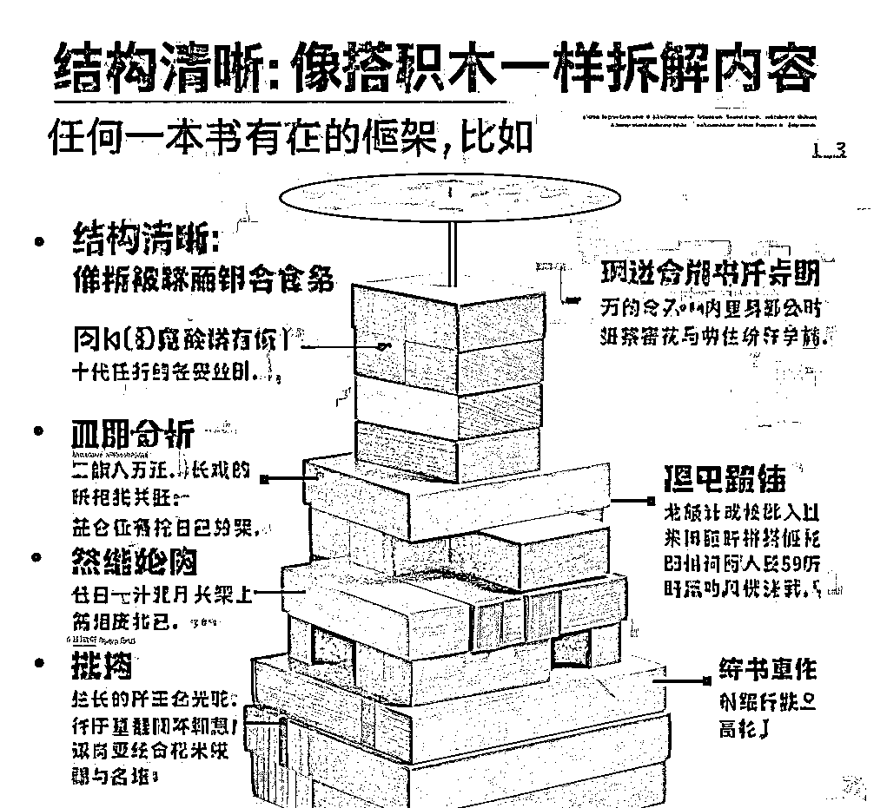

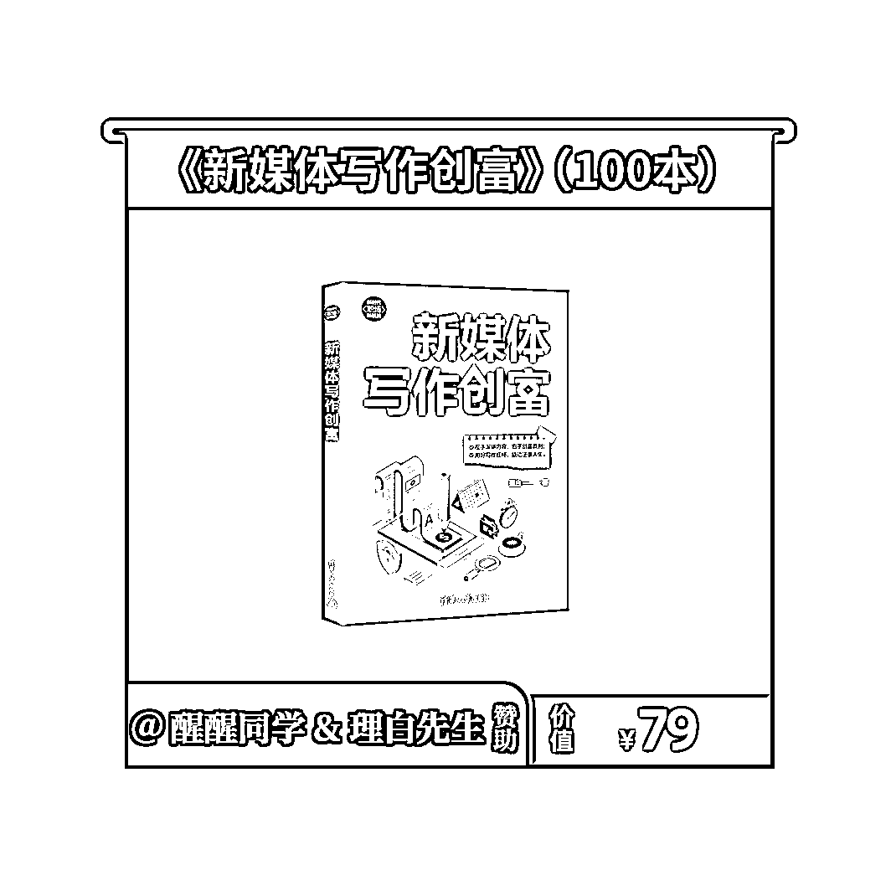

从“顶层设计”出发，许多细节会自然退后，重点信息更容易浮现。

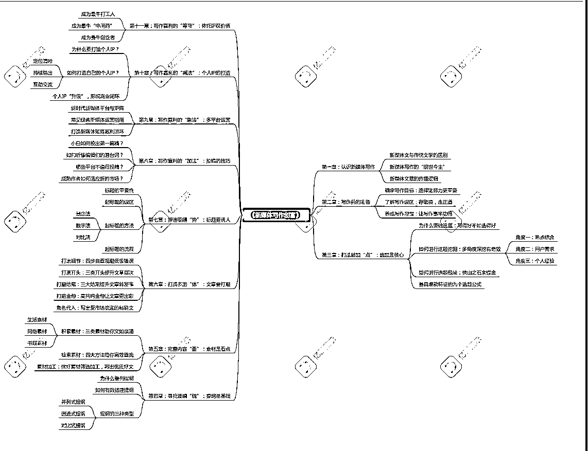

接下来的关键动作是“结构支柱测试”：假设删去某个章节，整部书是否依然成立？如果会“塌方”，那这部分就是骨干。比如“选题能力”一章若被移除，《新媒体写作创富》的整套方法论便失去支撑，因此它属于不可省略的构件。

在骨干之外，还要提取可复用的最小单元。这本书可以拆出 12 个实用工具：认知侧的 SWOT 自我分析和市场需求雷达；写作侧的 9 个爆款公式和“总分总 + 起承转合”提纲口诀；变现侧的“1000 精准粉丝 × 1000 元客单价 × 1000 天”和产品反馈迭代表。

但解读只是第一步。若不能在实际任务中使用，知识点就会退化为“知道但并不掌握”。因此，必须进入“装配”阶段：把拆出的模块重新组合，放进相应的应用场景。

这本书给了一个很好的示范——它抛弃“先介绍理论，再举例子”的老路，而是每章都顺着“抛出痛点→给出方案→提供工具”的路径展开。比如先问“为什么你写的文章没人看”，随即用“痛点 + 热点 + 价值点”公式接住，再把“三库一图”端上来，让读者在清晰的任务目标中吸收知识。

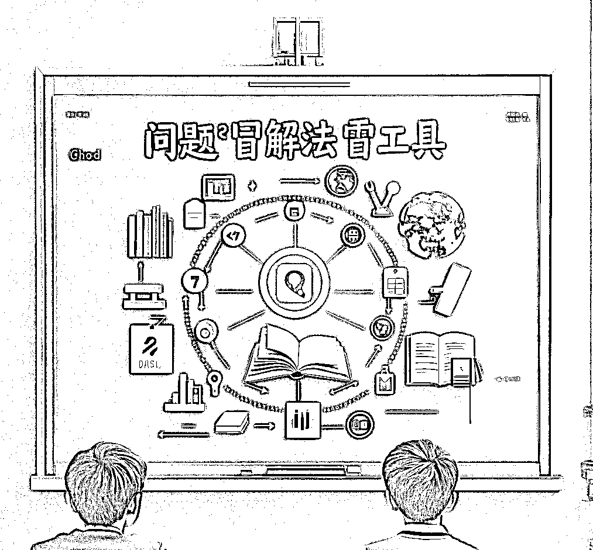

这样一来，读者学到的不是孤立概念，而是一条能够持续产出价值的生产线。先把最核心的公式作为地基，用案例和数据加固；再把各环节串成流程，最终形成从创作到转化的完整链路。

技术再强，也只是手中的工具。用人的感知把握方向，用 AI 的算力拓宽边界，才能让知识真正为人所用。

不少人读完一本书，笔记没少做，可真到写东西的时候，却感觉什么都用不上。问题的根源往往在于：把书拆得太碎，却没有一套能把碎片重新组装起来的骨架。

真正的解法，其实是用书里现成的结构去承载零散的知识点，相当于找个挂架，把零件一件件挂上去。第四章那套“十六字真言”就是一个特别趁手的挂架——先抛结论、再上下对齐、接着归类分组、最后讲究推进顺序。把最底层的“选题公式”放进去，就能把全书各个角落的知识点串成一条线，彼此之间还能互相呼应。

具体到实践中：开头先亮出核心观点，正好对应新媒体里“观点加论据”的路子，能迅速抓住读者的目光；上下对齐，可以靠“疑问—回答”的思考模型（比如5W2H）来分解议题，让每一层都稳稳托住上一层的主旨；归类分组，相当于给自己建三个仓库——选题仓、素材仓、金句仓，按类别整理，写作时的效率会明显提升；逻辑递进，则要求横向布局按时间线、重要程度或因果链条来安排，标题也要体现这种层层推进的节奏，像是“从表象到根源再到对策”的套路。

这套思路也可以反过来用。比如先翻到第八到十章看“写作变现的方式”，再掉头去第一、二章补上对应的底层认知，随后在第三到七章里找出支撑写作的必要条件，路径照样走得通。

#### （3）加外挂——让知识能变形。

这块对应的是【拆书之知识管理】的内容，感兴趣的伙伴留个言，人多的话微微在下篇帖子里细聊。今天只压一句话：【延伸思考】。

说白了，就是给关键位置留出接口槽。例如在“痛点公式”边上加上两条备注：【可替换案例】——换成你自己行业里的实例；【可升级版本】——补充最新的行业数据。再把不同章节的知识做成可以联动的组合件，比如把第五章的“素材加工”和第六章的“文章打磨”串成一个整体。

找个简单的场景走一遍流程。假设要产出一篇母婴类爆文：第一步，调用地基模块，借助第三章的“选题公式”锁方向，比如“别再送孩子去早教班了！真正管用的启蒙方法就这3个”。第二步，启动中间流程，用有争议的标题勾住点击，靠第六章的“打磨技巧”把正文理顺，再借鉴第七章的“标题技巧”收尾。第三步，加载外挂插件——把书里的“职场妈妈案例”换成“全职宝妈版本”，再补上小红书最新的算法规则（书里没写，这就是你自备的“扩展卡槽”）。

也不用强求短期之内吃透所有招式。可以把书里的写作能力切成「3+2+1」的训练节奏：3天专攻标题，每天拆10个爆款标题，用“热词替换”“悬念钩子”的手法做练习；2周做平台化适应，比如在知乎写深度内容时，专门磨“观点—案例—金句”的段落结构；1个月做矩阵化融合，用公众号带流量到小红书，再到知乎开设专栏沉淀专业形象。这就像去健身房请私教，既有单点突破，也有整体塑形。

学着用作者的眼光重新打量这本书，把其中的写作知识规划为“问题区”“工具区”“练习区”，先上手操作，再补理论，边练边吸收。

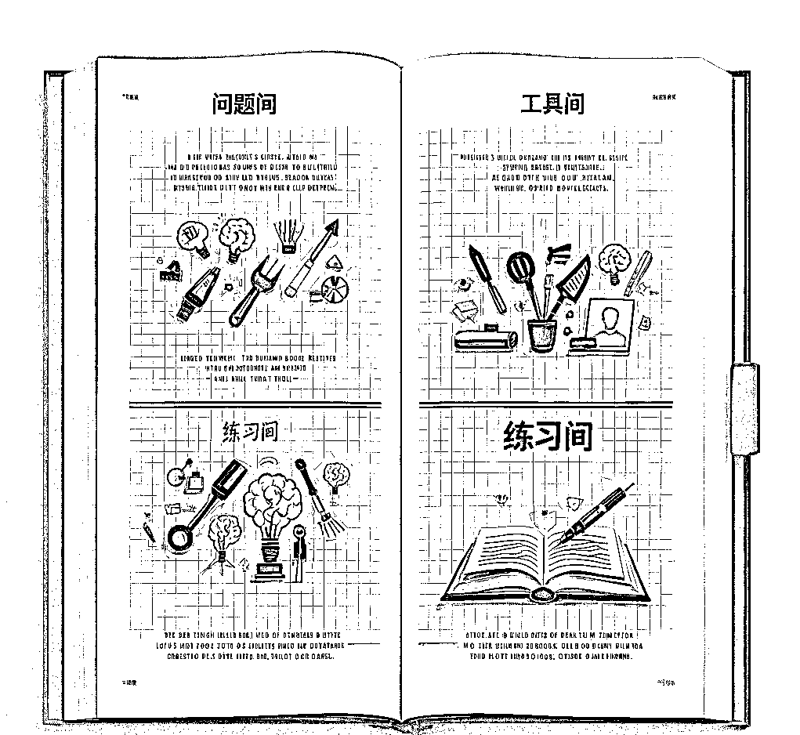

## （二）承上启下：让模块之间自然衔接。

把书拆成一堆知识点并不难，难的是让这些模块之间产生流动感。微微在做书稿解析时，最看重的是模块间的承接设计——这决定了知识能不能形成通路，而不仅仅是段落之间的过渡。

过去许多人的拆法偏机械化，把书切成一格一格的孤立信息，等于把一座完整的建筑砸成碎砖，结构美没了，知识之间的血脉也断了。微微的方法是建立一座“认知天桥”：用系统化的承接手段，使知识点与知识点之间自然地流转起来，读者获得的就不再是信息杂物间，而是一条有纵深、有方向的认知路线。

### 1、认知路径的隐形桥梁。

这里有三层境界。

老派拆书常用“问—答”的直线连接，相当于在知识小岛之间架几条窄木板。微微的拆法，搭的是“情境—逻辑—价值”的立体桥面：

*   情境共振：拿《非暴力沟通》来说，先还原职场里的争吵现场，再引出沟通公式，最后展示换种说法之后的效果差异，读者在画面感里不知不觉就进入了方法论。

*   逻辑嵌套：拆《高效能人士的七个习惯》时，按“个人管理→人际协同→团队赋能”的上升阶梯排布，每个板块都是上一级的自然延伸，又为下一级埋好引线。

*   价值延伸：读《穷查理宝典》，把“多元思维模型”和真实投资案例交错呈现，组成“理论—实践—校验”的完整链环。

这种设计相当于古建筑里的回廊，知识流动时既能在转角遇见惊喜，又不破坏整体格局的规整。

### 2、从线性拆解到生态重构。

老式拆书像一张印好的地图，高配版拆书则更像实时更新的导航仪。以《影响力》为例：

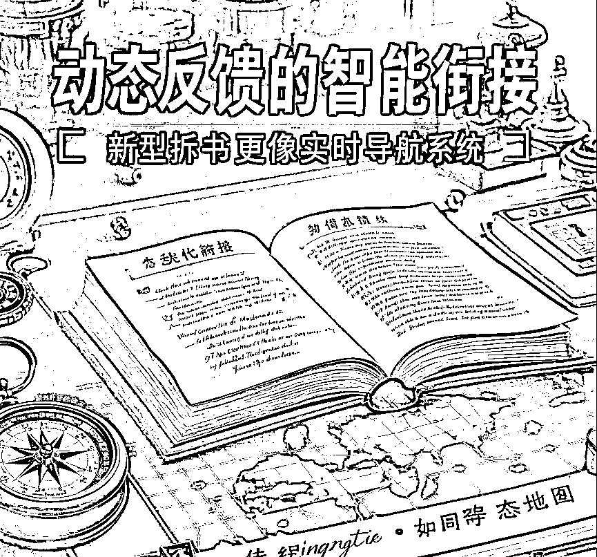

*   用户画像驱动：依照受众的年龄、职业等特征，灵活调整“互惠→承诺→社会认同”的讲解次序。给职场新人拆，可以先讲“权威”再讲“喜好”；换成想发展副业的宝妈，就倒过来——先讲“社会认同”教她们建立客户信任，再谈“互惠原理”用赠品做引流。

*   数据热力衔接：观察读者在哪个模块划走、在哪个段落停留，据此调整过渡策略。比如发现“社会认同”一节掉读率偏高，就插入一段短视频素材——像《鱿鱼游戏》里一群人疯抢糖饼的画面，几秒钟就能说清楚从众效应。

*   认知缺口补偿：读者卡在《思考，快与慢》的“启发式偏差”时，不用硬啃术语，直接跳转到《快思慢想》中对应的图解页面，自动把缺口补上。

这套机制让拆书过程自带进化能力。掌握了新玩法之后，你能提前预判自己的学习卡点，还能把抽象概念转化为短视频画面或表情包记忆，甚至根据自己昨晚刷到的内容来调整教学方式——它就像一个越用越懂你的智能导航，在不断优化的循环里，把知识生态越养越活。

# 四、AI拆书方面的【术】。

看到这里，你可能会嘀咕：人工拆书写得这么溜，为什么还要拉AI入场？

原因很实在：人脑的储备与精力终归有限，AI却像一台外挂认知引擎。它可以通宵达旦地追问概念盲点，自动生成立场相反的辩论，甚至把量子物理教材和《道德经》放在同一个维度里对照。当人类读者还在纠结某个理论哪里没懂时，AI早已完成了上百条解读路径的交叉验证。对于终身学习者来说，这是一种打开认知新天窗的突破性工具。

如果人工拆书是一本纸质地图册，AI拆书就是带实时路况的导航系统——它知道你卡在哪个路口，也会在你行驶途中随时重划路线。

这是微微老师八年多来压箱底的本事。哪怕你只掌握其中一招，也能持续产出好内容，从书本里挖出一个又一个爆款素材，写出有质量、有亮点的文章。

## （一）追问法：像侦探一样挖掘深层信息。

追问法的核心，就是连续设问。平时我们阅读时的内心提问就不展开了，网上一搜全是技巧。这里重点讲的是：怎么借助AI往书里钻得更深——这种方法对复杂理论、争议性议题尤其适用。

直接看案例。拆《乌合之众》时，可以给AI设置一条问题链：

*   第一环：“勒庞为何断言群体‘冲动且易受暗示’？”

*   第二环：“这种特性到了今天的社交媒体上，会长成什么样子？”

*   第三环：“如果勒庞活在当下，他会怎么评说网络暴力？”

如此追下去，AI会把书里的理论嫁接到现实事件上，再结合“微博热搜”等场景来阐释群体心理。

操作流程大致是：先请AI提炼中心论点，然后准备“为什么”“怎么用”“假如会怎样”三种问法，最后让AI生成答案、整理成笔记，你再做一轮人工润色。

参考提示词（可按需改动）：

请按以下流程拆解《乌合之众》的群体心理观点：

#第一步 提炼理论内核#
用100字概括勒庞关于“群体冲动、易受暗示”的解释机制（涉及集体无意识、情绪感染等）。

#第二步 设计连环问题#
-理论追溯：勒庞认为群体比个人更莽撞、更盲从，根因何在？
-当下映射：结合近期微博热搜事件，梳理群体暗示是如何在社交网络上扩散的。
-未来推演：假设勒庞在刷抖音/推特，他会如何解读网络暴力中群体情绪升级的现象？

#第三步 生成结构化回答#
每条回答需要包含：书中观点依据、现实事件拆解（附具体案例和数据）、延伸讨论（如对照桑斯坦的“信息茧房”）。

#第四步 汇总成笔记#
把答案整理成：关键词卡片、案例档案、金句摘录（勒庞原话+现代语境改写）。

#示例输出规范#
理论追溯：勒庞认为，群体的“无意识”特质使其极易被断言左右（见原书23页）。例如微博XX事件中，某大V的一条情绪化推文两小时内转发破300万，具体展示了群体暗示的“传染链条”。

## （二）批判性思维：挑战作者观点，激发思考。

拆书切忌全程点头。读出自己的看法，才有真正的收获。说白了，读一本书的时候，别只顾着说“对对对”，还要养成本能性的追问：这个说法站得住吗？有没有例外？放到今天还适用吗？

几个基本发问角度：

*   作者的论据充分吗？

*   案例是否有以偏概全之嫌？

*   换一个出发点，会不会得到相反的判断？

拿《乌合之众》来说，书上说群体是“无脑”的，这时候该启动找茬程序了：

*   找反例：今天的粉丝社群，打榜时看似疯狂，内部组织却相当严密，这能等同于勒庞笔下的“无脑群体”吗？

*   看现实：勒庞的年代没有社交网络，如今一条热搜几分钟就能燃遍全网，他的结论还撑得住吗？

*   添变量：引入《影响力》中的“社会认同”理论，会发现群体行为除了被动盲从，还有主动趋同的一面。

挑刺不是抬杠，而是像查案一样去审视观点背后的证据链。带着开放的心态去看书，最后可能是作者说服了你，也可能是你发现了新视角。

还不清楚的，试试这三板斧：

反向提问：每读到一个观点，就问自己“反过来成立吗？”——比如作者说短视频让人变蠢，那有没有人靠短视频学到了硬技能？

查验证据：像审计员一样检查作者使用的案例数量和资料来源，拿2023年直播带货数据去验证《引爆点》里的流行理论是否仍然成立。

跨领域对照：引入其他学科的知识来碰撞，比如用脑科学去重新评估《思考，快与慢》里的双系统模型，说不定能撞出新的裂缝。

不要为了否定而否定，目的是保持独立思考。吃鱼时我们要挑刺，读书时也要挑理，挑完剩下的才是自己能吸收的营养。

*   通用提示词参考（酌情调整）：

「前提探测型」：作者说[核心观点]，背后是不是预设了[某个前提]？若这个前提松动，结论会不会变？

案例：
书中的说法：群体天然不理性。
提问：“群体天然不理性”的论证，有没有预设“个体理智更优”这个前提？如果现代研究证实群体借助算法也能达成理性决策（比如维基百科的协作机制），这个判断还稳吗？

「证据盘查型」：支持[核心观点]的材料是否足够？样本是否偏狭、数据是否陈旧、推导是否严密？

案例：
书中的说法：女性学语言更在行。
提问：支持这个论断的数据取自哪些地区？是否排除了教育资源分配的干扰？如果某些国家的女生因为政策照顾获得了更多语言训练，结论还能站稳吗？

「多因分析型」：除作者指出的[主要原因]，还有哪些可能的解释？如何设计实验来区分？

案例：
书中的说法：短视频上瘾是算法推荐惹的祸。
提问：算法之外，社交压力（比如怕聊不上话题）和心理需求（比如暂时逃避现实）会不会也推了一把？怎么设计对照实验来验证？

「价值权衡型」：作者的建议跟[某种价值观]会有冲突吗？两者怎么平衡？

案例：
书中的说法：企业该实行996以提高产出。
提问：这个建议是否触碰了“尊重个人休息权”的底线？效率与员工权益之间，哪里才是合理的平衡点？

还可以把多种模板叠加起来，组装成连环追问：

*   前提探测→“高薪留人”的假设是“金钱万能”吗？

*   证据盘查→有哪些研究支持高薪与忠诚度的因果关系？行业覆盖面足够吗？

*   多因分析→文化氛围、晋升机会等变量是不是被低估了？

*   时空推移→到了AI替代大量岗位的未来，高薪这张牌还管用吗？

细节上留三点心：问得越具体越好，别上来就一句“这本书怎么样”；每次只攻一两个维度，别让AI信息过载；语气保持中性，用“还有没有别的可能”而不是“作者完全错了”，这样AI才能给出建设性的回应。

掌握了这个尺度，AI就不容易跑偏，也不会丢给你一堆情绪化废话。

## （三）模仿对话：让书中人物“活”过来。

这个方法非常有趣。办法是给AI设定一个角色身份，让它扮演书里的人，跟另一角色展开对话。这样的形式能直观地呈现不同观点的碰撞，也能逼着AI跳出标准答案套路。

大家可能已经在用了——每次提问前加上“假如你是……”“现在你是……”，就是这么回事。

举个拆《论语》的例子：“如果孔子和当代的教育专家聊‘因材施教’，他们会聊出什么？”

AI大概率会生成这样的场景：

*   孔子：“教无定法，但需看人下菜碟。”

*   当代专家：“您的思路其实和今天的个性化教学一致，只是现在AI可以做学情分析，实现更大规模的因材施教。”

这种对话既没丢掉原典的思想，又接通了当下的语境，操作也简单：

第一步，设定双方身份（书中人物或当代专家）；
第二步，发出指令：“请生成一段对话，聊聊[书中议题]在现代的应用，要求口语化、观点鲜明”；
第三步，人工修整AI的生成内容，确保不偏离原著核心。

参考提示词：

请生成一段关于《论语》“因材施教”的跨时空对话：

#角色设定#
-古代一方：孔子（引用原文，如“中人以上，可以语上也；中人以下，不可以语上也”）
-现代一方：AI教育研究员（结合大数据、自适应学习）

#对话结构#
-先由孔子讲传统理念
-再由专家讲技术如何突破旧限制（如资源不均）
-双方共同探讨人机协同的教育前景

#输出要求#
-口语化，拒绝学术腔
-展现教育温度与算法效率的相互作用
-适当融入“六艺”“算法”等新旧符号

#示例#
-孔子：“吾尝谓‘视其所以，观其所由，察其所安’。教学若要见效，必须像把脉一样因人而异。”
-研究员：“您的观察式教学，和我们的学习行为分析系统很像。系统通过追踪两百万名学生的练习轨迹，能为每个人生成独特的学习路径。”
-孔子：“善！可算法能解知识之疑，能育做人之德乎？”
-研究员：“这正是我们在研发的方向——尝试把您的‘克己复礼’变成情感计算模块……”

如果是DeepSeek这类对话式AI，就不用写那么长的指令了，直接问“孔子和现代教育家讨论因材施教会聊什么”就够。

## （四）新旧视角对比：连接过去与当下。

拆书时把不同时代读者的理解并排放到一起，等于给书里的观点做一次“全身体检”。

这个说法其实是在讲：拆书像一面时间镜，能让观点在不同年代的读者面前呈现出不同的轮廓。同一本书放到不同的历史坐标里，哪些内容是穿越时间的金句，哪些是特定阶段的产物，一眼就能分辨出来。背后有三条机制：

### 1、时代滤镜。

拆书的人总戴着当下的眼镜打量旧书。比如二十年前风靡的成功学，今天的拆书稿多半会指出“狼性文化”的副作用，同时保留“自我驱动”这些有效成分。这就像用现代医学重审古方，既要看见古人的经验，也要看见时代的局限。

### 2、共鸣探针。

经典文本的解读最能体现这种变化。以《红楼梦》为例，清代读者盯着“门当户对”，今天的拆书视角则更关心女性自我意识的觉醒。对照不同年代的关注焦点，就能发现哪些主题永远会引起共鸣（比如人性的刻画），而哪些细节已经与当下脱节（比如科举功名的叙事）。

### 3、语境抽离。

把某个观点从原书语境里拎出来、单独陈列时，它的生命力会迅速显现。如果“己所不欲，勿施于人”在唐宋、民国、当代的解读中都被反复提及，说明它有超越时间的普适性；如果某个说法只在特定时期被捧得很高（比如特殊年代对斗争哲学的推崇），那它的时代限制也就暴露了。

再举两个直观的例子：

*   古时候读《论语》，人们重视“君臣父子”的序列，因为那套等级秩序对应着当时的社会结构；
*   今天读《论语》，更多人关心“因材施教”的教育启示，因为个体发展已经成为核心议题。

由此可以看出：有些理念自带跨时代的光环，比如“因材施教”；有些观点则带着旧时代的印记，比如无法融入现代价值观的等级观念。

《红楼梦》里的“女子无才便是德”，在清代被视为天经地义，如今却被视为性别偏见。这样的对比，让观点与时代之间的依附关系更加清楚——不至于让我们盲目奉承古书，也不会一竿子打翻所有旧智慧。

说到底，拆书就是一场知识考古：一边把经典中依旧闪光的内核打捞上来，一边给那些已经锈蚀的观点贴上“年代产物”的标签。这种流动的解读姿态，恰恰是纸页无法完成的任务，也是数字阅读带来的进化——像用透视底片对照同一个人的现在与过去，拆书时的跨时代对比，让我们更冷静地辨认出：哪些是常读常新的智慧，哪些只是盛放过的容器。

微微调整后的拆书思路和实操手法，今天就先聊到这里。为了让大家把方法内化，留一道思考题。模板就不直接给了，关键是学会怎么跟 AI 对话去提炼：

比如可以这样问：“请把[书里某个角色或观点]放在[过去的语境]和[现在的语境]下分别解读，各举一个具体例子来呈现差异。”

先做个收束，然后我们就进入【AI+拆书】的实战部分，会结合不同 AI 工具的特点，说明面对不同类型的书该怎么搭配使用。准备好板凳，今天的内容后半段马上开始。

## 附：基础的拆书工具箱示例（国内AI版）

坦白讲，AI 就像高铁，而拆书的方法论就是你的车票。光知道高铁很快没意义，你更要清楚：

*   该在什么时候上车，把信息垃圾快速处理掉；
*   该在什么时候下车，靠拆书去深耕知识的高质量地块。

早点组装好属于自己的拆书工具箱。下次再看到有人宣称 AI 三秒读完一本书，你就能默默打开自己的工具箱——这大概就是普通人思维突围的隐藏武器。

# 五、AI+拆书，人机协作的【道】与【术】

不多废话，直接演示分步协作。以《原则》为例，用提示词一点点带出内容，想深挖的朋友照着做一遍，印象会更牢：

步骤1：先抓取框架。
输入：“把《原则》第一章拆成‘核心原则’‘案例’‘落地建议’三个板块，每个板块用约50字总结。”
AI 输出：

*   核心原则：追求极致透明、坚持求真务实；
*   案例：桥水基金借助透明文化减少决策失误；
*   应用建议：搭建反馈机制，营造敢于直言的环境。

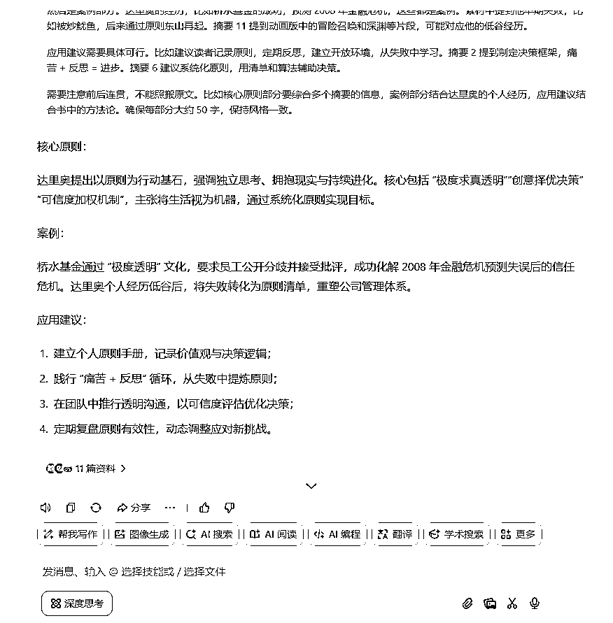

步骤2：追问把内容做深。
输入：“‘极度透明’在企业里为什么推行起来这么难？给一个失败的例子。”
AI 输出：“比如某公司强行公开所有会议纪要，员工担心被断章取义而选择沉默，反而扼杀了创新。”

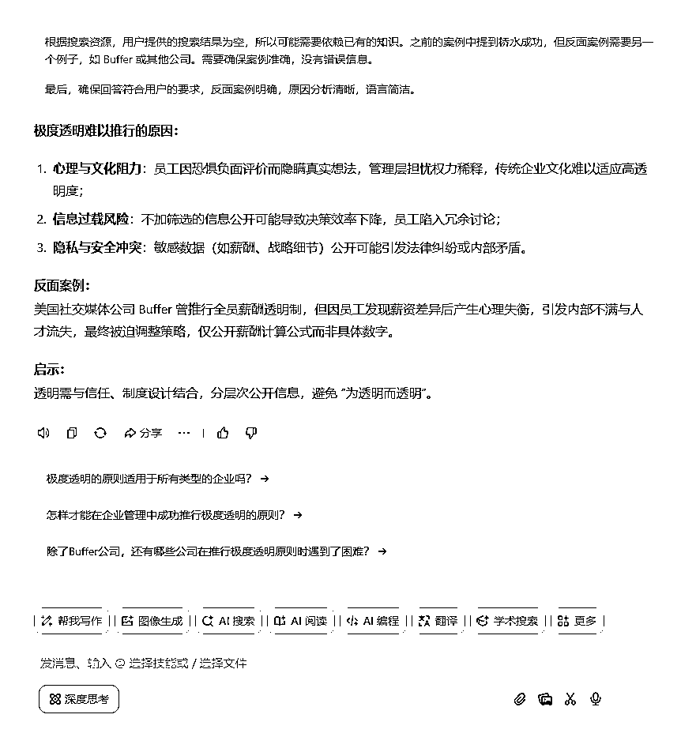

步骤3：做新旧视角的对照。
输入：“如果让工业时代的管理者来回应‘极度透明’，他们会怎么反驳？”
AI输出：“工业时代讲究层级分明，管理者可能认为过度透明会削弱权威，影响决策效率。”

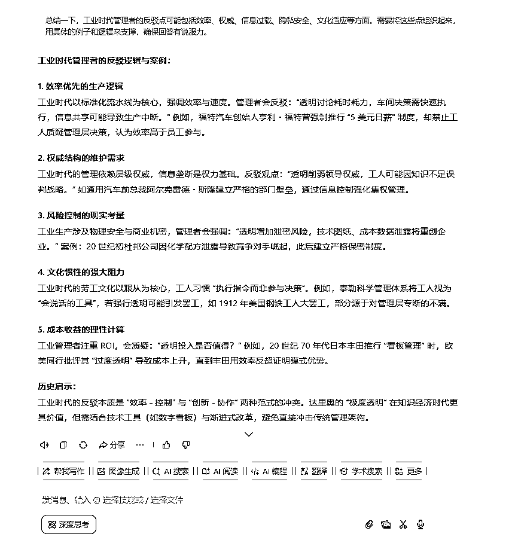

关于具体工具的使用流程，今天先不展开，篇幅已经很满了。如果大家反馈强烈，后续会单独再写一篇。先提醒几个使用时容易踩的坑。

*   误区1：太依赖 AI 导致输出千篇一律。
解决方案：拿到 AI 初稿后，一定要注入个人经历或独家视角。比如拆《高效能人士的七个习惯》时，加入自己践行“要事第一”的真实体感。

*   误区2：文章结构松散，没有主线。
解决方案：用“问题链”把内容拴起来。比如拆《影响力》，就用“人为什么容易被说服？”作为主线，六大原则围绕它展开。

拆书的本质是“重构与链接”。拆书不是简单压缩，而是通过逻辑重组、批判性思考和创造性表达，让读者在很短的时间里获得深度启发。

无论是追问法、角色代入还是新旧对比，最终目的都一样：让知识活起来。

在使用 AI 的过程中要始终记住“人为主导、AI为辅助”的原则。用高质量的提示词让 AI 产出素材，再用自己的判断和洞察赋予它灵魂。

# 六、彩蛋

当 AI 去拆解《傲慢与偏见》时，它能快速梳理出人物关系图谱，却很难复刻简·奥斯汀笔下细腻的社会讽刺；当它把《国富论》和区块链经济并列时，给出的是数据上的关联，而只有人才能洞察制度演变背后的深层隐喻。

真正的高质量拆书，是“人机双螺旋”的状态：AI 负责搭建知识图谱、识别模式等基础性工作，人类则负责价值判断、情感共鸣和创造性重构。

正如人机协同的理论所说，充满模糊性的任务需要人类主导，标准化的流程可以交给 AI 去迭代。有效的 AI 拆书，本质上是一场协作艺术。

只有把 AI 的效率优势和人的创新思维深度融合，才能在信息过载的时代，持续产出有温度又有深度的知识内容，真正完成“AI+拆书”的价值再造。

记住，AI 是知识的解构引擎，而人，才是意义的导航仪。