# 3月AI航海：一个文科老兵的网站上站踩坑实录

大家好，我是liliya，赚钱老成员第四年，这次参加了AI Web航海。有幸把4个站点都推上去了，3个是游戏站，1个是AI绘画工具导航站。现阶段流量几乎为零，也没有产生收入，但全程的学习和实操收获极大。熟悉了从零到上站的完整链路，对年轻人来说可能轻而易举，对我这个文科出身的年长新手而言，却是一次不小的挑战。

航海刚开始第一站还算顺畅，后面就各种卡壳，直到最后的图库网站环节直接停住，再也过不去。我的困境和心态，应该能代表绝大多数小白的真实写照。

这篇笔记盘点了我在 Cloudflare 过程中遇到的全部坑点，并重新整理了大量截图，作为航海手册的补充，期望能帮助还没成功上站、或在 Cloudflare 上卡住的圈友少走弯路。

图片较多，详细截图已移步飞书。

# 一、新手做出第一个 Web 网站的要义

## 1. 最难的是起步的第一步

据志愿者反馈，航海进行到三分之二时，只有三分之一的人完成了上站。最终数据我没统计，但看水日志就能感受到很多人都卡在第一步、第二步。

能尽快把第一个网站跑通，就能获得正向反馈，信心和动力会随之建立。若一开始就被卡住，很可能连开始的勇气都没了。

为什么会卡呢？对我这种文科背景的人来说，最大障碍是每个专业词汇都不懂。

做过计算机或写过代码的人会觉得部署、域名解析、网站解析这些概念是常识，教程的表述也默认读者具备基础，注册登录这些操作也默认已完成。所以很多步骤和截图存在跳跃，教练觉得无需赘述。

但小白的真实问题在于，不知道这些基础概念是什么，以及各个平台到底用来干嘛。手册里其实都写了，只是我看不懂。

## 2. 尽快拿到正反馈很重要

前天下午花了近两小时，帮一位因出差错过航海的圈友完整跑通游戏站上站全流程。教他的过程中，我对 Web 网站的理解又加深了一层。

他第一站上站成功后，立刻开始琢磨下一个站做什么。因为看到了自己的努力有了可视化成果，一个真正能访问的网站上线了，这种正向激励对项目推进和持续行动太关键了。

最难的永远是起手的那几步，只要开头顺了，后面就会有信心和兴趣。哪怕不赚钱，一个成功上站的网站也足够自豪。

## 3. 我不知道我不知道

阻碍我的不是懒惰，也不是没时间，而是方向感缺失带来的绝望。第一个网站是稀里糊涂上线的，甚至航海第二三天还短暂上过榜，但完全无法复制。

第二个站卡了整整一周多，问了教练第18次同样的问题，他才提醒我删除重复和多余的项目，保证一个域名只对应一个 Github 仓库。直到教练一张张截图带我排查，才定位到问题根源。

原来是因为手册里“绑定域名截图1”少了一个页面，导致我这边一直建错项目，循环往复，进不去下一步。

还有做导航站时，我一直读不懂手册内容。后来加一位已成功上线的圈友请教，才明白是我不理解“书签”这个词。书签就是浏览器里收藏网址的功能，每个浏览器都能编辑和导出书签。搞懂这个词后，导航站里所有基于书签的操作瞬间就通了。

这两处卡点都是典型的“我不知道自己不知道”。知道自己不懂哪个点可以直接问 AI、问 GPT 或 Claude：发生了什么、想要什么结果。但对于自己无感知的盲区，连提问都无从开始。

## 4. 找到属于自己的最近发展区

学过发展心理学的人知道“最近发展区”概念：一个人独立能作到的水平是10，在帮助下能作到的水平是20，10到20之间就是最近发展区。太简单会无聊，太难会挫败。

大脑学习新知时，需要把新知识和旧有经验建立连接，如果差距太大就连不上。于是对于 Web 航海或赚钱的任何教程，都需要先判断自己的最近发展区在哪。

大佬的帖子适合学认知和思路；而操作效率最高的是比自己高一点点的人，赚钱常说的“30分教20分”就是这个道理。

良辰美教练在分享时反复强调，要尽快跨过操作流程。群里几十上百条提问基本都是起步问题。不是不想快，而是确有难度。

## 5. 教学相长

今天指导圈友时，我又完整走了一遍上站流程，顺带把自己的导航站也成功上线了，虽然做得很粗糙。把每一步重新走一遍、截图并标注后，航海手册里缺失的几页也被我补全了。

还学会了截图快捷键 win+shift+s。以前只会用微信截图保存，再找临时文件再编辑，效率极低。学会快捷截图并直接存到印象笔记，配合标注箭头、方框，效率提升了好几倍。希望还没上站成功、或在 Cloudflare 上遇到困难的圈友能有所助益。

# 二、游戏站等各类网站上站 Cloudflare 实操

## 1. 做网站到底是什么

先用大白话给圈友解释：做 Web 网站就像在抖音发视频，发视频只是第一步。良辰美上站100个相当于发100个视频，发完还得搞流量、变现。

我们现在的上站工作，相当于一个从没用过手机的人，要完成拍视频、剪辑、配音并发布，账号注册、头像、简介都还没弄。我们现在只在学“拍视频”这一步。游戏站本质就是找一个爆款视频一比一复刻，用别人的游戏网站套个壳，也就是 IFRAME 地址的意思。

## 2. 上站工作分三部分

第一部分是域名，也就是网址。可以在 Spaceship 等平台购买，用信用卡支付，像 xyz、online 这种便宜域名一年不到10元人民币。

第二部分是代码。过去要程序员手写，现在用 AI 工具生成，比如大模型 ChatGPT/Claude，或编程工具 bolt/cursor/windsurf 按需求写好后保存到 Github。Github 相当于代码云端仓库，可修改、可展示。

第三部分是 Cloudflare，相当于把域名和代码安全连接起来的桥梁。所以后续操作核心就两件事：Cloudflare 链接域名，Cloudflare 链接 Github。

## 3. 小白版航海手册之 Cloudflare 使用

WEB航海手册 龙哥盟·资料文档 https://scys.com/view/docx/EECxdMzegoy8AAxVkq5cm9sTnvd#Sj7JdF5kyodEahxZzsfcJm8Bnjd 中对应章节是3.3.3.3，绑定域名后托管网站，共20张截图。前置工作已完成：

1. 域名已购买 dreamimage.art
2. 代码已上传至 Github 仓库名为 aidanghang

### （1）Cloudflare 注册登录并绑定域名 图1~图4

图1 打开 Cloudflare 官网，用邮箱注册登录。

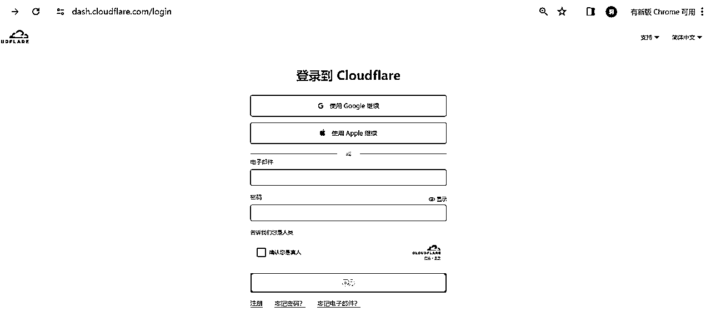

图2 登录后点右上角“添加”，弹出下拉框点“连接域”：

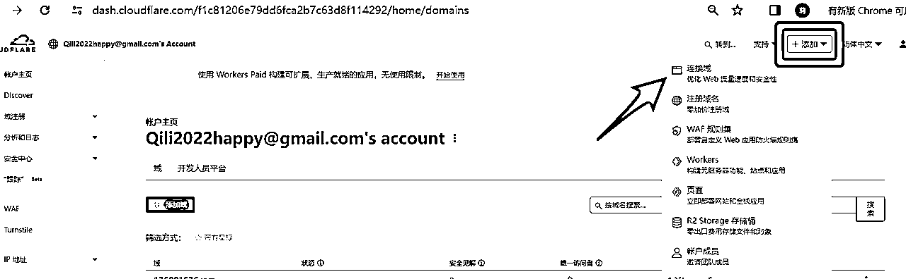

图3 填入之前购买的域名

图4 选 FREE，点继续

### （2）设置 DNS 图5~图13

图5 进入页面后忽略中间内容，点左侧 DNS，这点与航海手册不同

图6 找到页面最底部的两个子域名网址

图7 放大查看，这两个网址后面要复制

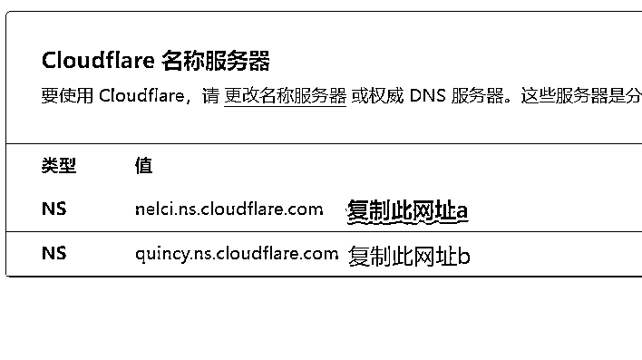

图8 回到 Spaceship 域名管理页面

https://www.spaceship.com/application/domain-list-application 点域名

图9 进入右侧功能栏，点 Nameservers&DNS

图10 点 change

图11 出现两个子域名位置，把图7里的网址复制过来替换原有内容，具体含义不用深究，按做即可

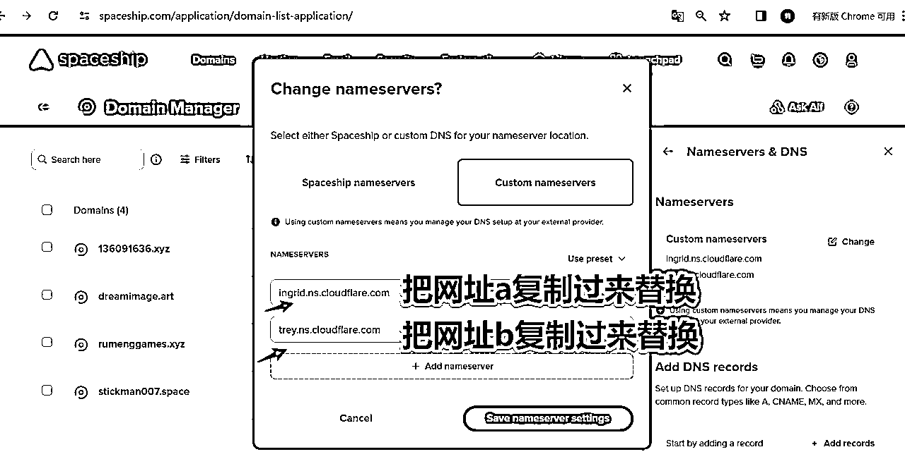

图12 替换后点 save 保存

图13 保存后右上角会出现提示信息

### （3）设置 Pages 与 Github 关联 图14~图26

图14 回到 Cloudflare 页面，右上角点“转到”回到主页

图15 在顶部搜索框输入“主页”二字

图16 进入主页，左侧红框处点域名

图17 进入 dreamimage.art，点右上角“添加”

图18 弹出选项框，选第4行“页面”

图19 进入 work and pages 页面，点“pages”

图20 进入 pages 页面，点右上角“添加”

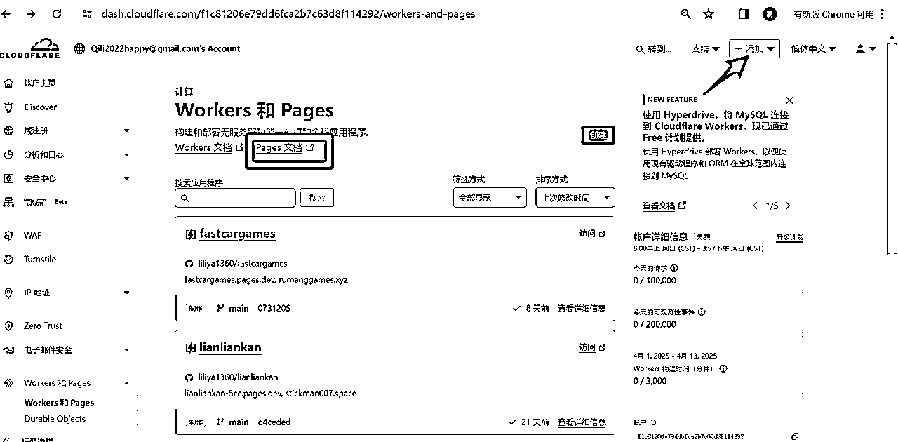

图21 进入创建应用，点“连接到 Git”，开始连接 Github 仓库

图22 选择存储库 aidanghang

图23 放大页面，点右下角“开始设置”

图24 设置构建与部署，点右下角“保存并部署”

图25 等待构建部署完成，需一定时间

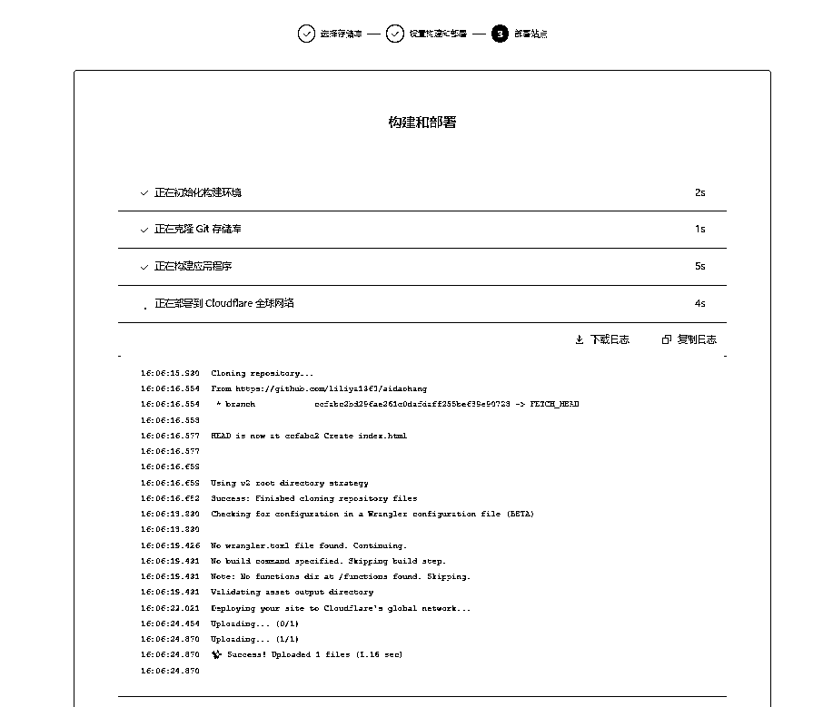

图26 部署成功，点“继续处理项目”

### （4）设置自定义域 图27~图32

图27 回到主页，点自定义域

图28 进入设置自定义域页面

图29 添加自定义域，输入购买的域名 dreamimage.art，点继续

图30 若出现“该项目与现有项目关联，请使用其他域，或找到已使用此域的项目，将其删除”的提示，请跳转后文查看删除图8~图11操作

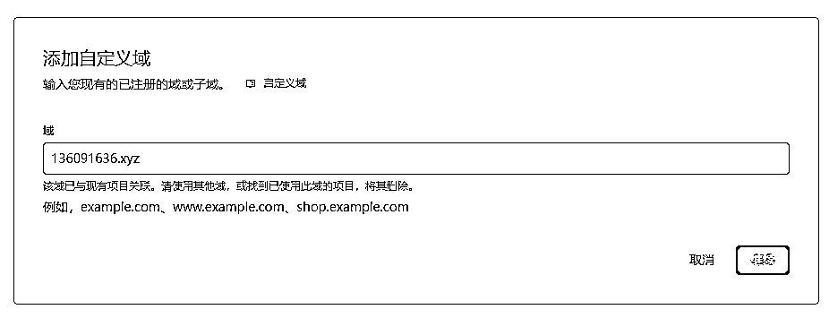

图31 确认新 DNS 记录，点激活域

图32 验证中，完成后点左侧“账号主页”

### （5）设置 SSL/TLS 图33~图37

图33 回到账户主页，找到域名，最后一列点三个点，选择配置 SSL/TLS

图34 进入 SSL/TLS 页面，点右侧“配置”

图35 在自定义处点“选择”

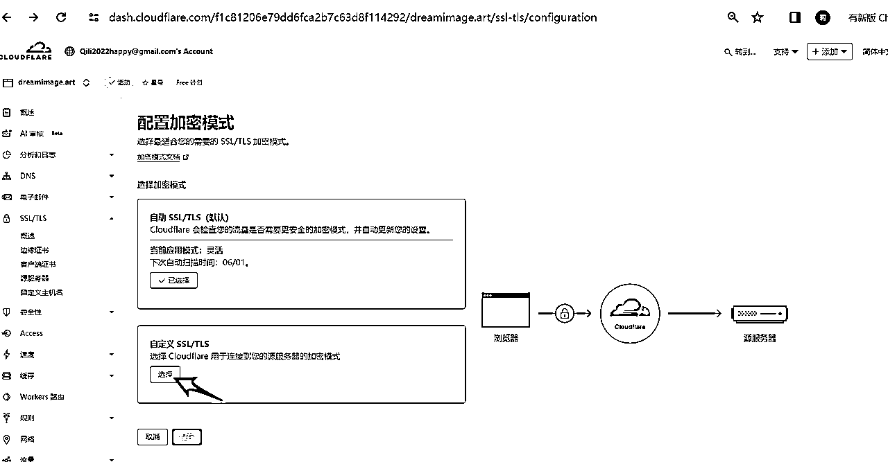

图36 在对话框中选择 FULL 即完全模式，再点保存

图37 完成，点击域名 dreamimage.art，我做的简陋导航站，还可继续优化。

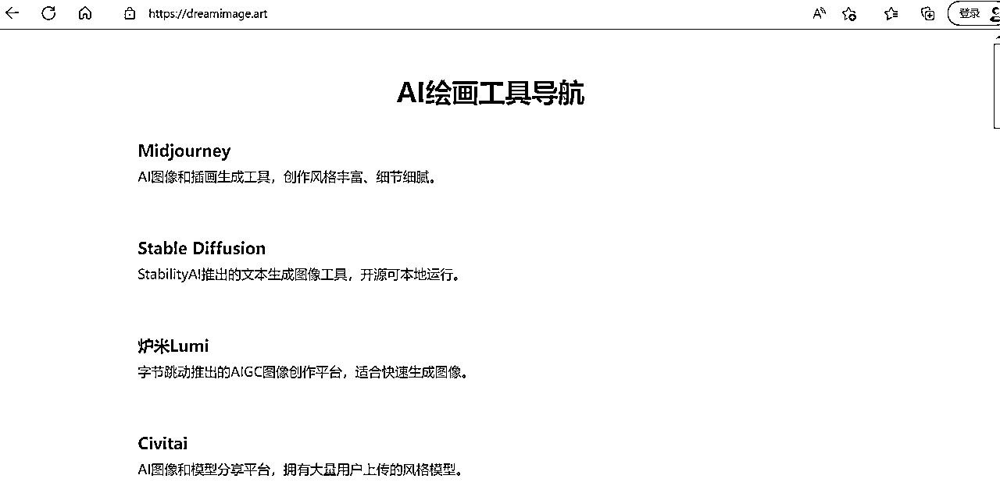

# 三、常见删除操作汇总

上站过程中以及群里提问，重复操作后找不到删除入口是很普遍的问题。国外软件对删除操作很谨慎，常藏得很深。以下是我摸索出的常见删除方法，便于错误后重置。

## 1. Github 项目删除 删除图1~删除图6

删除图1 在 Github 仓库页面点 setting

删除图2 页面最下方 delete this repository

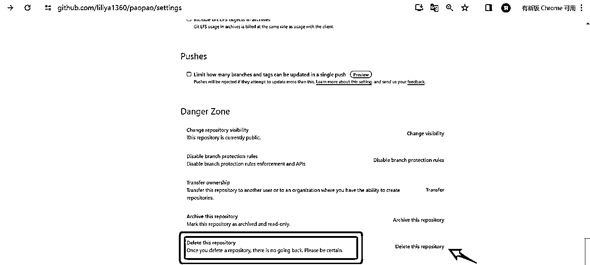

删除图3

删除图4

删除图5

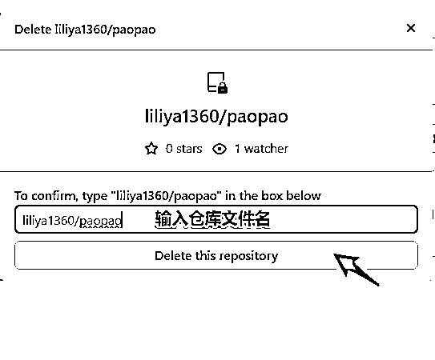

删除图6

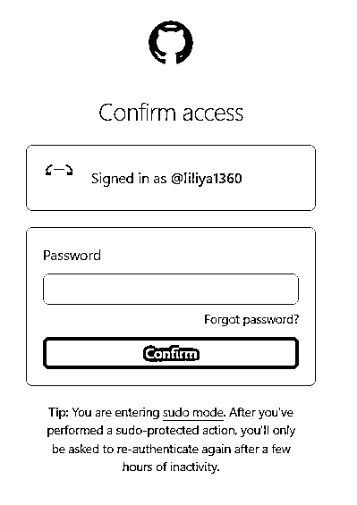

输入密码确认后删除完成。

## 2. Cloudflare 管理的 Github 项目与域名解绑 删除图7~删除图15

图29出现重复域提示时，需删除占用该域的原有项目。找到并断开是一个系统性操作。

删除图7（图30）

删除图8 先回到 works and pages，逐个点开 0429、0428、mbti 等项目，检查哪个占用了该域名。此处 mbti 项目下显示重复域名，需删除。

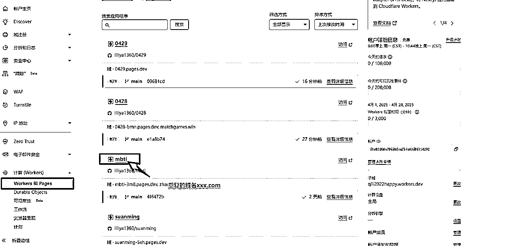

删除图9 点开 mbti 确认是该 Github 项目占用了域名，需删除。

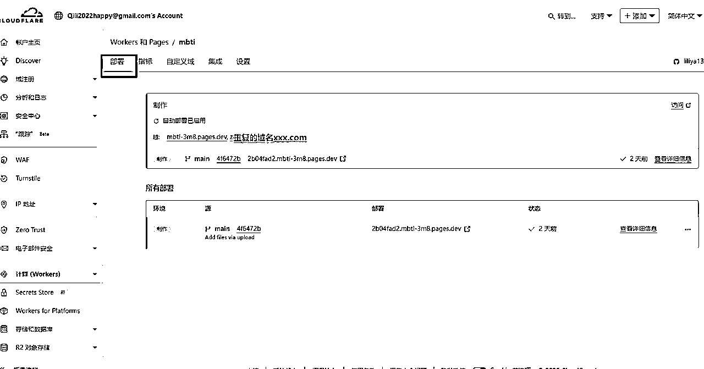

删除图10 点选“自定义域”，进入后右下角三个点打开，选择“删除域”即可删除。

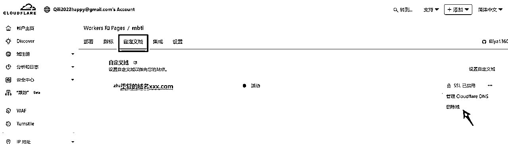

此时域名与项目已解绑，可重新完成图29、图30的域名配置。

## 3. 删除项目

删除图11~图13 拖到网页最下方，点红色小字“删除”，位置极隐蔽

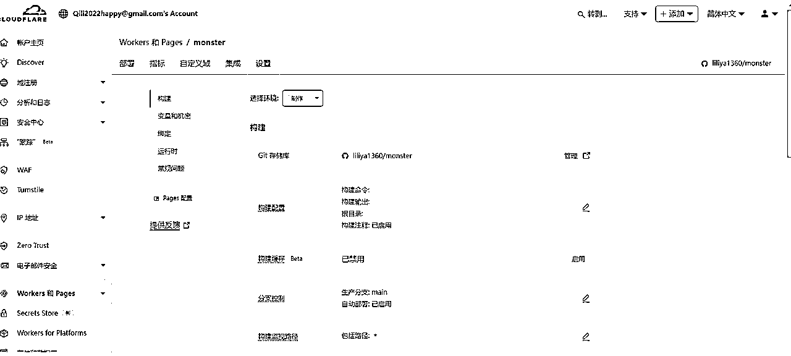

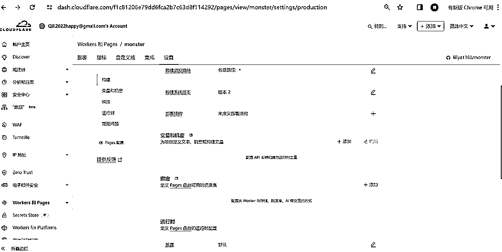

删除图14

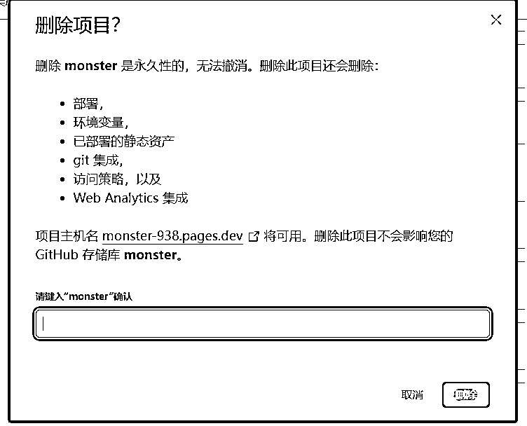

删除图15

删除图16 未料到意外出现，这里仍不允许删除

折腾了好一阵子，还是得感谢 GPT 够聪明。我把那张操作截图直接丢给它过目，它提醒我一个关键细节：在把这个域删掉之前，务必要先把前面解套、清理图8到图10那套流程走一遍。进入自定义域列表，找到目标域名后面那一串三个点点开，里面就会出现“删除域”的选项，点一下就能干掉。

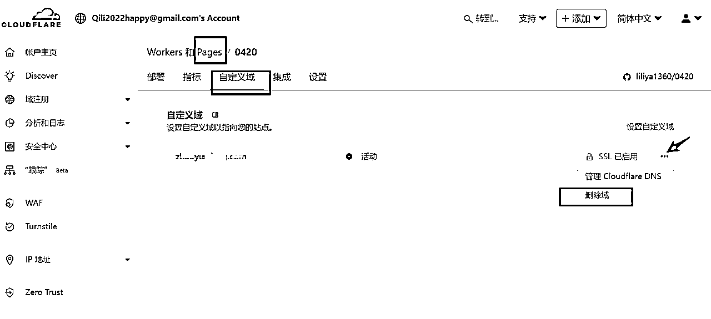

完成之后，再回到之前清理重复项目的环节，也就是图9到图11底部的那个删除按钮，按一下就能把重复的记录清掉。清理完就接着衔接图39之后原本要继续的操作。

## 4. Cloudflare 端的域名移除（对应删除图16）

回到删除图17，也就是图32的位置。如果前面操作失误导致域名重复或报错了，可以在最右侧那一行找到“从Cloudflare删除”的入口，通过它把之前出错的、冗余的域名一次性剔除掉。

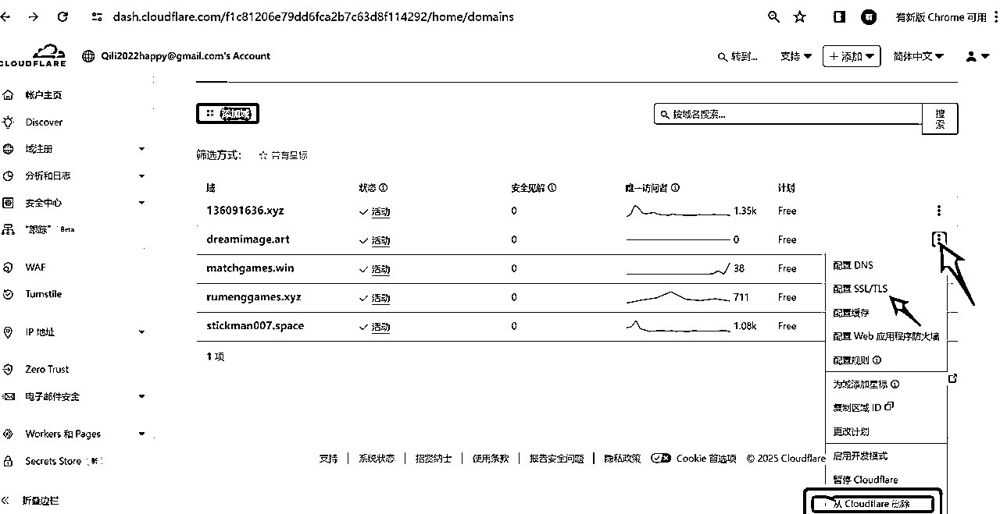

# 四、一点额外感悟

写下这些，就是希望还在 Cloudflare 这一步卡着的朋友能少绕点弯，顺利迈过这个坎，尽快进入下一阶段。上站只是起步，我在群里问教练接下来该干嘛，他给的建议是先冲到100个站，把流程练到肌肉记忆，同时练习找需求、找热词、学习 SEO、引流。变现路径里相对门槛低的就是挂 AdSense 做广告收益之类。

这和刚开始玩抖音其实一个道理，第一条视频发出去不代表能赚钱，得先找对标爆款把流量做起来，再考虑带货或卖课，找到适合自己的变现方式。

21天计划才刚开启，从零基础到目前已经顺利上线4个站点，真的得给自己点个赞。手上的三个游戏站是 136091636.xyz、rumenggames.xyz、stickman007.space，还有一个导航站 dreamimage.art。

接下来会继续深入使用 Manus、Cursor，坚持用 Bolt，以及在操作手法和心态上不断打磨。离良辰美老师提到的月入万刀目标还差得远，但至少已经迈出了第一步。

天辉老师长期稳居船员榜第一，几年前就是他的文章让我入了 AI 绘画的坑，也是我使用 AI 的启蒙者。看他每天的输出和学习轨迹特别有动力。他提到良辰美教练大概做到第20个站左右才逐渐上手，核心就是持续挖需求、持续做，有前辈的路可以跟着走。

另一个体会是，任何事都是有积累的。年前参加了赚钱超级榜，再加上看了 copy 小排老师的一系列动作，对 AI 的理解已经打了底，所以上手速度比预期快。导航站这块目前还没完全搞定也没关系，慢慢啃就行。

特别感谢小排老师的这篇 https://scys.com/articleDetail/xq_topic/4848511545851418，给我启发最大，其他资料还在持续学习中；也感谢良辰美教练、志愿者可伊、天辉老师、奋斗以及各位同行者。一起加油，为日入万刀的目标冲，梦想总要有的，万一实现了呢！