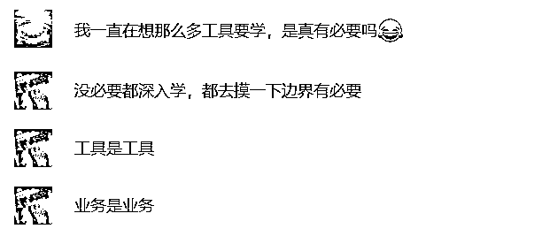
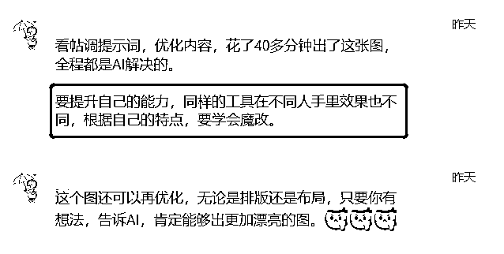

# 新手别瞎冲！这3个AI实操心法，能让你上手速度翻5倍

大家好，我是龙哥，专注品牌商业增长和AI视觉营销的实战派，平时就爱捣鼓能落地的AI工具和方法，期待交流~

前言：

最近社群里不断有人私信问我：AI入门到底该从哪儿下手？

我当时已经在群里简短回复过，为了让更多同样困惑的朋友少走弯路，我把思路整理成了这篇干货。

# 新手入门AI，别先堆技术，先把这3个底层逻辑吃透

## 💡 第一坑：上来就学工具，其实方向就偏了

有读者问：市面上AI产品这么多，是不是全都要掌握？

这种心态我太懂了，焦虑很正常。

AI迭代速度确实快，新的应用层出不穷。

但我的建议很直接：别去卷技术栈，也别追求全能。

更关键的是思考——如何把AI嵌进你的具体业务里，真正做出成果。

接下来这3点，是我希望每个新手在动手前先想清楚的。

帮你避开无效内卷，快速见到效果。

* * *

## 第一点：AI是放大器，不是万能钥匙

🧠 核心一句：工具一样，人的差距才决定结果的差距。

主角永远是你，AI只是你的杠杆。

打个比方，AI像一把电钻，钉螺丝时它效率爆表，用来削苹果就尴尬了。

我最近做一张视觉图，从写提示词到细节微调，AI全程辅助，40分钟就收工。

决定高效的不是我用了哪款模型，而是我一开始就清楚想要什么结果。

很多人是不是反着来？先沉迷研究工具功能，再去找它能干嘛。

### ✅ 怎么用对：

*   别先追工具，先明确自己想解决的具体痛点。

*   有明确目标，AI才有发挥空间。

*   工具可以越买越多，但思维必须由你主导，而不是被工具牵着走。

* * *

## 第二点：先练场景思维，再谈工具技巧

🧠 核心一句：决定效果的不是工具本身，而是用在什么场景、按什么流程用。

### ✅ 提效的本质是场景匹配

同一个AI，做海报、写推文、运营社群，玩法完全不一样。

你要做的，是回头审视自己的日常工作，找出最耗时的环节，把AI嫁接进去。

### ✅ 与其背Prompt，不如搭工作流

我更推荐你建立一套可复用的AI作业流。

比如“输入素材 → AI加工 → 人工校对输出”，这样才好复制和优化。

我的个人打法通常是：

梳理业务需求 → 匹配合适的AI → 跑通一次闭环 → 固化成可交付的产品。

甚至我会让技术团队把验证过的流程产品化，再交付给行业内的人用。

用户根本不关心你背后是哪个大模型，只关心：省不省时间、能不能赚钱。

### ✅ 操作建议：

*   先盘点3-5项你每天重复做的耗时工作

*   挑一个最简单的，用1个AI工具试着嵌入

*   把这个流程写成卡片：输入是什么、提示词怎么搭、输出怎么验收

* * *

## 第三点：先免费试水，再深度改造，最后沉淀成自己的SOP

🧠 核心一句：入门门槛要低，先验证价值，再投入精力。

很多人一开始就砸钱报课、买插件，性价比其实不高。

先用免费版跑通一个小需求，比如让它帮你写大纲、整理会议纪要、生成配图。

用几次你就知道这条路值不值得深挖。

我日常的习惯是不断“魔改”提示词。

同样的模型，经过我的调教，输出质量会明显提升。

因为它更贴合我的表达习惯和业务语境。

只要你会提需求、会反馈，AI就能从工具进化成你的私人助理。

### ✅ 落地步骤：

*   从身边最真实的需求出发：写文案、做演示、整理表格都行

*   用免费平台先上手，比如元宝、ChatGPT、文心一言等

*   把需求描述写具体，反复优化对话方式

*   等流程稳定后，整理成你自己的AI标准作业流程

* * *

## 🔚 方向错了，再努力也是空转，AI亦然

现在全网都在秀高阶Prompt和酷炫案例。

但如果脱离业务、无法落地创造价值，那再漂亮也只是表演。

真正拉开差距的不是你会多少技能，而是你的方向对不对。

AI是加速器，不是终点站。

选对使用方向，比把所有工具都学会重要太多。

所以给新手的总结就三句话：

别怕学不会，别去卷技术。

先把这三件事想明白，你就能轻松超过大部分同行。

👉 想看更多AI实操案例、工具挑选和流程搭建，关注我【米斗玩赚AI】，我会持续分享真实打法。

你现在用AI主要在做什么？评论区聊聊吧～