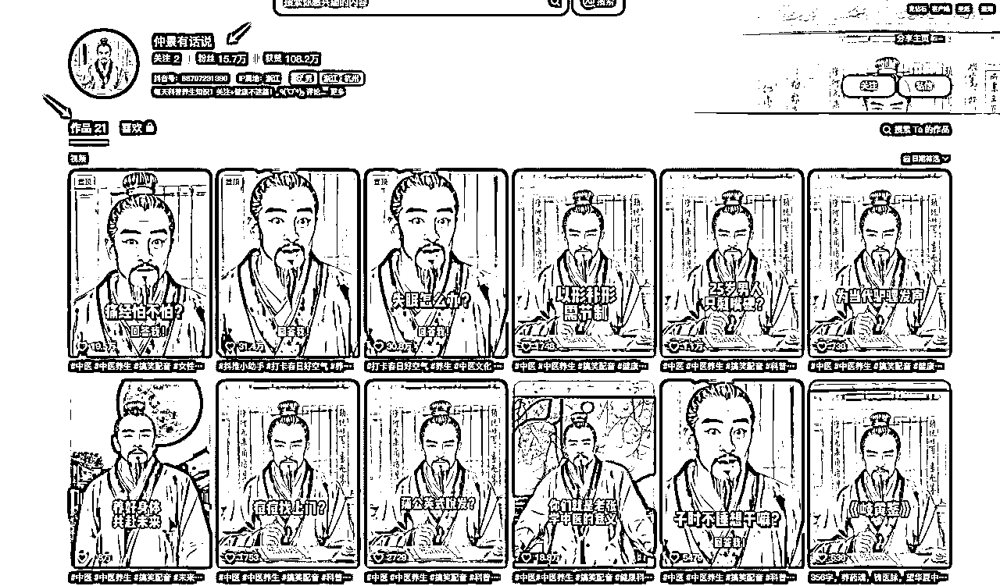
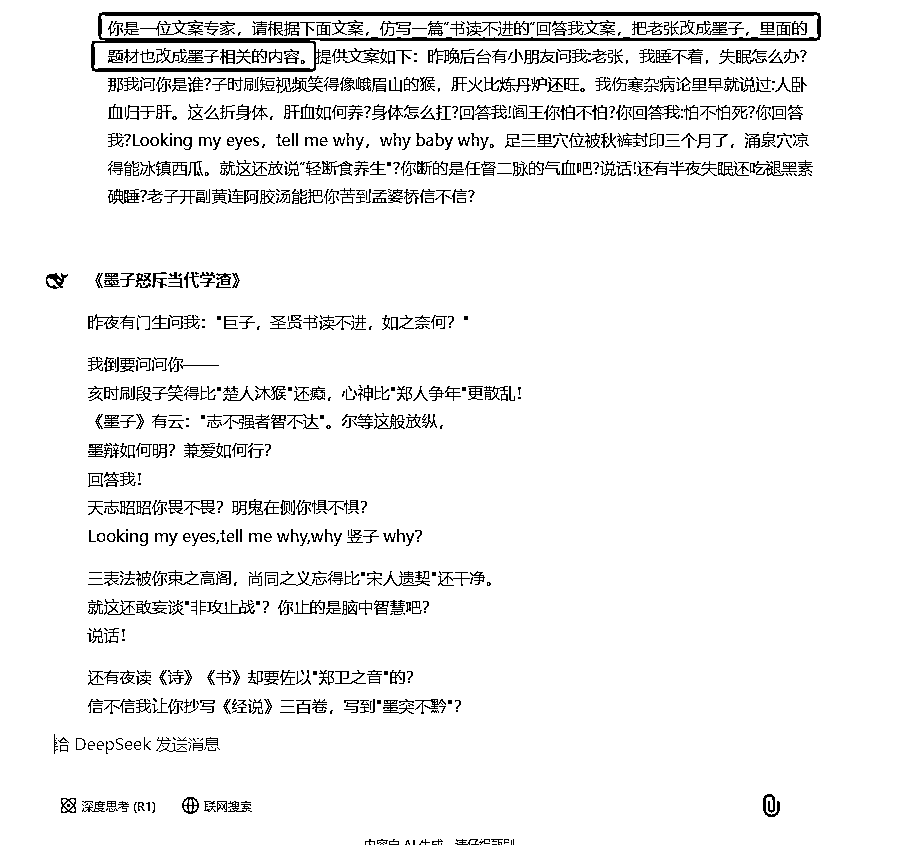
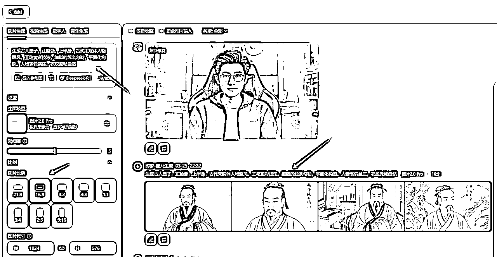
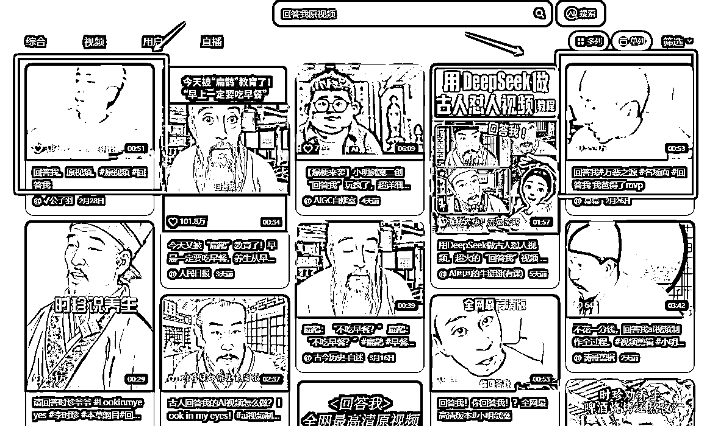
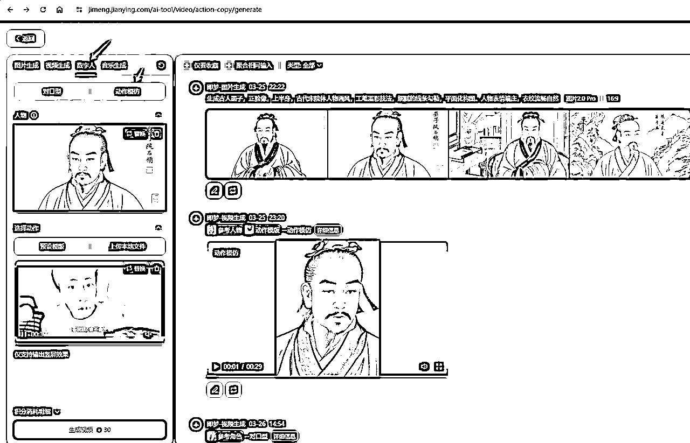
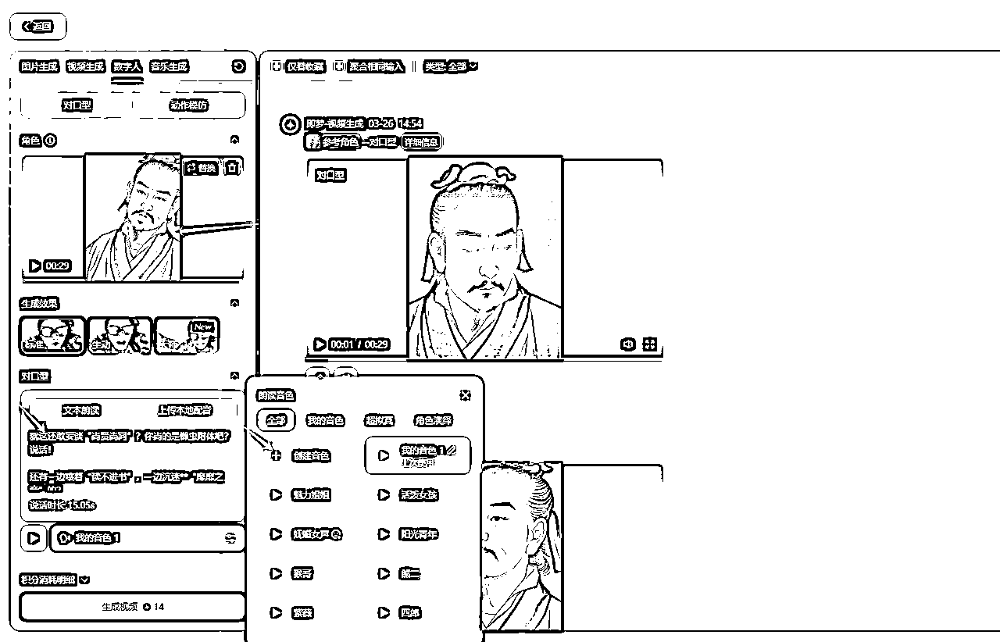
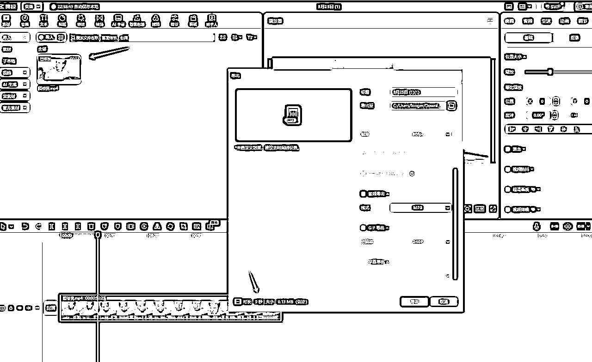
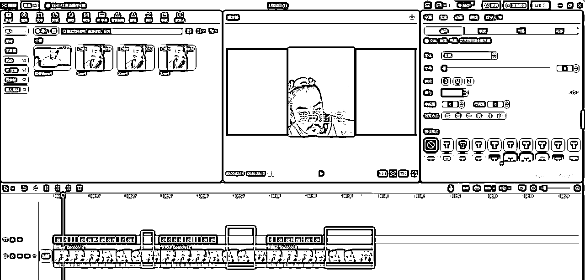
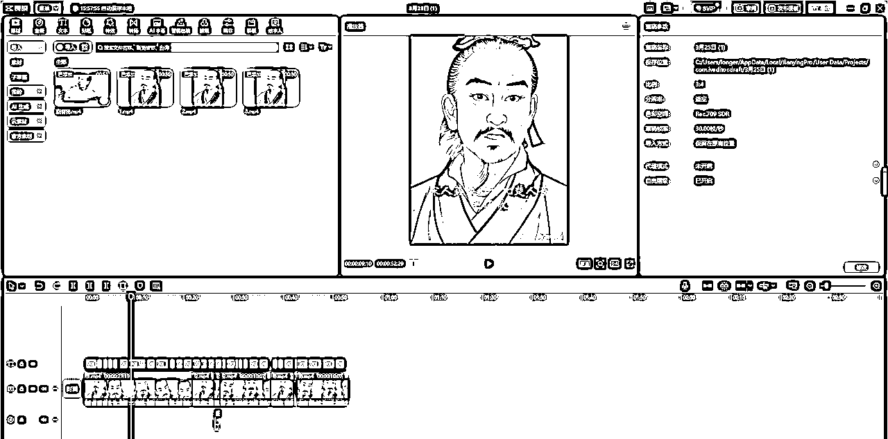

# Deepseek 搭子即梦，国内也能做爆款“回答我”视频

大家好，我是Longer

最近全网都在刷“回答我”类型的视频，玩法火得很。之前不少人用 viggle.ai 来做，结果被梯子劝退了。今天我用全套国产工具演示一遍，效果一样能玩转。

21条相关作品，就吸了15.7万粉

整套流程拆成6步，跟着做就能复刻：

# 第一步：让Deepseek重写视频文案

先找一条“回答我”类型的口播稿当底稿，再用 Deepseek 进行改写。提示可以这样写：你是一位文案专家，请参照下方文案，仿写一篇主题为“书读不进去”的回答我风格文案，把人物老张替换成墨子，并且整体内容围绕墨子相关。文案如下：

# 第二步：即梦里画出古人形象

以墨子为例，生成一张可用的角色人设图。

建议提示词：生成一位古人墨子，正面头像，上半身，风格参考古代宋院体人物画，采用工笔重彩手法，线条精致，构图扁平。面部神情庄重，衣袍纹理顺畅自然

# 第三步：拿到回答我原版动作视频

在抖音里搜“回答我原视频”就能找到大量素材，直接下载其中一条做动作参考。

https://www.douyin.com/root/search/%E5%9B%9E%E7%AD%94%E6%88%91%E5%8E%9F%E8%A7%86%E9%A2%91?aid=4de6e88a-d865-4a0f-8d19-b458d2e69b4c&modal_id=7476319568890301755&type=general

# 第四步：即梦数字人动作克隆

打开即梦的数字人功能，选择动作模仿模式，把刚才生成的墨子人像图作为主角上传，并把下载好的原视频作为动作源导入，即可生成同款肢体视频。

# 第五步：即梦文本配音实现对口型

1、把上一步生成的角色视频导入，即梦的文本朗读功能，在文案框里粘贴 Deepseek 输出的脚本

2、再新建一个音色，音色样本可以先用剪映剪出一段5到10秒的纯净人声作为参考

# 第六步：剪映收尾精修

1、利用剪映的识别歌词功能，把视频里没有声音的空段直接剪掉

2、把画面比例调成3:4，重新设计字幕样式，最后导出发布

