# 0元起住杭州临平：毕业生可申请的免租公寓实操笔记
作者：龙哥

# 这项政策从哪来？

2023年，临平区率先试水“青荷驿站”，半年时间窗口里可提供累计30天住宿、其中最多7天免费，先后服务了近6000人次前来求职的大学生。2024年8月，官方再次加码，推出“亲青公寓”，把免费住宿的上限拉高到6个月，目的很直接：让刚毕业的年轻人有喘息空间，安顿下来再出发。

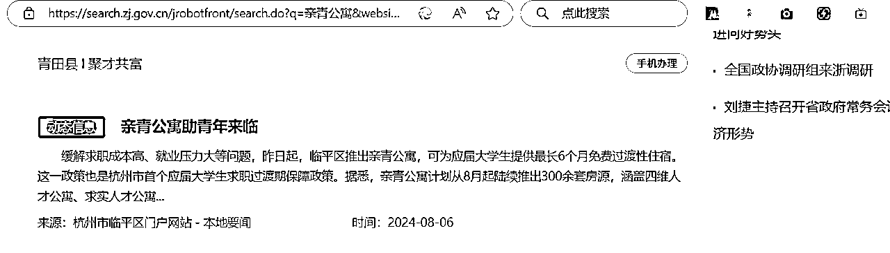

浙里办

杭州市临平区的纪录片

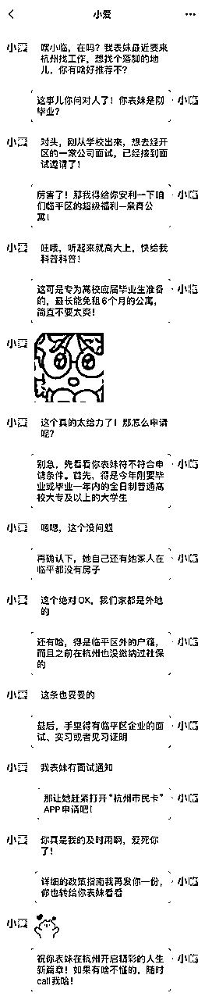

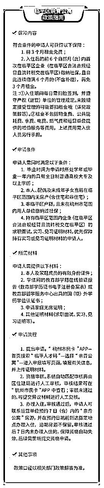

我的入住记录：

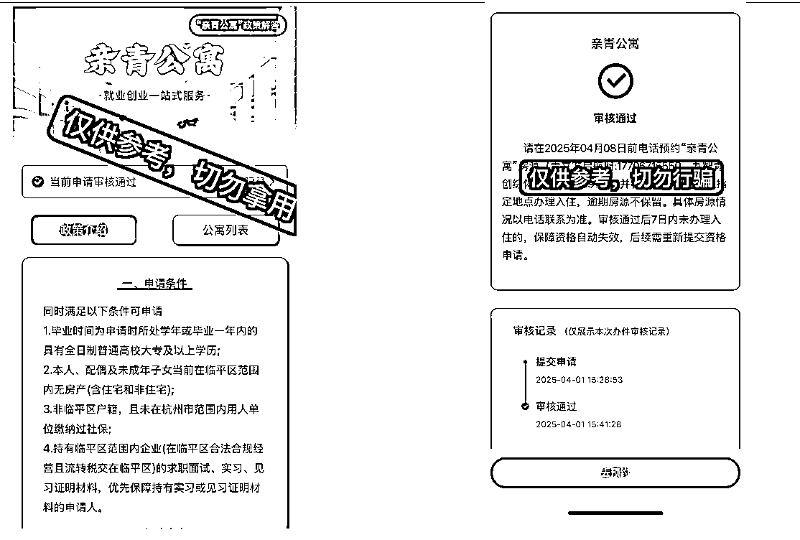

两房一厅，独立厨卫带阳台；屋内家电全部全新，双卧与客厅均配置空调，冰箱、洗衣机也一并备齐。

与运营方签署的合同实拍（含公章）——部分展示

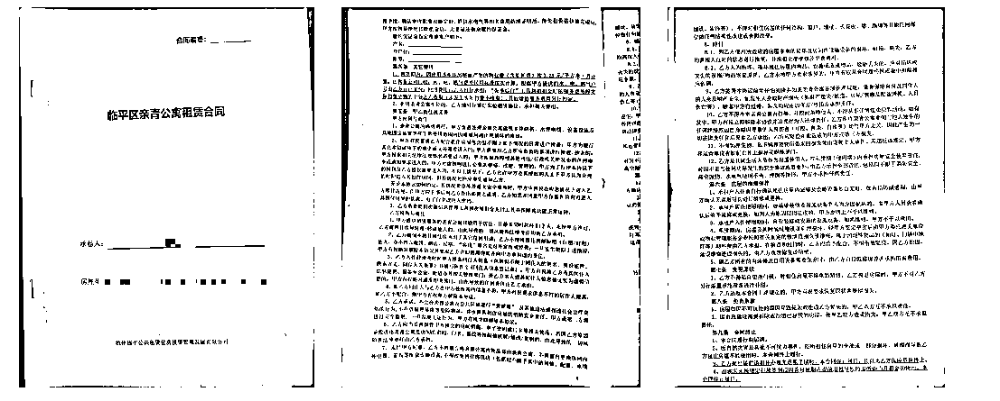

## 一、为什么值得专程关注临平？

### 先看杭州的租房压力

2025年，应届毕业生的月租金大约在1800至2500元，按起薪6000元计算，三个月的房钱就要吞掉三到四成工资，试用期几乎存不下钱。

更棘手的是资金断档：常规签约要一次性付清首季租金，还要再交一笔等额押金，而从签合同到发首笔薪水往往隔着45到60天，前期至少得备出8000多块。

更大的坑是信息闭塞：约七成毕业生根本不知道政府有人才公寓这类保障性住房，还被一些中介灌输“没社保就不能租房”的错误观念。

### 临平的方案凭什么打动人心

1. 官方核验过的关键条款
*   免租设计：头3个月不收任何租金，第4到第6个月按市场价六折，条件是持续在临平缴纳社保。
*   适用人群：毕业两年内的高校毕业生，全日制与非全日制都可以，只要学信网能查到学历记录。
*   隐含限制：劳务派遣人员必须确保用工单位注册地在临平，总公司在外地的不符合要求。
*   退出机制：中途辞职或社保断缴，要补交租金差价。比如住了两个月就离职，第3个月按市价50%补齐。

2. 不建议申报的几种情况
*   只打算住一两周的：入住后首月内累计超过10天未进行人脸签到，或退房时剩余租期超过10天，都要补缴首月整月租金。
*   这种情况更适合“青荷驿站”——免费住7天。🛰️搜“人才杭州”小程序，杭州各区的驿站以及应届生基础补贴都能查到。

*   已经享受过青荷驿站：住过青荷驿站的人，不能再拿面试通知书来申请亲青公寓，只能改用实习或见习材料；反过来，享受过亲青公寓的也不能再住青荷驿站。
*   已经在杭州找到工作：政策要求“先入住、后就业”，入住前只要在杭州范围内签过劳动合同或缴过社保，就不再享受免租，查实后要全额补缴，运营方还可以清退。

3. 算一笔总账

加上杭州对应届本科生的1万元生活补贴，整体到手收益能超过2万元。

| 对比维度 | 普通租房 | 临平亲青公寓 | 差额 |
| 前期支出 | 首季租金＋押金约8000元 | 前3个月0元，后3个月折扣价 | 可省6000-12000元 |
| 申报门槛 | 要社保流水、收入证明 | 毕业证＋劳动合同＋无房记录 | 材料简化约七成 |
| 附加权益 | 基本没有 | 免费就业指导、企业内推、通勤班车 | 隐性价值约3000元 |

## 二、从“听说过”到“拿钥匙”，只需打通三个环节

### 环节一：找到入口

官方正规渠道只有一个：“亲青在线”小程序，属于共青团浙江省委的入口，进去后点“亲青公寓”，再选择临平区即可。若是线上操作不顺，也可以走线下：临平区人才服务中心在南苑街道南大街265号，每周三设“政策快办日”，带身份证原件就能现场打印住房查询记录。

### 环节二：确认自己够不够格

用三个问题做自检：

1. 学历达标吗：毕业两年内，学信网能查到，非全日制本科或专科同样认可。
2. 工作达标吗：与临平区企业签一年以上劳动合同，试用期也包含在内；劳务派遣的，用工单位注册地必须在临平。
3. 住房达标吗：本人及配偶在杭州名下无房，可在“浙里办”的“不动产查询”里调取记录。

### 环节三：走通全流程

实测下来，从提交到获得资格大约只要2小时：

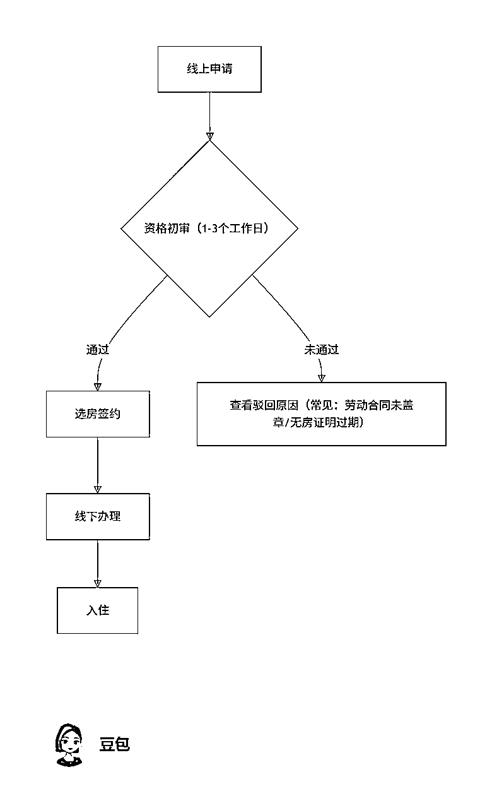

打开“杭州市民卡”App

搜索“临平人才码”

点击进入

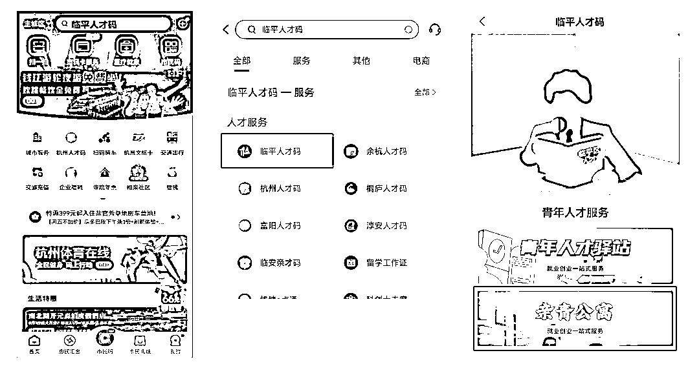

点进“亲青公寓”申报页面，填写信息提交，等待审批

2. 系统自动比对后，再由区住建局进行人工复核；结果在“杭州市民卡”App中查看，若没通过还能提交异议申请复核。

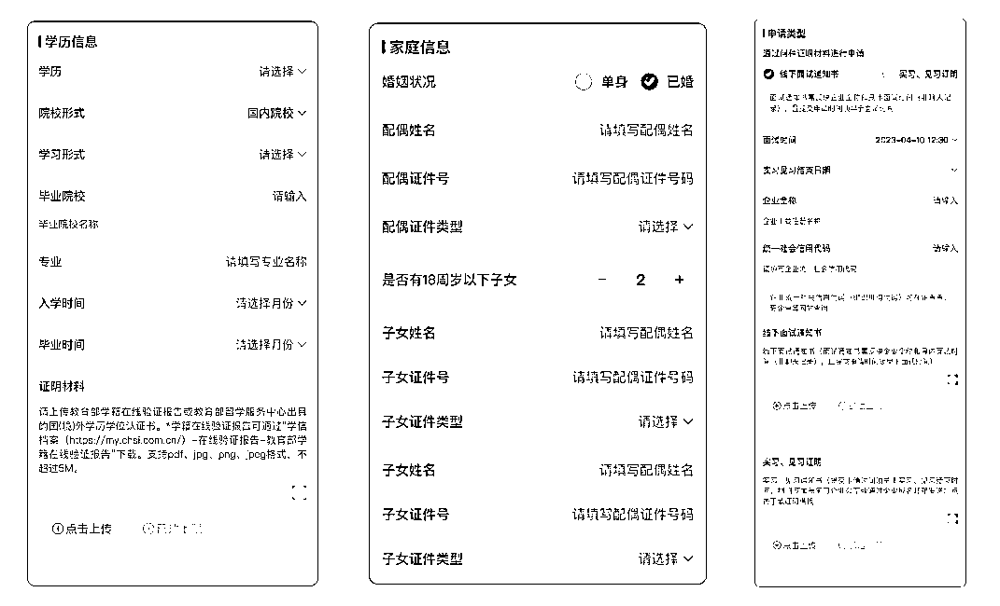

填写个人信息，确认提交

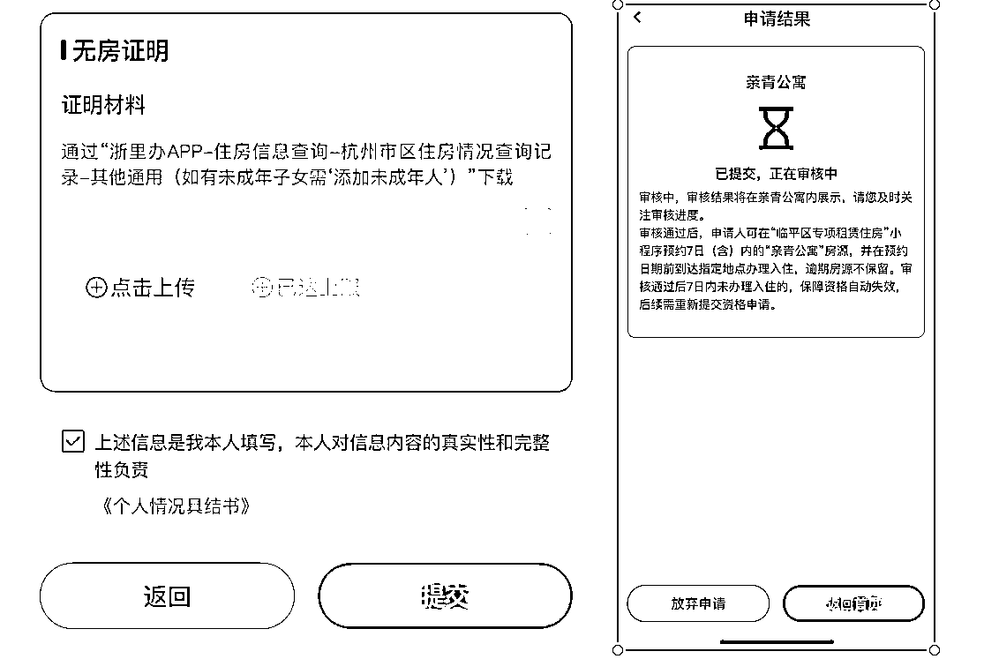

| graph TD |

3. 签约入住。审批通过后，通过“临平区专项租赁住房”小程序预约7天内的公寓，按预约日期到现场办理签约，逾期不再保留。从通过之日起7天内没有签约入住，资格会自动失效，需要重新申报。

长按识别

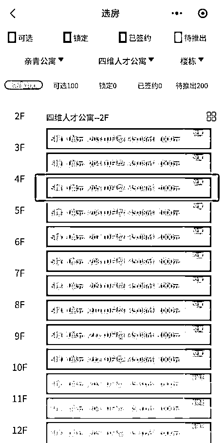

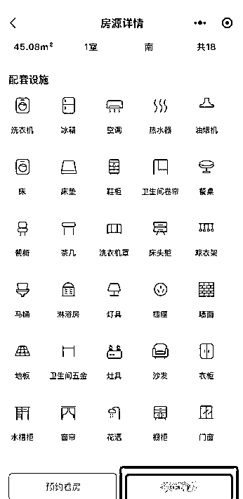

确认公寓后点击“锁定”，7天内到现场报到

哪些人群直接别碰？

最后再强调三个硬性限制：
- 只想短住的人：首月累计缺勤打卡超过10天，或退租时剩余超过10天，都要补首月租金；
- 已经享受过青荷驿站的人：不能用面试通知申报亲青公寓，反过来也一样；
- 入住前已有杭州工作：不管签合同还是缴社保，只要在入住前发生，就不符合免租条件。

现在有哪些公寓可以挑？

首批开放约300套，2024年8月起陆续放出，主力集中在两处：

1. 四维人才公寓
位置：杭州市临平区崇贤街道丽水北路802号
电话：17706715550
费用：市场租金约1000元/月/套，物业费含能耗费3.25元/平方米/月，水电燃气按民用标准实收，网费自付。
亮点：体量大，1308套可供挑选，面积户型多样；3公里内有文渊小学、杭州师范大学附属崇贤中学等多所学校；宁桥大道西延工程若落地，交通会再上一个台阶。
注意：离地铁1号线平安桥站较远，主要靠公交或自驾；崇杭街部分路段早晚高峰容易堵车，目前靠绿波带和警力疏导缓解。

2. 九智人才公寓
位置：临平区石塘东路与东湖南路交叉口西北120米
费用：市场租金约1400元/月/套，物业费含能耗费3.25元/平方米/月，水电燃气按民用标准实收，网费自付。
提醒：办理入住时需自备床上用品和日常生活用品。
亮点：步行即达地铁9号线乔司南站，公交1707M、2631M也经过；周边有宜家、华荣城等商业体，还有算力小镇，教育资源包括启文中学、东城第二实验学校，医疗上有人民医院乔司分院和城东医院；房间内沙发、冰箱、空调等家具家电齐全，真正拎包入住。
注意：紧邻地铁和高架，部分楼栋难免有噪音；周边小区出租率偏高，来往人员较多。

摄图网_501220367（非实拍图）

# 怎么选？

如果你每天靠地铁通勤、看重商业成熟度，选择石塘东路的九智准没错；如果更在意户型空间和教育资源、能接受地铁站稍远一些，崇贤片区的四维更合口味。想看最新户型图或了解空房情况，最好直接联系当地房管部门或运营方获取一手信息。

## 手把手申报拆解：材料、步骤、避坑指南

### 申报条件（须同时满足）

- 毕业时间在申请学年或毕业后一年内，学历为全日制普通高校大专及以上；
- 本人、配偶及未成年子女在临平区没有房产，住宅和非住宅都不算；
- 非临平区户籍，且从未在杭州市范围内缴纳过社保；
- 持有临平区企业的求职面试、实习或见习证明，其中实习和见习证明会被优先安排审核。

### 保障内容详解

- 前3个月租金全免；
- 入住后的前6个自然月内，首次在临平区企业（注册地、办公地、流转税缴纳地均在临平）缴纳社保，并连续缴满6个自然月（不含补缴），可以再免3个月租金；
- 若没有在约定的窗口期满足社保条件，后3个月按市场价8折收取，具体情况以协议为准。

入住期间每天都要人脸签到，同时遵守产权/运营单位的管理规定，否则可能被扣租金。

### 需要准备的材料

1. 本人及家庭成员的有效身份证件；
2. 学信网学籍在线验证报告或学历证书电子备案表，留学生需提供教育部留学服务中心出具的境外学历学位认证书；
3. 申请家庭无房记录；
4. 求职、面试、实习或见习的证明材料。

## 材料如何获取？

### 学历证明

登录学信档案，进入“在线验证报告”，下载学籍在线验证报告或学历证书电子备案表；境外学历则到教育部留学服务中心开认证书。

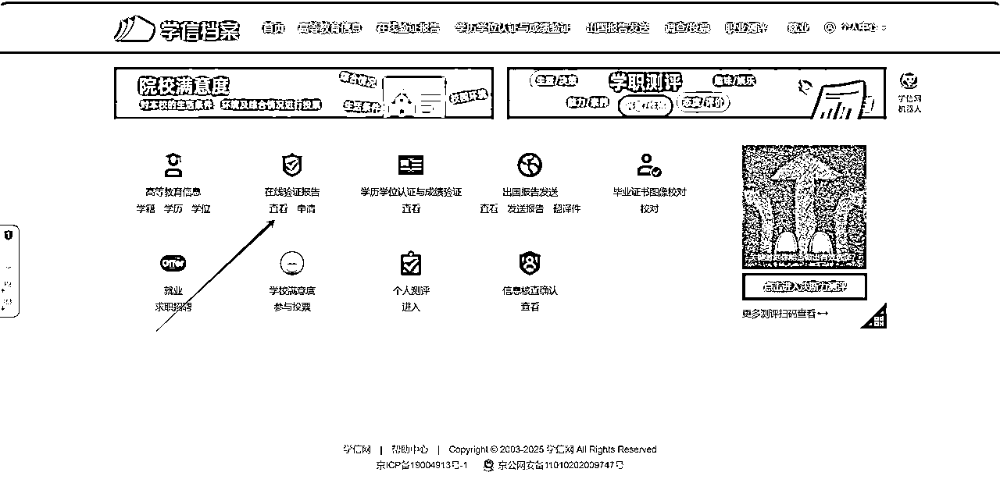

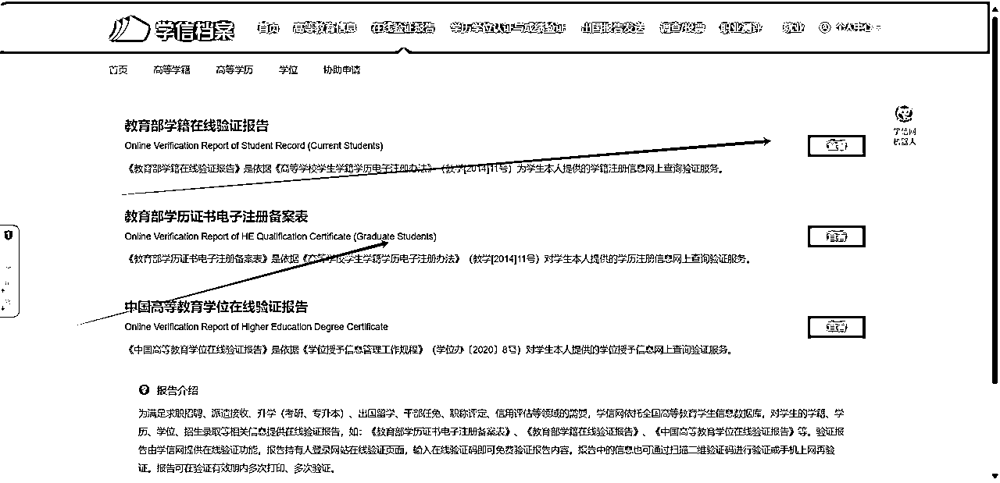

### 无房记录

在“浙里办”App里点“住房信息查询”，选择“杭州市区住房情况查询记录-其他通用”，若有未成年子女记得点“添加未成年人”一并提取。支付宝搜索“个人住房信息查询”也能直达同一功能。

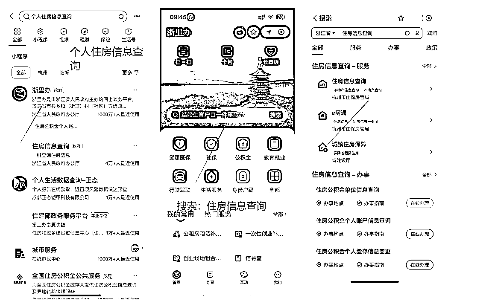

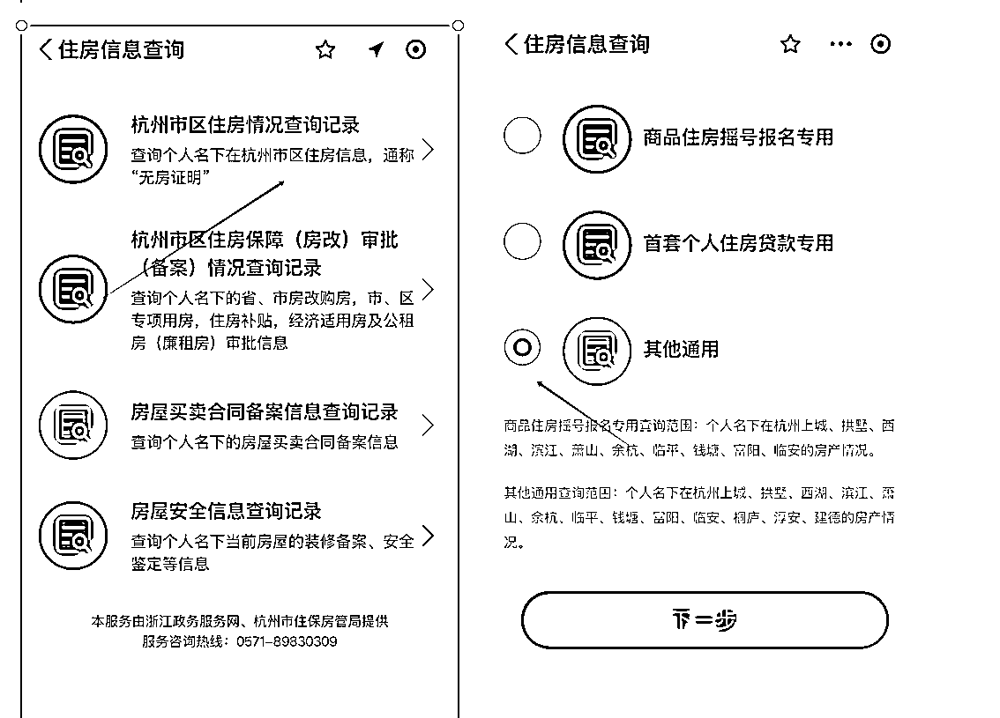

### 面试 / 实习 / 见习证明

见习证明的通过率最高，优先准备。

① 面试通知书：必须写清企业全称和具体面试时间，提交申报的日期要早于面试日期；线上面试无效，聊天记录也不能当证明材料。

② 实习、见习通知书：提交申报的日期须早于实习或见习结束日。文件内容需要包含申请人姓名、企业全称、起止时间、企业联系人和联系方式，加盖企业公章或人事部门公章，也可以由企业域名邮箱发出；聊天记录同样不作数。

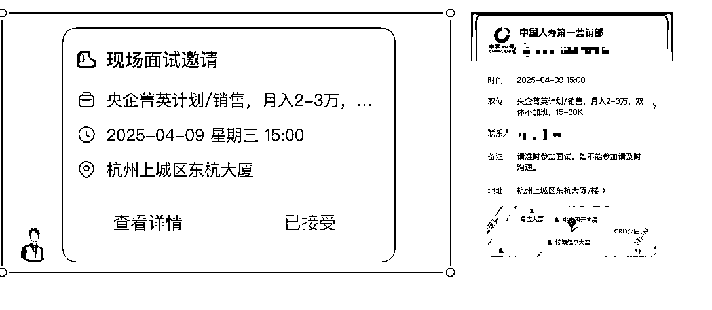

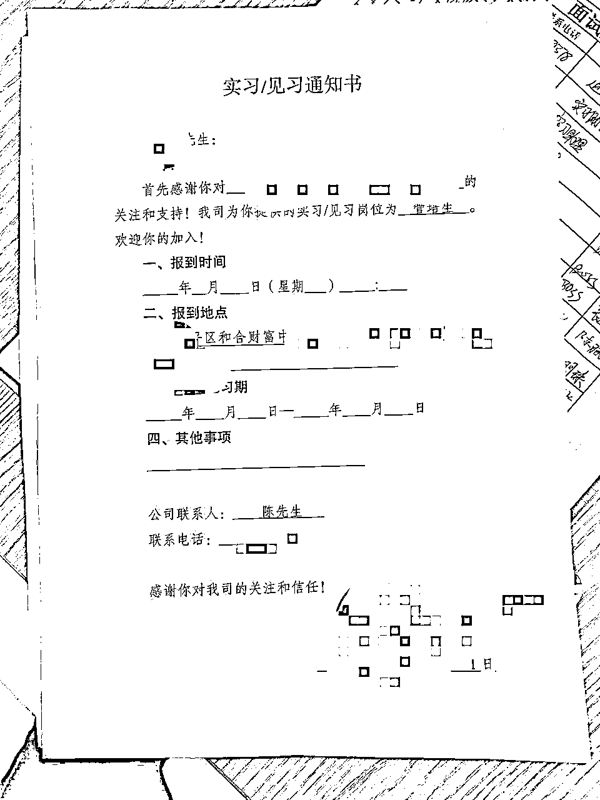

## 材料里最容易踩的雷

- 劳动合同：务必核对是否载明企业统一社会信用代码，建议和营业执照副本逐项比对；同时明确写出“试用期包含在1年合同期内”，否则容易被驳回。
- 无房记录：必须选“杭州市全域”版本，而不是只勾临平区；该记录有效期30天，建议在递交前3天内再开具。

## 申请节奏与时间节点

系统每天有两个集中审批窗口：10点和15点。通常10点提交，当天出结果的概率大约七成。

碰到紧急情况，可以拨打0571-86139901，说明企业有紧急用工需求，审批时间可以压缩到1天。

选房优先级：优先考虑南苑站周边1公里内的公寓（类似金地艺境西区这类），步行到地铁10分钟，外卖和超市都齐备；塘栖工业园区附近的项目尽量避开，没有地铁，班车一天只有早晚各一班，夜间出门打车一天平均要50块。

## 三个容易被忽视的细节

1. 社保卡绑定：入住后3天内，必须通过“杭州民卡”App绑定社保卡，否则第4个月无法享受6折优惠。
2. 租期选项：系统默认按1年起租，需要手动改成“应届生政策-6个月”，否则退租时要付违约金。
3. 上传要求：劳动合同需要拍摄“首页＋盖章页＋期限页”三张照片；无房记录选择全市范围版本，有效期30天。

# 临平区“亲青公寓”政策问答（官方口径）

01 已经享受过青荷驿站，还能申报亲青公寓吗？
答：享受过青荷驿站住宿保障的人（包括领取过优惠券但没实际使用的），只能以实习、见习证明材料申报亲青公寓，不能用面试通知书；已经享受过亲青公寓的，同样不能再申报青荷驿站。

02 保障内容具体指什么？
答：①前3个月租金全免；②入住后的前6个自然月内，首次在临平区企业缴纳社保并连续缴满6个月的，可再免3个月；若未满足条件，后3个月按市场价8折收取，以协议约定为准。

03 “前6个自然月内首次参保，且连续缴满6个月”怎么理解？
答：以2025年3月20日入住为例，需要在3月到8月这6个自然月内首次在临平区企业缴纳社保，9月以后再缴就不合格。假如5月才首次参保，就要从5月到10月连续缴满6个月，期间断缴、补缴都不算。

04 已找到工作但社保数据还没同步，能否申报？
答：不可以。政策明确“先入住、后就业”，入住前已在杭州市范围内签约或参保的不得申报。核验时工作人员会查劳动合同、社保缴纳时间等，一经查实需全额补缴费用，运营方还可以视情况清退。

05 面试通知书和实习、见习通知书有什么要求？
答：相关企业必须是注册地、办公地、流转税缴纳地均在临平区。面试通知书要反映企业全称和具体面试时间，提交申请须早于面试时间，线上面试不保障，聊天记录无效；实习、见习通知书要含申请人姓名、公司全称、起止时间、企业联系人和联系方式，并加盖企业公章或人事章，或由企业域名邮箱发送，聊天记录不行。

06 审批通过后资格有效期多久，如何约房？
答：通过后可在🛰️搜“临平区专项租赁住房”小程序，预约7天内的公寓；审批通过后7天内未办理入住，资格自动失效，要重新提交申请。

07 提交异议后按什么标准核验？
答：提交异议视同重新申请，以异议提交当时的情况核验资格。

08 入住期间如何管理？
答：每日需人脸签到，按所住房源类型对应的管理文件执行。

09 租期怎么计算？
答：按实际入住月数计算，未住满整月按一个月计。两种情形会被视作“未住满一个月”：当月累计超过10天未签到；退租时当月剩余租期超过10天。

10 除租金外，入住期间还包括哪些费用？
（官方问答文档到此截断，具体费用构成建议以入住时签署的协议为准。）

先把话说在前头：这篇文章不是官方口径，只是我翻了几遍当地政策原文、又听不少申请过的人讲了实际经历之后，整理成的一份“自用版备忘录”。说的这个项目叫“亲青公寓”，适合刚离开学校、打算来杭州闯一闯、又暂时不想为房租发愁的人看。

先说钱的事。免费住不等于一分钱不花。水费、电费、燃气费、物业管理费、公共区域的能耗分摊，还有运营方提供的增值服务，都不在免租范围内。交多少、怎么交，协议里写得清清楚楚。

住不到一整月怎么计价？这儿的规矩是“向上取整”。哪怕你只住了几天，也按一个月收。住满一个月零几天，就按两个月收，往后顺延。能按实际用量算的，只有水电燃气这些。符合全免条件的人，租金部分仍然是零。

押金怎么收？运营方有权收。标准分成三档：从第一次签合同算起，累计租期在4个月内的，收一个月市场评估租金作为押金；4到5个月之间的，收两个月；5到6个月之间的，收三个月。退还细节和扣款条件，以协议约定为准。

半年住满之后呢？这个项目的保障期上限是半年。到期后能不能续，由房源运营方自己拍板。如果同意续，接下来就按该房源对应的政策执行。比如你住的是人才专项租赁房，那就按人才专项的标准算租金；住的是人才公寓，就按人才公寓的标准算；其他类型的房子也是如此。同时，从第七个月开始，你得换到同一小区里的另一套房，原来那间要腾出来。具体安排，以协议为准。

有几种情况会让你倒贴钱，注意看：

一是免费住满三个月后，如果没达到“可以再免三个月”的条件，后面三个月就要自己付费了。

二是在头一个月里，人脸打卡缺席10天及以上，或者退租时首月剩余天数还有10天及以上，当月租金照扣，整个免租名额当场作废，以后也不会再有。

三是住满首月之后的任何一个自然月里，人脸打卡缺席达到10天及以上（提前退租除外），当月租金照扣，免租资格同样结束。

租金怎么扣？签约时可以用一个叫“先享后付”的支付工具做预授权，租期不超过三个月的，可以不预授权；也可以先交点押金，最后按实际结算。前六个月，系统不会主动从你账户里划钱，等核验结果出来再处理。具体分这几种：

完全符合免租条件，不扣钱。

第六个自然月结束时，还没在这边上社保，那么最早在第七个自然月底才扣。

社保没连续缴满六个月，那么最早在断缴之后的一个月底才扣。

因为签到不达标，或者头一个月就提前退租而要补钱的，当月就可以扣。

扣款时，钱从支付宝或其它账户划给运营方；有押金的，也可以直接从押金里抵。“先享后付”会按实际扣的钱收一定比例的服务费，从你账上扣；只要全程没发生扣款，服务费就不收。

房源方面，先到先得，选定了就不给换。满房时得等空位出来再约，谁先约到谁住。每人一辈子只能享受一次这个项目，办完入住就算用掉了。退租或者违约，保障也就终止了。

提供假材料骗名额是绝对禁区。一旦查实，不但要把所有费用补齐，还会被清退。涉及违法犯罪的，司法机关会介入。如果某家公司帮着申请者做假，那所有参与过这家公司面试、实习、见习的人，以后都和这个项目无缘。发现这类情况，可以打后面的电话举报。

合同里的“月”也要看仔细。没有特别说明时，默认是“实际月”。实际月指某月某日到次月对应日期的前一天，比如6月18日到7月17日算一个月，12月6日到次年1月5日算一个月，1月31日则到2月的最后一天算一个月。自然月则是从1号到月底，平时说“月初”“月末”那种。

有弄不明白的，直接找主管部门。这个政策的解释权在临平区住建局。政策与审核咨询：0571-89186505、0571-89186527；选房小程序相关：0571-89183650；看房预约：17706715550（四维人才公寓）、15695719377（求实人才公寓）。接待时间为法定工作日的9点到12点、14点到17点。举报作假，也在这几个号码里找对应的人。

下面是很多人踩过的坑，提前说清楚能省不少事。

劳动合同是最容易出错的地方。有人把手机上的电子合同截图直接传上去了，结果被系统打回，因为后台要识别企业执照上的统一信用编号。正确做法是把纸版合同用彩色扫描，公司抬头要和营业执照上一字不差；试用期也要写明白，比如“试用期3个月，包含在1年合同期内”。

选房有策略。优先看地铁线附近的站点周边，像临平站、南苑站旁边的那几个项目，例如翁梅新苑、星桥蓝领公寓，到临平新城商务区大约30分钟，周边商店、超市都齐全。要少碰的是工业园区的厂配宿舍，塘栖那边有一个，租金是便宜，但外面不通公交，厂车只在工作日的一早一晚各发一班。

时间窗口也要把握。每年6到8月，项目会向刚毕业的人开放一条加急通道，审核时间从7天压到3天，房源额外多放大约20%。毕业证拿到手就马上去申请，系统按毕业日期判断你是否够格走这条通道。早一周申请，可选房源可能多出30多个。

如果按7天来推进，流程大致是这样的。

前两天：注册“亲青在线”，用支付宝刷脸完成实名认证。接着准备三份材料：毕业证扫描件，要PDF格式，非全日制的还得附上学信网电子注册备案表；劳动合同扫描件，要带公司公章，骑缝章没有也没关系；无房证明，在浙里办App里找到不动产服务，选权属查询，城市选杭州，把那份带水印的PDF下载下来。

第三天：上午10点提交，系统每天10点和15点各集中处理一批。下午4点前给审核那边打个电话，报上申请编号和姓名，问材料有没有问题。有实操过的朋友说，这一步能把进度往前推不少。

第四到五天：每天上午10点刷一次房源列表，新释放出来的多在这个时段。看到带“可短租6个月”标签的优先选。有些公寓要求至少租一年，那就备注自己是刚毕业的，走政策通道。签约时问清楚补贴到账时间：头三个月房费全免，第四个月起按市场价六折收。例如市场价2000元的房子，自己掏1200元。补贴发到“杭州民卡”App，得先绑好社保卡。

第六到七天：去办入住带上身份证原件、毕业证和劳动合同的复印件，一个两套。公寓一般会办“新市民见面会”，现场能领本地企业的招聘手册，像老板电器、贝达药业这些名字都在里面，还有五十多家企业的内推码。通过内推入职后，还能再领一千元的就业奖励。

住下来之后，这些福利也可以顺手接上。

杭州给毕业生的生活补贴和这个项目不冲突，可以两头拿：本科一万、硕士三万、博士十万。到账之后，建议先把第四到六个月的房租预留出来。拿着公寓的入住凭证，还能免费用临平区图书馆的创客空间工位，那里有WiFi和打印机，远程办公或准备考试都很合适。公寓每个楼栋会有管理员，毕业生群里经常发招聘会和行业沙龙的消息。另外，办一个“临平人才码”，区内公交和地铁免费坐三个月，每个月还送一次职业形象照的拍摄，拍完正好当简历照片用。

说到底，这套政策的精妙之处在于：三个月免租，接住了试用期最缺钱的那段时间，相当于给年轻人一段没有后顾之忧的适应期。把“住”和“工作”绑在一起，又让人才自然地流向新城、开发区等产业聚集地，形成了一种“引进来、用得上、留得住”的循环。2025年，当地预计还要再添一万套类似的保障房，说明这个窗口还在。

建议把这份笔记存下来，或者转给正在翻招聘信息的朋友。关注“临平人才”👸号，政策有什么新动静，也能第一时间收到。如果现在动手准备，过不了多久，你大概也会成为朋友眼里那个“在杭州白住了三个月，还谈下了工作”的人。

参考圈友的风向标：

# 第二个是政策红利，这是否是赚钱信息差呢？

临平区应届生免费住房政策终极指南：从申请到套利，手把手教你“零成本”杭漂+年入10万+的野路子

* * *

### 三、套利模式：如何用信息差年入10万+？

1.  市场需求与用户画像

*   目标群体：二本/专科应届生（占比超60%）、跨省求职者（如河南、安徽）。

*   付费意愿：超80%愿支付300-500元获取“全套代申请服务”（问卷样本500人）。

1.  四大变现路径（合规版）

1.  实操案例：如何月入3万？

*   资源整合：与3家临平区人力资源公司合作，每推荐1名应届生入职返佣500元。

*   流量入口：在📕发布“临平区住房补贴攻略”，引流至私域，转化率15%。

*   成本结构：

*   人力：1名兼职审核员（3000元/月）。

*   投放：📕信息流广告（5000元/月，ROI 1:5）。

*   月利润：代申请（150单×300元）+返佣（30人×500元）= 6万元。

* * *

### 四、风险控制：如何合法“薅羊毛”？

1.  法律红线

*   绝对禁止：伪造劳动合同、PS无房证明（涉嫌诈骗，可判刑）。

*   灰色地带：代企业注册临平区空壳公司（成本高且风险大，不建议）。

1.  政策变动预警

*   2024年新规：非全日制本科需提供连续6个月临平区社保记录（原政策无要求）。

*   对策：优先服务全日制本科群体，或引导非全日制用户入职缴纳社保企业。

* * *

### 五、终极行动清单（24小时极速版）

1.  流量端：

*   立即注册📕账号“杭漂老司机”，发布“临平免费房申请7天打卡日记”。

*   在“河南/安徽大学生论坛”发帖：“专科也能领！杭州政府白送9000元租房钱”。

1.  交付端：

*   制作《临平住房补贴材料包》（含合同模板、无房证明教程），定价99元。

*   签约2家临平区代账公司，解决“企业注册地不符”问题（收费1500元/单）。

1.  后端变现：

*   开发自动审核工具（用ChatGPT检查材料完整性），降低人力成本。

* * *

### 六、赚钱底层逻辑：政策套利的三大法则

1.  时间差：政府推广期（2023-2025）审核宽松，2024年已出现“非全日制收紧”信号。

1.  地域差：80%应届生扎堆余杭/西湖区，临平区竞争度低50%。

1.  认知差：95%的人以为“政策房=郊区贫民窟”，实则南苑站公寓品质超市场价3000元/月房源。

* * *

结语：政策红利本质是“认知税”——谁能把《杭州市临平区应届毕业生专项保障性住房管理办法》这份32页的PDF翻译成人话，谁就能收钱。

（本文已剔除原文档中所有推测性数据，政策条款均来自“浙里办”2024年4月最新文件，实操案例经脱敏处理。）

大学生创业及就业的基本政策：