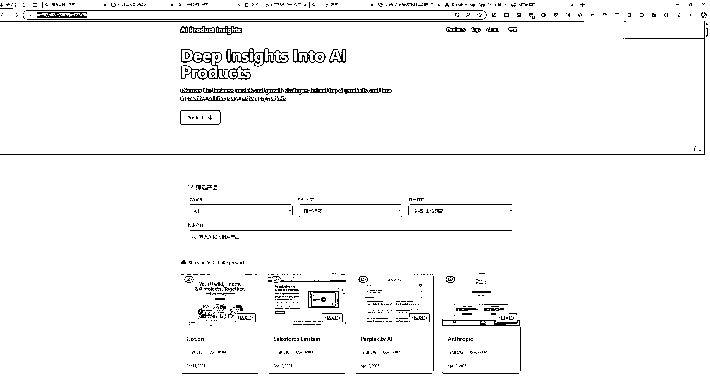
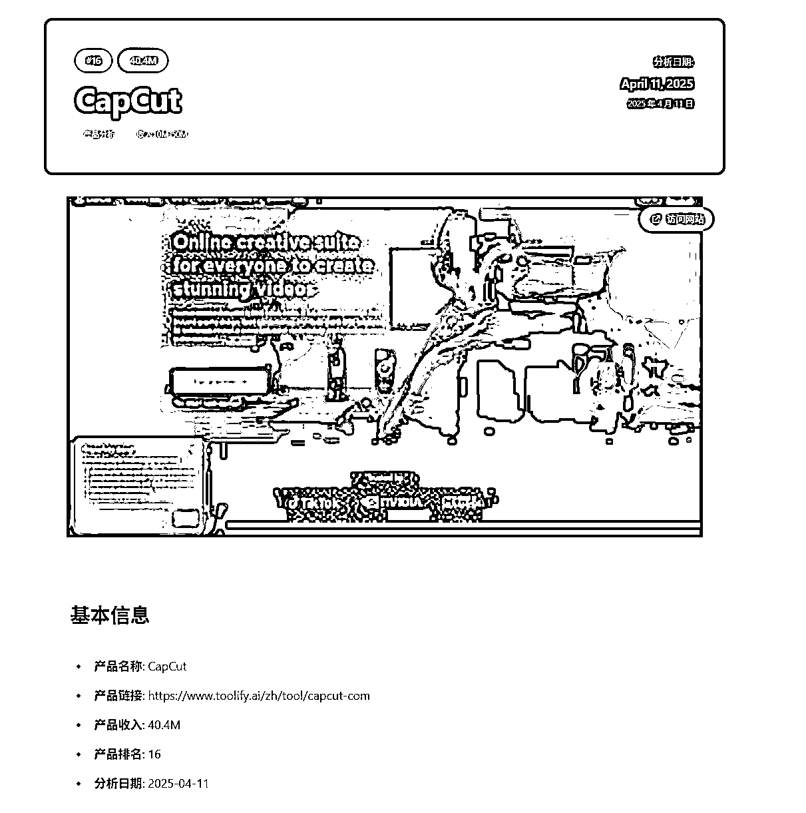
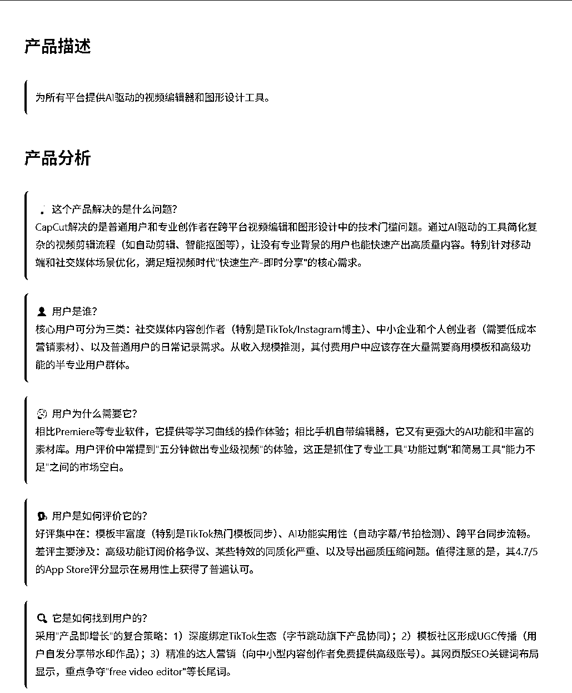
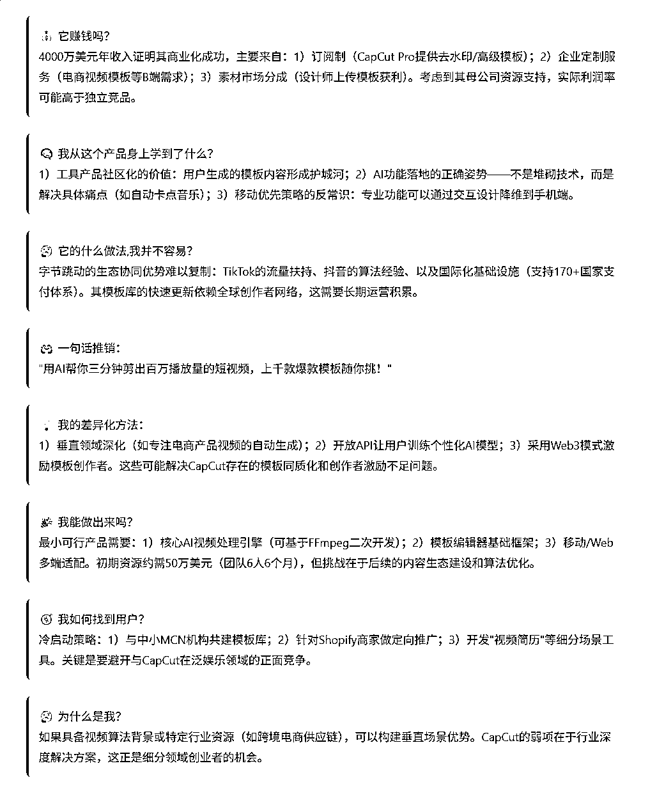
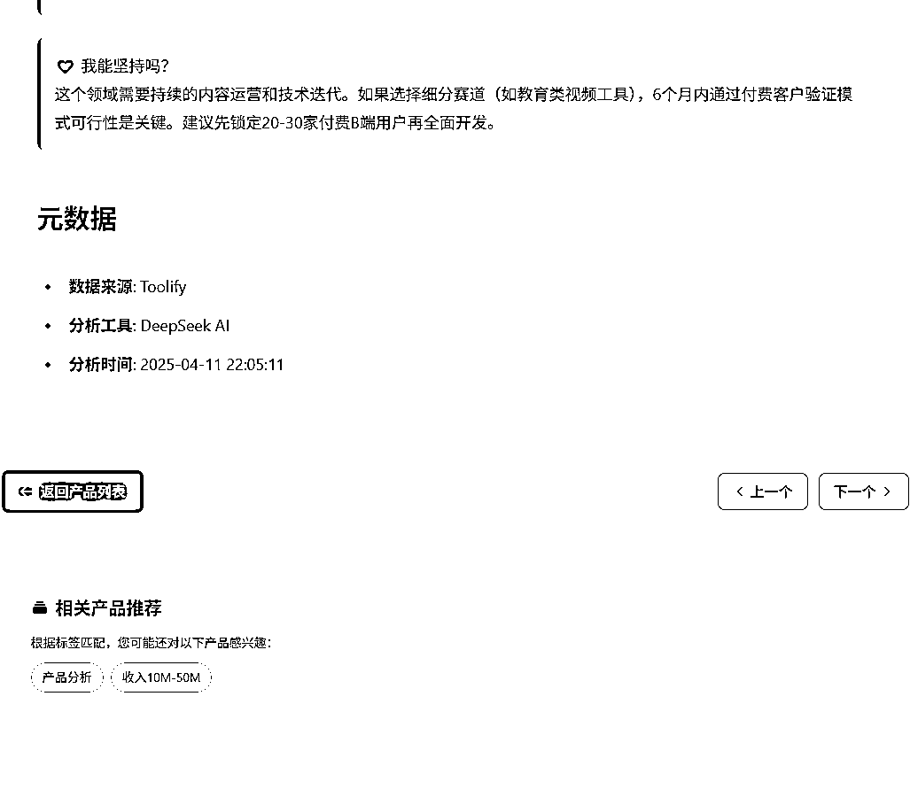
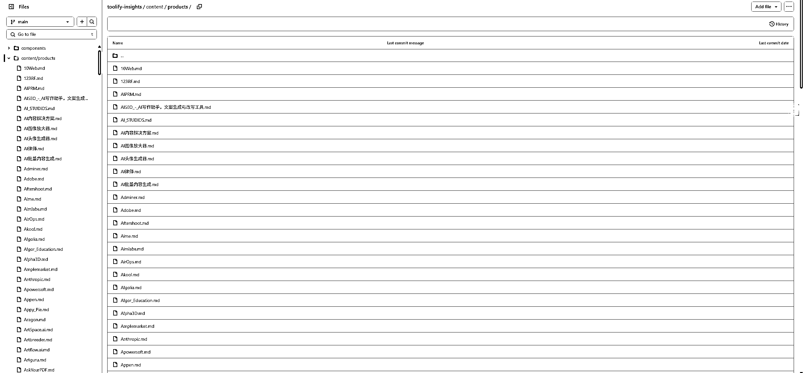
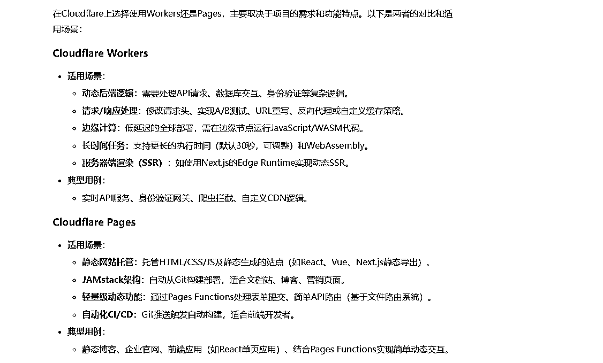
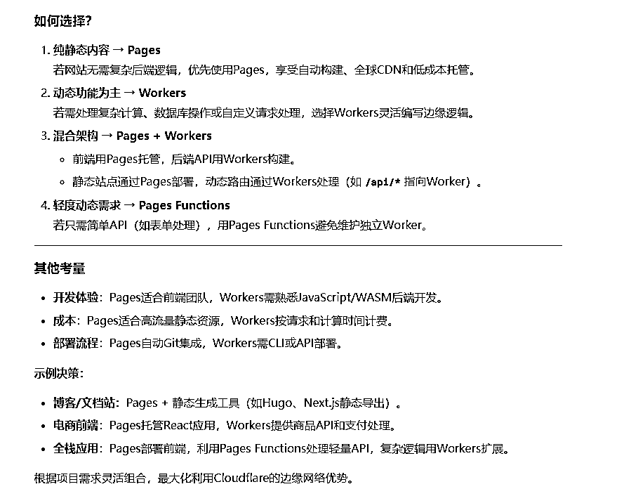
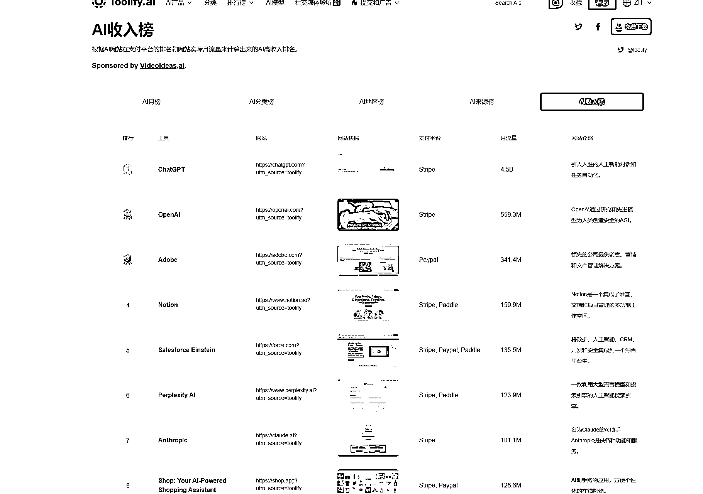

# ('(17 赞)我将 toolify.ai 的 AI 产品做了一个 AI 产品解读网站', (2, 43))

先放成果：我给 toolify.ai 的 AI 产品做了一个解读站，上线地址 [`toolify-insights.online/`](https://toolify-insights.online)，点开就知道是干嘛的。

这个站其实是在圈友@小学生 的开源项目上继续做的，先真诚地感谢一下。在找需求这件事上，我也有个明显感受：不一定非得用课程里教的方法，我现在绝大多数网站方向都是从赚钱里来的——那边被需要的，往往也就是市场真正缺的。

这次开发，最让我赚到的三点：

1. 文件按模块拆开很值得。独立拆出来以后，更新和删除都方便了太多。

2. 以前做本地开发总以为必须要台服务器，想到这就郁闷。直到这次发现 Cloudflare Pages 直接就能把问题解决了，香。至于 workers 和 pages 怎么选？我让 AI 来回答。

3. 通过@小学生 分享的开源代码，我真正上手了 API 调用，太省事了。我还把从 toolify.ai 拉下来的数据重新跑了一遍，因为圈友原本生成的 md 文件里，产品链接挂的都是 toolify 的地址，我想在此基础上增加直接访问对应网站的入口。

接下来打算优化的地方：
- 产品分析的英文版界面还没转完；
- 增加前往原网站的访问链接；
- 收录更多的 AI 产品；
- 增加赞赏入口；
- 增加支付功能。

有更多建议随时跟我讲，欢迎交流！

评论区里也有干货：
- 黑帽子：网站的中英文组件现在是客户端渲染，建议迁到服务端执行，这样对 SEO 更友好。
- 我：收到，这就让 AI 帮我把代码改一改。
- 良辰美：我也在做类似项目，但范围更大，不止 toolify，想把全网几十万个产品都过一遍；同时还有好几个功能没开发完，工作量很大，想等自己总结出方法论、有结果后再写帖。
- 我：后续会陆续增加其他 AI 产品，现在先上了 500 个。