# 让笔记封面成为持续吸流的“印刷机”

> 来源：[https://urh4zarsm8.feishu.cn/docx/FHAPdo8u1ohgb4x98ZvcIQUrnNb](https://urh4zarsm8.feishu.cn/docx/FHAPdo8u1ohgb4x98ZvcIQUrnNb)

带 AI 自媒体实操一段时间后，最常听到的困惑是：明明内容有料，却卡在封面要怎么做。

信息价值足够，却因为首图不够有吸引力直接被滑走。

针对这一常见卡点，我把亲测有效的封面打法提炼成可复用的方法论，结合真实拆解与关键要点，手把手带你做出让人忍不住点开的封面。

# 新手最容易掉进去的三大坑

## 需求错位陷阱

把“我能写什么”当成选题依据，而不是“读者缺什么”。就像在沙漠里卖雨伞，东西再精致也对不上需求。很多作者习惯从自身出发，创作自己擅长或感兴趣的方向，却忽略了受众的真实痛点。这种以自我为中心的产出，往往导致内容和需求脱节，最后数据平平。

案例：
*   你推送了《绘画软件的高阶技巧》，读者更想要《绘画软件入门：五分钟快速上手》。
*   你做了一套高端护肤组合，读者其实只想要平价好用的补水霜。

核心问题：
*   从自身能力出发，而非从受众诉求出发。
*   忽略了“用户需要什么”是创作的起点。

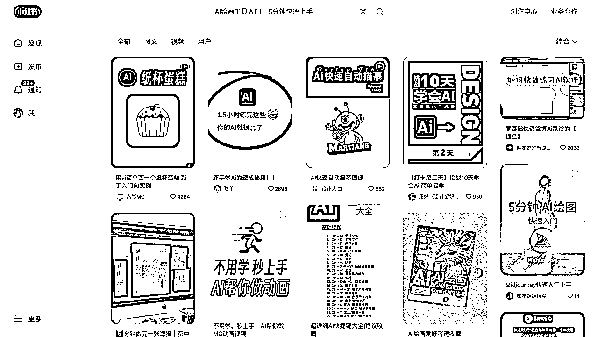

## 数据绝缘困境

反复打磨的首图、标题、正文，本质上是未经市场检验的实验室产物。真正能持续爆的作品，都是经受住用户用点击和停留投票的检验。很多创作者喜欢闭门造车，自认作品足够完美，市场回馈却不理想。

案例：
*   你花了一周写了一篇深度长文，读者只愿花三十秒看一篇快干货。
*   你设计了一个精美封面，读者更在意标题是否直击痛点。

核心问题：
*   内容缺少市场验证，缺乏用户行为数据支撑。
*   忽略了用户行为才是衡量价值的唯一标准。

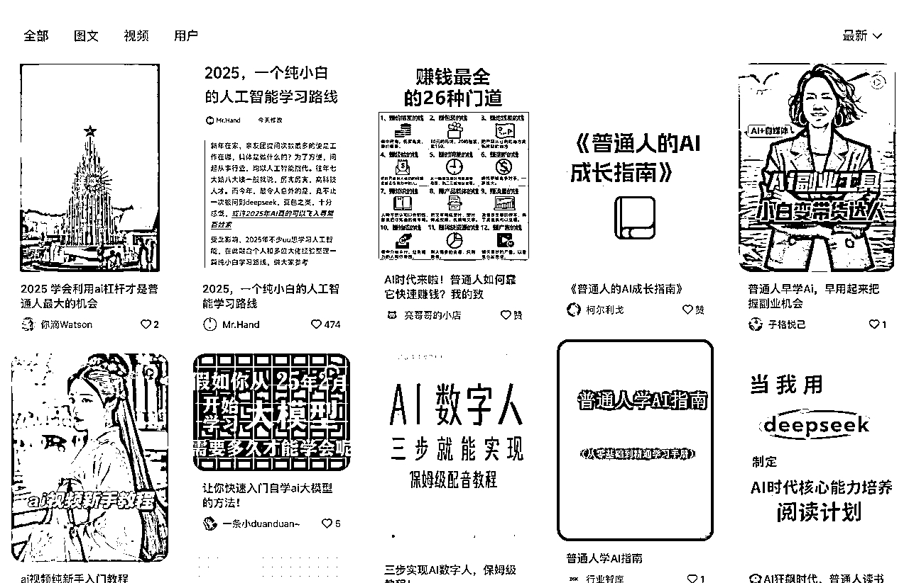

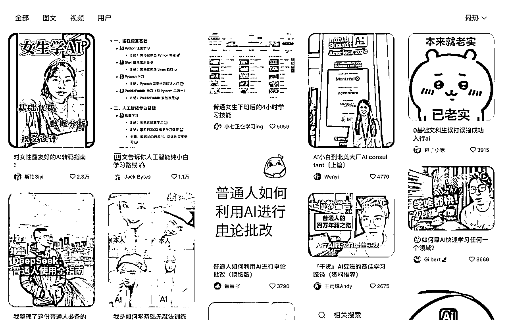

## 创新幻觉悖论

新人总是想做出差异，但商业向的内容需要的是“七成已被验证的框架+三成微调”。就像连锁餐饮的爆品逻辑：经典口味+季节限定包装。很多创作者误以为创新是爆款关键，实际上用户更喜欢在熟悉框架下获得新体验。

案例：
*   你做了全新呈现形式，读者更习惯传统的图文结构。
*   你尝试全新选题方向，读者更关注已被验证的热门话题。

核心问题：
*   过度追求新颖，忽略了用户对熟悉感的需求。
*   没有在已验证框架上做微创新，导致内容脱离认知。

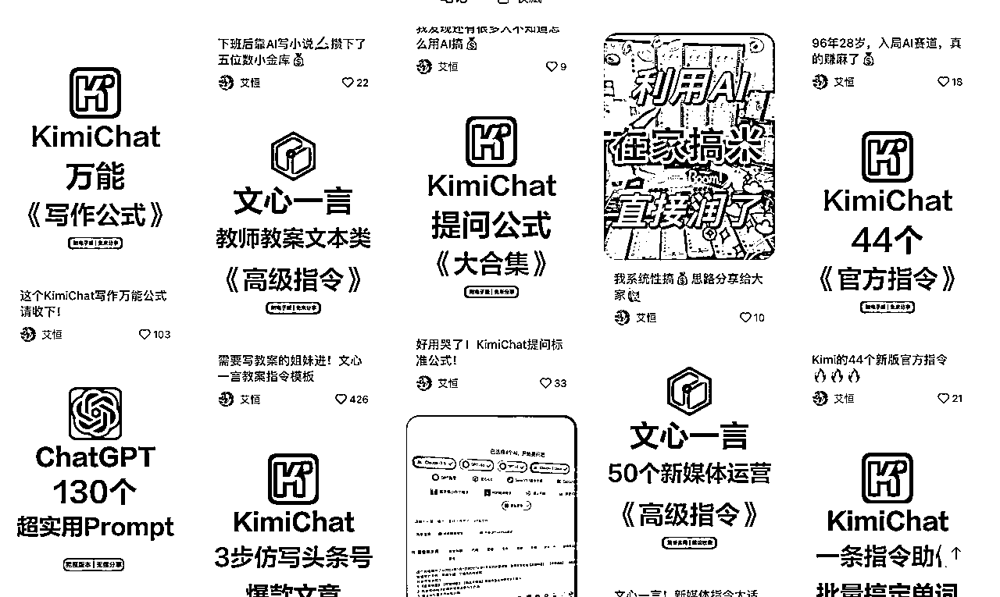

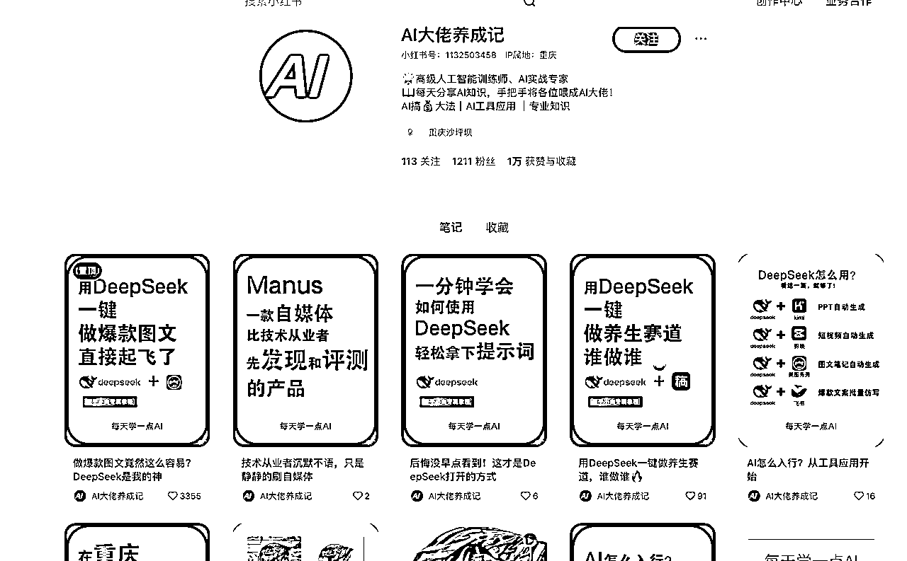

# 如何破局？思维层面的打法

心法口诀 - 守 破 离——来自刘小排老师

https://scys.com/articleDetail/xq_topic/582855552858284

关于破局，我很受刘小排老师那篇文章的启发。

它帮我跨过做项目的第一道坎。

没流量、不知道怎么下手？答案是像素级复刻！

下面节选该文开头，和大家共勉。

先说结论。善用他人的认知与经验，我的口诀是——「守 破 离」。

「守 破 离」源自日本剑道学习体系，后被广泛运用于武术与各行各业。

「守」指初学阶段须严格遵循师法练到熟练。
「破」指尝试突破既有规范。
「离」指自创招式开辟新境。

在赚钱有术社群，起步阶段只有一种基本功——守。

用社群黑话翻译，
「守」 = 像素级模仿

别人怎么做，你就照做，一丝不差。

别偷懒，别想跳过任何步骤，哪怕步骤看起来很蠢——因为你是新人，你还不知道它存在的意义。
别取巧，别想修改任何环节，哪怕环节看起来很蠢——因为你是新人，你无法保证自己的改动比教程更好。
别有偏见，哪怕你觉得这个项目很low——有些项目看上去挺土，你可能会嗤之以鼻。但在成为专家前，请先克制这种冲动。偏见的本质是傲慢。《三体》里的话很扎心，“弱小和无知不是生存的障碍，傲慢才是”。

大白话就是——偏见阻碍你学习。偏见阻碍你赚钱。

马云说：很多人输在对新事物，第一看不见，第二看不起，第三看不懂，第四来不及。看不懂、看不起、看不清、来不及。

如果你“不屑”像素级模仿，很可能你正陷在“看不懂”的自以为是里，或“看不起”的偏见里。

做好「守」的关键是——做一个肯下笨功夫的聪明人。

什么时候可以离开「守」的阶段？
——当你在实操中拿到真实反馈时、当你完整复刻“保姆级教程”并赚到钱时。

# 2. 实操层面

你是不是也有这些烦恼？

❌ 干货笔记写得可以，封面太平没人点
❌ 想学大V封面，却总差点意思说不清
❌ 花几小时调色调字体，最后还不如随手做的

✅ 按下面这套可直接照做的流程，哪怕只用美图秀秀，也能做出专业感封面👇

##### 2.1 封面版式怎么定

*   单图还是多图：看对标账号的风格来定。新手建议从单图起步，更易把控。
*   原因：单图更聚焦，适合传达单一核心信息；多图适合展示多个产品或场景，信息面更广，适合内容更丰富的笔记。
*   举例：推广 DeepSeek 这类产品时，单图可呈现界面或核心功能；多图可呈现不同应用场景，如文案生成、数据分析等。

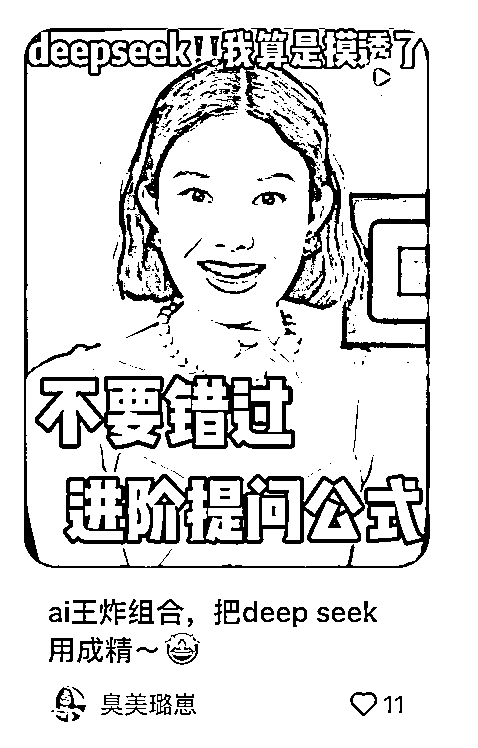

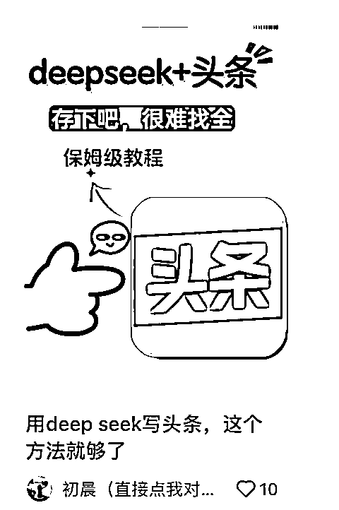

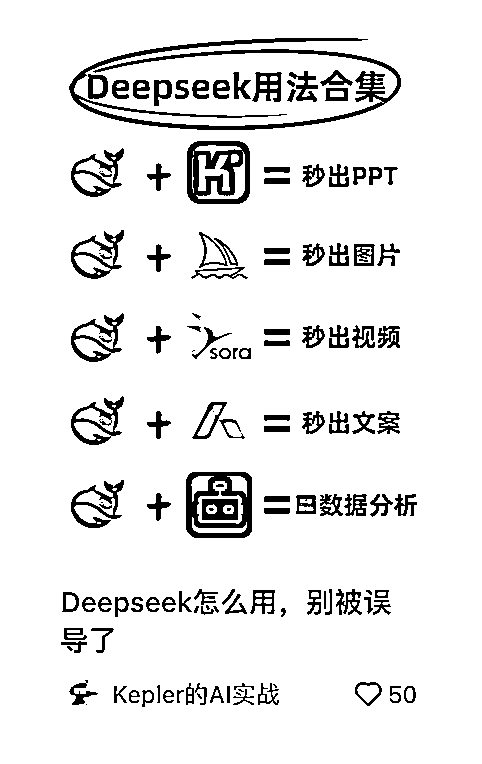

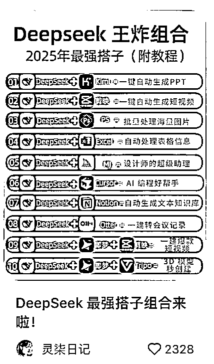

*   文字摆放：模仿对标账号的文字位置。通常标题放中央或底部更吸睛。
*   原因：文字位置决定阅读动线与注意力分配。居中更易成为第一眼焦点，底部则给上方图片留出视觉空间。
*   举例：推广人工智能工具时，标题居中突出卖点如“五分钟学会 DeepSeek”。

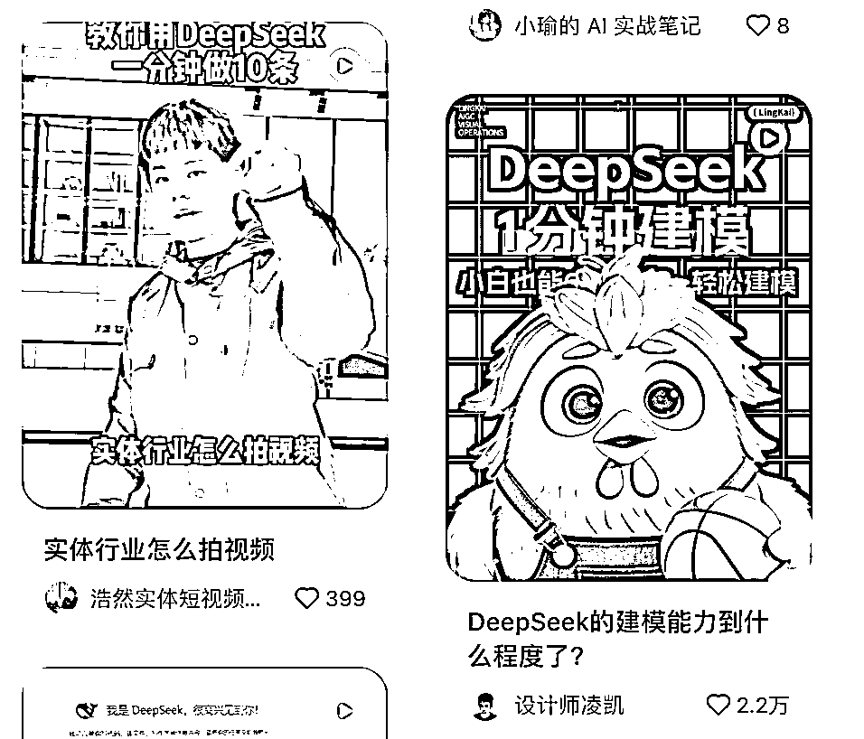

*   图片占比：保证图文字的比例与对标账号一致。对标图片占大头，你也可以跟随。
*   原因：图片占比决定视觉重心。图片为主时用户先看图；文字为主时用户先读标题。
*   举例：推广人工智能工具时，图片占大部分展示界面或操作效果，文字简洁点出核心信息。

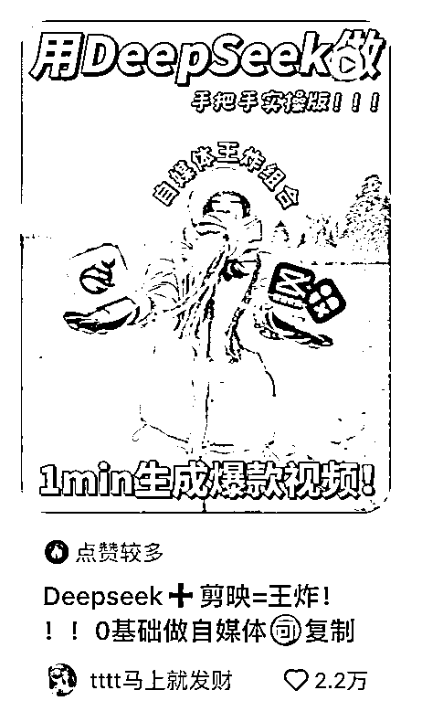

##### 2.2 配色怎么选

*   主色调：选用与对标账号接近的主色。不确定时可用取色工具如 Photoshop 吸管提取对标封面颜色。
*   原因：主色调决定整体氛围。明亮显轻松活泼，适合年轻受众；深色显专业沉稳，适合技术内容。
*   举例：推广人工智能工具时，深蓝背景传递专业感，白色字显清晰现代。

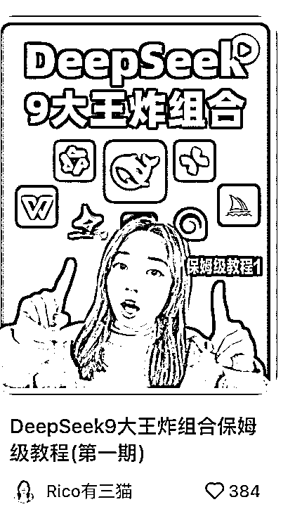

*   对比度：文字与背景对比是否足够强烈？一般高对比如白字黑底更抓眼。
*   原因：高对比让文字更醒目，提升可读性。
*   举例：推广人工智能工具时，白字黑底让标题“五分钟学会 DeepSeek”更突出。

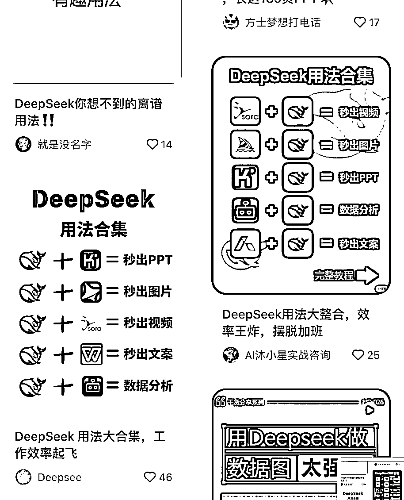

##### 2.3 字体怎么选

*   字体风格：选用与对标账号相近的字体风格。找不到完全一致时选风格接近的即可。
*   原因：字体风格影响整体调性。无衬线显现代简洁，适合技术类；手写体显亲切个性，适合情感类。
*   举例：推广人工智能工具时，选择无衬线字体如 Arial、Helvetica，让封面更专业现代。

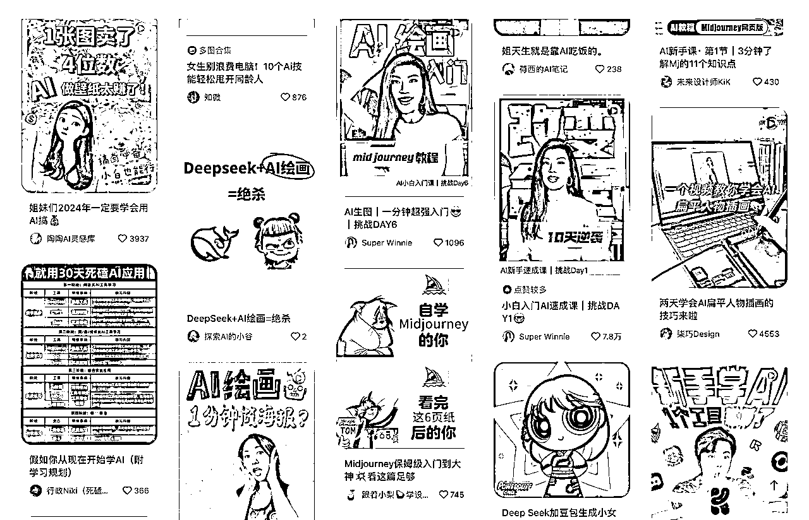

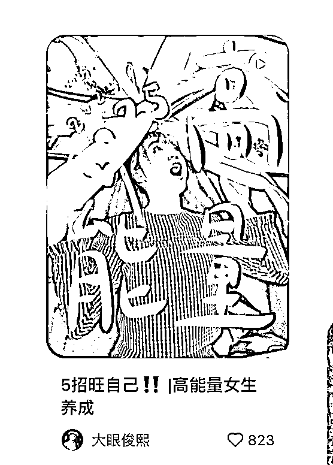

*   字体大小：保证标题足够大，封面上清晰可辨。
*   原因：字号决定标题的可见度。足够大的字让用户在快速滑动时一眼捕捉。
*   举例：推广人工智能工具时，标题字号可设 48pt，确保“五分钟学会 DeepSeek”一目了然。

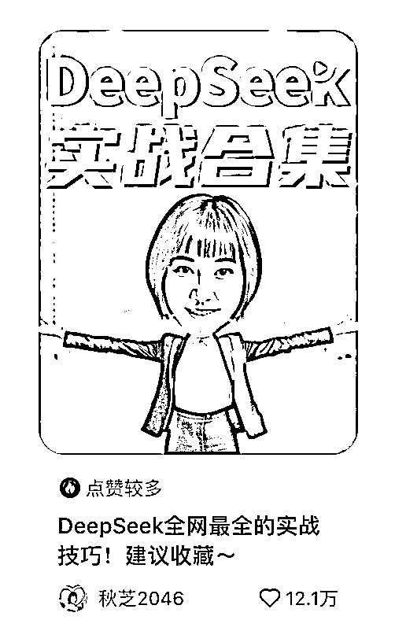

*   字体颜色：根据背景挑选适配的颜色，确保文字清晰易读。
*   原因：字体与背景的对比度直接影响可读性。高对比更清晰。
*   举例：推广人工智能工具时，白色字体配深蓝色背景，确保易读。

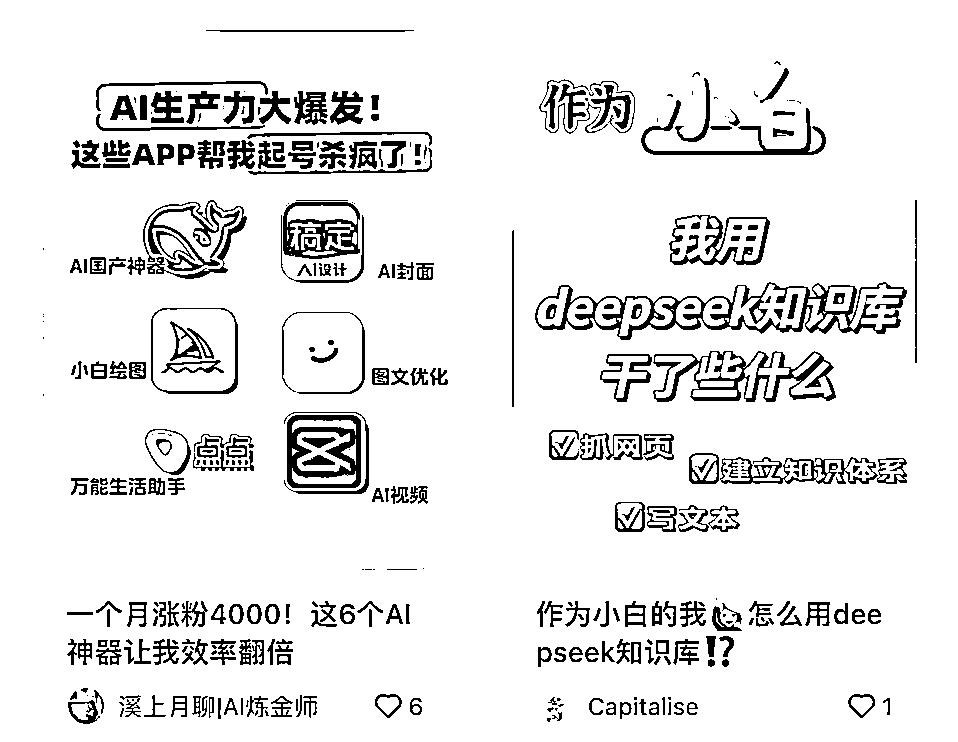

##### 2.4 图片内容怎么选

*   图片类型：对标账号封面用的是产品图、场景图还是人物图？
*   原因：图片类型影响信息传达。产品图适合展示功能，场景图适合展示使用情境，人物图适合增加亲和力。
*   举例：推广人工智能工具时，可用产品图如 DeepSeek 界面截图，或场景图如用户使用场景。

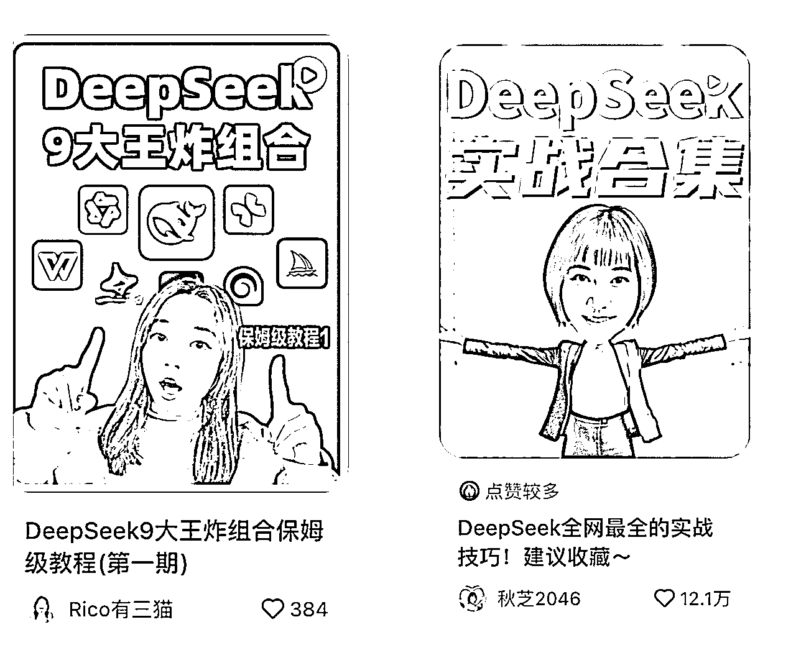

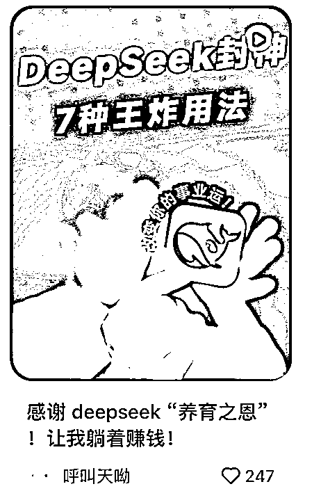

##### 2.5 其它元素

*   图标/装饰：封面上有无小图标、边框或其他点缀？这些元素是否提升了吸引力？
*   原因：小图标和装饰能增加视觉层次，提升吸引力。
*   举例：推广人工智能工具时，可在封面右下角加一个小图标如 AI 标志，提升专业感。
*   品牌标识：对标品牌账号是否有品牌 Logo 或标识？
*   原因：品牌标识提升辨识度，增加信任感。
*   举例：有自己的品牌 Logo 时，可添加到封面，提升品牌记忆。

# 三种封面类型实操拆解

在 AI 内容同质化严重的赛道，封面就是零点五秒定生死的号角。

我测过多个账号发现：
✅ 强人设封面——信任转化率提升 50%（真人出镜+专业场景）
✅ 海报型封面——点击率暴涨 30%（大字标题+高对比配色）
✅ 低成本封面——生产效率提高 5 倍（固定模板+智能工具）

这不是美学课，而是一场精准的流量狙击。

下面这三套在 AI 领域被验证过的封面公式，手把手带你打开流量入口

### 第1张——强人设封面

#### 内容细化

*   定义：强人设封面通过突出个人形象，建立信任感和亲和力。适合有个人品牌或希望靠个人形象吸粉的账号。
*   特点：
*   真人出镜：封面以真人为主，突出个人形象。
*   简洁背景：背景多为纯色或简单场景，避免干扰。
*   大字标题：标题简洁有力，直接传达核心信息。
*   案例：
*   杜老师 AIGC：封面为杜老师本人出镜，背景为简洁办公室，标题为“五分钟学会 AI 绘画”。
*   秋芝：封面为秋芝本人出镜，背景纯色，标题为“工具实战指南”。

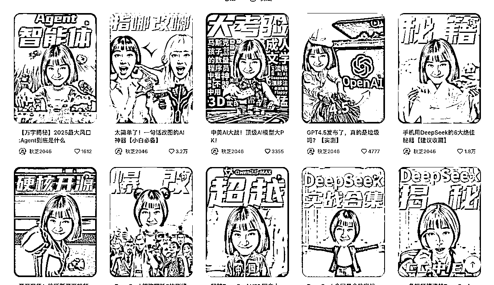

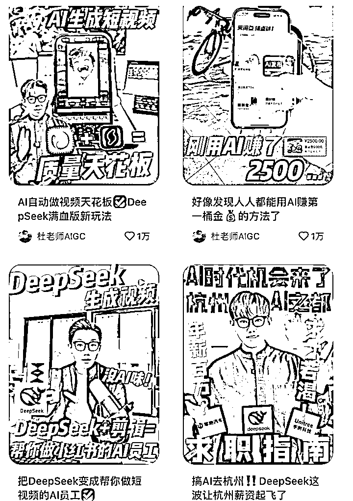

#### 设计步骤

1.  准备模特图：选一张高质量人物图和背景图，确保人物清晰、背景简洁。
（用美图秀秀抠图并替换到准备好的背景上）
1.  添加标题：在封面中央或顶部加入大字标题，字体简洁有力如无衬线。
1.  调整配色：选择与人物图协调的配色，保证标题与背景对比强烈。
1.  优化细节：微调人物与标题位置，保证整体平衡。

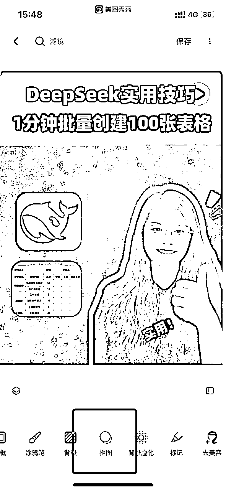

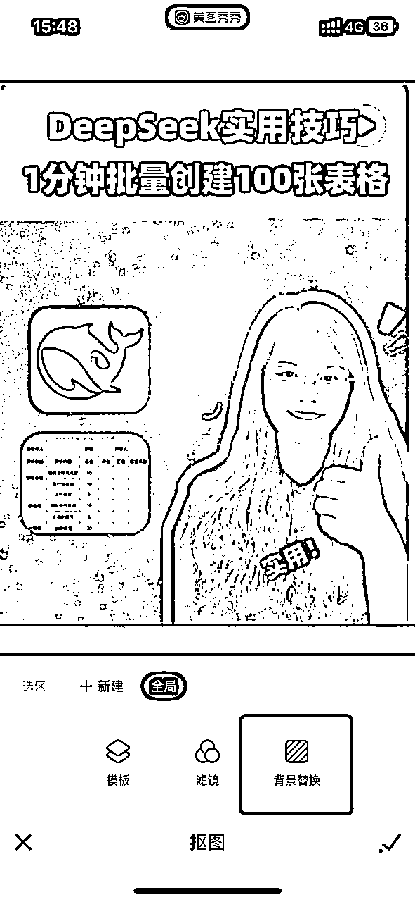

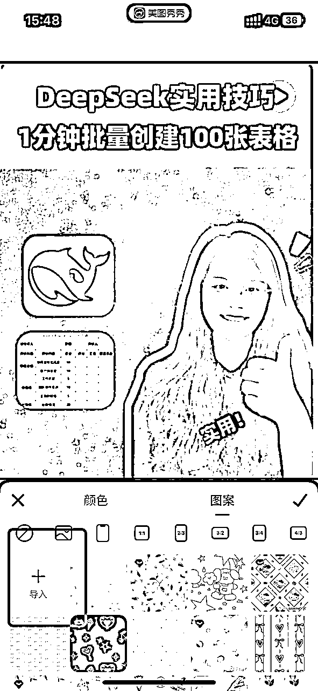

#### 实操演示

*   直播演示：在直播中展示从选图到加标题、调配色的完整流程。
*   工具推荐：Canva 或 Photoshop 做封面设计。

* * *

### 第2张——海报型封面

#### 内容细化

*   定义：海报型封面以大字报形式传递核心信息，适合不想出镜或想靠内容吸睛的账号。
*   特点：
*   大字标题：标题占据封面大部分空间，字号醒目。
*   简洁背景：背景多为纯色或简单图案，避免干扰标题。
*   无真人出镜：封面不出现真人，完全靠标题和背景吸引。
*   案例：

先别急着嘲笑那些看着很low的项目。在你成为专家之前，请把偏见收起来。偏见说白了就是傲慢。还记得《三体》里那句被疯狂转发的话吗？真正让生命栽跟头的，从来不是弱小和无知，而是傲慢。翻译成大白话：偏见会让你学不到东西，也赚不到钱。

关于新兴事物，马云有句很扎心的总结：大多数人先是无视它，然后轻视它，接着看不懂它，最后追不上它。如果你打心底里不屑于“像素级模仿”，那你很可能正站在“看不懂”的自信里，或者陷在“看不起”的偏见里。想做好“守”，核心只有一条：当一个愿意下笨功夫的聪明人。那什么时候能离开“守”？当你从实操中拿到真实反馈，或者完整跑通一套保姆级教程并且赚到钱的时候。

很多做AI内容的朋友都有类似的困惑：干货笔记写得再认真，封面平平无奇，根本没人点；照着大V的封面改，却总觉得哪里不对；调了半天颜色和字体，效果还不如随手做的好。其实问题不是你不会设计，而是没掌握一套可复制的封面方法论。哪怕只用美图秀秀，也能做出专业感。

第一步，定布局。先看对标账号，决定用单图还是多图。新手建议从单图开始，因为更容易聚焦，适合讲清楚一个核心信息；多图则能展示多个产品、场景或更丰富的内容。比如你推荐DeepSeek，单图可以放工具界面或核心功能，多图可以分别展示文案生成、数据分析等场景。文字位置也有门道：居中的标题能第一时间抓住视线，放底部则给图片上方留出呼吸感。想突出“5分钟学会DeepSeek”，就把标题居中。图片占比也要跟对标账号保持一致：图片占大部分，用户先看画面；文字占大部分，用户先看标题。

第二步，配色。主色调参考对标账号，不确定就用取色器提取。颜色决定氛围：明亮色轻松活泼，深色系专业稳重。AI类内容常选深蓝背景+白字，专业又现代。还要注意文字和背景的对比度，白字黑底这种强对比最抓眼球。

第三步，字体。字体风格跟着对标走，找不到同款就找相近的。无衬线字体现代简洁，适合技术内容；手写体亲切有温度，适合情感类。标题字号一定要够大，比如48pt，保证快速浏览时一眼看到。字体颜色则跟着背景走，高对比才清晰，比如深蓝底配白字。

第四步，选图。对标账号用的是产品图、场景图还是人物图？产品图秀功能，场景图讲故事，人物图拉近距离。推广AI工具，界面截图或用户使用场景都是好选择。

第五步，加元素。小图标、边框、装饰能增加层次感。比如在右下角加一个AI小图标，专业感立刻上来。如果有自己的品牌Logo，也别忘了放上去，辨识度和信任感都会提升。

AI内容越来越同质化，封面的作用就是0.5秒内决定用户点不点。我拆解了大量AI账号后发现：强人设封面能让信任转化率提升50%，海报型封面点击率能涨30%，低成本封面生产效率能提升5倍。这不是设计课，而是流量狙击战。下面三套经过验证的公式，直接抄。

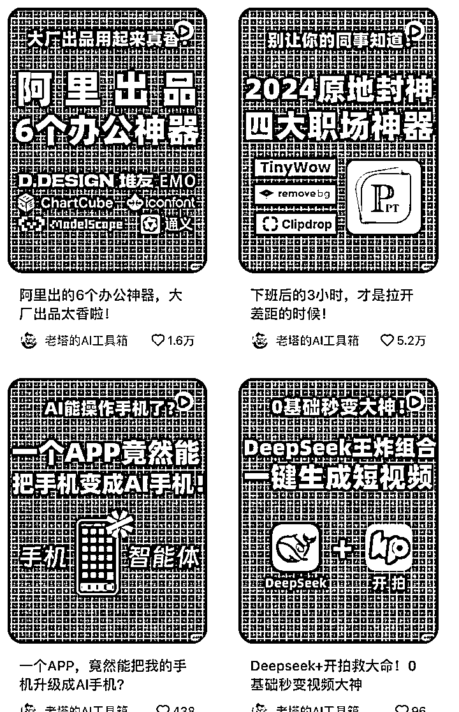

先看强人设封面。简单说，就是真人出镜+简洁背景+大字标题。适合有个人IP、想靠亲切感建立信任的账号。比如杜老师AIGC，办公室背景+本人出镜+“5分钟学会AI绘画”；秋芝则是纯色背景+“AI工具实战指南”。怎么做？先准备一张高清模特图和干净的背景，用美图秀秀抠图换背景；然后加上无衬线大字标题，放在中央或顶部；再调整配色，让标题和背景形成强对比；最后微调人物和标题的位置，让画面平衡。可以用Canva或Photoshop操作。

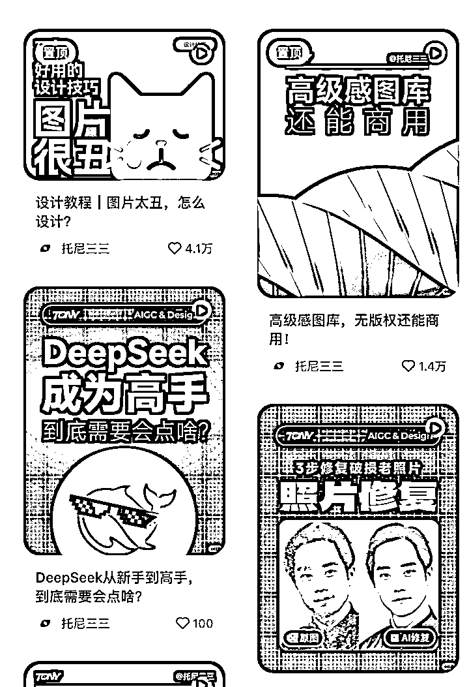

再看海报型封面。不想露脸？那就让标题当主角。大字标题+纯色背景，简单粗暴。比如托尼三三的深蓝底白字“AI工具实战指南”，老塔的AI工具箱是黑底黄字“AI工具大全”。步骤也不复杂：选一个纯色或简单图案背景，居中放大一个无衬线标题，确保和背景对比强烈，比如白字黑底、黄字蓝底，再微调大小和位置。工具推荐Canva或Figma。

最后是低成本封面。新手或时间不够，用固定模板批量生产。比如媛媛的AI笔记，用一张星巴克底图，每次只改标题。具体参数可以是：多图布局、标题置顶、底部图片占大比例；深灰背景+白字；较大号无衬线字体；图片用AI工具界面截图。模仿时，先选单图布局、文字居中，然后深灰底白字，字体大小适中，配上相关界面截图，最后在右下角加一个AI小图标，专业感就出来了。

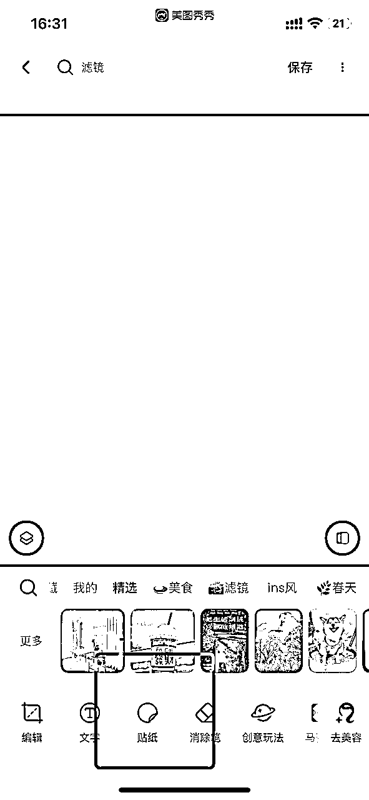

工具方面，手机党5分钟出片：美图秀秀适合抠图+文字，记得用AI消除笔去杂物，直接套“配方”模板；黄油相机擅长可爱字体和贴纸，花字模板一键生成ins风标题。电脑小白：Canva搜“AI科技”“极客风”免费模板，用Magic Design输入文案自动生成封面；创客贴中文模板更接地气，直接搜“ChatGPT”“AI绘画”，网址分别是canva.cn和chuangkit.com。团队协作：Figma用组件库统一风格，可以装“封面设计系统”插件自动规范字号色值；Clipchamp是Win11自带，免安装，适合快速做动态封面。专业玩家：Photoshop学智能对象和图层样式，用神经滤镜自动调色；Remove.bg一键抠图，导出带阴影的PNG更自然。选工具三句话：新手先用手机APP练手，批量制作转战Canva/创客贴，专业号必须用Figma+PS。

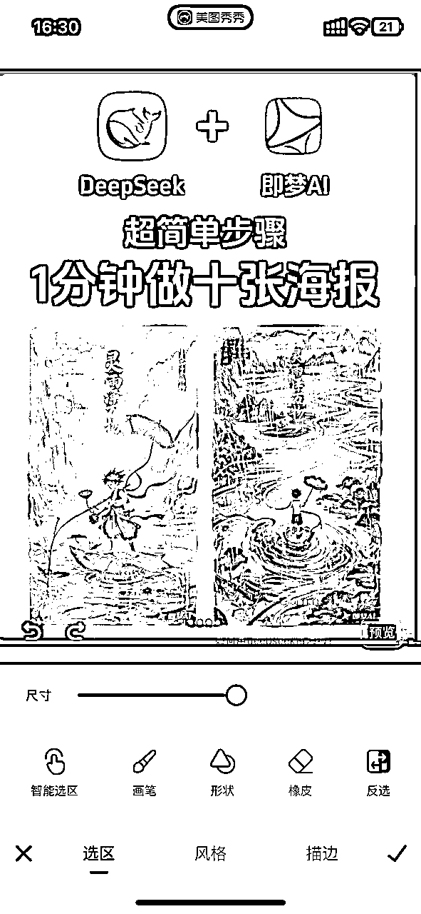

个人实战心得，这3条铁律是从踩坑里捡回来的。第一条，抄作业才是最快的学习。别自己瞎试错，直接拆解10个万粉账号的封面库，用收藏夹分类。我以前也看不上某些“土味”封面，结果同样的内容，别人点击率是我的5倍。第二条，数据比审美更靠谱。建一个封面实验室，起号阶段每次换封面都记录点击率。结果我发现我觉得丑的荧光绿标题，比高级灰高了40%。第三条，标准化才能规模化。整理一份封面设计SOP文档，把字号、色值、边距、底图全部定死。以前做一张封面要2小时，现在15分钟搞定。技巧上，可以在模仿基础上加一个自己的“记忆点”，比如固定放在角落的签名图标，我用一个电路板小图标，账号辨识度直接提升70%。手机作图用好美图秀秀的“配方”保存参数，黄油相机的“模板共享”也能直接套AI领域设计师的模板。

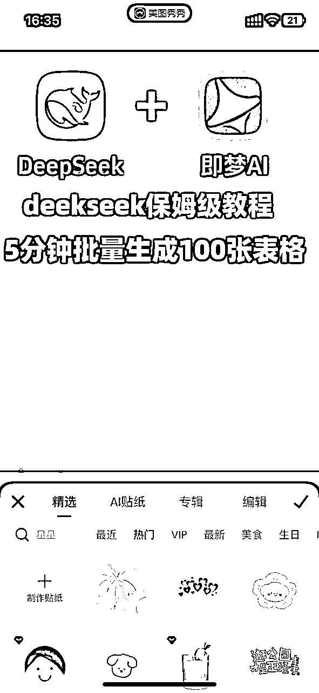

下面进入百问百答。

基础操作类：
Q1 怎么找对标账号？A：在抖音、B站、小红书搜“AI工具”“AIGC”，按最多点赞排序，优先看粉丝1-10万的腰部账号。头部大号背后有专业团队，你学不来。
Q2 必须真人出镜吗？A：技术解析类可以不露脸，但教学类账号真人出镜转化率更高。
Q3 手机能做出专业封面吗？A：实测美图秀秀+黄油相机足够，关键是会用“消除笔”和“文字透视”。

设计技巧类：
Q4 文字总被平台压缩怎么办？A：记住最小字号标准：安卓标题48px、正文36px；iOS标题52px、正文40px。
Q5 工具界面截图怎么变高级？A：三个技巧：用“壳子”APP加手机边框；用PS加内阴影，参数建议不透明度20%、大小10px；背景叠一层科技感网格素材。
Q6 不会配色怎么办？A：用这两组安全牌：权威感是深蓝#0F4C81+银灰#E5E7EB，活力感是黑色#000000+霓虹绿#00FFA3。

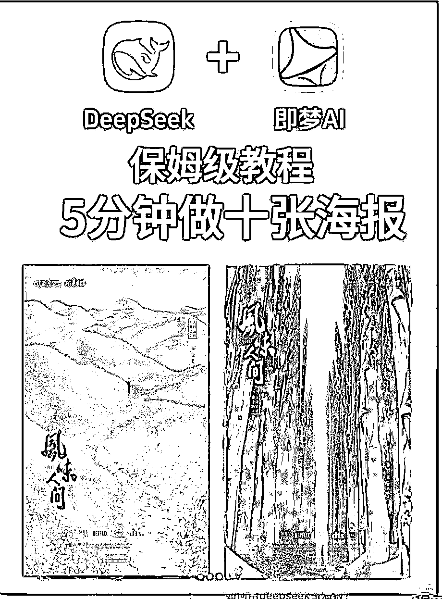

工具类：
Q7 Canva模板太普通？A：先用Magic Design生成基础模板，再导入PS添加AI元素，素材可以到Flaticon找免费科技图标。
Q8 怎么快速统一多封面风格？A：用Figma，创建颜色样式库、制作自动布局组件、再装一个“封面设计系统”插件。
Q9 不会抠图？A：Remove.bg上传时加指令“保留电脑/手机元素”，导出时选“带阴影”格式，效果更自然。

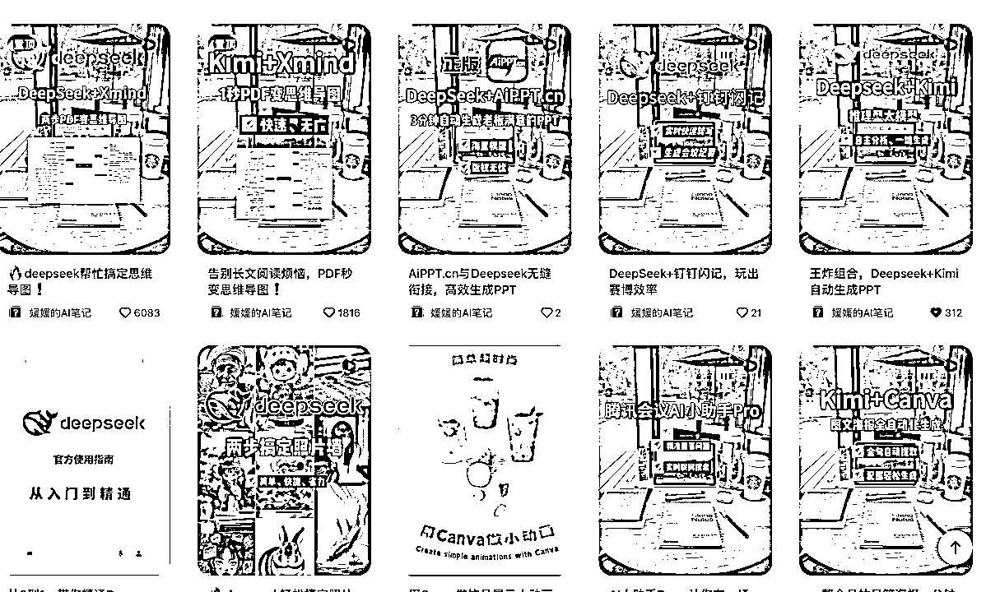

数据优化类：
Q10 怎么判断封面合不合格？A：看两个指标：点击率≥5%，3秒完播率≥40%。
Q11 改了封面没效果？A：用单变量测试法，每周只动一个元素，比如这周只调标题位置，下周只改主色调。
Q12 爆款封面能复用吗？A：建一个封面元素拆解表，把不同爆款的元素组合起来，比如A封面的配色+B封面的布局。

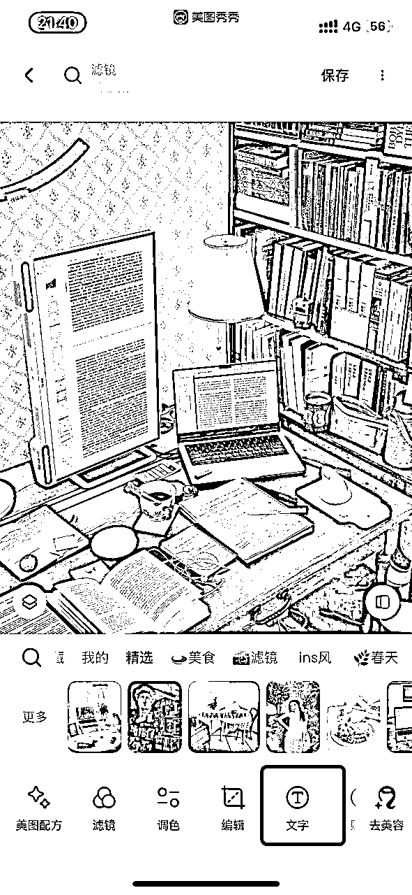

文章有点长，谢谢你看到这里。有问题欢迎留言，我会尽量回复。

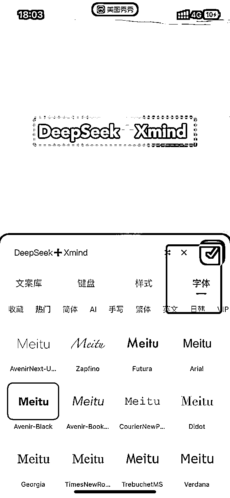

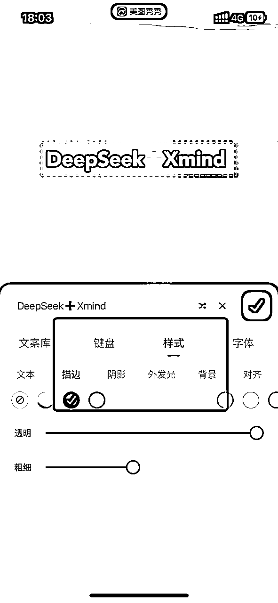

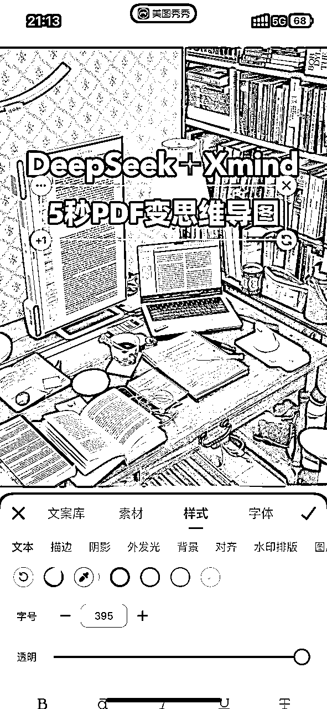

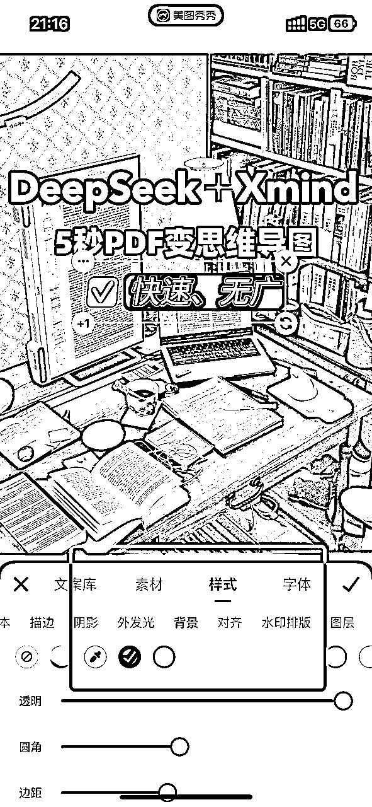

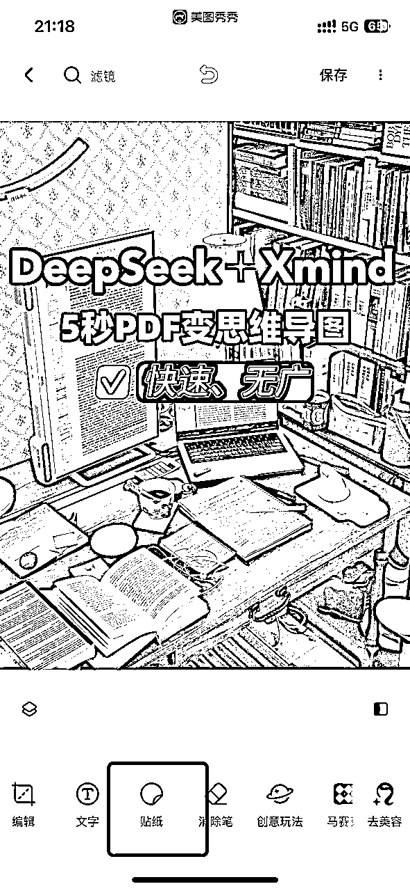

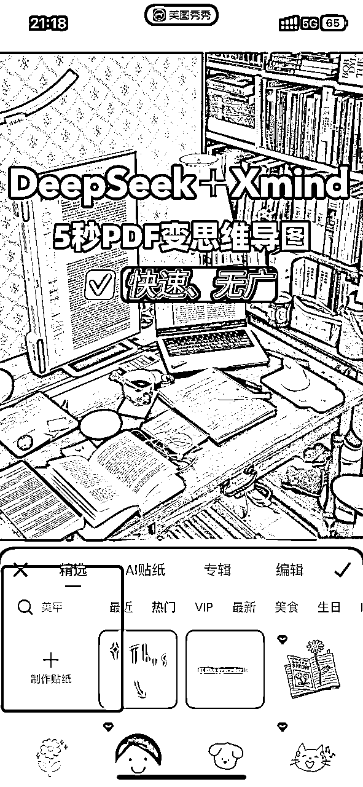

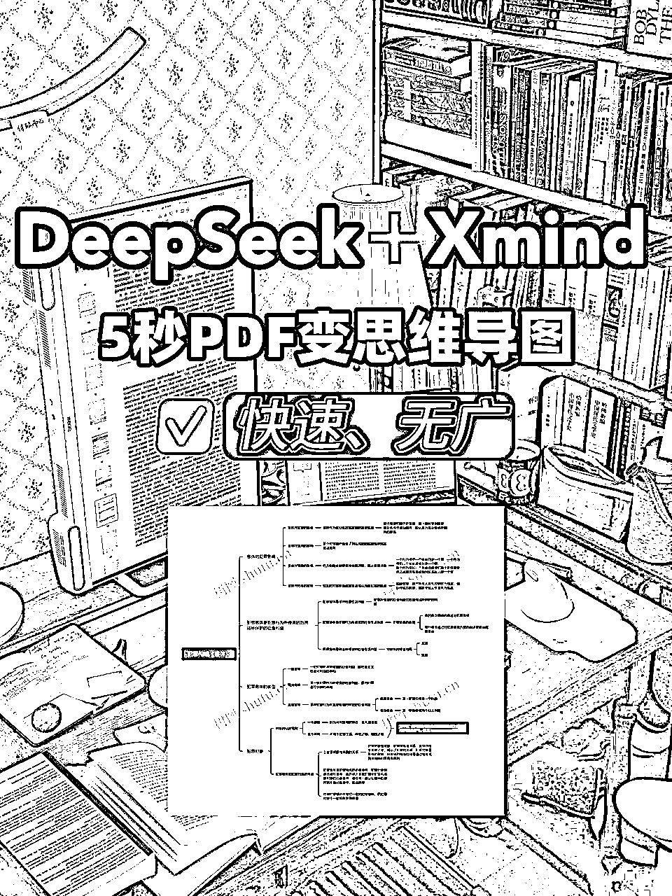

# 封面总做不好？AI 方向的成片方法论整理

不管是靠手机随手出片，还是想在电脑上精细打磨，甚至是团队协作批量产出，下面这套工具清单和实操经验，可以帮你把路径找准。

## 一、按使用场景选工具

### 📱 移动端快速出图

* **美图秀秀**：抠像换底、叠加文字都很顺手。核心在于善用「AI消除笔」清理杂物，再配合「配方」一键套用成熟模版。
* **黄油相机**：字体和贴纸资源丰富。「花字」系列模版能直接做出社媒感的标题，适合审美要求不高但求速度的场次。

### 💻 个人电脑入门友好

* **Canva**：海量免费模版，检索「AI科技」「极客风」即可。进阶用法是「Magic Design」，把文案丢进去自动拼装版式。官网：https://www.canva.cn
* **创客贴**：中文语境下的模版更贴近国人口味。直接检索「ChatGPT」「AI绘画」等关键词即可拿到可用稿。官网：https://www.chuangkit.com

### 👥 多人协同作业

* **Figma**：组件库可实现风格统一。装入「封面设计系统」插件后，字号色值会自动归一，多人合稿也不会冲突。
* **Clipchamp**：Windows 11 自带，微软出品免安装。擅长制作动态封面，例如加入进度条、数据跳动等小动画。

### 🖥️ 高精度专业向

* **Photoshop**：智能对象加图层样式是基础，再配合「神经滤镜」做AI 辅助调色，效率和可控度兼得。
* **Remove.bg**：专攻抠图，人像或产品 1 秒分离。导出 PNG 后可直接拖入其他软件继续编排。

💡 **选型建议：**

1. 入门阶段用手机 App 热身，美图秀秀与黄油相机搭配已足够。
2. 需要量产就转到 Canva 或创客贴，复用模版节省时间。
3. 品牌号运营建议配置 Figma+PS，才能把视觉规范吃透。

建议自建一份对比清单，从上手难度、适用情境、学习投入三个角度打分，选型更清晰。

## 二、从踩坑到熟练的个人经验

### 💡 心态层面

#### 1. 模仿拆解比闭门造车快
别自己从零试错。把十个万粉号的封面合集扒下来，用收藏夹分类归档。我曾嫌弃某土味封面，结果同主题内容点击差距达到五倍。

#### 2. 用数据否定直觉
起号期我建了个「封面试验场」，每版都记下点击表现。让人意外的是，我主观认为难看的荧光绿标题，表现比高级灰高出四成。

#### 3. 流程标准化才能提效
把制作步骤固化成「封面 SOP」，明确字体大小、色号、留白、底图规范。现在一张从两小时压到十五分钟。

### 🛠️ 操作层面

1. **微创新记忆点**：在模仿基础上加一个固定符号，比如我在角落统一放电路板小徽标，账号辨识度提升很明显。
2. **移动端复用技巧**：美图秀秀的「配方」可保存成功参数直接调用；黄油相机可关注领域设计师，模板共享后直接套用。

## 三、AI 封面制作高频疑问

### 基础执行类

**Q1：怎么找合适的对标对象？**
A：在抖音、B站、小红书搜「AI工具」「AIGC」→按点赞数排序→挑粉丝 1-10 万的中腰部账号。头部大号多为团队作业，不易复制。

**Q2：必须露脸吗？**
A：技术拆解类可纯图文，教学类带真人出镜的转化通常更高。

**Q3：手机能做到专业水准吗？**
A：美图秀秀加黄油相机组合足够，关键是把「消除笔」「文字透视」用熟。

### 版式技巧类

**Q4：文字被平台压缩怎么办？**
A：谨记移动端最小规范：安卓标题 48px/正文 36px；iOS 标题 52px/正文 40px。

**Q5：截图怎么显得高级？**
A：三点处理：用「壳子」App 加手机边框；在 PS 里加轻微内阴影，不透明度约 20%、半径 10px；背景铺科技网格素材。

**Q6：配色无从下手？**
A：两个安全组合：沉稳感 深蓝 #0F4C81 + 银灰 #E5E7EB；活力感 纯黑 #000000 + 霓虹绿 #00FFA3。

### 工具使用类

**Q7：Canva 模版太千篇一律？**
A：先用「Magic Design」生成初稿，再导入 PS 增加 AI 元素，Flaticon 的免费科技图标是常用补充。

**Q8：多图风格如何统一？**
A：Figma 三步走：建立颜色样式库、制作自动布局组件、接入封面设计系统插件。

**Q9：抠图困难？**
A：Remove.bg 进阶：上传时提示保留电脑/手机主体，导出选带阴影版本更自然。

### 数据优化类

**Q10：封面达标线是什么？**
A：点击率不低于 5% 为行业基准，3 秒完播率目标 40% 以上。

**Q11：修改后仍无起色？**
A：采用单变量测试，每周只动一个要素，如仅调整标题位置或仅更换主色。

**Q12：爆款能否复用？**
A：可以。建立元素拆解表，把成功组合拆开重组，例如 A 的配色搭配 B 的版式。

全文篇幅较长，谢谢你读到这里。
有任何疑问欢迎留言交流。