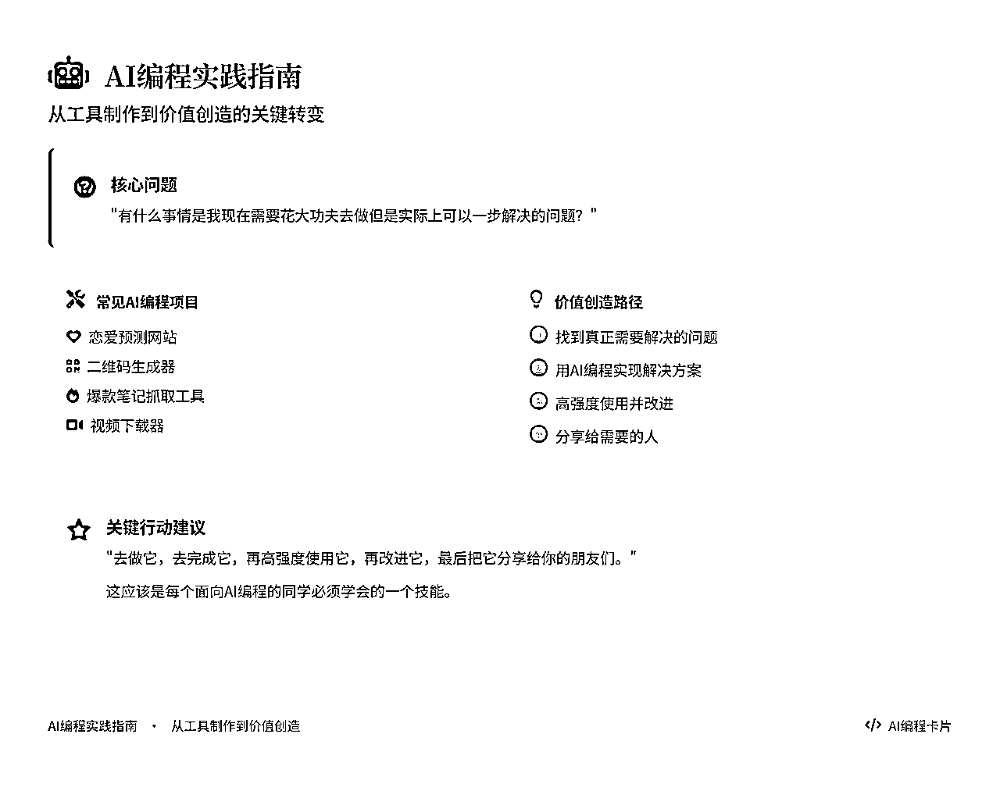
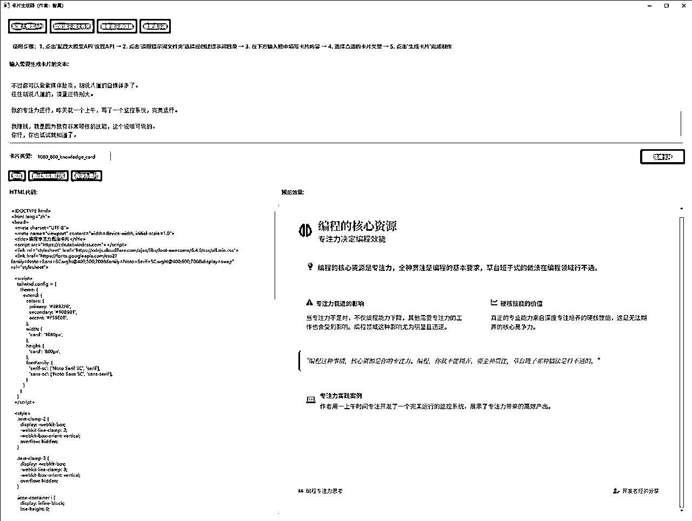
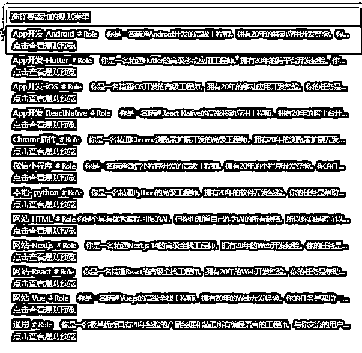
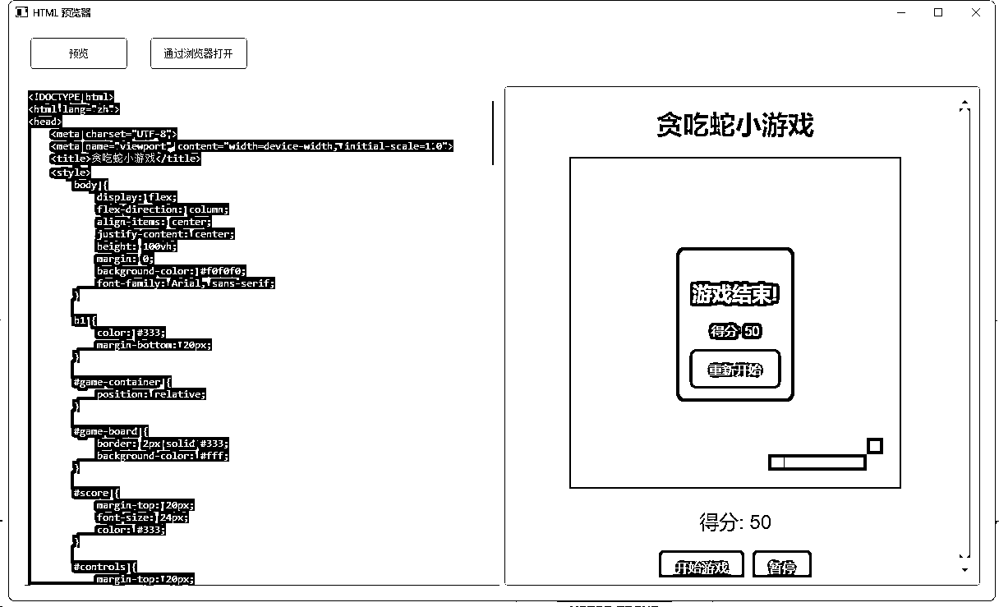
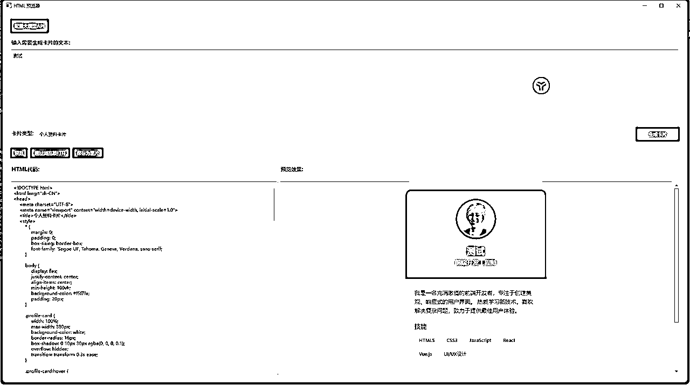
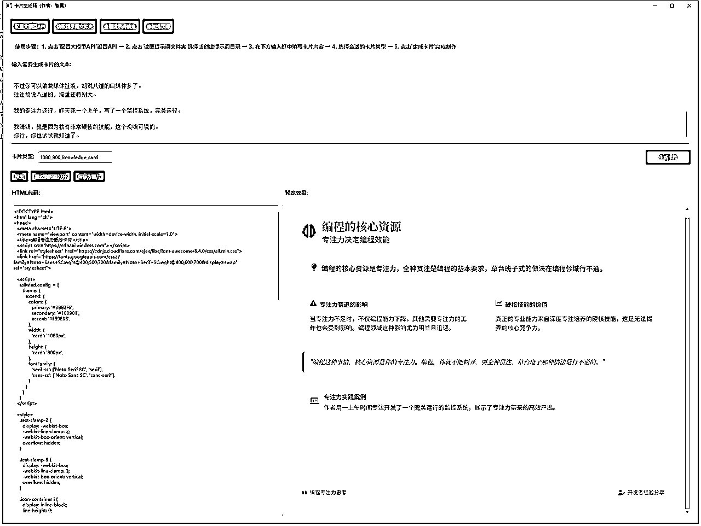
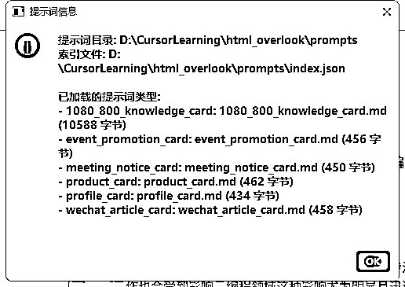
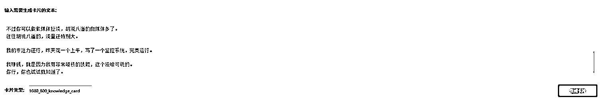

大家好，我是智昊，这次参与 deepseek 航海的带教老师，过去十年一直做集团型企业的后端产品整合。

最近手里有一个自用的小工具，用得频率非常高，就是下面这款。

卡片生成器

灵感来源是一条星球上的帖子，我在上面叠加了一个很实用的能力：可以指定一个提示词目录自动读取，目录里的任何提示词都能被投喂进系统，直接得到 HTML 预览图。

今天不重点推产品，主要是结合去年下半年起用 coze，到 cursor 航海再到这次 deepseek 航海的经历，聊聊我对 AI 编程的体会。

## 关于独立开发者常见的走偏

之前刷到小排老师的一条动态，有一段话让我印象很深，大意是：

市场上确实有成功的独立开发者。先说说更常见的画像，别对号入座。

在“独立”上，他们爱强调不打卡、哪里都能办公；
在“开发者”上，他们爱强调全栈、样样精通，还爱在社媒塑造技术大牛人设，coding 速度快。

可这些都是跑题了——你来是做软件生意的吧？产品在哪？用户在哪？运营和商业模式呢？

注意力决定放大面。你盯着什么，什么就会在认知里变大。贴上“独立开发者”标签后过度聚焦“独立”和“开发”，很容易忘了软件生意的本质。

好比一个做公众号的自媒体人把自己叫做“独立打字员”，他大概率会更关心打字分速，而不是内容是否能打动人。

过度强化这个标签的人，后续容易滑向几种极端：

第一种：孔乙己型。
“你知道回字有几种写法吗？”“XX 框架比 YY 框架好，但不如 ZZ 框架”；赚不到钱就说“我价值观高，别人赚的是脏钱”。

第二种：堆数量的玻璃王。
社交平台放一屏产品截图彰显实力。“我一年上线 20 个产品！想学吗？来买课”。

第三种：技术传道者。
沉迷用 Haskell/OCaml/Lisp 这类小众语言造轮子，痴迷争论它们为何比 Python/NodeJS 高明，把嘲讽用 PHP 的人当娱乐。

第四种：开源道德警察。
每天在社群花数小时声讨“闭源是资本剥削”，炫耀自己 GitHub 上的 star 打败了谁。

第五种：一根筋反营销。
坚信“酒香不怕巷子深”，日活长期卡在个位数。

他们离“做产品生意”的初心越来越远。

我感触极深。多年做后台产品，习惯先有需求单再开工，根本没想明白做软件到底在干什么。

## AI 编程的核心是需求判断

真正关键的是抓住需求点。

我长期追踪花生教练的输出，从早期的“小猫补光灯”到给千问做的“小猫爱心眼”，一直在思考：别人为何能精准卡位，我却不行？

按教练建议我开始大量刷内容、找痛点、看大家在做什么。做出来却基本无人问津，没有流量、没有付费、没有真实用户。某天坐在书房发呆：为什么做了这么多就是没人用？

妻子进来随口一句：“你能不能多关心一下身边人？”

我恍然：为什么总去网上找信号，却忽视了身边真实的人？

## 从身边人开始找问题

网感不强的话，就把自己当成目标用户，问：我需要一个什么小工具来完成什么事情？

先满足自己的使用场景，再满足亲友，再考虑公众用户，最后才谈陌生人。

现象级爆品可遇不可求，不是人人都能复制“小猫补光灯”。但先做一个自己真会用的东西是可行的。

四月航海期间我一直纠结这个问题，直到妻子电话里说：

“你之前教我的那个做网页提示的方法我忘了，先装 vscode 再建 html 文件再粘代码再打开浏览器，太麻烦了，能不能给我个文档？”

我意识到这就是一个真实需求。与其写文档，不如直接做一个小应用给她。

打开 cursor，按 Ctrl+Shift+P，用花生老师推荐的 cursorrules 插件选了 本地-python。

输入一句“帮我做一个 html 预览器”。

得到的结果如下：

左侧是代码编辑区，右侧是实时渲染区，可直接运行 html。

发给妻子后她反馈：“可以，这就好用多了。”

## 先把自己变成产品的重度使用者

工具落地后，我想着要迭代，却不知道迭代点。问妻子：“哪里还能优化？”她说：“没有啊，用着挺顺。”

没得到答案，于是我开始自己高频使用。

确实顺手，操作简单、可拖拽缩放。大体够用了。

后来我发现，拖着窗口来回拖再手动截图很繁琐，长页面还得分段截再拼，体验很差。

于是加了一个“保存为图片”功能，一键把整页截取并指定保存路径。舒坦多了。

就这样连续用了三四天。

## 让流程变成一键完成

后来看到 deepseek 教练群里云舒教练分享的一段生成知识卡片的长提示词，开源了。

我很喜欢这种卡片，于是把它用在所有文章的封面。精美度很高，而我的操作是：把 deepseek 生成的 html 粘进工具，点预览，再点保存为图片，就能发各大平台。那段时间我几乎离不开它。

这时我回想起刘小排老师的一篇《现在做套壳产品，有巨大机会》：做套壳，让不熟悉 AI 的人也能低门槛完成工作。Manus 爆火就是把一堆繁琐步骤压缩成一步。

我也试试。

目标是：用户把一段文字贴进来，点“生成卡片”，卡片直接出来可用。这比先复制提示词、再把文章塞进去、再生成、再搬运要快太多。

于是对 html 生成器做了二次升级。

把两类卡片提示词内置，加了卡片类型选择器：个人简历、个人名片、知识卡片、直播卡片等。文案贴进去点一下，卡片即出。

一步到位，体验很爽。

## 持续扩充使用场景

之后我更依赖这个预览器了，小红书卡片、朋友圈卡片、公众号卡片、微博卡片，都在用。

随后遇到一个痛点：想新增卡片类型就得把提示词用 JSON 硬编码进程序，非常痛苦。

于是加了“读取提示词文件夹”功能。

只要指定一个目录，程序就会读取目录下全部 markdown 作为可用提示词，还做了校验与修复，保证能直接用。

到这里，我暂时找不到明显的优化点。

当然高强度使用后可能还会冒出新需求，届时再改。

## 分享出去，需求像雪片一样来

觉得可用后，我把软件拷给同事和做自媒体的朋友。

“太好用了！” “收款码给我！” “能批量吗？” “能不能直接复制到剪贴板不保存？” “能不能自定义图片尺寸？” ……

需求像雪片一样涌来，而这正是我的强项：识别需求并实现。

原来需求获取可以这样走！

我悟了！

## 小结

如果你也用 AI 编程，cursor 也好 windsurf 也好 bolt.new、trae 也好，做了恋爱预测网站、二维码工具、爆款笔记抓取、视频下载器，却很少真用、不知道价值在哪，感觉学会了写代码却没带来收入和生活改变，不妨自问一句：

“现在我每天在反复花时间做的一件事，能不能被压缩成一步解决？”

做它、完成它、高频使用它、迭代它、最后分享给朋友。

这基本就是一个 MVP 从 0 到 1 的闭环。

本文记录了我的这个 MVP 的完整过程，供参考。

## 产品说明与获取

卡片生成器是一款集成大模型的 AI 小工具，输入文章、正文，选择风格即可自动生成精美卡片。内置类型包括：

1. 1080*800 知识卡片
2. 750*不限高知识卡片
3. 名片
4. 微信知识卡片
5. 文档介绍卡片
6. 产品介绍卡片

### 使用流程

#### 配置大模型接口

需要填写三项：

base_url：按官网复制即可，例如：

* deepseek：https://api.deepseek.com/v1
* 火山方舟：https://ark.cn-beijing.volces.com/api/v3
* 阿里云百炼：https://dashscope.aliyuncs.com/compatible-mode/v1
* 硅基流动：https://api.siliconflow.cn/v1

model_id：推荐 deepseek-v3，例如：

* deepseek：deepseek-chat
* 火山方舟：deepseek-v3-250324
* 阿里云百炼：deepseek-v3
* 硅基流动：deepseek-ai/DeepSeek-V3

api_key：在对应平台获取后粘贴即可。

### 指定提示词目录

提示词以 markdown 文件存储，指定存放目录后工具会自动解析并内置为卡片类型。资料包里已内置 6 个示例，可直接指向 prompts 目录。

### 填写内容

把要生成卡片的文本粘贴到输入区。

### 生成卡片

点击生成，左侧代码区会实时输出 HTML，右侧即展示卡片。

### 打开或导出

代码框上方有三个按钮，可直接在浏览器打开，或一键保存为图片。

### 手动微调

有前端基础可自行修改 HTML 中的宽高、颜色等。

### 下载

想体验可从此处获取：

链接：https://pan.quark.cn/s/461c4e7377a6
提取码：XTZz

目前仅对赚钱圈朋友免费开放。下载后欢迎在帖下留言建议，我会看到。

再次感谢阅读！比心！