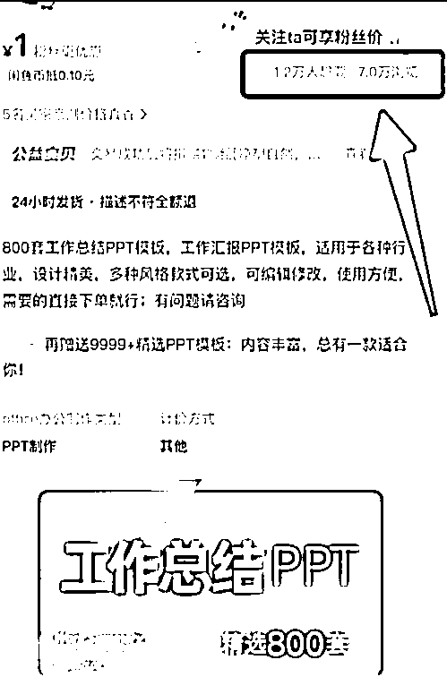
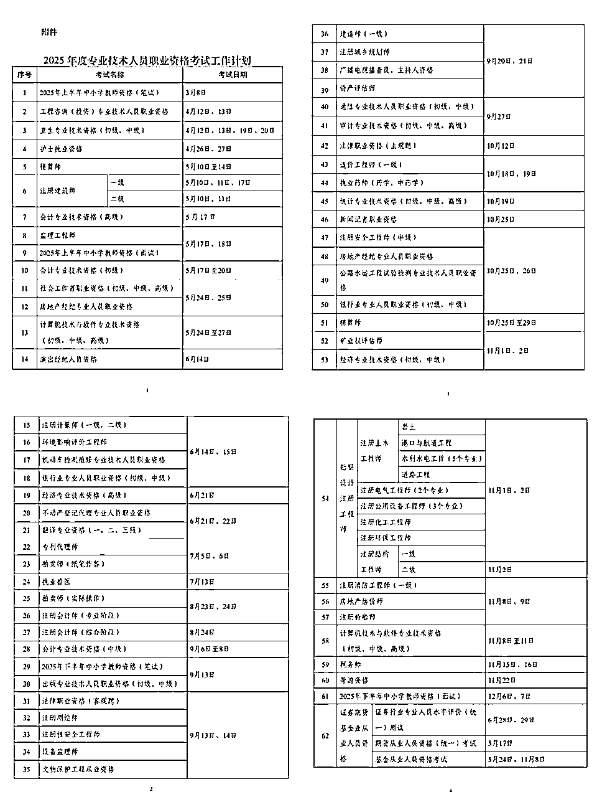
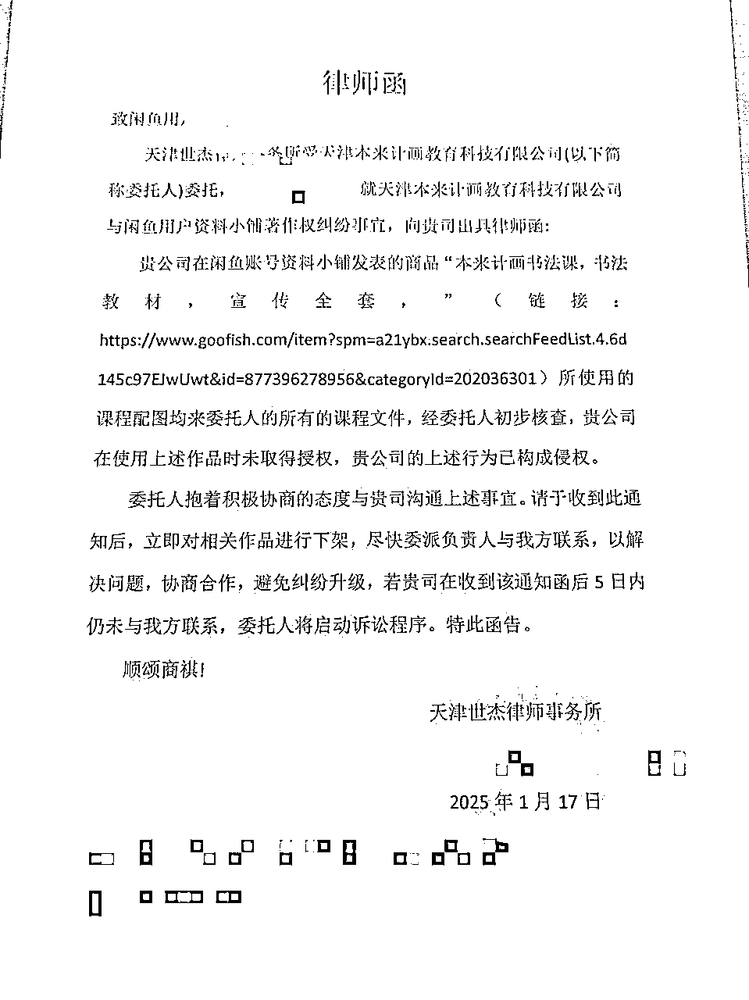
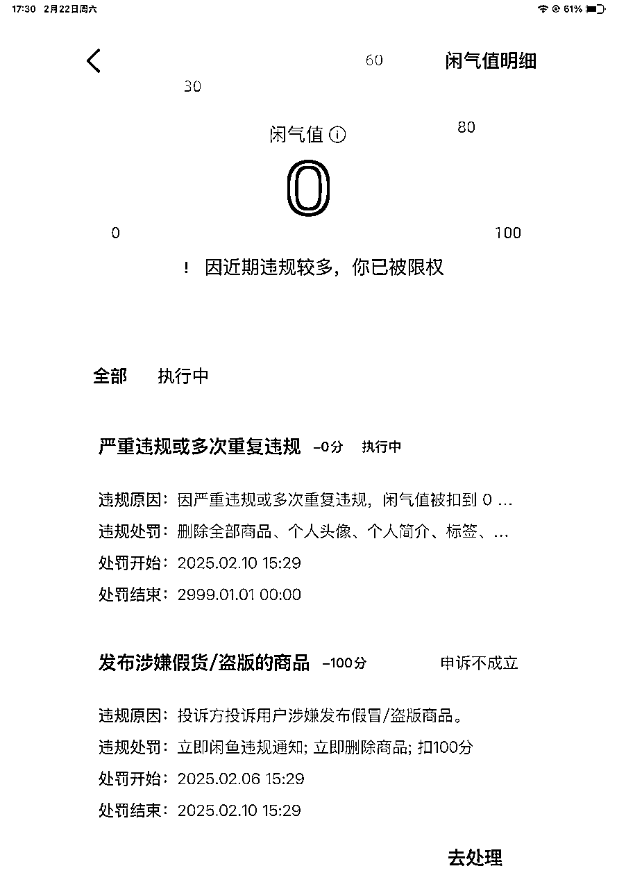

# 闲鱼虚拟资料到底能不能零成本变现？一个地产人从零到1600元的实操复盘

> 来源：[https://ncnxi4u4wp2p.feishu.cn/docx/LertdZZ2EobRWuxtnzec1xqBnRp](https://ncnxi4u4wp2p.feishu.cn/docx/LertdZZ2EobRWuxtnzec1xqBnRp)

大家好，我是南星。

本职是一名地产从业者，互联网的第一笔收入就是在赚钱社区里赚到的。

去年九月我进入赚钱，先做了盖洛普优势测评，十二月同时报名了两场航海，一场是闲鱼虚拟资料，一场是小红书商单。闲鱼这条线我在12月5号上架了第一件商品，12月18号等来了人生第一单，客单价平均不到3块钱，坚持到2月15号，账户里实打实到手1600元。

刚加入赚钱那阵子我焦虑到不行，刷到太多日入过万、周入过万的大佬，还大多是00后，搞得我怀疑自己的认知、赚钱能力和执行力是不是都差了一截。

转折点是听了一期播客【搞钱女孩 携隐Melody：搞钱是我和世界合作的方式|人类搞钱指南】。里面有一句话点醒了我，“搞钱是一项技术，可以通过练习来提升”。那一刻我眼眶都热了，之后才真正静下心来练手艺。眼光不行就找会的人带，实打实上手，把手弄脏。

今天把这次复盘拆成四个问题来聊：

一、新手有没有可能做闲鱼虚拟资料
二、第一次操盘踩了哪些坑
三、账号出事后怎么稳住
四、给同路人的一点话

* * *

# 🔥 一、【零基础起步方法论】没粉丝没资源也能把闲鱼虚拟赛道吃透

## 1.先从最容易获得正反馈的事做起

我最初选项目全凭兴趣。23年6月原公司整组裁撤，到24年8月才找到新工作，空窗期听了搞钱女孩。24年5月就通过她的链接报名过赚钱3天体验营，觉得门票贵一直没加入。8月工作有了保障，立刻办了会员。进社区后琳琅满目，9月航海在即，我也没特别心动的方向，先做了盖洛普优势测评，想看看自己适合干嘛。测完反而更迷茫，发现自己不适合现在待的公司，这也让我下定决心要搞钱，早点从职场里抽身。

12月的航海我最期待的是小红书商单，很喜欢那个平台，之前好几次想报相关航海。结果满打满算做下来，没有获得即时反馈，也正常，世上不是只要努力就有回报，而是努力才有成功的概率。

真正讲到闲鱼虚拟资料了，我起初根本没打算报。我觉得自己没时间同时兼顾两个航海，也对闲鱼一无所知，从没想过在上面卖东西。这个名额本来是给男朋友报的，他没空，我只好每天早起一会做闲鱼，午休和晚上做小红书，就为了把199报名费赚回来。

结果花没成，花成柳。花大力气做的小红书没跑通，反倒随手做的闲鱼跑通了。第一单来的那天我正在炒菜，手机响起一个从未听过的提示音，才发现有人下单了。当下把锅铲一扔就去处理，大概折腾了十分钟才把资料发出去，中间提心吊胆怕因为准备不足把单子弄丢。前面13天两个项目都没动静，我也没老老实实按航海手册做前期准备，这点必须引以为戒。

所以刚开始练搞钱手感时，最重要的是先拿到第一笔正反馈。我当时出单的瞬间，就像心里放了一场迪士尼烟花，亮又暖。

## 2.按自身投入时间选项目，别贪多

当时我白天上班，两个项目并行，累到心态都快炸了。建议别学我，量力而行。一定要结合当前状态和可投入时长来挑赛道，贪多只会让两个项目都反馈不良。

## 3.为什么我最终选闲鱼而不是小红书

1. 小红书审核更严，对同行图片文案必须二创，闲鱼则允许直接参考同行资料。对当时新手的我来说，闲鱼上手门槛更低。
2. 小红书成交通常要引流到私域再沟通，本职工作已经很忙，我没精力做长链路服务。闲鱼虽然也有聊天，但大多很短，算是可接受的“摸鱼”程度。未来我也想尝试小红书虚拟资料，会慢慢上手。
3. 虚拟资料是零成本启动，我一开始还以为要先自己买入再倒手，按手册操作其实完全不用囤货。
4. 无需囤货，后期可自动上架自动发货。运营熟练后每天也就半小时到一小时，适合赚点外快。

# 💣二、【新手致命失误盘点】第一次实操我犯的3个大错

第一次做项目期间遇到的困难

1.不会选品
2.抱着侥幸心上架强版权产品并收到律师函
3.下架侵权品后店铺依然被封

## 1.不会选品

1.优先选红海但相对安全的品类：素材类、学习资料、合同模板等，受众广且版权风险低。带品牌名、人名的千万别碰。
2.选【想要：浏览数≥1：10】

3.紧跟热点，过年期间Deepseek相关资料很受欢迎，年前2025规划类资料也很火。每个阶段都有爆品，比如《2025年度专业技术人员职业资格考试工作计划》，按计划提前布局考试资料。

4.选品方法多看航海手册，时常翻阅更新。龙哥盟网页版

## 2.侥幸上架强版权收到律师函

刚开始出单还行，元旦当天一天出了50单。后来选品乏力，出单放缓。看到闲鱼榜单上排名靠前的课程，价格高，我版权意识薄弱就直接上架了。爆单是爆了，很快就迎来第一次处罚，只是强制下架，我没当回事。尝到甜头后继续上架不同课程，一个月不到就收到多条警告，我仍抱着侥幸心理，直到1月17日收到律师函。当时吓坏了，立马把所有课程类商品下架，但事情并未结束。

## 3.下架后依然被封店

律师函风波后，我清掉了所有课程。但投诉并非你删了就没事，上架过侵权的商品，对方随时可以抓取历史记录投诉。之后我仍陆续接到投诉，没有即时处罚，有天正在出单，忽然被禁言，多次违规直接扣100分，店铺永久封禁。强版权产品真的不要碰。

目前基本会被投诉的品类：K12、新东方、迪士尼、爱奇艺、国产电影、电子书、所有带人名的课程。远离侵权，保住店铺。

# 🆘三、【封号应对思路】上了强版权，收到律师函怎么办

1.若已上架强版权，收到投诉时别慌，一般一两次无大碍，立刻下架即可。
2.收到律师函也别恐慌，多为律师群发，不一定会真诉。即便起诉赔偿也不是漫天要价，不建议私下联系，建议先找专业律师评估后再决策。
3.账号被封心态别崩，没用。重新养号重新来，别再犯错。已经跑通0到1，再来一次不难。

闲鱼虚拟资料确实是新手友好的项目，只要按步骤执行，保持耐心，结果是可以拿到的。

# 💌四、【给迷茫者的几句话】为什么虚拟资料可能是普通人的救生筏

关于赚钱的心得，我想分享几点：

1. 赚钱是认识自己的过程。在实践中你会发现自己喜欢什么、不喜欢什么、擅长什么、不擅长什么，这很重要。选了不喜欢不擅长的领域，执行起来会很痛苦，也坚持不下来。我线下其他项目赚得更多，却坚持不下去原因就在这里。
2. 每做一次项目都是一次积累。即便没成功，经验也能沉淀下来，每一步都算数。赚钱本身就是一门手艺，过程中锻炼眼力、脑力、动手力和心力，选品、学习、执行、耐受力都会提升，这些就是最宝贵的收获。
3. 多尝试，总能找到适合自己的变现方式。
4. 心态要稳，没有一劳永逸的渠道。我中途崩溃过很多次，因侵权被举报心态崩，因前期无单心态崩，但崩着崩着就习惯了。搞钱需要好的心态。
5. 最后分享一句今年最触动我的话，出自《飞驰人生2》，张弛说，“我努力过无数次了，机会只会出现在其中的一两次。”我会一直努力去抓住那几次机会。共勉。

最后，特别感谢航海教练钟哥，有问必答。感谢志愿者放空老师及各位志愿者，感谢赚钱团队的付出，也感谢2024年最后那个月一起航海的圈友们，期待未来还能一起搞钱！