# 八小时之外，我把家里的蟹摊做成了第二事业

周围时常有人问我：工作那么清闲安稳，何必再瞎折腾？我的回答很简单：安稳的工作给了我很高的确定性，却挡不住我内心一直想证明自己。

我叫帅彬，白天在单位坐班，晚上帮养殖螃蟹的父母料理线上生意。进了赚钱有术之后，这门小生意才真正走上正轨——老客户的回头率提高了四成，单次客单金额直接翻了一倍。说句实话，不是我自己有多大本事，而是找到了对的场域、对的同行者。

假若你也正琢磨着利用工作之外的零散时间多挣一笔，这篇内容不讲大道理，只讲我落地过的路径。

## 一、这个圈子给我的，不是现成的钱，而是成事的土壤

刚进去的时候，我把它看成一堆“赚钱秘籍”，好像翻几页就能捡到宝。半年下来才明白，它更像是练兵场，也是连接器。有三样东西，我觉得对普通人来说远比一份资料更值钱。

### 1. 别人验证过的模型，就是最省钱的认知课

头两年我卖蟹，最愁的就是回流客太少。蟹季一过，客户就散了。后来我尝试在站内检索“复购”“促活”等关键词，一下子冒出来大量已经跑通的打法：

有圈友组织老顾客拼团购，再配上抽奖裂变，90天时间把复购指标从15%推到了60%。

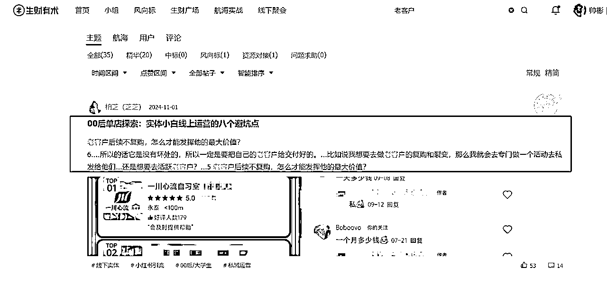

点开查看完整内容

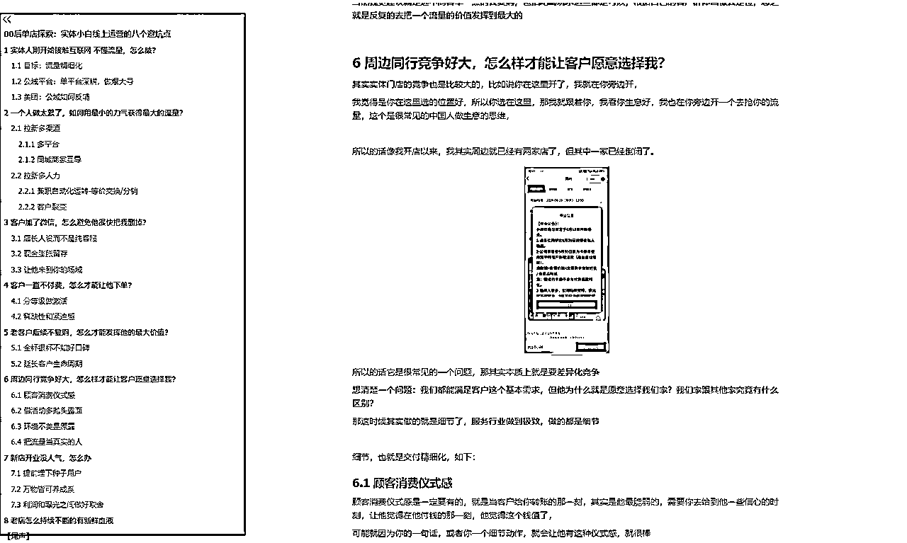

有圈友在特殊时期借助快团团卖牛肉，愣是做到了上海本地口碑榜的前排。

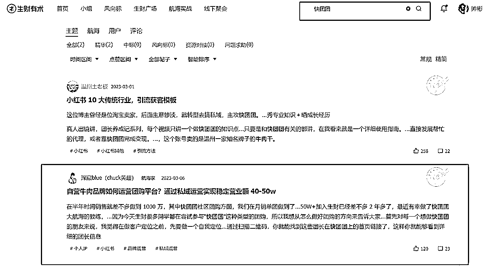

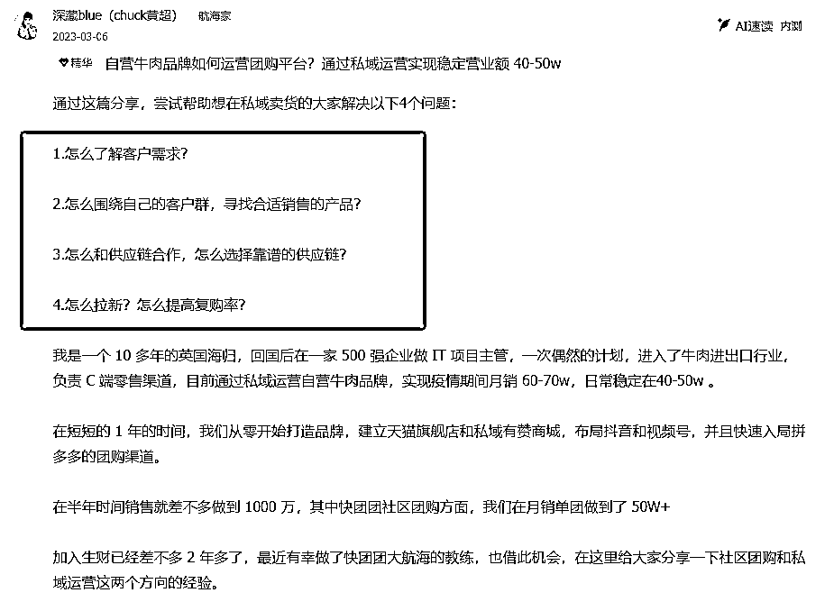

还有一位经营着几家面包房的圈友，在中小城市从零起步搭会员体系，每月流水多出五十余万。

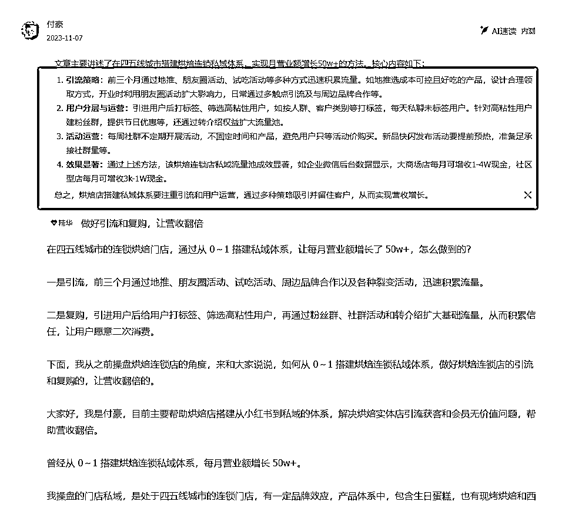

这些分享让我意识到：市面上不缺赚钱思路，缺的是有人把路走通后再告诉你哪里有坑。我不再只是羡慕，而是对照自家蟹摊的情况做了改良，同时把自己的卖蟹记录也发进圈内，主动去链接同频的人。脑子里的经营逻辑也变了：以前想的是把货卖出去，现在想的是和客户处成朋友。心态一换，生意反而顺了。

### 2. 有人拽着你下场，行动力才会被点燃

去年我报名了一个21天的社交内容变现训练营，给自己的目标是跑通获客、培育、成交、复购四个环节。

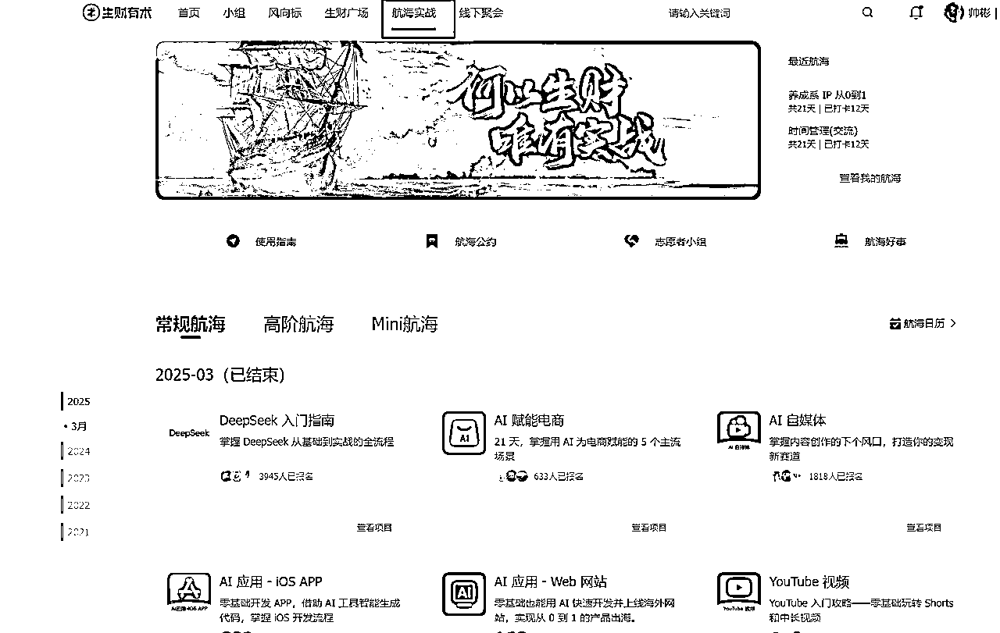

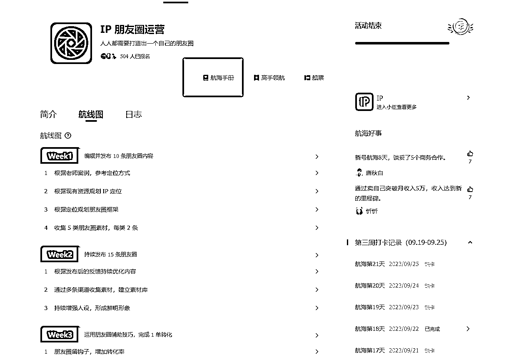

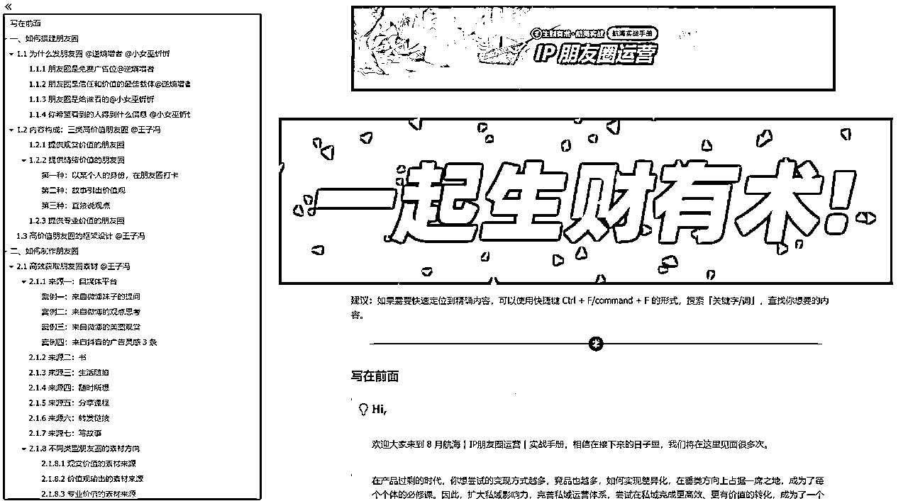

那段日子，群里每天都会同步数据、拆解卡点。有一回我拿不准发什么内容，几个圈友连夜帮我把文案从头到尾顺了一遍。结营时，成交转化从5%涨到12%，还牵线拿到了两个快团团的帮卖渠道。

但比数字更值钱的是，我终于学会了怎么做一个真实而不端着的人——让你的客户感受到你的用心，比刷屏吆喝管用得多。

### 3. 你能为别人解决什么，决定了你能连接到谁

靠着发龙珠帖，我认识了不少做个人品牌的圈友，其中一位我付费请教，后来一起搭了“学习交流群＋蟹品代理”的模式。

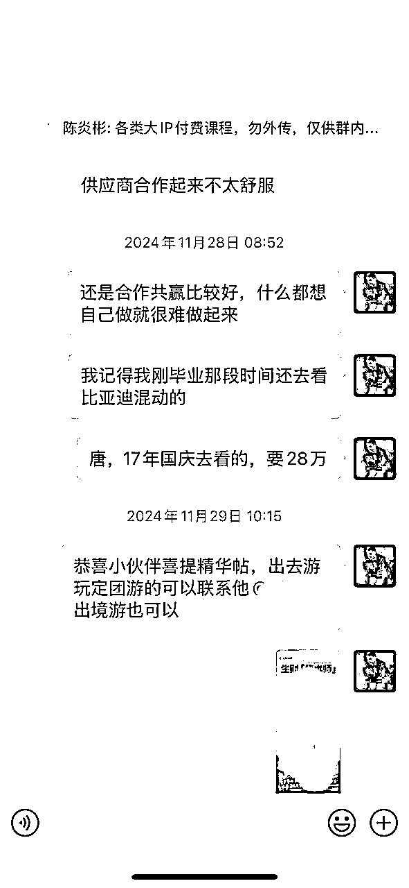

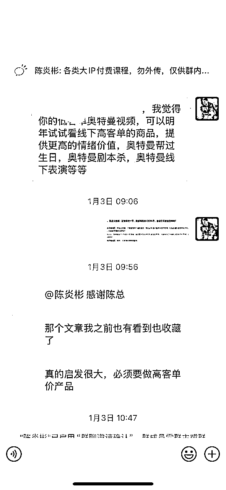

我自费买的网课全部开放给群内成员，大家每天都在一起切磋怎么把线上生意做细。

更意外的是，我还在官方群里遇上了一位同在常州的老乡，我们一拍即合，策划了“郊外瑜伽＋露天烧烤＋现蒸活蟹”的周末活动。一只蟹就这样走进了都市人的休闲生活，家乡的蟹品牌也在社群里越传越广。

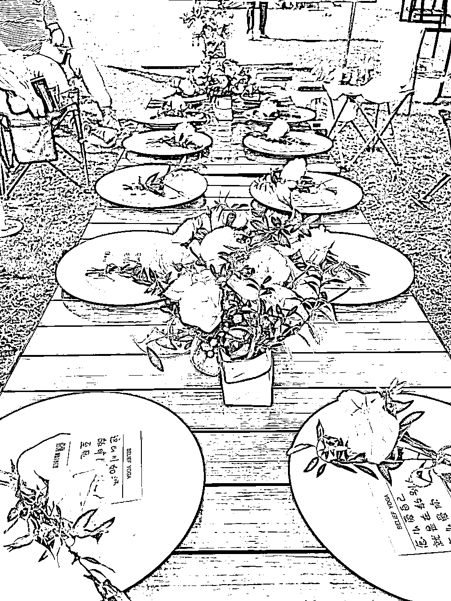

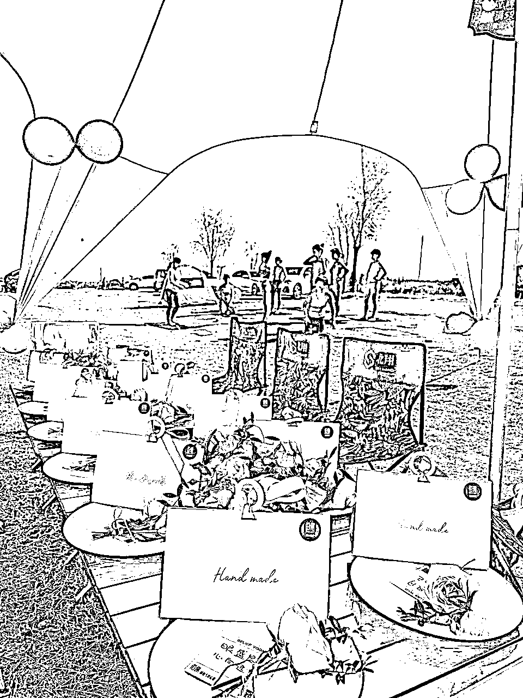

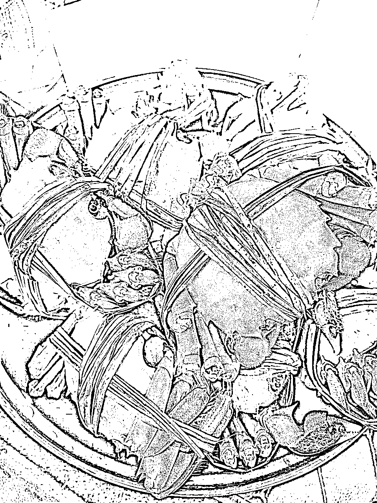

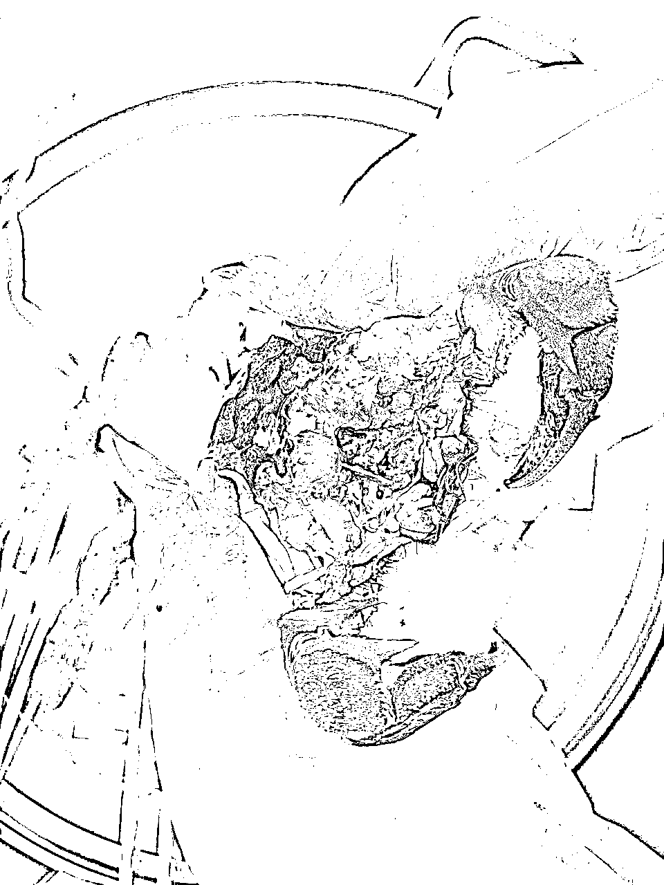

在这个圈子里，人脉的本质不是加了多少好友，而是你切实帮多少人解决过困扰。

## 二、正职与卖蟹并存，我的三条实战心法

### 1. 不挤红海，选一个细分的空位

蟹类市场早就卷成了红海，但我看准了“企业福利定制”这个方向还没多少人重视。参考圈内分享的《小众品类暴利打法》，我把重心放在公司团购的定制蟹礼盒上：激光雕刻、UV彩印、外观按需设计。避开低价竞争后，客单从200元一跃升到800元，利润空间超过了28%。做生意的本质是回应客户的需求，而不是自我感觉良好。

### 2. 将顾客分组管理，沟通才有节奏

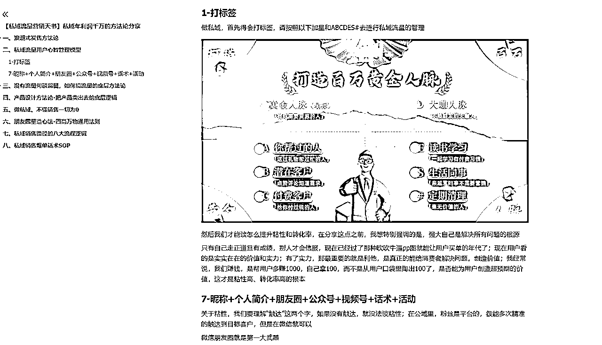

过去我所有客户都堆在一个大群里，发什么都担心打扰错人。后来参照圈内的《客户分组SOP》，我把客群筛成了三类：公司客户重点关注发票和定制细节，散客偏爱折扣与小礼物，代理伙伴则在乎佣金和独家保护。分而治之的效果立竿见影——单个客户一年的采购额从500元涨到了3000元。

### 3. 善用合作者的流量，让1+1大于2

一个人的客群终究有限，但把众人的客群叠在一起，力量就完全不同。我邀请了几位圈友共同推出一款228元的蟹品引流款——蟹本身没有任何质量问题，只是品相稍有瑕疵，因而价格亲民。这款产品放在合作者们现成的客群里售卖，每成一单给10%佣金，后续复购也同样分成。靠着这种从外围切入、层层渗透的打法，我在中低价市场站稳了脚跟，也绕开了正面拼价格的消耗战。

## 三、写在最后

赚钱有术并不是一座金矿，它更像一张寻宝地图。有人按图索骥找到了宝，也有人把图搁在一边，抱怨它不够精准。其实图没有错，差别只在于：你敢不敢真的迈开腿，愿不愿意坚持走到黑。

假若你也有这样的念头：

- 希望在工作之外增加一条收入线，且不耽误本职工作
- 告别一个人闭门摸索的日子
- 抓住工具和渠道更新的周期，做出一点改变

4月18日，赚钱有术将开启新一轮的加入通道，上万个同行者会一起用一整年时间，把想法真正落地成看得见的数字。

能发现风口的人从来不缺，真正握住风口的终归是少数。愿下一个分享故事的人，是你。