# ('一人公司创业者如何高效使用赚钱有术？', (2, 20))

如果你正以一人公司或自由职业者的身份打拼，想找一条从“没项目”到“稳稳变现”的路子，这篇内容或许能给你不少启发。

我是千易，2017年开始全职创业，2020年之后一直保持一人公司模式，主营抖音直播带货。2024年加入赚钱有术，在这里研究小红书、视频号的玩法，也认识了一群同频的朋友。那一年，我们做到了千万级营收、百万级利润。回头看，赚钱在项目挖掘、能力提升、赚钱信息获取上帮了大忙，我也顺手输出了几篇精华帖。

今天想跟你聊聊：作为一人公司创业者，我是怎么把赚钱用出效果的。

先说明一下，我的使用方法更适合自由职业者、小团队、一人公司。核心就四步：

1. 学会挖掘项目，搭起自己的项目库；
2. 在实战中提升技能，跑通从0到1；
3. 复盘总结，写出精华帖拿到龙珠；
4. 长时间创业，还得持续给自己充电蓄力。

**第一步：怎么从赚钱挖到好项目**

很多人进赚钱第一件事就是找项目，但我更建议先学“怎么找”。方法比项目本身更能产生复利——方法学会了，好项目会源源不断冒出来。

具体操作不复杂：

打开赚钱，直接搜索“项目挖掘”“挖掘方法”“项目分析”这类关键词，就能找到高手们沉淀的方法论精华帖。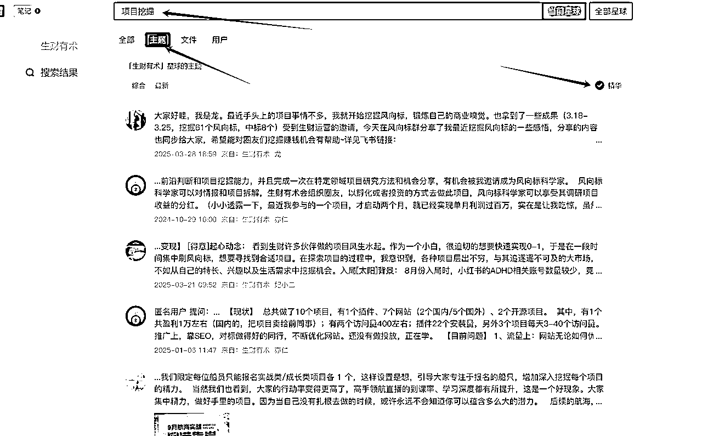这些帖子大多经过圈友投票、龙哥和官方团队认可，质量很有保障。看的时候不用太在意发布时间，方法层面的东西往往经得起时间检验。

比如这几篇就值得反复读：
- 《普通人如何寻找自己的挣钱项目》
- 《如果财富归零，我会去哪里寻找好的赚钱机会》
- 《如何判断一个互联网项目的可行性》
- 《能落地！项目选择核心方法论》

看完之后，把精华内容整理成思维导图或自己的知识库，一套属于自己的项目挖掘体系就慢慢成型了。关于怎么整理，也有圈友专门总结过，比如《看了100+精华帖，建立了项目知识体系》。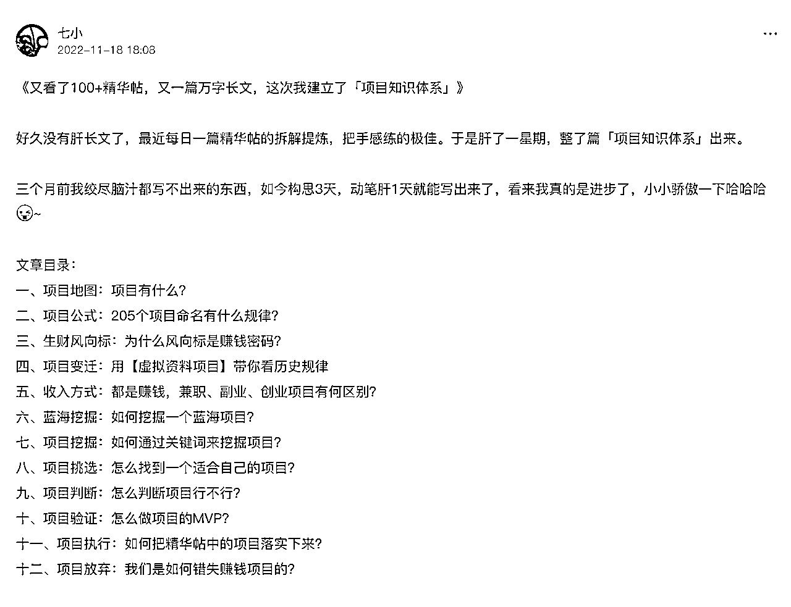

掌握了方法，接下来去哪挖？我主要盯这几个地方：

**1. 风向标和中标**

龙哥大哥说过，找项目要找异常值，异常数据里藏着商机。赚钱的风向标就是典型的异常信息聚集地，每天都有大量圈友在更新，相当于上千人帮你盯信息，你只要从中筛选判断就行。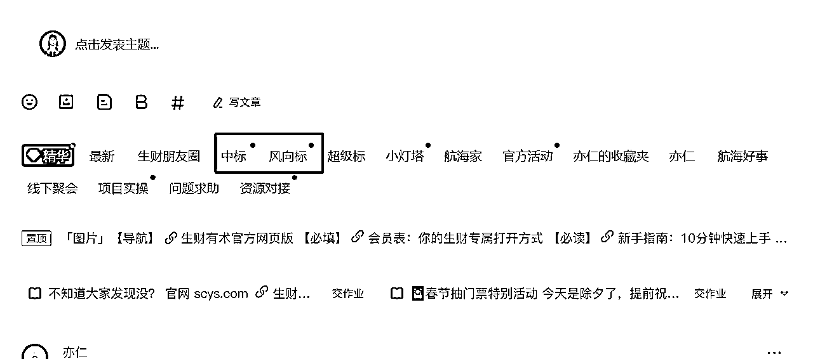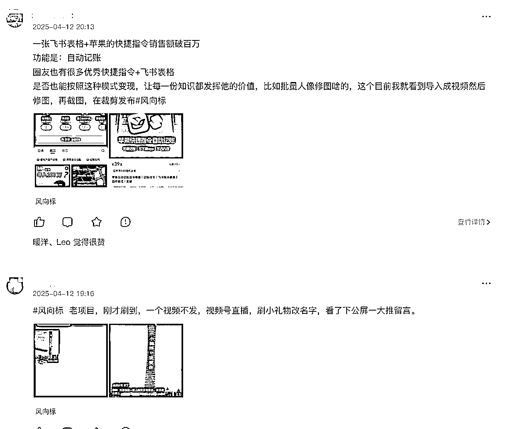如果你想更快拿到官方验证过的项目，可以直接看【中标】，这里的信息由赚钱团队把关，质量和可靠性都更高。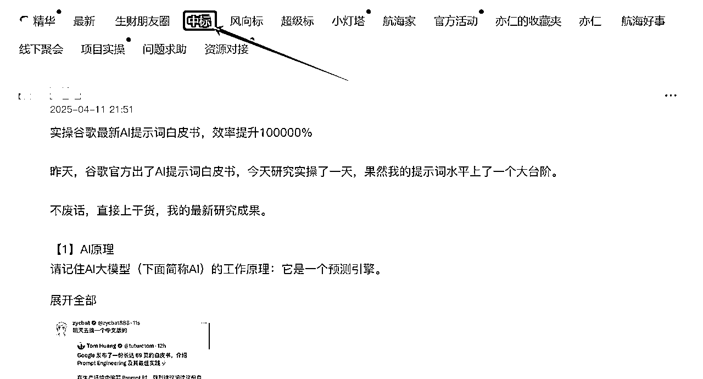

**2. 超级标**

这是2024年赚钱推出的新板块，由龙哥本人亲自筛选当下最值得关注的热点项目，帮你站在更高的信息源上去判断。去年重点推了AI方向，今年已经全面爆发了。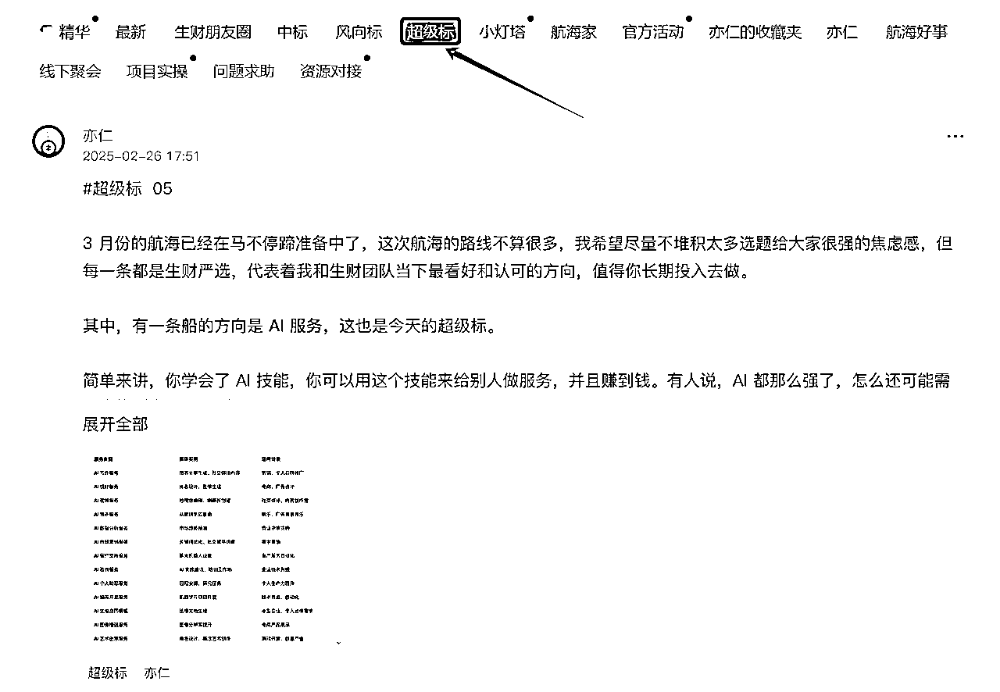

**3. 精华帖**

很多圈友会把跑通的项目经验写成帖子，这些精华帖本身就是现成的项目来源，还能顺带看到项目从0到1的落地路径。不过看精华帖要注意时效性，有些项目红利期短，越新的帖参考价值通常越大。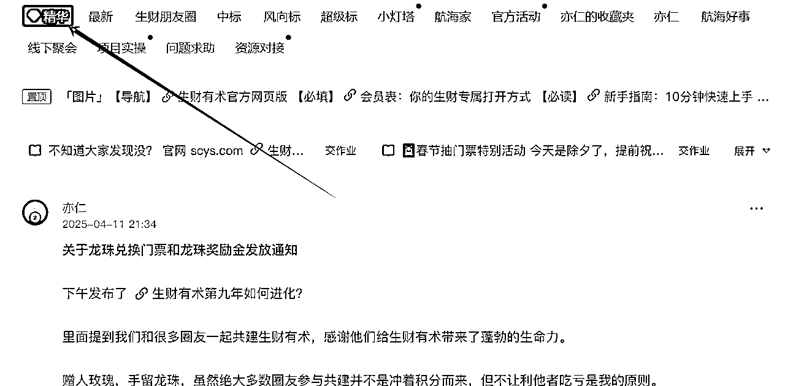

按这个思路，你至少能挖出一批潜力项目，形成自己的“项目库”，再也不用愁没方向了。

**第二步：怎么通过赚钱把实战技能练起来**

光有项目还不够，能力跟不上照样白搭。我去年除了继续做抖音，还拓展了小红书、视频号两个新平台。说实话，刚开始对这两个平台一无所知，但半年跑下来，也都从0到1跑通了。这里面赚钱的两个模块帮了大忙，几乎是小成本撬动了大提升。

**先报名大航海，21天从0到1**

如果你要做一个完全陌生的平台，对规则、操作、选品、起号都不懂，那最该做的第一件事就是报名大航海。跟着航海手册一步步实操，大概率能把流程跑通。

我先后报过小红书带货、视频号带货，还有AI赋能相关的航海。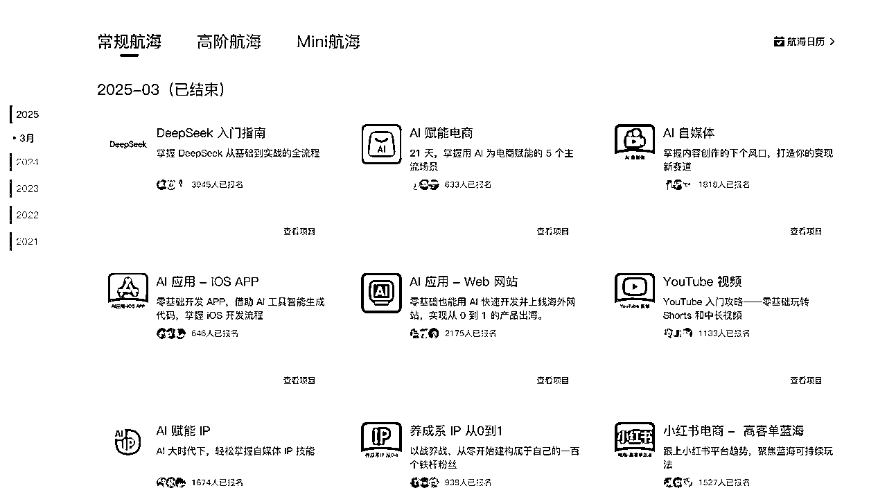很多人没意识到，不参加航海其实是最大的损失——整套体系的价值不亚于市面上几千块的培训。里面有清晰的航线图、详细的文字版手册，还有专门的教练和志愿者，群里随时答疑，再加上每天打卡督促，基本等于手把手陪跑。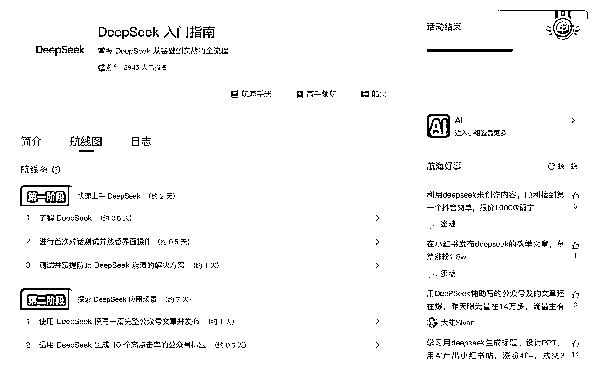

**再搜索关键词，找精华帖**

航海手册解决的是共性问题，但具体到自己项目里的细节问题，我常用一招解决99%的卡点：直接搜索关键词，找对应的精华帖。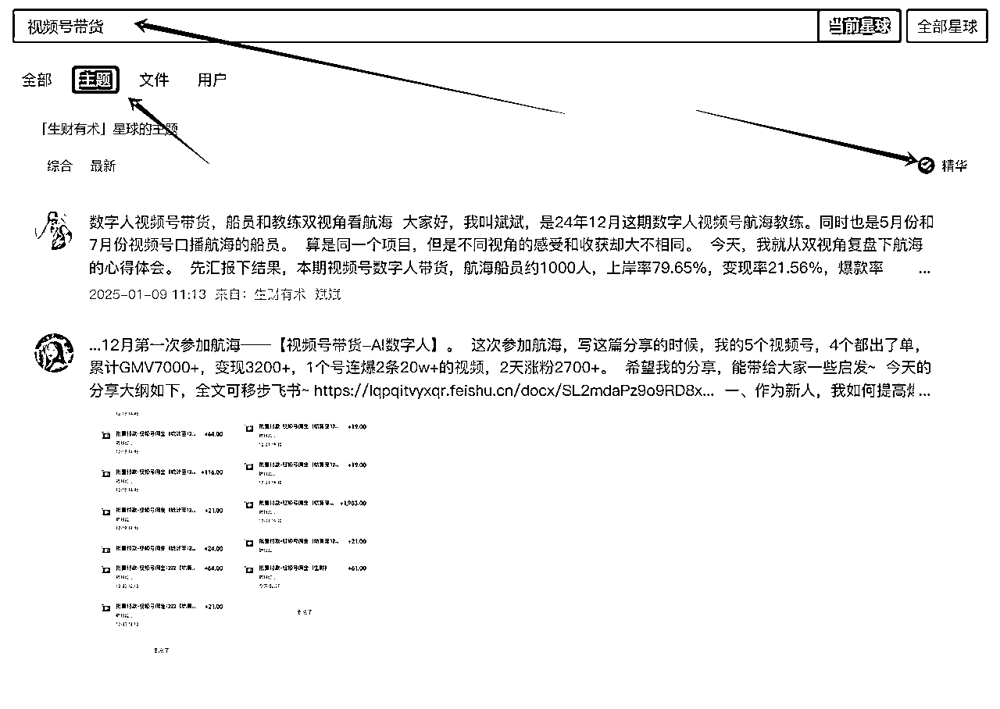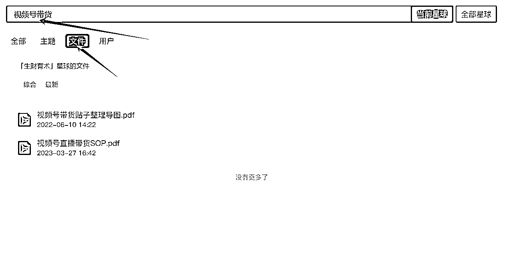如果看完帖子问题还在，就主动去链接写帖子的博主，通过鱼丸对接，礼貌地一对一请教，往往很快就有思路。

说到底，从0到1能不能成，关键就看两件事：技能和项目匹不匹配，以及你在实战中能不能解决问题。解决问题的能力，就是实战技能提升的过程。

**第三步：新手怎么快速写出精华帖**

我进赚钱一年，发了8篇文章，其中5篇拿到精华。说实话，写精华帖没有想象中那么难。

先说心态：越分享越幸运，利他是最好的利己。精华帖的核心是“对别人有用”。

再说形式：精华帖不一定是成功案例，失败复盘、方法总结、效率技巧都有可能成为精华。只要内容接地气，能帮到人，就有机会。

还有就是别被“写作”吓住。精华帖不需要文采飞扬，逻辑清楚、有条理地把自己的实践讲明白就够了。

哪怕只是每月写一篇复盘，也很有价值。写作能让思路更清晰，输出还会倒逼输入，这笔账怎么算都不亏。

如果还不清楚写什么，可以参考赚钱官方总结的《赚钱精华帖欢迎什么样的内容》。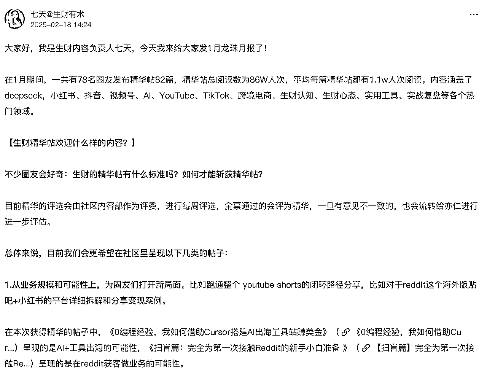

**第四步：一人公司怎么保持心力**

一个人创业，确实会有孤单、焦虑、遇事没人商量的时刻。但一个人走得快，一群人走得远。

我的两个充电方式供你参考：

**一是参加同城会。** 赚钱官网上每个月都有很多圈友组织的线下聚会。线上聊千遍，不如线下见一面。在同城会里，你能碰上做同一平台、同一类项目的人，既交流经验，也可能遇到牛人成为你的榜样，给自己补充能量。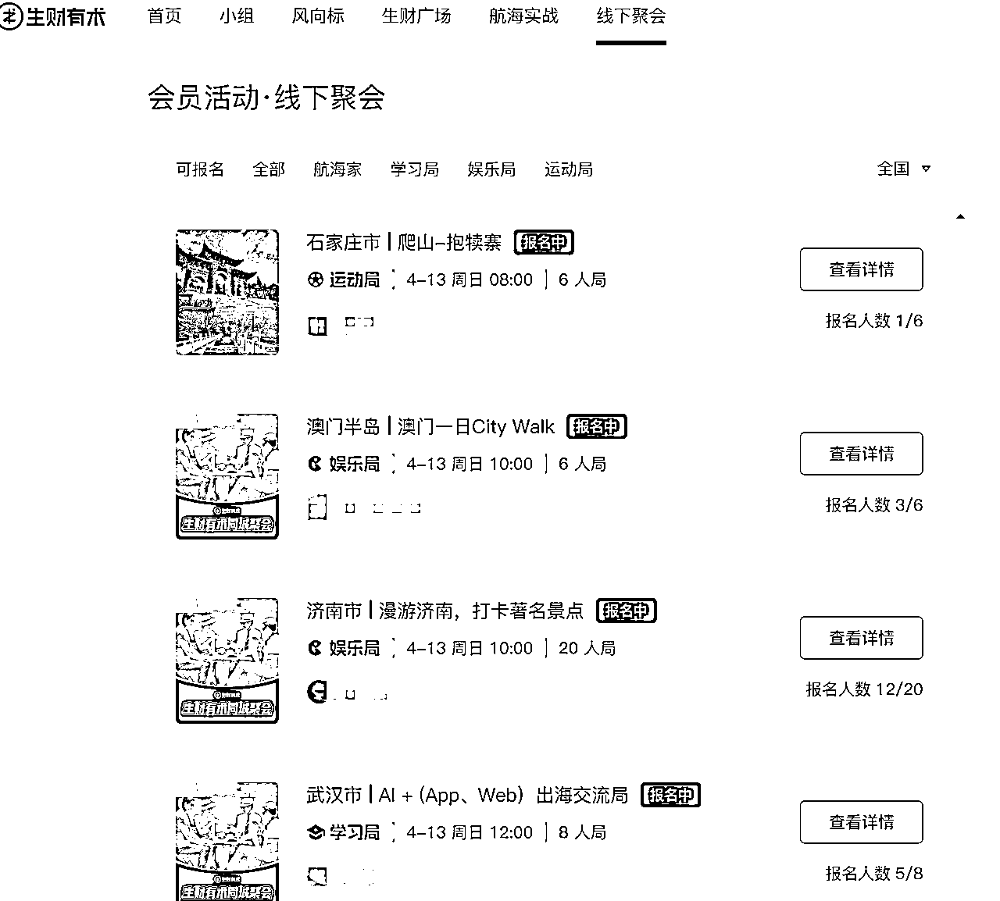

**二是翻精华帖。** 除了解决问题时看，我还会在状态低落、能量不足的时候看。这时候精华帖对我而言就像“创业鸡汤”：有00后年入百万，有大学生副业逆袭，也有70后依旧持续前进。看到这些人还在拼，你会觉得自己没理由停下来，而且继续往前走的人，很多真的拿到了大结果。

所以，迷茫也好，疲惫也罢，翻翻精华帖，既找方法，也找能量。

如果你也是一人公司创业者，欢迎来赚钱一起同行。在这里，你能链接到同频的人，找到一起做事的伙伴，在创业这场人生马拉松里，一步一步往前走，走得更稳，也走得更远。