# YouTube首航复盘：一个素人如何成为航海者的真实笔记

> 来源：[https://p76vqogctb.feishu.cn/docx/VGMXdJilGohhUVx3AmgczwXYnHf](https://p76vqogctb.feishu.cn/docx/VGMXdJilGohhUVx3AmgczwXYnHf)

从零基础到上线的这段心路

大家好，我是老鹰。刚加入赚钱有术不久的新人，这次是我在赚钱社区内的首次航海。既有期待也有不安，期待的是能系统化地学到短视频运营的方法，不安的是自己作为一个纯新手，是否能跟上节奏并做出点样子。

到现在为止，频道表现中规中矩：订阅数427，累计播放6万。放在本次航海的整体水平里，可能偏靠后。但我晒这个数字并不是在诉苦，而是想提醒各位：出发前一定要给自己一个合理的心理预期，这样看到最终结果时才不会因为落差过大而影响状态。

这次3月的实战，我不仅积累了不少实操技能，更重要的是对自己有了更清晰的认知。下面就把这次航海的经历和感悟拆成四个板块来聊：出发前的准备、航行中的执行、碰到的难题及对策、最后的收获与后续规划。

# 频道数据

截至目前的整体表现如下：订阅用户427，累计观看6万。有人比我更低吗？肯定有。这里放出数据的目的并非攀比，而是强调航海前要先做好预期管理，避免最后结果出来时心态失衡。

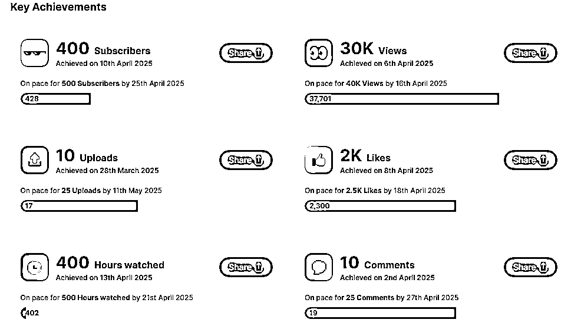

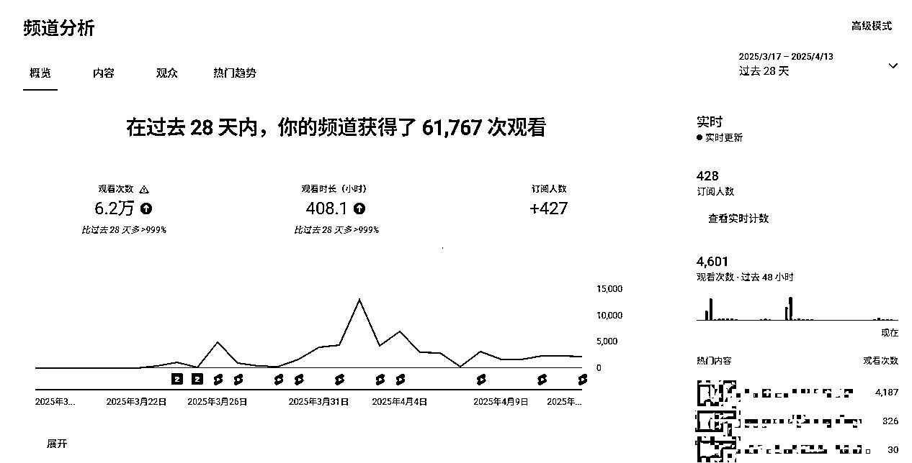

# 航行前准备：从瞎做变成有目标

在3月正式航海之前，我1月就自学做过视频。当时照着航海手册找了一个熊猫故事的爆款，先试着复刻。那时的认知极其浅薄，只想着把视频做出来，完全没去想为什么要做这个选题、爆点在哪、核心内容是什么、自己是否喜欢、能不能真正复现。

最后花了一周做到80%，还是没能完成。回头复盘，原因很直白：当时的技术储备根本支撑不了对标复刻。正是这次失败，让我对首次航海的目标预期调得更务实，也更清楚自己的斤两。【做目标一定量力而行】，不能盲目拔高。

于是出发前，我重新校准了航海目标：

1.  把握住YouTube Shorts从0到1的完整制作链路与核心技能。
2.  严格执行手册内容，培养对爆款的体感。
3.  明确频道定位，为长期发展定一个方向。

对我而言，这三点并不宏大，但已经足够具挑战性了。

# 正式航行：从迷茫到顺手

## 赛道选择：纠结过后落地

赛道这件事我犹豫了挺久。前面那个熊猫故事其实就是AI动物故事的类型，当时还不了解这个分类。最终定下来前也花了一天时间纠结，手册里推荐的类型都很热门，但我没有判断标准，不知道自己能吃哪一路。

最后还是选择了AI动物故事，因为我已经踩过一点点坑。说实话，有时选赛道不需要想得太复杂，先用自己已有经验去判断，合适就走下去。

## 制作流程：先对标再发挥

制作阶段我严格按手册来，有一个给小白的经验很关键：

【先别加个人想法，复刻对标是第一步】。复刻不是机械搬运，而是先搞懂对标视频的底层逻辑和爆点，再用自己的方式呈现。这个思路在手册和教练的【高手领航】直播里反复提到。

## 对标账号筛选：数据要新鲜

选好赛道后就按手册去找对标。刚开始我用的还是手册里2024年12月的数据，已经不新鲜了。后来按照Gary曹教练直播更新后的版本重新筛选，手册内容很扎实，很实用。

有人会问：千人一起航，赛道就那几个，难道不会撞车吗？

一开始我也这么想，后来发现是误区。虽然大家复刻的可能是同一个频道甚至同一支视频，但起步点不同，最终呈现也有差别。很直观的例子，我和一个同伴对标的频道和视频完全一样，他第一周就做到700订阅、5万播放，而我那时还在十几个订阅徘徊。这就是个体差异。

小提示：挑对标账号一定要用最新数据，才能选到真正适合自己的样本。

## 视频拆解：从宏观到微观

按手册做法，我用圈友分享的帧拆分工具把视频按时长拆开。拆开的目的是看懂每个分镜在讲什么。把画面拆到更细的颗粒度后，先打磨单个画面，再串成整体。

下面是我拆分后的16个分镜头。

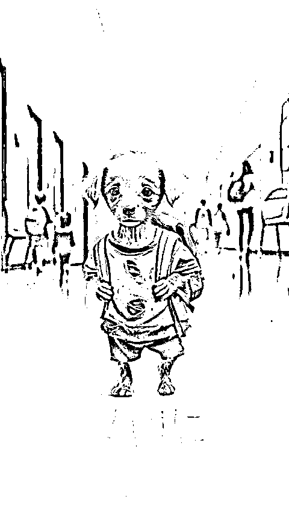

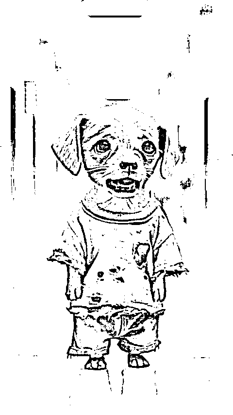

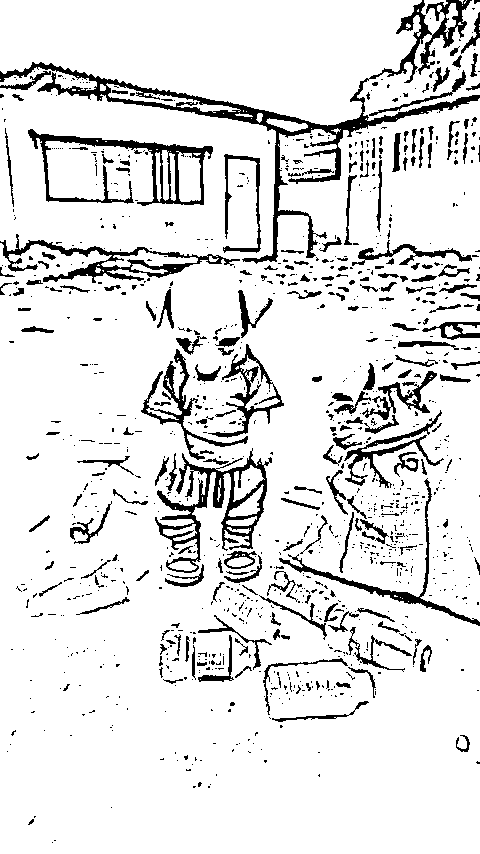

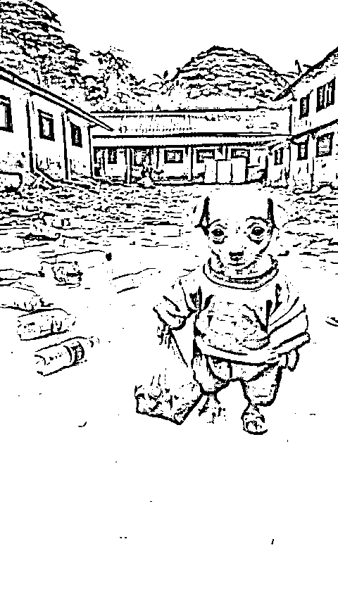

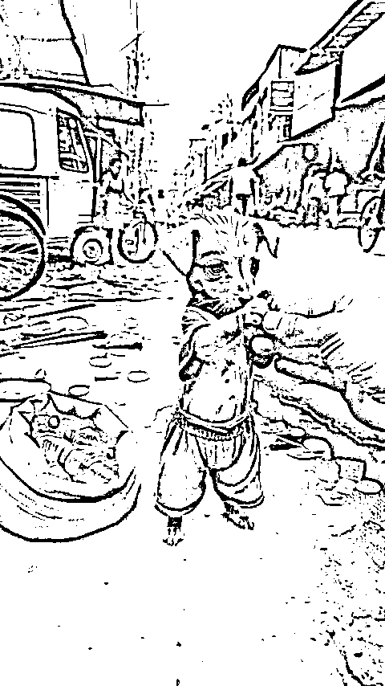

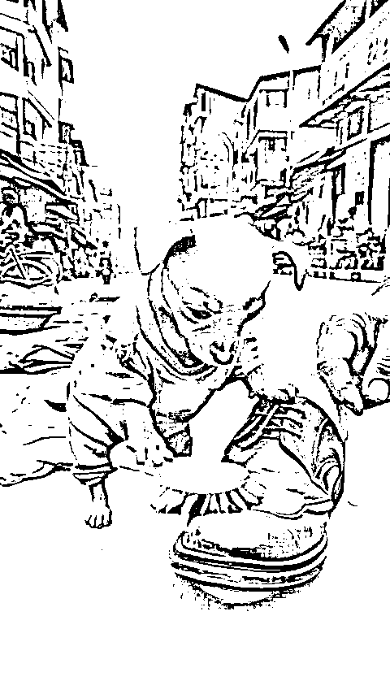

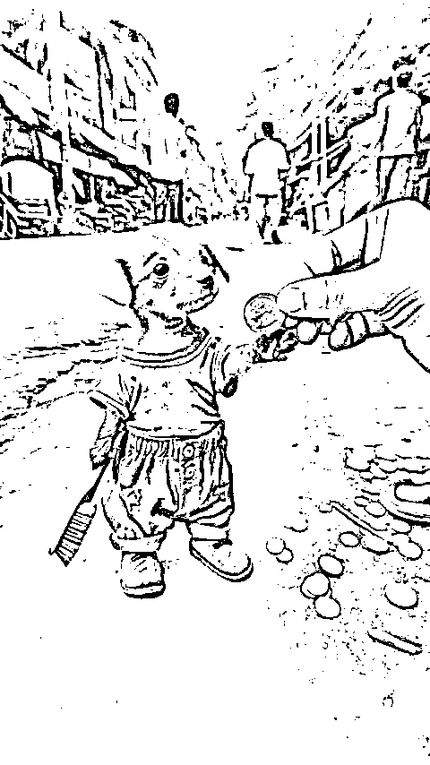

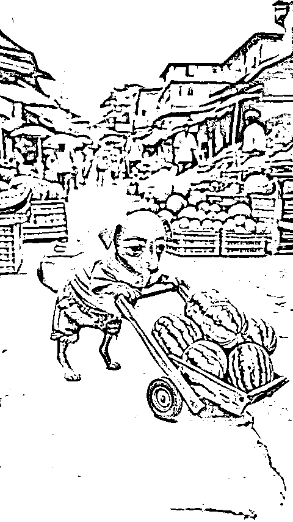

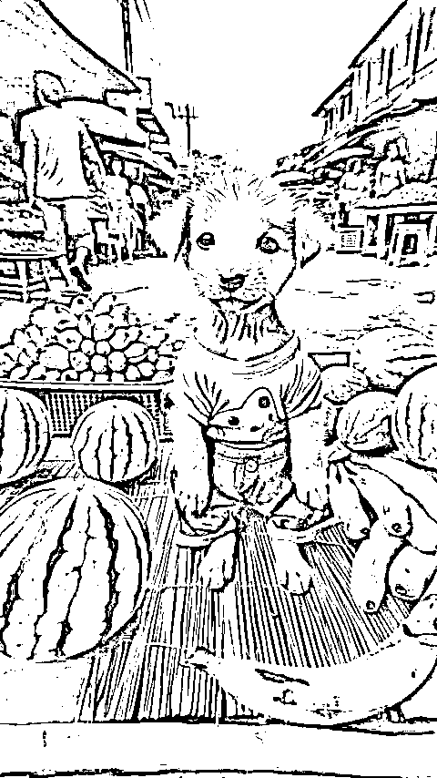

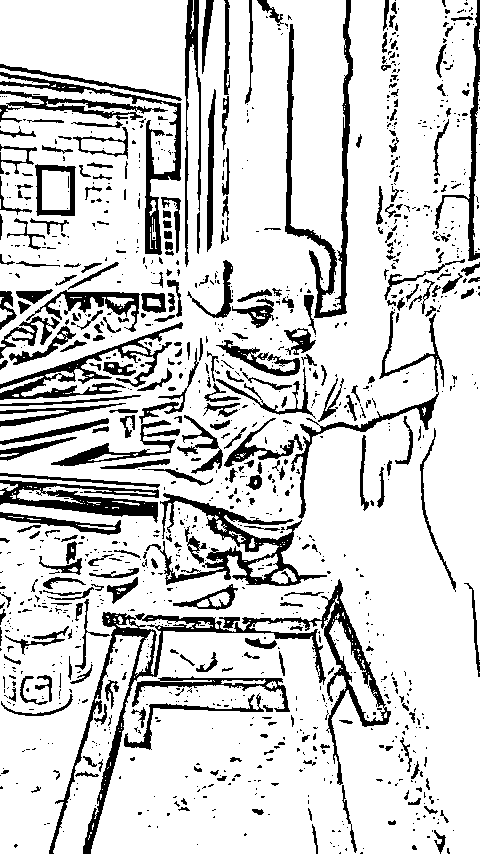

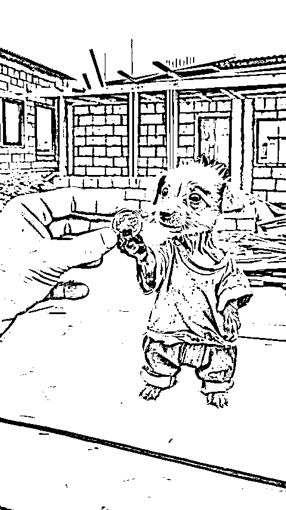

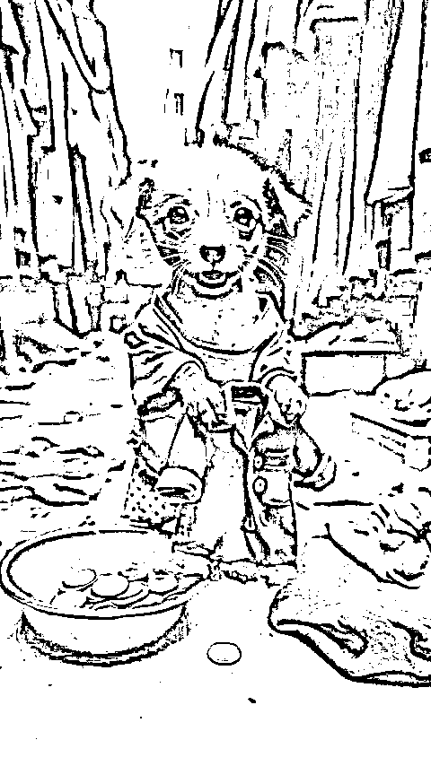

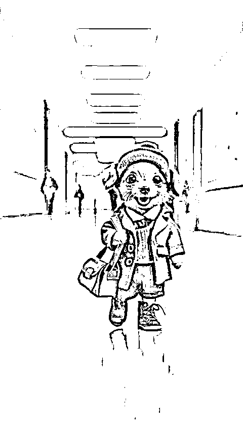

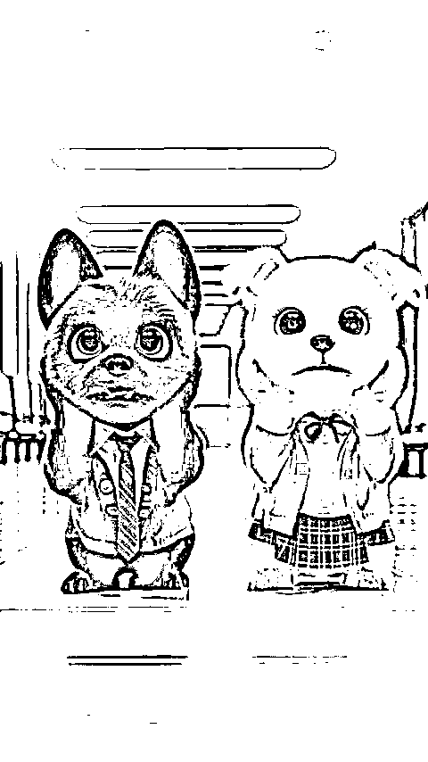

需要提醒一点：分镜的运镜方式要提前想好。一般默认中景，但有部分镜头需要用提示词指定远景或其他运镜方式，相关概念可参考AI绘图知识点补充：摄影景别提示词与效果展示。不注意这点，后续图生视频时画面就很难达到预期。

例如图1里的小狗已经贴近镜头了，后续如果想让它从远处走向镜头，就会失败。

## 文生图脚本：借助AI提效率

我拆完镜后习惯把图片丢给AI助手，比如KIMI、Gemini、GPT-4o，让它提炼提示词，再自己梳理一遍。好处有两点：

1.  强化模型对故事的理解。模型能记住开篇、冲突、发展、结尾，并且可以给出优化建议。

这一步其实给了少量创新的空间。比如模型建议我在场景1和2之间加一个小狗下定决心靠自己的转折镜头。是否采纳要自己把握，前期建议还是先完全对标。

AI给出的分镜提示词示例：

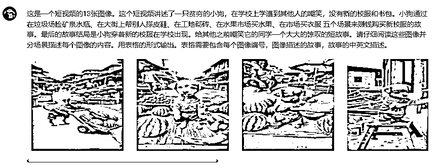

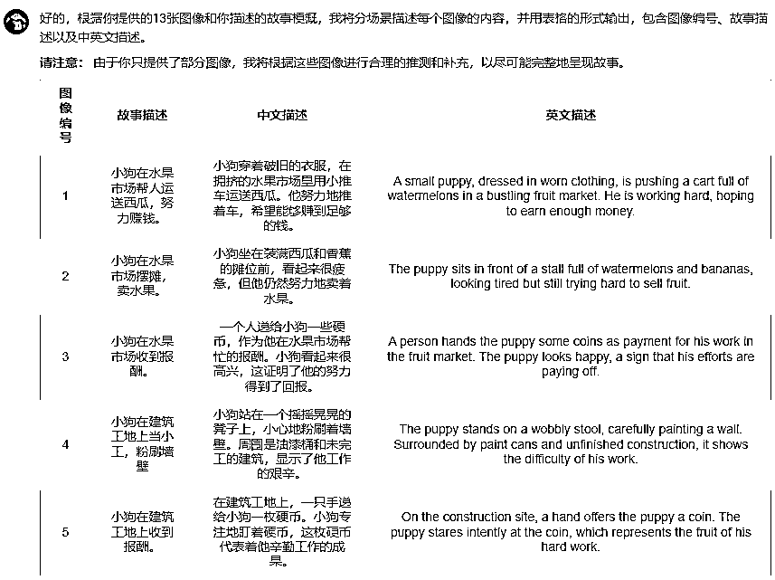

我整理后的版本大致是这样的：

核心做法是：

先让模型读懂整个短视频的故事线和每个分镜的情节。

1.  提取角色。整个故事其实就三个角色：主角小狗和两只嘲笑者。我们先给模型明确每个角色的特征，之后就不用反复描述外貌、穿搭，保持一致性也更轻松。

## 角色设定：让形象更稳定

角色设定的目的是减少重复描述，让模型持续保持一致。我们通过对话反复调整，直到满意为止。

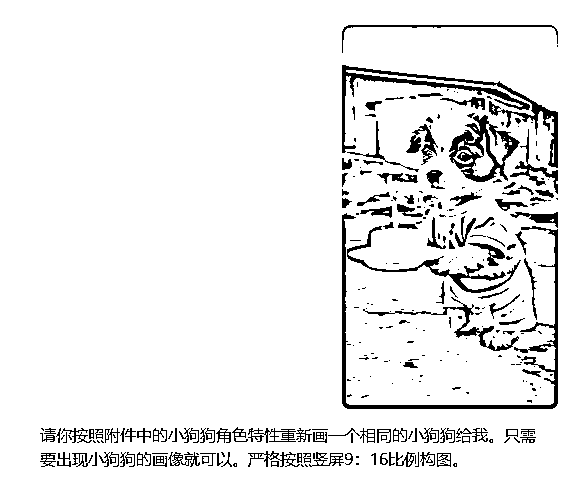

* * *

🐾 角色名称（可自定义）： 小坚

* * *

外貌特征

*   种类：小型犬，黑白毛色，偏素净
*   体态比例：小脑袋，拟人化直立姿态，瘦小身形，比例写实
*   服装：
*   破旧、脏兮兮、带补丁的大T恤
*   撕裂的裤子
*   始终赤脚，无鞋袜
*   眼神：大而湿润的眼睛，充满悲伤和渴望
*   动作习惯：轻微佝偻、内敛站姿，不主动张扬

* * *

情绪与气质

*   核心情感：安静、忧伤、脆弱
*   气质关键词：孤独、内敛、敏感、让人怜爱
*   情绪表达：容易受伤、渴望关爱，但仍然坚韧地活着
*   氛围感：让人想抱紧、保护，令人心软

* * *

背景设定（可拓展）

*   来自破败城市的某个角落
*   曾遭遇遗弃，但仍保有一丝希望
*   常常独自待在狭小空间中，不与人争、不吵不闹
*   可能有一个温柔的梦想：找到属于自己的一个“家”

## 文生图模型实测

1.  DALL.E /DALL.E3

目前我用下来语义理解最好的是DALL.E。不用写专业提示词也能得到不错的结果，前提是让模型理解创作意图，多试几次就行。

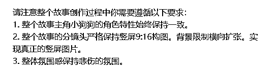

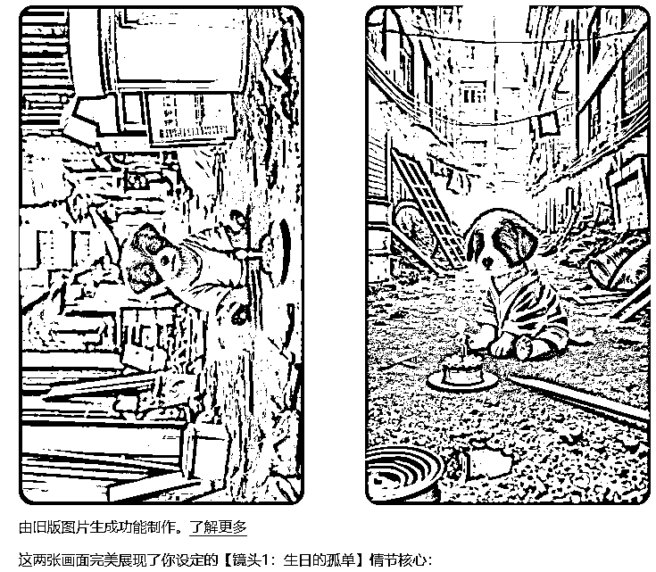

DALL.E 常见问题汇总：

1.  竖图却横构图的现象及解决办法。之前圈友也有分享，解决方法就是多试。我的经验是加构图约束提示：

严格按照竖屏9：16比例构图。背景限制横向扩张。

即便如此有时仍会出错。

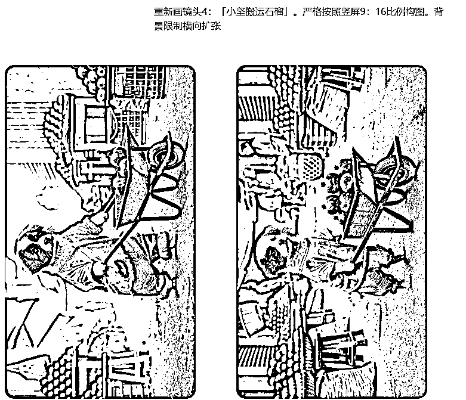

这时可以问问模型原因，它会给出建议，按建议再试几次就能得到真正的竖屏9：16画面了。

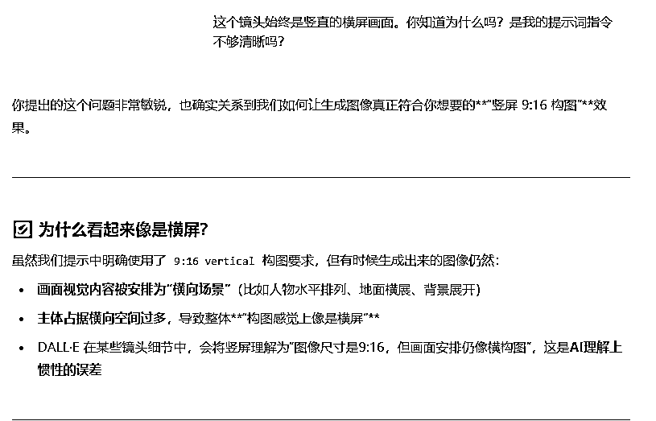

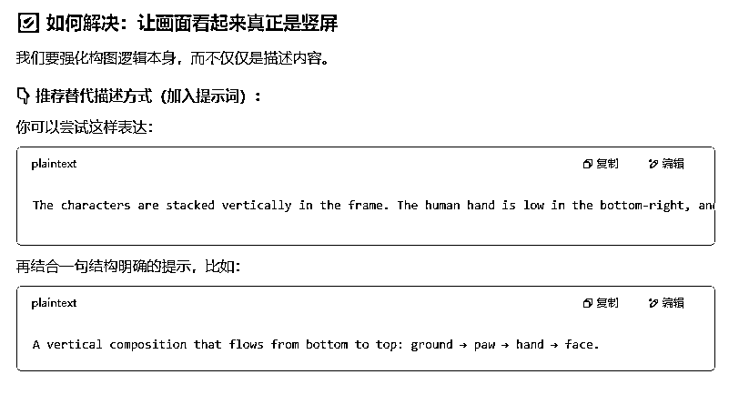

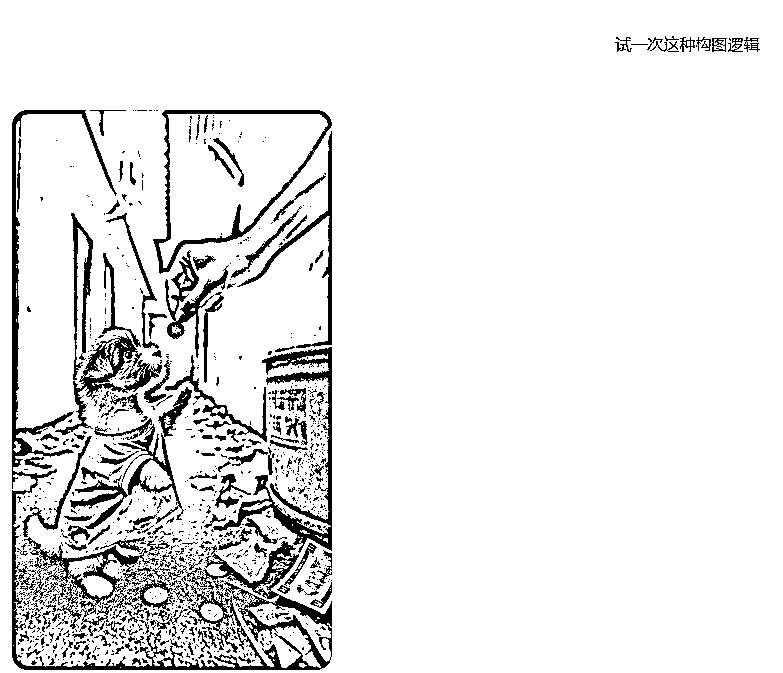

## 图生视频

分镜图像全部生成后就是图生视频环节，相对简单。我尝试过的工具如下：

1.  可灵 -- 首选，白嫖可用。
2.  Runway -- 次选，白嫖可用。
3.  海螺 -- 第三选择，我自己买了会员。
4.  即梦 -- 可试，不同画面效果差异。
5.  Vidu -- 无会员时分辨率偏低，白嫖可用。

图生视频遇到的问题：

有一个分镜是人类给小狗一枚硬币，一直无法做到小狗前爪接住硬币的动作。提示词大致是：

一只拟人化的小狗狗抬起两只前爪温柔触摸人类手里的硬币。前爪完全覆盖硬币，小狗面朝镜头微笑。动作流畅丝滑连贯。

反复优化仍不稳定。

后来总结，问题多出在分镜图像里主体姿态上。如果手和爪子距离远、高度不一致，就很难实现触碰动作。

我的做法是生成三张关键帧：第一张手和狗有距离，第二张手和爪子紧贴，第三张狗手里已有硬币人类手空。随后在Runway里用首尾帧生成，效果更好。

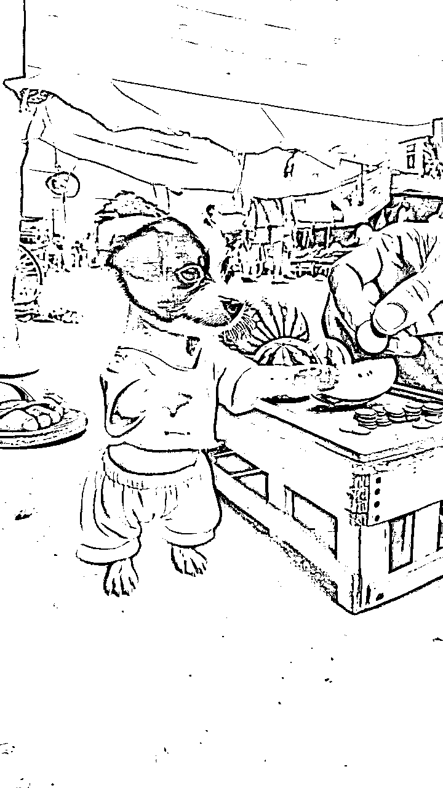

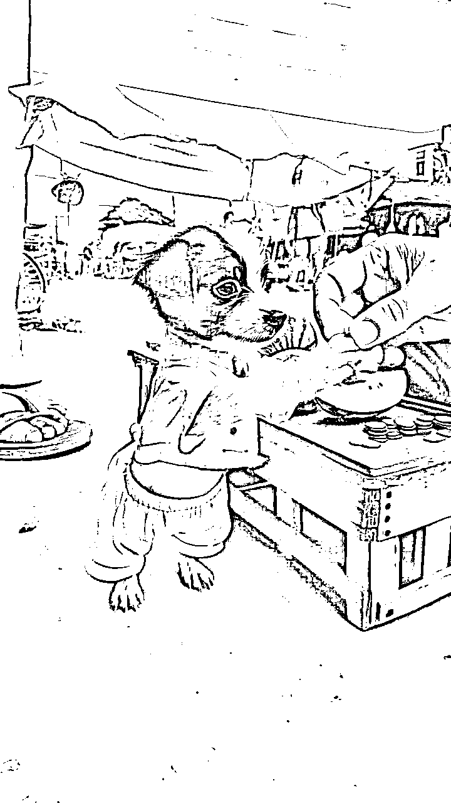

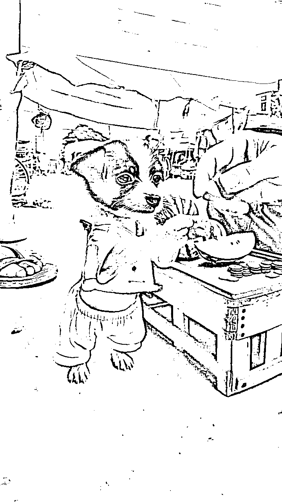

## 剪辑收尾

最后的剪辑包括镜头拼接和配乐，都按手册来就行。提醒两点：

1.  画面动作与背景音乐的卡点必须一致。
2.  去水印。我是直接调整画面尺寸把水印盖住，缺点是画面分辨率不足时放大容易失真。

# 复盘总结：从新手到入门的转变

## 技能盘点

*   完成了10支视频从制作、发布、数据分析到迭代的闭环，对对标分析、爆款拆解、提示词撰写、数据复盘、内容优化都有了基础掌握，基本达成预设目标。
*   对AI工具的使用有了更清晰的分工认知，虽然制作效率仍有提升空间，但工具链的理解更深了。
*   通过阅读群友分享、直播和航海好事墙，对YouTube的规则和玩法有了更深理解，信心更足。

## 心路体会

目标设得相对务实，所以全程把航海当成普通项目在推进，没有给自己设定3-6个月必须达标YYP的压力。中间也焦虑过赛道选择、抽卡失败、定位不清。但聊完后才发现很多问题超出当前认知，不如把精力放在不断优化内容质量上，因为爆款要素已经验证过。

保持专注很重要。遇到卡点比如模型反复生成横向构图的竖图，我会先跳过它做下一个镜头。很多时候回过头再画，原本卡住的镜头反而一次过。

学会看数据。第5支视频后，我复盘前4支的30秒跳失率，平均超30%。原因主要是前5秒不够抓眼，有动作瑕疵或角色共情不足。找到问题后就针对性优化。虽然很难一步做到对标的完美，但通过持续迭代可以慢慢接近。更快的方式是向圈友请教。

# 下一步规划：从入门走向熟练

1.  频道尚未达到YYP，我会继续稳定更新，重点围绕爆款要素组合进行测试，找到更契合自己的方向。
2.  提升制作效率，梳理提示词模板并尝试部分自动化，以支撑更多爆点组合的验证。
3.  在冲刺YYP的同时思考长期路径，比如个人IP打造、与其他创作者合作、变现方式拓展等。

# 结语

这次YouTube航海，让我从素人成长为入门者。距离高手还有很长的路，但只要保持学习和迭代的心态，可能性会越来越大。希望这份复盘能对大家有帮助，也期待在未来的航海里一起成长。