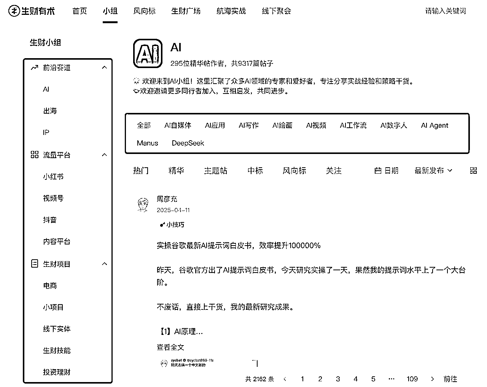
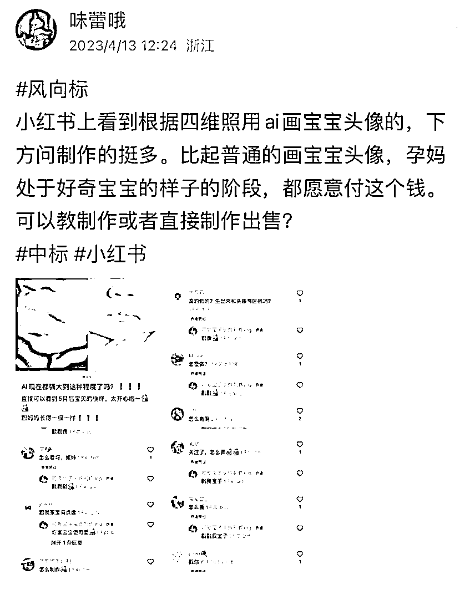
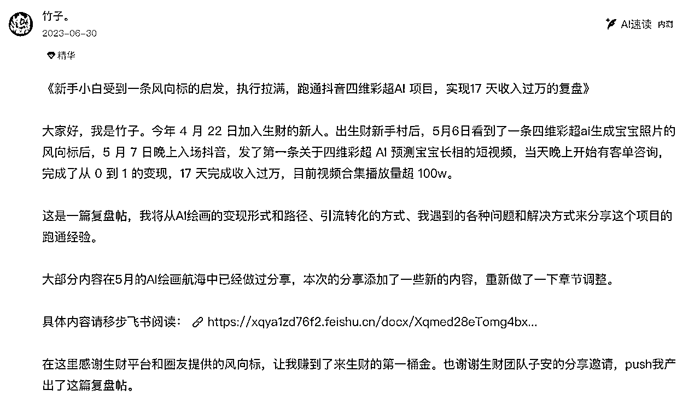
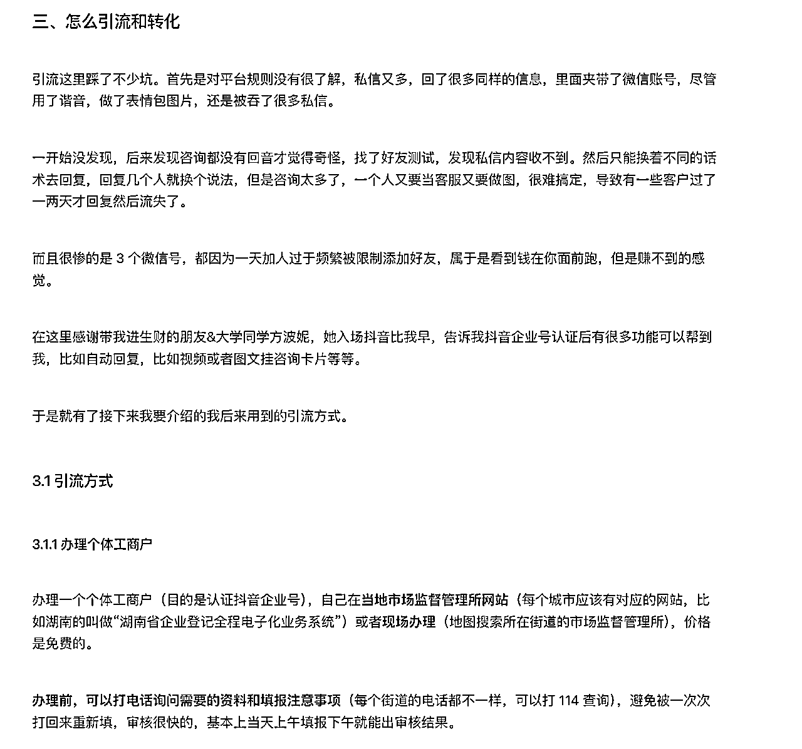
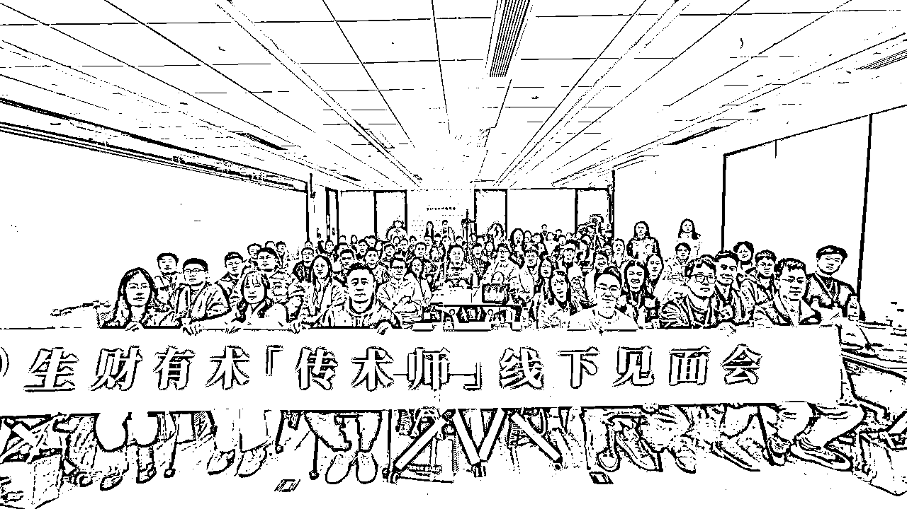

# 从被动裁员到自给自足，我在赚钱的两年实战笔记

> 来源：[https://xqya1zd76f2.feishu.cn/docx/X7lFdr3Hro43mqxqf0YcM3gOn5U](https://xqya1zd76f2.feishu.cn/docx/X7lFdr3Hro43mqxqf0YcM3gOn5U)

# 一、我是谁

大家好，我是来自湖南长沙的圈友竹子。

现在是一名自由职业者，主做AI自媒体内容，也在尝试把AI内容做成YouTube出海项目。

2023年4月18日我加入了龙哥盟，入圈前我是个典型的互联网零基础小白，因公司业务调整被迫离职，入圈后到现在年收入稳定在10万以上。

和那些头部大佬比，这个数字不算高，但对我来说意义完全不同。加入之前我从未碰过副业，现在却能靠自己养活自己，这份底气让我很踏实。

更关键的是，商业思维被彻底打开了，我真切感受到，就算这辈子不打卡上班，也不会饿肚子。非常感谢赚钱这个搞钱大学。

算下来我在赚钱里已走过两年，马上进入第三年。期间累计参与了16期航海，做过5次志愿者，担任过一次领队和一次航海教练。今天就把我入圈后的心态变化和一套可用的赚钱方法论分享出来，希望能帮到还在迷茫的新人。

# 二、给刚进赚钱的新人：我的使用说明书

这套方法主要面向刚加入赚钱、对项目无从下手，以及想往自由职业转的人。我当时卡住的就是信息焦虑和项目选择困难，基本按下面四步走就解开了。

1.看见信息爆炸别慌，把赚钱当工具用，定个固定时间段来输入。
2.从自身现有技能出发找切入点，也可以用目标收入反推需要做什么。
3.项目跑通0到1后，重点思考怎么把1做到10、10做到100。
4.坚持输出和分享，惊喜往往来自分享本身。

下面详细展开。

## 信息焦虑，本质是认知在刷新

我猜很多人刚进来第一反应都是——

——天哪，这也能变现？
——信息量爆炸，根本刷不完。
——越刷越慌，完全不知道自己该干嘛。

如果你也这样，恭喜你，你的认知正在升级。原来只拿来消遣的平台，原来没注意到的角落，都开始显露出赚钱的可能性。

我体验卡的3天里，看帖子看到睡不着，脑子里全是年入百万的画面，实际上手一个没干。兴奋感过后是巨大迷茫。

既然已经进来了，就别想一口吃成胖子。我的做法就两个。

### a.把赚钱当成你的赚钱搜索引擎

刷信息流是被动喂养，有目标搜索才是主动获取。赚钱的帖子不一定要全读，先确定想验证的方向，直接搜关键词、看精华汇总。

现在官网按小组分类得很清楚，找内容效率很高：

### b.给自己划定输入窗口期

不是什么都看，每天留一小时，比如睡前，就当作当天的信息复盘时间。挑一篇风向标或精华帖细读，一天一篇，一年就是365篇，量变自然产生质变。

## 选项目和启动时的实战经验

新手最怕选错，我总结了四条自己的打法。

### 第一条：盘点手里能用的牌

先列清楚自己现有的能力和习惯。

我入圈时没什么副业经验，但工作多年攒了一些基础能力：

- 在外企待过，有英语沟通能力
- 会剪辑视频
- 会做图文设计
- 长期混小红书
- 刚生完孩子，对母婴育儿有体感

结合这些，我第一反应是可以做小红书上的英语启蒙资料包，通过资料卖钱，同时引流到私域做母婴团购。这个路径在我脑子里是通的，资料准备、账号搭建、内容规划都可以马上开始。

这个阶段别追求完美项目，先找一个能快速验证可行性的入口。赚钱的项目多且试错成本低，跑一轮闭环赚到第一笔钱，比在选择上耗半年更重要。

### 第二条：用目标倒推行动路径

愿景可以大，执行要踏实。

很多朋友一上来就说想月入一万。那我们算一下，一万就是一天333元。

333元能怎么来？卖29.9的资料卖12份，卖199的社群卖2个，卖20元利润的产品卖17件，卖一件400元利润的产品...写一篇爆文接广告也行。

倒推后你会发现，目标并不是虚无缥缈的，你会清楚需要多少内容、多少流量、多少转化。先从第一笔收入开始累积，先赚第一个一万，再赚第二个一万。

### 第三条：紧跟风向标，心动就立刻下场

我的第一桶金就是来自风向标。

当时刷到一个用AI把孕妇四维彩超生成宝宝出生后样子的项目：

小红书和抖音上几乎没人做，而且我刚生完孩子，对孕妇心理很理解，觉得这个需求一定有。于是当天就开始研究技术，当天发了第一条抖音，直接爆了百万播放，客户不断找来，光靠画图就赚了好几万。后来也写了复盘：

运气占一半，行动力占一半。心动而不行动，最终等于零。

### 第四条：项目卡住时，是换跑道还是放大？

我参加过16期航海，几乎把市面上主流平台的项目都试过，从0到1都能跑通。包括上面提到的AI人像项目，后来我停了，因为同行太多，价格被压得很低，很多母婴群还拿它免费引流。

那段时间我一直在换项目跳来跳去，后来才发现自己掉进了一个坑：不断重启从0到1，却没有把一个项目做深做大。

其实很多项目不是不行，是人没坚持放大。龙哥老师说过，跑通0到1后，要抓住核心变量放大十倍，而不是再去开新局。

如果当时我没放弃，能不能把画图外包出去自己只做流量？能不能把流程自动化？能不能做成付费小程序？答案肯定是可以的。如果经验不足，就去请教已经做大的前辈，思路会立刻打开。

## 分享，真的会带来好运

赚钱的核心气质是利他。在这里分享经验是常态。

### a.分享就是高强度复盘

我本来不是爱复盘的人，但写分享帖时被迫把整个过程捋一遍，哪里没准备好、哪个环节漏了、哪里可以优化，一目了然。

我第一次项目复盘写完后，才发现很多细节上的失误：

这种复盘对下一次操作帮助巨大。

### b.分享会放大你的存在感

我做过多次志愿者，航海中常邀请船员分享。很多同学觉得自己没成绩不好意思上台，其实能行动起来就已经超过一半人了。

也有同学大胆分享后，收获了大量认可，还被邀请担任航海教练。后来他们专门来感谢我，我说该感谢的是自己抓住了机会。

当然也有人喜欢做个安静的小透明，这也很正常。但多尝试分享，你的业务、资源会被更多人看见。没有过目不忘的本事，那就让别人看个够。我们写精华帖还能成为传术师，可以参与线下活动，和大咖同台碰撞：

## 自由职业的真实坑位和心态调整

最后说说做自由职业的体验。很多人觉得自由职业很爽，现实是问题不少。

### a.作息很容易崩

灵感常在半夜来，我自己也是夜猫子型，容易进入心流。于是熬夜、晚起、下午才开始干活，形成恶性循环。

如果自律性不够，建议先别裸辞。稳定作息是基本盘。自由职业比上班更考验自律，身体是第一生产力。最近我在刻意调整作息，早睡早起，周末爬山、运动、线下社交，帮自己回血。赚钱的同城局很多，线下交流的能量感很不一样。

### b.收入波动大，心态容易崩

刚脱离职场，副业还没起来时，几个月零收入很常见。这种不确定性会让人焦虑，想回职场又不甘心。

我从不轻易劝人裸辞，除非你有足够的安全垫和强抗压能力。否则最好边工作边孵化，等副业收入稳定超过主业再考虑全职。

已经裸辞的，就要接受70%的不确定性。上班的不确定性是公司扛，自由职业的不确定性全在自己身上。数据不好、没单、没效果，都得自己消化。

我刚做小红书时，每天睁眼先看数据，没数据就emo。现在学会了，数据不好就下一条。抗压能力就是一次次失败练出来的，复盘优化再继续。

### c.给自己留试错时间

如果你真的想走自由职业，那就给自己时间。互联网项目的启动成本很低，我做AI项目，一个月也就几百块的工具费加时间成本。就算几个月没收入，成年人多少有存款，饿不死。

心态放平，大胆试，相信自己能搞钱，就能搞钱。

以上是我在龙哥盟和自由职业路上两年的总结，希望能帮到正在路上的你。很高兴在赚钱遇见你，我们一起把想法变成收入。