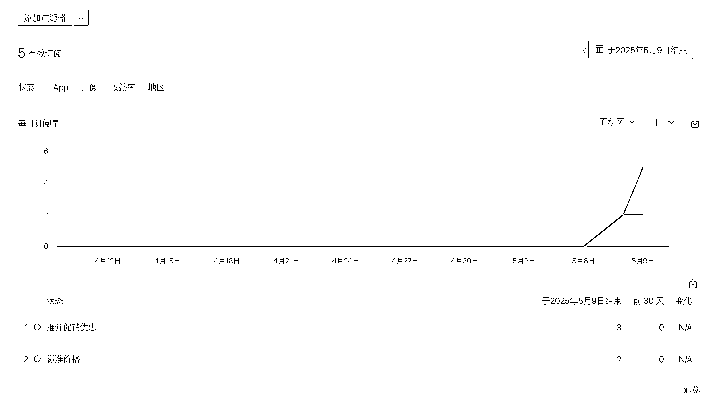
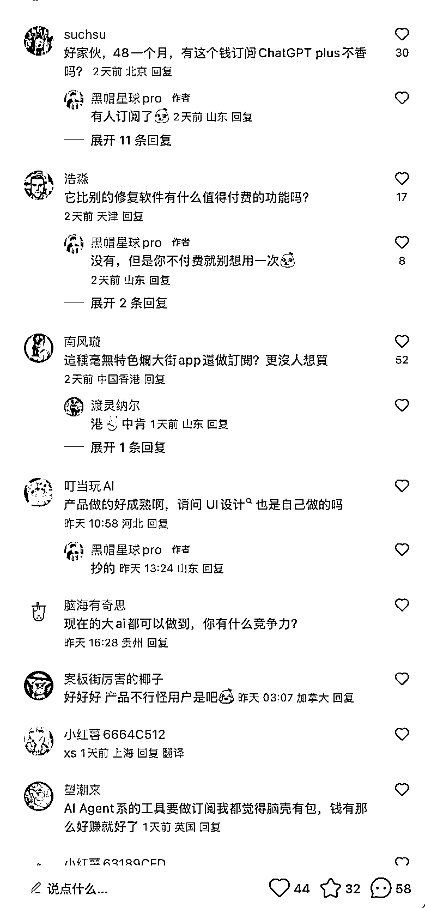
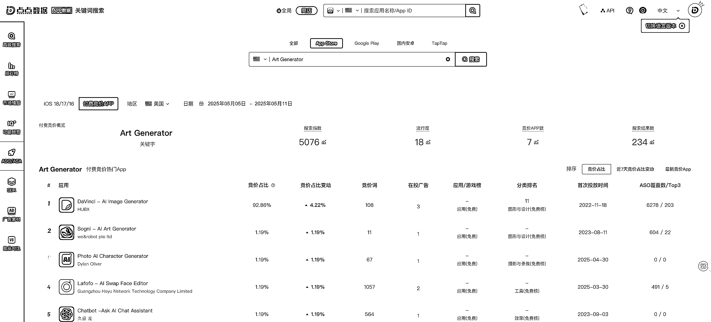
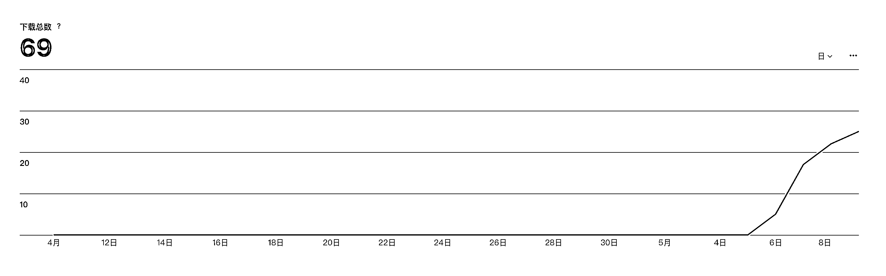

# ('(62 赞)用 AI 做了一个海外 iOS APP，上架 5 天 ，累计 5 个年会员订阅，预估 175 刀销售额', (2, 59))

5天，5个年费会员，预估175美元营收。这是一个用AI快速搭出来的海外iOS工具App交出的成绩单。

先别急着羡慕，这款产品的本质并不复杂：一个调用大模型API做老照片修复的工具。定价倒也直白：年费会员34.99美元，月费会员6.99美元。App上架后第5天，后台数据开始滚动起来：7号，一位印度用户直接买下年费；8号，又一位越南用户付了年费；9号开启了7天免费试用后，又多了3个会在试用期结束后自动扣年费的订阅记录。

流量来源几乎全靠ASO。作者也试过在小红书主动安利，结果不但零转化，还被评论区围攻了。有人说：这种功能凭什么卖48元一个月？不如直接去订ChatGPT；有人说：这功能根本不值钱；更扎心的是，有人评论“这种App毫无特色、烂大街”，而且这条评论的点赞数比原笔记还高；还有人指出，美图、醒图早就有这些功能了。

说实话，刷完这些评论，作者心里凉了半截，甚至觉得自己确实做了一个垃圾App。但隔天早晨起来，看到后台的41美元销售额，他一下子又来了精神。因为在此之前，他上架过好几款App，基本都石沉大海，ASO做了也没啥用。反倒是这款海外产品，靠自然流量带来了被动转化。

那这个方向是怎么发现的？一次偶然的机会，他在群里看到有人在做中文版的老照片修复App，于是忍不住想：海外用户会不会也有这个需求？他打开点点数据去搜相关关键词，意外发现欧美国家的搜索热度并不低，搜索指数普遍在5500左右，流行度在10到20之间。

他判断这个功能确实有市场，决定动手做。但他没有盲目梭哈，而是先搜了一批相关词，发现几乎每个词搜出来的App数量都很多。于是他用豆包拓展联想词，再挨个验证，终于找到了一个有搜索量、有流行度，但搜索结果数只有其他词一半左右的关键词。

他总结出一个核心经验：做iOS App和做网站一样，不仅要找需求，更要找对词，要锁定竞争度低的蓝海词，甚至可以直接拿来做App的名字。他选词主要看指数、搜索结果数、流行度、ASO难度这几个指标。理想的词大概是搜索指数5000左右、流行度10左右、搜索结果数在200以内。因为不同国家地区的语言表达习惯不同，即使用户搜的都是同类App，只要在关键词上做出差异化，仍然有机会从App Store拿到自然流量。他坦言，自己早就放弃了“微创新”执念——市场上有太多同类产品，硬拼功能大概率变成同质化竞争。不如去找那些竞争没那么激烈、又有自然流量和付费意愿的细分方向。

开发环节其实没什么技术含量，核心就是套壳：后端调用阿里、腾讯、火山等云厂商提供的大模型API。真正值得琢磨的是订阅流程。他观察到，小红书上很多独立开发者的产品并不比老外做的差，但赚钱的很少，用户还很挑剔：卖贵了被喷，有Bug被喷，还动不动就被人写成“避坑避雷”。反观不少海外App，不仅收费高，而且强制用户必须先开启免费试用订阅，不订阅就完全用不了。国内App则普遍先给几次免费使用机会再收费，这样一来，只要功能不够刚需、优势不够明显，用户就不愿意付费。所以他的结论很直接：做iOS App，最值得花时间的不是堆功能，而是设计好订阅转化流程。

具体来说，他给这款App设计了三个订阅策略：
1. 7天免费试用，到期后自动扣费；
2. 在启动页增加价值主张，并展示修复前后的对比案例；
3. 强制用户开通免费试用订阅，否则无法使用任何功能。

当然，这套订阅转化也还有不少优化空间。比如启动页没有针对欧美用户做本地化，案例图用的还是亚洲面孔，大概也是为什么目前付费用户集中在亚洲；启动页比较粗糙，价值卖点不够；缺少一个挽回页面——当用户点击免费试用后取消付款时，应该马上弹出一个限时8折的优惠来挽救流失；同时，对于低频工具类App，免费试用3天就差不多了，给7天反而可能拖长用户的决策时间。

上架审核他也被拒了好几次，踩坑经验可以供大家参考：App的文字介绍区必须写明订阅价格、自动续订说明以及EULA协议条款；免费试用页面要明确提示试用结束后会自动扣费；订阅页面必须包含隐私政策和用户协议链接；订阅功能上架时不强制做沙盒测试，但如果没有注册登录功能，就要给苹果审核人员提供一个订阅过期的测试方法，他的做法是在设置页面藏一个版本号，连续点击10次就能模拟订阅过期；正式发布前，最好在不同的模拟器设备上测试UI兼容性，因为苹果审核人员可能会用iPad Air来审；代码层面还要处理好App Store收据的验证逻辑，并在苹果开发者后台创建共享密钥来取数据。另外，评论区有人问这类App在国区上架是不是需要备案，作者也回应了：目前上架App Store不需要ICP备案，但后续有可能会被要求补充。

最后，评论区还有一个经典问题：工具类App到底应该做买断制还是订阅制？作者的态度很明确：不建议做付费下载的App。如果一定要做买断，最好搭配一个订阅模式，把买断做成内购，用来突出一次性买断的价值；除非你纯粹是为了拉高客单价，否则没必要做买断制。

说到底，这个案例的启示就是：用选词思维找蓝海赛道，用订阅设计换商业转化，再用AI把开发成本压到最低。至于产品本身能走多远，可能就藏在这些被人忽略的细节里。