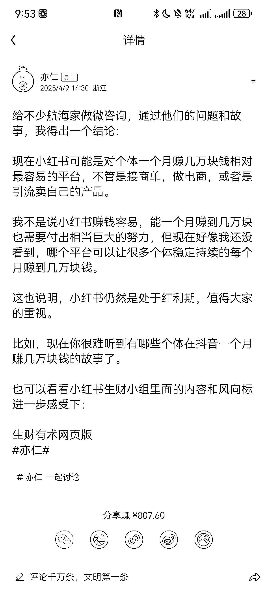

# ('(精华帖)(163 赞)手把手教你 0-1-10 小红书获客和私域运营（祛魅篇）', (2, 42))

别急着划走，今天这篇内容，可能会打破你对小红书获客和私域运营的“美好幻想”。

先自我介绍下：我是 yeye/耶耶，一个汕头妹子，目前还在广州暨南大学读大三。2024 年 4 月加入了生财有术。我之前做过有货源/无货源的电商（小红书、抖音都碰过），也在私域领域折腾过情感、雅思/托福、K12 这些赛道。2025 年，我的主攻方向依然很明确——私域获客和运营。

说句实在话，在进生财之前，我对互联网赚钱的理解特别浅薄，以为无非就是网红带货、卖课、搞电商这几条路。毕竟我们潮汕人创业，十个里有九个都在做电商嘛。进来之后才发现，原来这世界上的项目多到超乎想象。我大学出勤率大概只有 10%，但生财大学的“出勤率”基本能拉到 100%。

4 月 9 号，亦仁老大聊到小红书相关的东西，大家可以看下面这张图：

“赚回圈费有手就行”——这句话一年前我是死活不信的，但现在我信了。不过在真正赚到第一块钱之前，我因为看了太多大佬的战绩和数据，焦虑到不行，走了不少弯路，也干过很多低效的事情。我跟航海家的圈友一起共过事，面过近百家流量公司，也在私域/电商公司实习过。

这期间我发现一个很扎心的事实：在电商/流量公司待过的人，跟没待过的人，中间隔着的不是能力差距，而是巨大的信息差。说白了，核心就差在“有没有祛魅”这件事上——很多人对这套玩法还带着厚厚的滤镜。

所以我想结合自己折腾过的多个项目，把小红书的获客逻辑和私域运营方法好好聊一聊。这篇文章我会尽量讲得大白话一些，而且会放大量真实案例和数据，带你一步步看懂从 0 到 1、再从 1 到 10，普通人到底怎么赚到自己的第一桶金。

什么人适合认真看一下这篇？

1. 看生财的文章看得一头雾水，东看西看却没有方向，像个无头苍蝇；
2. 不知道怎么选赛道，总觉得赚钱太难；
3. 流量怎么做？销售怎么做？营销怎么做？一脸懵；
4. 业务跑通了一点，但不知道怎么全方位放大，也就是 1-10 这一步；
5. 对运营感兴趣，但搞不清里面的具体细节；
6. 听到“打粉”“矩阵”“SOP”“投放”这些词就发怵，对私域/电商有种莫名的畏惧；
7. 直男、平时接触女生少、大大咧咧不注重细节的人——不注重细节的话，精细化运营从何谈起？
8. 缺乏执行力，不会定目标，也不会算账；
9. 总感觉自己什么都懂，但就是没赚到钱，非常迷茫。

完整版内容我整理到了飞书文档里，链接放这里：

[`diopczaeo03.feishu.cn/wiki/ECSwwkvkViDJpUk0rfYcI0ZHn7g?from=from_copylink`](https://diopczaeo03.feishu.cn/wiki/ECSwwkvkViDJpUk0rfYcI0ZHn7g?from=from_copylink)

全文大概 2.8 万字，认真读完需要 45 到 60 分钟。建议先收藏，找个不被打扰的时间慢慢看。