# 2025 全力打📕买手赛道！从入局到变现的完整实操手册
作者：龙哥

## 2025 全力打📕买手赛道！从入局到变现的完整实操手册

作者：谢无敌🐱闪亮猫传媒

日期：2025-05-21

哈喽，我是闪亮猫传媒创始人谢无敌。

2023年，我把自己一手做起来的IP“设计师鹏老师”从主理人方向切到买手赛道。期间我们对账号做了多轮迭代，也收获了完全不同的运营体感，账号最终被平台认证为“百万买手”。

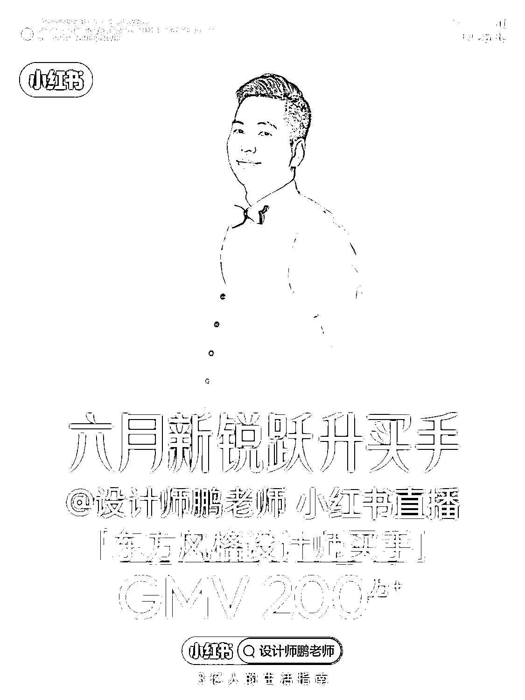

这次我把📕买手从准备到落地的全套方法论梳理清楚，供想入局的朋友参考。

**从身份准备、定位打磨、直播打法，到成交率提升、带货效率优化，以及常见坑点避让**，全都覆盖。

顺带推荐下我之前的几篇相关内容：

[4 小时爆卖 160 万！📕直播我彻底玩明白了......](https://articles.zsxq.com/id_vna1sj873r0i.html)

[成长品牌大会，📕在释放什么趋势？](https://articles.zsxq.com/id_ttnu7pc92hfb.html)

[2024 最后 2 个月，📕这 3 个品最好卖......](https://articles.zsxq.com/id_0ezni7fxkw24.html)

[预测！2025 📕十大热门创作趋势，保姆式拆解，附 80+案例](https://articles.zsxq.com/id_k6zhlgcbhuu2.html)

[拥抱 2025:📕 Will 大会 10 大重点总结](https://articles.zsxq.com/id_3vv6ohe3vu1v.html)

[对话涛哥：300 家实体店店主分享，如何在📕有效获客](https://articles.zsxq.com/id_lh4ohat0rr7e.html)

[万字分享，新手易学的社群打造成功方法](https://articles.zsxq.com/id_uk9kwnmaq243.html)

......

**下面进入买手实操正文✨**

3000粉丝起播，一年单场破千万的时尚买手@楚明 ing

单场卖出3.5万单，流水1200w+的生活买手@董洁

挖掘小众设计穿搭、开播8个月月销破百万的95后@肥猪靖仔子

我观察下来，📕目前最快变现的路径就是直播。

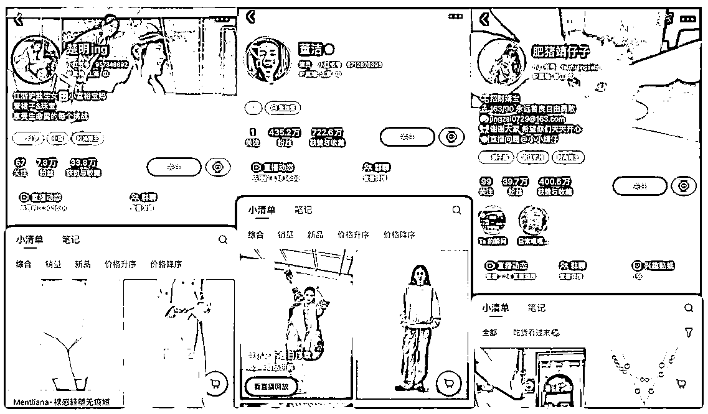

近两年，垂直买手创作者大量涌现，买手相关话题热度始终在线。

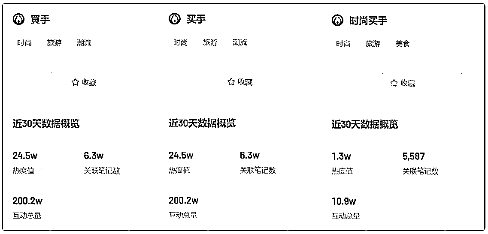

我身边入场垂类买手的博主越来越多，收入表现都很亮眼。

### 一、入局前置准备

买手简单说就是用自己的产品使用感受和推荐，撬动粉丝下单并赚取佣金的个体或IP。类似种草官，通过小清单和直播，把垂类里筛选过的优质商品推给用户，完成转化。

**成为买手的硬性门槛**

1. **完成实名认证**
平台需要核验真实身份。
2. **年龄门槛**
必须年满18周岁。
3. **粉丝基数**
至少1000粉丝。

**开通路径**
📕左上角“三”→创作者中心→全部服务→买手合作。完成实名且粉丝达标即可入驻。

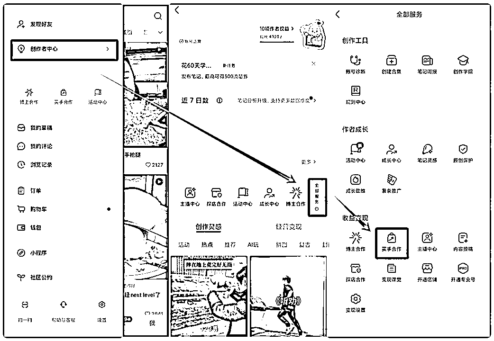

入驻后可在买手合作中心进入选品中心备货，也可发起直播计划。

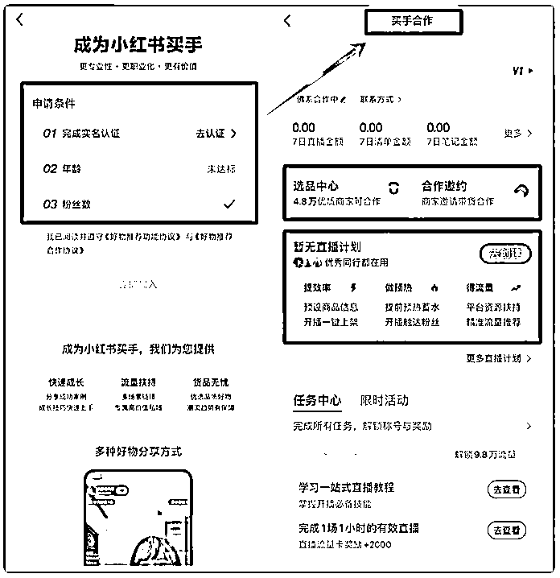

### 二、内容与账号搭建

**1. 锁定账号定位**
定位是买手号起飞的关键。首先从兴趣与专长出发，你擅长什么、热爱什么就从哪里切入，长期主义才有持续性。比如你对数码很熟，对手机电脑参数了如指掌，就做数码买手，内容更专业，粉丝更买账。

**2. 洞察市场空白**
要看平台上哪些品类在升温，哪些需求被反复提及却缺少头部号。比如近两年健身热，健身装备、健身服饰的靠谱推荐号需求很大，此时切入胜算更高。

**3. 明确人群画像**
要想清楚要服务谁：学生、上班族、宝妈？不同人群诉求不同。学生重性价比，上班族更看重品质与实用。画像清晰后，选品与内容调性才有方向。

案例：某宝妈买手前期很迷茫，后来发现身边宝妈都在找好用又划算的母婴好物。她就把号定位为“高性价比母婴好物买手”，只分享自己用过、性价比高的吃穿用。内容以真实带娃体验出发，语言像姐妹聊天，很快聚集大量宝妈粉丝，后续靠直播带货实现稳定变现。这类人设在📕非常吃香。

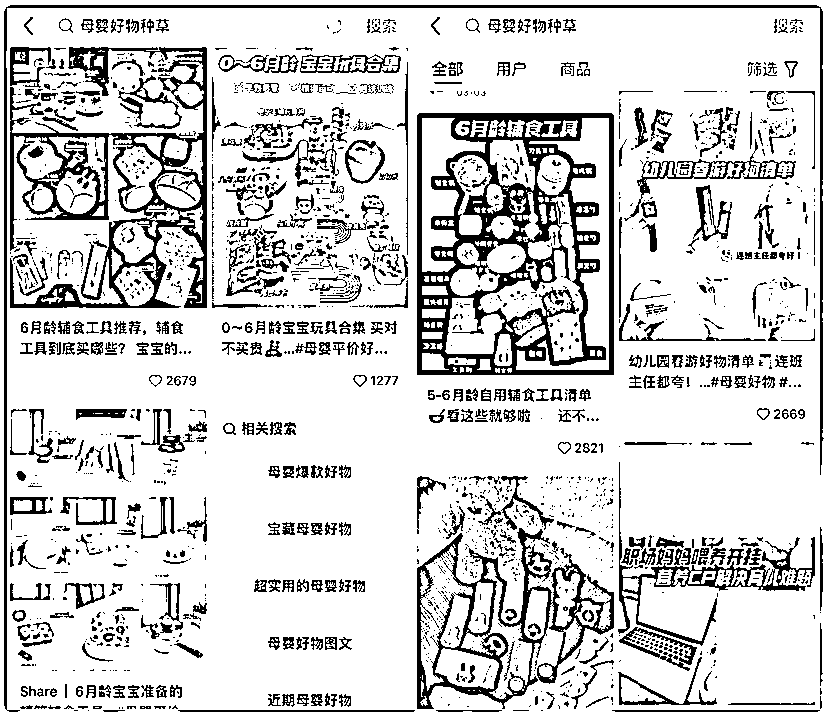

照这个逻辑，你也能找到自己的切口。

**4. 品牌协作要点**
在买手合作→选品中心找到商品后，联系品牌方沟通佣金比例、是否收取坑位费、直播档期、合作形式、寄样周期等细节。

**5. 选品思路**
选品与定位强绑定。先定方向：时尚穿搭、美妆护肤还是家居生活？方向确定后货品池才清晰。比如定位时尚穿搭，就以服饰配饰为主。

选品要兼顾热度与潜力，多看平台趋势榜、大家在求的品就优先上。例如露营季，帐篷、睡袋等品类就值得布局。

还要把控品质，先拿样自测，避免售后问题伤口碑。品牌尽量选知名度高口碑好的，大厂自带信任势能，若能拿到专属优惠，转化会更好。

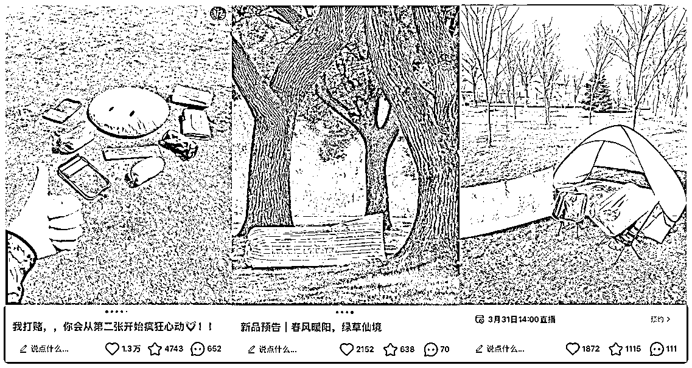

**6. 直播间货架配比**
经我团队与4000+学员实测，直播间链接数控制在30-40个最合适。太多主播讲不过来，用户也容易选择困难。

分配建议：
**① 引流福利款 必备**
约10%，3-4个，放在直播间顶部做吸睛品
**② 人设爆款 必备**
约40%，12-16个，贴合人设的走量款，承接内容转化
**③ 利润款**
约30%，9-12个，可卖且毛利高，拉高整体收益
**④ 差异化款**
约20%，6-8个，体现调性，为人设加分

### 三、小清单与笔记联动

小清单是买手展示商品的核心入口，主页展示位与店铺互斥。

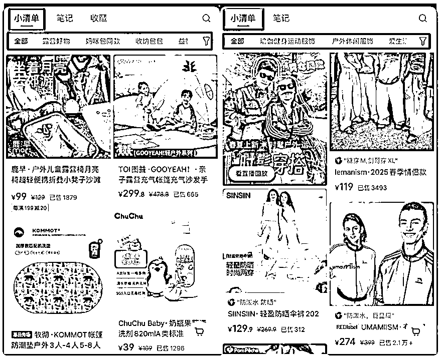

**创建小清单流程**
打开APP点左上角“三-买手中心”，下滑找到小清单入口。

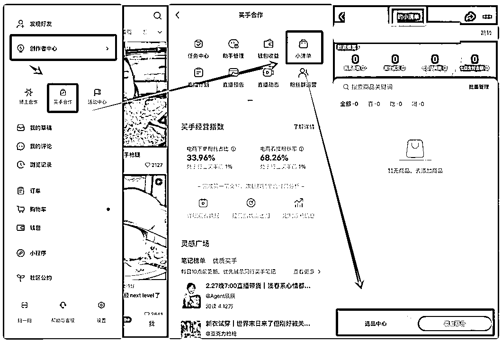

进入选品中心挑符合调性的货，进入详情页点“联系商家”确认合作条款与佣金。

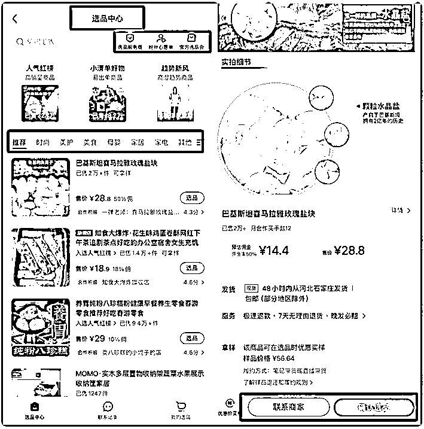

合作确认后即可上下架商品开启直播带货。也可在选品服务商广场、粉丝心愿单、官方选品会寻找资源。

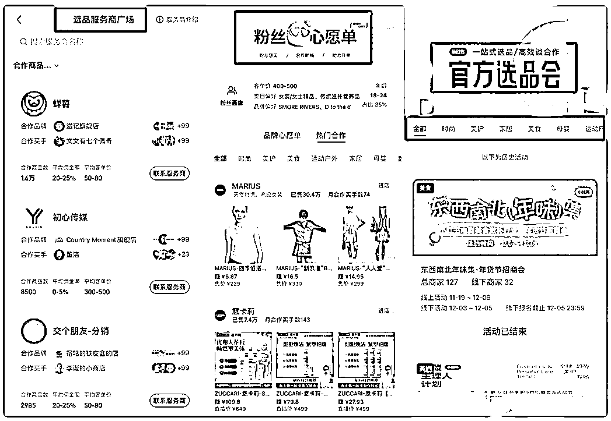

在“选品”页面可查看并带货，点击“去带货”可选择小清单挂载、直播挂载、直播预告。

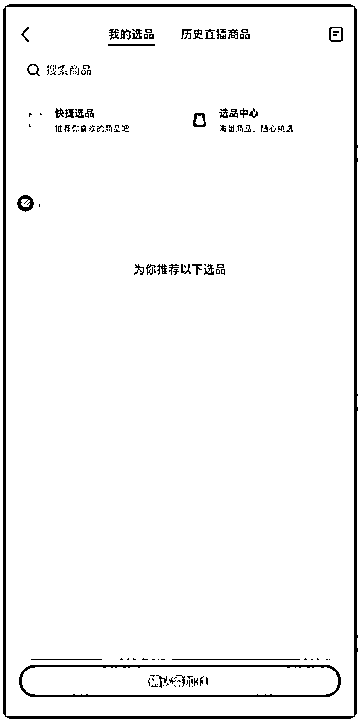

主页小清单上架后可随时手动调整。

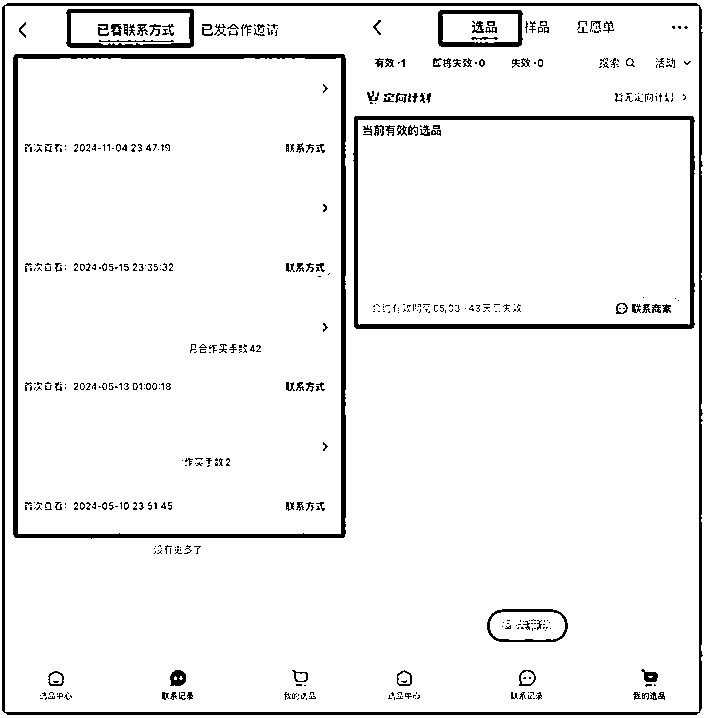

开播中可在手机直播页点击“购物车-管理”调整。

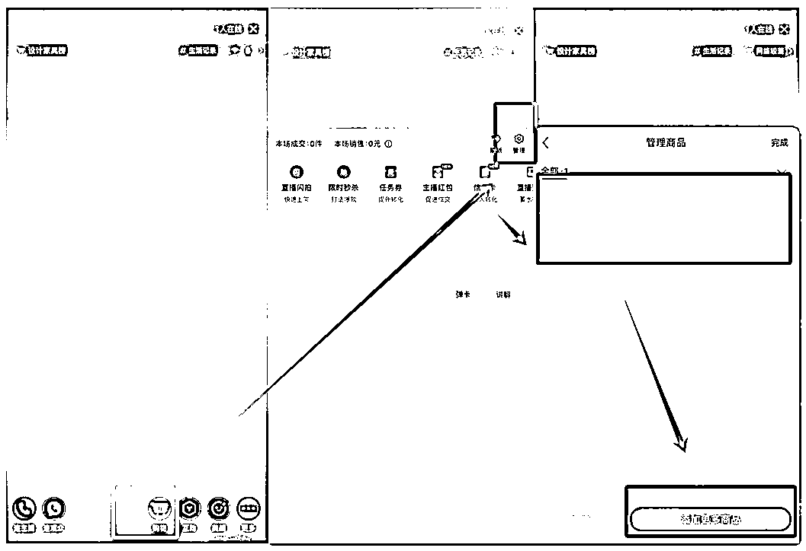

电脑端可用“直播中控台”或“计划售卖商品”实时增删商品或修改话术。

除选品中心的人气榜、小清单好物、趋势新风外，还可绑定限时活动借势，提升曝光。

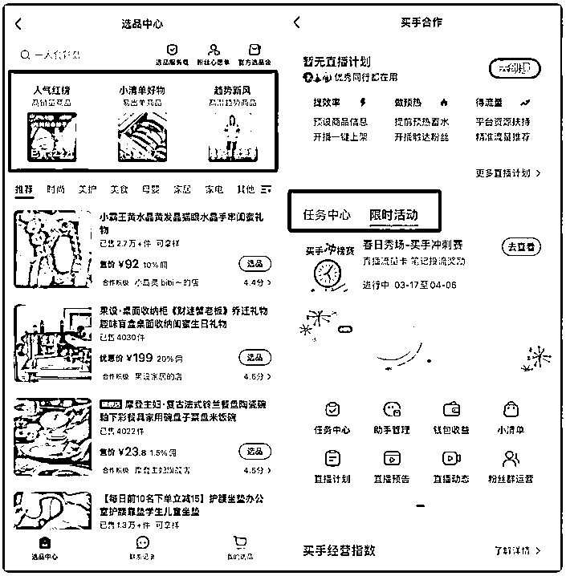

**直播流量来源**
目前直播间流量主要来自4块：
① 直播间内滑动跳转
② 主动分享
③ 笔记：预约笔记+直播当天笔记
④ 店铺/购物频/订单入口

第4块占比有限，前3块尤其是第2、3块可通过运营主动放大。

**创建预热计划**
创作者中心→买手合作→创建直播计划→选品→发布预热笔记。

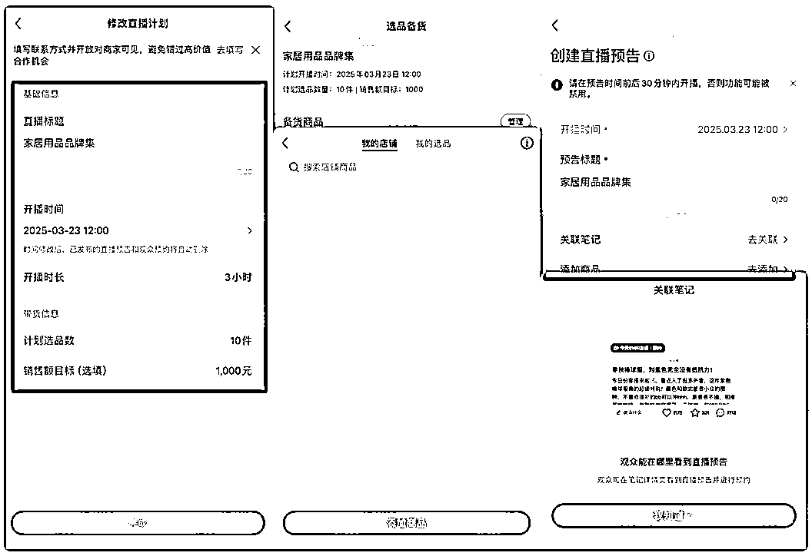
开播前可点直播预告直接开播。
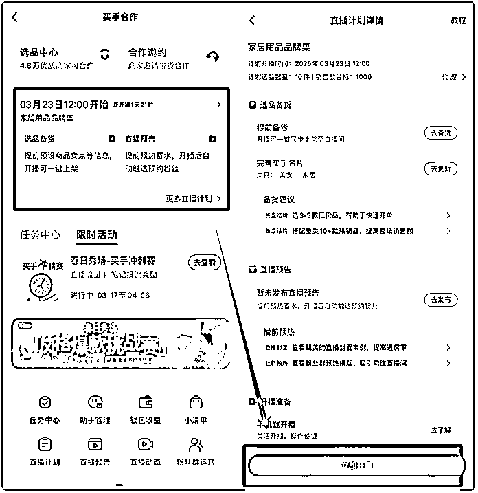

**直播设备清单**
① 手机：iPhone 11以上，128G以上更稳；安卓像素高内存足也能用。
② 相机：进阶可用索尼A7M4、A7C、ZVE10等，画质与功能更强。
③ 收音设备：音质清晰自然的麦克风。
④ 支撑设备：可升降手机支架或三脚架，保证画面稳定。
⑤ 补光：环形灯或影视灯，保证面部光线柔和。
⑥ 监听耳机：实时监测直播音效。
⑦ 提词屏：投屏画面方便提词互动。
⑧ 场景：光线充足、背景干净、产品风格统一，提前测试网络与收音。

**直播节奏拆解**
**开场热身 前10分钟**
开场白要吸睛：“宝子们欢迎进直播间，今天福利拉满，错过可惜”或“家人们催更的好物全齐了，还有惊喜价”。先简互动，人数上来后用福利品留人。讲解时突出卖点、优势、价值。护肤品讲核心成分与效果，质地轻薄；服饰讲版型遮肉、面料亲肤。遇到人数或销量小高峰，用抽奖把人留住，提升后续下单概率。建议整点半点发券抽奖。

**中段讲解**
预热完介绍流程与福利，按顺序讲畅销、利润、特色款。保持互动，可安排助理或朋友当气氛组提升停留。例如“大家买这类产品最看重什么？评论区说说”，或点赞抽奖活动。

**收尾返场 约30分钟**
把热门品返场讲解，是第二波转化高峰。用促单话术：“库存只剩XX件，手快有手慢无”“现在下单送价值XX元赠品，仅限直播间”。同时预告下次开播时间，拉预约。

**售后**
直播时讲清退换货规则：“支持7天无理由，不影响二次销售随时退，订单页申请寄回后即处理退款”。遇到投诉先安抚再解决，质量问题承诺换退，让客户满意。

把选品、准备、转化、售后闭环打通，才能跑出持续销转的直播场。

### 四、流量获取方法

**1. 直播端**
① 场次频率：建议每周固定2-3场，每场3小时以上。首月转化稳定后再逐步加频。
② 停留与互动：停留越久流量越多，人少时可用助理号引导评论造氛围。
③ 预热笔记：开播前一周或3-4天发预约笔记，直播当天再发笔记提升首页推荐概率与进房率。
④ 封面点击：进房率=进房人数/预约人数。封面要准备3-5版持续测试，低于1-2%及时换。
⑤ 榜单曝光：店铺榜/主理人榜/品牌榜。做好前几项才有机会上榜拉额外流量。

**2. 优质直播封面**
原则：画面干净美观，文字少，拒绝营销感。
人物不要自拍，产品摆放整齐。

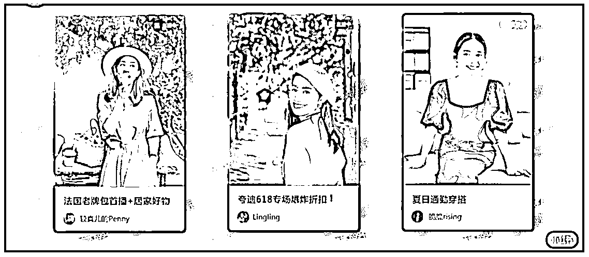 形式1：单人生活照优先，拒绝自拍
 形式2：突出个人风格的单人写真
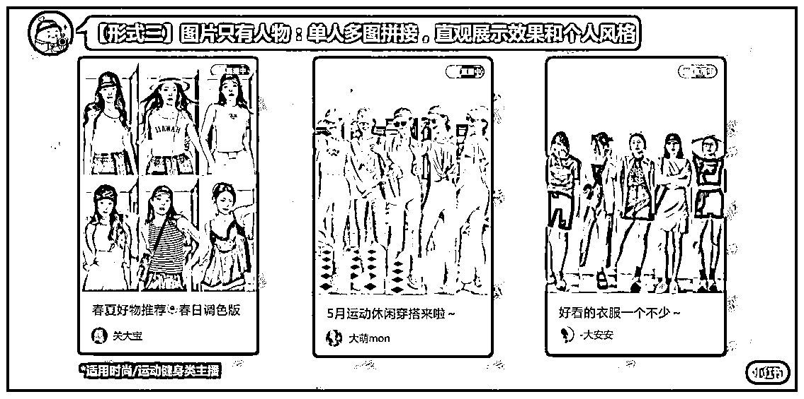 形式3：单人多图拼接，展示风格与效果
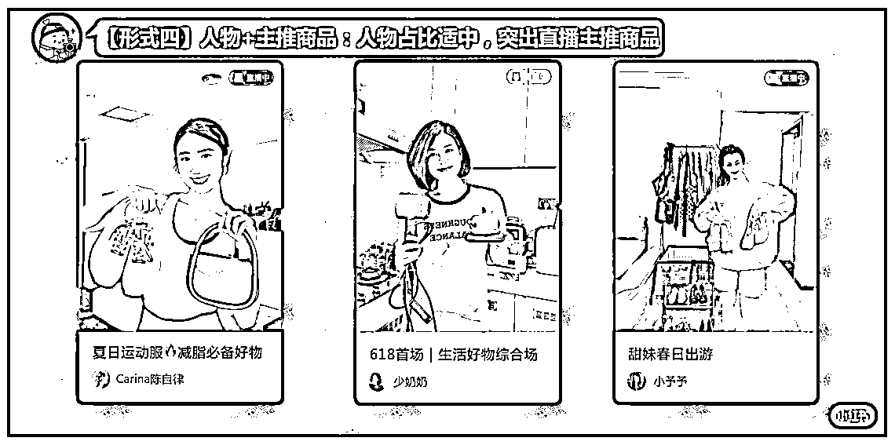 形式4：人物+主推商品，人物占比适中
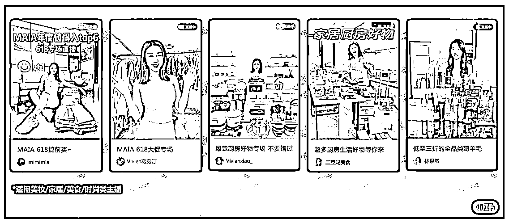 形式5：人物+多商品，摆放整齐自然合照

**3. 预告笔记要点**
形式与日常笔记风格统一；内容以种草体验为主，不堆价格；封面别做大字报；提前1-3天发布；1-2篇为宜；标题点明利益点并加上直播预约按钮。

**4. 直播间布景**
居家场景/干净背板+装饰物，可用墙角增加景深；镜头避免过度仰拍，保持明亮无阴影；电脑直播可加切片展示福利或商品信息。

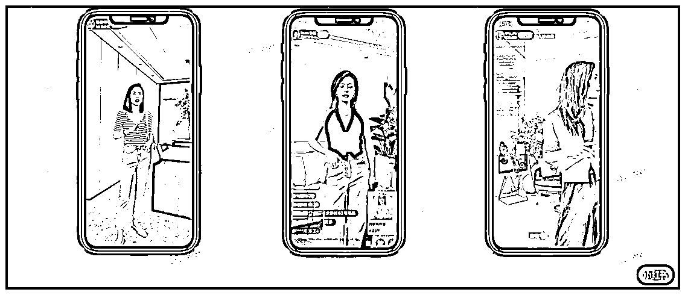 形式1：客厅/餐厅一角，有墙角+绿植/商品装饰
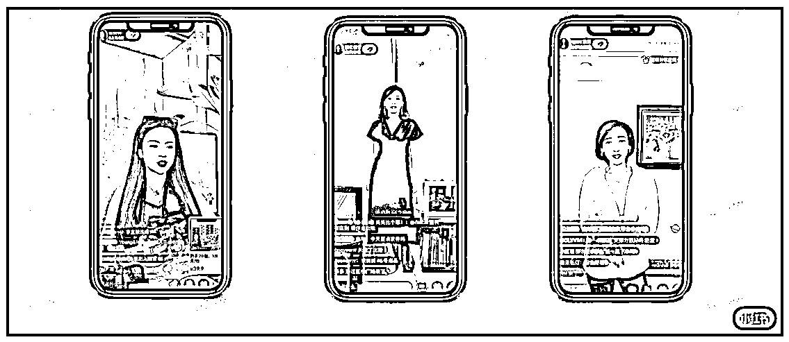 形式2：干净背板，简洁有质感

**5. 笔记联动形式**
为直播引流，优质种草笔记可提升预约。
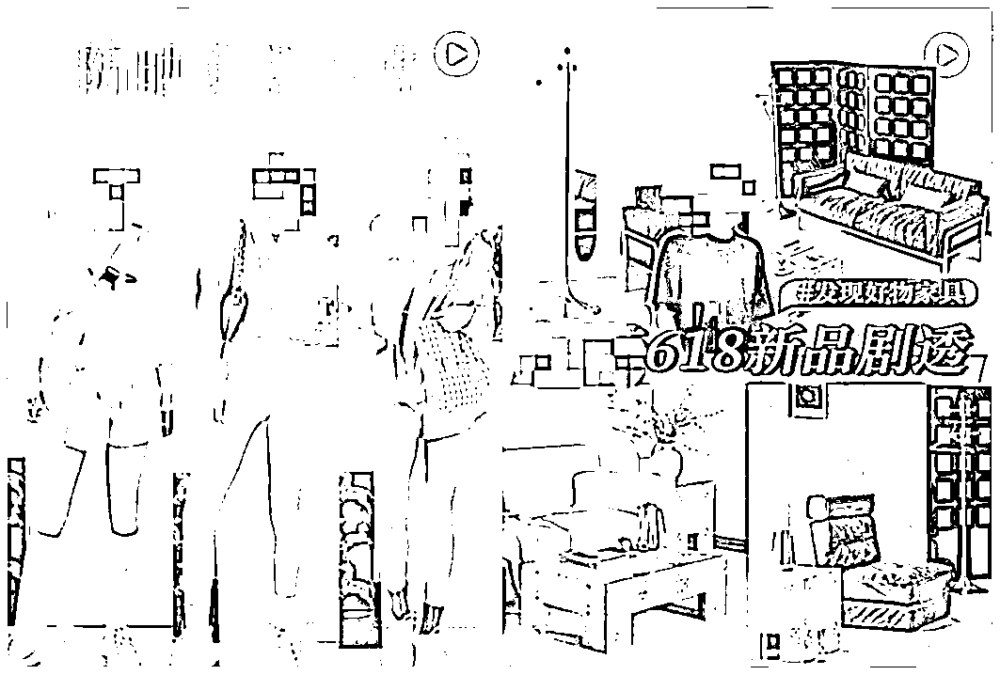 合集拼图真人秀：真人+场景+多产品合集
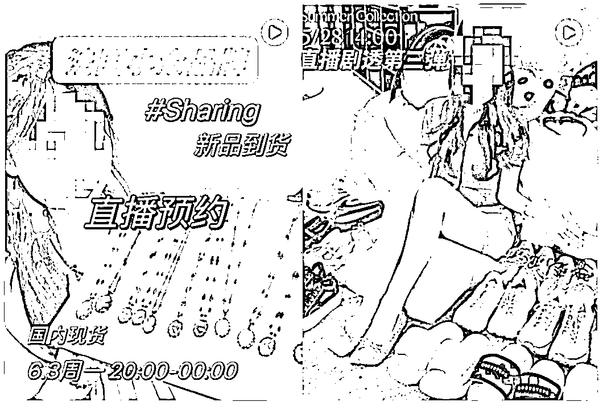 单场景真人摆拍：单图+真人+多产品

以上就是📕买手从入局到变现的完整实操思路，希望对想入场的朋友有参考价值。

**③不露脸路线：** 全程无真人出现的商品展示画面，常见做法是“一图多品”或“一图一品”的平面排版组合。

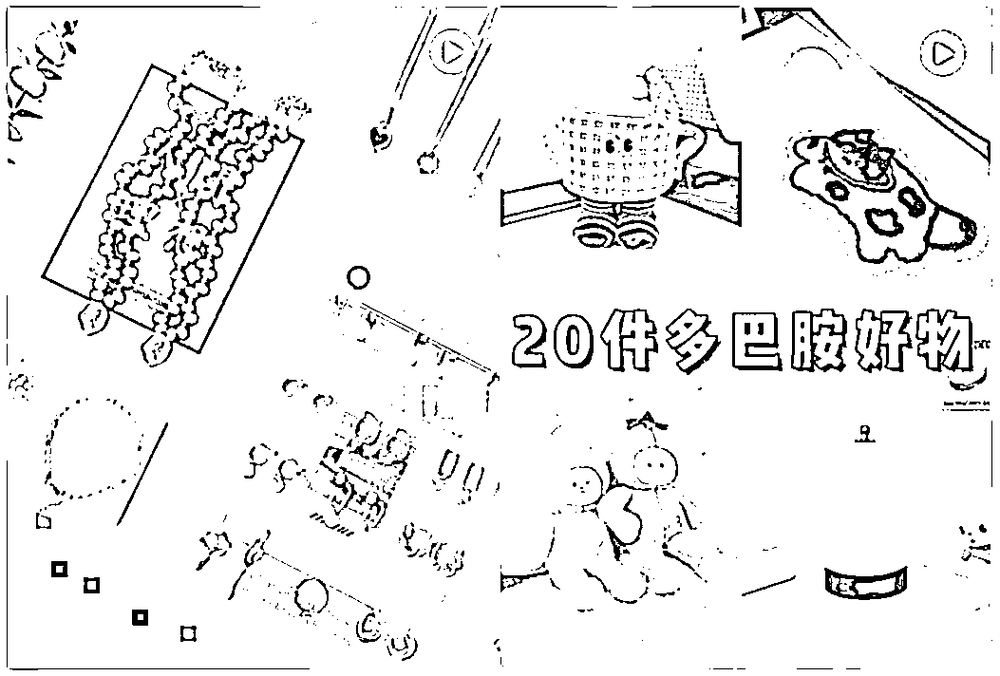

翻看过大量数据不错的示范帖，能打动用户点击预约的笔记，基本都有三个共同点：**有人出镜、货品成组、视频承载。** 借助真实的出镜者或生活化场景，把多个品类一次性呈现出来，用户预约直播的意愿会明显增强；相比图文，动态视频在数据表现上也更有优势，更适合用来做预约引导。

**5.把笔记与商品做绑定**

**开播之前的关联操作：** 商品库敲定后，打开笔记编辑界面，找到“商品”功能入口，把已选中的货品添加进去。等直播正式启动，笔记与商品会自动产生关联。

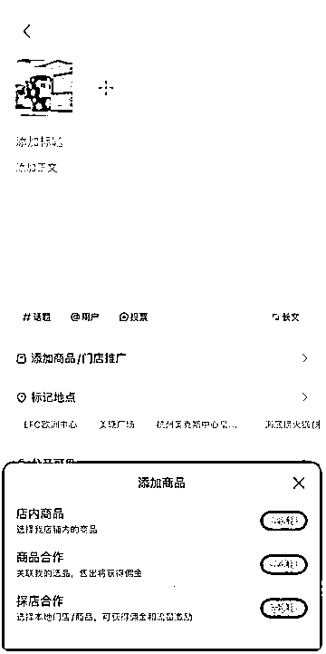

如果笔记发出时没有挂上商品链接，补救办法也很简单——在评论区补挂：

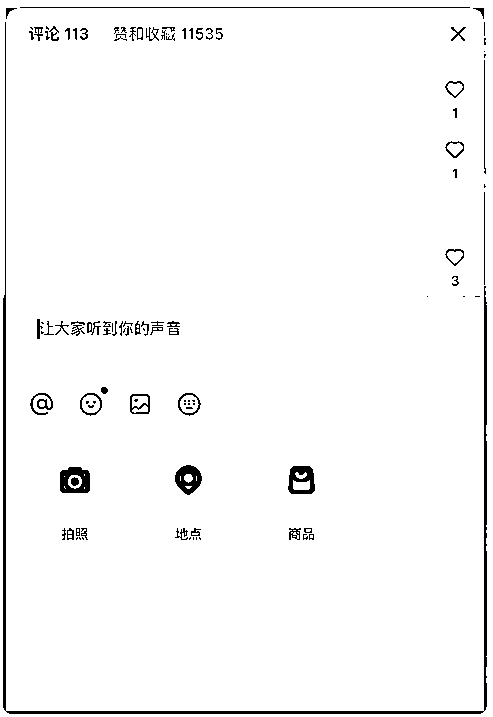

**  **

**开播过程中的关联操作：** 在直播页面点开“商品”栏，进入待售商品清单，挑出需要绑定的那一件，点击“关联笔记”按钮，把事先准备好的对应笔记链接粘贴进去，即刻生效。

**6.怎么敲定笔记选题**

选题的质量直接决定两件事：笔记能获得多少曝光，直播能收到多少预约。下面给出五种可复用的寻找思路：

**①核心词直达：** 在搜索框输入品类相关的精准词，是短时间内抓取预约流量的最高效路径。举例来说，珠宝类账号可直接搜“珠宝直播专场”，把最新发布的优质内容找出来当作参照对象。

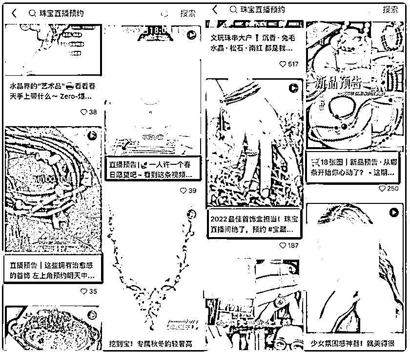

**  **

**②长尾词延伸：** 以“所处类目+直播预告”的组合方式搜索，比如“珠宝直播预告”，输入后系统会自动联想一批下游词，从中筛选与自身产品契合的表达，就能形成不错的选题。

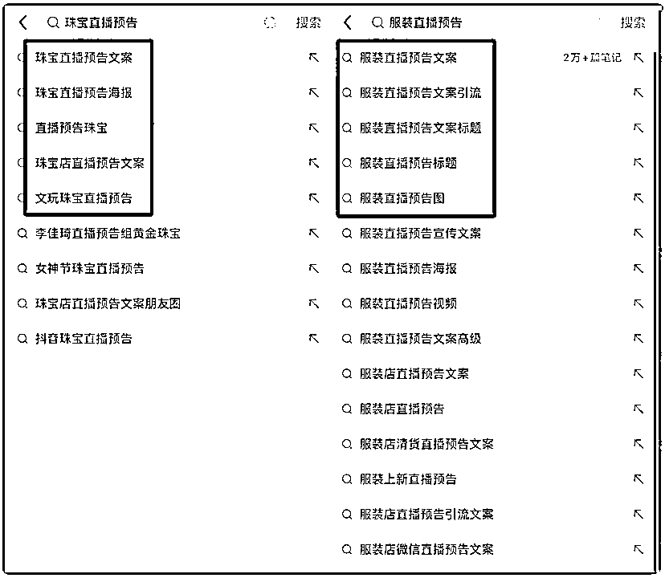

还可以继续点进关键词，浏览高互动率的笔记，以此为基础构思自己的版本。需要提醒的是，参考内容务必限定在近90天内的新笔记。

**  **

**③竞对直播间：** 搜索品类词，例如“珠宝”，再切换到“可购买”“主播”“直播间”等标签页，当下正在开播的同类型账号会全部浮出来。顺藤摸瓜进入对方主页，把他们用于引导预约的笔记研究一遍，再化为己用。

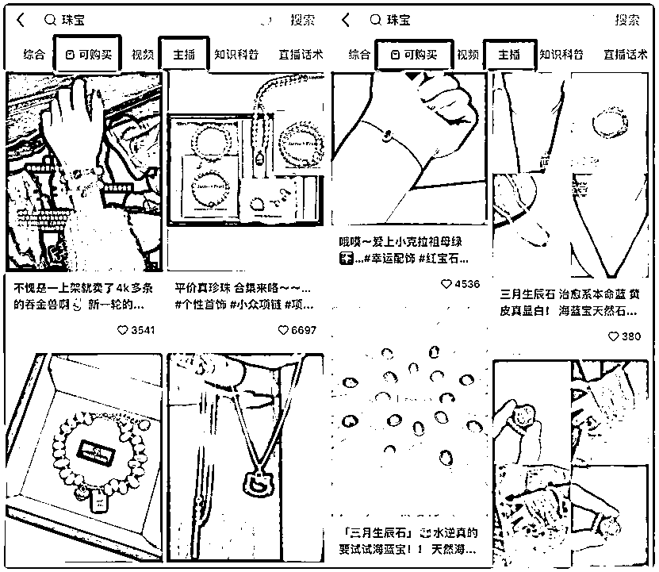

**  **

**④直播广场挖掘：** 打开“直播广场”，系统会推荐相当多具备爆款潜力的账号，从这些主页中同样能收集到丰富的选题素材。

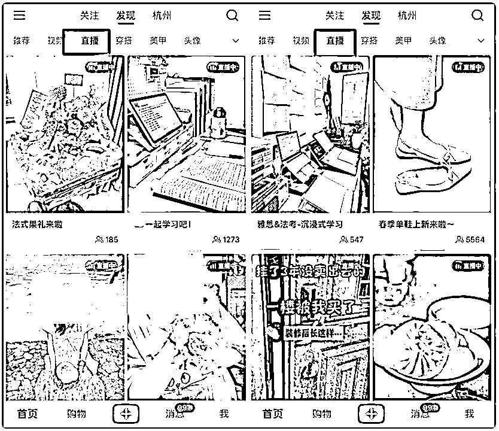

**  **

**⑤选题公式速查**

- **借时令、节日做文章：** 把当季热门议题融入笔记标题，抓住大家的注意力。例：盛夏、春夏换季。

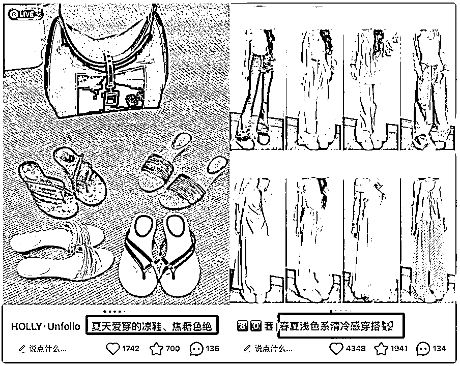

**  **

- **从系列感入手：** 沿着产品的不同调性和使用场景拆解内容，精准覆盖某类人群的偏好。例：古着穿搭、vintage。

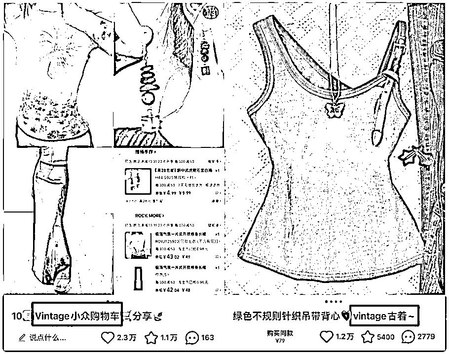

**  **

- **用新品吊胃口：** 把未上架或刚上架的新款作为最大卖点，推高点击和预约量。例：新品+体验官招募。

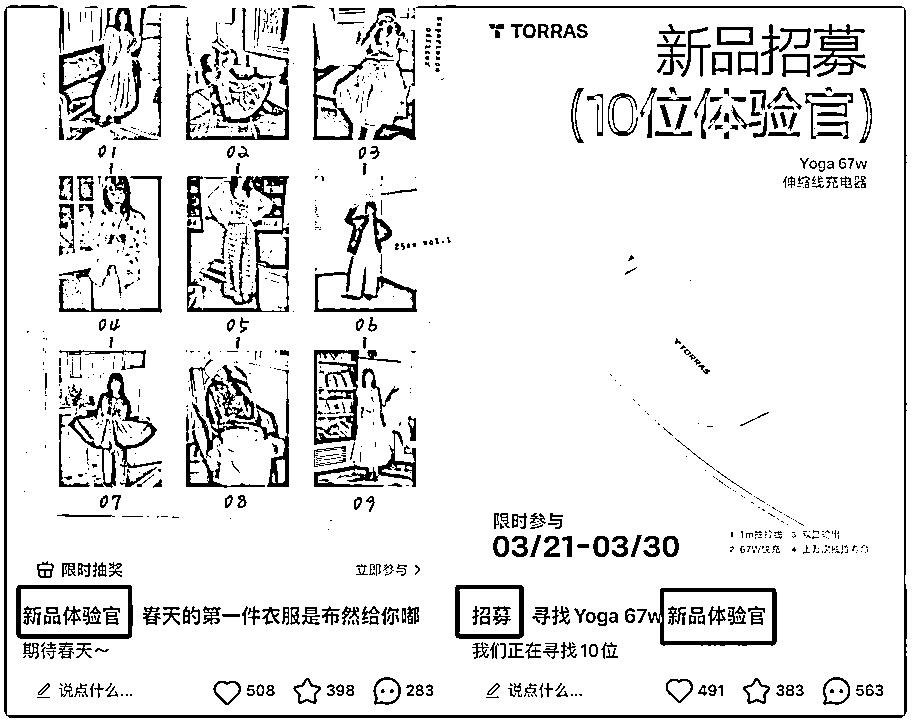

**  **

- **把数字摆在明面上：** 用醒目的数量词突出货品种类之丰富，让人忍不住点进去。例：1000+订单、6家韩系小个子店铺。

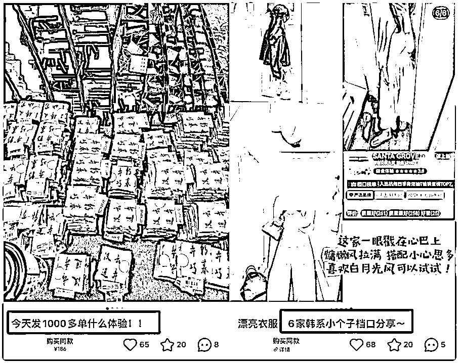

**  **

**7.标题怎么取更吸量**

标题的权重不亚于选题，它对预约人数有直接拉动效果。写标题时，既要交代内容重心，也要埋入钩子，同时把直播的主题、核心卖点和风格标签亮出来。

以下三招可快速提升标题的吸引力：

**第一招：用画面、符号或数字来呈现“结果感”**

原标题：南洋风家居搭配技巧  
改后：南洋风家居搭配分享，闭眼入轻松 get

**第二招：用“怎么做+能得到什么/解决什么问题”的句式去写**

原标题：家居好物分享  
改后：这些家居夏凉好物，清爽过夏天

**第三招：格式定为“风格+产品/氛围+直播福利”**

原标题：床品上新  
改后：天丝凉感被上新，首发福利送套

**8.封面图的讲究**

封面是除标题之外另一个不能马虎的要素。行业经验里，点击率达到3%就已经算相当亮眼了。想让更多用户点进来，可以直接套用三种被验证过的封面模板：**出镜者手持商品、出镜者身处场景、个人风格强烈。**

**  **

说到底，封面设计的底层逻辑还是那套经典框架：**人、货、场。** 只要你盯准竞品去拆解模仿，审美普通也没关系，把自己的核心优势放大即可。

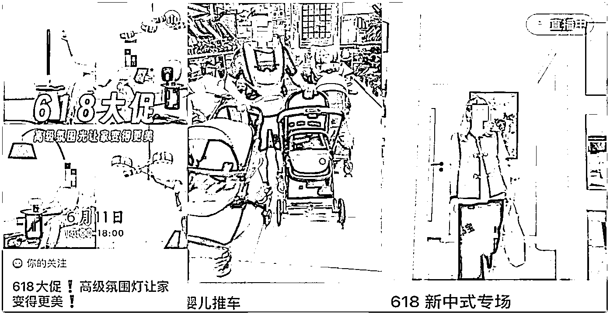

**9.把社群和个人资料用起来**

直播启动前和播出期间，都可以把直播间入口同步到**📕粉丝群或🛰️等私域群聊**；另外在**个人简介栏和瞬间动态**里写清楚固定的开播时间段，经常刷到你主页的新老粉丝自然就会形成预约习惯，进而带来持续曝光和预约增长。

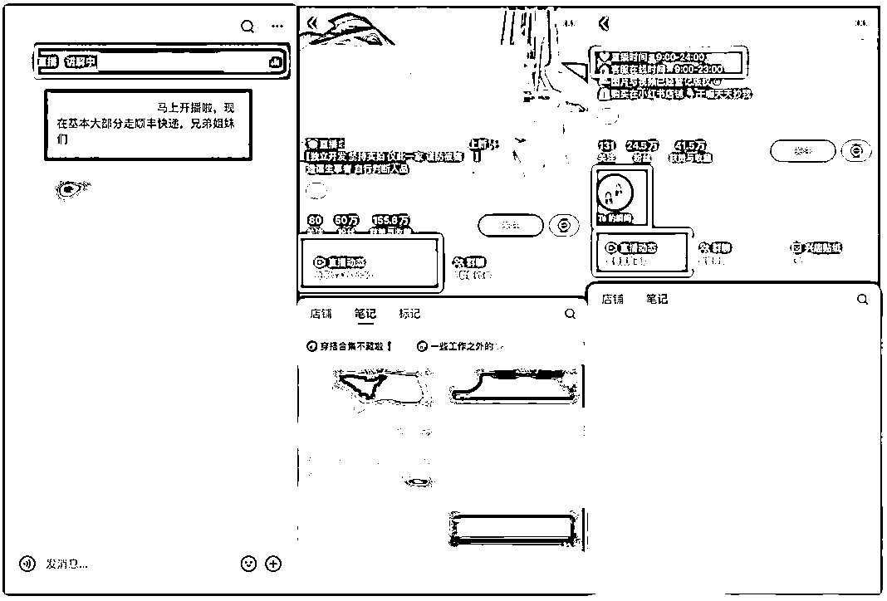

**第五部分：如何让直播间转化率上去**

**1.按时间段排布直播内容**

**前10分钟：** 先跟老粉打个招呼、聊聊天，等人气自然起量；再用福利品把观众留在画面里，也可以开一轮抽奖来锁定停留，为接下来的转化做铺垫。

**中段数小时：** 重心放在畅销款、高利润款和差异化商品的讲解上。主播要多抛话题和粉丝互动，让观众有参与感；有条件的话，**安排小助理、客服或熟人担任“气氛组”**，不断刷屏带节奏，新进来的用户会更容易留下来。

**最后30分钟：** 临近结束时往往还有一波转化小高峰，集中火力把最热门的畅销款再讲一遍，制造“再不买就没了”的氛围促进成交；同时预告下场直播的时间，顺手把下一场的预约人数也带上去。

**2.用抽奖稳住人气**

刚起步的直播间，定时发福利是成本最低、见效最快的留人方式。比如**红包、赠品、折扣券**，都能有效稳住流量并带动下单。

**抽奖节奏怎么排：** 每隔15分钟放一波小奖，每到整点放一波大奖，把观众的期待值一直吊着。

**参与姿势怎么定：** 可以设置关注后才能抽、入粉丝团后才能抽、完成订单后才可抽。实测下来，后两种（加粉丝团、下单）的促单效果最明显。

**提醒用户别错过：** 福利信息要在粉丝群、直播间右上角公告面板、置顶评论等位置反复露出，确保更多人接收到。

**3.粉丝群这样运营**

粉丝群看着不起眼，基础运营做到位，直播间转化率照样能往上走一大截。

**开播前：** 在群聊中推送预约笔记，用粉丝专享福利、新品首发等由头号召大家点击预约。

**开播中：** 加大群内的导流频次，把正在直播的信号推送到每一位成员，从而抬升进房率；也可以反过来，把直播间里的观众引导进粉丝群，为日后的转化蓄水。

**开播后：** 在群内分享回放链接，发动粉丝晒单、反馈体验，认真收纳大家的建议，作为下一场的优化依据。

平时还可以把售后服务下沉到群里，主动回答使用问题、顺势推荐关联单品（群内购），既提高了连带销售，又能让大家提前知道下一场直播的安排。

**4.话术怎么说才留人**

想在📕开播，门槛其实很低，不需要背什么复杂的话术模板。

**开场：** 前几句话的目标就是抓住注意、建立链接。可以说“宝子们，欢迎来到我的直播间！今天这场直播超精彩，给大家准备了超多福利和超赞商品，千万不要走开！”或者“家人们，我又来啦！今天有你们一直催着要的好东西，还有惊喜优惠送给大家！”

**讲品：** 核心是把特点、优势和价值讲透，让人心动。比如讲精华：“这款精华核心成分是高浓度烟酰胺，提亮效果很强，用一段时间皮肤肉眼可见变透亮，质地轻盈不油腻，各类肤质可用。”

**互动：** 目的是提升活跃度、增加粉丝黏性，通常有四类玩法：

**提问类——** 抛出跟商品有关的问题，帮用户解决疑虑，顺势促单，例如：“还要再看主播展示其他颜色吗？”“刚刚分享的使用技巧大家学会了吗？”

**选择类——** 让观众二选一或编号留言，愿意发言的人往往购买意向不低，例如：“购物袋里哪件最感兴趣？评论编号我来讲”“喜欢皮质的扣皮质，喜欢布艺的扣布艺”。

**刷屏类——** 参与门槛极低，能快速炒热气氛，也让新进直播间的用户感受到热闹，例如：“觉得这套床品好看的扣1，下次还安排类似风格”“大家不够尽兴？好，再上一波福利，想要的把1扣起来！”

**宠粉类——** 主动cue老粉丝的名字打招呼，例如：“欢迎xxx来到直播间，这是咱们的老粉了！”

**留人：**

**引导关注：** 用话术把观众的注意力引到产品的细节、优点和使用方法上，例如：“咱们家这款上衣用的是xxx料子，上身特别柔软贴肤……”

**放大商品魅力：** 反复强调卖点和价值，让观众产生购买欲，例如：“这口锅用了xxxx工艺，拿过xxxx认证，炒菜完全不粘……”

**建立信任：** 即时解答疑问，消除顾虑，信任感上来后购买意愿自然提升，例如：“想听哪款讲解？评论区打出来”“新进来的宝宝扣个1，给新粉准备一份小福利……”

**催单成交：** 用好话术直接推动销量，例如：“喜欢的宝宝赶紧去下单啦，直播间专属福利错过就没有啦！”

**保证节奏：** 全程保持内容的连贯与专业，让用户愿意一直看下去。

**逼单：** 关键在于紧迫感。可以说“这款库存告急，只剩最后XX件，手快有手慢无！”或者“现在下单加送价值XX元赠品，仅限今天直播间！”

**5.开播前的预热怎么做**

提前三天就要开始造势：发布预告笔记时，标题里带上“直播剧透”“专属福利”一类关键词，正文部分则用悬念感强的表述和看得见的福利来勾人。

再配合短视频做引流，把即将上架的爆款和福利提前剧透给观众；私域方面则同步在粉丝群、店铺首页放出开播提醒。

开播之前：发布一条商品合集笔记，把货品和福利一次性陈列出来；  
开播期间：透过私域渠道在群里持续轰炸直播信息，让更多人看到入口；  
封面图则要优先选点击率高的类型，比如画风可爱的、跟商品强相关的、能传递干货信息的……

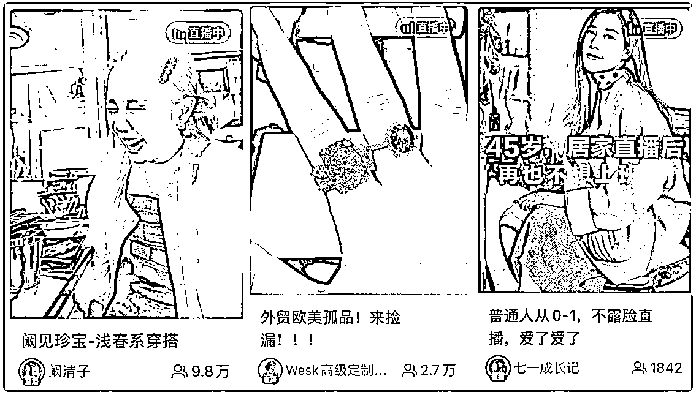

**  **

**6.商品合规别踩线**

在📕上带货，合规是一切前提。每一件上架商品都要有完整的品牌授权文件、质检报告等凭证。

食品类目需要有生产许可证和卫生许可证；美妆类目要有对应的备案记录；医疗器械这类特殊商品更是要严格对照法规，资质文件一份都不能少。

如果被平台查出问题，轻则限流，重则直接封禁直播间。

另外，商品描述必须实事求是，功效上不能有任何夸大。比如卖减肥类产品，不能张口就说“用一周瘦十斤”，而是要如实说明成分、适合人群以及常规效果。

**7.违禁词排查清单**

另一个高发雷区是口头禅式的违禁词。**“最”“极”“绝对”“第一”** 这类词如果没有数据背书，被平台识别后很可能判定违规，进而导致直播间被关停。

建议开播时安排一个助理在旁边盯话术，一旦出现敏感词立刻提示；或者干脆将这些表述替换成更朴素中性的同义词，把风险按在源头上。

**极限类表述**

这类绝对化词汇一律不能出现：“国家级”“世界级”“最高级”“第一”“唯一”“首个”“首选”“顶级”；以及“最高”“最低”“最”“最具”“最便宜”“最新”“最先进”等含义相同的说法；还有“绝对值”“绝对”“大牌”“精确”“超赚”“领导品牌”“领先上市”“巨星”“著名”“奢侈”这类难以考证的词；以及“100%”“国际品质”“高档”“正品”等夸张或真假难辨的说法。

**权威身份类表述**

不许借国家机关或领导人的名义搞宣传，例如“国家XXX领导人推荐”“国家XX机关推荐”“国家XX机关专供”“特供”；“质量免检”“无需国家质量检测”“免抽检”等声称跳过检测的说法也不行；未经央行批准不得使用“人民币图样”；“老字号”“中国驰名商标”“特供”“专供”同样在禁用之列。

**煽动抢购类表述**

“秒杀”“抢爆”“再不抢就没了”“不会再便宜了”“错过就没机会了”“万人疯抢”“抢疯了”这类制造紧迫、煽动情绪的措辞，一律不准使用。

**疑似医疗功能类表述**

普通商品不能碰跟医疗沾边的说法，除非这个商品本身就是特殊用途化妆品、保健食品或医疗器械。

**迷信玄学类表述**

“带来好运气”“增强第六感”“化解小人”“增加事业运”“招财进宝”这类带有迷信色彩的用语也要避开。

**美妆功效夸大类表述**

“特效”“高效”“全效”“强效”“速效”“速白”“一洗白”“xx天见效”“xx周期见效”这种保疗效式的说法，容易被判定为虚假宣传。

**8.引导关注要有度**

引导观众关注、点赞、评论、转发都没问题，但直接用金钱做诱饵是绝对不允许的。像“关注我发红包”“点赞过千送现金”这类说法踩的红线非常明确。

合规的做法是换成间接福利，比如“点关注，下播有专属福利”“点赞超过XX抽一位送小样”，这样既达到了互动目标，又不触犯平台规则。

**第六部分：带货效率怎么提升**

**1.靠数据做复盘**

核心看几个维度：观看人数、观看时长、进房率、互动数据、销售数据。

观看人数体现的是直播间的入口吸引力。数据低，优先排查封面和标题是否缺乏点击欲，再检讨开播时段是不是不合适，然后针对薄弱项做调整。

观看时长则对应内容本身的精彩度。停留时间过短，基本可以判定是内容乏味或节奏拖沓，需要在脚本编排上动刀。

互动数据包含点赞、评论、分享、涨粉四项：点赞量高说明内容获得了认可；评论活跃说明观众愿意参与，期间的发言也是洞察需求的素材；分享量大说明内容自带传播力；粉丝增量则直观反映账号拉新能力。

互动数据不佳时，第一时间回头检视话术设计和互动环节设定，找出冷场的原因。

销售侧的三个指标同样关键：商品点击量指明哪些货品更受关注；下单量直接决定GMV的高低；客单价则能识别出观众的消费力区间和选品偏好。

把这些数字拉通来看，自然能判断出哪些品要继续推、哪些品要尽快改打法。

复盘的意义在于沉淀方法：把做得好的地方拆出经验，把有短板的地方找出解法，后续的优化和变现才能有据可依。

**三个重点优化方向：**

第一，选品：货品是否足够讨喜、能不能拉动下单；

第二，互动：现有话术与目标人群是否匹配，随时修正；

第三，转化：围绕用户真实痛点和购买顾虑去优化讲解内容，让转化链路更顺。

**2.内容与带货互相借力**

最常见的一招，是在已经跑出量的爆款笔记里挂上直播预告链接，让笔记积累的热度直接流向直播间，关注度自然水涨船高。

另一种做法是把低价引流款或店铺爆款关联到日常笔记里，让非直播时段也能持续产生成交。

**3.粉丝要分层触达**

把粉丝按身份做归类——是来看直播的、还是已经买过东西的，分别拉进不同群聊进行管理，比如“xxx粉丝群”“xxx会员群”“xxx日常开播群”。

每一场直播主题确定后，挑出与该主题最匹配的群推送直播间链接，转化效率会提升不少。

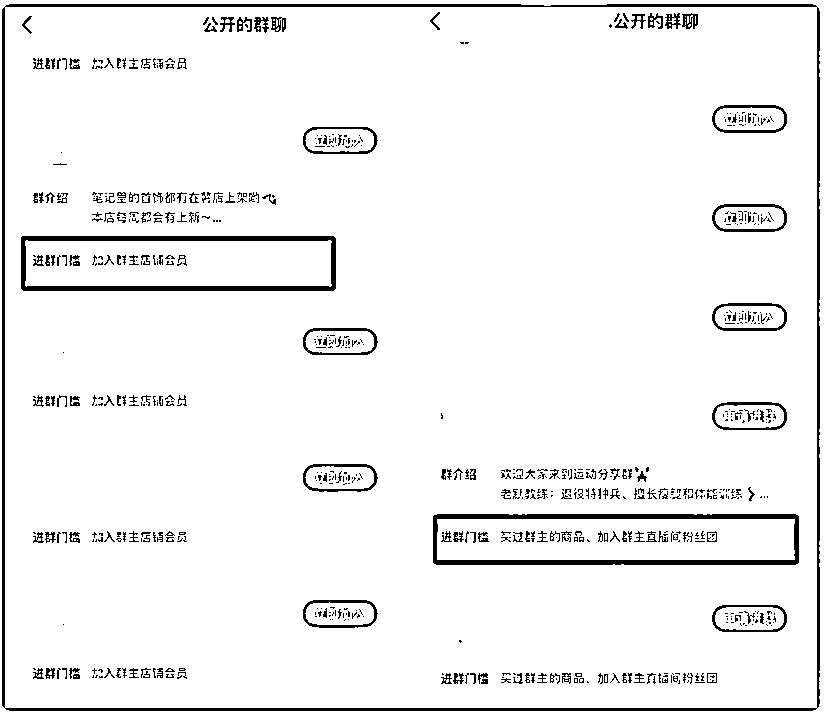

**4.把观众稳步沉淀进群**

最通用也最有效的做法是用福利换入群，比如“进群即可领无门槛优惠券”，门槛很低，用户很吃这一套。

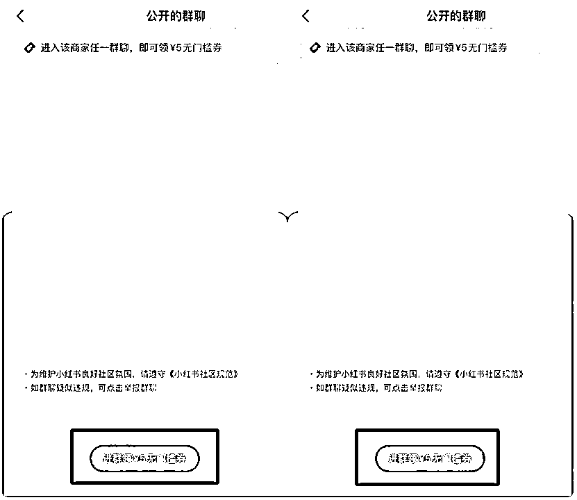

直播过程中也可以口头引导，话术示例：“每天xx-xx准时开播，群里会提前通知每一场的动态，大家记得加群关注。”

**5.七个高频问题一次说清**

**Q1：一场直播播多久合适？**

建议不少于4小时；开播时间上，周末最迟下午5点，工作日最迟晚上7点。

**Q2：选品中心在哪里？**

路径是：创作者中心→商品合作→选品中心。

**Q3：怎样才算我的业绩？**

用户经由你直播间的商品链接进入详情页，并在24小时内完成付款，或24小时内加购、7天内付款，这笔订单就会计入你的佣金。

**Q4：销售数据去哪看？**

直播进行中，主播端购物袋自带实时数据展示，也能登录PC管理后台（redlive.xiaohongshu.com/login）查看实时情况。下播之后，进入选品中心的“我的数据”即可看到，当日数据在次日更新。

**Q5：平台要从佣金里抽多少？**

平台收取佣金总额的20%作为技术服务费，主播到手佣金的80%。

**Q6：佣金什么时候到账？**

个人主播：📕在每月8-15号，将已完成确认收货订单的佣金在代扣个税后打入📕App钱包，碰到节假日顺延到下一个工作日。

机构达人：平台对公打款到机构账户，由机构自行安排收入分发和个税代扣。

**Q7：佣金如何提现到账？**

有两条路：钱包→我的收益→好物推荐收益；或创作者中心→商品合作→我→我的数据→提现。

以上就是这份📕直播实操手册的全部内容。最后再提醒一句：这个时代，目光要往“钱”看，跟上趋势的同时，也别忘了给自己留出探索新赛道的空间。

2025年，我的目标是带动10000+位博主在📕实现持续稳定的变现。如果你也想要一起走，欢迎来链接我。

* * *

评论区：

暂无评论