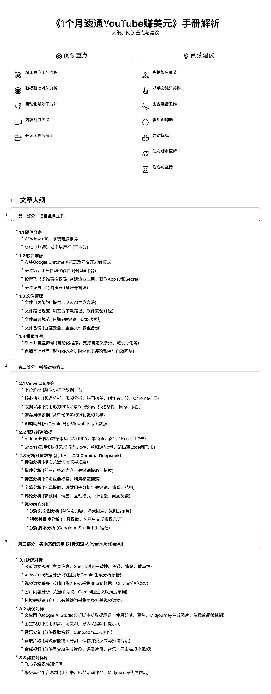

标题：新手小白一个月拿下2个YPP？3万字YouTube赚钱手册来了，工具源码全免费！

你敢信？刚接触YouTube项目才一个月，这位叫“越越”的新人，就已经递交了两个YPP申请。更厉害的是，她还顺手写了一本整整3万字的《Youtube学习手册》，连工具源码和制作思路都全部公开。

这份手册有多贴心？小到环境搭建，大到实际操盘，每一步都有图文对照，照着做就行。而且她专门把新手最容易翻车的地方标了出来，手把手帮你避坑。内容全部来自航海圈和深海圈伙伴的真实打卡记录，从大家实际卡住的问题出发，给出真正能落地的解决方案。

最让人意外的是，这位作者之前也是个纯小白。她发现星球里好多帖子都有个通病：默认读者自带基础，行内人看着轻松，新手却根本啃不动。于是她用了两周时间，把圈友们的反馈和需求整理了一遍，写成了这本专门给小白的3万字手册。里面还记录了她怎么用AI给YouTube项目赋能，怎么通过“AI+编程”实现工具自由，把AI提问能力硬生生练到了可以自己逆向提示词、写程序的程度。

手册会一直更新，分上中下三篇，加起来十万字，内容还在持续完善。看到这里记得点个赞，留意后续动态，别错过更新。

这不是一篇只讲理论的帖子，作者直接在精华帖的基础上，把工具的制作思路和代码重新优化了一遍，成品和源代码直接给你，后续还会长期维护。在她看来，技术从来不是门槛，能找到真实需求才是真正的门槛。

另外，部分灵感来自@钱塘江鲤、@困困教练、@李香君、@曹淦等教练，感谢深海圈各位教练和伙伴的耐心答疑。

飞书链接直达：https://txt6wm3b04b.feishu.cn/docx/L5KXdFjhdoLhguxFpqZceXD8nSd?from=from_copylink

