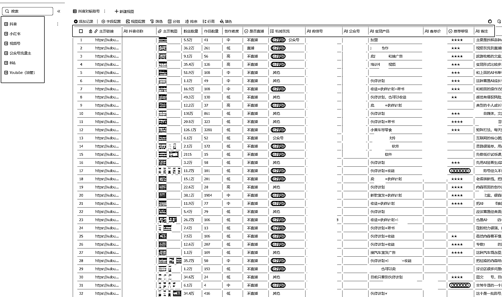

# 从一个很小的灵感出发，如何把它变成能真正跑起来的大项目？
作者：龙哥

## 从一个很小的灵感出发，如何把它变成能真正跑起来的大项目？

作者：铲哥带你飞
日期：2025-05-12

这篇笔记很短，但适用范围极广。几乎任何项目，都可以从一个关键词、一张图、一个短视频、一篇笔记、一篇文章开始，最终拆解成可落地、可执行的完整体系。

我用这套打法，经常一个小时内就能筛出几十个正在被验证、并且已有正向案例的赛道。

* * *

# **第一步：捕捉信息，找到需求**

刻意训练自己“找需求”的敏感度，带着明确目的去刷信息：我要找到需求点和已经跑通的变现案例。

重点战场是抖音、📕、视频号、👸号、B站、朋友圈里的营销内容、淘宝、闲鱼、知识星球。次级战场是快手、今日头条、知乎等自媒体与电商平台。

刷到任何一条内容，立刻点进创作者主页，留意有没有留下的联系钩子，比如🛰️号、👸号，很多人会藏得很隐晦，要仔细看。同时判断他到底是怎么把流量变现的。

提醒：别只刷自己爱看的领域，很多好机会，都藏在不经意刷到的冷门内容里。

建一个飞书多维表来做沉淀，按平台归类。关键字段是主页链接，一定记主页链接而非账号名，因为账号可能改名，主页链接是稳定的。还要记录创作门槛、变现产品形态、引流矩阵账号等。

找项目先扩张再收缩，先把选择面做大，再做精挑细选。

## 扩张

先保证有得选，所以要大量囤项目。建议每个平台至少收集 50 个点子。

## 收缩

把明显不成立、不可行的选项全部筛掉，剩下的就是高概率选项。从中挑 2-3 个你最有信心能快速出结果的项目，全力推进。

# **第二步：调研需求，是不是真有价值**

99% 的项目流量都依赖自媒体和电商平台，只要有人在导流，你就能顺着这条线找到对应的内容和账号。

核心要判断三件事：这个需求的市场体量够不够大？同行的平均水准如何？

把关键词丢进抖音、📕、视频号、B站、👸号、知识星球、快手、今日头条、知乎，以及淘宝、京东、拼多多、抖音商城、闲鱼去检索。如果是图片，直接用各平台的识图功能。

1. 竞品数量是否健康。大量账号在持续更新，说明这个赛道在持续产生商业价值。
2. 自己有没有胜算。关键看内容质量能否比对手做得更好。
3. 交付能力能否匹配。对标账号如果提供高客单的1V1咨询、深度服务，就要评估自己是否能复现交付标准。

# **第三步：思考落地路径**

项目方向和对标案例都清晰后，就要想怎么落地。最直接的切入口是做内容，先把流量跑通。

把同行账号和爆款内容全部抓出来，进行结构化拆解，拆成可执行的颗粒度。

比如：标题的写法逻辑是什么？封面怎么设计更抓人？素材怎么拍/怎么找？文案的表达节奏是什么？一天发几条？最佳发布时间是什么时候？钩子怎么留？怎么引导用户加🛰️或关注👸号？用户进来后开场白怎么设计才能提高转化？

把这些细节点一个个想清楚，你就从旁观者变成了创造者，而且解决了引流这个最关键的一环。

也可以把思路整理一下去问AI，给AI讲大白话就行：我想做XXX，请给我一些能快速落地、跑通MVP的具体建议。换几个AI问一遍，相当于集齐了不同高手的视角。

# **第四步：行动，快速验证**

把前面的方案做出来，先找流量最好的内容形态做低成本复制。建议准备5个号同时开测，快速验证。如果效果不理想就换形式，直到流量和获客模型跑通为止。

# **第五步：迭代，优化模式**

只会照抄永远慢半拍。当验证通过后，就要开始优化：把内容生产流程化，引流方式做升级，成交话术做打磨。先模仿，再超越，才能吃下更大份额的市场。

# **第六步：杠杆，放大规模**

很多人项目跑通后就去追新的方向，从而浪费了先发优势。等竞争者涌入，就只剩内卷。

所以跑通闭环后立刻加杠杆，把整个业务做成标准化SOP。

1. 人力杠杆：找线上兼职按条数或按新增用户结算，或招线下团队，制定人均账号数和日更指标。
2. 技术杠杆：把SOP固化下来，用PRA+AI和AI编程写脚本，实现半自动化或全自动化。
3. 资金杠杆：用付费广告投放直接放量复制。

如果执行到位但结果不理想，就回溯到上一个环节调整。比如下了100条内容流量依然差，就换内容形式；形式换了还不行，就换对标对象。

总结：信息 → 调研 → 思考 → 行动 → 迭代 → 杠杆

* * *

评论区：
杨小六 : 学到了