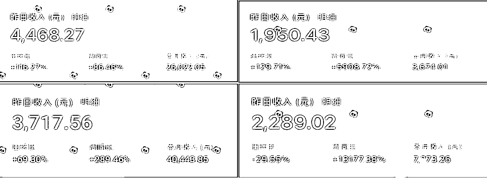
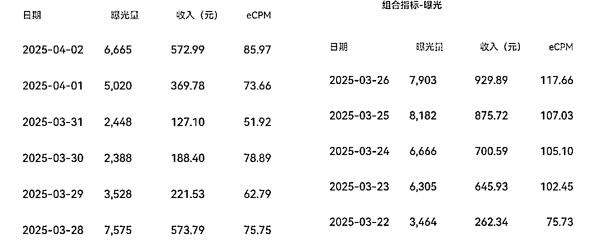
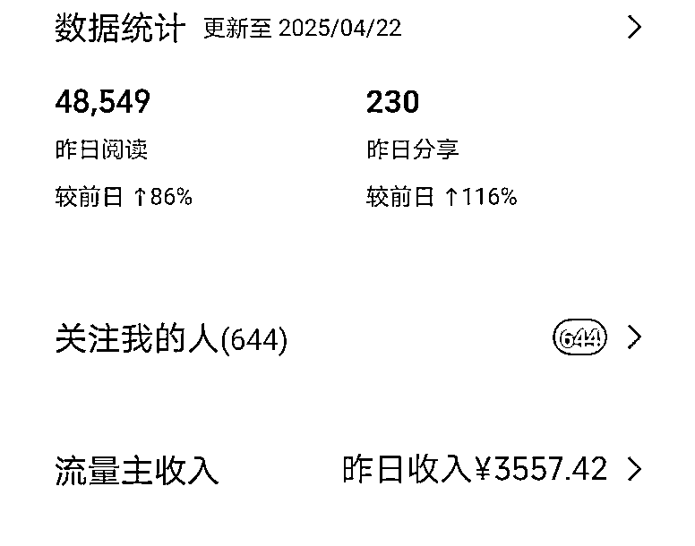
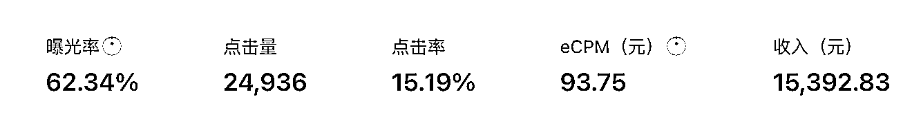
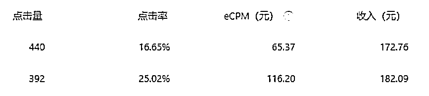
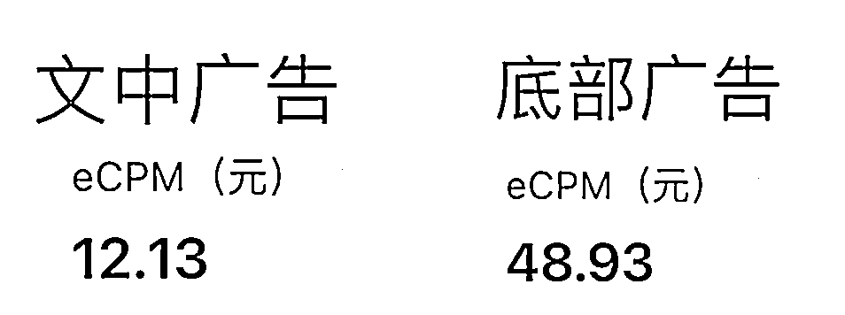
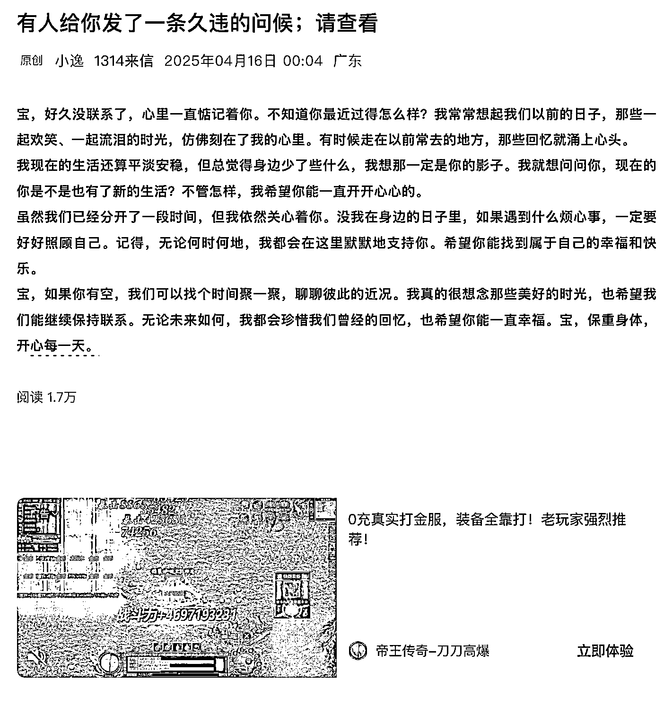
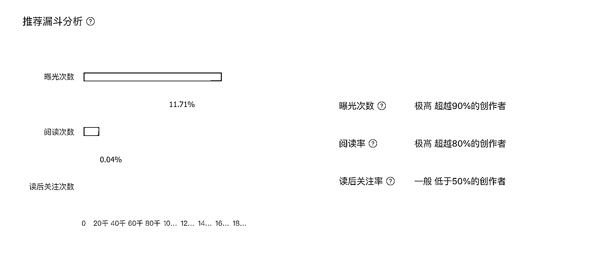
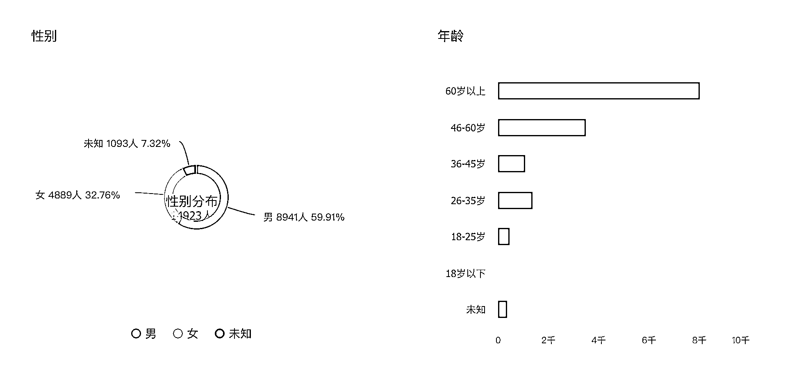

# 用 AI 撬动百元 eCPM 的公众号打法，全套实操拆解

> 原文：[`www.yuque.com/for_lazy/zhoubao/efik2v6rvx40wzk6`](https://www.yuque.com/for_lazy/zhoubao/efik2v6rvx40wzk6)

公众号写爆款的生意并不新鲜，起起伏伏了多年，最近又被很多人捡起来复盘。之所以现在好做，主要有两拨变化在推着。

1、公域分发被打开。差不多在一年前，平台开始给零粉丝账号分发公域流量。过去没有基础粉丝，阅读量基本起不来，现在即便是全新号，也仍有机会冲到十万加，门槛被拉低了很多。

2、内容生产被 AI 接管。过去一篇像样的文章全靠自己码字，耗时耗力。现在把重心放到选品上，落字部分交给模型就能批量产出。

## 先追阅读，还是先追单价

公众号变现的底层逻辑很简单：收益 = 曝光量 × 单价。

翻阅过往的航海经验和同行复盘，绝大多数人都在卷阅读量：如何制造爆款、如何冲 10 万 +。很少有人去琢磨另一个变量——单价。今天就把视角换一下，不讲怎么涨粉，只讲怎么把单价做上去。

下面两组账号是我手上在跑的数据，eCPM 基本稳定在 60-100 元以上，甚至直接破百。它们的内容长什么样，先不剧透，留到后面一起看。

很多号主每天看着个位数 eCPM，第一反应是：百元单价肯定是假的、P 的。我刚接触到这类数据时也一样怀疑，直到自己做出同类结果，看着后台数字一点点涨，才对单价的形成有了全新认知。下面把影响单价的关键点拆开讲。

决定单价高低的核心就三件事：广告能否被看到、用户愿不愿意点、展现的是哪类广告位。

1、能否被看到
公众号流量主的本质是广告展示，曝光上不来，后面一切免谈。最直接的做法是把文章体量压到极致。比如下面这种两三百字的纯文本短文，就是为了让底部广告几乎无遮挡地出现。

2、用户点不点
我对比过不同垂类的后台，拉开差距最大的是人群属性。娱乐八卦类内容，广告点击率通常只有 0.1%-0.5%。而某些高价垂类，点击率能做到 15%-25%，两者差距是百倍级别。

3、广告位类型
传统长文策略是堆字数、插文中广告，很少有人刻意经营底部广告，因为长文天然导致底部广告很难被看到。但数据会告诉你，文末广告的出价是文中广告的数倍。同一篇文章里，文中和底部广告的单价对比，差距非常明显。

讲完三要素，很多人会问：现实中真的有同时满足这三点的内容吗？有的，就是下面这种看起来很平常的短文。阅读量大概 1.7 万，收益能轻易做到 1000 元以上。

为什么不起眼的几百字能实现这种收益，拆解如下。

第一，曝光被锁死。文章只有几百字，进入正文就基本到头，底部广告展现率接近 100%，第一步就稳了。

第二，点击率被放大的同时，成本极低。文章面向的是偏年长群体。年轻人对广告极其敏感，一眼就能分辨。但 60 岁以上读者很难分清正文和广告边界，看到图片就容易点进去。数据显示这类文章 60+ 占比常年过半，点击率因此出现异常高位。

第三，广告位被锁死在高价位。为了保证高单价的底部广告被命中，短内容就是最优解：既保证曝光，又确保曝光的是价格最高的广告位。

最后补充一个执行细节。这类账号的素材非常好复制。找到对标号，把原文搬下来丢给 AI，几分钟就能仿写出几十篇同款。无需排版、无需配图，一段文字就能发，一个人轻松带几十个号。

总结下来，百元 eCPM 的逻辑其实是：用极短内容锁定 100% 底部广告曝光 + 用高点击率的老年人群放大点击 + 用高单价的广告位收割收益。其中人群选择是最大杠杆，曝光和广告位最多拉开 2-3 倍差距，点击率却能拉开几十倍、上百倍。老龄化内容，确实是目前公众号里最被低估的富矿。

* * *

评论区：

小胖 : 感谢分享[微笑]

小花 : 一直不知道张集慧老师的性别[呲牙]

阿辉|solas : 大帅哥

若凡吖 : 感谢分享

水心 : 很有帮助，感谢分享

青霜 : 请问如何找到这种对标账号？

张集慧 : 你去搜关键词：2 个未接电话，完后会看到很多账号，关注几个，后面系统会推荐更多

青霜 : 感谢