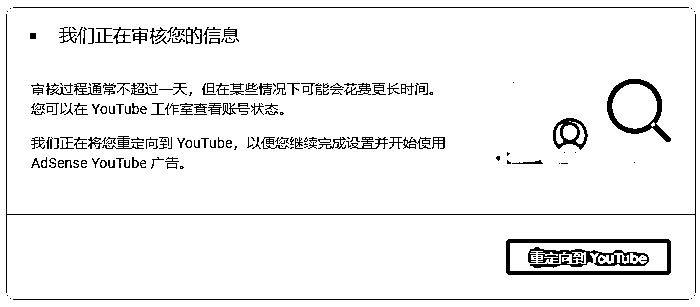
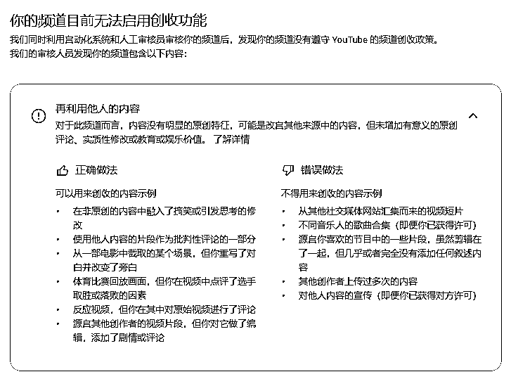
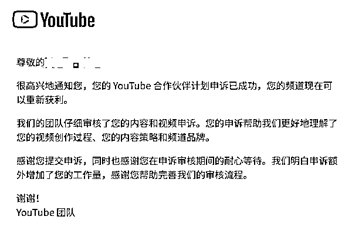

# (64 赞)美元是怎么赚到的：我用 3 个月在 YouTube Shorts 上赚到人生第一笔美元

## (64 赞)美元是怎么赚到的：我用 3 个月在 YouTube Shorts 上赚到人生第一笔美元

作者： 陈子游

日期：2025-04-28

4 月 23 日，招行推送的到账通知让我确认了第一笔 YouTube 收益已入账，长舒一口气，这条变现路径终于走通了。

400 美元换算下来约三千人民币，数额不大，却是我此生第一次收到外汇，也是加入龙哥盟以来首度真正实现盈利。

今年是我进入赚钱社群的第三个年头，往昔参加过数次航海、尝试过诸多项目均未成事，这一次总算把当初的入场费赚了回来。

本文复盘这几个月在 YouTube 上的实操经历。写作的初衷，也是想为自己积攒些运气。龙哥曾提到过分享越多越幸运，虽尚未亲身印证，但过去两年运气平平，我选择先相信再验证。

* * *

# 起因

前两年我一直在用 Midjourney 玩 AI 绘画，并运营了一个小红书号，最终并未做起来，变现也十分有限。

我太太同样在经营小红书，她近期觉得纯图内容吃不饱，便开始尝试制作短视频，间或用可灵生成一些简单的 AI 影像发布。

小红书的 AI 赛道竞争激烈，她发了视频后数据仍不理想，好在热情未减。我见她劲头十足，想到赚钱圈里提到的 YouTube Shorts 流量扶持，便劝她试一下。

她随后注册了 YouTube 账号，尝试上传五六条不同主题的作品，播放却只停留在个位数，便判断这件事行不通。我告诉她账号运营需要找对标、进行模仿、边做边调整，持续一段时间才能下结论。她不信，我便说，那我来做一条给你看。

就因这个看似无厘头的原因，我踏入了原本毫无兴趣的赛道。

* * *

# 试错阶段

起初我抱着玩票的心态入场，前期大量时间浪费在摸索上。当时正值一月，YouTube 航海已收尾，我只能参照航海手册自行操作。

按手册搭建完账号后，我没细看后续内容便开始自行探索。每日在 YouTube 上闲逛，发现宠物类内容的数据似乎不错，于是决定切入该方向。

恰好我常使用即梦，官网有不少用户分享的猫狗作品并附带提示词，我照搬生成后用剪映拼接上传测试。

连续发布数日，数据维持在几百。起初我对数据无感，觉得总比个位数强，便继续坚持。过了一段时日感觉不对劲，**播放一直卡在几百，向前跨越都很困难。**

于是我再次刷平台找参照。后来刷到一批猫狗跳“摩托摇”的作品，部分数据非常亮眼，我觉得有戏，便决定转向。

这时出现一个难题，我不清楚此类舞蹈视频是用何种 AI 工具制作的。查阅航海手册，记载为用通义千问，实际操作并不完全契合。我四处询问也无果，只能先用通义千问搭配其他曲风发布，效果依旧平平。

后来在小红书或其它地方偶然看到一款名为秀脸 FacePlay 的应用，才知“摩托摇”多为此工具生成。我试用后认为可行，便花 200 元购入会员，专门制作猫狗“摩托摇”舞蹈视频。

上传后，**数据明显提升，很容易达到数千播放。** 航海手册曾提到只要持续输出平台会给予推流，于是我每日更新，有时一天发四五个。素材图由即梦生成，视频由秀脸 FacePlay 制作，效率高、成本低，坚持起来并不难。

当时我以为只要熬下去就会迎来推流爆发。事实证明我错了，**坚持近一个月，播放仍在数千徘徊。** 后来才明白，“摩托摇”的热度早已过去。继续消耗不划算，我开始寻找新赛道。

* * *

# 找新赛道

寻找新方向并不容易。我翻阅航海手册，也研究了对标账号，发现其中列出的多数赛道近期流量下滑，播放多在数千至数万区间。

我一度迷茫，不知该往何处去，只能先继续发布旧内容，空闲时刷 YouTube 找灵感。

**某日，我刷到一个做宝宝走秀的账号，当期数据极佳，高峰上百万，低谷也有数十万。**

我当时很惊讶，宝宝走秀不是已过时了吗，为何数据仍如此亮眼。细致对比后发现，该账号与其它同类账号的最大差异，**在于宝宝形象极具辨识度，尤其是面部轮廓与身材比例。**

我当时想，若能生成同样外形独特的宝宝图，或许也能获得更高流量。

* * *

# 走上正轨

要复刻对标账号的宝宝图，我起初想到垫图法。即截取图片，放入 Midjourney 反推词，再垫图生成。

**但我使用 Midjourney 已数年，深知该方法过于死板，很难达到同等水准，更遑论超越。**

于是我尝试自创方法。我先用浏览器插件下载对标账号中数据最好的封面，随后用高清放大软件将图片放大数倍，并在 Midjourney 官网新建一个风格画板，将这些图上传打包成一个风格，得到一个风格代码。

接着我在官网找到一批宝宝走秀相关的提示词，开始测试该风格代码的输出效果。

结果很差，基本不可用。可能因画板素材太少、风格过于单一所致。

**随后我尝试将自己账号长期训练的默认风格代码叠加进去，没想到效果相当不错。**

两种风格融合后，宝宝外形极具特色，且与对标账号差异明显，对用户而言具有新鲜感。

接下来是验证用户是否买单。起初我仍用即梦生成视频，后发现即梦制作走秀视频的质量太差，于是换成可灵，效果实现质变。

**这次选对了，宝宝走秀视频发布四五天后播放量便开始攀升。** 我的账号自此走上正轨，时间点为二月底。

* * *

# 开通 YPP 的波折

我未曾想自己能如此迅速触及 YPP 门槛。过去发宠物视频最高仅一万播放，**没想到宝宝走秀上线一周便出现数个爆款，十余天总播放突破千万。**

待创收后台数据更新，我立即提交 YPP 开通申请。

**未料第二步注册 Adsense 账号便卡了我整整一周，具体原因不明，后台始终显示“我们正在审核您的信息”。**

我曾在群里询问他人，该步骤通常很快，唯独我等待逾一周。好不容易通过，进入最后审核。本以为又是漫长等待，却在次日收到拒绝邮件，心情十分沮丧。

**YouTube 后台拒绝理由为“再利用他人的内容”。** 实际上我的内容完全原创，仅参考了部分风格。于是我按赚钱圈方波妮老师的帖子开始录制申诉视频。

首次录制此类材料过程磕磕绊绊，最终视频较长，为剪辑至 YouTube 要求的五分钟，又耗费两三天。怀着忐忑心情上传后，第二天即收到申诉成功通知，YPP 正式开通。

* * *

# 赚到第一笔美元

刚开通 YPP 的阶段运气不错，日均收益约 30 多美元，Adsense 很快寄出 Pin 码邮件。

等待 Pin 码的过程也令人焦虑，**我足足等了三个多星期才收到邮件。**

验证成功后，Adsense 的打款效率尚可，前一天邮件通知款项已汇出，第二天便到账。我按航海手册流程，将美元兑换为人民币。

以上便是我通过 YouTube Shorts 获得首笔美元的完整经历。文字上平淡无奇，实际走来却是历经波折，能跑通实属不易。

* * *

# 收益和计划

我的观众以印度为主，因而即便部分视频播放量高，收益并不高。刚开通 YPP 时，日均最低 30 多美元，最高 40 美元，但仅持续半月。如今随流量下滑，日收益降至二十余美元，近期甚至只剩十余美元。

无论如何努力更新，播放难以明显回升，感觉用户已产生审美疲劳。

当前计划是趁流量尚未完全枯竭，先开设数个小号开通 YPP，后续待播放彻底不行时再考虑转型。目前已有小号开通初级 YPP，另有一个正在冲刺中。

* * *

# 几句闲话结尾

回顾过往略显曲折的人生，我总结出一个对我屡试不爽的定律，名为“出乎意料定律”。

**该定律认为，只要遇到较为困难的事，无论是求职还是寻找出路，最终找到的方向必定大大超出预期。**

此次 YouTube Shorts 即是如此，赚钱两年多我尝试过多种变现方式，皆未成功，最后这个我从未考虑且完全不感兴趣的赛道却做成了，**跑通即算成功，而非赚大钱**，再次印证了我的定律。

若你正处于迷茫探索期，不妨少纠结多尝试，多参与各类航海项目，说不定下一个能做成的方向正藏在意料之外。

最后感谢龙哥盟，感谢各位航海教练的帮助！

* * *

评论区：

书情小跟班 : 大佬，牛逼

Mengxiang : [强]优秀

葫芦 Mom｜金侣 Ly* : 出乎意料的定律，太喜欢这个词，学习啦

陈子游 : 客气啦，我是新手

陈子游 : 谢谢鼓励[调皮]

陈子游 : [握手] 一起进步

邓森曜 : 出乎意料定律，有意思[偷笑]

陈子游 : [调皮]