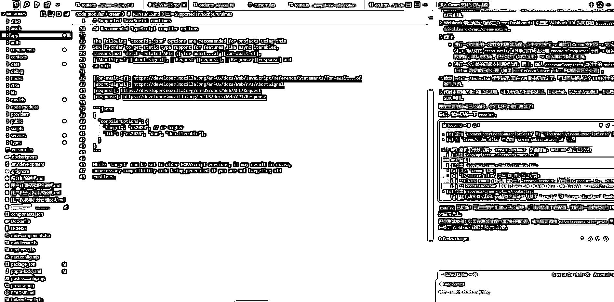
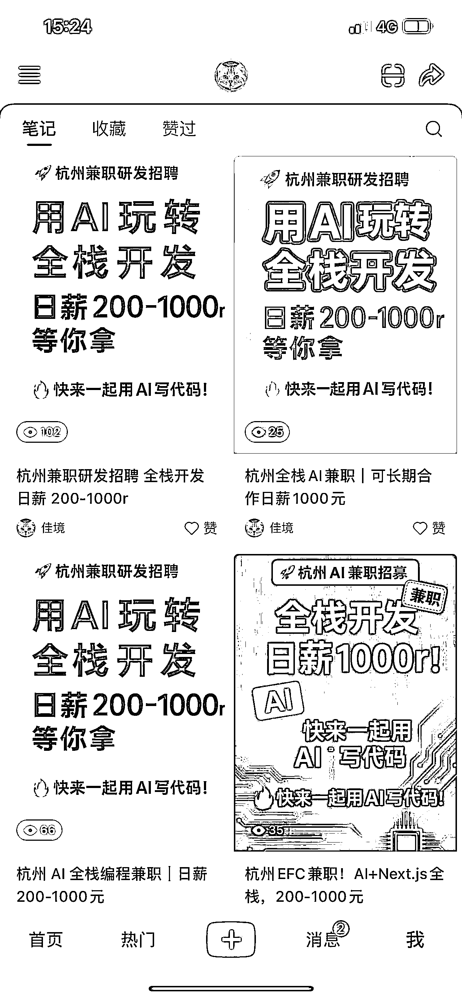
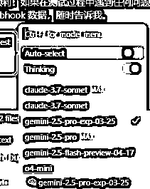
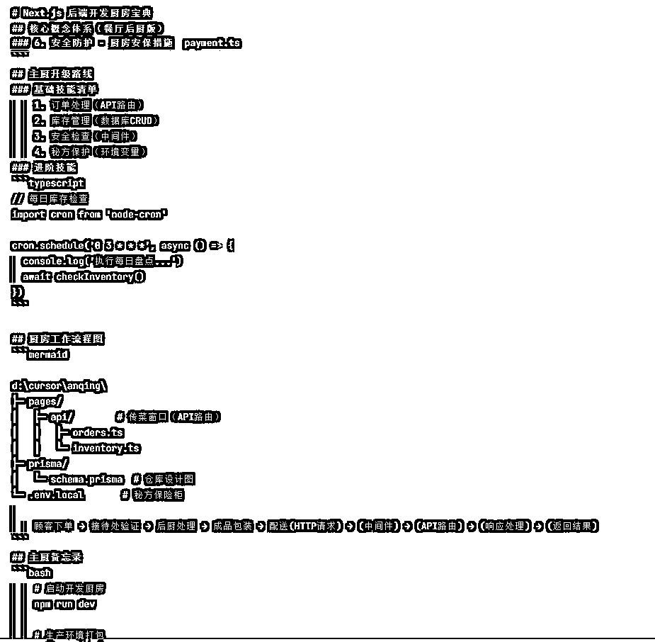
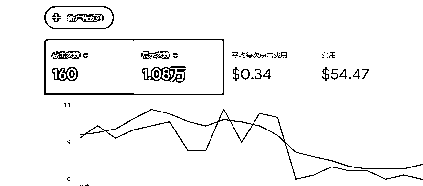
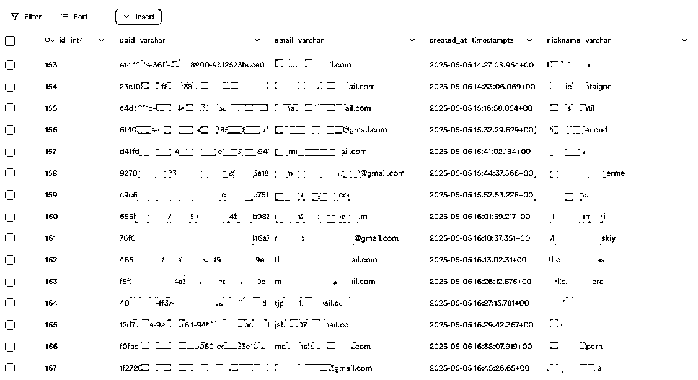
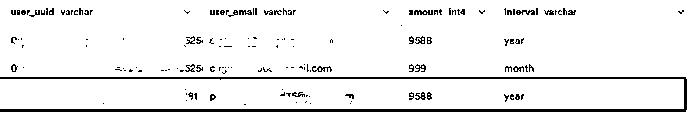
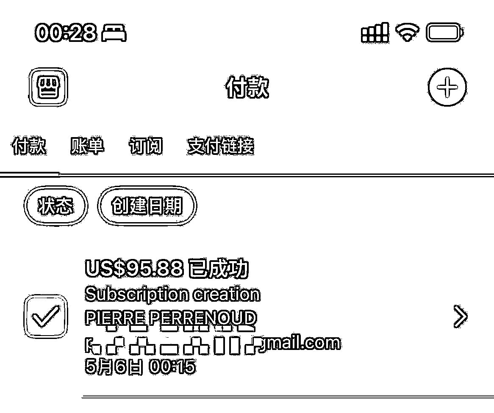
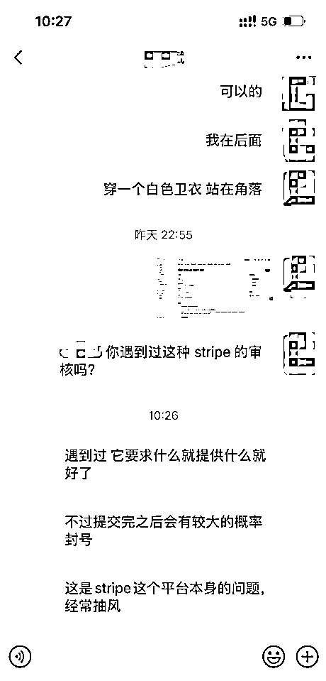

# 30 天把一个出海 AI 站点从零做到首单：我的实战复盘
作者：龙哥

> 没有捷径，只有把每一个坑填平。

五月初的深夜，后台弹出了一笔 95 美元的年费订单。我盯着屏幕发了几秒，猛地站起来。那一个月里熬过的夜、反复怀疑、推倒重来的瞬间，忽然有了落点。

这篇不讲套路，只讲走过的路。一个人非技术背景如何硬着头皮把能收钱的工具站做出来并上线。

## 转向：一次饭局让我改了主意

三月底去杭州前先到广州，和杉木聊了两个多钟头。手上本有两条线，被他一句市场空间太窄直接否掉，随后给了一条新方向。

当时心里不太舒服，感觉和原计划完全背离。最后还是选择听劝。这次改道后来被证明很关键，有时候关起门想不如听听已跑通的人怎么说。

## 为什么选择自己上手

此前我做过产品负责人，和研发团队协作的体验很糟糕。点子要反复解释，需求经常被打回，有数据支撑的改动推动起来也费劲。这次我决定把实现权握在自己手里，做到编码自控后，就能按照自己的节奏快速试错，不被别人的排期绑住。

## 开发期：自信被现实按在地上

出发前发帖说要七天搞懂 Next.js，然后用 AI 代写。头一周还算顺，接接口、搭骨架很快。触及到登录模块就哑火了，轮询、回调、持久化取址这些以前没碰过的机制直接让项目卡住。

当时主用的是 Claude 3.7，说两句就能出代码，看起来能跑，改动时却混乱不堪，结构像乱麻找不着头绪。没办法，只能找圈内朋友帮忙，甚至在二手平台买了个脚手架。起步阶段用低价试错没什么可避讳的，Semrush、Similarweb、国内一些逆向接口都是先用着，等规模起来再做正规替换。

模块合并也很难受。想把旧功能接到新架构上，新框架拆分太细，文档又不全，对新手非常不友好。最终只能去官网啃教程，用模块化思路把新旧功能逐个重搭。好在 UI 层之前做得还行，直接搬过来改省了不少时间。

## 外援失败，撞上提效组合

到第十天左右，衔接问题集中爆发。实在扛不住，在📕和 Boss 上发了兼职信息，聊了二三十位，最后都不匹配：传统开发者要么只会用 AI 辅助、技术吻合度低，要么节奏太慢，别人说要一个月的工作我几天就能闭环。最后还是决定靠自己。

转机来自一次👸号推送。文章提到 Claude 3.7 适合发散，Gemini 2.5 适合收敛。评论区有人说 2.5 写代码像是在和真工程师对话。当时没在意，后来 3.7 的快速额度用完，频繁报网络错且很慢，就试了 2.5。

越用越顺。2.5 很“听话”，指令明确就严格执行，不会乱发挥。现在日常 90% 都用 2.5，只有做界面审美时才切回 3.7——3.7 生成的页面更漂亮。组合起来效率明显提升，小 bug 两句话就能修。最惊喜的是，2.5 执行完会把改动讲得很细，新手看懂说明就能继续推进。

写代码的方法也慢慢成形。起初按常规拆任务，后来发现更适合先把全局想清楚再动手。参考大名老师的分享：先厘清业务场景和用户场景，让模型理解后列出 todo 清单，按序实现，每步同步更新文档。试下来效果很好。为了让输出更易读，我加了规则提示，告诉它我有电商背景，用电商案例解释逻辑。

于是轮询回调、钩子函数这类概念都被翻译成“下单后通知仓库”之类的场景，理解成本大幅降低。掌握后就把提示撤掉。现在多数想要的功能都能顺利落地。

## 上线：延期、修 bug、硬发布

原计划一周到两周就能上线，结果被各种问题拖住。4 月 26 日左右产品基本成型，一部署就冒出大量缺陷，体验、性能、界面都有问题。26-29 号集中修复核心缺陷。一个月期限将到，决定先搁置非核心能力，用相对完整的核心功能去和市场竞争。

上线后启动 Google Ads。有淘宝直通车经验，在小南指导下发现操作逻辑很像，上手很快。初期每天投 10 美元，出价 0.2 美元，主要熟悉流程并验证过往经验是否适用。随后观察访客的注册与付费行为。

做 AI 虚拟产品和卖实体商品本质相似：先打磨好产品再放出去验证需求。但虚拟品有个巨大优势：能随时迭代功能和体验，而实体商品改版周期很长。

到 5 月 3 日，体验基本打磨完毕，预算提到 15 美元，出价 0.8 美元放量。花费三十多美元带来了七八十到一百左右的访客。数据分析后发现，花大力气做的进阶功能几乎无人使用，用户只用基础核心功能。这让我意识到，产品绝不能自嗨，必须贴近真实使用。

## 首单到来

推广推进后，注册用户突破 150，人，部分人开始日活使用。这给了我信心，接下来重点转向付费转化。之前从未对用户做付费引导，价格和功能提示都缺失。花了半天研究对手，发现可借鉴的很少，于是去研究其他优秀产品的转化路径。

优化后当晚 12 点推送新版，十几分钟后刷后台时出现了第一笔年付 95 美元的订单。当时激动得喊铁铁一起看，她比我还兴奋。这一单像强心针，证明方向是通的，出单只是时间问题。

第二天把价格档位调到 30 继续放大，当晚又收了一单。第三天 Stripe 账号触发风控，只能先停投，准备换支付通道后再继续。若投放能保持盈利，会加大投入，并结合 SEO 等手段扩大覆盖。

## 经验提炼：抄、超、钞与氪金逻辑

朋友常问我总结是什么，我归纳为三点能力：

- 借鉴能力：不是照搬，而是提取竞品的优点；
- 超越能力：在借鉴上做出更优解；
- 资金能力：有预算快速验证假设，看用户是否愿意付费。

出海创业让我想起游戏里的氪金逻辑。出海里也有“零氪派”和“氪金派”。

零氪派多是技术出身，认为自己能全包不花钱。极少数天赋异禀能捕捉新需求推出新品，踏实的人靠发外链慢慢积累，但大多数人难以持续出结果。

氪金派分小氪和大氪。我属于小氪，每个项目投流预算大概一到三万，不一定全花。之前做电商，选好品、主图和内功做好后，测品成本约三四千，若这点投入都测不出反应，产品本身大概率有问题。出海也一样，不能只做 demo。新赛道可以零氪试探，红海赛道就得像人民币玩家一样投入。花三四千买的是时间与数据，数据不佳可能是选品偏差。前期不理想不要慌，优化后进入下一轮测试：性能、留存、付费意愿逐项验证。即使每个环节都打磨到极致仍不行，就果断换品。

大氪则是如彪哥、杉木老板那样的玩家，有资金沉淀，敢投十几万甚至几十万试错，失败也能快速切换方向，且选择的赛道体量更大。但无论规模大小，核心思路一致：快速做出来、快速验证，用真实用户行为驱动迭代，并设置好时间与资金的止损线，未达预期即切换。

最后感谢龙哥老板提供的孵化空间与环境，感谢杉木老板指明方向，感谢小南的投放指导，感谢铁铁一个月的陪伴和技术支持，也感谢龙哥盟这个平台带来的优质人脉与资源。

路还在继续，坑仍不少。但只要保持快速试错、快速调整，总会等来属于自己的那笔成交。

欢迎在评论区交流，一起把出海这件事做实。