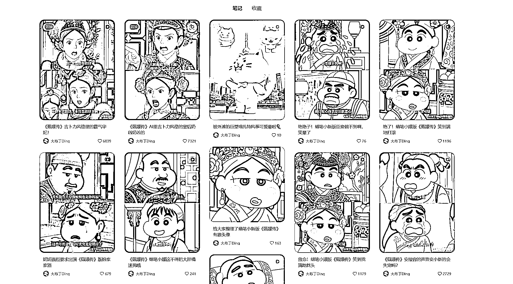

# (精华帖)(77 赞)手把手带你用 AI 搞出 3D 动画版《甄嬛传》

## (精华帖)(77 赞)保姆级教程 利用 AI 制作 3D 动画版甄嬛传文字教程

作者：蛋蛋 2 号
日期：2025-04-28

第一次来赚钱发帖，先做个新人自我介绍。这篇笔记要分享最近在网上刷屏的那个 AI 3D 动画版《甄嬛传》的复刻方法，操作门槛很低，流程我都梳理清楚了，方便想上手的小伙伴直接照做。

具体步骤和素材我都整理到飞书文档里了，直接看这里更清晰。

文中如果有描述偏差的地方，还请各位圈友帮忙指正。

最后祝愿赚钱社区越来越活跃，大家都能把想法变现，赚得开心~

* * *

评论区：

橘子脑袋 : 哈哈哈，很棒

海阔天空 : 可以一试