AI自动做书单号、国学、治愈系视频？从文案到成片，全程不愁！

你可能已经刷到过不少这样的爆款：火柴人讲心理学、国学文化、养生口播、治愈系老爷爷老奶奶、治愈系动态视频、书单号、历史故事、英语系列……这些看起来内容感很强的视频，其实都能靠AI一条龙做出来。写文案、定分镜、剪成片，全程自动，根本不用你手动操心。简单到什么程度？只要你会上网、会按按钮，就能快速批量出片。

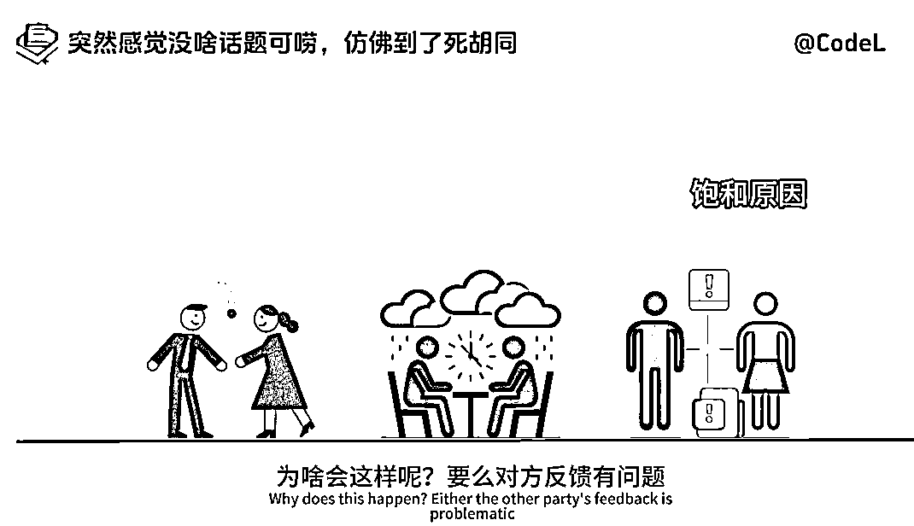

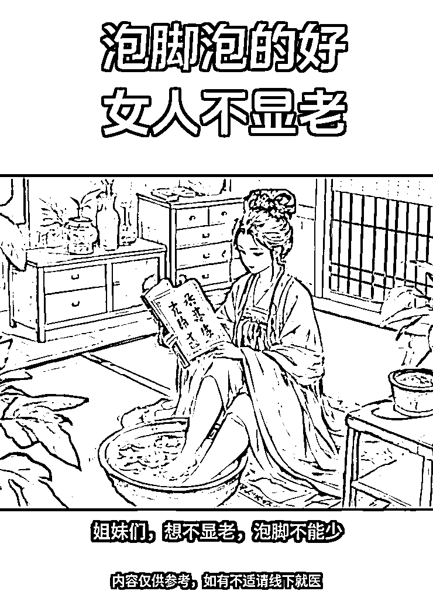
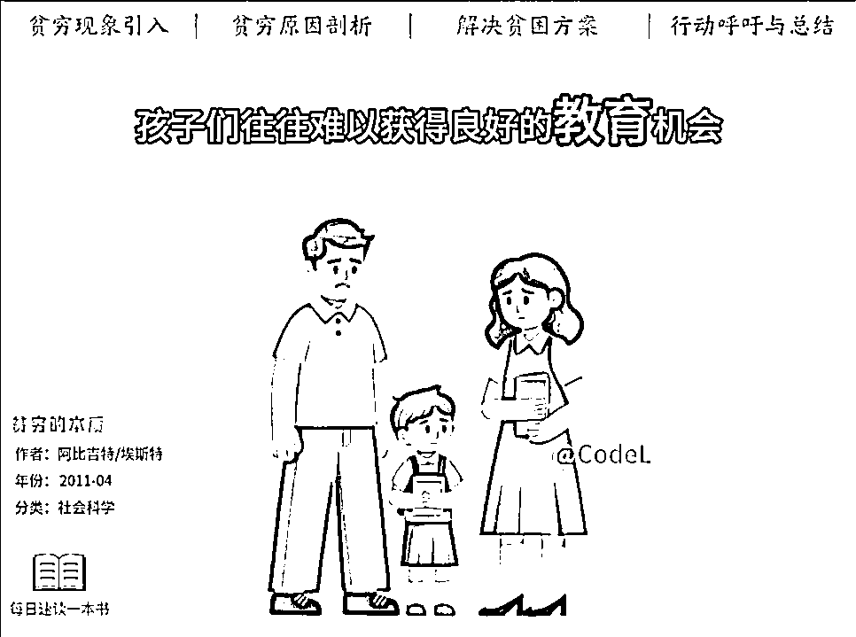
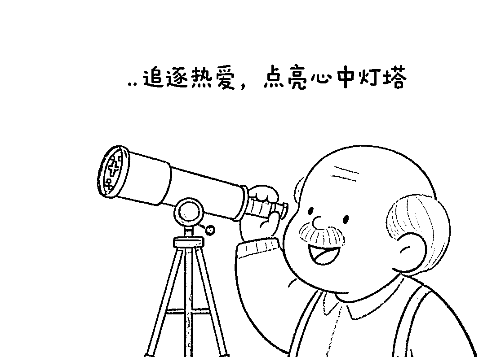

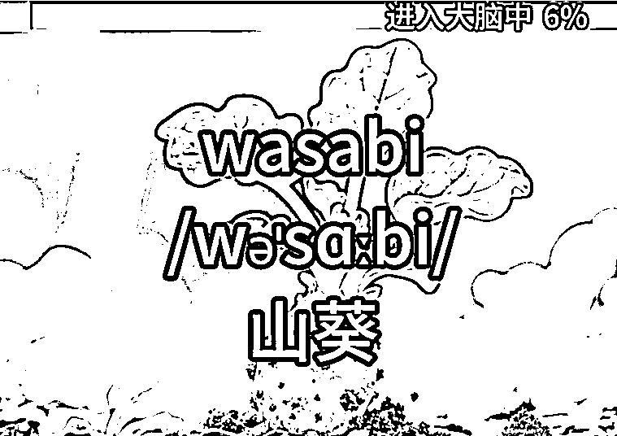

下面我用最热门的书单号来拆解，整套流程就三步。

第一步：让coze智能体先产出草稿。记住，一开始别自己搭智能体，直接搜别人做好的，一搜一大把，先跑起来再说。自己从零搭，费时费力，卡住了还得四处求助，不一定能解决。现成的放在那不用，何必呢？你还想不想赚钱了？

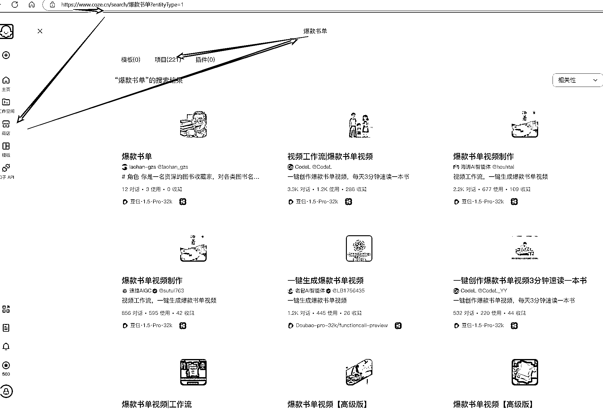

 images.zsxq.com/Fi7OzrgIiiViDJQMgQ4oARWyutiZ)
 images.zsxq.com/Fj2LlUMkJYY1T_AfeOgLRTcXmuV7)
 images.zsxq.com/Friorp7RWiL56OP42sSQ93eqY39A)
 images.zsxq.com/FhV31pm7FK4E4yGhYHHHyBqHRCdZ)

挑一个专门做爆款书单的智能体，能跑就行。

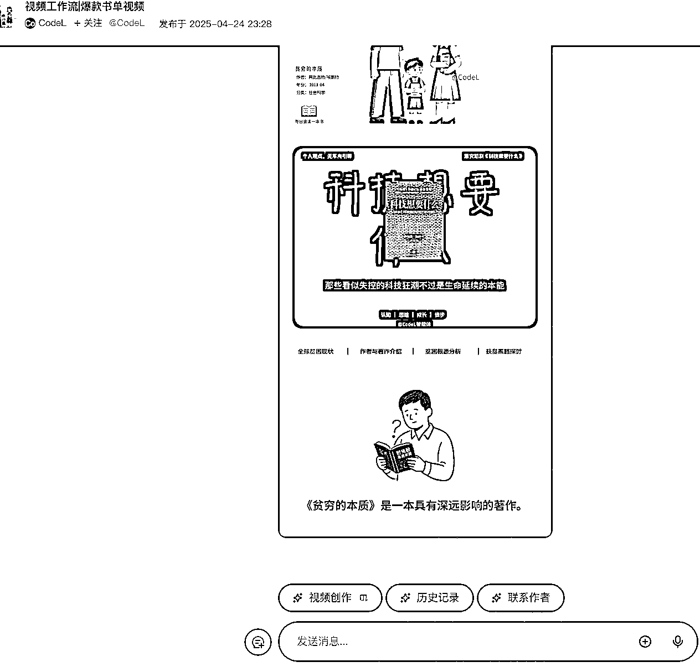

点击“视频创作”，把书名、作者填进去，提交后等它生成就行。每个智能体的画面风格都不同，多测几个，选你自己最喜欢的。

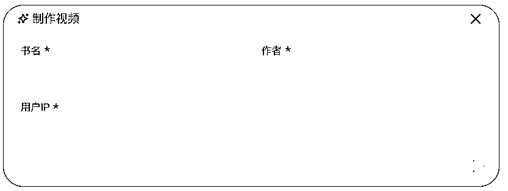

生成结束会给你一个json文件，复制它的链接，等会儿要用。

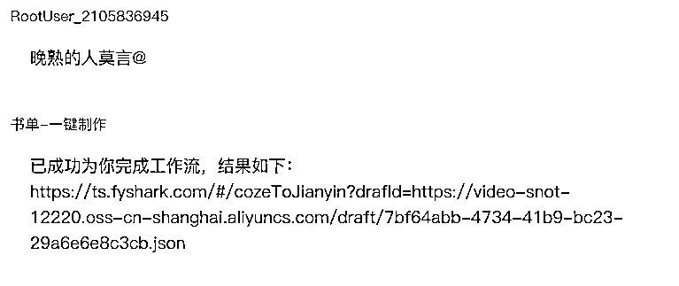

第二步：把json转成剪映草稿。打开速推AIGC（ts.fyshark.com），在页面下方找到“剪映草稿工具”，下载并安装。

 GDaSwKWm6pcF3BwgVpcgi)
 images.zsxq.com/FgefYsJB1ayeodanK0cy5ugRkcj-)

安装完成后，把刚才的json链接导入，设置好你电脑上剪映草稿的存放路径。导入成功后，打开剪映，草稿就已经在里面等着你了。

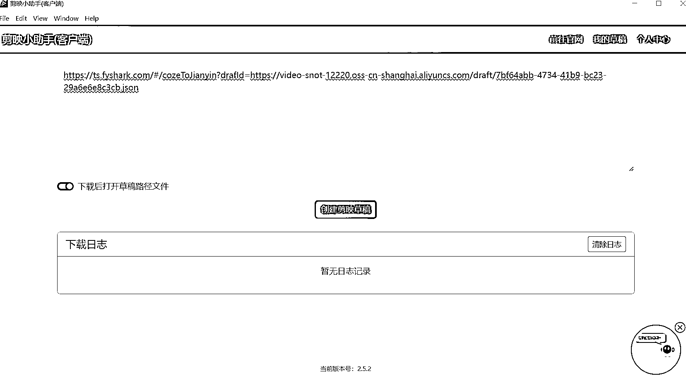

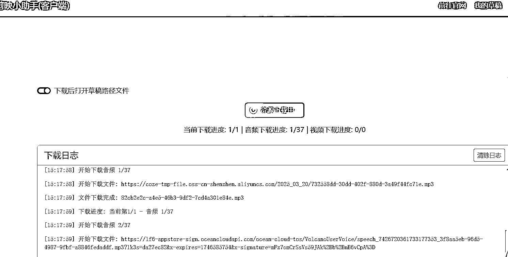

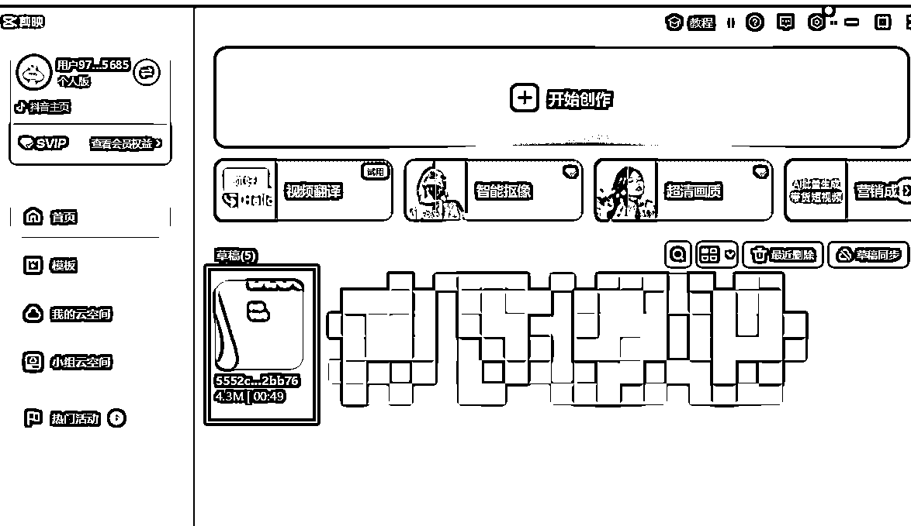

第三步：在剪映里打开这个自动生成的草稿，直接导出，一条原创视频就搞定了。

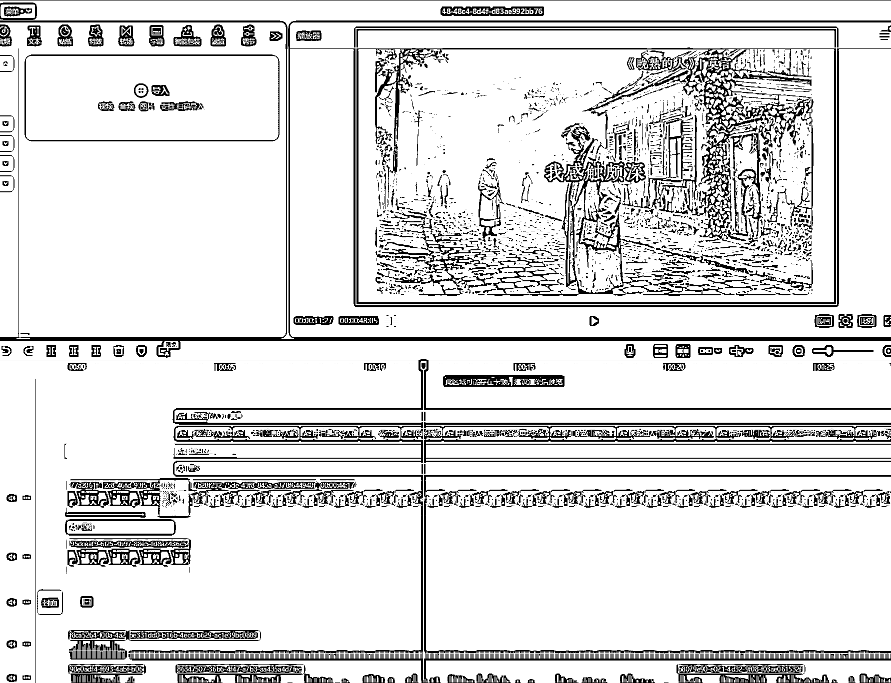

之后是几句碎碎念：

基础设施之类的别来问我，该搜索就去搜索，该登录就登录，智能体不能用就找平替，该付费就付费，不想付费就多搞几个账号薅羊毛。一点点小障碍不应该成为你放弃赚钱的理由。另外，你是有脑子的人，别什么都张嘴问。

关于原创，书单视频尤其不用担心。就算同一天用同一个智能体做同一个书单，每次生成的内容也都不一样，AI比你想象的能折腾。你还可以换模板、换背景图、换背景音。别人做心理学，你可以切进历史、情感、育儿等其他赛道。

开头的治愈系、火柴人、国学这些，都可以套用这套做法。

如果你做的是非IP类账号，矩阵运营就是你放大收益的最优解。

最后，我特别不喜欢那种“保姆级”万字长文，这篇已经2500多字了。要是时间宽裕，我会逐句打磨，不浪费你半秒；今天时间紧，就先这样。