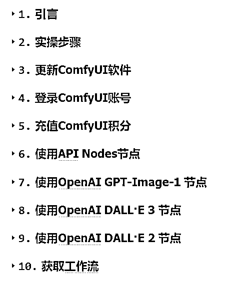

# (精华帖)(88 赞)ComfyUI 工作流使用 OpenAI 三种最新生图模型自动批量出图（保姆级教程+工作流下载）
作者：龙哥

OpenAI又搞事情了！这次发布的GPT-Image-1 API，用的可是和ChatGPT 4o同款的图像模型。而ComfyUI这边也迅速跟进，通过原生API节点（测试版）就能直接调用，再也不用折腾什么复杂的API密钥了。更香的是，没有ChatGPT账号也能玩，🛰️、支付宝充值就能用GPT-Image-1、DALL·E 3和DALL·E 2三个模型批量出图。

你可能会问，为什么要在ComfyUI里做？因为这里能批量自动生成图片，还能把AI视频、AI音频、AI数字人模型全部串联起来，一站式做出完整的AI视频。

今天分享的这篇精华帖（已获得88个赞），来自作者来来，手把手教你如何在自己的ComfyUI工作流中使用OpenAI三种生图模型完成批量出图。下面是详细说明：

评论区已经有不少小伙伴来打卡：有人说“超级详细，连费用都列出来了”，也有人直呼“感谢老师分享”。如果你也在研究AI批量生图，这篇绝对值得收藏。