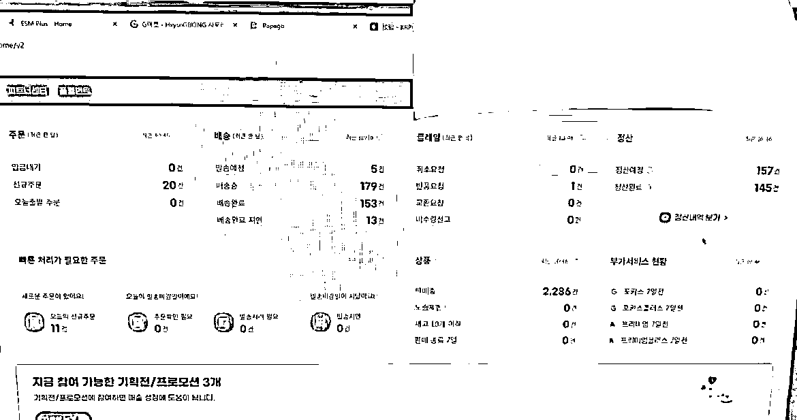

# Gmarket实操复盘：一个3人小团队，2年开出130+店铺，月净利5万美金的秘密

> 有这样一个跨境电商平台，90%的人还没注意到它。

当大量卖家还在亚马逊、速卖通、TEMU 这些红海市场里打得不可开交时，我们三个人默默转战到了韩国市场的 Gmarket。用了两年时间，把店铺数量从 0 做到了 130 多家，单月净利润稳定在 5 万美金以上。

这个平台目前的状态很有意思——红利期正在爆发，但知道的人还不多。没有让人窒息的价格战，也没有流量被头部垄断的困境。今天想把我们从零起步的实操经验整理出来分享给圈友，如果你正在寻找出海新机会，这或许是一条值得认真研究的路。

## 为什么说 Gmarket 对新手极度友好？

和那些血拼低价的平台完全不同，Gmarket 更像跨境电商里的一方净土。韩国的消费者其实非常愿意为设计感强、有品质的商品买单，他们并不是只认便宜货。换句话说，新手不需要靠砸钱打价格战来存活，真正要花心思的是选品。

还有一点很关键——Gmarket 目前正处在快速增长期，平台规则还在持续演进，没有完全定型。这听起来有点“乱”，但懂行的人都知道，这恰恰是机会所在。就好比 2010 年左右的淘宝，规则不完善，但机会遍地都是，谁先入场谁占先机。我们当时就是意识到了这一点，深入研究了韩国市场的小众需求，最终在“家居创意 DIY”这个细分领域做出了突破，3 个月内单店月销售额就突破了万元。

## 从 0 到 130 家店，我们到底做对了什么？

### 一、极低成本起步，把试错开销压到最低

开一家 Gmarket 店铺的门槛非常低，准备企业营业执照、法人身份证明和收款账户就能申请下来。我们初期搭建前两家店，总投入不到 5000 元。

平台佣金在 6%-15% 之间，按品类不同有所区分。考虑到试错成本，我们一开始优先选择了佣金较低的 3C 配件类目。下店周期大概 7 个工作日，而这段时间刚好用来把后续运营的准备事项提前排好。

### 二、选品的核心方法论：冷门 + 差异 + 溢价

在 Gmarket 上选品，最忌讳的是抄爆款。我们形成了一套自己的“冷门掘金”筛选体系：用软件筛选出搜索量年增长超过 200%、而平台在售商品数不超过 100 的小众类目。

举个例子，我们发现有款“桌面绿植加湿器”在韩国年轻人中搜索热度上升非常快，于是通过定制设计，配合场景化的页面呈现，硬是把单品利润率做到了 65%。在供应链方面，我们坚决避开大众知名品牌，合作国内优质白牌工厂，通过微创新做出独家感。

### 三、用平台的“新人扶持期”做免费流量引爆

Gmarket 对新店有明确的流量扶持窗口。我们的操作是：店铺上线前 7 天，集中上架 30 款商品，同时开启限时折扣活动，用最短时间积累基础销量。

还有一个外部流量入口容易被忽略——韩国主流的比价平台 Naver。店铺的流量很大程度上会通过这个比价渠道进来，平台抽走 15% 佣金，其中大概有 5% 是给比价平台的。所以，在上线后的头七天一定要集中精力把产品权重做起来，尽量拉高店铺综合权重。

### 四、让数据说话，运营的每一分钱都要花在刀刃上

我们建了一个自己的选品数据库，每周对商品点击率、转化率、退货率等 20 多项指标进行深度复盘。之前通过数据发现，韩国消费者对详情页中的“实际使用场景图”特别敏感，于是我们把详情页图片从 5 张扩到 12 张，转化率直接提升了 40%。

也正是依靠这种数据驱动的方式，店铺复购率始终稳定在 35% 以上。

## 给准备入局的新手三条实在建议

**第一，警惕伪蓝海。** 某些类目看起来竞争很小，但不排除背后是韩国本土成熟品牌在把控。选品前一定要抽时间查看 TOP50 商品背后的卖家构成，别只看表面数据。

**第二，物流真的会决定口碑。** 我们吃过亏，用过廉价物流导致一度出现 15% 的差评率。后来换成中韩专线，虽然物流成本多了 15%，但客户满意度直接回到 98%。这笔账一定要算清楚，省下来的成本补不回流失的复购。

**第三，远离高风险类目。** 比如母婴、医疗器械这类产品，资质要求和合规门槛很高，新手很容易踩坑。如果一定要涉足，建议先去好好了解韩国的 KC 认证等制度再做决定。

现在的 Gmarket，某种程度上确实像十年前的淘宝——规则宽松、流量红利充沛、平台对新人友好。我们亲身验证过了这条路，只要方法得当，小团队完全有可能在这里撕开一个口子。

如果你已经厌倦了红海平台里无休止的内耗，想抓住跨境电商里为数不多的野蛮生长窗口，Gmarket 是真的值得一试的赛道。

这篇先聊到这里，如果圈友们感兴趣，后面我再出一篇更详细的实操教程，把具体环节一步步拆给大家。

WkfnP1f)