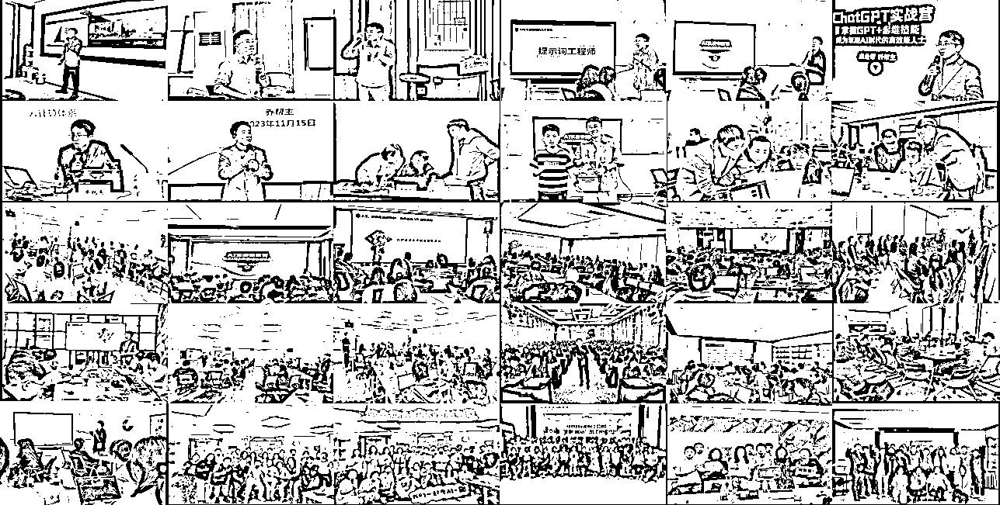

# (精华帖)(73 赞)《普通人如何成为年入百万的 AI 培训师？6 大核心模块+15000 字实战解析！》
作者：龙哥

普通人，如何靠着AI培训这门手艺，把年收入做到七位数？

我认识一位圈内朋友，乔帮主，他亲口跟我说过一段经历：2023年5月，他踩进了AI培训这个赛道。那时候，他幸运地赶上了刀姐和SKY举办的国内首批AIGC培训师线下课，算是这一行最早吃螃蟹的人之一。

两年走下来，他不仅拿到了不俗的结果，还攒下了一整套从0到1的实战打法。今天这篇文章，就是他在这条路上摸爬滚打总结出的干货——我把它整理出来，希望能给正在观望或已经上路的朋友一些启发。

先问一个问题：AI时代，最缺的是什么？

不是算力，不是模型，是会用AI的人。

AI要真正落地，终究要靠人才落地。眼下无论市场还是企业，对AI人才的渴求几乎到了饥渴的程度。尤其今年年初DeepSeek一炮而红，AI培训的需求直接炸了。这既是肉眼可见的商机红利期，更是一个信号——AI时代的高速发展列车，已经呼啸而来。

我们这一代人，可以选择做旁观者，也可以选择做亲历者、推动者。与其看着别人上车，不如自己也买张票。

乔帮主有一句话我特别认同：商业的本质是利他，但作为AI培训师，被赋予了“老师”这个身份，思想觉悟还得再高一层——不能只盯着交易，而是真正践行那句“燃烧自己，照亮他人”，为市场、为社会、为国家、为这个AI时代，培养出更多优秀的AI人才。

那具体怎么干？他用了三个星期时间，写了一篇近15000字的深度拆解。从六个维度把这条赛道讲透了：商业方向、流量获取、营销转化、课程产品、培训交付、售后服务。

——关于商业方向，他拆出了三条路：做教育、做企业、做创业扶持。每条路的天花板和要求都不尽相同，关键看你自己手里的牌。

——关于流量获取，他列了七个打法：身边圈子资源、流量机构合作、流量博主合作、经纪公司合作、销售拓客、IP拓客、投流获客。并且他还专门讲了一句大实话：怎么分辨一个渠道好不好？看它的流量质量和你自己的转化效率，而不是只看表面数据。

——关于营销转化，他强调了“销转产品”设计、销转方式的选择、以及讲师个人介绍的包装逻辑。说白了，客户信你，才会跟你学。

——关于课程产品，他提炼了四个关键词：体系化、专业性、通俗性、实用性。课程不是讲完就完事，而是要让人听得懂、学得会、用得上的。

——关于培训交付，他特别看重四项能力：表达、演讲、互动、应变。这四点全部具备，才算真正能把场子撑起来。

——关于售后服务，他拆解成课前、课中、课后三段。很多人忽略这一块，但实际上，口碑和转介绍，全靠这一步拉满。

再说说这篇文章背后的故事吧。他在第一周做了主题和大纲规划；第二周动笔，初稿写到12000字；第三周，又拉上赚钱圈的@瓜斯和@欢欢帮忙提优化建议，然后硬是多加了3000字，连压箱底的老本都掏了出来。

他说，有些核心内容，本来是不准备公开写的——写出来等于给自己添竞争对手。但后来他想通了：格局大一点吧，极致的利他，才会给商业带来更多可能性。

这个想法，我举双手赞成。

另外提一句：这篇帖子内容丰富，图文附件不少，强烈建议大家用电脑浏览器阅读，体验会舒服很多，也更适合边看边做笔记。

别人花三周熬出来的实战心血，已经不是“干货”两个字能概括的，更像是一张地图。评论区里有人说，这篇帖子让新人少走了弯路；有人说他是逐字逐句读完的。要我说，这就是稀缺内容的真实质感。

AI培训这条路，确实还早得很。现在上车，一点都不晚。