# 搜索型图文账号复盘：细节，决定内容能不能长期被看见
作者：龙哥

## 从一条长期占位的内容，看懂搜索型图文怎么做

作者：波波@抖查查@爱盈利  
日期：2025-04-20

今天复盘一个值得研究的图文账号。

案例是一条在搜索结果中持续获得曝光的内容：它发布于2024年3月，到2025年4月依旧出现在“搜索流量”相关结果的前列，排名稳定在第二位。

一条内容能持续一年多被用户搜到，背后并不是偶然，而是内容形式、信息质量、关键词布局和运营细节共同作用的结果。

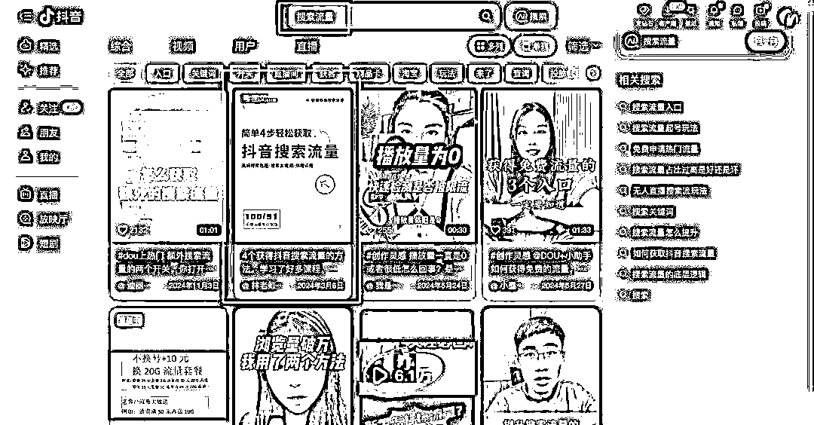

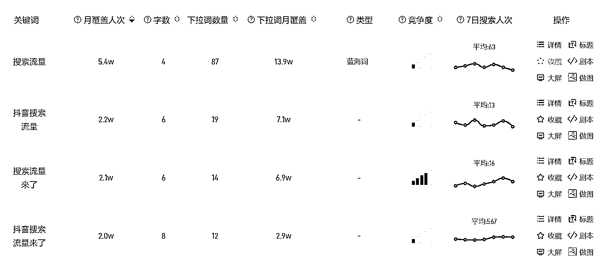

数据参考：[www.aidso.com](http://www.aidso.com)

## 先看封面：它承担的不只是“好看”

这张封面把标题、品牌标识、系列编号、插画元素和整体色调都安排得很完整，观感上更像一本书的封皮，而不是普通信息卡片。

不少用户在留言区提到账号的细节处理，这说明视觉包装不仅影响点击，也会影响用户对账号专业度的判断。

补充一个容易被忽略的因素：近期留言和互动，可能会对内容在相关检索结果中的表现产生帮助。

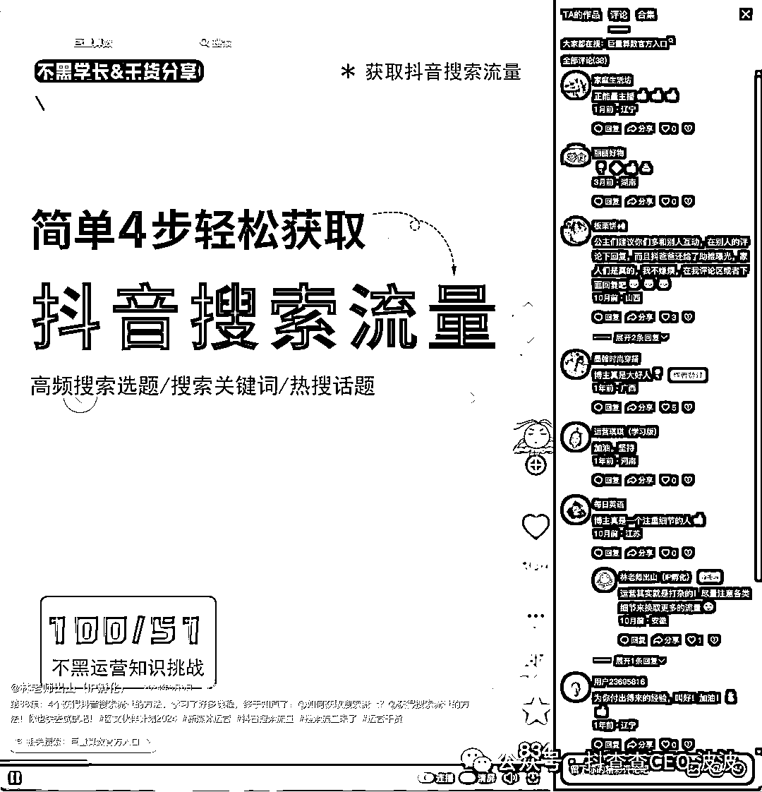

## 描述区：让用户和平台都能读懂

作品文案大意如下：

第38集：分享4种获取抖音搜索流量的方法。看了不少课程之后，终于把思路理清了。  
①怎样获得搜索流量？  
②哪些方法更容易拿到搜索流量？  
建议你亲自测试。  
#图文伙伴计划2024 #新媒体运营 #抖音搜索流量 #搜索流量来了 #运营干货

这里的处理方式值得借鉴：目标短语在标题、正文和话题中都有出现，便于平台识别内容主题，也有利于覆盖同一需求下的不同检索表达。

但关键词不能像标签一样机械堆满页面。真正有效的写法，是在不影响阅读体验的前提下，让表达自然包含用户会搜索的词。

## 正文页面逐页看

整组内容由大图和文字说明组成，结构清晰，信息密度也比较高。

### 首页：标题负责吸引，主题负责筛选

页面标题为：

《4步快速获得抖音搜索流量》

这个标题包含了几个有效元素：

- 数字结构让用户更容易预估阅读成本；
- “快速”满足希望尽快看到结果的人群；
- “抖音搜索流量”明确告诉平台和用户，这篇内容解决什么问题；
- 图文共同呈现，降低理解门槛，也方便读者快速浏览。

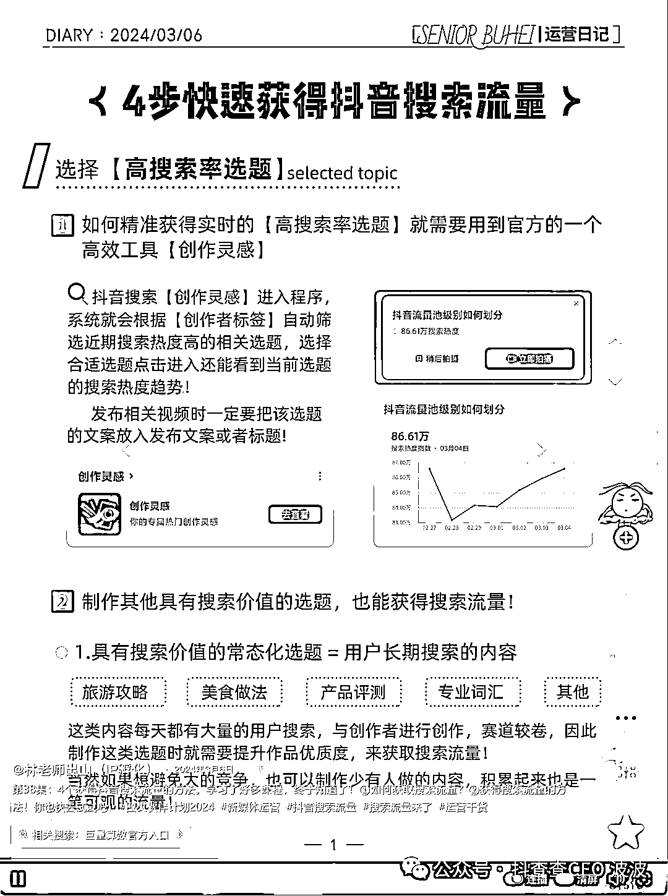

### 第二页：先建立数据意识

这一页开始引入检索规模的概念，让读者意识到，做内容之前，不能只凭感觉选主题，还需要观察需求大小和竞争程度。

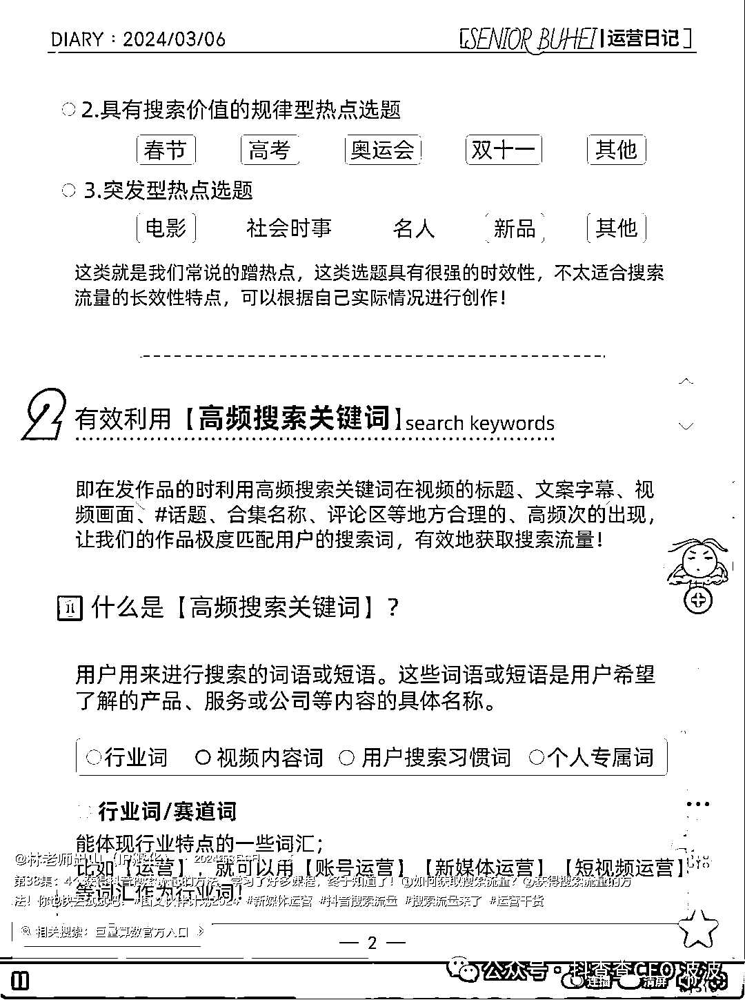

### 第三页：借助官方数据工具判断方向

页面重点介绍了“巨量算数”。

对于平台型内容来说，理解并使用官方工具，本质上是在顺着平台的规则寻找机会。页面底部还出现了“巨量算数官方入口”等关联引导，这种细节能够增强主题关联度。

一条旧内容之所以还能保持较高位置，往往不是单一因素带来的，而是主题匹配、内容结构和相关入口共同积累的结果。

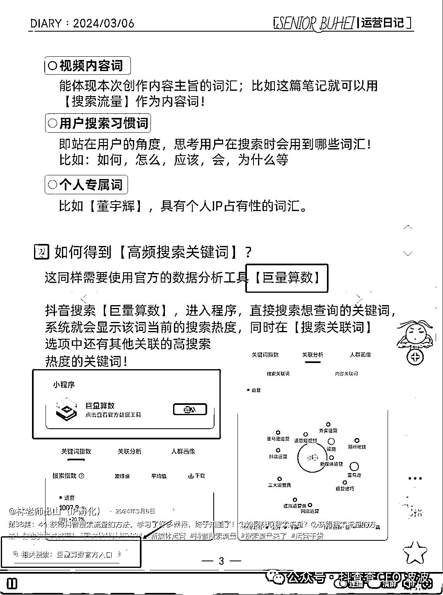

### 收尾页面：封面与合集仍有提升空间

后面的内容继续讲到封面和合集，这两部分确实是图文账号不可忽略的组成。

不过，案例中的两个封面并不算理想。第一个样例使用了较重的字体特效，可能影响系统识别；颜色层次也不够清爽，用户阅读时需要额外辨认。

如果能再加入搜索排序机制、影响排名的指标以及平台考核思路，整组内容会更适合已经有基础、希望进一步理解搜索机制的人群。

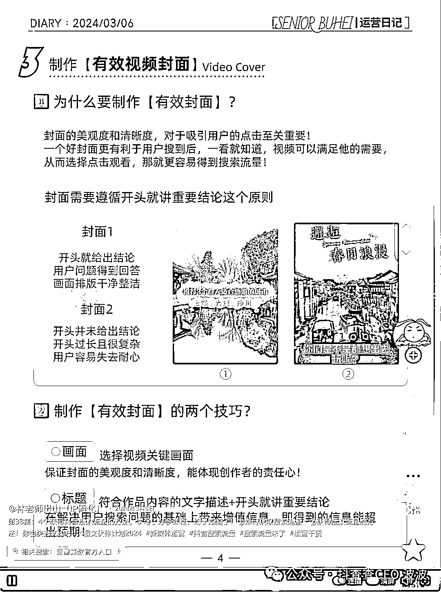

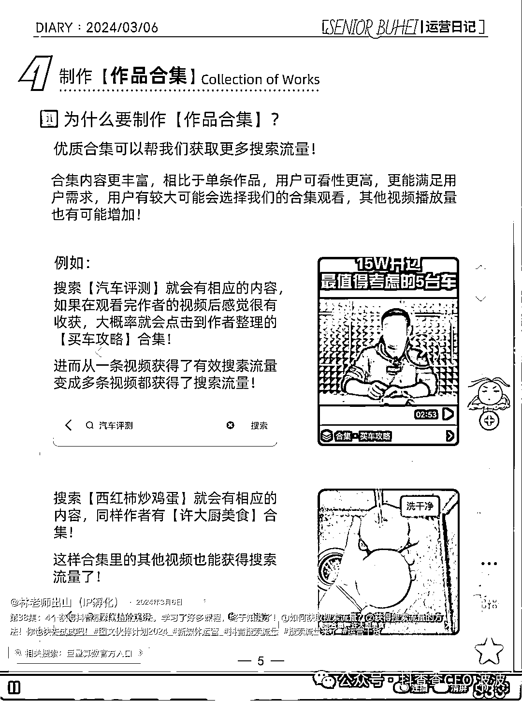

## 再看账号本身：内容只是入口

这个账号目前大约有7万粉丝，累计获赞33万左右，共发布93条内容，其中不少作品的互动量超过千次，部分甚至达到万级，整体流量基础不错。

商业化路径也比较丰富，包括：

- 课程与训练营；
- 账号代运营；
- IP项目操盘；
- 工具和软件销售；
- 商业合作与广告植入。

账号的具体作品和数据，可结合下方素材继续观察。

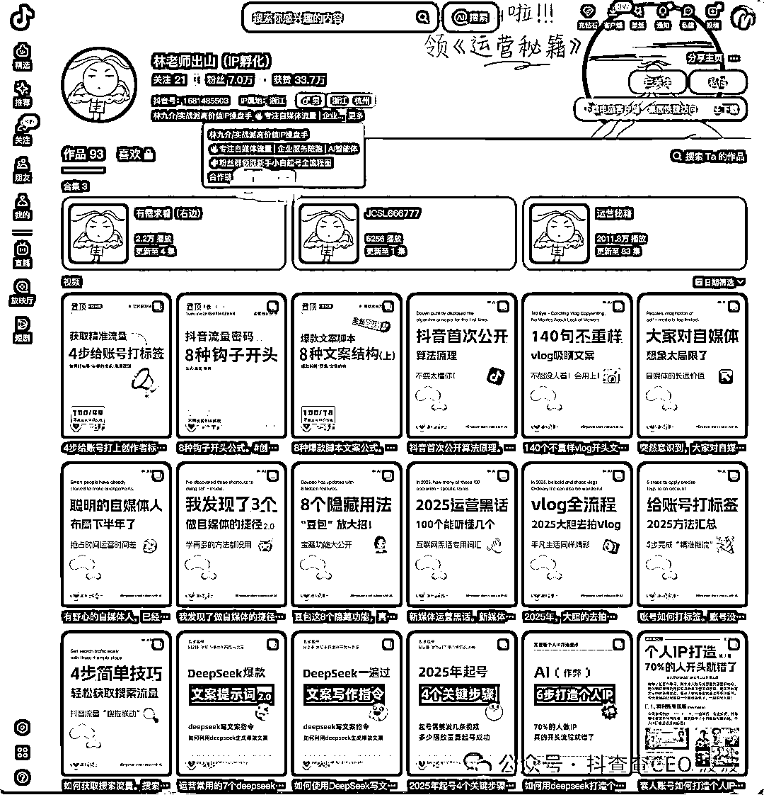

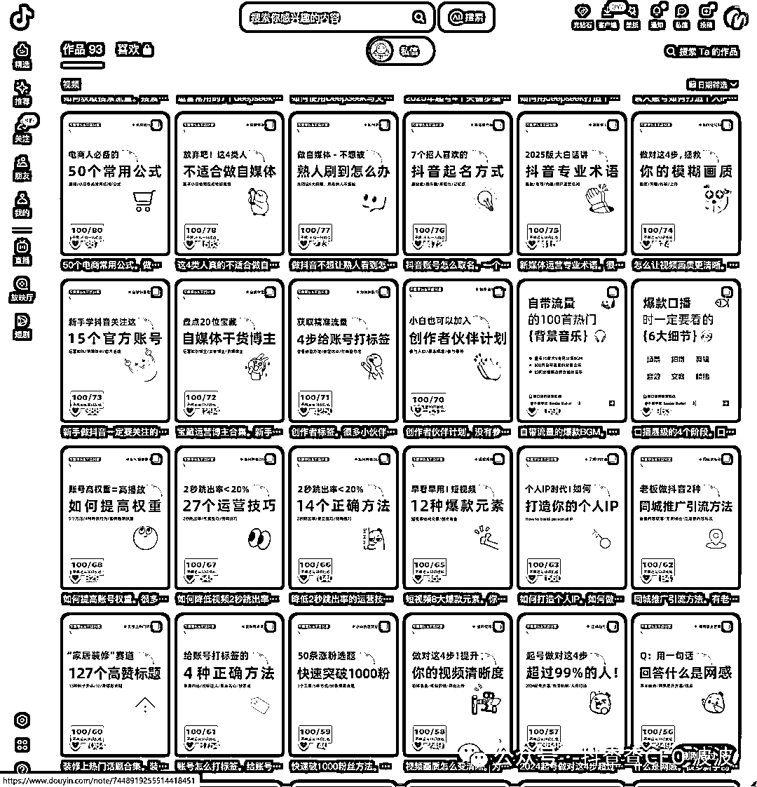

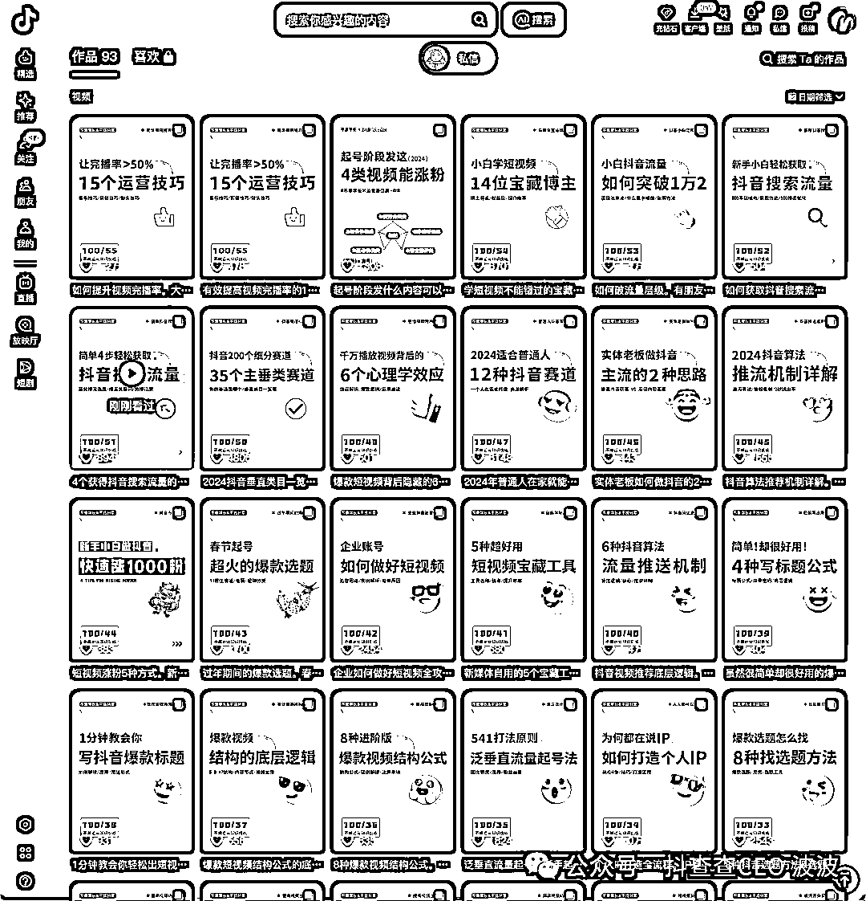

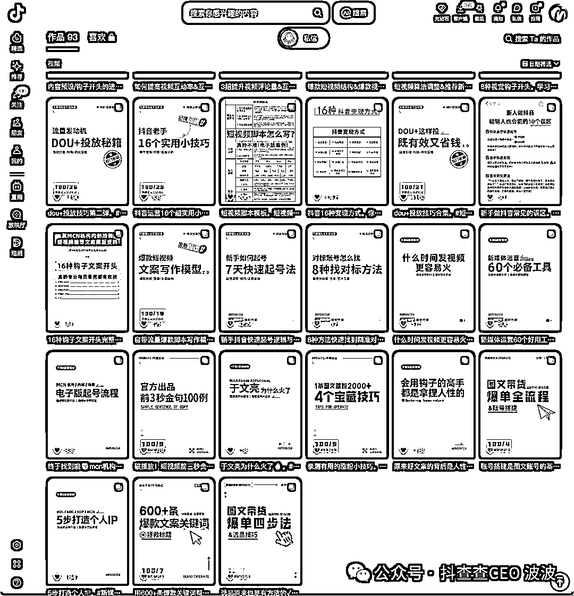

近期上线的新版本工具：[www.aidso.com](http://www.aidso.com)，上线后短时间内新增了数百位用户，目前仍在持续增长。

## 为什么搜索承接更适合图文

在搜索场景里，用户通常带着明确问题而来，希望迅速找到答案。

种草阶段可以借助口播内容建立兴趣，但进入检索和比较环节后，图文往往更容易完成信息承接。

这并不是说口播没有价值。

对于一些范围较宽、需求尚未明确的词，口播可以通过讲解、对比和案例帮助用户形成判断，甚至影响其最终选择。

但当用户搜索的是购买意图较强、目标较明确的词时，图文的优势会更加明显：信息集中、浏览速度快，用户可以直接跳到自己关心的部分。

例如“酒店住宿”这一类需求，日均检索量可能达到1000次左右。

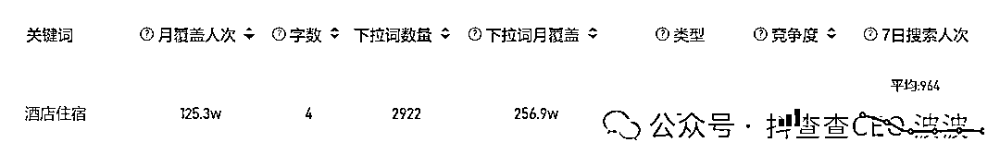

数据参考：[www.aidso.com](http://www.aidso.com)

设想一下：

用户是愿意看一张人脸连续讲几分钟，最后还没找到价格、位置和适用条件，还是更愿意打开一组信息清楚的图片，用几秒钟完成筛选？

只有真正把自己放进搜索用户的路径里，才能理解图文在这个环节的效率。

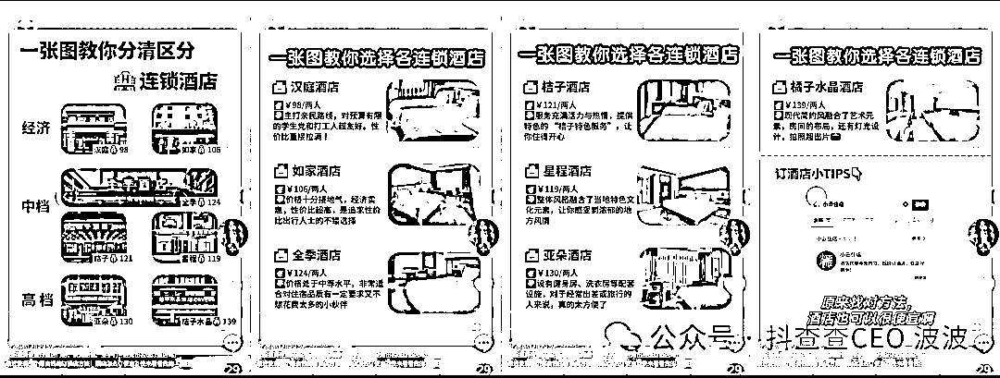

好的主题选择，加上清晰的图文表达，再叠加稳定的关键词布局，往往能形成很强的组合效果。

这类内容也适合用作相关检索需求的投放素材。

## 工具现阶段能做什么，不能做什么

先把预期说清楚：工具目前还不是“生成后直接发布”的终极方案。

现阶段输出的内容仍需要人工检查和修改。部分参数为了保证上线速度暂时采用固定配置，例如文字长度、排版结构等，后续会根据使用反馈逐步开放。

这符合MVP产品的常见路径：

先做出一个能解决部分问题的版本，再交给真实用户使用；通过反馈发现缺口，再持续修正。参与得越早，越有机会把自己的实际需求带进后续版本。

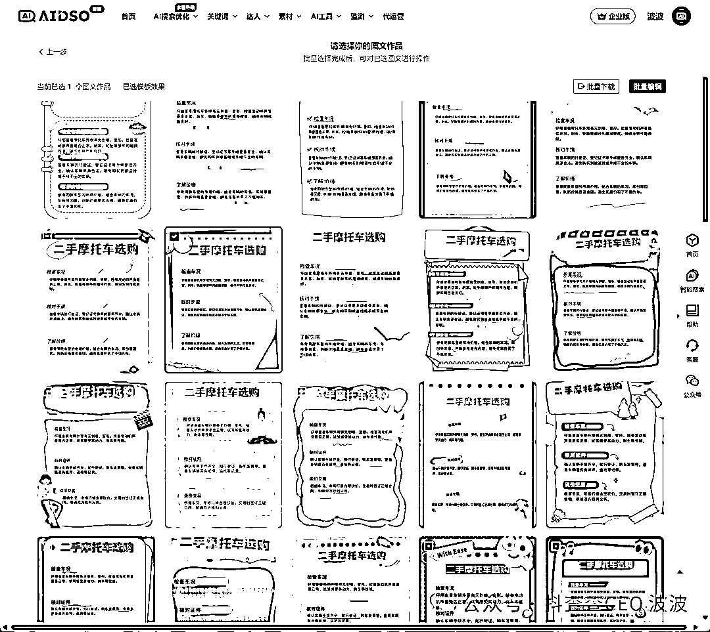

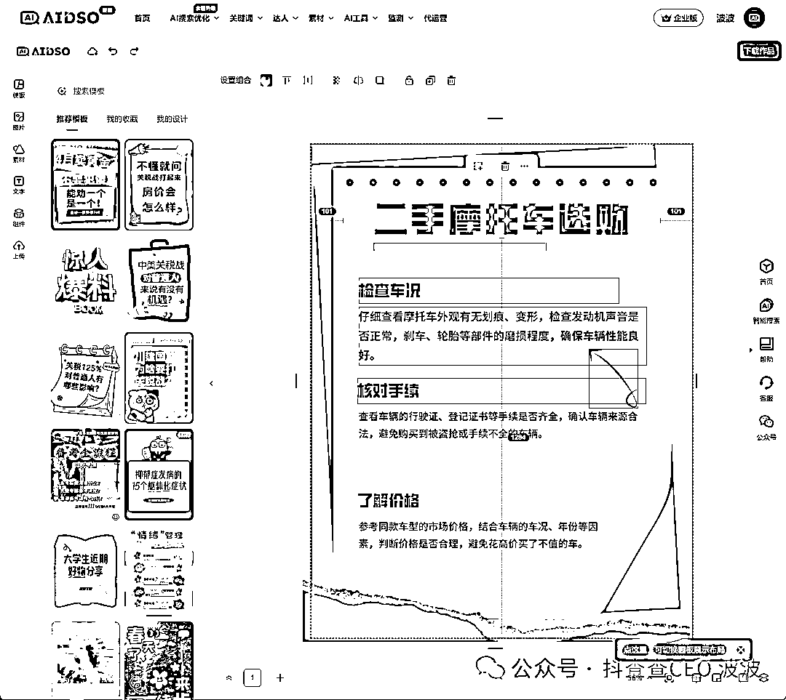

目前，段落长度受到限制，主要是为了避免自动排版时出现大面积错位。随着版本优化，这些限制会逐渐减少，更多修改建议也会进入后续开发安排。

高亮、划线、装饰性插图等元素，目前主要是以图层形式放入画面，仍需人工检查和调整，暂时无法像成熟剪辑软件那样自动识别内容并完成适配。

选定合适的版式后，再进行人工微调，当前依旧属于“模板辅助+人工修订”的工作模式。

团队也测试过完全依赖大模型自动生成的方案，但在批量实战中，成本、速度和稳定性都还不够理想，很难持续产出真正能用的成品。

即便如此，现有流程已经能够把单人每天制作5张左右优质图文，提升到约30—50张，效率大致提高6—10倍。

后续还会考虑加入智能筛选图片和文字的能力，把人工挑选环节进一步压缩，让系统承担更多初步判断工作。

## 什么人更需要这类提效工具

如果你目前还没有做到每天发布300条以上图文，可能很难立刻感受到批量生产的重要性。

但当账号规模扩大、发布量上升后，真正的瓶颈通常不是“有没有账号”，而是“有没有足够多的合格内容”。

当大量账号等待发布，人工却无法稳定供稿时，工具的价值就会从“省一点时间”变成“决定产能上限”。

当然，批量分发还伴随着授权、登录、风控和账号稳定性等问题。无法承受这些运营成本，就不适合贸然进入这种高竞争模式。

投放方面，也不能只想着零成本获取全部结果。平台需要商业回报，预算、投放力度和账号表现之间存在联系。与同赛道相比，投入更有竞争力，通常也更容易获得平台的持续分发机会。

## 品牌调整：DSO114更名为AIDSO

品牌已经从DSO114升级为AIDSO。

工具的价值，是帮助用户减少重复劳动、提高执行效率，而不是承诺点击一次就自动产生收益。

在词库和主题筛选方面，面对规模庞大的检索词集合，平台可以帮助用户提升整理和判断效率；在图文制作方面，也会继续围绕批量产出和质量控制进行优化。

有人会问：现在生成式AI发展这么快，为什么还要保留模板路线？

原因很现实。即使GPT-4o这类模型表现强劲，放到大批量图文生产中，成本、响应速度、排版稳定性和最终可用率仍然存在差距。

等到头部团队把算法效果与生产成本同时解决，模板方案才可能真正退出主流。现阶段更稳妥的方式，是先采用模板辅助，再等待模型能力达到实战标准。

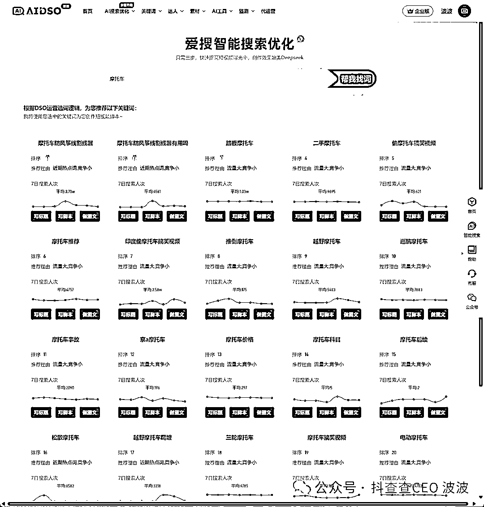

## 选词方式：新手和熟手不必用同一套方法

对于还没有建立搜索优化体系的人，可以先借助系统推荐来获得一批可测试的主题，不必一开始就把所有判断逻辑研究透，先用数据验证方向。

已经掌握主题筛选规则、接受过相关训练的人，则可以根据经验、竞争强度和用户意图自行判断，通常会获得更精细的结果。

两种方式没有绝对高下，关键在于账号数量、团队能力和目标。

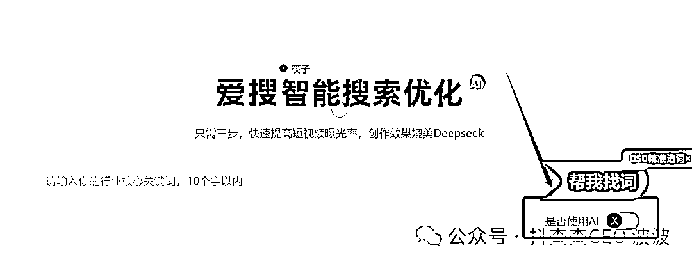

系统里提供了不同的选择入口。

如果你追求精细运营，可以自己完成主题筛选；如果账号数量较大，则可以交给系统完成初步筛选，哪怕单个主题只有六七十分，只要总体数量足够，也可能形成规模优势。

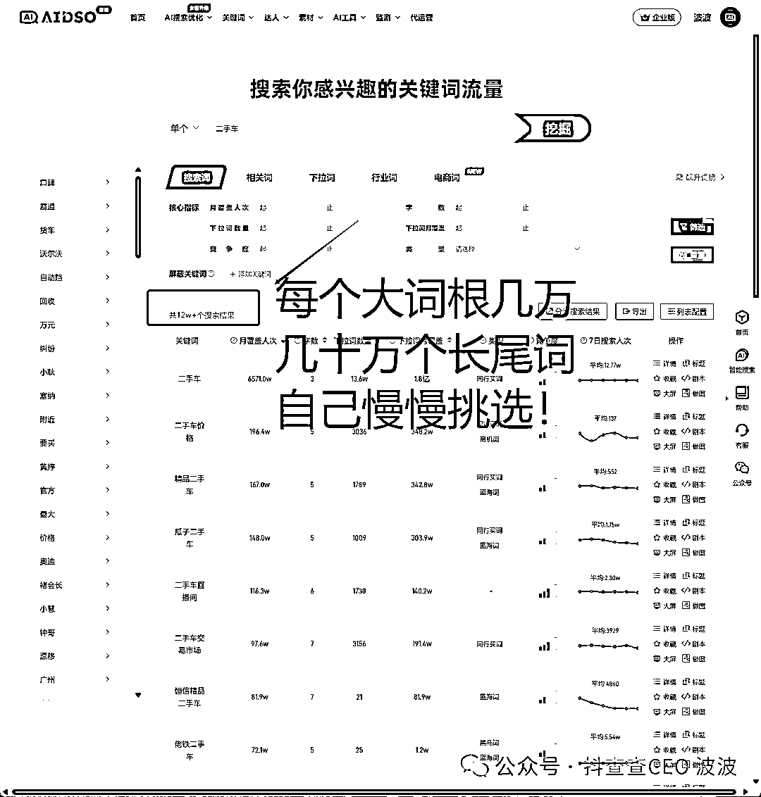

## 今年值得留意的三个方向

### 1. 知识服务

知识服务目前仍是变现效率较高的领域。

AI正在改变教育、产品、工作流程和企业经营方式，围绕新技术应用、效率提升、行业转型形成了大量学习需求。

早期市场难免出现内容混杂、质量参差的情况，但随着行业逐渐规范，未来会出现更多有口碑的品牌和平台。

对于愿意主动拥抱AI、能够快速学习并整合案例的创业者，这仍然是值得关注的方向。

### 2. AI产品

AI产品在早期阶段往往需要较长时间验证商业模式，因此与知识服务结合，会更容易建立收入闭环。

只要目标人群明确，产品能够解决实际问题，同时具备稳定的触达能力，就有机会快速验证结果。

如果希望把项目做得更大，还需要进入需求更强、竞争壁垒更清晰的细分领域，并补足团队能力。

### 3. 早期项目探索与孵化

从早期项目切入，通常启动速度较快，投入相对可控，也方便小步试错。

对于具备流量、产品或运营能力的人来说，这是一种值得考虑的进入方式。

全文到这里。

评论区：

波波@抖查查@爱盈利：抖音搜索获客航海活动，感兴趣的朋友可以留意。  
波波@抖查查@爱盈利：工具也会配合活动提供体验名额。

追风少年O2：期待。3月初在杭州听过波波老师关于搜索优化的分享，内容很真诚。

刀子嘴AK心：新人很多地方还没看懂。是不是先找需求比较大的词，再借助工具批量制作内容？

波波@抖查查@爱盈利：方向基本如此，但词越大竞争未必越适合，要结合账号能力选择。

抖音电商-时光：这次复盘把封面、标题、字幕、话题、长尾表达、指数工具和关联内容等零散知识串在了一起，收获很大。

淼淼：刚来就看到需要的信息，谢谢分享。