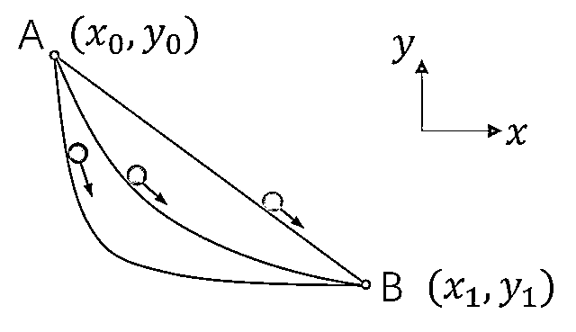
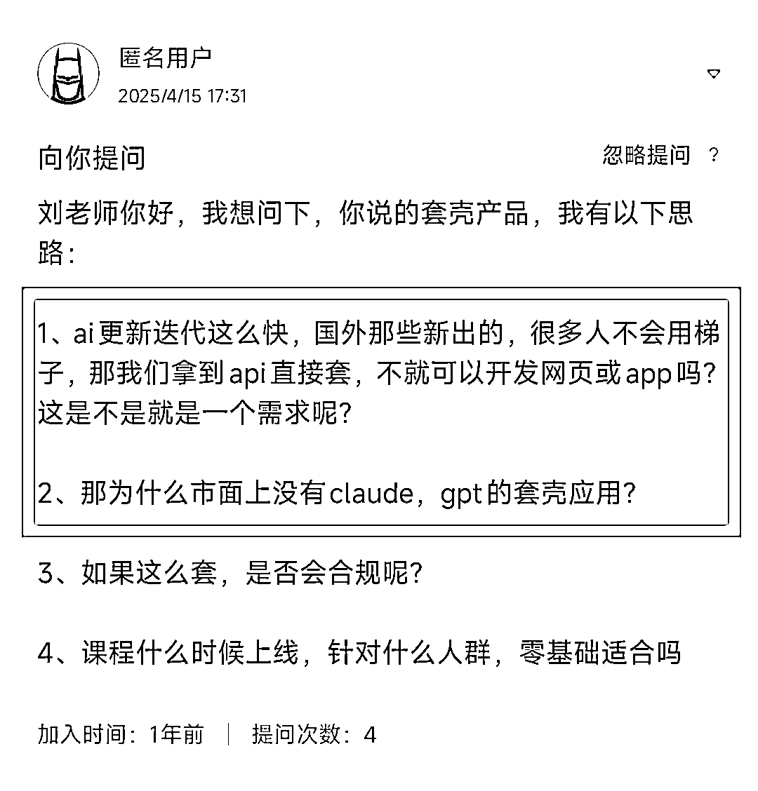

# 生财新人的头七天，最该做的一件事

> 原文：https://www.yuque.com/for_lazy/zhoubao/az4u2r7ko39i5o7b

作者：刘小排 · 2025-04-21

每年 418 一过，就会有一批新朋友反复追问：拿到门票才几天，满屏都是信息，究竟该从哪儿下手？

这个问题这几年来一年比一年更尖锐。社群走到第九年，人多了，内容也翻了不知多少倍。

先别急着找答案，听我讲个三百多年前的数学轶事。

1696 年，一位客居荷兰的瑞士裔学者，在欧洲一本重量级数学刊物上公开叫阵，请全欧洲的同行解一道难题：让一个小球从高处出发，仅凭重力沿轨道滑到下方，走什么路径最省时？

那时大家都隐约知道，最快的路线绝不是两点的直线连线，而是一条曲线。可没有一个人能给出曲线的确切方程。

大约一年后，这位学者总共收到五份正解。前四份来自欧洲大陆几位大名鼎鼎的数学家，第五份却连名字都没留下。

他在给兄长雅各布的信中谈及这位匿名人，写了一句妙喻：「光看足印，我就知道那是兽中之王。」

这句话的潜台词是：他看穿了匿名者是牛顿。从英国亨利一世起，王家纹章上就绣着雄狮，提到狮子便是指英国；而当时英国最拿得出手的数学大脑，正是牛顿。

事实也如他所料。牛顿傍晚拿到题目，一夜之间写出答案，再以匿名信的方式朝欧洲学界亮了一手。他不知道，另外四位解题者各自花了十来天到几个月。

这位学者不需要看落款，只看一眼解法的推导方式，就锁定了作者。怎么就能这么准？我想，无非两个条件。

一是，他对欧洲数学家们的解题习惯如数家珍。数学家本就是一个紧密的圈子，常在同一批期刊上过招，风格瞒不了内行。二是，牛顿的思路自带辨识度。他偏好几何构图，几乎不用纯代数那一套，与欧陆同侪的路数泾渭分明。

这两个条件，放到今天再看，其实说的就是我们。

1696 年的期刊圈，如今被叫作生财；牛顿解法里那种独一无二的思路印迹，如今叫「离群信号」。

如果用对方法，我们也能在深夜的书桌前拍案：「这个信号，一看就是我的。」

那具体动作呢？先全量通读。

## 一、全量通读的理由

有人劝新人：挑自己感兴趣的一两个垂直赛道深耕就好。我旗帜鲜明地反对这种「哪儿痛揉哪儿」的省力路线。理由有三。

**第一，看得够多，才谈得上敏锐。**

你加入这个圈子，本就是要跳出单一的上班视角，摆脱被投喂的信息牢笼。如果第一步还是回到最熟悉的角落，那和之前有什么区别？

政治学里有句话：只懂一个国家的人，其实哪个国家都不懂。

小时候看警匪片，墙上的标语写着「坦白从宽，抗拒从严」，我们觉得天经地义。后来看了另一种风格的剧集，才知道警察会先念一段权利告知：「你有权保持沉默，你所说的每一句话都可能成为呈堂证供。」原来在很多地方，沉默权是常识。

类似地，出租车师傅最爱聊世界大势，可他可能从没出过国。这种信口开河的正确率，能有多高？

真正的判断力首先来自见多识广。你读过的、接触过的领域足够多，才会把自己手上的方法摆进千万种可能里去比较，才会对另外九千九百九十九种可能性产生好奇。

总有人因为一辈子没离开过村子，就坚定地认为村里最好看的姑娘是世界第一美女。同理，从不了解其他行业的人，也会把自己的赛道误认为全宇宙唯一的路。

**第二，不做功课，就没有对话的资格。**

一位做潮玩品牌的创始人讲过一段亲身经历。当时一家很有名的基金经中间人牵线找过来，他先把丑话说在前头：第一，必须是能拍板的负责人亲自来，普通员工来了是浪费时间；第二，对方得看过公司财报、做过功课，才可以聊。中间人拍胸脯保证没问题，对方很有诚意，最快两周就能打款。结果见面之后，对方开口第一个问题就是：「你们的主打产品是啥？」

他当场礼貌送客：「不好意思，今天确实安排满了，等您做好功课再来。」

整场对话不到五分钟。那位创始人后来解释：无论多大牌，不做功课的会谈，浪费的是双方的时间。

这让我想起此前有位圈友在社群里提问。他的问题涉及我写的一篇讲 GPT 再包装应用的文章。那篇文章一开头就举了 Monica.im 当例子。可这位圈友似乎没有读完正文，也没有打开产品看一眼，就直接断言这类产品在市场上不存在。面对如此没做功课的提问，我真的不太想接话。

希望那位圈友如果能看到这篇文章，能明白：功课做在提问之前，交流才有质量。

**第三，跨界的灵感，都在生疏领域里等待。**

常被问到：为什么你总能写出一些视角不一样的文章？像现在这一篇，明明在聊社群入门的建议，却连数学史、心理学和法律常识都串了进来。

说穿了很简单：我不排斥冷门领域，甚至会主动找陌生领域的内容来读。知道的东西足够杂，它们就会在脑子里互相连接。所谓创新，无非是把旧素材拿来重新拼装。手里存的素材越多，能拼出的新花样自然越多。

以上三点，是我坚持「全量通读」的全部理由。

## 二、怎样执行全量通读

四年前刚入圈时，信息量还没这么大，我只用几天就把当时的优质内容扫了一遍。现在内容量早已不同往日，想完整扫一遍几乎不可能。但目标不是追求那个结果，而是培养全量阅读的意识。有了意识，下面两条路径都能走。

**第一条，来自一位资深老圈友的分享：**

1. 打开官方微信订阅号，把历史文章按顺序全部过一遍（目前大约有一千篇），不必篇篇都要懂，先让它们在你脑子里留个影子。
2. 打开官网，用上一步里让你有感觉的词去搜索，很多素材都能直接找到。
3. 再把官网上的实战指南刷一遍，里面的内容几乎都是外面卖几千块一节的课。

**第二条，是我自己的惯用打法：**

1. 同样先啃实战指南。
2. 接着通读年度好帖合集（[生财年度好帖合集](https://shengcaiyoushu01.feishu.cn/docx/BpMVdgU4aowBznx2YtncFBCEnIh?from=from_copylink)）。
3. 抽空报名参加你所在城市的线下交流。

两条路线可以单走，也可以合并，一周时间完全够用。

它们有一个被你忽略的共同点：都是在借力官方筛选。微信历史文章、年度合集、实战指南，都是经过官方一轮轮层层筛选后的产出。

我比老圈友多加了「线下」这一项，是因为自己的体会很深：看完一本书，往往不如和作者面对面聊两小时；对着文档干读，也不如和同行者当面交锋一次。

## 三、然后呢

读完之后，就是行动。

你可以花三周做启动准备，等五月中旬的实战营开营，直接下水。

这是一个行动派扎堆的地方，很多人的故事都是从「先干起来」开始的。

愿你在生财，早日遇见下一个版本的自己。

---

评论区里，有圈友说准备先收藏再细读；有人说这篇值得反复看；还有人分享了更狠的做法：两个周末把实战视频一帧一帧看完，笔记写到像一本菜谱。这位朋友原本是年入过亿的销售主管，却想换种活法，给自己打工。愿他这粒种子早日开出花来。