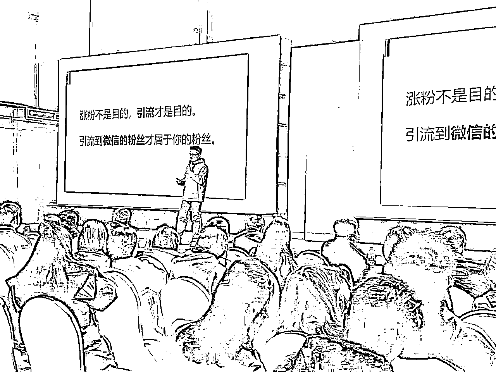

# 70%的打粉团队消失了：我做小红书引流三年，踩过的坑和活下来的路

大家好，我是星城。之前在龙哥盟做过三次小红书航海教练，也写过几篇被加精的复盘。很久没有系统输出了，一晃时间真的快。这两年里我既被很多圈友带飞，也带了一批人从零开始在小红书起量，可以说互相成就。

从2022年入局小红书开始，我的团队经历了大起大落。最多的时候超过20人，最少的时候只剩四五个人。教育、绘本、同城交友、亲子研学、创业粉等赛道都操盘过，核心打法都是矩阵引流，以自然流为主。裁员和扩招反复上演，赚过钱，也被同行抄作业；也曾因太自信走歪路，吃了不小的亏。

这篇就是一次阶段性复盘。秉持越分享越走运的原则，我每次输出后总能链接到意想不到的资源，所以就把这些账算清楚。

(23年行情好的时候经常被邀请去分享，后来混圈减少再出去，发现一批新面孔，很多人都不认识了)

# 一、先说清楚“打粉”是什么，以及它现在有多难

“打粉”本质上就是我们说的引流业务，核心逻辑是给甲方提供流量合作。

* 结算一般是CPA或CPS，按效果付费。
* 每个粉丝都有明确的商业价值，特别适合可复制可放量的项目。2023年这个词最火，大家都在涌进来试水。

先给结论：只靠打粉吃饭的团队，2024年七成以上都消失了。消失的意思就是团队解散，或者不再单独做单粉，转去做自营了。2024年单纯靠打粉活下去真的很吃力。以前平台规则松的时候还能做，现在不能指望打粉一家吃饱。

为什么呢？因为打粉这个模型本身就不稳定。没有自营后端托底，业务波动极大。有人会问，自己建个自营盘不就行了？如果是团队从一开始就有相关基因，那还好；如果后期硬加，弯路会很多。

# 二、打粉模型的三大不稳定，以及应对办法

行业里有个共识，一个打粉员工扣除成本，能给公司带来2万左右利润，这算不错的产值了。10个人理论上就是8-10万利润。

但现实中三个不稳定会把账算乱：

a、免费流量的波动。免费流有高有低是常态，今天有明天可能就没了。

b、放量带来的转化波动。
* 精准度会变。量上去后模板要迭代，流量质量就变了。
* 销售承接不过来。10个人聊和50个人聊，话术和转化率完全不是一个量级。
* 成交场景被迫改变。原本的一对一私聊，可能要改成群聊或直播课成交，整个模型变了。

c、人员流动大。打粉对基层技能要求不高，是典型的劳动密集型，项目一波动就走人。

于是会出现这种场景：一个员工能赚1万利润，招10个能赚10万。你信心满满招20个冲20万时，上面三个问题就会集中爆发。

怎么对冲？

2.1、免费流不稳时，用投流补位。我们会用“聚光”去投。但免费流才是我们最擅长的，投流效果不可控，甚至会亏。如果是不亏不赚，我们愿意扛一段时间，因为换项目和换人成本都高。只有持续亏损才会及时止损换方向。

2.2、备好多个项目。行业有淡旺季，皮草是冬季，高考志愿是高考后。平台内容偏好也会随时间变。我们不可能招人只做三个月，所以必须有备胎项目。A项目养B项目的情况很常见，最理想当然是多个项目都赚钱。

2.3、黄金期后选赛道要更挑。免费流成本低，22-23年是小红书的黄金期。2025年开始挑项目，难度明显变高，平台越来越规范化、越来越聚光化。如果还要做打粉，就得选高客单价赛道，或者后端有私域控制权，能精细化运营粉丝。

分享下我们的内部模式：普工3500底薪加绩效提成。手机一台300-400，一般选nova4或v20，项目黄了还能二手卖掉。入职前就说清楚要办卡运营，直接对接营业厅资源办卡，离职注销。我在广州，需要这个资源可以找我，一次性办电信移动联通，省去员工跑营业厅的麻烦。

举个例子，我们之前做高中教育粉，一个粉回款5元，志愿填报期一天能产1000-2000粉，特别香。这也导致技术很容易被复制，后来有2个员工自己出走开工作室，启动资金5万就够了，胆子大点就能起。

这里衍生出“阿米巴”现象。员工出去做，甲方找不到了，我就做中间商。甲方给我15元，我让他帮我做13元，我坐收2元差价。对他们也是赚钱，对我也是降低管理成本。他们独立后技术迭代还能保持联系，算互利。反过来他们接到大单也会分给我做，真正的互惠。

大的打粉团队也会用阿米巴模式孵化多个小团队。好处是：账号设备分散，IP基建不同流量更稳；组长变成合伙人驱动力更强；管理成本共担，能应对更多风险；员工不想跳槽不如绑起来一起做。

弊端也有：分出去的利润没直营高；对人品要求更高；账目要算清楚。

按重要性排序我觉得是：人品>快速迭代找模板的能力>商务找甲方的能力>管理能力>引流技术。团队生意技术反而是最末位的。

# 三、想独立出去，大概要走什么路，会踩什么坑

赚钱里很多人想独立出来。一种是想扩盘，一种是待腻了想单干。

第一步，你必须手握多个类目打粉的实战结果。只会一个领域太被动，建议先回炉。公司会保护你，天花板虽低但稳定。外面很残酷，你要自己解决资源问题。

如果你有多个类目经验，可以先以接单形式起步。单从哪来？就在赚钱。真实分享自己的案例，用案例撬案例。别去引流，就是真分享。我第一批客户就是这么来的，特别感谢赚钱这个平台。

现在流行说AI实现程序员技术平权，我觉得赚钱实现了资源认知平权。老板和打工人的区别本质是资源和认知。你能沉下心，思维方式就不一样。

独立初期，优先做自己做过的项目，大概率可控。因为是效果付费，风险在你身上。没势能时就别硬扛。

我建议的结算方式：让客户预付3万，约定单价，先测两周。效果不满意退剩余款。没预付款客户往往不重视，热脸贴冷屁股。熟人推荐也是好方式，重视度不一样。所以混圈线下见面还是有意义。

实操上，高中教育粉这类大类目下细分很多，看模板就能判断能不能成。只要满足批量化、评论区很多人问、账号可复制，我们一般都能跑出效果。

判断方向后，先在微信通讯录里按关键词搜。因为很多业务会在个人简介里写。搜到直接沟通，谈粉丝单价。其他领域同理，核心都在模板判断。

组长级的人技术有时比老板好，ppt可能都是他们做的。但能真正独立出去的很少，关键是客户来源。手机成本和人力成本相对透明，难点在客源。

# 四、实战里最常见的坑

### 跑单风险

跟甲方谈好10元一个粉，一开始一天200粉测试还行。模板打通后一天破1000粉，甲方微信爆了，前期经验不足，几个微信被封了。价值流失不说，后端销售也接不过来，觉得粉质量低，直接喊停。团队还在发工资，现金流立刻紧张。

后来我们复盘出三点：①前期预收款，合同写清爆发时的预算准备；②要求客户多微信储备，做公众号、企业微信等后端承接；③自己也要备planB找同行承接。这是下下策，前两点做好基本没事。

### 自建自营盘

打粉能判断哪些客户稳定收粉，就能判断谁能赚钱。于是大家都想自己做自营盘，不想做一次性生意。

结论是：最佳路径是找一个懂后端的合伙人，而不是自己从零搭。别人看起来赚得轻松，自己搭太费劲，还会错过项目黄金期。后端涉及销售管理、话术、产品，学习成本极高。我前期就是自己摸索，错过窗口期，后来明白找合伙人才是正途。

自营的核心诉求是拿回私域归属权。既然不是为了学后端技术，就别自己造轮子。

还有一种联营模式：出资与甲方共担成本，利润按项目整体分成，而非流量计费。是做增量分增量，更健康。

### 人才管理

老板的时间主要花在谈单和测新模板上，执行靠组长。组长最重要，能自己挖模板能带团队，这种人一定要留。基层员工流动大点没关系，培训3天就能出粉。BOSS直聘上小红书引流、运营、美工岗位投递最多，面都面不完。

# 五、未来怎么选

### 做宽还是做深？我建议做深

前期打粉会接触很多赛道，后期要么绑定大客户稳定供粉，要么做自营盘精耕。越了解行业越能做细分服务，才有壁垒。

我踩过的最大坑是陪客户成长。不要陪没接过粉的客户成长，后期问题很多。选已经接过粉的成熟团队，谈好单价，效率高，马上进粉马上变现更香。

用AI提效。现在小红书自动回复省去好几个客服，内容辅助、模板批量化都能省大量时间。AI时代，速度和成本决定竞争力。

最后，也是最重要的：安全。曹大说过，安全大于一切。不要碰灰黑产，后端出问题前端必然被牵连。建议：①实地考察或建立信任基础；②自营盘全流程可控；③签合同明确责任归属。

庆幸我们还活着。做一些小众的自营赛道深耕，再加上AI带来的错位竞争，未来可以期待。下次分享希望不是一年后。

以上内容都是用真金白银换来的经验，能让你少走半年弯路。感谢赚钱术平台，与时间做朋友，与同行做朋友，一起赚钱。