# 小白也能快速上手、闭环最短的AI写作变现方向：做降重+降AIGC的一站式服务

大家好，我是陈bu懂。

这个名字很直白，背后就一句话：不懂就学。 它是我给自己立的提醒牌，保持学习状态，别停下给大脑充电。 世界很大，机会也很多，真正卡住人的从来不是外部环境，而是自己。

“不懂就要学。”是我在每个领域的工作准则。只有持续学习，才能持续进步。

网名之外，这更是一种工作态度，一种逼自己别混日子、别摆烂的提醒。

生活不容易，摆烂更没出路。只有不断学习、不断成长，命运才有机会被改写。

我叫陈bu懂，但我正在一点点学会。

# 前言

好久没更新了朋友们。

这大半年我几乎把自己泡在项目测试里，很少有时间整理能落地的干货。也就是在这段实操期，我把好几个类目跑通并放大了。

今天聊一个经过我反复验证的判断标准——

一个项目值不值得做，很简单去看：连一个普通人都能在里面快速赚钱吗？

能，就是好项目。门槛不高、流程顺畅、收款路径清晰，就是我们要的。

而在AI写作赛道里，最符合这个标准的细分，就是降重和降AIGC服务。

做这个几乎不依赖写作功底，也不用研究复杂的流量逻辑，按部就班就能接单变现。可以说属于“照着模板就能开工”的类型。当然，这个需求有明显淡旺季，3到6月毕业季是需求高峰。

我甚至把这套打法整理成课程，几百上千也有人愿意买。但这里我直接摊开讲。

想更快进入状态，建议先看我之前整理的基础认知课，几分钟就能把视角和思路校准，认知对了实操才顺。

# 对降重业务的基础认知

## 1.降重主要用在哪些场景

“降重”在内容创作者、学术写作者和文案从业者里很常见，本质是“降低重复率”或“降低查重率”。目的就是让重复度高的文本变得更具原创性，避免被系统判定为抄袭或重复。

每年毕业季，专升本、专科、本科、硕士、博士都要交LW或BS，这类论文的降重需求会集中爆发。

## 2.主流查重系统

不同场景对降重标准不一样，因为查重系统不一样：

付费类：知网、维普、格子达、Turnitin 等；

免费类：PaperPass 等

各家识别逻辑有差异，但核心都是能识别原句微改、关键词堆砌、语序微调但逻辑雷同的内容。

## 3.手工降重思路

# 对降AIGC业务的基础认知

## 1.为什么需要降AIGC

1. 平台规则限制
很多内容平台如微信👸号、知乎、📕、简书、TikTok、YouTube都有原创扶持，同时也在筛查AI创作痕迹。痕迹过重可能导致限流、不推荐、被判非原创、账号权重下降、收益受影响。

2. 客户硬性要求
不少甲方或编辑明确不要AI味稿子，要的是“人手打感”。交稿时AI特征明显就可能被打回、丢单。

3. 学术风险
论文若被识别为AI生成，有可能被视为学术不端。国外高校已在广泛检测AIGC内容。

4. 搜索引擎排名
谷歌、必应并不完全禁止AI内容，但会压制无深度、无独特价值的AIGC内容。AI痕迹重的内容排名会很差。

下面内容聚焦学术查重场景的LW和BS。

## 2.AIGC文本的典型特征

要做降AIGC，先要识别AI痕迹。AI写的东西通常有这些通病：

## 3.人工降AIGC思路

| 降AIGC的核心思路就是：遮住机器感，还原人性化表达。
简言之，别写得太工整，加点个人特色，加入情绪和观点，写得像人就行。

# 实操全流程

认知理顺后进入实操。

## 1.获客引流

做降重/降AIGC，第一步不是怎么改，而是谁来找你。

核心客户画像很清晰：

* 第一类：临近毕业的学生，尤其是本科、硕士、博士；
* 第二类：不会降重的外包写手，接了单却处理不了，需要转包。

适合小白的获客打法，我实测有效：

### ①闲鱼开店 = 新人起步最优解

纯小白建议从闲鱼起步。门槛低、操作简单、流量稳定。

具体做法：

* 搭一个简洁可信的店铺；
* 商品标题用“降重”“降AIGC”等高频搜索词；
* 借鉴头部同行，优化文案、案例和展示风格。

完整教程我之前出过，建议照着做就能启动。

参考同行：
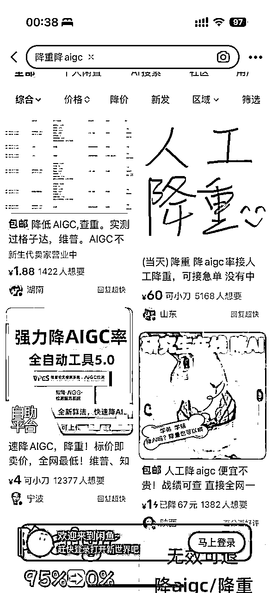

### ②📕自热+截流

📕上降重大量需求集中。

两条路：

* 自热起号：发干货笔记，引导私信；
* 截流打法：搜索同行爆文，在评论区埋微信或关键词截流。

直接搜“📕 降重 AIGC”就能看到热度和写法。

自热参考同行：
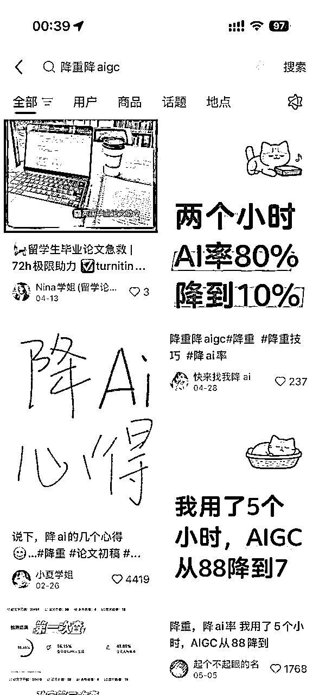

截流参考：
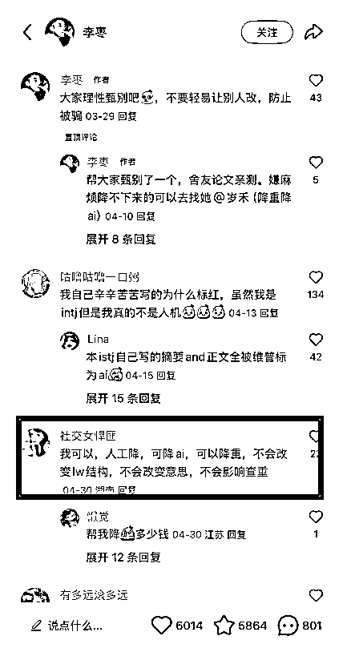

### ③抖音截流

抖音不需要主动起号，做精准截流即可。

* 搜“降重 AIGC”关键词
* 在相关视频评论区留言引流

不求爆发，但不做很可惜。

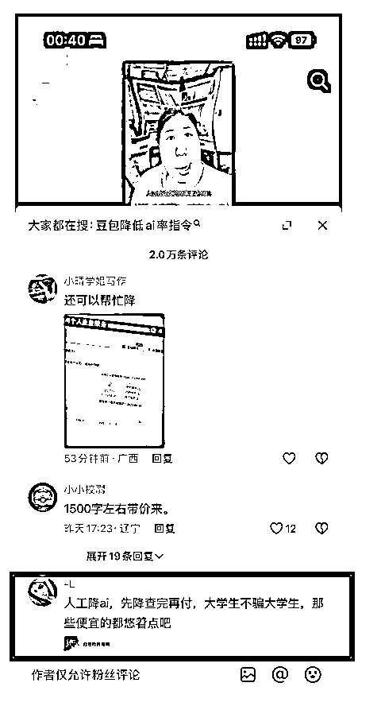
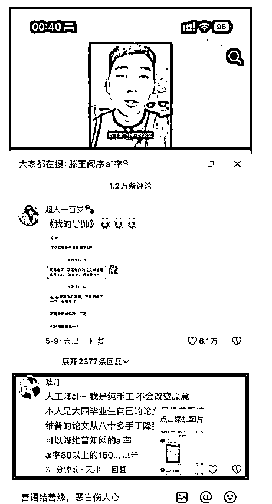

### ④小结

获客 = 选对平台 + 用对关键词 + 学会模仿 + 多点位铺量。

下一步是把流量转化为订单。

## 2.私域转化与成交

无论短视频还是笔记，最终都要把客户拉到私域成交。私域是你的人设、案例、朋友圈和话术展示区，信任感直接来源于此。

客户加微信后怎么成交？

### ①私域形象 = 第一印象

客户第一件事是翻朋友圈。朋友圈要放真实案例、客户反馈、交付展示，专业感立刻出来。

人设可以做成“兼职接单、靠谱稳定、效率高”的形象，常用标签如“温柔认真接单小姐姐”。

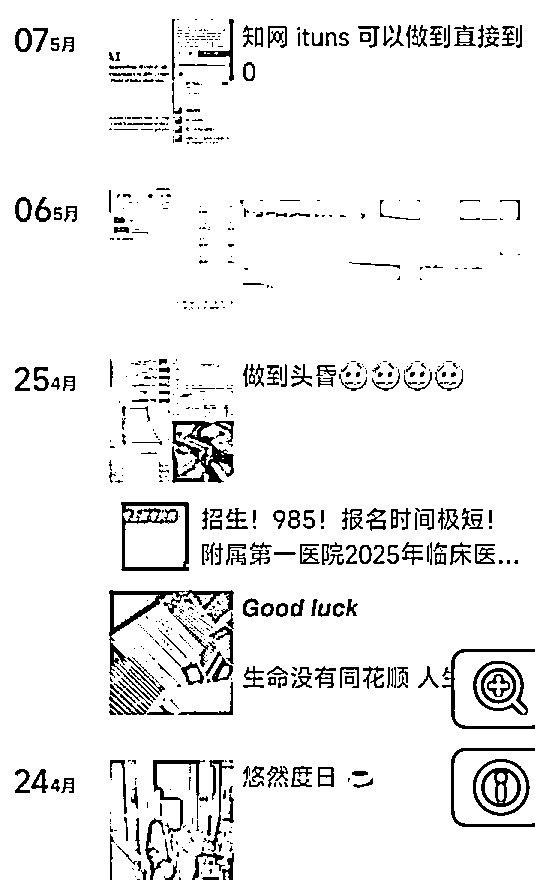

第一印象决定客户是否愿意继续聊。

### ②准备案例 = 证明你能做

客户更信你做过什么。去📕、闲鱼找优秀同行，以客户身份加他们，整理他们展示的案例类型，反向搭建自己的案例合集。这是信任构建的核心。

### ③谈单话术 = 专业又懂人

这个类目不复杂，关键是快速识别需求并引导下单。用引导式提问+大白话沟通即可。

标准流程：

1. 确认项目类型：
“宝子，是降重、降AI，还是两者都要呢？”
确定后问语言种类，中文英文价格不同。

2. 确认语言类型：
“请问论文是中文还是英文的呢？”

3. 确认查重平台，非常关键：
“学校要求哪个查重平台出报告呀？例如知网、万方、维普等。不同平台处理方式不一样，确保达标很重要。”

举例：学校要求知网低于10%，但只给了维普报告，按维普降完在知网可能仍不达标。

常见坑：客户用维普查，学校要知网，两套算法差异大，容易扯皮。

4. 确认目标重复率：
“您希望重复率/AI率从多少降到多少呢？”

5. 获取报告评估工作量用于报价：
“方便发一下查重/查AI报告吗？我评估工作量后给您准确报价。”
如论文1万字，重复率80%需降到20%，处理量约6000字。

灵活提示：若学校未明确平台，可先发现有报告处理。

6. 确认交付时间：
“您对交付时间有要求吗？紧急可安排加急。”

### ④报价策略

参考价：

* 中文：20元/千字
* 英文：40元/千字
* 加急：+30%左右

价格不是死的，客户预算低但有后续单，可以先成交。核心是客户觉得值，自己也能赚。

### ⑤促成下单

最佳路径是微信直接转账，最快。

“您可以直接微信支付，方便快捷。”

若客户顾虑，可引导闲鱼下单，保障感更强。

“如有顾虑，可走我闲鱼店铺下单，更有保障。”

### ⑥小结

引流进微信 → 私域建立信任 → 套需求 → 灵活报价 → 成交收款。表面是聊天，实则是用标准化流程把犹豫拉成信任。

## 3.后端交付

先说一个误区：不需要人肉逐句改。

AI时代不用硬刚苦力，用工具批量处理更快更稳。

### ①工具选择

AI检测工具更新很快，对应就有绕过工具。我常用的是一个降重降AI专用站点，稳定、效率高。

站点地址：https://banana.paperjai.com/

使用手册由客服提供，可参考。

### ②订单示例

项目：中文降AIGC
平台：知网
要求：43.3% → 10%
价格：250R

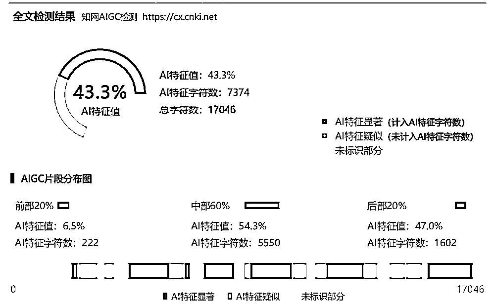
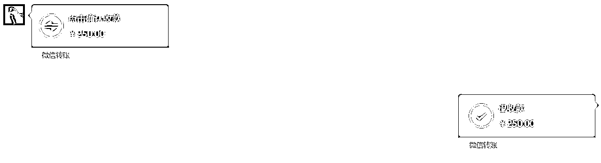

### ③操作演示

第一步：定位高AI部分
打开客户查重报告，对照原文，把标红的高AI段落复制出来。

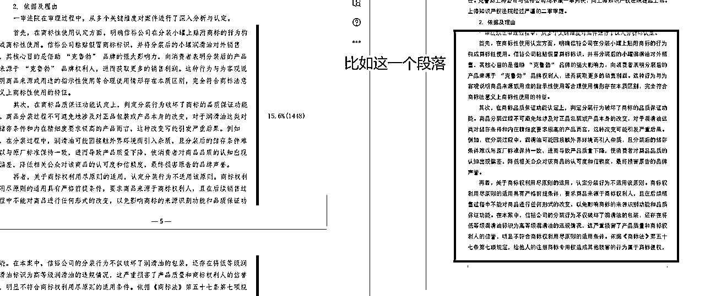

第二步：丢入工具改写
打开站点，选择设置：
* 模式：降AI率
* 语言：中文
* 检测目标：知网 或 维普
点击“一键生成”，工具自动输出改写版本。

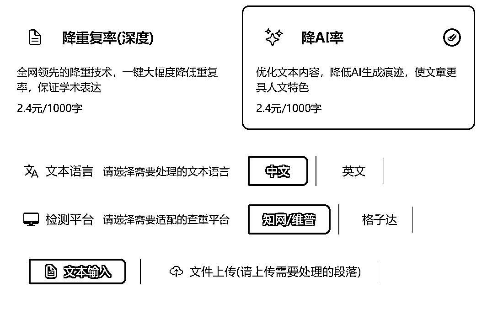
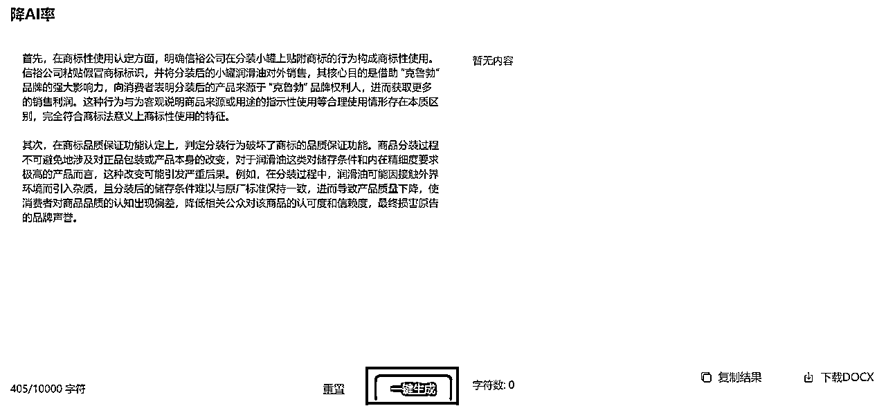

第三步：替换回原文
把生成内容粘贴回原文，覆盖高AI段落。重复几次，整篇AI率就下来了。

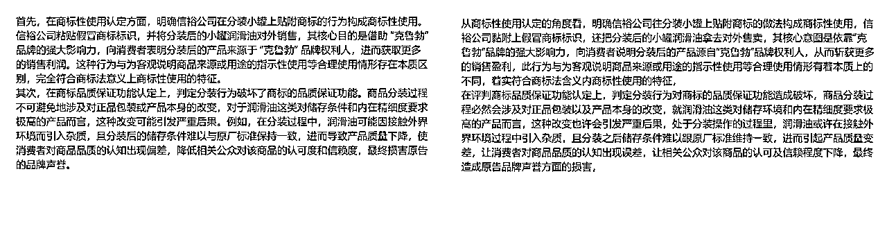

这一单：
* 客户支付：250元
* 工具成本：约24元
* 用时：不到15分钟

比想象中简单太多。

# 总结

我之前写的很多项目都没这么简单，但这个确实简单。它正处在信息差红利期：大部分人要么不知道能赚钱，要么还在手动改。 

你不需要懂技术、不懂AI原理、不需要文笔好，按流程走就能开始收款。

底层逻辑就是：别去卷难的，先选那种“普通人也能赚钱”的项目。

这一年我测试了很多AI写作赛道，最稳、最快起步的还是降重/降AIGC。

门槛低、流程傻瓜、回款快、工具成熟，闭眼都能做。

表面操作简单，利润很实在。复制粘贴几轮，15分钟一单净赚200+，比很多高大上项目更实在。

现在做的人不多，信息差就是机会。现在毕业季需求爆发，正是窗口期。

别等。直接开干。

你叫什么不重要，我叫陈bu懂，但我已经学会了。你呢？