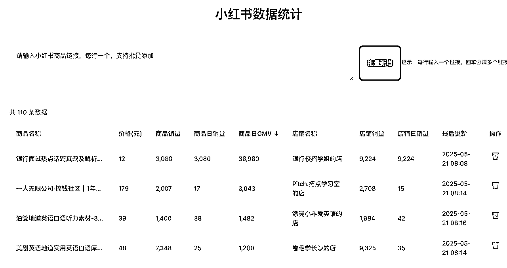
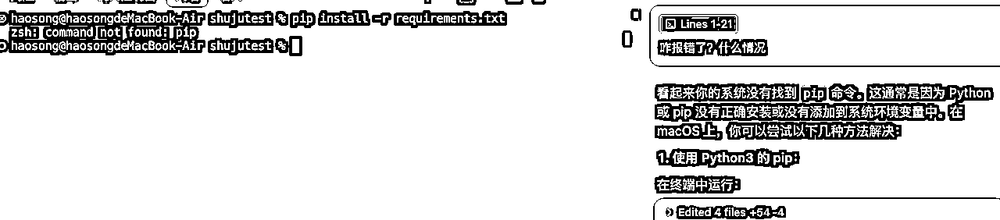
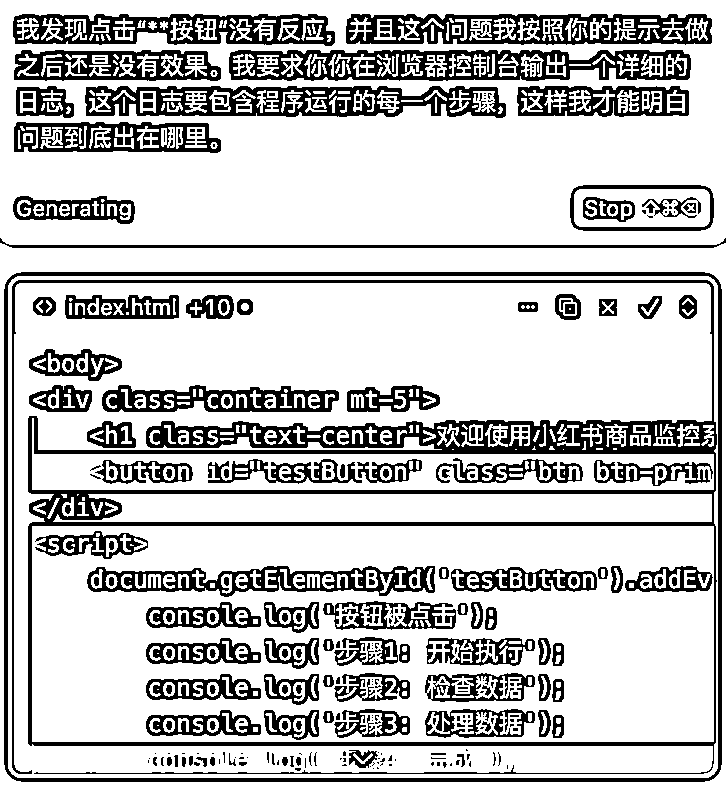
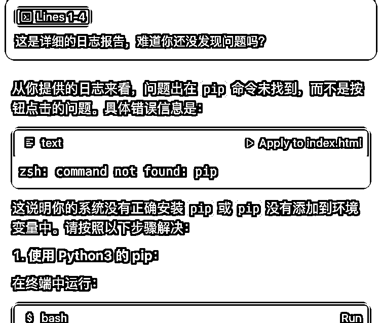
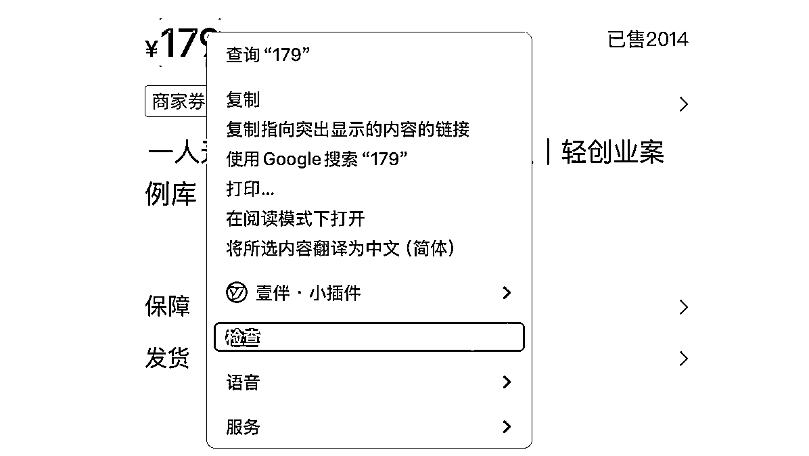
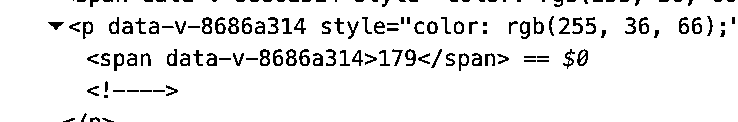
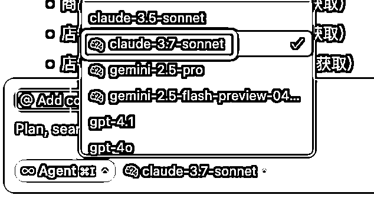

# 用Cursor搭建一个📕商品监控系统

我用Cursor搭了个“📕竞品监控”，顺便把选品思路也盘明白了

在龙哥盟潜水四年，我一直是个小透明，今天难得冒个泡。本来想琢磨个惊艳的开场白，后来想想算了，社恐就直接上正文吧。

# 先分享两个真实案例

我这些年在📕上做过几个品，其中一个美剧台词本，实体资料，利润做到30多万。为什么这个品能跑起来？说白了，很多人想靠美剧或英文动画学英语，觉得这样不枯燥，还能给自己造一个语言环境。可现实是，大多数人一打开视频就只顾着追剧情了，根本顾不上看词汇、抠语法，刷完几季啥也没记住。这时候，一份整理好的台词资料，就成了刚需。

我当时把目标用户分成两类，分别做了不同的场景。

一类是从没想过“看美剧还能学英语”的人。我拍了个实拍视频：电脑上放着剧集，旁边摆着一本台词本，一个人边看边拿笔在台词上划重点。画面里的剧集尽量挑有趣的片段，把人的兴趣勾起来。旁白大意是：“天呐，原来美剧还能这么学！一边追剧一边把关键台词划出来，轻轻松松记下一堆地道英语。”

另一类是知道这个方法，但觉得没用的人。视频画面不变，但话术换成了：“以前刷完好几部美剧，英语也没半点长进，现在才明白，问题出在没抓住台词本这个灵魂。这才是正确打开方式！”然后继续展示边看边划的画面。

产品本身很简单，前年做的是纸质台词本，打印成本也就十几块钱，但售价能到大几十，基本没什么退货，算得上暴利。不过去年我已经把这个项目停掉了，店铺也注销了，没法给大家看后台。最大问题是版权风险，不建议大家再碰。

有意思的是，后来有人升级了玩法，把台词内容做成了飞书知识库，还加了重点表达解析和例句。定价最低48，最高99，销量做到7000多份，这又是至少30万利润。

我目前还在做一个英语虚拟资料项目，也在赚钱，但具体是什么就不公开了，毕竟还在盈利。放一个号的后台数据给大家感受一下。

# 我选品用的框架，其实就六个字

认真总结下来，我的选品方法就是：需求、场景、解决方案。听起来很学术对吧？不少大佬在各个平台都讲过类似的理论，抖音、快手、淘宝、跨境电商……我耳朵都听出茧子了。但等自己真的做出几个品，才发现确实是这套东西在支撑。

所以我现在看一个品，就先拆成三个问题：有没有需求？对手怎么搭场景？他靠什么方案赚钱？

先聊需求。我一直觉得，📕上用户的需求只有两种：一种是我明确知道自己想买什么，一种是我还不知道自己需要这么个东西。前者靠搜索流量，后者靠推荐流量。比如台词本，打的就是推荐流量——用户不会主动搜“XX剧台词本”，就算有人搜，也一定存在价格更低的同行，我去卷没有意义。

再聊场景。怎么理解“场景”？我讲个段子：什么情况下1+1等于3？错误的情况下。错误也是一种情况。放到📕，场景就是“用户在什么情况下会下单”。一个品面对不同人群、不同痛点，能延伸出很多场景，你得去试，找一个有共性、有真实痛点、市场竞争又没那么惨烈的场景。

举个例子，假设你做美白产品。大场景基本被品牌方占完了：天天开车怕晒黑怎么办？老公总看街上白嫩的美女怎么办？你这时候进场，基本没机会。但换个画风的小众场景呢？夏天骑车上学被晒黑，喜欢的女生越来越冷淡怎么办？练太极的爷爷奶奶晒黑了，跳广场舞都没伴怎么办？中老年朋友因为皮肤黑，被孙子以为脸脏，不愿意让抱怎么办？这几个场景不一定都成立，但试了才知道。

最后是解决方案，本质就是你要卖的东西。同一个需求，解法可以非常多样。拿美白来说，美白霜、防晒帽、防晒衣都是方案；拿学英语来说，有人卖纸质台词本赚几十万，有人卖飞书知识库赚几十万，都可以。

# 实话实说：个体户很难做深度调研

但接下来我得泼一盆冷水。如果只是个体户，你真的有足够时间去把需求、场景、方案一个个研究透彻吗？这套打法其实是从我上班时候的工作方法演变来的。当时我有充足的时间做调研，有帮手协同，更重要的是，就算项目没做成，工资也一分不少。可现在不一样，手上的品只要还没盈利，吃饭可能都成问题，哪还有心思慢慢沉淀？与其花力气研究一个还没做起来的品，不如多测几个品。更何况调研出来的需求、场景，最后很可能只是一份书面报告，并不等于真实市场的反馈。

我不否认这套方法论有价值，但它更适合高举高打的品牌方，或者想在某一个品类长期深耕的团队。我自己更喜欢把方法揉碎了，变成更接地气的一条：找一个日GMV不错、而且比较稳定的品，研究一下我能不能做出类似的笔记。能就上，不能就放。

为什么就盯着“日GMV不错且稳定”的品？因为竞品已经替你把需求、场景、方案统统验证过了。他不用给你交一份书面报告，而是用实打实的数据直接告诉你：这个品能行！

所以我才需要这么一个📕商品监控系统，用来盯竞品每天卖了多少。

现在进正题，聊怎么用Cursor来搭这套系统。

# Cursor不神秘，关键是把需求说清楚

Cursor是一款AI编程软件，零基础也能上手。我自己本科是软件工程，但说实话，大学四年完全没学会写代码。一方面是我自己没认真学，另一方面是理解不了老师讲的if、else、hello world到底有什么用——这些基础语法和用户需求能扯上什么关系？后来反而是靠着Cursor，写了好几个能实际跑起来、用在业务上的程序，一写还写上了瘾。

安装和基础使用我就不多说了，龙哥盟的航海手册里都写得很清楚。Cursor没那么高深，你只需要从“说清楚要什么功能”开始。写需求描述，我的两个法宝是：讲情况、举例子。

什么是讲情况？就是把你所处的状态说准确。比如你告诉别人“我三天没喝水了，现在非常渴”，对方立刻就知道你缺的是水。至于给你矿泉水还是奶茶，已经不重要了。

什么是举例子？就是防止一句话产生歧义。你说“我要吃饭”，Cursor可能真的只给你一碗白米饭；但如果你说“我要吃饭，比如辣椒炒肉盖浇饭、南昌炒粉”，它就知道怎么做。你看，如果我把“举例子”这个概念只讲道理不举例子，不同人读完会产生不同的理解，Cursor也一样。

# 我当时的原始需求文档

这大概就是我最初给到Cursor的需求文档。

背景：我是📕商家，想盯竞争对手的销量变化。我会不定期丢一个或多个商品链接，让系统爬取数据供我参考。

爬取功能：拿到链接后，模拟用户点开页面，获取HTML代码，从中提取商品名称、商品销量、商品价格、店铺名称、店铺销量。注意，销量一旦过万，平台会折叠显示成“1.3万”或“1.3万+”，程序要能自动还原成具体数字，比如13000。

爬取时间：每当我添加一个商品时，马上爬一次；另外每天早晨8点自动爬一次。

计算功能：把两次爬到的数据做差。商品日销量=今天销量-昨天销量；商品日GMV=商品日销量×商品价格；店铺日销量=今天店铺销量-昨天店铺销量。

展示功能：网页里要有个列表，展示商品名称、商品价格、商品日销量、商品日GMV、店铺名称、店铺销量、店铺日销量，并且支持按商品价格、商品日销量、商品日GMV、店铺销量、店铺日销量排序。整体风格简约大气点。

下载功能：每个商品配一个下载按钮，点击后导出一份Excel表，记录这个商品从添加那天起，每天爬到的销量数据。比如5月1号添加，那表格里就要有5月1号、2号、3号的全部记录。

做好之后，我就可以在网页上监控所有商品的日销量增长，选品决策有数据参考。效果看下图。

# 迭代思维：把Cursor当你手下的员工

你该不会以为，把上面这份文档扔给Cursor，就能一键得到同款系统吧？当然不是。

实际开发的时候，会遇到各种问题：可能是Cursor没理解需求，也可能是你中途冒出新的想法，更常见的是运行时一堆报错，什么字段缺失、环境错误、重复定义、空指针……听不懂这些词？没关系，简单问题基本靠“质问”就够了。

比如我按Cursor的提示输入某个命令，结果报错了，我直接反手把错误提示丢给它，问一句：“咋回事？报错了，为什么？”

那遇到复杂问题呢？总不能关机睡觉吧。这时候得学会演一个“没有专业能力、只会坐享其成的小领导”，指挥你的硅基员工干活。你遇过那种业务能力很一般的领导吧？他在具体业务上指导不了你，但能站在局外人的角度帮你理清思路。当你跑去跟他说难题，他会怎么回应？大概率是：“哪一步出的错？为什么会这样？给我写个详细报告。”味道很冲，但确实管用。

我让Cursor解决复杂bug时，用的就是“写报告”这招。只要报告够详细，Cursor就能自己发现问题、自我优化。

第一步，先PUA它：“我点‘xx按钮’没反应，按你提示做了也没效果。你这系统连个详细的日志都没记录，我怎么指导你？我要求你在浏览器控制台输出一份完整日志，把程序运行的每一个步骤都打出来。”

第二步，装成已经发现问题的人，再质疑它：“控制台日志我截给你了，这么详细，难道你还没看出来问题出在哪？”

实话实说，那份日志我压根没看，截图直接丢给Cursor，它就苦思冥想给我找解决方案去了。

# 常见问题，附解决办法

最后留三个踩坑笔记。

一、抓不到商品信息。Cursor可能分不清链接里哪个是价格、哪个是销量。你可以用浏览器的检查工具：在商品价格上右键，点“检查”，就能在HTML里看到价格对应的标签和内容，把这个信息反馈给Cursor：“我发现价格在这个标签里。”它就能对症下药。

二、爬虫进不了📕。告诉Cursor用两个办法：一是无头浏览器模式（headless: 'new'），二是设置自定义User-Agent来模拟真实浏览器。这是📕的官方反爬机制，技术细节不用深究，Cursor会自己处理。

三、感觉Cursor不够聪明。建议换成Claude 3.7模型，听说Gemini也不错，但我暂时还没试过。

这套系统不一定是标准答案，但至少让我每次选品前，心里都更有底。希望对你也有启发。