# 🔥一键把爆款变成AI成片：可复用的内容自动化生产线

最近把 @super 黄 和 @一泽 分享的方法做了个拼接，弄出了一套点一下就能跑完的AI视频生成流水线。用起来还算顺手，也能搬到别的模板化场景里。觉得这条路子值得拆开聊，欢迎想一起打磨流程或定制效果的朋友来交流。👏🌹

# 一、操作演示与样例效果

首条任务从触发到完成大概需要5分钟左右。

文中的示范视频仅用于说明这条链路是怎么走的，并非真实投放素材。

# 二、整体思路

# 三、搭建步骤

准备清单：

*   Chrome 浏览器
*   trae / windsurf / cursor 其一即可
*   Coze 账号
*   飞书多维表格账号
*   剪映小助手（下载地址：剪映小助手下载地址（请点击））
*   电脑版剪映专业版

## 第一步：定制浏览器采集插件 抖音/小红书

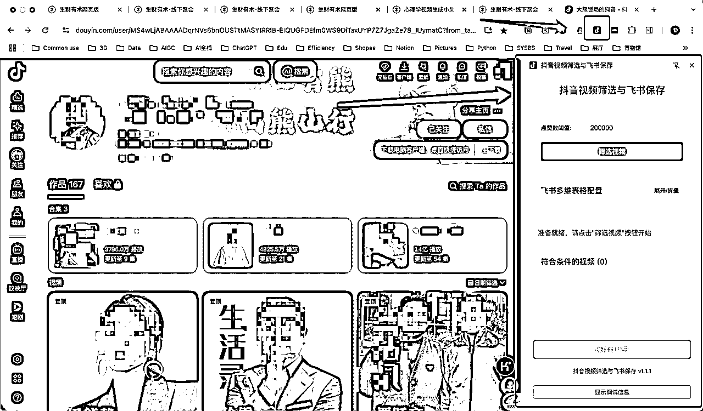

### 抖音插件：

可以直接沿用 @Super 黄 的精华帖里提供的版本；

### 小红书插件：

我基于抖音版本用 trae 做了改写。也可以按 @Super 黄 的公开方法自研，或找我拿现成。

### ⚠️ 配置要点：

1、飞书多维表格的参数要一步步填对：

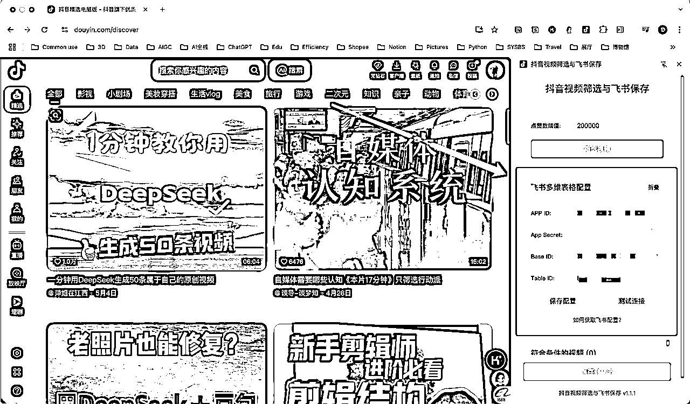

APP ID、App Secret：前往飞书开发者后台获取；

Base ID、Table ID：从多维表格的分享链接中截取；

具体取法可参考 @Super 黄 的教程。

2、多维表格里必须先建好固定列：

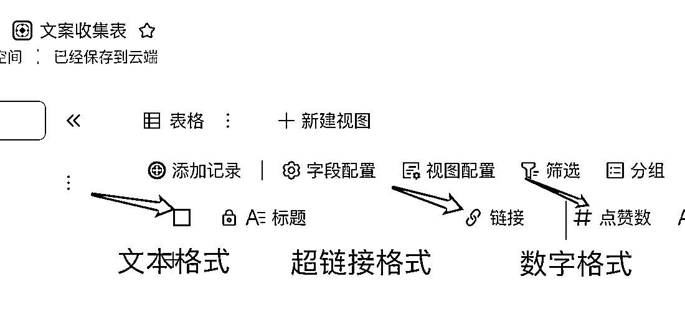

*   标题：文本类型
*   链接：超链接类型
*   点赞数：数字类型

这两项很容易被忽略，一旦格式不对，视频链接就批量写不进去。😅

## 第二步：定制“文生视频”Coze智能体

搭建细节可看我之前的帖子：

智能体方案：工作流 @一泽

⚠️ 小提示：

发布时务必勾选“飞书多维表”，只有这样智能体才能使用表格字段捷径；

进入“配置”后，控件要改为“字段选择器”，把所有选项都勾上；

发布后需审核，通常半小时左右。

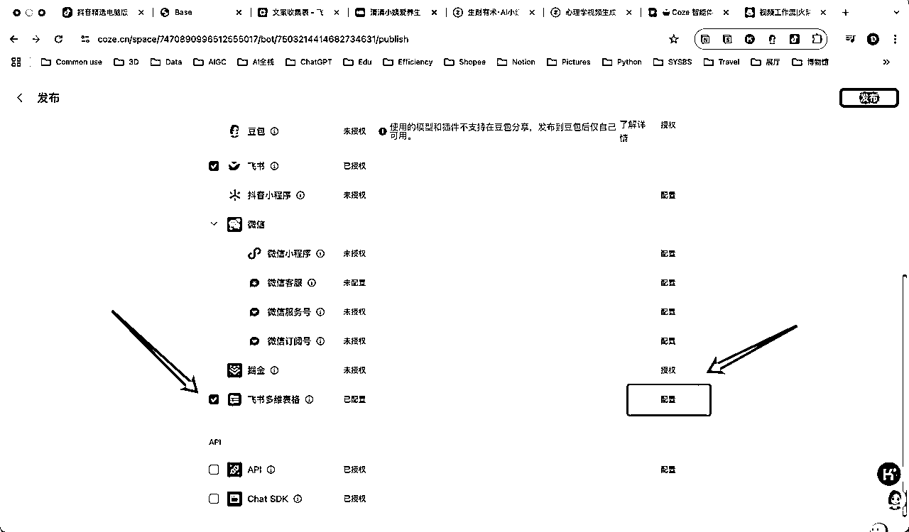

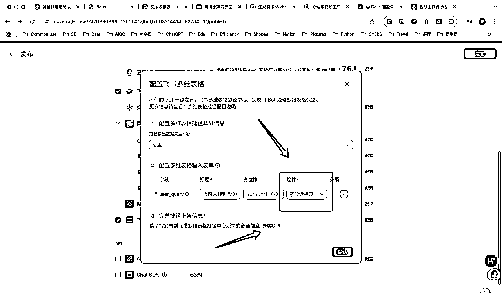

## 第三步：定制“视频转文案”Coze智能体

两种做法：

1.  自行搭建智能体：参照 @Super 黄 的教程
2.  调用字段捷径：直接在飞书多维表格里接入“视频转文案”捷径，需要付费开通API并买Token

优劣对比：

| 视频转文案方式 | 优势 | 劣势 | 适合人群 |
|---|---|---|---|
| 自建智能体 | 免费 | 抽取稳定性一般 | 个人尝鲜 |
| 调用捷径 | 抽取更稳 | 需付费 | 商业化使用 |

## 第四步：飞书多维表格串联

用采集时用的那张表即可做成流水线：

*   标题、链接、点赞数 为固定字段；
*   文案提取——字段捷径——绑定自定的“视频转文案 Coze智能体”；
*   风格分析——字段捷径——Deepseek——按需写指令，并引用“文案提取”；
*   改写文案——字段捷径——Deepseek——按需写指令，并引用“文案提取”；
*   火柴人视频——字段捷径——绑定自定的“文生视频 Coze智能体”，引用“改写文案”；

⚠️ 提醒：

*   表格基础设置可参考原文教程；
*   每个字段设置完后，记得拉到最底打开“自动更新”。

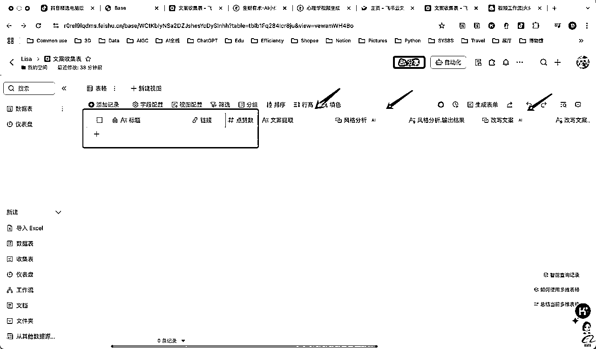

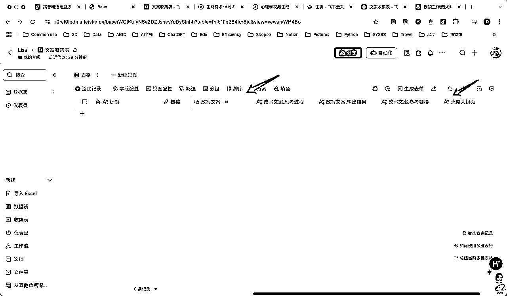

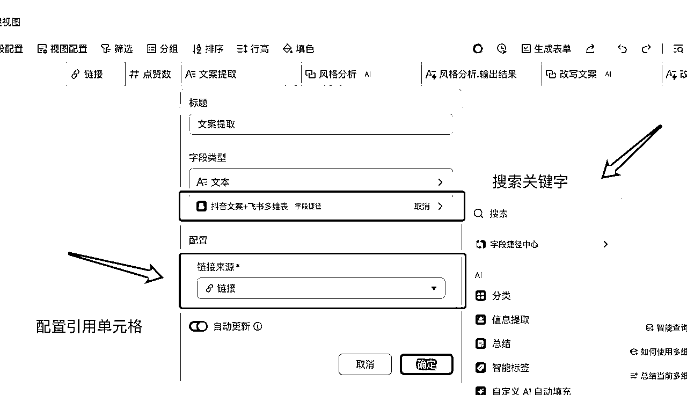

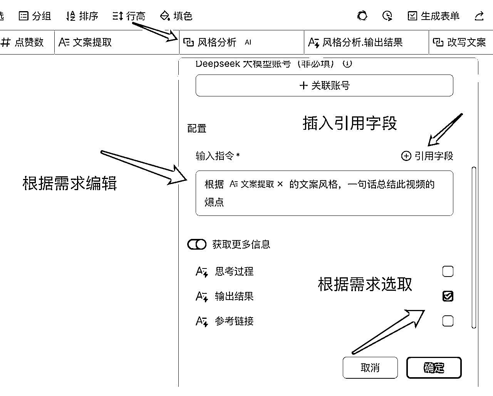

# 四、商业价值拆解

### 从提效工具到直接交付结果

把黄叔和一泽的两条线拼起来，本质是把内容生产的整条链路打通了。

选题挖掘✅——提炼大纲✅——生成口播稿✅——拍摄✅——剪辑✅——封面标题图✅——发布运营——数据复盘✅。全流程闭环，从单纯提速变成可复制的产出能力。

### 迁移性很强

输入端：抓取爆款数据  
处理端：URL转文本、文本解析、要点提炼、改写、文生图/音/视频  
输出端：图文/视频成片

只要骨架搭好，后续只需倒推产出标准去调prompt。所有模板化内容都能套，不同赛道也能玩出新花样，例如：

结构化故事：

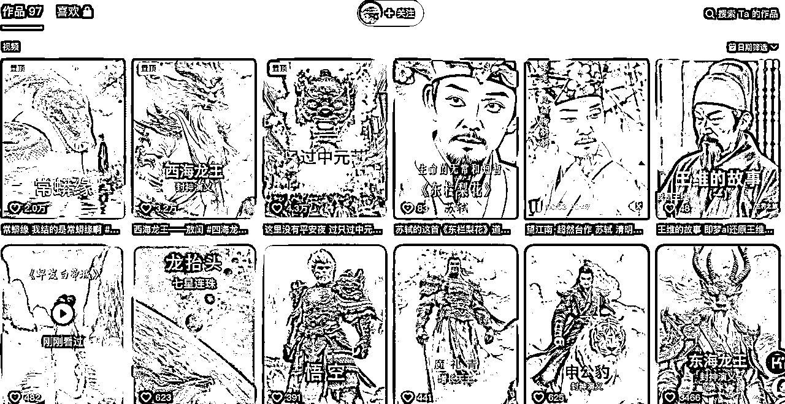

养生类：

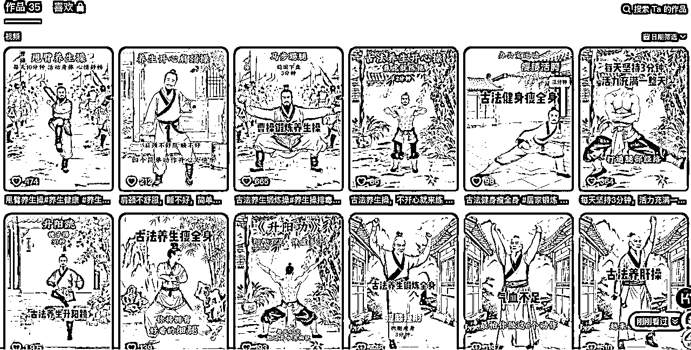

食品科普：

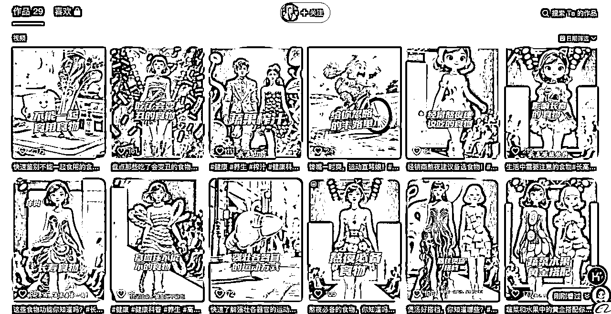

育儿干货：

画面风格也能换，即梦、可灵等平台可生成3D、超写实、赛博朋克、极简等视觉；声音可切换不同TTS。未来接入 https://www.lovart.ai/ 后想象空间更大。

### 稳定性可控

只要底层的插件和服务稳定，整条线输出就稳定。必要时多备几个平台的Token做冗余。

# 五、实操体会

*   第一次看到自己设计的流程真的跑通，还是有点小激动。以前一条视频人工要几小时，现在点一下就能串起来。
*   当前成片还比较粗糙，主要是先记录。优化点主要有：
    *   插件稳定性与响应速度；
    *   Prompt细节打磨，尤其是智能体的人设与边界约束，越清晰越不容易跑偏。
*   商业化需要真实测试，适合做个养成系实验。
*   这套东西是技术小白试出来的，拆成小步骤也能落地。