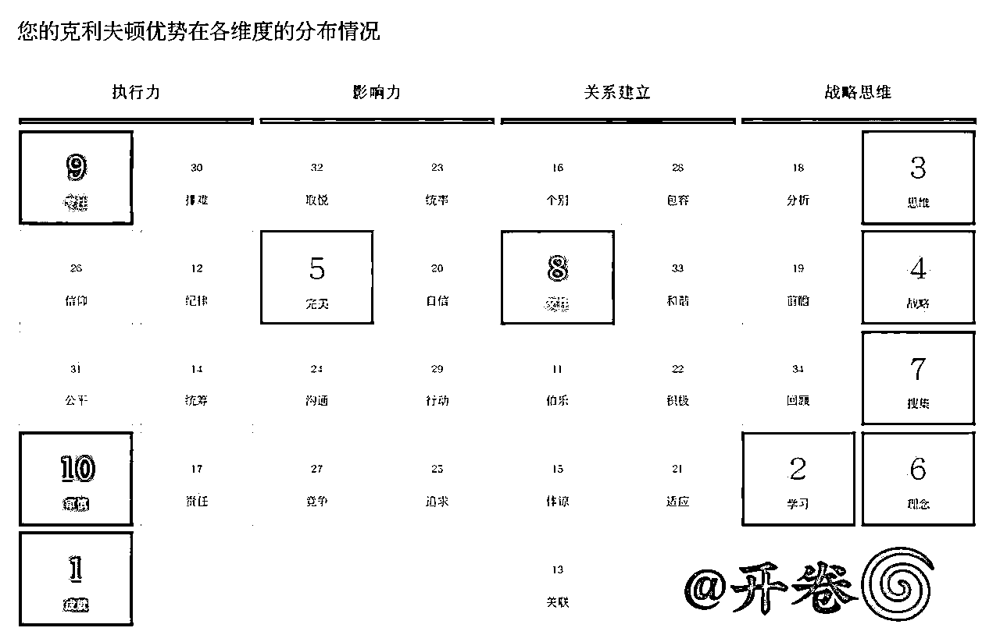
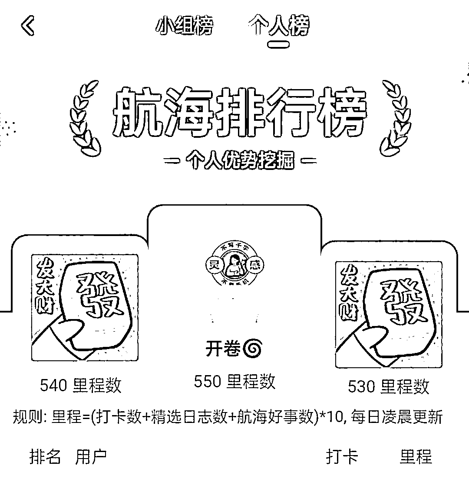
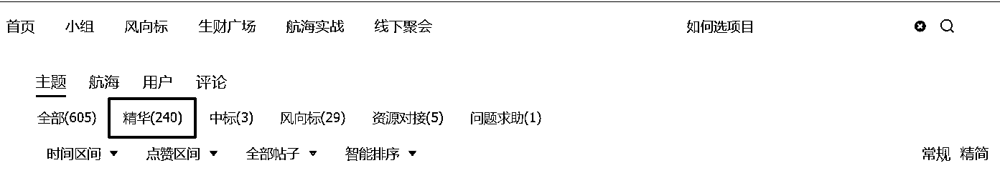

# 从存款3800到副业六位数，一个“搞钱笨鸟”的赚钱血泪史

大家好，我是开卷。985写作硕士，写过百万爆文，有6年文案底子，也是赚钱传术师。今天想聊聊，我这个没什么天赋的普通人，是怎么在赚钱圈里跌跌撞撞，最后跑通0-1的。

两年前，我手里只剩3800多块，其中2500要交上海房租。很多人以为我自由职业是因为有学历有经验，其实真正的导火索是——我失业了。研究生毕业后投了上千份简历，没有一个岗位对得上眼。走投无路时遇见了赚钱，那是我人生最暗的一段日子。

在这之前，我在电商圈从4000块月薪的文案做起，一路做到外企内容主管，月薪两万。可这份经历反而给了我一种虚幻的信心，觉得自己做什么都能成。结果呢？赚钱第一年，我把能踩的坑全都趟过了一遍。第二年才慢慢摸到门道，靠👸号爆文、知识付费、项目分销、帮朋友做短期项目，累计变现突破六位数。现在回头看，上班给的稳定，其实只是另一种风险。

如果你也像当初的我一样，卸下职场光环后一无所有，希望我的故事能帮你避坑，也给你一点盼头。我不是天选自由职业者，只是一只搞钱笨鸟，硬是靠“题海战术”试出来的。

## 不上班的代价，一年亏掉十多万

2023年3月底，我看着手机银行提示的余额，心里冷飕飕的。但就在同一天，第5个面试电话打来时，我直接婉拒了。当时心里快速盘算过：哪怕拿下月薪1.5万的活儿，在上海扣掉房租、通勤、外卖、人情，时薪也就30块。拼命工作三年也攒不下多少，反倒是因为不敢尝试副业，在裁员大潮里两手空空。

刚进赚钱那阵子，我总想找“熟悉感”，想用过去的方法抄近道。结果这条路让我摔得很惨。我盲目乐观，觉得什么项目都简单，上手就翻车。

具体有多惨？我做过知乎好物，数据平平；做过📕店铺、商单号、IP号，光23年下半年就注册了12个📕号，变现却只有四位；还试过抖音图文、无人直播、短视频带货、多多视频、视频号直播带货……没有一个真正跑出来。最跌份的是📕店铺，从端午折腾到中秋，选品、上品、投流样样不落，最后在朋友帮衬下才赚了不到1000块。女装不行换百货，百货不行换饰品，像素级模仿对标也没用，测评号还被关进小黑屋。那阵子我就像困在迷宫里的老鼠，急得团团转。

## 我踩过的坑，比走过的路还多

回头看，我的坑分三大类：项目坑、认知坑、心态坑。

**项目坑，其实项目本身没毛病，是我对自己和赚钱这件事都太不了解。** 我特别需要外界认可，于是报了个人优势和📕店铺两条船。个人优势那条，教练在日志下点评我“是个能成事的姑娘”，这句话把我点燃了，我一路卷到第一名。那束光，后来照了我很久。

但📕店铺我中途弃船了，一是精力跟不上，二是我发现自己开店赚钱的储备约等于零，像不会游泳的人一脚踩进海里，手忙脚乱，实在没信心游向深海。

**认知坑，踩得更深。**

第一，凭感觉选项目。别人说啥赚钱就做啥，听起来跟老本行沾边就冲。后来才知道，赚钱官网光选项目的精华帖就有200多条，我当时居然没想到去搜一下。

第二，只看别人赚钱的结果，不看过程。别人月入十万，可能背后熬了五年；别人矩阵年入百万，是因为手握几万好友和成熟产品。只看结果，容易打鸡血，也容易低估成本，一入局就发现不对味，然后草草放弃。

第三，以为努力就有结果。我作废了无数账号才悟出一个理：努力只是标配，方向和方法对了，努力才有价值。

第四，错把热闹当结果。我做过万粉零变现的📕号，也做过数据漂亮但不赚钱的👸号。后来才明白，可持续的赚钱模式，本质是解决特定人群的特定问题。新手最该研究的不是项目，而是“判断项目的能力”。

**心态坑，更是一抓一大把。**

学生思维：总等标准答案，反复问“现在做还来得及吗？”其实赚钱是开放式问题，最快的解法是搞懂核心思路后立刻去试。

道德洁癖：被不靠谱的知识付费坑过后，就认定赚钱=割韭菜，看不上小钱。可不放下这层洁癖，很难从小项目里赚到第一块钱。

过度反思：错一次就否定全部，一次航海没结果就觉得自己不适合。其实很多流量高手，前30条笔记都在摸索。

峰值预期：总想“整个大的”，幻想一炮而红，对长期增长没有耐心。可真正长期做的人，都懂得尊重周期。

成本恐惧：舍不得买工具、改善环境，总想有正反馈再投入。结果为了省几十块，浪费了大几百上千的收益。

后来我心态稳住了，核心转变有三点：接受不完美的开始；用实验心态替代成败心态；区分情绪成本和实际损失。

那一年我算了笔总账：放弃上海、放弃月薪不到1万的工作，光机会成本一年就至少5万，加上付费学习、工具开销，不上班的代价妥妥超10万。而收入呢？不到5000块。负债累累，焦虑到真想回去上班。

## 赚钱第二年，我终于摸到通关密码

2024年元旦到春节，我偷偷找工作，但心里不甘。后来去找靠谱做咨询，他一句话点醒我：我最大的问题不是执行力，而是打工人思维没走出来。过去的职场经历，给了我强烈的“搞钱幻觉”。

于是，我给自己设计了四道关卡，一关一关去破。

### 第一关：打工人思维

我的打工人思维有点特殊：“公司选我就是恩赐，我要加倍努力报恩。”这种亏欠感让我长期主动加班，对需求有求必应，却没有分辨需求的能力，经常是蛮干。做项目也一样，看到问题就解决，看到玩法就尝试，从不思考值不值得、适不适合。

24年初跟几位博主合伙做私教课，我又下意识活成了打工人，总想当助力，结果越努力越拖累团队。和靠谱聊完才清醒：赚钱的核心是价值交换，要先解决“我能给用户什么价值”，而不是“怎么让团队满意”。打工思维是求认可，但市场只看结果不看努力。熬夜做出来的东西没人看，就是自我感动。

所以，我从努力求认可，转向努力创造真正的价值。

### 第二关：“我喜欢”

很多人说赚钱要从喜欢的事出发，这话没问题，但只看喜好就是陷阱。我有6年写作经验，做过写作号，写自己真正认可的内容，没水花；写“我真的无法欣赏房琪的文案”，只有几个阅读。后来房琪塌房，才发现很多人也讨厌她的文案，但我没研究用户心理、平台规则，光靠喜欢有什么用？

做女装、百货、饰品，也都因为我“喜欢经典款”“喜欢真淘宝”“喜欢按审美改对标”，结果全没做起来。商业的本质是满足市场，不是满足自己。喜欢只是起点，市场需求才是终点。没人买单的喜好，只能算昂贵的爱好。

后来我悟了：可以先找赚钱的事，在过程中培养喜欢。能赚钱带来的正反馈，会让人慢慢喜欢上它。

### 第三关：“我以为”

看10篇精华帖说📕赚钱，就以为我也能；看保姆级项目拆解，就以为照着做就行。可“我以为”和现实之间的差距，大到不忍直视。我以为靠文案经验能做好短视频带货，结果被选品、投流、供应链、售后卡死；我以为做自媒体就是涨粉接广，结果做出万粉零变现；我以为做IP就是报名课程分销刷屏，结果没人买单。我脑子里装了一堆营销案例，却很少有能直接拿来用的。为什么？因为那是别人的，不是我的。

## 写在最后

赚钱两年，我从一个盲目自信的打工人，变成了一个尊重市场、研究需求、快速试错的自由职业者。过程一点也不轻松，坑踩了无数，但也正是这些坑，让我找到了属于自己的那条路。

如果你也是新手，别怕踩坑，但一定要复盘。像我一样用“题海战术”去试，但请带着判断力去试。先把第一块钱赚到手，比研究一百个理论都有用。

希望我的故事，能给你一点避坑参考，也给你一点继续走下去的信心。

如果觉得有收获，我会继续分享具体的方法和案例。我们下期见！

很多人写的经验，都是跑通之后才补的“马后炮”。

我在这个圈子待满一周年那天，原本打算写一篇避坑心得，内容是某个平台运营时的各种坑。但后来回头看，让我真正被看见的，几乎全是另一个图文平台带来的。

别人的经历哪怕每个字都是真的，你照着做也未必能复现。赚钱不是“找到一个得分点就得分”的简单算术。更麻烦的是，你自以为理解的意思，和对方实际想表达的，常常因为认知差异而错位。市面上到处是“零基础也能做”的项目，真亲手试过才知道：时间成本高得吓人，单位收益低得可怜，还会跟自己的原则打起来。

只看自己的喜好不行，只听别人的说法也不行。这个时候，真正难的问题才浮出来。

**第一关：总想拿到标准答案**

做项目初期，我有种道德洁癖，既不想抄也不敢抄；到了中期想赚钱了，开始琢磨怎么在守住底线的前提下借鉴；等到连续碰壁、心力耗尽，就盼着有人把一份完全正确的答案塞进我脑子里，我负责照做就行。

“想抄现成答案”这个念头，会在不同阶段反复冒出来。

我之前想在种草社区做写作号，但不愿意照搬别人对某位博主的爆款拆解。写了多年文案，我太清楚抄袭的代价，所以一直停在原地。

后来账号开始低粉变现，是因为我开始研究别人的内容和变现思路，把直播话术一句句拆开来看，有技巧地借鉴。虽然给自己设了上限，但也做出了一点成绩。

更多时候，我是想自己赚钱，却不知道从哪下手。我知道做内容能赚钱，但总想找一份现成模板；知道做个人IP能赚钱，却总想找一条步骤明确的路线，最好能一帧一帧复刻。越急着要结果，动作越变形——只学了别人的表面动作，从没想过自己合不合适。

嘴上不愿意承认，可我心里一直渴望有个“将军”或“领头人”，给我一个百分百正确且适合我的答案，我只需要执行。这种对“外部答案”的依赖，让我很长时间一无所获。

后来和一个靠谱的咨询师聊完，我终于看清了自己的问题。再密集刷帖、上课，才真正懂得：赚钱不是对努力的奖赏，而是对认知升级的补偿。

承认这件事后，我决定再续一年，给自己一次重启的机会。因为在这里，我看到了很多职场里看不到的玩法，也知道了普通公司那条赛道之外，还有更高的天花板。

**第二关：不会用工具，等于空手挖矿**

第二年，我把赚钱当成闯关游戏，心态完全变了。

以前依赖过往工作经验，现在从圈友的案例里找参考；以前问“我喜不喜欢”，现在问“用户喜不喜欢、这种方式我能不能接受”；以前觉得做事一二三就成了，现在会翻翻还有没有更多思路；以前在借鉴里自我挣扎，现在享受找适合自己的答案。

有趣的是，问题最多的时候，往往也是机会冒头的时候。

去年年初，我在种草社区找对标时经常刷到的爆款，居然在另一个平台疯狂刷屏。经人介绍后才知道，很多人靠这种简单的文字，一天能赚几百甚至上千。而这一切完全在我的认知盲区之外。

某个睡不着的深夜，我决定先放下种草社区，转去做图文平台的爆款内容。具体操作方法前两篇文章写过，今天想聊的是：我如何把这个社群当成练习册，一道题一道题刷下来，慢慢攒到第一笔大钱。

**项目手册：藏宝图**

回头盘点，反复研究的手册只有两本：个人优势、图文爆款。

前一本概念太多，不多读几遍根本记不住，脑子里经常打架；后一本是因为我从没做过图文平台，既有连续失败后的警醒，也有对未知的敬畏。前后通读了不下七遍，还不包括遇到问题时专门去查。

手册有两种读法：一种是“看完了，赶紧试试”；另一种是“看完了，还有几个逻辑卡点没通，再看一遍”。你觉得哪种成功率高？我在种草社区是第一种，在图文平台是第二种。

开始前，我先做了一份思维导图，从机械学习变成把圈友的经验内化成自己的。这样脑子里就有一张地图：遇到问题，要么知道答案，要么知道去哪里找，要么知道这是必经的卡点。心里有数，心态才稳。

两年参加了十一次实战，九成的问题手册里都有答案，剩下的一成来自认知不足、自我设限和情绪问题。我最初有疑问张口就问，现在习惯先翻手册。

一个项目适不适合你，与其问别人，不如翻手册——别人不一定了解你，但手册能让你看到全局。做项目时遇到具体卡点，不管是不是在实战期，手册都能帮你找到解法，因为很多单个问题的答案需要全局思维。

**精选案例：相当于一对一咨询**

读透手册，你对项目会有整体认知，但细节上仍可能卡住。

比如手册给了七八个方向，你还是不知道选哪个，这时就该去看精选案例。

如果你像我一样基本没启动资金，可以参考我的路径；如果你有预算、有团队，就得参考那些有投流经验的人，去选投入产出比更高的方案。

我刚进圈子时，总拿别人的成功来打压自己，越看越焦虑。后来才懂，看案例的正确姿势，是提取对你有价值的内容，而不是用别人的成绩来惩罚自己。

日常用法，就是把社群当成搜索库。比如我不管做什么平台都要解决流量问题，所以我反复搜“流量”相关的案例，看得多了，认知自然就深了。

在我看来，手册是“通用参考答案合集”，精选案例是“具体问题的思路参考”。找到背景相似、思考方式相似的帖子，相当于做了一次深度一对一咨询。

**同行的人：能量补给站**

新手做项目，太容易产生挫败感。别人随手就能解决的小问题，自己怎么都搞不定，心态就崩了。

只看精选案例，眼里全是拿到结果的人，你会越看越焦虑。如果能力还是小白，却拿结果去对标大佬，很容易觉得自己太渺小，甚至想退出。

但你要意识到，精选案例只是结果，就像你刷到的所有爆款，都是跑赢规则的人。

更好的方式，是去参加一次实战。看看同方向、同水平的人都在关心什么，也看看不同阶段的人都在关注什么。你会发现，不同阶段关心的问题本来就不一样。别人走得远一点，可能只是比你早出发了一点。

实战群里，你可能找到步调一致的同伴，遇到愿意帮你的大佬，还有教练、领队和志愿者，这就是一个强大的支持系统。支点越多，心态越稳。

最好的策略从来是：动作上对标高手，结果上对标过去的自己。

**阶段小结：最小闭环**

第一年疯狂踩坑的时候，我没有写任何总结，因为觉得没拿到结果，不值得写。

但到底什么才算结果？日更二十一天涨粉却没变现，算吗？发文引流了却没出单，算吗？全程跟下来，发现某个环节特别内耗，觉得这条路不适合自己，算吗？

答案因人而异。但如果没有及时的总结习惯，可能不到一个月，你就忘了自己做过什么，连目标是什么都忘了。

如果你的目标是涨到一千粉开通某功能，做到了就算结果；如果你的目标是私域每天加二十个人，加到了就算结果；哪怕只是排除了一条不适合自己的船，也是及时止损，也是结果。

我去年开始写阶段性总结，才意识到这件事：很多人只看0到1的闭环，但对新手来说，0到1是需要时间的。这次实战解决了涨粉，下次接了第一个商单，再下次定下自己的产品，这些全都是结果，都是你赚钱链条上的关键节点。

所以现在，每次实战结束，我都会用一篇小结收尾。赚到钱了，就写内容回顾；连续参加三次之后，就写整体思考；AI实战结束，就写提效成果。

小结不一定要写“跑通了0到1”，过程中的每个关键点都很有价值。而且，正因为有了这个习惯，你的每一步都会有核心目标，不会今天为涨粉焦虑，明天为变现发愁。

**我的轨迹**

2024年5月，决定做图文平台，开始相关手册；  
2024年6月，写出百万阅读爆款；  
2024年7月，第一份总结，被推为精华；  
2024年8月，研究精选案例，探索批量内容和矩阵号；  
2024年9月，参加实战，赶上小绿书红利，累计变现四位数；  
2024年10月，调整方向，开始做个人IP号；  
2024年11月，IP号30天涨粉4000多，私域每天都有新增；  
2025年1月，第二份总结，再次被加精；  
2025年2月，结合AI精选，密集探索账号新玩法；  
2025年3月，AI实战上线当天做出小产品，跑通最小闭环，学会用AI做插画vlog和口播；  
2025年4月，实战结束，AI辅助提效300%，写完两份总结。

**给新人的六条建议**

两年下来，我的状态大致分成四个阶段：2023年4月到12月，乱撞期，收入为负；2023年12月到2024年5月，调整期，有进账但不稳定；2024年6月到2025年1月，图文实操期，集中变现；2025年2月至今，个人品牌期，研究提效。

我的第一笔大钱，有知识付费，有帮朋友做的短期项目，有图文流量分成，还有分销。直到今天我才想明白，赚钱就是不断解决关键问题、满足核心需求后得到的正反馈。

**第一，怎么补充能量？**

月薪两万、985毕业证，在自由职业初期反而成了阻力。亲戚朋友眼里，稳定工作才是正事，我不上班就是“抱着金矿讨饭”。连续踩坑那阵子，我要面对的不止存款缩水和挫败感，还有至亲的质疑。次数多了，也就麻木了。

如果你还没有正反馈，最缺的往往是心力。这时你可以刷案例、看传记、请教高手，但我最推荐的，是整理自己的“翻盘时刻”。

比如我：初中作文被老师嫌弃文笔差，半年后却上刊拿了第一笔稿费，从此开始拿奖；高中作文被同学质疑，一年后拿了全国二等奖；高中一度严重厌学，却用半年多把数学从30多分拉到130多，地理从10多分提到90多；大学毕业后面试了近百家公司才找到工作，但三年时间，月薪从4千涨到2万。

这些“别人不看好、自己却争了口气”的反转，就是你的翻盘时刻。看别人的成功故事，拿到的是二手经验；而自己的翻盘时刻，才是真实战斗力。

**第二，怎么识别假努力？**

如果你也用过“题海战术”，一定见过这种状态：题做了很多，分数没变。

小时候跟别人买一样的习题册，看答案全会，做题就废；长大后刷了大量帖子，感觉记住了，一到实操就出问题。

我现在再做某个平台，会先问：定位是不是和别人重复？别人的变现路径我能不能搞定？内容形式我能不能驾驭？更新频率和运营策略我能不能坚持？全都可行，才拿来参考。而不是今天看谁火就去追谁，明天看谁赚钱就在哪里捞。

如果你参加完一次实战、看完一批案例，解决问题的方式却和从前一模一样，那就要警惕假努力了。

破局的办法是：参加实战前定好目标，刷帖时带着问题，认准当下最想解决的赚钱问题，而不是把规则背得滚瓜烂熟。

**第三，怎么不盲目学习？**

参加AI实战时，我最大的收获是：停止单纯的学习。学习是手段，不是目的。我学AI是为了提效，学个人品牌是为了放大优势，学商业是为了看懂机会。

看起来很功利吧？我以前也不喜欢。但漫无目的地学习，大多只是自我感动，最多换来一点谈资。

“集邮式学习”更害人：看到什么有趣就先学，想着总会用到。我走过这条路，至少发现两个坑：

第一，学的和做的可能是两套系统，完全不兼容。我学的是广告文案体系，但工作中，很多老板只认“9.9包邮”，欣赏不来那一套。刚做内容时，我用文案框架写“我无法欣赏某位博主的文案”，一点水花都没有。当时还以为白学了，后来才明白：只是我不会写新媒体内容，没有网感，也不懂流量逻辑。

第二，学了没有用武之地的东西，很快会忘。就像考了驾照却不买车，不到一年就忘光了。更麻烦的是，如果学一样就推翻一样，你会越学越内耗，越学越空。

唯一的破解法，是密集做事。当你留下一个个里程碑，回头看时，才不会急着否定过去，而是看到自己已经硕果累累。

**第四，怎么避开长期主义陷阱？**

我愿意把长期主义当心态，而不是当决策依据。

周围的人都爱问：这个平台还能做多久？那个风口还能火多久？红利期还有几年？

越纠结“还能做多久”，越难真正投入。因为你会一直焦虑没赶上风口，努力全是浪费。

真正的长期主义，投的不是平台或风口，而是底层能力：思考、写作、决策、执行。就算你现在才开始做图文平台，积累的运营经验，以后换任何平台都能带走；就算你现在才开始用AI，学会的人机协作方式，以后也能用在其他流程里。

短期靠项目，长期靠能力。今年的经验，就是明年在别处赚钱的本钱。

**第五，怎么找到适合的变现路径？**

做第一个小产品时，直播三小时只成交一单，我一度想去做无人直播；私教服务太重、没时间做流量时，我想过搞自动化；图文单号能赚上万时，又想过批量复制。

赚钱就是这样：你没解决的问题，会反复回来找你。

你可以参考高手的方案，但那只是可能性之一，不是唯一解。现在复制不了高手的路线，也很正常，不必苛责自己。

更重要的是，适合你的路径，未必是你想象的那条。我以为自己能靠种草社区加私域年入三十万，后来又以为能靠图文平台年入三十万，再后来以为能靠产品和分销年入三十万。结果现在，靠知识付费加图文加分销加短期项目先拿到第一笔大钱，感觉也还不错。

定位是试出来的，路径是跑出来的。承认自己优势，也承认短板，做一个敢认账的大人。

**第六，怎么突破收钱卡点？**

虽然进了搞钱社群，听过很多“要大胆收钱”的话，但我很久都不敢收。

后来有一件小事点醒了我。回老家后，我尽量帮父母分担。爷爷奶奶住院时，我陪床、跑腿，满足他们一切需求。他们出院后，坚持要给我几百块钱。我第一反应是拒绝，但奶奶说：“你不收，以后我可不敢麻烦你了。”

我一下子想到开水果店的亲戚。我们去她店里，她按进价卖，还常送贵价水果。后来我们反而不太敢去了。本来我可以给她介绍长期客户，她能赚得更多，但因为她不好意思正常收钱，我也就不敢再登门。

人和人之间有感情，就会有亏欠感。你以为免费/低价是体贴，对方感受到的却是“我给你添麻烦了”，于是因为亏欠，反而不敢再来找你。

所以，只要花了时间、认真对待需求、真的帮到了别人，就可以收钱。哪怕对方是亲戚朋友，只要人家真心愿意给，你就大大方方收下。你不收，他反而可能在别处花更多冤枉钱。

后来，我不再把奶奶给我的钱原封不动地存起来，而是换成了一件件她真正需要、却总舍不得买的东西：漂亮的新衣服、保暖的帽子、好吃的糕点，还有出门时能拎着的小包。

最让我开心的是，后来她去别人家吃席，穿着我买的外套，戴着我挑的帽子，手里还拎着那个小包。那一刻我忽然觉得，钱真正的意义，不只是数字增加，更是能让在乎的人过得好一点。

所以，赚钱之后，大可以坦然接受收入，也可以用更有价值的方式把钱花出去。能够靠自己的能力改善生活、照顾家人，本身就是赚钱带来的幸福之一。

* * *

**写在最后**

很多人知道我现在做自由职业，也写出过百万级爆款，就会下意识地认为：我之所以能走到今天，是因为有6年的文案经验，或者因为拥有985院校的写作硕士学历。

但事实并不是这样。

我和绝大多数普通人一样，只是一个普通本科毕业生。那时的我没有特别突出的技能，也没有什么人脉资源，还不太擅长社交。之所以进入文案行业，是因为当时能选择的并不多；之所以一写就是6年，是因为我知道，很多文案岗位本来就缺少主动权；之所以后来去提升学历，是因为我清楚，像我这样没有明显专长的普通人，在上海很难拥有竞争力，于是天真地以为，学历能成为进入大厂的通行证。

可没想到，等来的不是大厂机会，而是裁员潮。

我想表达的是：6年文案经历、985硕士学历，以及百万爆款，这些都不是彼此成就的必然关系。它们只是我在人生不同阶段，做出不同选择后留下的结果。

同样，今天我会持续写帖子、分享经验，也不是因为那些看起来光鲜的身份，而是因为几年前的我，曾经失去工作。

如果你正在经历迷茫、焦虑、失业，或者卡在职场与人生的某个瓶颈里，希望我这个算不上逆袭的故事，至少能给你一点继续往前走的力量。只要还没有停下，天总会亮。

这是我的第4篇复盘帖。

写下这些文字时，我又想起刚加入赚钱时的兴奋，做项目迟迟没有结果时的失落，决定转换方向时的忐忑与挣扎，第一次写出爆款时那种不真实的感觉，以及赶上机会之后忙到停不下来的状态。

一路走来，惊喜固然很多，但更多的是感谢。

谢谢靠谱@梁靠谱 把我带进赚钱，帮我梳理定位、筛选项目，也耐心指导我写复盘，鼓励我去尝试更多真正有价值的事情。

也感谢11次航海中的教练、领队和志愿者们。每一次航海，我都获得了很好的体验。即便是不擅长社交的i人，也能在大家的陪伴下，跟上团队的节奏，一起闯关、成长。

还要谢谢每一位赚钱圈友，是你们分享的趋势判断和高质量帖子，让一个原本什么都不懂的小白，也逐渐建立起自己的搞钱思维。

来到赚钱的第3年，希望自己可以收获更多真实结果，写下更多复盘，认识更多朋友，也继续见证更多圈友实现属于自己的赚钱时刻。

2025，愿我们都能龙哥盟，重新启动人生，也有方法、有底气地走出自己的路。