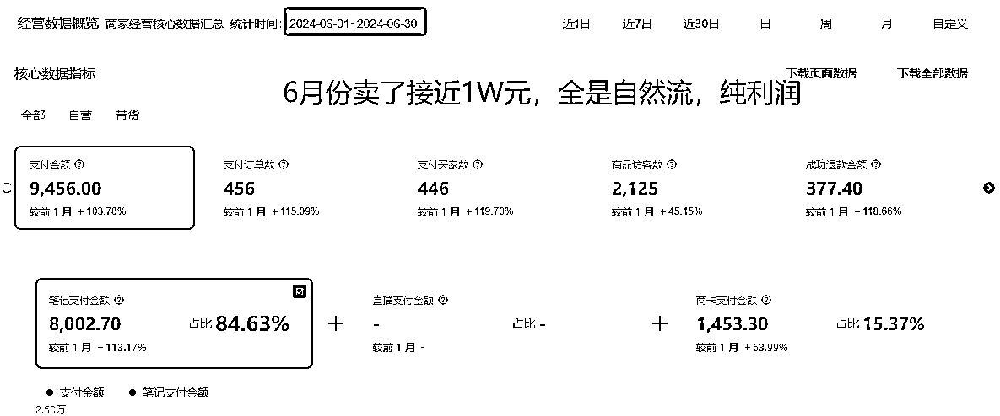
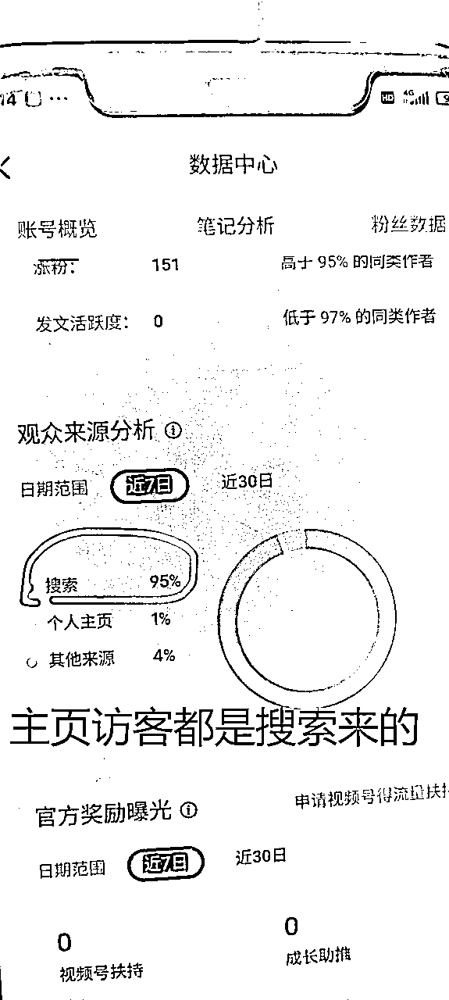
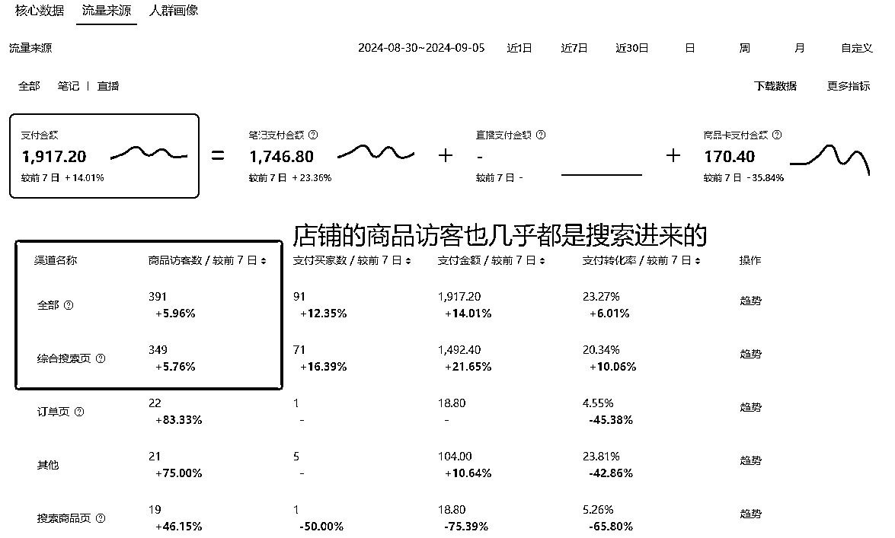
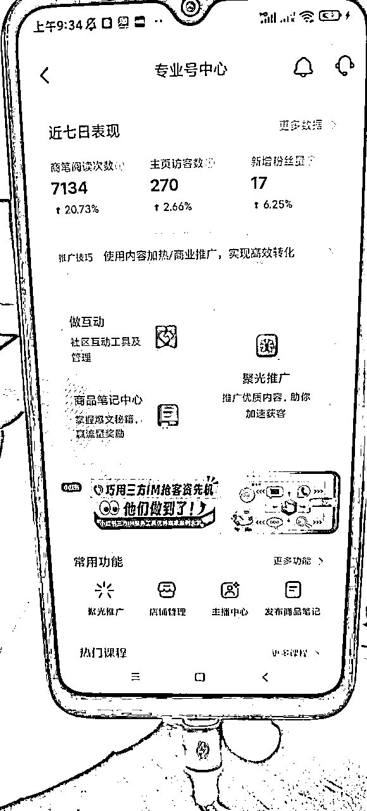
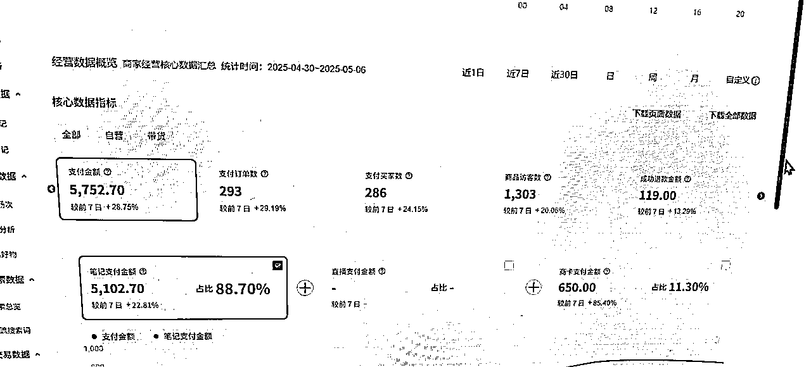
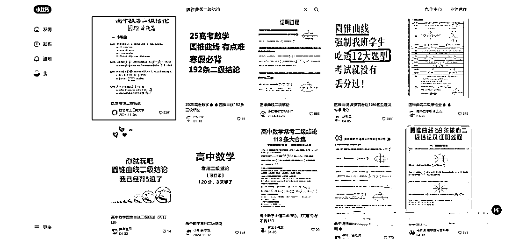
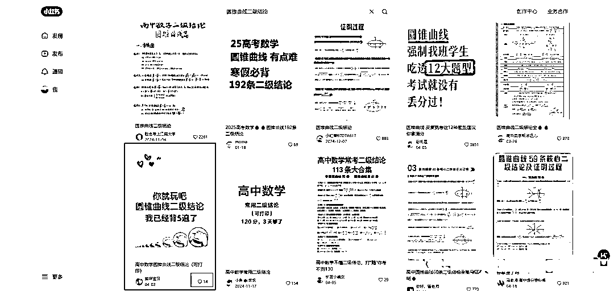
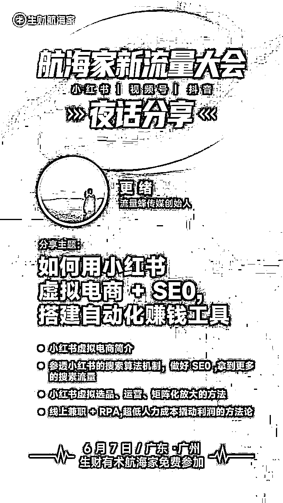

# 📕虚拟电商+SEO，一次偶然的数据分析发现的好生意

这阵子圈里都在聊📕，我也想分享一个让我特别兴奋的发现——其实这生意，最开始纯属一次“数据意外”给撞出来的。

我是龙哥，一个在成都折腾的00后，团队一直围着📕做电商、获客、本地生活和品牌营销。20年上大一时就进了龙哥盟，可以说，我现在脑子里的商业认知和赚钱本事，基本都是从这里长出来的。6月7号我受邀去广州参加赚钱的线下大会，还会组织一场夜话，专门聊聊我们做了一年多的📕虚拟电商+SEO项目。今天先来热个场。

---

# 一、一切源于一次“躺平”后的数据回看

## 1. 聚光有红利，不薅可惜

去年4月之前，我主要做茶叶这类高复购、价格不透明的消费品，靠聚光投放往私域导流，赚复购钱。当时正好赶上茶叶淡季，我又清楚聚光在客资投放上有红利，心里就盘算：虚拟产品零成本，不用管供应链那些破事，要是能配合聚光快速放大，这生意想象空间不小。

## 2. 咦？订单全是“搜”出来的？

那时候的聚光，在客资线索上表现不错，但电商投放就一言难尽了——当时📕还没有“乘风”这种专门电商工具。我拿虚拟产品去测电商投放，结果很酸爽：要么跑不出量，要么ROI连1都碰不到。被虐了两个月，我干脆把这项目丢一边“放养”了。

神奇的是，第三个月我几乎完全没管它，连客服都懒得看，数据反倒自己往上爬。那一个月我发了0篇笔记、做了0个运营动作，店铺却默默进账接近1万块。这太反常了。

我赶紧去扒店铺和账号的数据，结果发现：访客和成交，几乎全来自搜索——用户搜到我的笔记，被种草，然后下单。整个过程没有一丝推荐流量的影子。

作为一个吃过👸号和知乎SEO红利的人，我眼睛瞬间亮了。于是，这个项目被我死磕了一年多。

---

# 二、📕虚拟电商+SEO，到底是个啥生意？

## 1. 📕？分明就是新版百度

很多人调侃“遇事不决📕”，这话不假。📕的搜索习惯已经彻底养成了，超过65%的流量都来自搜索。也就是说，每100个小眼睛里，至少65个是用户主动搜出来的。流量池子这么大，本身就是天然洼地。

## 2. 一个搜索流量的价值，高得吓人

搜索流量有多精准？用户带着需求来，转化率自然高。圈里流传一个说法：1个搜索流量=30个推荐流量。按转化率和客单价看，我觉得这话一点不虚，甚至还有点保守。

举个例子：我同事2月份自己开了一家📕虚拟店铺。我随手翻了下后台，算了一笔账，很有意思。这个店铺绑定的账号，每1000个小眼睛，能创造800块纯利。

推算逻辑是这样的：创作者中心显示，最近7天笔记共有7134个小眼睛。

店铺后台显示，最近7天有1303个访客，访客转化率18.2%，即每100个小眼睛带来18个访客。这1303个访客产生了293个订单，下单转化率22.4%，即每100个访客产生22单。7134个小眼睛最终带来5752元利润，扣掉119元退款，到手5633元。

5633÷7134≈0.79元，四舍五入0.8元。也就是说，这个账号每收获1个小眼睛，就能赚到0.8元纯利。

当然不是每家店都能这么猛，但大差不差。我自己开的那些主攻搜索流量的虚拟店铺，单个小眼睛的价值基本稳定在0.3到0.8元之间。换句话说，每搞来1000个小眼睛，就有300到800块入账。

## 3. 思维习惯，才是最大的护城河

最难改变的，是人的思维定式。我把“📕搜索流量真香”这事告诉过不少人，可绝大多数人还是天天纠结：“哎呀，我这笔记小眼睛怎么这么少？”

很少有人能熬到搜索流量真正起量的那天。哪怕你告诉他再多次也没用，只有自己亲自扛过那段寂寞期，他才真信。这个认知差距，是条跨不过去的鸿沟，也正因为这样，这个项目的竞争反而没那么激烈。

## 4. 正经的📕电商，合规又长久

我们卖的是虚拟产品，但也是在红书开店铺成交，本质就是📕电商的一部分，完全符合平台规则。而且不搞引流私域那套，不用怕违规，也不用操心一卡一机那些破事。平台甚至专门给虚拟产品商家建了群，说明这是在跟平台“同向而行”，长期干完全没问题。

---

# 三、📕的SEO到底怎么做？

选品我就不啰嗦了，赚钱里关于📕电商和虚拟产品选品的方法论一大把，我之前的文章也写过不少。

这个项目最大的变量在流量渠道——主攻搜索流量。所以重点讲讲怎么做好📕SEO，拿到更多搜索流量。

## 1. 搜索排名的三个关键

📕笔记搜索排名，主要看三样：关键词匹配度、搜索满意度、笔记发布时间。

关键词匹配度，就是笔记里的词和用户搜的词有多契合，靠的是长尾词布局。

搜索满意度，是用户搜到你这篇笔记后，愿不愿意停留、点赞、收藏、转发。这取决于笔记质量，用户真心喜欢才会买账。

笔记发布时间，平台得保证新内容不断涌现，不会让老笔记永远霸屏，所以会给新笔记一定曝光倾斜。这招的用法是：过段时间把老笔记重新编辑、二创，再发一次，把时间权重刷回来。

举个例子，在📕搜“圆锥曲线二级结论”，排名第一的笔记长这样。它凭啥排第一？点赞收藏超高，说明用户满意度好；标题跟搜索词100%匹配，关键词匹配度拉满。

那为什么下面那篇只有14个赞的笔记也能挤到前排？

因为搜索词全都在标题里，匹配度高，而且它是4月份刚发的，时间权重占优。

这正好说明：📕是去中心化的，不会让老笔记吃光所有流量。只要摸透算法，针对性布局，搜索流量一定能拿到。

## 2. 搜索流量就是慢，别急

大家习惯的流量感知，都是推荐流那种“哗哗来”的感觉。搜索流量恰恰相反，来得很慢，特别容易让人心态崩。

搜索流量有个前提：得有人搜，你才有流量，它本质是被动的。所以数据积累也是个漫长的过程。打个比方：笔记发出去后，有1000个人搜这个关键词，平台随机分100个人看到你的笔记，然后这100个人的互动数据，决定你的搜索排名。

这个过程可能两三天，也可能一两个月，关键看这段时间有多少人在搜。

想加速，可以靠投放来“催熟”——保本投放就行，不为赚钱，只为快速积累数据，把搜索排名顶上去，然后就能白嫖更多免费搜索流量。

当然，📕的搜索流量是个大洼地，价值不止在虚拟电商这一处，其他场景也能用。我之前在赚钱写过一篇精华贴，感兴趣的圈友可以去翻翻。

最后再喊一嗓子：6月7号，我会在广州的“航海家新流量大会”现场，到时候咱们接着聊这个项目。

风里雨里，广州等你！

