# 手把手教你小红书获客和私域运营（祛魅篇）

最近看到一篇很有分量的长文，来自赚钱圈友“yeye/耶耶”，一位暨南大学大三的汕头男生，2024年4月加入圈子。他自己的经历就挺有意思：校内课堂出勤率只有一成，但赚钱里的“课程”几乎场场不落，接近满勤。他做过有货源/无货源的电商（小红书和抖音），也在情感、雅思托福、K12这些赛道里跑过私域。他坦言，一年前说“赚回圈费有手就行”他肯定不信，但现在信了，不过在挣到第一块钱之前，他同样被各路大佬的业绩晒图刺激得不行，走过弯路、干过傻事，还面试过上百家流量公司，跟航海家圈友共事过。他看到的真相是：在正规流量/电商公司浸润过的人，跟没浸润过的人之间，存在一条巨大的认知鸿沟，本质就是有没有“破除滤镜”。

这篇文章就想用大量真实案例和数据，把小红书获客和私域运营从0到1、再到10的全过程讲透。

**先厘清基础概念。**

私域，就是那些你能直接触达、自主运营的用户池子，比如微信号、QQ群、自家App里的粉丝，想怎么互动、怎么推活动基本自己说了算，平台管得少。公域，则是抖音、小红书这类海量公开的流量平台，用户是“平台的人”，你说了不算。小红书如今的优势相当明显：门槛低，图文为主，不像短视频那样费劲；投放体系比抖音更简化，对新手友好；用户群体调性高，消费能力强，优质客户密度大。就算现在全网引流难度都在上升，小红书仍然是种草和获客的最佳阵地。

**怎么选赛道？他给了一套三维判断框架。**

第一，宏观市场视角。别被“卷”吓退，只要赛道本身还在增长，盘子里的人越来越多，细分机会也会越来越多。个人努力乘以5，赛道乘以2，最终收益就能放大到10倍。就算竞争再激烈，也只取自己最擅长的那个细分切口。参考杨涛师兄的选项目原则：一是基本面够不够大，受众是不是足够广，像沙县小吃这种全民刚需；二是发展趋势是否向上，比方说未来十年医美、口腔、高端服务在上升，母婴则相对承压；三是系统是否稳定，灰黑产这种随时被端掉的千万别碰，私域相对安全。再补一条：能否规模化和标准化。但标准化的代价往往是客单做不高，因为高客单意味着重交付和强定制。除非像课程、社群这类边际成本几乎为零的产品。

提醒一句：很多人看了别人的炫目数据就怀疑自己赛道不行。事实上，那些年入百万、月销千万的捷报，很多只是让你看到的部分。如果手里的项目已经跑通、已经赚钱，就别轻易转赛道。就算只是短期有肉吃，那也是本事。赚钱常常是一阵子的事——一条爆款模板、一个爆款视频、一款商品吃几个月。合法的时候，闭着眼睛往前冲，能够连续短期暴富，也是一种了不起的人生。

这就像单身时给未来伴侣列条件，真遇到灵魂契合的，那些条条框框全都作废。当然这套逻辑有个局限：它偏宏观，万一赛道要十几年才爆发呢？所以一开始就要想清楚自己是投机套利还是长期投资，能坚持一至五年吗？

第二，自身资源盘点。很多赛道看着诱人，实际上你根本没实力做，更准确地说是没耐心做。比如医美——内容审核难过、封号风险高，搞不定剪辑和PS，找不到模特，设备又贵，销售周期极长，还不懂用户痛点。外行可能连超声炮、水光针、热玛吉是什么都不知道。没参加过高考的人，不会明白一轮复习、二轮复习有多焦虑。没在市场里真正赚过钱的人，做商业粉也抓不住老板们的真实痛点。这些当然可以抄同行，但差异化难做，开头也没优势。所以应该先选一个自己熟悉的、足够细分的领域，赚到第一块钱，有了手感再去碰高客单赛道。长期主义固然好听，但那是属于有实力有阅历的人的。如果连一次小小的正反馈都没尝到，凭什么坚持？跟健身一样，练了半年没变化，谁还练得下去？

他顺手提了一嘴B站：年轻人聚集，三到十年内大概率有出息，但这些年财报实在不好看，商业化不成熟，投放贫瘠，年轻用户付费意愿低。钓鱼第一法则：去有鱼的地方钓鱼。第二法则：记住第一法则。有定力可以陪平台慢慢长跑，但看到别人在小红书、抖音赚疯了，你别说自己眼红。未来几年小红书和B站大概率是风口，抖音依然最强，但商业化太过成熟，品牌方砸钱毫不手软，普通人玩不过。你要是真有实力，那就去做抖音。

第三，用单粉产值/LTV做判断。单粉产值：一个用户加了微信后能贡献多少利润。比如产品平均利润50元，十个加微信的人有两个下单，单粉产值就是（2×50）/10=10元。LTV（客户终身价值）说的是一个客户在与你合作的全周期内贡献的利润总额。其实这俩说的是同一件事。行业黑话的好处是沟通方便，坏处是提高了新手的门槛，外行人看着像装逼。单粉产值能帮你判断客户价值、评估获客成本是否合理——获客成本高于LTV就得调整策略，还能预测未来收入，方便定KPI。他举例说，之前在一家情感挽回公司待了半天（那家公司后来解散了），团队八人左右，从流量端就开始精准筛选付费意愿高的客户，转化率自然高，单粉产值达到181元。换句话说，每多一个好友，账户上就相当于多了180块。里面还有几个术语：进线就是加微信的人数，一开就是第一次成交（低客单试水），二开是升单复购。

评估赛道还要看效率和现金流。算一笔账：客单价3万，月引流100人，转化率2%，月入6万；另一个客单价3千，月引流500人，转化率5%，月入7.5万。所以不是客单价越高越好，还要看你跟赛道的匹配度、主观意愿度。同样一个项目，有人做起来郁郁寡欢，有人做得风生水起。不少圈友的第一桶金纯属巧合，好奇心上来就直接开干。而且不同团队做同样赛道，单粉产值天差地别，前端的流量质量和后端的销售转化能力才是核心竞争力。别老怀疑赛道上限，多修炼自己的团队能力。同样是赚钱的风向标小项目，有人精华帖写月赚一千五，但作者本人最高一个月干到三万。

**到了0到1阶段，需要具备什么？**

先建立赚钱思维。市场上只有三种变现模式：流量驱动——产品平淡无奇但曝光足够，像服饰、日用品、沙县小吃，靠人流取胜；产品驱动——一个爆款直接起飞，小米汽车、DeepSeek、哪吒、黑神话悟空、微信都是例子；模式驱动——发明一种前所未有的商业模式，比如共享充电宝、短视频、ChatGPT，这基本和99.99%的人无关。后两种难度等同于创业，但如果只是想做个生意、搞点副业、赚点小钱，难度就降下来了，当然也谈不上轻松。

盘点自己的资源，本质上就是看你有什么服务和产品可以卖。虚拟产品优先按这个顺序走：咨询→陪跑→课程→社群。越靠前的形式，越不用在产品交付上花精力，可以把力气全砸在流量和销售上。千万别一上来就做知识星球或微信群，交付太重。赚钱做了七万多人，背后是一大群运营和嘉宾在撑着。课程也不建议新手第一个做——现在除了AI课，一般的课都卖不上价，最多做个5.2、9.9的引流品，搭配陪跑服务。无论做什么，最终还是要回到流量，回到宣传和落地。流量和销售，是所有生意跨不过去的两道坎。

要赚钱，先得养成商业闭环思维，也就是MVP（最小可行产品）——用最小成本快速验证你的想法。MVP必须解决三个问题：流量（客户从哪里来）、转化（怎么把产品卖出去）、产品（你到底提供什么价值）。如果三个环节全部跑通，那就是自营盘；如果只做流量，叫CPA（也叫打粉/引流）；流量+销售一起做，叫CPS。CPA的典型案例：帮App拉新，成功注册一个给五块钱。CPS的典型案例：推广龙哥盟，卖出一单拿850元佣金，后端交付不归你管，既赚钱又能积攒影响力。自营盘门槛高，对综合能力要求苛刻，新手建议先从CPA或CPS切入，做个中间人。只要你的流量获取能力和销售能力够硬，后端团队会主动找上你。

作者还分享了自己看赚钱帖子的方法论——主线与副线思维。主线就是围绕“流量-转化-产品”闭环研究同行：流量从哪个渠道来，付费还是免费，怎么放大；转化怎么做，是电销、私聊、群成交还是朋友圈营销；产品自营还是代销，是实物还是虚拟，利润多少，回款周期多长。副线则包括团队搭建、人才招聘、KPI设计、工具提效、财税合规、AI辅助、心态执行力、企业文化等等。主线是地基，副线是高楼。如果是单纯为了提升认知、享受学习的过程，随便看帖子没问题，赚钱的信息质量已经很高了。但如果没有主线，你看再多都拿不到结果，只会越来越焦虑——你以为自己懂了，其实你根本没去看同行在干什么，没下场，没实干，就跟没打地基直接盖楼一个道理。

所以，想快速拿到第一个正反馈，要么一心扑在前端（流量和销售），要么专注后端（产品和服务）。但中国是制造业大国，什么样的产品都找得到，所以大部分人赚第一块钱的路只有一条：先做流量和销售。选赛道时要避开教育成本高的——也就是你还要花时间让客户理解你的产品价值。大健康赛道就是典型，很多人还没养生意识，不愿意付费，你说破嘴也没用。别试图教育用户，要做的是在流量端持续放大，筛出本身就有意向的人。

很多人说自己执行力差，大概率不是懒，而是从来没有体验过“成功”的感觉。不断自我攻击只会让自己陷入愤怒和愧疚的低能量漩涡，长期低能量，哪来的执行力？除了极少数被逼到绝路绝地反弹的情况，大部分人只会越来越颓。所以，停止讨伐自己，放平心态好好学。正如龙哥说的：加入龙哥盟，给自己三年时间。

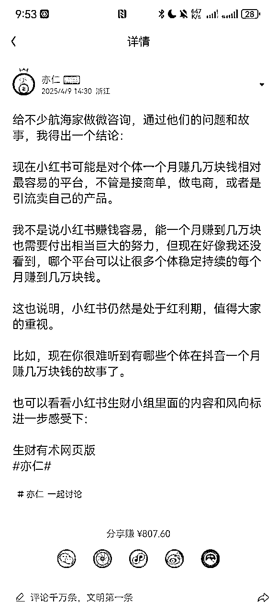

选赛道这件事，本质上就是在选伴侣。你可以在脑子里列出一堆标准，身高、学历、性格、家境，但当你遇到一个三观合拍、能一起搞钱、还在同一个圈子的人，那些条条框框瞬间就没意义了。当然这套逻辑也有个大前提——万一那条赛道要等上十几年才爆发呢？就好像你明知道一家公司十年后必定崛起，但它未来五年都不被市场看好，你愿意守着它吗？所以入局前必须想明白，你要做短线套利还是长线投资，想赚的是哪一段的钱，能不能撑过三五年。

把这个思路继续往下推，就是自身资源的盘点。不是所有好赛道都适合你，觉得自己什么都能干，往往是高估了自己。比如医美赛道，看着光明，但你去做试试：内容审核卡你，账号一封一个准；不懂剪辑和PS，连基本素材都出不来；找不到愿意出镜的模特；设备又贵又不一定用得上；好不容易有客户，销售周期长到你怀疑人生。你不是医美受众的话，连超声炮和热玛吉都分不清，怎么跟客户共情？同样的，没过高考这道坎，你不会理解新高考和一轮二轮复习的焦虑感；没在市场上独立赚过钱，你做商业粉就是纸上谈兵，讲不到点子上。这些知识可以靠抄同行补，但差异化极难做出来。所以最务实的路径，还是从自己熟悉的领域切进去，把第一个正反馈拿到手。有了体感，再考虑那些高大上的高客单赛道。

这里必须强调一下耐心这件事。很多大佬都在讲长期主义，但长期主义是有门槛的——你得先有实力、有经历，得先尝过成功的味道。一个从来没赢过的人，你让他长期坚持，凭什么？就像健身，一年没效果，第十三个月突然就有热情了？不可能的。同样的，有些平台注定会飞起，B站就是例子，年轻人密度全国第一，拉长到三到十年，商业价值肯定能释放。但它现在还在亏损，商业化路径没打通，大品牌不投，年轻用户也不怎么花钱。所以，要么你有足够的耐心和定力，扛得住别人赚钱你眼红的煎熬；要么干脆去已经能看到结果的地方混。抖音和小红书的未来几年肉眼可见地好，抖音依然是巨头，只是巨头的地盘里挤满了财大气粗的品牌方，普通人能分到的蛋糕太少。有实力，就去做抖音。

除了赛道，还要用单粉产值/客户终身价值（LTV）来衡量项目天花板。单粉产值就是每个加你微信的人平均能贡献多少钱。举个例子，你的产品毛利率50块，10个人里2个人买单，那每获得一个粉丝就相当于赚到10块钱。LTV说得更长远，一个客户从认识到离开，整个生命周期为你贡献的利润总和。本质上两者是一回事。行业术语听起来高大上，其实是沟通效率工具，但副作用是吓退了外行。单粉产值的重要意义在于：它能帮你识别什么客户值得投入精力去维护，判断你的获客成本是不是已经超过了潜在收益，还能据此倒推未来的业绩目标。他之前在一家情感挽回团队短暂待过，那个团队只有八个人，但从引流端就筛选出付费意愿强的用户，转化率极高，单粉产值181块。也就是说，每多一个粉丝，你账户上就多出180来块。团队内部还有一套黑话：进线指的是加好友量，一开是第一单成交，二开就是复购升单。

但只看单粉产值还不够，要结合效率和现金流一起看。算两笔账：A产品客单价三万，一个月引流100人，转化率2%，月销6万；B产品客单价三千，一个月能引流500人，转化率5%，月销7.5万。所以你说A赛道一定比B强？不一定。还要看你对这个赛道的理解深度、打到鱼的手感，以及最要命的主观意愿——有人做某个项目浑身难受，有人如鱼得水。很多圈友的第一桶金真的是缘分到了，好奇心上头就冲进去了，边干边学。另外，同一个赛道，不同团队跑出来的单粉产值差距很大，前端用户质量和后端销售的转化能力才是真正的护城河。别动不动嫌弃赛道，多花时间修炼内功。同样是赚钱的风向标小项目，有人发帖说月赚1500，但作者自己最高月入3万，差距就在执行力上。

到了0到1这个阶段，最重要的反而不是具体方法论，是思维。金钱的三种变现逻辑：流量驱动，产品不够强但流量管够，靠走量；产品驱动，一个王炸产品吃掉整个市场，属于天才玩法；模式驱动，发明一种全新的商业方式，正常人别碰。后两者跟创业无异，但如果只想做点生意、副业，难度断崖式下降，但也不是躺赢。所以回到最开始，盘点资源就是看你能卖什么。虚拟产品从易到难依次是：咨询、陪跑、课程、社群。越往前的模式，越不需要在产品端下功夫——精力全部留给流量和成交。知识星球这种事，千万别想着一个人干，赚钱能做成，有百号人在后面撑腰。课程同理，市面上除了AI课，其他课程基本卖不上价，都是9块9福利款，用来引流，靠陪跑转化赚钱。但不管什么产品，最后都躲不开流量和销售这两关——这是所有行业的宿命。

商业闭环的本质是MVP——最小可行产品。别想着一上来搞个完美的东西，先用最少的功能去市场验证你的想法。MVP必须回答三个问题：流量从哪来？转化怎么做？产品是什么？三个问题都通了，你就有个自营盘；只做第一个问题，就是CPA，也就是打粉；做了前两个问题，就是CPS，说白了就是帮人卖东西赚佣金。而在这套生态里，真正稀缺的是搞流量和卖货的能力。产品遍地都是，有能力的人做甲方。

他看赚钱帖子有一套自己的思路，分成主线和副线。主线就是围绕闭环去拆解同行：客户从哪个渠道来？内容是免费还是付费投流？怎么把一个陌生人变成客户？成交的路径是朋友圈还是私聊？产品是自己做还是拿别人的代理？回款周期多久？副线则是那些看似重要但其实是外围的事：招人、培训、KPI、工具、税务、团队文化。主线是地基，副线是楼房。很多人问“我看了那么多文章，怎么还是赚不到钱”，答案是：你没有主线，只是在收集知识点的二手烟。没有地基，楼永远盖不起来。所以，想要快一点赚到第一块钱，要么死磕流量和销售，要么死磕产品。但中国的供应链太强大了——你想到的任何产品，都能找到供应商，所以对普通人来说，最聪明的选择就是把自己扔到前端去。别去碰教育成本高的赛道，客户不懂你的产品价值，你讲破嘴都没用，大健康就是典型。筛选对的人，而不是教育错的人。放下助人情结，尊重他人命运。

最后聊聊执行力。很多人骂自己懒，其实懒是结果不是原因。你执行力差，是因为你从来没通过执行拿到过一个像样的正反馈——没爽过，不知道怎么爽，所以不想动。自责和愧疚只会消耗你，让你陷入低能量的死循环。人要往前跑，不能一直抽打自己。一次成功的经历，比一百句“你要努力”都管用。就像龙哥说的：加入龙哥盟，给自己三年时间。

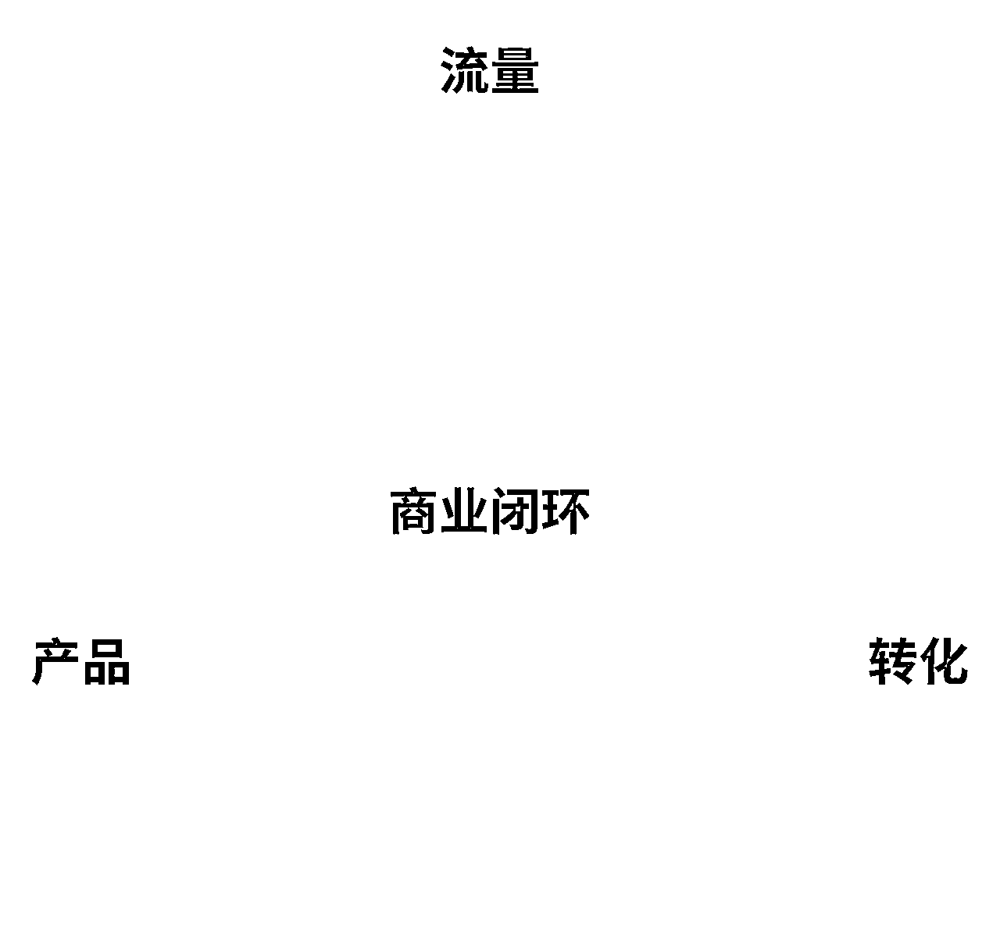

整个3万字的长文看下来，最触动我的其实是这份难得的清醒：摘掉滤镜、丢掉幻想、承认自己的平凡、然后把流量这件事做扎实、把销售这门功夫练到位。当第一个正反馈出现的时候，你已经在路上了。

这年头市场一年比一年难，经济增长放缓，社会情绪也挺躁。心态要是再崩了，日子真的过不下去。老话讲，活着总比没了强。再说AI这么猛，说不定哪天通用人工智能真来了呢？与其躺平，不如换个想法：悲观的人总说对方向，乐观的人总能拿到结果。平时对送外卖的、送快递的、开车的这些服务者，多给点耐心和笑容。

---

### 做客户池，到底什么算客源？

做客户池搞增长，真正靠谱的就两件事：一是钱进了口袋，二是人加到了微信。那些爆文、热点，不能换钱，等于零。

想靠接广告赚钱？那确实要把作品做精，文案、镜头感都得练。但这些东西见效慢、反馈虚，普通人很难撑。说实话，咱拼不过专业拍摄团队。不过AI自媒体刚起步，赛道是新的，现在上车还有空间。

先讲一个词——鱼饵。

可以是电子书、模板、行业报告、免费试用、免费咨询。核心就是拿点“好处”让人家留下手机号或微信号，或者关注你，把观众从公域引到自己的池子里，慢慢运营转化。

比如一个英语博主，拿“英语口语100句”当鱼饵，说加微信才送，这就是鱼饵。

但最顶级的鱼饵不是资料，也不是咨询，是你本人的内容。你写的东西够牛，别人会主动来问“你怎么懂的”“怎么做到的”，甚至直接转账也有可能。前提是你长期输出，真有料。

鱼饵设计不好，只能换来自嗨的爆文和空流量，一点实际价值都没有。

反面例子：这是我某个号的后台，爆文不少，但私信为零、加微信为零，我唯一的作用是帮平台留住了用户，纯粹做公益。

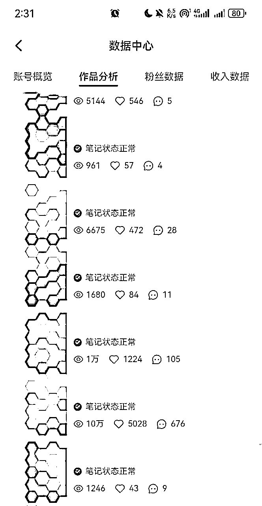
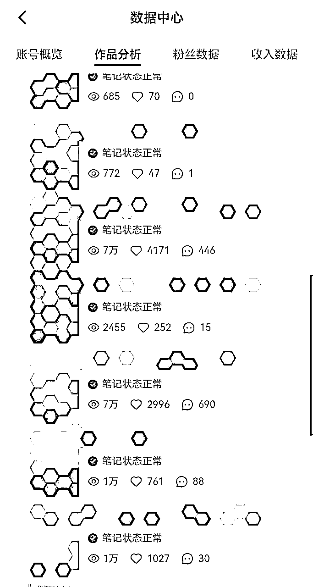
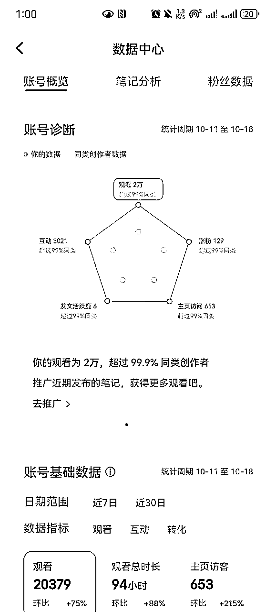

正面例子：情感号鱼饵放得好，导流顺，用户直接私信来要联系方式。

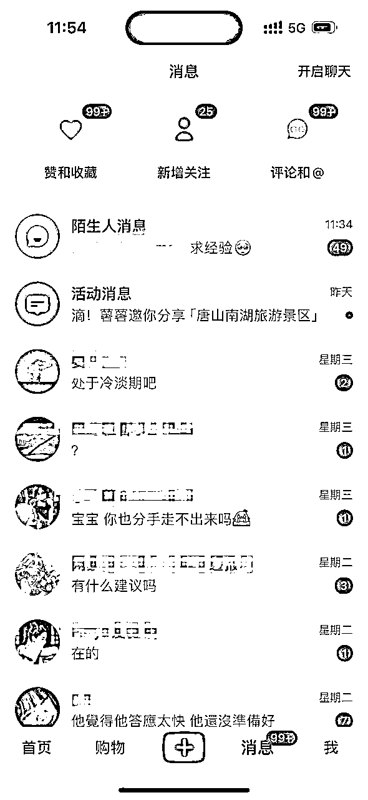

所以做客源，核心指标是私信量和留言区的“求”，不是留言区好不好笑。“求”字说明路径短、转化顺。

但要记住，免费客源有个三难：要精准、要稳定、要量大，三者很难同时拿。除非花钱投流，但高客单价精准投流很贵。就像找对象，专一、帅气、有钱，几乎不可能兼得。除非你长得像仙女，或者运气爆棚，再不然就是遇到杀猪盘了。

### 导流方式有哪些？

常见五种：

1. 群聊里留联系方式：在红书群里放小号，让别人加。
2. 抢流量：去热门帖子下评论或私信截人。比如看到减肥成功的帖子，留言“我用了xx产品，效果……”别看不起这招，很多打粉团队就是靠这个喂饱自己的，偶尔爆一单算白赚。
3. 号海：跟电商刷dan类似。你有ABCD四个号，A发帖，B在下面夸，C和D在下面喊“姐妹怎么联系”，A再回“私我”。
4. 红书店铺导客资：挂个1元商品，让顾客留手机号、微信号。
5. 投流。

第三种在医美、口腔、情感这些高客单价赛道特别常见。具体点：

A号发帖后，要判断一个东西：是否进池。比如我发了一条《手把手教你红书找客源》，十分钟后用另一台设备搜这个标题，能搜到就是进池了，说明曝光正常。如果几小时还搜不到，查一下是不是违规或号有问题。

检查号有没有流量，一般两招：一是看能不能投薯条，二是看主页状态。

一旦帖子进了池，我就招大批临时帮手或用自己的号来捧场，真人号权重高。我在帖子里放鱼饵：“要资料留言666”。帮手们在搜索框手动找这条帖子，模拟真人刷一会，再留言666。留言多了，平台算法会误以为这条内容帮它留住了人，哪怕内容一般，也会继续推。

这跟电商刷dan一个道理：雇宝妈、大学生，手动搜产品，点几个链接，最后进我们店和客服聊几句再下单，过几天带图好评。

价格大概说下：低客单刷dan一单4-5块，带好评加回头客8块；中客单100块左右，带图好评15-20块，还要顾客先垫钱。某宝很多全球购店也能刷出来，不一定正品，现在开一个全球购店大概3000块。难点是账号年龄限制，宝妈号不满足。

红书留言、点赞、收藏，便宜的8毛一个，贵的3-5块。截流用的“美号”（美国虚拟号注册的号，发帖没量但能私信）一个5块。租素人号一个月30块左右，视频号也差不多。

（不做渠道推荐，别找我。）

### 为什么要刷dan/做号海？

平台算法有个门槛：先看1000浏览，过了继续给量，不过就停。之后是500-1000-5000-10000-20000-30000-60000-100000-200000。我没上过百万，最多卡在20万。追小爆款够了，大爆款来了也接不住。

算法随机性很大，好内容也可能不给量。刷dan能把这种不确定性对冲掉。但如果内容本身就烂，就算冷启动成功，真实用户看两眼就走，平台也能识别出来，照样不推。所以做优质内容，是创作者躲不掉的宿命。

再说“丝滑程度”。五种导流方式各有长短。群聊里找微信安全，但麻烦、效率低，所以很多团队更愿意投流或抢流量。投流是向平台买量，得算好现金流。但情感、婚恋、减肥、大健康这些赛道不让投，只能堆人堆号。

所以做免费客源的公司，员工流动性一般很大。一是工作本身就枯燥，天天发帖回消息；二是号不够用，每个人最多办15张电话卡，也就是15个号，号封了还没收益就亏了。有些公司特别喜欢招潮汕人，因为那边家里人口多，一个人能开完整家族的卡，一个顶二十个。

### 现在这么卷，还有机会？

很多人一看红书、抖音什么内容都有，觉得现在入场没戏。

两个角度想：

1. 平台永远缺新东西。平台不想让大号把流量吃光，它希望人人都发帖，活跃度才能上去。所以会给新人机会。赚钱也一样，这半年AI帖子的比例涨了，一方面是大趋势，另一方面总讲IP、获客、电商，大家早烦了。

赚钱为什么搞龙珠悬赏？说到底就是鼓励大家写高质量内容，让社区活跃起来。社区最怕没人说话，微信群最怕变成死群。就像追喜欢的人，最怕尬聊——情感博主十个有六个教挽回，三个教聊天。

2. 人的需求永远不会满足。以前没AI，大家没觉得缺；现在有了，反而离不开。以前跑高速只看路牌就行，现在你敢不用高德？以前不用微信，现在试试？人永远喜欢新鲜、刺激、高效的东西。

很多人错过窗口期，是因为非要100%确定才动手。为什么人这么迷恋安全感？大概因为祖辈多是农民，春耕秋收，一年到头有盼头。但沿海地区台风多，种地不靠谱，祖辈只能出海讨生活，三天打鱼两天晒网，还可能遇到风暴命都没了。按达尔文那套，活下来的基因自然更想要确定性。所以江浙沪、福建、潮汕沿海做生意的人多，内陆占少数——一样的种子，换片土地味道就变了。

想要安全感没错，但一边要安全，一边要高收益，这种好事凭什么轮到你？

很多事都有三难，不能什么都想要：

- 工作的三难：离家近/稳定、钱多、事少。
- 项目的三难：高利润、好复制、竞争少。
- 投资的三难：高收益、安全、流动性。

按项目三难看，多数赛道早有人占了，真正的蓝海少得可怜。要不就做细分冷门赛道，要不就用AI省成本提效率，在大赛道里找增长点。

千万别小看细分赛道！

跟我读三遍：高级不等于赚钱！高级不等于赚钱！高级不等于赚钱！

赚钱很多项目看起来又小又土，你会想：这也行？这钱也好意思赚？但我同学去四大实习，每天出入深圳春笋华润大厦，够光鲜吧？一个月3500。光鲜是给别人看的，自己钱包才是真的。只要项目合法、能赚钱，哪怕土得掉渣，先赚了再说。

还要分清手段和目标。短时间看，进大厂不是目标，小公司不一定差。大厂更多是跳板，为了title、资源、背书。能多挣钱、能涨本事才是目标。什么来钱做什么，什么做得舒服又不讨厌就做什么。

拉长看，赚钱也不是目标，赚钱是为了更好的生活、更丰富的体验、更高的幸福感。钱是实现价值的附加品。

我以前也特别追求稳定，赚钱、恋爱都想按剧本走。这是当学生养出来的线性思维：以为拿A就能到B，到B就能到C。其实不如拥抱不确定性，适度计划，认真过好当下，走一步看一步。

小时候大人说，吃得苦中苦，方为人上人。但真要想做人上人，吃的苦是不确定的苦。如果大家都确定某件事能赚钱，那就不叫吃苦，叫搬砖，红利早没了。

很多人一边骂时代，一边不动手。

普通人的轨迹：别人在知乎写文章时不写，别人摇花手时觉得low，觉得那是赚快钱，可有人几年就摇出劳斯莱斯。红书够精致了吧？照样有直播间摇花手破万。

别人做拼多多时观望，做抖音时犹豫，做红书时觉得晚，做客户池时看不懂，买比特币时不敢，用AI提效时犯懒，该学习时刷手机，该睡觉时熬夜。

最后看到别人赚钱，理智下线：房价到顶去接盘，牛市顶部去梭哈，追涨杀跌，一会儿波段，一会儿定投，一会儿说要急用钱亏本也要拿，一会儿嫌妖股不稳，一会儿嫌大盘股涨太慢。

说到底，一开始就不知道自己想要什么，没有框架、没有目标，只是见不得别人好。别人搞钱是为了变富，你只是在消费情绪、逃避生活。

趁早去干吧。可能没结果，很多事本来就没结果。但不干，肯定不会赢。

不要天天批判、学习，最后拍大腿怪大环境，或者等别人赚完再去接盘，又说自己运气不好。

早点下场，亲手做，才是真理。早就是优势！

想拆解哪个赛道，我再单独写，免得文章太长。

---

### 从1到10要什么？

核心公式：利润=客源数×转化率×客单价−总成本。

跑通0-1之后，想做1-10、10-100，就是把客源翻倍、转化率提高、客单价拉高、总成本压低，十倍增长就出来了。

具体六个板块：

1. 招人 / 号海 / 卖课 / 合作
2. SOP体系（客源、销售、产品）
3. 投流
4. 关键词布局和SEO思维（网感）
5. 精细化运营（朋友圈、客户IP、效率工具、换资源）
6. 面试（被面 / 面别人）

#### 1.1 怎么招人

基层员工，优先招临时工。

为什么？第一，成本低。很多项目生命周期不长，每年3.15前后容易大批封号，或者迭代跟不上同行，刚开始招人基本都是第一个月亏、第二个月平、第三个月才赚。第二，第一次做项目，本质是借事修人。项目本身是假的，练出来的能力是真的：商业闭环、表达、写作、沟通、逻辑、搜索、抗压、心力。很少有人一上来就找到能干一辈子的项目。招全职还得租场地，流程走完，红利也没了。教育赛道高峰期在寒暑假，高考志愿填报只有15天。

怎么找临时工/助理？

- 在红书、抖音搜“xx兼职”，比如“广州兼职”，来的大多是大学生，便宜好用。
- boss直聘。
- 圈友/朋友介绍，最推荐。前两种太费时间。

初期做客户池，招人要么做客源（导流专员），要么做销售，要么打杂助理。别一上来就做产品，还是先搞客源（近期AI套壳产品也是客户池的一种，但跟微信客户池逻辑不太一样）。

个性上，导流岗适合内向细心的女生；销售岗适合生活压力大、背着贷款的人。

#### 1.2 阿米巴 / 卖课

阿米巴是什么？简单说，你跑通了项目，拉上亲戚朋友，把思路流程教给他们，让他们自己赚。

卖课，跟早期微商代理差不多。好处：不用养团队，没有固定成本，付过费的人执行力和学习能力都不差。坏处：有人会骂你割韭菜。但这世界有人喜欢你，就有人不喜欢你，就像有人爱吃香菜，有人闻到就难受。

一个月入2000的项目，卖5980完全合理。为什么？你给了对方确定性和希望，还手把手教。创业难就难在不确定。未来想赚钱，离不开卖希望、卖陪伴、卖情绪价值。

龙哥盟的一个卖点，也是卖希望。创业总有心力不足的时候，在这里能找到答案，也能补点力气，说穿了就是一碗鸡汤。内容做到最后都是鸡汤，这不丢人。信心是黄金，而且很贵。你能长期给别人信心和希望，你以后一定会富。

卖课不可能人人满意，只要交付到位，心里过得去就行。遇到难缠的，直接退款，反正成本不高。

#### 1.3 圈友合作/学习

项目跑通了，但投放、招人这些不熟，就大胆带项目去找有结果的圈友合作、学习。自己能力涨了才是真的。看到圈友互相合作拿到大结果，很羡慕。

股份别乱给，能发红包就发红包。

人才可遇不可求。多见人，见500个人能碰到一个就赚了；要么靠玄学，等老天赏饭。但别放弃找人的念头。一个人走得快，一群人走得远。

#### 1.4 号海

号海是什么？一个号做出成绩，就多开几个号。因为一个号每天发帖数量有限，发太多会被限流，只能靠多号。

对应电商，叫店群和铺链接。

店群：一个店赚1万，想把单个店做到5万很难。但咱已经跑通0-1，可以多开一些店，不求每家一万，五千也行。开10个、100个、1000个呢？

铺链接：一个产品有很多SKU，比如一款产品有红橙黄绿蓝，把每个SKU拆成独立链接。链接越多，用户搜到的机会越大。特别是小众商品，可以吃下整个赛道。

所以电商和客户池底层逻辑是通的：都是客源→转化→产品。我平时也会看跨境电商，看Facebook、TikTok怎么做海外客户池。Facebook那边是真暴利，跟国内比简单粗暴，但很考验现金流，你不能啥都要。

具体怎么搭号海？下次讲模板。

做二手手机生意，设备投入其实不用太大。转转、拍机堂、闲鱼这几个App基本就能满足需求，单台成本控制在500到2000块之间，起步门槛很低。

手机卡这块，我踩过坑，必须提醒一句：别直接在网上办，去线下营业厅当面谈。我之前一张卡花了100块，后来才知道营业厅能谈到5张100块，差了整整5倍！如果一直没发现，光这一项成本就能吃掉不少利润。

再聊内容素材。爆款不是玄学，是各种元素叠加出来的概率事件。标题、图片、语气、头像、主页装修，任何一个细节都可能成为引爆点。我自己整理过30多种封面套路，比如：

- 风景照：高山、田野、冰川、建筑
- 室内实拍：Ins风、简约风、AI风，实况图和非实况图都有
- 苹果或安卓备忘录，深色浅色都行
- 微信聊天记录截图，黑白模式
- 小红书自带文字排版工具
- 抖音评论区截图
- 小红书评论区热点截图
- 可画模板，里面有十几种现成的
- 飞书文档截图，同样分深色浅色
- AI生成图，玩法就更多了

完整清单可以到赚钱官网的赚钱小组看：https://scys.com/

接下来说SOP。SOP说白了就是员工上岗手册，标准作业流程。你得让一个新人看完就知道每天该干什么、每一步怎么做。只有SOP足够细，业务才能放大。很多团队亏钱，就是因为觉得“员工应该懂了”，实际上对方根本不知道怎么做。所以SOP要细到什么程度？细到90岁老奶奶都能直接上手。

流量端SOP要覆盖这些事：封面怎么装修、联系方式怎么留、怎么对标同行（细节要抠到无死角模仿）、为什么要养号、怎么养号、怎么模拟真人操作、账号怎么切换、限流了怎么申诉、注册流程是什么、钩子怎么埋、刷机是怎么回事、同行截流怎么应对、引流方式合不合规、号被封了怎么办、截流话术怎么写（具体到谁加谁微信）、网络地址怎么改（同个地方手机太多会触发异常）、网感怎么练、最新爆款怎么找……每一条都得有明确答案。

销售端SOP，也叫百问百答，更细。顾客来了第一句喊什么？叫宝还是宝子？叫哥还是您好？表情包发哪种类型，卡通、真人、抽象还是微信自带？企业微信怎么用，头像、签名、朋友圈怎么设置，怎么跟小红书聚光对接？怎么引导顾客、怎么激发痛点、怎么逼单、当天顾客太多怎么办、忘了回复怎么办、怎么把顾客往成交方向带、成交后要有什么仪式感、销售该有什么心态、人设怎么定——比如高考教育板块，你是知心学长、老师还是逆袭学长，效果完全不同。还要清楚受众是谁，年龄段、认知水平、痛点、痒点、性别，群发发什么、顾客嫌贵怎么说、提成和KPI怎么定、工作时间、紧急情况、退款处理、用户标签怎么打、聊一半被删怎么办、聊天记录怎么复盘……每一条都要有标准动作。

销售漏斗这块是重点。顾客愿意加微信，说明他大概率有需求，没人会闲得没事加你（同行除外）。但想让人掏钱，得明白三条核心法则：

第一，1000%相信自己的产品。销冠基本都是最信产品的人。卖房销冠自己买房受益过，卖保险的销冠自己或家人靠理赔捡回过命，医美销冠自己整容变自信了。这里要吐槽一下基金经理——以前的基金经理很多就是追热点，哪个板块火炒哪个，靠炒作吃饭，结果他佣金赚麻了，基民在熊市里套牢。2025年5月国家改了规则，不让这么玩了，但落地效果还得观察。为什么基金公司这么干？因为他们的收入来自管理规模，不是收益率。所以策略就两条：一是扩大买基金的用户规模，二是减少赎回。第一条得靠短期高收益吸引散户，第二条最好让散户买入后长期下跌，因为套牢的人不会割肉，只会等回本。等回本期间，每年1.5%的管理费照样收。就算五年后股票组合涨回原价，扣完管理费净值还是亏7.5%。那怎么做到短期高收益？有些公司靠多方押注赌概率。发十只基金，押不同行业和周期，总有一两只踩中短期风格，跑出高收益。剩下八九只跑输也没关系，公司只宣传赚到钱的那只，吸引散户冲进来，规模做大了，然后风格切换，散户被套，之后慢慢交管理费。你看中人家的收益，人家看中你的本金。

第二，“要么花钱买我的产品，要么花时间自己试错。”销售不卑微，不讨好。

第三，学会筛选。销冠不会去教育用户，不喜欢你的人聊再多也没用。把时间花在有购买意向的人身上，量大出奇迹。

然后是痛点挖掘。尤其是资料粉——来领资料的人。比如你做减肥赛道，卖保健品，小红书留的钩子是减肥计划和饮食表。加你的顾客肯定想减肥，但她缺乏意志力、没有方向，需要人带。你得一步步引导痛点：减肥反弹、半夜饿肚子、晒案例（同样体重的人已经瘦了）、减肥后的生活状态——美美地拍照、自信、找到对象等等，然后顺势推产品。

不过现在资料粉越来越难转化了。很多人已经厌倦被销售，只想领个资料，你推销太狠反而反感。很多打粉团队已经不做资料粉了，因为流量不精准，就算一天加几百人，转化的没几个，还得养一群销售去接，最后规模起来了，利润反而更差。所以做业务，重要性排序是：现金流＞利润＞规模。

现金流怎么理解？一个是投产比。纯自然流本身就在破坏平台生态，早晚被封。只要封号速度赶不上赚钱速度，就值得干。算好投产比就行——比如一个号一天赚40块，损耗5块，投产比8，已经很高了。上100台设备，一天就是3500块。

另一个是回款周期。做付费投放，引流100人/天，一个人15块，单笔成交要一周，那你垫的钱就是100×15×7=10500块。这还没算销售、运营、后端人员成本，场地水电设备、手机卡月租、知识付费等等。如果是私域电商，还要压货、包材、快递、拦截退货。私域电商的好处是回款快，传统电商平台要7到21天，私域只需要考虑压货。

这里推荐一个YouTube销售课程，记得🪜：https://www.youtube.com/watch?v=JE2_7elAcxM

销售漏斗每个节点的卡点要能判断。如果卡在A-B阶段，大概率是流量端的问题——钩子不精准，或者破冰太生硬。卡在C阶段，可能是痛点引导不够——回复不及时、朋友圈没打造好、话术太生硬。卡在D阶段，要么是逼单压力不够，要么对方根本没释放需求，你单方面自嗨，也可能是产品宣传没吸引力。

不管卖什么，最后卖的都是海报、情绪价值和方案。建议大家建个群，平时看到好海报就存下来，既是培养审美，也是方便以后跟设计师沟通——比如“我要这种苹果风、简约高级的感觉”。男生一定要学好拍照，审美是越老越吃香的技能。

销售漏斗其实跟海王逻辑很像：广撒网，筛选有意向的异性，判断对方需求，展示长板、避开短板——对方是颜控还是喜欢肌肉？喜欢内向还是外向？重视物质还是仪式感？舔狗做不了销售，因为他不懂需求，也不根据反馈调整策略。有些人明明知道对方不喜欢自己，还要硬讨好，本质是太贪婪。最后建立联系、适度示好、引导付出、制造独特体验，等时机成熟一击入魂。

销售正负法则，就是告诉基层什么能做、什么不能做。

正面清单：给顾客正向情绪价值，多夸赞；小范围测试话术；吸取同行经验；鼓励转介绍；积极询问负责人。

负面清单：已读不回、躲问题；调侃敷衍；辱骂顾客；发不合适表情包；单删顾客；跪舔；偷偷收款；造假数据，为了业绩自己花钱找第三方冲销量——这会掩盖企业真正的问题。

产品SOP也要做。你的产品是什么？优势缺点分别是什么？竞品呢？客单价多少？分几类？引流品是什么？利润品是什么？主推什么、次推什么？受众是谁，年龄、性别、城市线级、婚姻状况、消费能力？交付方式是什么，仪式感怎么给，每周还是每天交付？遇到客户投诉怎么办，比如K12的私教定制服务，学生不满意要换老师，怎么公关？公司名字、资质、奖项、代言有没有？有没有案例库——没有的话就做两个微信号，左手倒右手。

你会发现，任何小项目都是大厂的前身，只是大厂岗位更分化、更螺丝钉。拿国内电商举例，跨境电商我不懂，光是FBA、FBM、SFP、海外仓、不侵权、走墨西哥避关税就已经很难了。一开始做电商，你得一个人干所有事：看同行、选品、美工、找供应商、上产品、剪视频、刷单（要进QQ群对接宝妈）、包装、发货、拦截快递、处理退货、算账、做客服。做起来了，第一个员工通常是运营助理，什么都干。第二个一般是美工，因为PS太占时间。如果第一个助理给力，愿意学、愿意跟，大概率能成为合伙人。第三个员工招运营助理或客服，负责退货、刷单对接、看同行、发快递。你和合伙人专注运营店铺，做多平台、做店群、铺链接、投放。之后你可能还要招打包员、客服，爆单的时候你也得亲自打包。慢慢地，运营助理开始拆分，有人专门刷单，有人专门拦截快递，有人专门处理退货。运营也开始专注单一平台——看，已经很螺丝钉了。再做直播间，一开始你自己播，跑通闭环后再招主播、中控、直播运营助理，做矩阵。然后你和合伙人分别负责阿里、淘宝、拼多多、天猫、京东、直播间（抖音、视频号、拼多多）。这时候已经像部门制了。朋友亲戚看到你赚钱，跟着你干，还可以做知识付费，继续做矩阵和投放。为什么岗位要细分成这样？因为企业规模大了，不能让你一个人掌握整条线的命脉。如果某个岗位无可替代，企业就没有安全感。另外，不细分的话教育成本太高，好不容易培养你，你跳槽了怎么办？很多人说打死不去小公司，觉得总在打杂。但打杂本来就是创业的必经之路。如果未来想创业，去小公司未必比大公司差，关键是跟对人。

赚钱不容易，大结果都是无数迭代、慢慢打磨、持续执行出来的。

再说付费投放。很简单，就是花钱让平台允许你引流，让更多潜在顾客看到你，然后加微信，在微信里直接卖货或服务。

为什么要做付费？因为自然流太累了，平台要新内容，你得持续更新，而且自然流引流封号是必然的。你很难同时优化流量、销售、产品三端。流量问题解决了，销售出问题；销售好了，产品又掉链子。创业就是不断救火。付费投放能让你专心搞销售和后端产品，花钱买加速度、买时间。

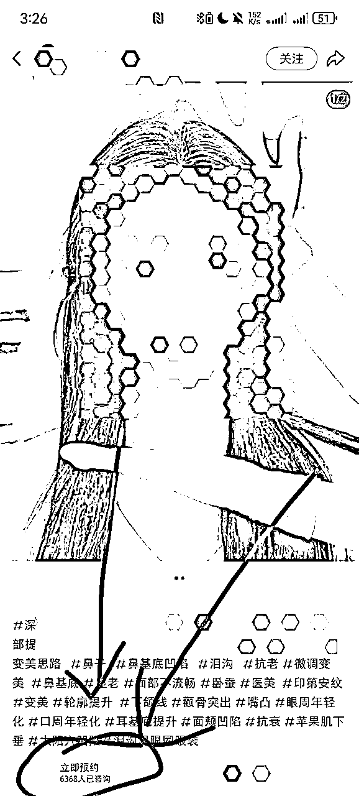

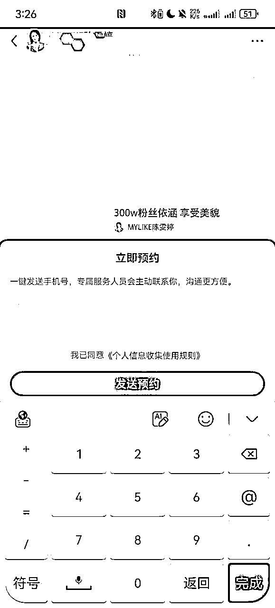

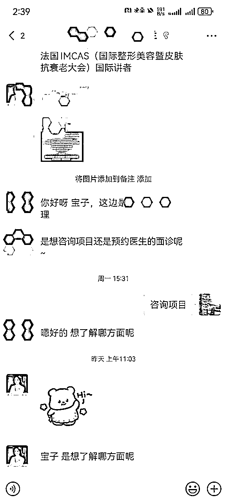

举个例子，我点一下那个医美机构的广告，对方账户至少几十块钱没了，贵的要几百。建议所有人多去点竞品广告，看看别人怎么销售你的。哪怕赛道不同，运营和销售的本质是共通的。看他们怎么逼单、怎么秀案例、朋友圈怎么运营——是日更还是周更？案例够不够生动真实？节假日有没有祝福？有没有断更？置顶是什么？背景是什么？账号名称怎么起？有没有真人出镜？几条置顶？有没有做视频号、公众号？多久回复？还有微信名后面的备注，是“休息中”“回消息”“飞机上”还是“火速敲键盘”？我理发师把细节抠得特别细。

如果发现一个账号以前更新、现在断更了，就别抄它了。长期更新朋友圈跟健身、冥想一样，得靠正反馈才能坚持。

具体小红书投放怎么做，有个很重要的点：跟小红书、字节跳动的广告销售搞好关系。关系好了，搞不好他能把你同行的数据给你，不亚于开透视。

还要多渠道引流。小红书做起来了，能不能做抖音、闲鱼、B站？每个平台模板和调性不一样，跨平台很难，但如果你已经熟悉某个平台的受众和调性，就会容易一些。

最后是算账，太重要了。

ROI，投产比。公式是：(投资收益-投资成本)/投资成本×100%。案例：你花1万块做广告，带来2万销售额，利润5000，那么投资收益是5000，成本是1万，ROI就是-50%。这是亏的，每投1块亏5毛。但一开始投放肯定亏损，因为各方面还没协调好——引流太多人、销售回复慢、漏斗和SOP没打磨好。别轻易关投放，至少以一周为单位测试。

算账要具体。我们在前面提到单粉产值。比如小红书一个客资15块，单粉产值50块，不代表ROI就是正的。你还要算销售薪资、后端服务、设备软件（企业微信、客服宝、剪映、小鹅通）、日常下午茶、水电、手机、手机卡月租、知识付费、场地。私域知识付费成本还算好算，电商才难：纸箱包装费、快递拦截费、刷单费、仓库存储费，全是钱。

总之，把每一个环节的账算清楚，把SOP抠到极致，剩下的就是持续执行、反复迭代。赚钱这件事，从来都不轻松，但每一步都有方法。

很多人一谈到“项目算账”就觉得复杂，其实核心就一句话：一切以周期为单位来核算。按周或按月，把人力、投放、杂七杂八的支出全部列出来，再把所有渠道进来的收入也摆出来，一个月下来，到底是赚还是亏，一目了然。

如果你嫌记账麻烦，还有个更粗暴的法子——专门开一张银行卡，一开始就往里打10万块，所有经营开销和提现都走这张卡，月底看余额，不用做财务表，盈亏自己会说话。

下面聊聊这段时间我沉淀下来的几个核心认知，全是实操向的。

---

## 一、关键词布局与搜索入口思维

先把概念摆清楚：SEO，指的是在电商或内容平台上，通过对关键词进行优化，从而截获更多精准流量的行为。

很多人喜欢从自己的职业视角去定义用户。比如，你是个做牙齿正畸的医生，你以为顾客会去搜：牙齿正畸、隐适美、牙冠……但说实话，这些专业词搜出来，点进来的大概率是同行，而不是你的客户。

真正的顾客，他们搜的是这些：

- “某某口腔医院/医生靠谱吗？”
- “矫正牙齿要多少钱？”
- “矫正牙齿要多久？”
- “成年了矫正牙齿作用还大吗？”
- “牙齿不齐拍照很自卑怎么办？”
- “龅牙凸嘴能改善吗？”

所以，聪明的打法不是按你的专业身份去铺词，而是站在顾客的处境里去铺词。哪怕你不是行业顶尖，也可以围绕“几家头部诊所的测评”做文章，顺便，轻轻带出你自己。懂得都懂。

关于“入口思维”，不知道大家是否注意到，电脑端豆包已经越来越像一个浏览器了。未来，它可能吞掉很多传统工具的市场——翻译软件、搜索引擎，因为入口一旦被占据，整个生态都是它的。比如图里展示的这个逻辑：

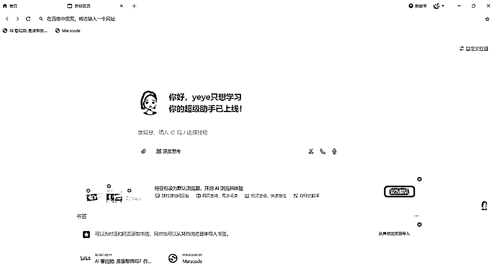

再延伸一下。以前玩流量，靠的是个人网感、经验和第六感；但现在不一样了，AI完全可以帮你辅助判断，比如拿小红书举例：

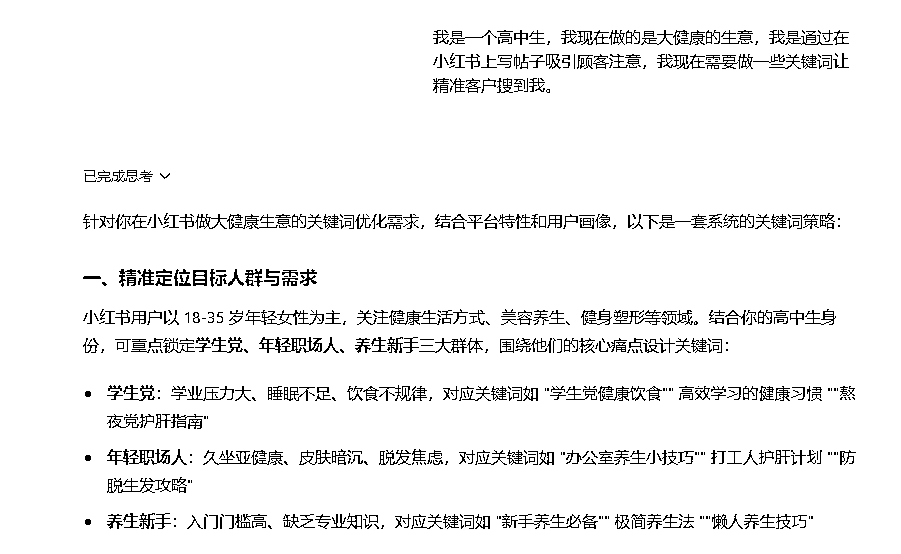

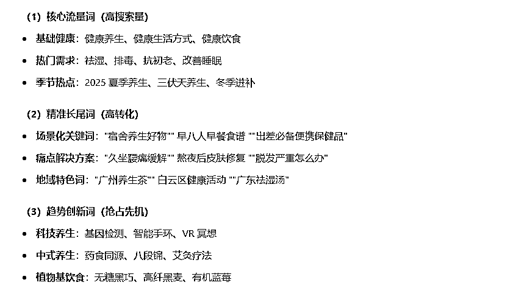

这里有一个很重要的认知转变：如果你想在小红书吃到赛道红利，不一定要靠某一篇帖子爆火。以顾客为导向，把你的关键词做成一张网。当一个赛道底下布满了你的帖子时，哪怕单篇流量不大，但整个流量入口都是你的。这就是为什么聪明人都在做矩阵——他们不是在发帖，而是在“吃赛道”。

---

## 二、私域精细化运营

### 1. 私域个人IP

先给IP下个定义：IP是品牌与知识产权的综合体。而“个人IP”，强调的则是有血有肉的真实的人。

如果有人问，这两年里最成功的个人IP是谁？很多人会提名雷军。特朗普若也算IP，那他就是全球流量的天花板。

IP有两条路径：

- **KOL**：有较大公众影响力的大V，比如李佳琦、小杨哥、辛巴这类。
- **KOC**：粉丝数不多，但能在朋友圈、小圈子里赢得深度信任的人。比如，你有个朋友特别懂球鞋，他推荐的渠道你闭眼入——这就是KOC的价值。

一个IP要做到“立得住”，通常要满足三件事：

第一，**日拱一卒地经营**。每天都要出现在用户面前，认真讲好产品、讲好故事。永远不过时的，是那些逆袭故事和励志内容。

第二，**有辨识度**。最顶级的IP，一定有名场面、有梗、有口头禅。听到“Are you ok”你会想到谁？听到“先定一个小目标”呢？“我对钱不感兴趣”？“泪水打湿猪脚饭，发誓要赚一百万”？这些就是语言钉子，稳稳钉在用户心智里。

第三，**有反差感**。雷军一边说着“友商是XX”，一边人设亲切得像邻家大叔；特朗普一边加税一边减税，反复横跳却始终有话题。不完美，反而更真实。

那为什么强调“私域”个人IP？

因为在抖音、小红书这些公开平台，你面对的是专业机构和天赋型选手，拼剪辑、拼特效、拼投流，单兵作战很难出头。但一旦把战场挪到私域，竞争对手直接少一大截。你的顾客微信里，大概率只有你在卖这个产品。你不需要做多炫酷的视频，写好朋友圈，顶多再加个视频号直播，就足以形成竞争力。

IP的核心，不是曝光量，而是“根植感”——让你这个人、你的产品，深埋进用户心里。这需要日复一日地出现在对方的圈子里。这也是为什么做私域的人，轻易不要换赛道：换一次，之前积累的心智资产就算清零了。

再有，IP一定不是端着的人设，而是带着烟火气的真实存在。你会发现，把名字头像换成自己真人的IP，显然比一个品牌logo亲切得多。

想做好销售或IP，我特别笃定一件事：**要记录自己的感受**。人生活在一个情绪场里，只有当你情绪流动起来、能量被感知到，形象才能在别人心里变得具体。没有能量的销售，注定走不远。

大家只会记住故事和感受，没有人记得干巴巴的干货。雷军和周鸿祎的区别就在这——周鸿祎足够理性，但情绪颗粒度不够，亲和力自然少了一点点。当然了，他们俩都是非常成功的IP。

我的习惯是，把生活的细节和感受记下来，哪怕是不开心的瞬间。方法也很简单，建个只有自己的微信群就行，想到什么写什么。

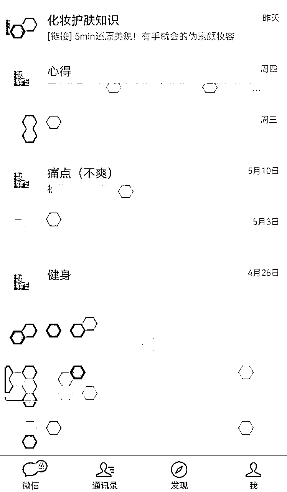

这件事往小了说：持续记录能让你更敏锐地捕捉到用户的痛点，也更容易做爆款。别小看内向的人，他们往往洞察力惊人，能打磨出真正扎心的内容；外向的人则不同，擅长场控和氛围，自带光芒。各有各的赛道。

往大了说：人活着，真的不只是为了世俗意义上的成功。一辈子很短，体验和幸福感，才是最最最值得的。情绪本身——贪婪、恐惧、焦虑、八卦、尴尬、无聊、心累、感动、怀念、不满、平和……这些才是我们真实活着的证据。

### 2. 朋友圈运营

为什么要好好发朋友圈？两个理由：

一，**信任前置**。现在社会信任成本高到什么程度？恒大、碧桂园说暴雷就暴雷，人和人之间、消费者和企业之间，总是隔着警惕。在这种情况下，还有一个人愿意持续、用心地经营朋友圈，本身就是最好的信任状。要知道，很少有人会坚持半年以上，只为了做你一个人的生意。

二，**低成本持续触达**。IP的本质就是反复刷存在感，反复种心锚。什么叫心锚？说简单点就是条件反射：一听到“遥遥领先”你就想到华为；一说到创业社群你就想到龙哥盟；一提起广州，你就想到拖鞋佬。这就是生态位。

朋友圈怎么经营？核心三句话就够了：

1. **你的生活，我的梦**——让人看完心生向往。
2. **看完还有收获**——让人觉得“我又学到了”。
3. **万一你还有点用**——未来我可能会找你。

注意，千万别广告刷屏。广告的比例必须克制，多一分招人烦，少一分没转化。最好的参考就是那些优秀的同行。

把三句话拆开看：

**关于“你的生活我的梦”：**

造梦能力，绝对是核心能力之一。低段位的做法很简单直接：消费不看价格、给父母买东西不眨眼、日入过万、晒豪车、晒购房合同、晒旅游、晒名校背景、晒与名人的合影、出没于高端会所。

高段位的玩法是卖生活状态：松弛感、家庭和睦、优质社交圈、不内耗、对未来笃定、团队信任、热爱、自然醒、通勤时间短、灵魂伴侣、自洽。你要让人羡慕的不是你花多少钱，而是你活成了什么样。

**关于“看完还有收获”：**

别上来就讲大道理，而是先讲一个故事，调动情绪。比如：“今天遇到了一个人”、“最近京东和美团打起来了”、“刚看了一个热搜，你想到了什么”……通过场景切入，顺势输出你的感悟。

内容可以有很多种：热点事件的商业解读（比如京东大战美团的本质其实是美团动了京东的蛋糕）；某某大佬的经典语录笔记——段永平、巴菲特、张一鸣；或者是你对恋爱、婚姻、家庭、创业的真实感悟。人嘛，都爱八卦，也爱被点拨。

**关于“万一你还有点用”：**

有个老话是：人一生至少得认识两个医生、两个律师、两个交警、两个警察。我说，多多益善，留个万一。

我亲身体会：五年前加过一个代购，一直到今年才第一次找她买东西。但因为她一直坚持做这行，当我需要的时候，脑子里第一个蹦出来的就是她。你要永远敬畏人的“惰性”——只要一个人在、在你心里占据过一个位置，几年后你需要时，第一时间想到的一定是他。

这就是私域/微商/IP的魅力：你可能1年不需要、5年不需要，但一旦有了需求，你就是第一选择。

顺便一提，账号资源真的是稀缺资产。平时没事多囤几个微信号，各平台账号也多备一些。哪天流量爆了、需要接住，你就能从容应对。如果要做矩阵，也不用临时养号。

书到用时方恨少，钱到用时方恨少，号到用时，一样恨少。

另外一个小技巧：无论男生女生，建议留一个微信号，性别设置为相反——我自己就有一个女号，朋友圈打造得很精致，专门用来“混进”同行的鱼塘。为什么？因为很多销售对男女生的态度是不同的，一般来说更愿意在女生身上花时间（实话难听，男生的消费力很多时候真不如狗，处处讲究性价比，转化链路极长）。这一点，你用心体会一下就懂。

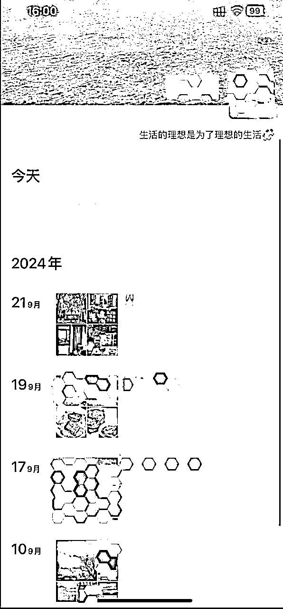

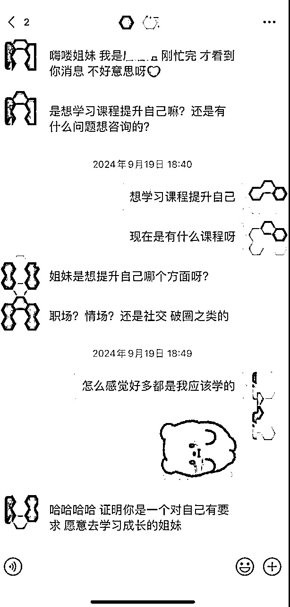

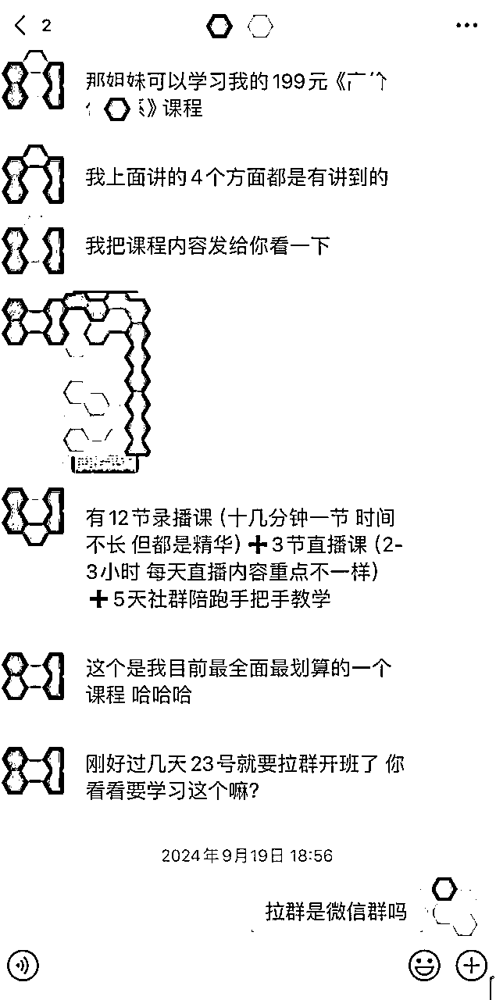

### 3. 换量 / 转介绍 / 裂变

**私域换量**

逻辑很简单：你认识我的人，我认识你的人，但咱们不是同行。举个例子，A做水晶，B卖女装，C做化妆品，D教瑜伽。四个人都有不少微信好友，服务的人群高度重合——20-30岁、一线二线城市、注重生活品质的女性。

那就可以“互相导流”：A帮B、C、D打广告，B帮A、C、D打广告，以此类推。原因很好理解：你的好友暂时不需要你的产品，但可能刚好有买女装的需求；对方的粉丝暂时不需要她的产品，但或许正需要你的水晶。

用这个方法，完全不用去公域平台抢流量，增长快，还有对方做信任背书。当然了，前提是合作方公信力过关，口碑差的一律不合作。

**转介绍/裂变**

当你有了一群忠实客户，就可以把一部分利润让出去，让别人帮你介绍生意。这时候，你要做的就是把产品打磨好，慢慢地往“产品驱动”方向进化。真正伟大的公司，底层都是产品或模式驱动的。

“裂变”这个词，就是让存量用户像病毒传播一样，帮你带来大量增量用户。常见的玩法：拼多多砍一刀、支付宝集五福。

去年还火过一波“10年合伙人/战队/茶园股份”模式——懂得人都在笑，味道太像传销了。简单说：你做A业务，他做C业务，我做B业务，大家有交集，就捆绑在一起打包成“10年合伙人”产品，承诺交付期长达十年，听着性价比爆棚。

然后，再让一群“小弟”疯狂帮你去群里加人、分销。搞分销排名，给冠军团队曝光和物质回报。你可能见过自己朋友圈被这种海报刷屏的盛况。从业务角度说，这套模式威力极强，本质是互相借力、把别人的私域当自己的公域用。

但我个人不喜欢这种模式。在我看来，影响力可以换短期的钱，也可以换长期的机遇。我才21岁，我对未来很乐观，每年都在十倍速成长。我不需要用未来10年的交付，去换现在这1-2万块。

当然，如果你真的下定决心、认定自己能踏踏实实交付10年不跑路，那我双手赞成——那确实是超级性价比的选择。

### 4. 提效工具与精细运营

**用户打标签**

说句实话，打标签就是把自己的用户仔细备注好。形式不重要，高效才重要。关键是结合你的销售漏斗模型，知道每个用户处在哪个节点。

有了标签，你就知道该重点攻克谁，也不会漏回消息。个人微信有个巨大优势：你能刷到客户的朋友圈，看出对方是什么样的人，从而为对他“定制内容”如果你用的是企业微信，反而看不到对方朋友圈——信息盲区特别大。

当然，企业微信也有它的好处：

- 防止个人微信频繁加人被官方限制。
- 防止员工离职带走客户。
- 收款更合规，大额转账更安全。
- 可以建N个群聊。

**怎么“针对性发圈”？**

对方喜欢旅游，你就多发旅行照片（前提是审美在线）；对方追某个明星，你就偶尔分享那首歌、那条动态；对方是创业者，你就多写创业感悟、名人金句、AI提效干货。你还可以通过对方的朋友圈，判断他有没有付费实力，再把时间往最有价值的人身上砸。

销售还可以通过朋友圈找破冰话题：对方刚去长沙，你就聊小龙虾和夜生活；从重庆回来，就聊火锅；去了杭州，你说美食荒漠不冤，但西湖走路真的很舒服，小笼包也好吃——记住，千万不要贬低对方喜欢的东西；对方在看心理学书，你就聊阿德勒、弗洛伊德、荣格，没看过就AI帮你扫盲，很方便。

自古真情留不住，唯有套路得人心。但“套路”不一定就是坏事，因为你提供了满满的情绪价值。哪怕对方知道你是“有目的”地靠近，谁又能拒绝一个愿意认真了解自己的人呢？

大多数人对于“被理解”和“被认真对待”的渴望，远超对“真相”和“真诚”的追求。我们处在短视频时代，人人都追求短平快，没几个人愿意停下来听你慢慢说。你有耐心，你就赢了。

**ERP与SaaS**

ERP管什么？管订单、管库存、管补货。哪个客户买了什么、订单进展到哪一步、库存还够不够，提前预警。做私域电商的，主要还是要靠ERP。但如果你的生意是虚拟服务，飞书多维表格就足够好用了。

SaaS就更方便了——微信群管理、自动回复、用户偏好分析、精准推荐，你都不用自己开发，直接租用就行，比如企业微信、有赞、微盟这些。

**SCRM聚合平台**

号多了，一台一台看很累。SCRM系统说白了就是个“微信多开聚合器”——五个号、十个号的消息统一收，统一回。

但这里必须提醒一句：市面上所谓私域管理工具，不少就是割韭菜的。更可笑的是一些“自动获客软件”，宣称躺赚粉丝——你想想，如果真能自动获客，对方凭什么卖给你？这种多数是利用平台漏洞，只能用几天！

关键是看运行逻辑。比如A、B、C、D、E五个号，合规的聚合逻辑是把消息收集上传到平台再统一回复（类似复制粘贴），而不是去篡改微信程序、打断信息链路。永远、永远、永远不要去对抗腾讯爸爸的规则。

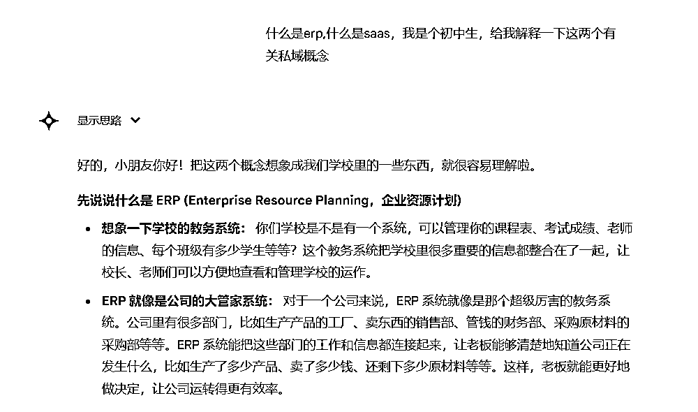

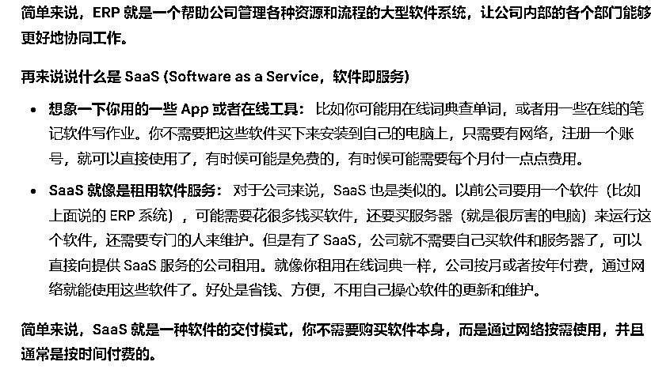

**几个高频工具推荐：**

- SEO：DSO110（dso100.com）、DSO114（www.aidso.com）
- 小红书封面：可画 / 稿定设计（电脑端）
- 朋友圈做图：微脉水印相机app，打码超方便

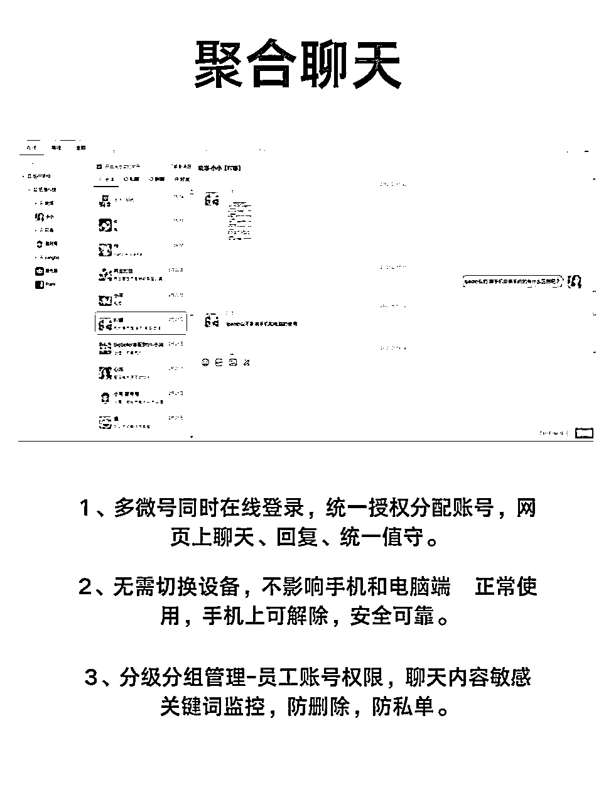

---

## 三、面试：双向挖掘的认知窗口

面试这个事，分两种视角：求职者和面试官。但不管哪一边，都是行业信息密度最高的场景之一。

### 求职者视角：面试就是最高效的行业调研

哪怕互联网再发达，也没人愿意把正在赚钱的项目细节全盘托出。人之常情。

但面试/实习不一样，哪怕你只干半天就跑，你能真实触碰到这个赛道正在发生什么。网上你可以随意装b、晒结果，但做业务的时候必须求真——面临流量困境？不知道该用什么模板？去面试一天就知道当下的爆款模板长什么样了。

甚至不用待满一天，直接问老板/面试官具体形式——有些小公司连HR都没有，一问一个准。

你还可以带着自己的模板去“换”：我之前就是用这个方法，拿我的旧模板去换对方的新模板，多换几次，某个赛道里的所有爆款逻辑基本就都能摸清了。

我自己大学期间面试过近百家小公司。有人问我怎么做到时间管理的？其实很简单：同一区域，一天排满十家。广州分天河、白云、越秀、番禺、海珠、黄埔、南沙，选一个区，一天“刷”完一个区，通勤时间大幅缩短。再加上现在AI这么强，直接把公司地址丢给它，让它帮你排最优动线和时间表，特别方便。

如果你预算充足，还能“外包面试”——让你的助理去面试、去学习。前提是，这个助理情绪稳定且懂业务细节，如果是女朋友，那效果更理想。

再狠一点——砸点钱/资源，直接绕到HR和小组负责人那里。HR一定知道企业想招什么样的人、看重什么品质、业务需要扛什么指标。这手情报拿过来，等于开卷考试。

另外，观察企业前途，一看创始人的价值观，二看HR。HR就是公司的门面，HR不行，这家公司多半就不用看了。

最后多说一句：面试多了，人真会变自信。我大学之前很内向，说话磕磕绊绊，面了一百场，彻底练出来了。

### 面试官视角：拿高价换信息差，是笔好账

“以高于行业20%的薪资去招人，疯狂筛选，搞不好能听到一些从未听过的流量打法和运营细节，遇到合适的人才就留下。”——这句话出自杨涛，但我觉得这就是老板该有的杠杆思维。

我招助理的经验不多，但会重点看这几个维度：

1. 学习意愿——平时都在学什么？
2. 抗压能力与生活压力。
3. 是E人还是I人，有没有自我设限。
4. 时间观念和执行力——丢个任务过去，看完成速度和结果质量。
5. 简历是否贴合岗位描述、最快到岗时间。
6. 有没有对象——对需要出差的岗位来说，这很重要。
7. 眼缘——有时候直觉就是很准。
8. 容貌——倒不是看颜值，而是看有没有在认真打理自己。

---

## 最后一点碎碎念

我这一年走过来，最大的感受是：能把文中说的0-1到1-10全部走通的团队，真的少之又少，哪怕是50人以上的团队，多数也就是有A没B、有AB缺C。

但看完这一套，你的商业闭环思路应当已经通了。

不信，咱拿“开实体店”走一遍流程：

第一步，做宏观市场分析——什么赛道在上升，什么在萎缩？医美是往上走的，但你要是开个奶粉店，可能就悬了。

第二步，盘点自身资源。余额只有100万，就别想着做医美了，光设备和场地都cover不住。就算你真的有一百万，最多也只用30-50万做预算——而且实际成本基本是预算的1.3倍起步，大概要39到65万。更合理的逻辑，是用现金余额的十分之一去押一个机会，这样你不会动作变形。

第三步，别总想着发明新东西，你就是去赚钱的，所以核心永远是两件事：找到流量，搞定销售。MVP跑通，再谈扩大。

商业的尽头，从来都是认知。以上，与各位共勉。

很多人问，开店或者做个项目，怎么判断哪个地段人流旺、哪个地段冷清？光看地图没用，要亲自去蹲点。最好把人数量化，比如分时段数人，工作日、周末、节假日分别记录，看看周边1-3公里范围内有多少家同类店铺，以及它们生意怎么样，有没有可借鉴的打法。

在模式没跑通之前，一定要死磕成本，能少花就少花。最稳妥的做法是：你本身就有一批信任你的老用户——哪怕是从前公司积累下来的口碑用户，从他们身上开始获客，比从零起步稳得多。

当你赚到第一块钱，就可以想放大的事了。核心就三件事：把流量做上去（线上线下一起拉），把销售转化率提上来（参考同行的优秀操作，直接“借鉴”），把产品成本压下来，同时提升复购。毕竟利润=流量×转化率×客单价－成本。派助理去同行那“学习”也行，自己亲自去也行，甚至直接招人、挖人。

接下来，把所有流程标准化，搭建“流量—销售—产品”的SOP，把销售漏斗和正负反馈规则都定清楚。比如你开奶茶店，怎么迎客、怎么做饮品、怎么处理退款、哪些动作绝对不能做，全部写成标准。小企业靠灵活，大企业靠稳定，你要往稳定的方向走。

再往后，产品要打磨到80分以上，招管理层来带团队，招执行层干活，定好KPI，提效率。后端可以上ERP/SaaS系统，微信小程序或自研软件都行，还能做直播、孵化IP。

更大的盘子呢，就是放加盟、做知识付费、搞阿米巴模式，或者直接把自营店复制成N家（注意现金流！别让回款周期拖死你，口罩时期教训可太深了）。再比如和知名IP联名借势、做裂变活动（分享领券、免费体验、拼多多式砍一刀），冲一波增长。

等你活下来了，一定要开始注重合规、税务、企业文化、价值观，做长期主义的事。最后，准备敲钟吧。

说实话，很少有人能把这套全走完，每一步都是坎，只能迭代着来。我只是把自己看到的、听到的、验证过的总结了一遍。大家也别焦虑，世界就是个巨大的草台班子。

聊聊心得。

在龙哥盟这种社群里，搞钱的信息特别密。一年前满屏都是GMV几千万、投放几个亿的“战绩”，看多了真的容易怀疑自己，动作也会变形。但现在好多了，官方也变了。

为什么不用焦虑？四点：

第一，平台和政策变得飞快，号说没就没，就算你闭环跑通了，也可能只是短暂的窗口期。团队被打击可比普通人厉害多了。

第二，很多团队连账都算不清，ROI都不一定打平。给你算一笔账：抖音卖100件货，销售额1万，GMV就是1万。但成本呢？商品、投流、人力、设备、水电、房租，加起来可能超过1万。爆款也不是天天有，亏钱是常态。所以，看到秀GMV的数据，统一打1-3折。

第三，知识付费的局你未必看透。我哥做国内电商，自有货源。有个客户从他这进货，卖得比他成本还便宜，销量却10w+。后来才明白，那人根本不是赚电商的钱，人家赚的是“教人做电商”的钱。那10w+销量只是背书——你看，哇好厉害，快教教我。你看到的一切，可能只是别人想让你看到的。

第四，也不是谁都能把团队搭好。薪酬、文化、氛围、应对不确定性、沟通、迭代，每一样都考验人。更别说基层执行了，流量岗门槛低，真正能打的很少。很多人晚上10点还在回消息，但也很多人根本没什么网感。

很多“年入百万”，你拆一下：业务赚20w，卖项目赚20w，炒币赚60w。这能算“年入百万”吗？我19年关注BTC，那会还在高一，最低3000美金一个，前阵子10万美金。假如当初买10个拿到现在，那就是582万人民币。这算不算年入百万？所以别被表面的数字迷惑。

只要你终身学习、足够细致、有耐心、坚持迭代，对手放弃了，你就能吃掉他们的市场份额，你就赢了。

还有，要好好吃饭，好好睡觉。平时练好内功，赚钱往往是一阵子的事。真到红利期，可能连轴转、通宵干，身体和心力就是一切。红利期保持钝感猛干，低谷期保持开放，学东西、沉淀、好好生活。

搜索和AI是超级外挂。赚钱官方电脑版分类好看，谷歌很强大——有一回我搜到一篇作者已删的知乎文章，居然在谷歌缓存里找到了。公众号、小红书、B站、咸鱼、拼多多、淘宝、X、Reddit、YouTube都值得翻。很多人忽略了咸鱼（上面有很多冷门项目，本地生活变现不输小红书）和AI（Gemini、ChatGPT、豆包等）。比如现在这篇，很多部分就是AI帮我润色的。

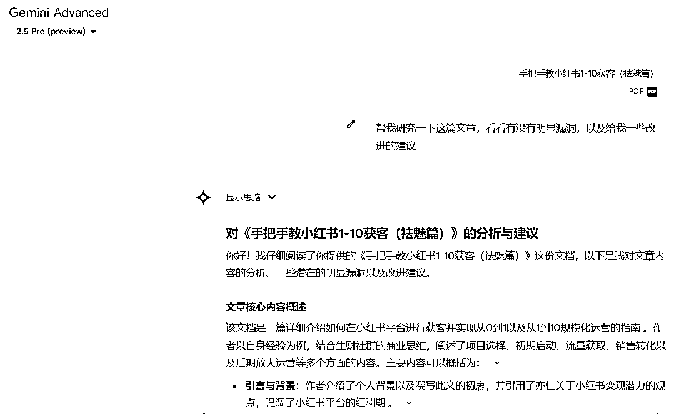

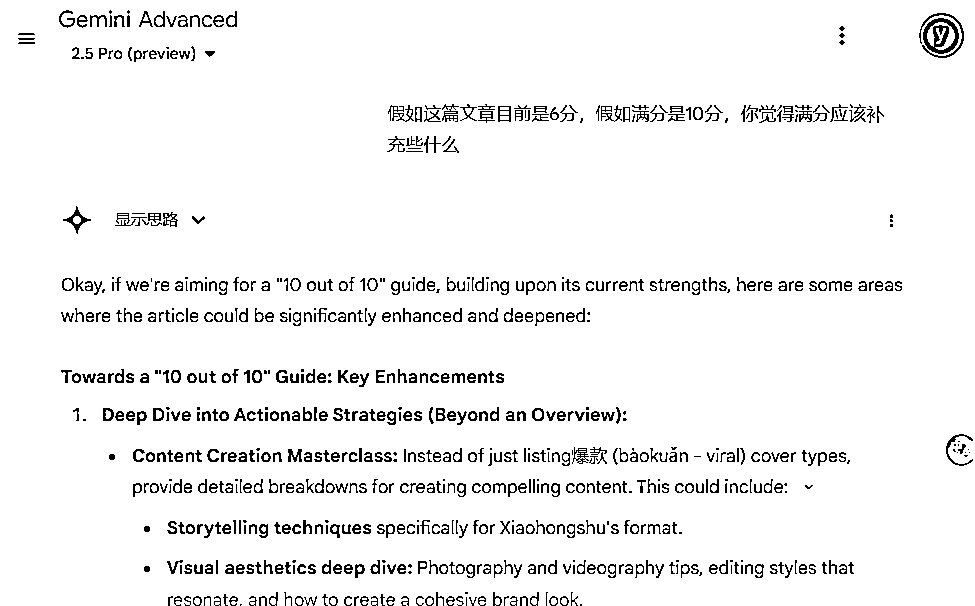

线下组局，十倍增长。我每次飞速进步都始于参加一次线下局。强推杨涛的局，去之前准备自我介绍和至少20个问题，啥都能问——毕竟问AI和问真人完全是两码事。24年9月周六日连参加两场，之后认知和搞钱能力指数级上升，三天只睡了俩小时，满脑子都是新点子。那种身边全是创业者的感觉，只看线上帖子是感受不到的。还能交到真朋友，少走太多弯路。

对钱和结果要敬畏。别人在做什么、当下拿到了最大的结果，就跟着谁学，别轻易用道德去评判，说什么割韭菜、吹牛。路是前人走出来的，你看他们走出来了，跟着走就对了。我本身不喜欢写这么长的文，但发现很多优秀00后都在赚钱输出内容、积累影响力，拿到了大结果。那我也得照做，没有为什么，因为人家拿到了更大的结果。

定个目标吧。就像涛哥发的那张图，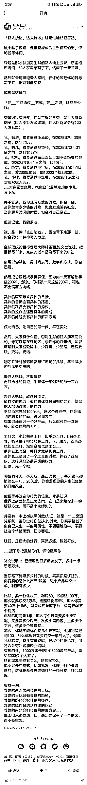 我耶耶立个flag：2025年12月31日前，在龙哥盟发5篇精华帖，拿10条中标。

目标要基于数据拆。比如单粉产值50元，今年想赚100万，那就需要引流20000人，平均每天55人。做免费流量，就准备好日更。假设一个小红书号一天引流3人（这已经很高了，尤其精准高客单价），每个号每天发2篇，那需要约18个号（一机一卡），也就是18台手机，每天发36篇，一个月1080篇，一年12960篇。

成本算一下：手机18台，600一台，10800元。手机卡18张（日常一张不算），20元一张，约340元。月租29元，17张卡一年5916元。不算场地水电软件人力后端注册税人情世故，总成本已经17052元。

但这就对了吗？错。免费流量引到私域会被封号，手机被限流，卡也不对，绝对不止那点卡。有的号天生没流量，一个人也发不了那么多帖，你还要用时间精力去销售、打磨产品。每天发这么多你能保证吗？不休息吗？所以这算法错得离谱，不够细。

所以有团队按季度定KPI：Q1Q2侧重流量，Q3Q4侧重销售和产品，再靠大促冲利润（比如618、双11，赚钱的418）。我出一道题互动一下：你觉得自己年入百万怎么算？评论区见。

当你开始考虑赛道天花板，招助理解放自己，开始付费投放，找人才，拥抱不确定性，考虑投产比、效率、现金流，不断迭代优化，尊重结果和人性——取经之路，就在脚下。

这些观念刻进脑子里，你慢慢就有了赚钱的体感。就像学骑车，学会了就不会忘。你会慢慢调整认知，也没那么焦虑了，因为你知道焦虑没用，只能一步步来。

最后，感谢龙哥盟，谢谢你看到这。祝大家身体健康，万事胜意，早日发财。有疑问直接评论区或星球提问，我会回复。