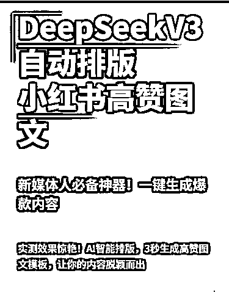
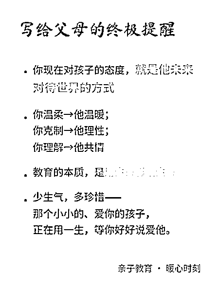
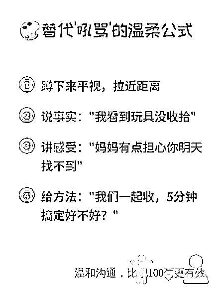
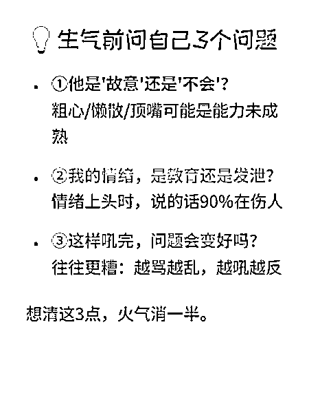

# 我搞了个智能体，👸号文章一键变身小绿书卡片，终于不用手动截图了！
作者：龙哥

前阵子，我把👸号发文这个动作接进了扣子空间的MCP调用，本来只是做个自用的小工具，顺手分享了一下，没想到评论区一堆人喊“我也要”。要是你还没看过那篇，可以翻一翻。

## 那有没有人想做一键发布小绿书的？

我自己第一个举手。说实话，我一直眼馋小绿书的自动发布，之前折腾到一半就搁置了，因为有几个硬骨头啃不动。后来coze的图像模型接入了即梦3.0，它对文字生成的支持特别给力，做点治愈系语录、金句合集什么的，效果应该相当能打。

但问题也明显：碰上信息量大的内容，比如知识干货类文章，文字一多，即梦3.0就有点顶不住，生成的图片容易翻车。于是我又停下来了。

## 转机出现在哪？

后来DeepSeek V3新版本发布，代码能力突飞猛进，看到不少人拿它做知识卡片——原理就是用代码能力把文字转成HTML，通过网页排版来呈现卡片效果。试了试，还真挺好看，就像下面这样：

不过这个方案也有个尴尬处：大模型吐出来的是一段HTML网页代码，不能直接看效果，每次都得手动复制代码去开页面，太折腾。所以我又做了个插件，帮用户自动把代码转成能访问的网页。

网页倒是出来了，新的麻烦又来了——想变成图片，要么自己截图，要么在提示词里让代码自带下载功能。

就算网页能下载了，你还得一张张去点保存，这多费手啊。而且我试过几次，用代码技术直接抓下来的图，有时候和网页实际样式对不上，甚至样式直接丢失，丑得没法看。所以这条路也走不通自动化。

## 关键那一脚

但我这人就是不死心。我就想实现：发一篇👸号，然后一键生成小绿书知识卡片。既然直接下载不靠谱，那就模拟人工去截图呗，这样拿到的图才是最原汁原味的。

于是我想到了RPA。说真的，RPA简直是AI的黄金搭档。为了保证出图稳定，我决定用代码自己写RPA，不用现成的工具。原因是我想把它部署成API接口，供coze调用，最终达到的效果是：输入网页，输出截图。

吭哧吭哧研究了好几天，还真被我搞出来了。这是我智能体跑起来的样子——我找了一篇信息密度很高的爆款文章来试：

下面这三张就是生成的卡片效果，你们觉得咋样？反正我挺满意的。图片微微有点糊，不过手机上刷着完全OK，后续再琢磨下怎么优化清晰度。

## 体验地址丢这里了

https://www.coze.cn/store/agent/7505777225267429412?bid=6gb9b31ag1009&bot_id=true

说句实在话，这个截图服务是跑在我自己服务器上的，和普通API调用不太一样。每次请求都要起一个进程跑RPA截图，人一多服务器直接扛不住闹脾气，所以不适合做成公共福利，最好人手一套自己玩，哈哈。

后面我会把它也整合进MCP里，到时候一键发布👸号也能顺带安排上。各位等着吧！