# 普通人入局年入百万的AI讲师赛道：全链路实战拆解与六大模块

阅读前说明：

1、本篇干货体量较大，全文约一万五千字，围绕商业定位、获客路径、转化营销、产品体系、交付执行、服务跟进六个维度，系统拆解了切入人工智能培训赛道的认知、打法、经验、技巧与可复用素材。

2、这篇内容前后打磨近三周，持续在补充细节并优化表达。第一周梳理主题与目录，第二周完成初稿约一万两千字。第三周特别感谢赚钱的 @瓜斯 与 @欢欢 对内容的提炼建议，在此基础上再补三千字，连我此前压箱底的心得也一并放出，最终成型为这篇深度长文。起初不少关键信息我并不打算公开，担心抬高同业竞争，后来权衡后决定放大利他，格局打开后商业可能性反而更大。

3、篇幅较长且配图附件较多，建议使用电脑浏览器阅读，效率更高。

大家好，我是乔帮主。

从2023年5月开始，我正式切入人工智能培训方向。当时有机会参与了刀姐和SKY首期AIGC讲师的线下训练营，也算国内早一批深耕该赛道的人。我在过去两年里在这个领域取得了阶段性结果，并沉淀了不少可复用的经验，下面把实操过程系统分享。

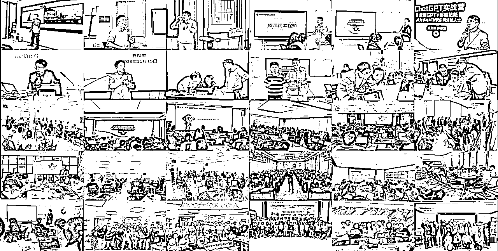

人工智能的真正落地，等同于人才的落地。当前及未来，无论市场还是企业，对AI人才的需求都在持续放量。尤其是今年年初DeepSeek爆火后，相关培训需求迎来井喷，这既是一段红利窗口，也标志着AI时代进入高速扩张期。

我们不该做旁观者，而应成为参与者与见证者。愿这篇文章能为正在做或准备进入该赛道的朋友提供参考。

# 1、商业定位

凡业务皆可借助短视频重来一遍，凡行业皆可借助人工智能重塑一遍，凡产品皆可借助大模型升级一遍。短视频是营销获客的放大镜，AI则是生产力提升的加速器。

AI 将重构全部行业生态，培训领域同样蕴含巨大机会。帮助市场与企业孵化、培养AI人才，正处在风口期。

我个人相对看好教育端、企业端、创业端三个赛道，具体选择取决于自身优势与兴趣聚焦。

## 1.1、教育端

### 1、面向K12：AI编程方向

K12赛道堪称又爱又恨，人群庞大需求旺盛，但大部分流量被头部机构占据，单打独斗很难做大盘子。不过对于独立讲师来说，打造个人IP、运营私域，一年做出百八十万的体量不算难事。

去年6月我在成都参加一场行业聚会，现场全是K12独立讲师。多数人尚未开展线上课程，仅靠口碑做线下小班，收入已相当可观。若能把线上体系化，个人及小团队的盈利空间会更宽。

传统K12课程无非语数外提分、少儿编程/记忆力提升等学习力方向。结合AI来看，我特别看好AI+少儿编程的结合体。

去年暑期我做过一期AI亲子活动，也和机构联合推出面向14-15岁群体的《AI编程与游戏制作》课程。近期又在和渠道合作推广面向中小学的《AI编程入门与应用》，市场反馈都不错，正处于需求红利期。

相关大纲与介绍同步分享供参考：

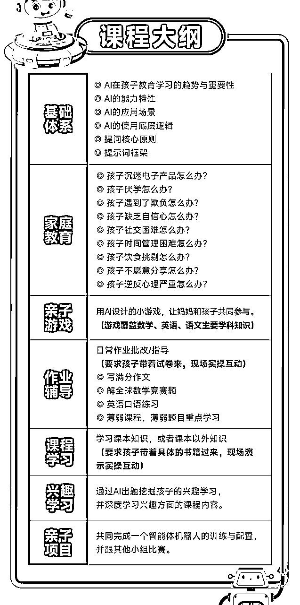

《AI亲子课》

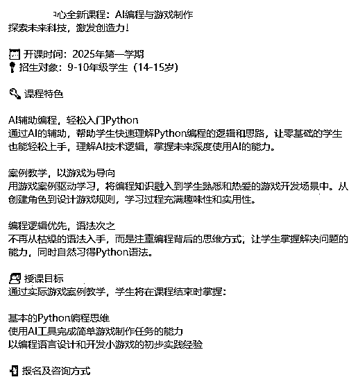

《AI编程与游戏制作》

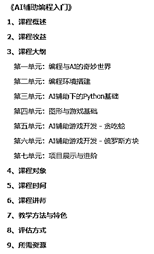

《AI编程应用》

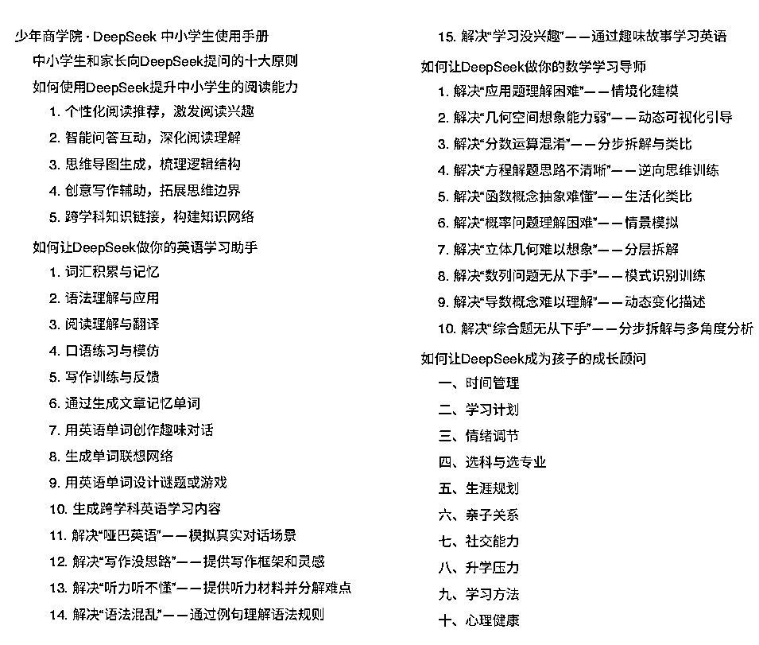

《DeepSeek中小学使用》

### 2、面向高校在校生：AI求职就业课程

大学生就业培训和K12一样属于刚需。传统就业培训市场虽大但已高度内卷。若用AI切入细分岗位，可形成差异化弯道超车。

例如产品、研发、运维、运营这四大核心岗位，通过AI构建体系化、专业化就业课程，是一个很有前景的方向。

知乎持续在公域推广AI大模型开发就业课程两年有余：

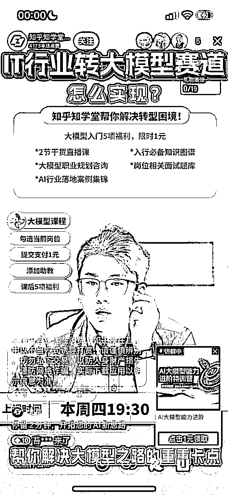

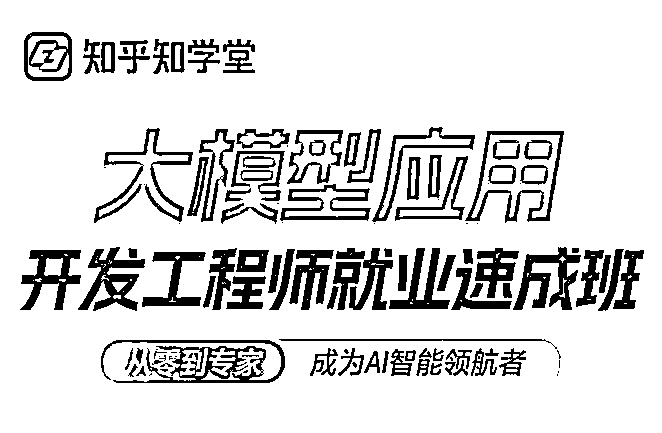

头部IT教培机构达内也上线了大模型开发课程：

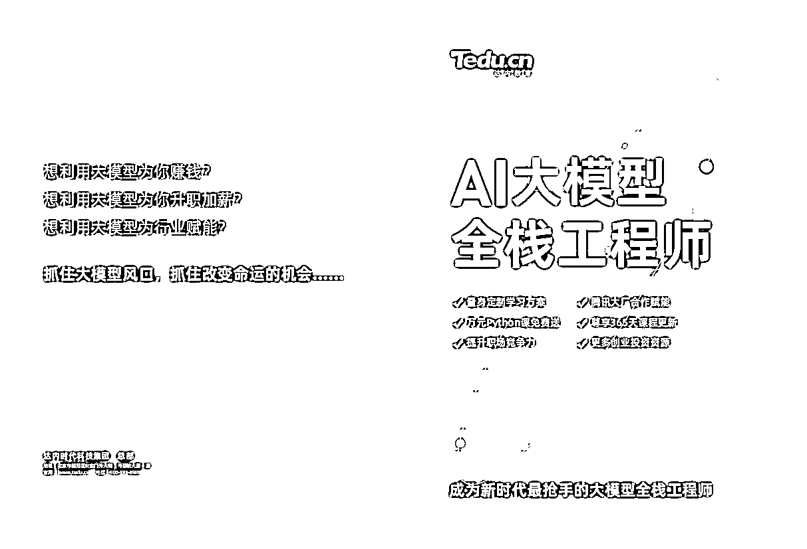

抖音上也能经常刷到网易云课堂的AI产品经理课程：

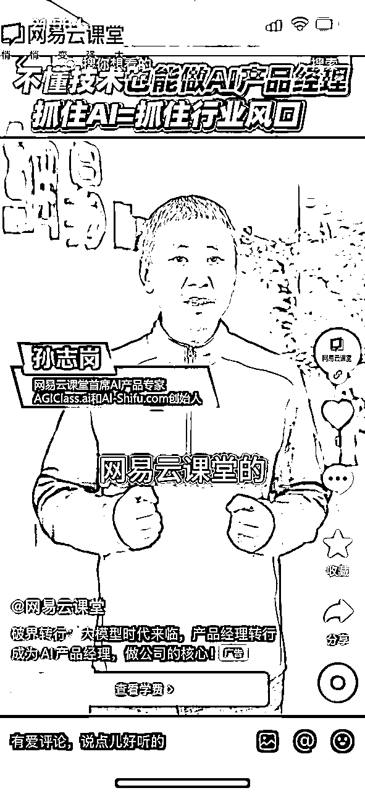

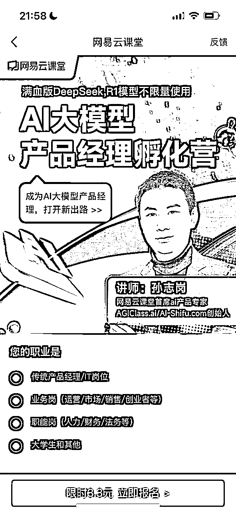

亦有圈友分享过相关风向标：AI产品经理培训市场火爆。

### 3、面向在职人群：AI技能进阶

为职场人提供技能进阶服务，帮助其掌握核心能力、提升竞争力，也是可行的方向。需注意，技能进阶通常面向有经验的在职者，周期一般为2-7天；而求职就业课程面向零基础未就业者，周期至少两个月以上。

去年职场人群的AI数据训练师进阶课十分火热，去年11月有圈友发过风向标帖获得142点赞：面向新职业AI的就业培训，招生规模持续攀升。

去年7月我曾调研过该课程，早期海报文案等资料均留存，现一并分享：

去年我还与国内一家头部IT教培机构合作，为IT运维推出垂直技能进阶项目，反馈良好。课纲课表无保留分享：

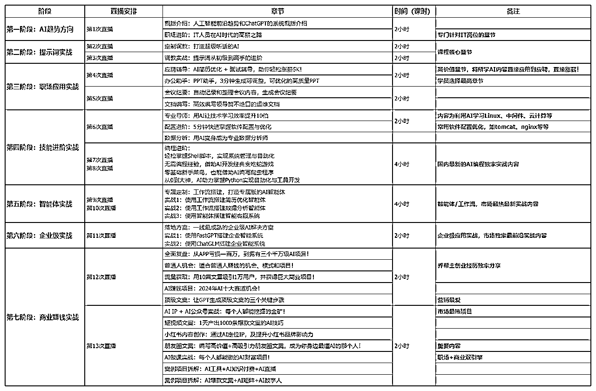

除机构合作外，高校市场同样重要。高校面向师生的AI技能进阶课程需求旺盛，我使用的课程大纲也直接分享：

## 1.2、企业端

除教育端外，企业内训是另一个主战场。现在是企业AI内训的红利期，重申三遍：红利期、红利期、红利期！

提示词+办公应用，在赚钱圈内已是常识。但赚钱本质是信息差小圈子，整体领先市场1-2年。市场上大量企业仍未真正用上AI，特别是国企与传统非互联网企业。随着DeepSeek引爆，国内企业应用AI的速度大幅提升，培训需求激增。我们这批讲师最近数月排课基本满载，正是风口所致。

我收到的需求，约九成集中在提示词+办公应用场景：

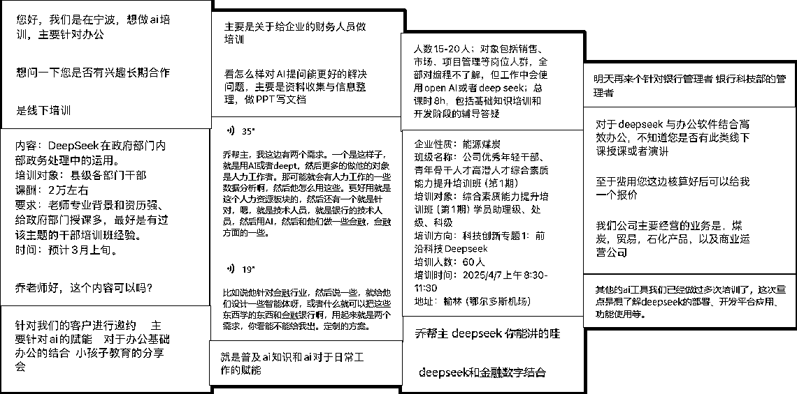

除通用培训外，越来越多企业需要面向特定岗位的定制服务，比如HR、财务、产品、研发、运营、高管、老板总裁班等，对内容专业度要求更高。

除通用与垂直岗位外，还有带解决方案的培训模式。此前sky在航海家分享过，针对鞋服公司的AI设计培训+解决方案，客单价可达10万/天。

再以今年3月30日杭州航海家AI大会为例，包子老师线下课定价4999，现场瞬间招募百余人。其课程本质也是带解决方案。AI技能本身价值有限，市场更关心AI如何结合直播、短视频打通工作流。业务理解+AI落地，才决定应用上限。

总体来看，AI培训+解决方案未来空间巨大。真正落地必须在企业级垂直场景深度应用，才能释放商业价值。纯通用培训的信息差消散极快，DeepSeek带动的企业培训红利我判断今年为主，明年即开始衰减。因此面向垂直行业、垂直岗位的定制培训+解决方案，才是企业服务未来的方向。

## 1.3、创业端

除教育、企业外，创业方向的培训同样值得关注。

最赚钱的生意是教人赚钱。为想赚钱的人提供赚钱的AI工具，即给掘金者卖铲子、卖水，是用AI变现的优质路径。

“AI获客”一词去年兴起，已被广泛讨论。核心是用AI数字人、AI矩阵、AI短视频、定制AI手机、AI鼠标、AI智能体、AI系统等工具打包成营销获客解决方案。

借助红利期面向企业主、操盘手、个体创业者，通过直播投流或短视频投流、招商加盟等方式引流，开两天一夜或三天两夜线下课，客单价多在1980、2980。核心变现并非课费，而是后端工具平台与定制陪跑服务。

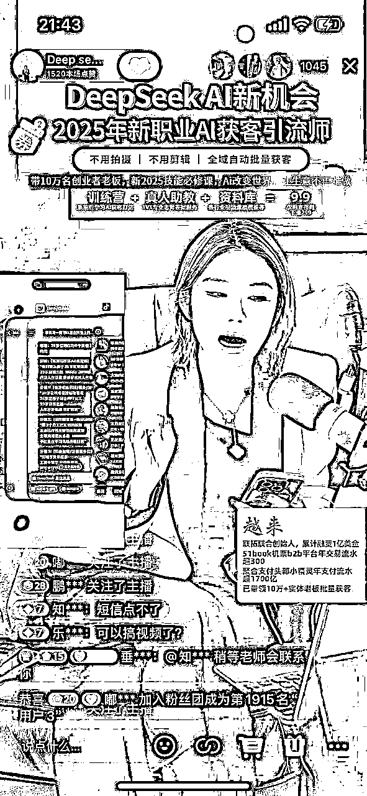

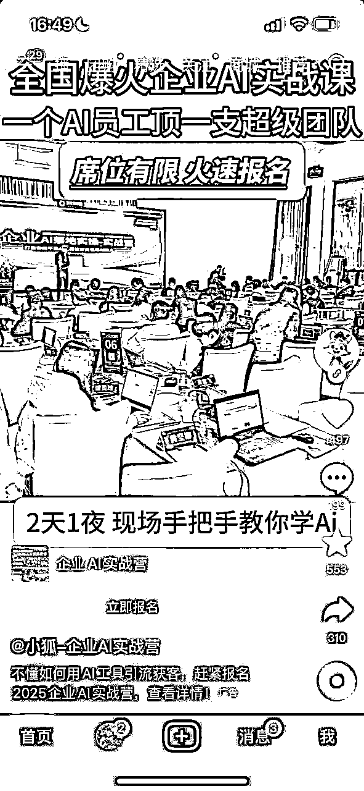

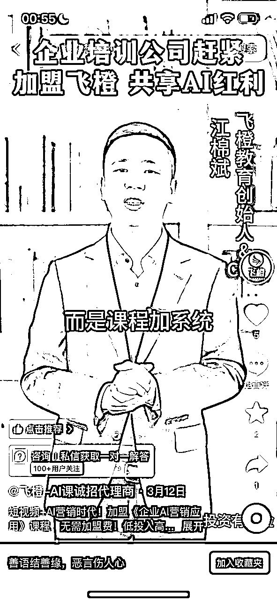

该赛道同样有价值。AI自媒体、AI智能体、AI爆文、AI视频号、AI📕，选择一个细分赛道，为老板与创业者提供垂直服务，市场空间可观。

# 2、获客路径

确定商业方向后，第一步要解决的是如何获取精准流量，而非先闭门造课。这点极其关键。很多时候一份大纲就能开始售卖。

有人下单再开发也不迟。新课开发通常需1-3个月，若先做课再找人，时间易浪费。

虽然给出三个方向，但实际选择往往受资源圈子限制，并非想做哪个就做哪个。

我认识的讲师，有人在高校体系内做得风生水起，有人深耕政府银行客户，也有人只做线上公开课，一场就能入账几十万。核心在于资源渠道聚焦与交付服务稳定。

对于想入局的朋友，获客主要有以下七种打法：

## 2.1、盘活身边圈层资源

身边圈层是最早的种子用户。我本人即靠身边资源，与几家多年合作的机构从0到1跑通。

圈层资源是冷启动的核心。特别是赚钱圈友，善用平台与圈子，是启动最快的方式。通过朋友圈、👸号、线下活动让他人知晓你在做AI培训，跑通0到1至关重要。

就我近两周的案例，有位圈友主动找我深度合作：他们前端流量强但无交付能力，我们优势互补，一拍即合。流量问题由此解决。

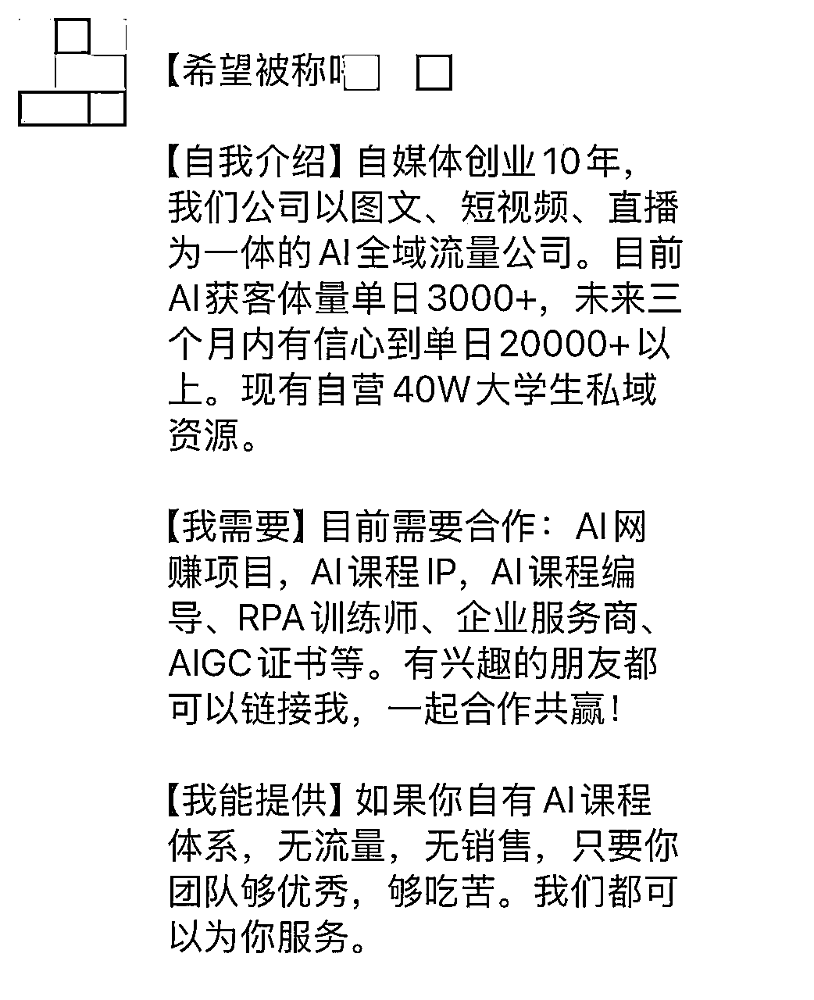

结果背后是什么？第一，讲师需具备强课程设计与交付能力，专业是基础。第二，关键在于盘活身边资源，能链接到更多有流量的伙伴。当时我问他如何知晓我，他说数位大佬推荐。

在专业扎实的前提下，让圈内人了解你的业务，形成口碑与主动推荐，才算真正盘活资源。

怎么做？本质是勤能补拙。新加入赚钱的圈友，多写帖子、多参加航海做志愿者/领队/教练、多组局，多链接、多利他，让他人看到你的能量与价值。

我本人在赚钱的成长路径：

1. 一年内产出7篇精华帖；
2. 参与11个航海项目，打卡211次；
3. 连续担任资料整理、ChatGPT提效航海教练；
4. 赚钱线下首个实操组局发起者，现场带大家实操；
5. 最早一批航海家；
6. 去年5月/9月AI编程航海主教练。

走过类似路径的人，基本能靠圈层资源解决流量问题。

## 2.2、与流量型机构合作

流量型机构指教培机构、有企业资源的服务商、高校等。他们有影响力与稳定客群。合作模式为他们负责前端获客，我们负责后端开发交付，效率较高。

寻找方式：把简历优化好后在Boss直聘上主动接触招AI讲师的机构与公司。只要在平台发布招聘，基本都有明确需求。我多家重要合作即由此而来。

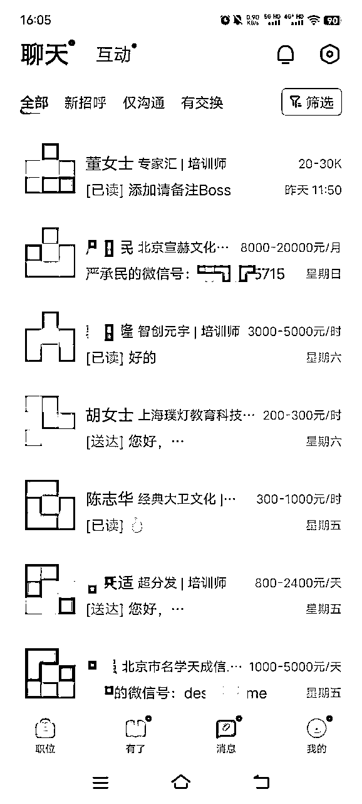

## 2.3、与内容型博主合作

指AI自媒体博主。龙哥此前发过AI自媒体超级标，他们借助风口做大，各平台账号变现多靠广告商单。

目前AI培训需求增多，企业与机构常通过公域找博主承接培训，这类需求门槛较高，与博主合作由我们交付，既不伤粉性价比又高。

两位圈友曾帮我推广3万与3.5万的培训单，僅做微信引荐，后续销转交付由我跟进，我给予30%分佣，市场常规20%-30%。

如何找到这类博主？主动出击链接。受龙哥一篇花7万买宝妈微信号的帖子启发，我安排专人去Boss、抖音/视频号/📕/快手添加相关机构与博主，撒网式洽谈。哪怕100人中成交1人，对高客单长期合作已足够。实际操作不到100人已获数个重要合作。

## 2.4、与经纪公司合作

经纪公司即中介。他们手握大量机构资源，合作流程为客户找机构→机构找经纪→经纪派单给你。

优势：排课量有保障，月排10场以上常见，无需自行考虑流量，经纪团队会包装与推广。

劣势：通常签独家排他，影响与其他机构或甲方直接合作；客单价被层层分佣，从2万/天的需求到手可能仅五六千；对课程与交付要求极高，不适合新手。去年我与sky去培博会应聘头部经纪公司华师经纪，简历+5分钟+10分钟试讲，淘汰率超98%。

寻找渠道：参加培博会等行业大会，资源高度聚集。

## 2.5、销售型拓客

把自己当销售去跑客户，人效低且不擅长者不易坚持，不太推荐。但无中间商抽成，利润最厚。我此前维护的老客户，按市场价2万/天直接交付，收益更香。

## 2.6、个人IP型拓客

值得长期复利投入，但见效慢。我写👸号两年，粉丝仅三四千，却布局大量AI培训关键词做SEO。今年DeepSeek爆火后，大量需求通过👸号主动而来。

视频号、抖音、📕做IP同样重要，用内容营销引流。但讲师难以兼顾后端交付与前端内容生产，合作共赢更现实。

## 2.7、付费投流获客

直播投流+9.9/19.9/39.9公开课销转线下课，需强直播能力。文中提到的博主越来即靠DeepSeek热度直播投流，在杭州开两天一夜课2980，一个月开三四场，每场上百人。

短视频投流适合直播能力不足者，虽高效但需后续转化。文中提到的小狐企业AI实战营、飞橙AI课即在招代理。

## 2.8、如何判断渠道优劣？

核心在于能否带来持续高性价比的业务。需综合商业定位、自身资源、交付能力评估。好渠道的标准是优质客户密度高、合作可持续，最终看转化率、复购率、客单价与稳定性。

篇幅有限，后续将继续拆解营销转化、产品体系、交付执行与服务跟进模块。持续关注。

在流量获取这件事上，七种打法里，绝大多数其实都落在了渠道合作上：朋友圈资源、跟流量公司牵手、跟头部博主联动、甚至跟经纪机构或培训机构搭线，本质都是借别人的场子。

那怎么判断一个渠道到底能不能用？这就是实打实的避坑经验。AI培训赛道起步阶段，我踩过的坑最多就是机构合作。很多机构声量很大，宣传时热闹非凡，一到要转化就拉胯，花大量时间配合做课，最终预报名寥寥无几。

还有一类公司想白嫖，前期开口就要你先把内训大纲发过去评估价值，然后要求你先免费做一两小时分享试试水，分享完大多就石沉大海。

在势能不足、没有标杆案例、课程打磨和交付体系都未完善的起步期，过来人的感受是：即便这些合作暂时不产生结果，也可以当作试验田。用这些真实场景来倒逼自己把营销转化、产品设计、交付标准练出来，价值其实不小。

回归到如何筛选流量渠道，核心就看这几把尺子：

### 1、真实变现能力
这是第一性指标。合作一两轮，或者干一次公开课试招，就能看出渠道成色。预报名、成交数据会说话。

* 到底能不能带来有效付费？实际卖出了几单？
* 是真的成交，还是只是热闹的曝光？
* 别被机构或博主报的粉丝量、播放量带偏，虚火的案例太多了。

### 2、受众匹配度
渠道的粉是不是你的理想客户？职场人、转行者、自媒体人这些人群是否在听你的课？

* 对方粉丝是否对AI有付费意愿？
* 泛娱乐账号可能带来大量无效点击，而垂直AI博主粉丝少但转化率高也常有。同样，企业服务类的供应商客户量少但客单价高，价值也不容忽视。

### 3、合作方本身的实力
多方打听合作方情况：团队规模如何？是否与同类培训项目合作过？结果怎样？能提供点击、咨询、成交数据吗？

有独立运营或销售团队的渠道，闭环更快；否则后段转化压力全在你这边。对接人的层级也关键，最好直接对老板。以前跟高校合作，对接人没有决策权，每次方案都要层层上报，效率极低。

对接人做事风格是否合拍也极重要，磨合不好，精力全耗在沟通上，及时止损更划算。

### 4、长短期价值的平衡
圈内资源属于慢热型，但信任沉淀带来复购、裂变和深度合作。机构和博主更适合短期脉冲式投放。

理想状态是两者结合：既要爆量，又要养盘。

# 3、成交转化

选定赛道和流量方式后，下一步就是把流量变成订单。

## 3.1、销转产品
没流量前就闷头做课件是浪费。起步阶段，一个完整的大纲就够了。搜索👸号里“AI培训”相关大纲，或者参考行业公开大纲，拿来结合AI润色一下就能先用起来。

## 3.2、销转方式
C端教育产品，常用3-5天直播公开课转化。自己私域裂变可做免费，公域投放则常用9.9/19.9/39.9做门槛筛选。公开课核心是“展示实力+福利刺激下单”。客单价一般在几百到两三千，目的是为线下高客单做升单。常用升单品：私教、陪跑、IP孵化等。

B端企业内训的成交逻辑不同，更强调“卖讲师，课程同质化严重”。讲师背景、案例是核心差异点。

常见报价区间：
* 企业直采内训：1.5w/天-2w/天，带解决方案可到5w/天-10w/天。
* 培训机构渠道：8k/天-1.2w/天，留出机构差价。
* 经纪公司渠道：4k/天-6k/天，经纪和机构层层抽成，实际到手有限。

## 3.3、讲师形象
企业内训里，专业的讲师介绍等于第一封简历。上周我手上有一个4月底桂林一天的AI培训需求，酬劳偏低准备让给别人，结果圈里不少人自荐，发来的资料却只有微信文字、海报甚至一句话自我介绍，专业感几乎为零。

标准做法是Word/PDF版个人履历，包含：讲师简介及证书、主讲课程、课程大纲、授课风格、服务案例、授课照片、授课视频、客户评价。

政府类项目常走招投标，AI相关证书加分明显，人社部、工信部、阿里、腾讯、华为、微软等平台证书都有用，部分项目还要求大厂背景或研究生学历。

首次合作客户信任度低，30分钟以上的完整现场视频是标配。部分客户还会要求现场20-30分钟试讲，考核表现力与授课节奏，经纪公司合作同样如此。

没有视频怎么办？用手机对着电脑屏幕自录一段也是解法，很多机构负责人当年就这么建议。

# 4、课程产品

成交后进入内容开发阶段。课程质量取决于AI专业内功，唯一办法就是大量阅读和实操，比如把赚钱社区的AI干货帖全部过一遍并亲手复现，水平自然进阶。

内容开发不要闭门造车。要找标杆、抄作业。2023年我做首期线下AI课时，几乎把市面上所有AI课件看遍。实用技巧：拼多多、淘宝搜“AI课程”，几十块能买到大量盗版课，对素材匮乏的人是宝库：

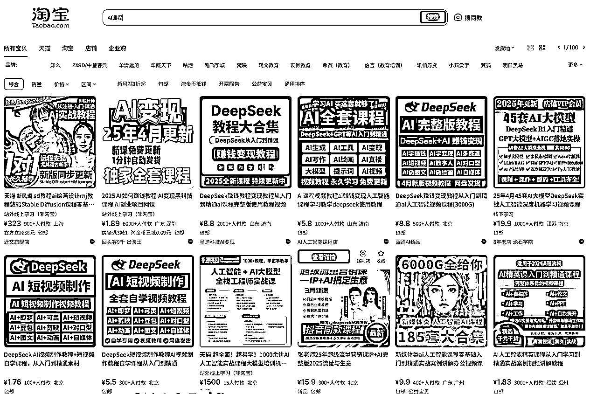

另外持续刷赚钱帖子，课程案例里很大一部分来源于赚钱干货和航海手册。

我每年拿出30%收入用于学习，付费买时间。付费不仅买经验素材，还能买人脉圈层。无论盗版还是正版付费，本质都是积累内容素材库。但要有竞争力，还需要自己的理解。好的课程产品具备四个维度。

## 4.1、体系化
培训课和知识付费的关键区别在于体系化。知识付费解决点技能，培训课要做结构化、层层递进的知识架构。

体系化不是目录罗列，而是宏观架构。以AI内训为例，我的设计框架是：

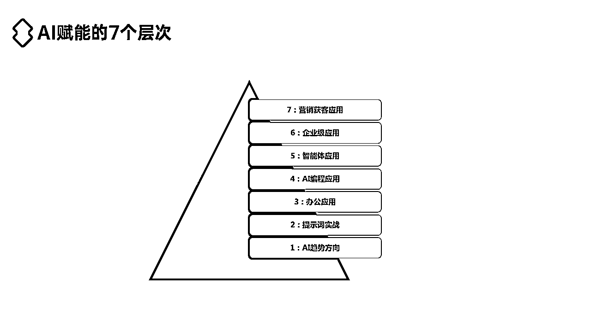

这七层对应AI应用七个阶段，企业可根据自身成熟度挑选模块。单拎一层也能继续拆解，比如提示词实战。很多同行只教模板，这很初级。我设计的提示词体系包含6大分支，可撑一整天：

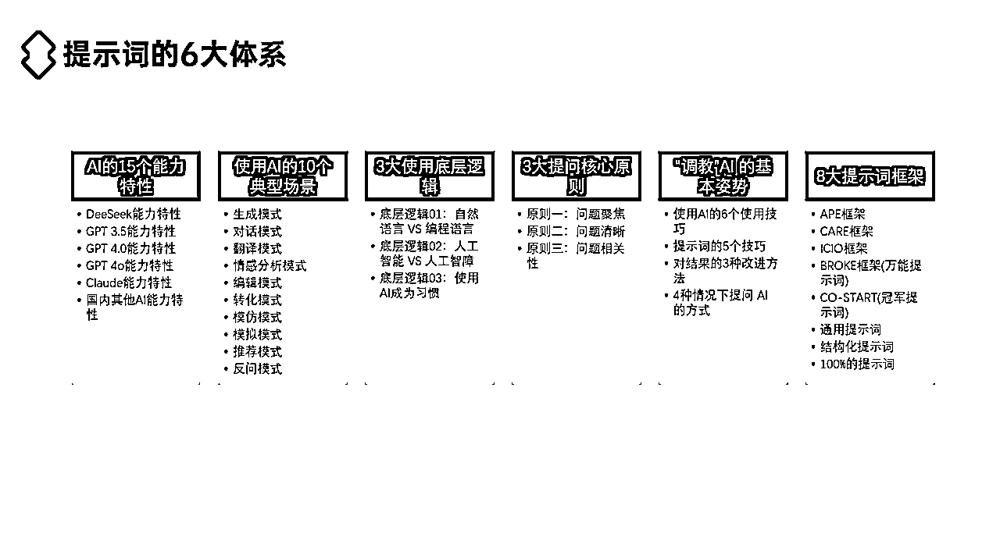

交付时不一定全讲，以客户需求为导向精选，核心是体系完整。

## 4.2、专业性
专业体现在广度和深度。体系化是广度，微观细节是深度。举提示词底层逻辑一页为例：

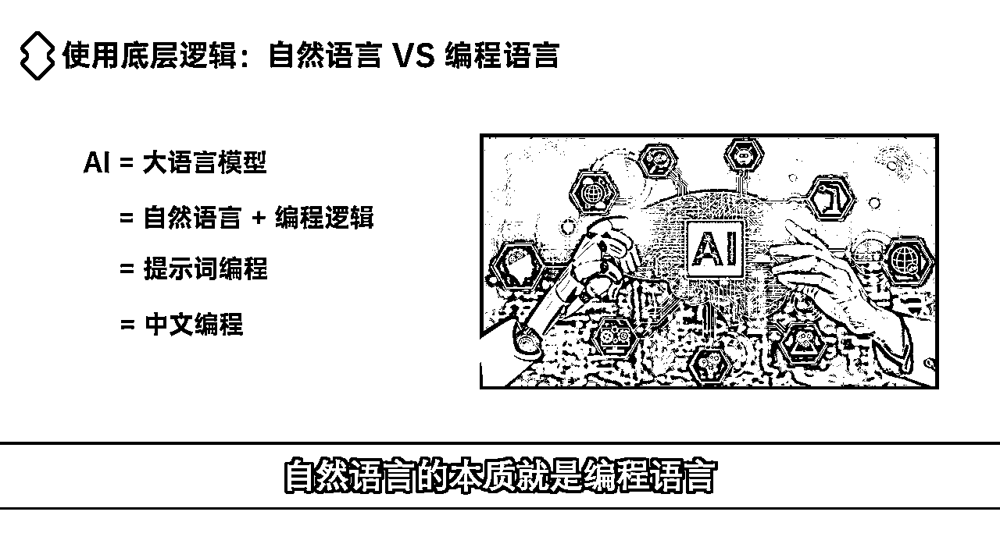

每个关键词的深度讲解体现专业厚度。PPT呈现同样重要，AI讲师的PPT不能丑，工具本身就能做精美课件。

## 4.3、通俗性
专业不等于晦涩。技术原理对非技术学员可不讲，或用大白话翻译。理解越深，表达越通俗。

## 4.4、实用性
AI是工具，最终看实操。课程必须结合学员岗位和场景设计实战案例，让学员能立刻用上。

# 5、培训交付

内容是内功，交付是外功。线下面对面仍是学习效果最好的形式。

新手上台易紧张、语速不稳，解决办法就是反复试讲磨课。2023年我首次做赚钱线下实操组局，要求学员带电脑实操，本质是磨课。那次PPT是现场生成的，用来演示AI+PPT能力。

优秀交付需要四大能力：表达、演讲、互动、应变。

## 5.1、表达能力
能把复杂讲明白是基本功。提升路径：结构思维、举例能力、语言简洁与节奏。

结构思维常用金字塔原理，典型结构“是什么-为什么-怎么做”“问题-原因-方案”。练习是写500字逐字稿并能一句话概括。

举例能力是降维利器，能把参数比作神经元数量，把fine-tune比作岗位培训。

语言要短句、重点前置，多录音复盘自己是否啰嗦绕口。

## 5.2、演讲能力
表达是内在，演讲是外放。声音洪亮、吐字清晰、表情自然、肢体配合，控场节奏分热场-干货-互动-故事-回顾，每15分钟做一次情绪起伏。

氛围感靠故事、金句、自嘲建立。表达力=好结构+好例子+好语言；演讲力=好声音+好节奏+好故事+好气场。

## 5.3、互动能力
互动让抽象知识落地。开场用快问快答、投票破冰；课中用提问点人、A/B选择、案例猜测；课后用现场任务促输出，如现场写prompt、分组分析。

互动不是为问而问，而是创造参与感。

## 5.4、应变能力

在培训现场，真正的专业度从不是PPT做得多漂亮，而是当突发状况砸过来时，你还能稳住气场、把局面接住。这种在意外、挑衅、技术卡顿面前依旧从容的处事能力，就是应变力。

AI培训的特殊之处在于，它天生自带话题热度，也自带争议性。杠精式追问、跨界难题、技术演示一不小心就翻车，再加上内训班里背景参差不齐，节奏很难统一。缺了应变力，再好的内容也会被现场带跑。

实战里，最常遇到的几类状况和我的处理思路：

**1、被当面质疑**
比如学员甩出：“AI胡说八道怎么办？”
先接住再拆解。先肯定问题的价值，再表达共情，最后展开说明。 “这个问题问得非常到位，也是大家最关心的痛点，我们一起拆开来看逻辑...”

**2、演示环节掉链子**
预防比补救更重要。开场就先打预防针： “今天现场演示，网络或模型偶尔会闹脾气，见谅哈。” 同时一定要有备胎方案：提前录好的演示视频、关键步骤截图、备用提示词脚本，必须随时能切换。

**3、问题超纲或不适合当场展开**
直接承认边界更专业。 “这个话题很深，更适合在特定场景细聊，我整理成资料会后发到群里。” 必要时可以把提问者拉出来沉淀一下，或者抛给全场一起头脑风暴。

**4、现场气氛冷掉**
讲师自己先打破僵局。 “AI是不会冷场的，今天我得争一口气。” 用投票、举手表决替代开放式提问，用一个真实踩坑小故事激活讨论，比硬讲有效得多。

**5、临时即兴输出**
我常说，时代从不缺机会，缺的是抓住机会时的即时表达力。很多时候谈合作、见客户，根本来不及准备课件，只能根据对方的行业、痛点、语境，几分钟内重组框架、快速讲清重点。这种内容驾驭力、结构化速度和情境匹配力，才是高阶讲师的标志。

应变的本质不是做到零失误，而是情绪不崩、引导不乱。用专业和稳定，把不可控拉回可控。

而应变力之外，交付体系决定口碑。我一直坚持：一个有生命力的课程 = 30%内容深度 + 40%现场交付质量 + 30%服务温度。

**课前准备**
基础概念、预习干货，我们会用录播提前推送。正式课只练刀法，不浪费时间在理论普及上。

**课中体验**
重实操、重手把手。所有能操作的提示词、案例、工具用法，都打包进课程的知识库和学员手册，这部分往往是学员觉得最值的。

**课后跟进**
线下班免费赠送线上回放，没听懂可以反复学；承诺一年内免费复训。课程素材持续迭代，比如DeepSeek刚刚火起来，我们就把新模块直接同步给新老学员。企业内训另建答疑群，一个月免费答疑；公开课学员也有专属群，有问必答。

从课前到课后的一体化服务，加上扎实的交付体验，才能让AI培训做到头部水准。毕竟术业有专攻。

AI正在急速重塑行业，我们没必要当旁观者，要成为参与者、见证者。写这篇内容，就是希望给正在做或想做AI培训的同行一些参考。

商业的底色是利他，而做老师，格局要更高。除了利他，更要做到燃烧自己，照亮他人。为市场、为社会、为国家，培养出真正能用AI的人才。