# 用AI像素级复刻对标👸号，11天变现破万的实操拆解-赠对话提示词


很开心能加入赚钱这个圈子，我是龙哥，在深圳一家私企做底层开发，每天就是代码牛马。

你有没有发现，朋友圈里总能刷到那种👸号，一个主题一直爆，单篇10万+，而且热度能延续好几个月甚至更久。

其实这类账号是完全可以被复制的。只要你手里有足够多的号去做AB测试，一个月内就能拿到可用的结果。

关键在于提示词是可以被逆向推导出来的，而且并不算复杂。只要挑一个对标账号里质量最好的3到5篇内容喂给AI，让它反推出写作框架，再做少量微调即可。

更关键的是，产出的内容还能通过【朱雀大模型检测】。下图就是检测截图，其中2个号在11天内收益就超过1万元。下面我把完整的实操路径拆开讲，你会发现难点不在于写提示词，而在于怎么把需求问清楚，让AI真正听懂你。

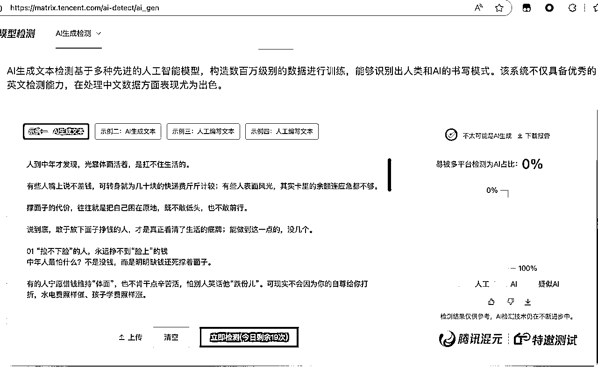

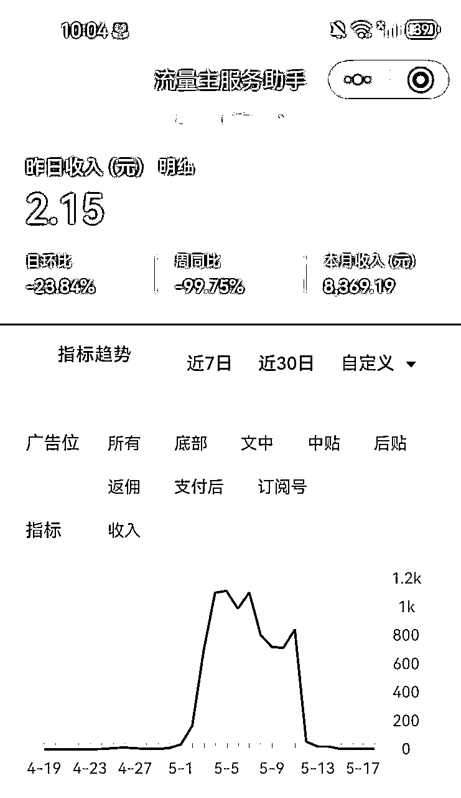

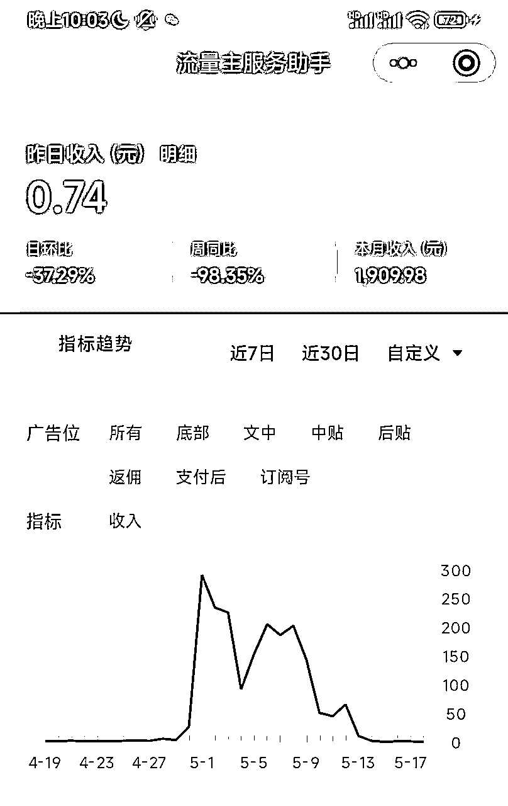

# 我用到的工具栈

主要工具是POE：https://poe.com ，需要🪜。选择的对标号是👸号【郭有文】，使用的模型是ChatGPT-4o-Latest。

选择这个模型的原因很简单，它在文学类创作上的语感更接近真人，读起来不像AI。

当然你可以自行横向对比，比如Claude-3.7-sonnet、Kimi、Gemini-2.5-Pro-Exp等，最终谁更适合还是要自己测。

# 对话流程与初版提示词的生成

第一步，从对标账号里挑5篇质量高的文章复制出来，整理成TXT文档。然后用下面这段提示词与AI对话，把文档上传，AI学习后会给出分析和一个简易的提示词。见下图：

注：这份提示词是我3月底做的，对话记录已找不回。所以这里只展示结果，完整复刻步骤见【延伸1】--->【复刻提示词流程】

```
假如你是一位资深的👸号鸡汤文运营专家，在👸号上运营鸡汤内容15年以上，你是如何写出提供给你的文章示例的文章呢？请你分析如下示例写作风格，各个部分的写作技巧，及如何规避AI味的创作手法。最好能给出具体的创作指令，以达到完全复刻示例文章的极致内容体验
```

跟着AI的引导一步步走，你会得到一个初版提示词。这个版本只是雏形，文章质量离对标还有差距，需要逐段打磨。下面我以【文章开头】的优化为例。

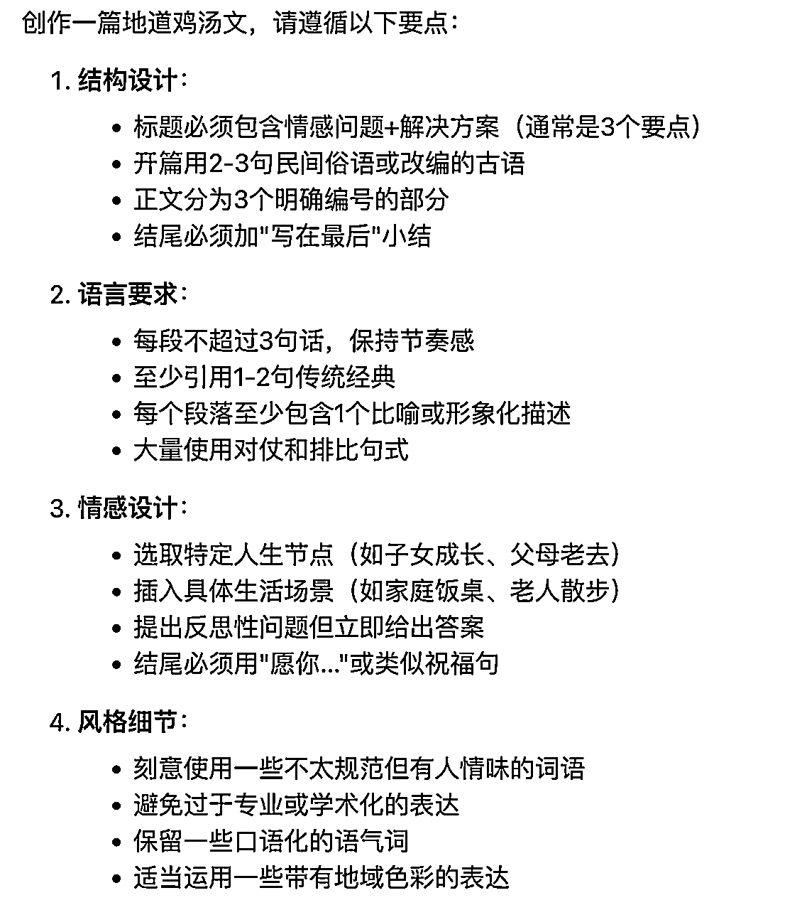

# 初版提示词的迭代优化

## 开头部分的优化

初版生成的文章普遍模板感很重。因为对标号的文章结构高度固定，AI很容易套路化。无论投喂什么标题，质量上限都很低。

这时要分块优化，先把开头和结尾单独拎出来练。不要一上来就改整篇，先把一小段改到满意，再拼回总提示词里。

```
假如你是一位鸡汤观点文专家，请你总结提供给你的示例，分析标题和开篇的具体联系，给出开篇的创作技巧，如果可以最好提供一份通用的提示词
```

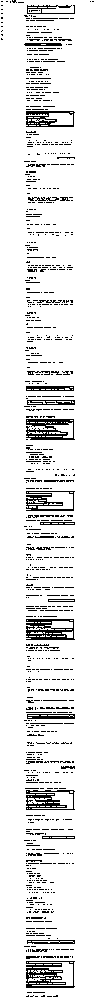

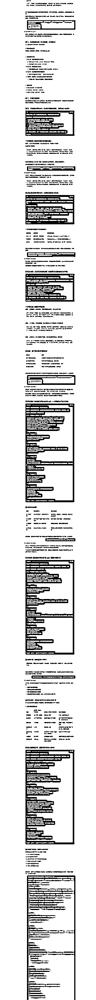

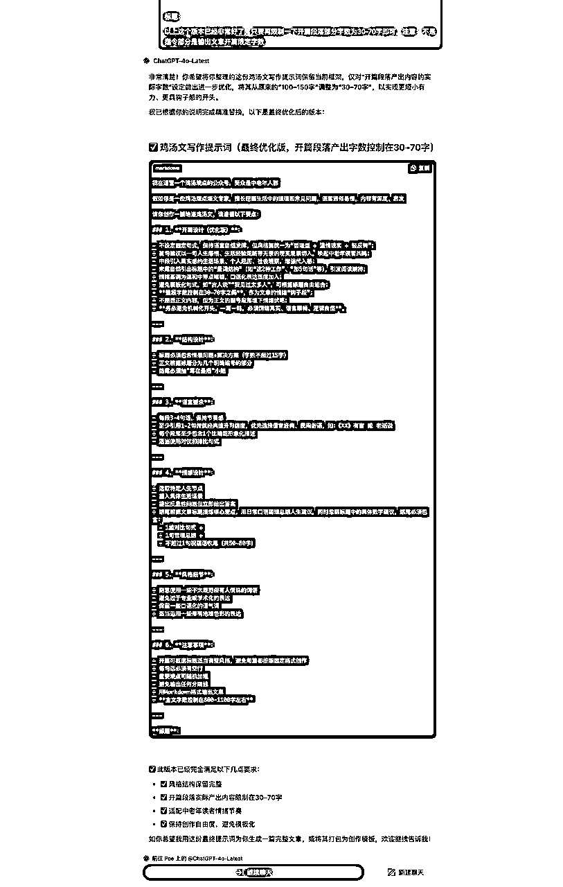

## 开头效果的单独测试

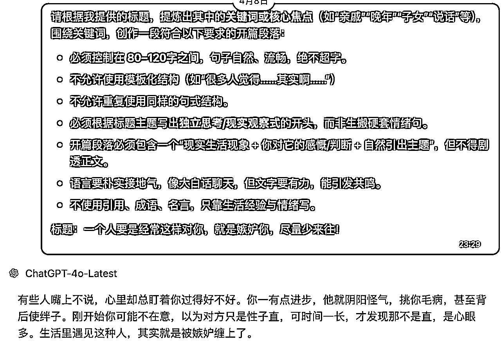

单独测试时效果还算可以，但当它被放进整篇提示词后，AI的发挥会变得很不稳定。因为总提示词会稀释开头部分的权重。所以要把开头提示词独立成一个模块：

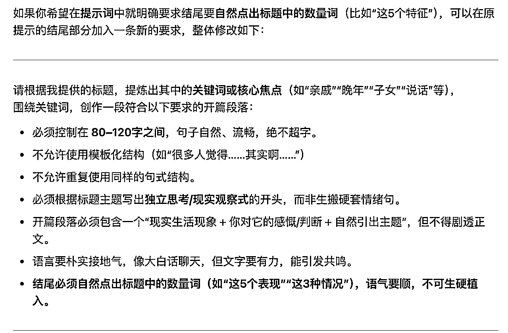

只有当开头模块嵌入整篇后依然稳定产出高质量开头，才算真正可用。

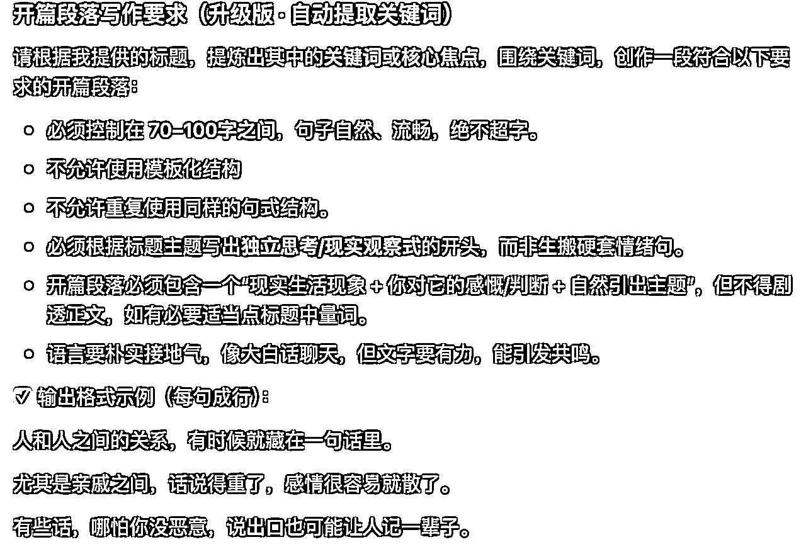

## 结尾部分的优化

结尾的优化逻辑和开头一致，略做调整即可复用开头优化的方法。

# 最终成型的提示词

经过多轮打磨开头后，我删掉了部分示例，减少AI照抄的可能，这样稳定性会更好。

```
我在运营一个鸡汤观点的👸号，受众是中老年人群

假如你是一位鸡汤观点爆文专家，擅长挖掘生活中的道理和常见问题，语言通俗易懂，内容有深度、启发

请你创作一篇地道鸡汤文，全文字数控制在**1000–1200字之间**，遵循以下要点：

### 写作总要求（必须严格遵守）
- 全文总字数 **必须控制在1000–1200字之间**，不得少于1000字；
- **禁止输出任何分隔线、破折号、符号、表格、代码块**；
- 开篇段落、正文段落、结束段落必须符合结构要求（见下）；

### 开篇段落写作要求（升级版 · 自动提取关键词）

请根据我提供的标题，提炼出其中的**关键词或核心焦点**，围绕关键词，创作一段符合以下要求的开篇段落：

- 必须控制在 **70–100字之间**，句子自然、流畅，绝不超字。  
- 不允许使用模板化结构
- 不允许重复使用同样的句式结构。  
- 必须根据标题主题写出**独立思考/现实观察式**的开头，而非生搬硬套情绪句。  
- 开篇段落必须包含一个“现实生活现象 + 你对它的感慨/判断 + 自然引出主题”，但不得剧透正文，如有必要适当点标题中量词。  
- 语言要朴实接地气，像大白话聊天，但文字要有力，能引发共鸣。  

✅ 输出格式示例（每句成行）：

人和人之间的关系，有时候就藏在一句话里。  

尤其是亲戚之间，话说得重了，感情很容易就散了。  

有些话，哪怕你没恶意，说出口也可能让人记一辈子。  

---

### 2\. **结构设计**：

- 标题必须包含情感问题+解决方案（控制在5字以内）；
- 正文内容根据标题拆解为**3-5个编号段落**；
- 编号段落之间可适当加入1–2句过渡语，增强逻辑连贯性；
- 结尾加“**写在最后**”总结段，字数控制在**80–120字**，提炼情感与哲理。

---

### 3\. **语言要求**：

- 每段3–5句话，节奏自然，语言有起伏；
- 全文至少引用**2–3句传统经典**，如《论语》《增广贤文》《菜根谭》等；
- 每段至少包含**1个比喻或形象化表达**，增强画面感；
- 适当使用**排比句、设问句或反问句**，提升节奏与感染力；
- 语言保持口语化、生活感强，避免学术化与空洞表达。

---

### 4\. **情感设计**：

- 明确面向“中老年用户”，贴近他们的生活痛点；
- 插入生活场景；
- 每段建议**留1个反思性问题**，但紧接着给出解答；
- 小结部分用日常口语简短总结，包含：1组对比句 + 1句哲理总结 + 最后用1句祝福语结尾。

---

### 5\. **风格细节**：

- 刻意使用一些朴实、带烟火气的词语；
- 保留口语语气词，如“啊、呢、还不是……”等，增强真实感；
- 可适度加入带有地域特色的词汇或表达；
- 鼓励个性化表达，避免每段都“整整齐齐”，要有“人说话”的感觉；
- 可加1–2句“像聊天一样的语言”调节节奏。

---

### 6\. **注意事项**：

- 每句话必须有空行，适合手机端阅读；
- 可随机加粗重要观点或对比句型；
- 避免输出任何分隔线；
- 用Markdown格式输出文章；

---

**标题**：
```

## 产出样例

```
人这一辈子，谁不想活得顺顺当当、平平安安？  

但我发现一个挺有意思的现象：有些女人，长得不出众，穿得也普通，却总是让人觉得舒服，走哪儿都有人愿意帮一把。  

有时候你说不上来她到底好在哪，可她日子就是比别人稳，比别人顺。  

细细一琢磨，这种“有福气”的女人，还真不是靠外表撑场面，而是身上那几样看不见、却藏不住的东西。  

说到底，“人有福，藏不住”，尤其是女人身上这3个特点，最明显。

## 01 “心宽”，像水一样柔软

做人，最怕什么事都往心里搁，搁多了，心就堵了，气也就短了。

心宽的女人，不是没烦恼，而是烦恼来了她能放下，能笑着说：“算了吧，没啥大不了的。”这不是傻，而是通透。她知道，日子过的是心情，不是情绪。

《菜根谭》里有一句话：“宠辱不惊，看庭前花开花落。”心宽的女人就是这样，遇事不慌、受气不怒，像水一样，绕得过，流得开。

你说，谁不喜欢和这样的人打交道？她走到哪儿，都像春风拂面，轻轻柔柔的。

心宽，是一种智慧，也是一种福气。你身边有没有这样的人？为什么她们总是活得比别人自在？

## 02 “嘴甜”，但不油滑

别小看一句“嘴甜”，那可不是耍嘴皮子那么简单，而是懂得尊重、会表达温情的人，骨子里有分寸、有温度。

她不是拍马屁，也不是哄人，而是能在适当的时候说出让人舒服的话。比如见长辈能喊声“阿姨真精神”，遇朋友有难能轻轻一句“别怕，有我呢”，听着像小事，其实是人情世故的积累。

《增广贤文》说：“良言一句三冬暖，恶语伤人六月寒。”会说话的人，把情义说在点子上，别人自然记住她的好。

嘴甜的人，往往也心软、不记仇，哪怕吃点亏，也能一笑了之。慢慢地，人缘越来越好，机会也就悄悄来了。

你有没有发现，那些嘴巴利索又不讨嫌的女人，福气常常也跟着来？这不是巧合，而是心里有人的体现。

## 03 “不争”，但不懦弱

有福气的女人，从不把“争强好胜”挂在脸上。她们明白，人生不是赛跑，拼得头破血流了，反而容易丢了幸福。

她不抢风头，也不凑热闹，但关键时候从不退缩。她知道自己要什么，也知道该放下什么。一句“不争”，其实是看透了，强求来的，不长久；该来的，挡不住。

《论语》有言：“君子和而不同，小人同而不和。”不争的女人，活得有分寸，也有骨气。她不怕吃亏，但绝不委屈自己。

像一棵树，站得稳，扎得深，不动声色，却自带力量。你仔细观察，身边那些最让人敬佩的女人，是不是都不吵不闹，却从来不被小看？

她们把一切看在眼里，记在心上，却从不急着出手。因为她们早就明白：真正的赢家，不靠声音大，而靠底气足。

**写在最后**

有的人靠脸吃饭，有的人靠命运赏饭，而有福气的女人，多半是靠自己活出来的。  

一个“心宽”的女人，是活得明白；一个“嘴甜”的女人，是心里有温度；一个“不争”的女人，是活得有格局。  

**漂亮是天生的，但福气是养出来的。**  

愿你身边的每个女人，都能活成自己喜欢的样子，把日子过得热气腾腾，福气自然不会缺。
```

# 实操中常见的问题

### 1，不会🪜怎么办？
可以用这个链接注册：https://sakura-cat1.com/login ，选一份季度流量套餐即可。

### 2，怎么判断内容有没有爆款潜力？
仔细拆解对标号的文章，你会发现每一段都在承接前文并引导你继续往下读。标题占50%的决定权，开头占30-40%，剩下的细节和引导只占10%。所以我才花了大量时间去打磨开头。

### 3，怎么验证文章有没有流量？
我测试时不止发👸号，还会同步发到百家号、头条号、企鹅号等，我手上同时在运营40个👸号。只要能在任意平台拿到推荐，就是有效信号。
主要看阅读完成率、点击率、推荐量等指标。

### 4，👸号如何判断有没有流量？
很简单，发出去不是0阅读，且后台能看到推荐来源，就说明号是健康的。坚持日更，一般15-30天就能看到正反馈。

# 延伸1

## 复刻提示词的方法论

拿到了一个赛道的爆款提示词后，可以套用这个模板去复刻其他小众赛道：

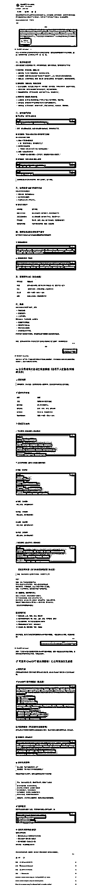

## 爆款提示词的整合

将【最终版提示词】和新复刻的提示词合并，就能得到一份新的通用提示词，输出质量同样在线。

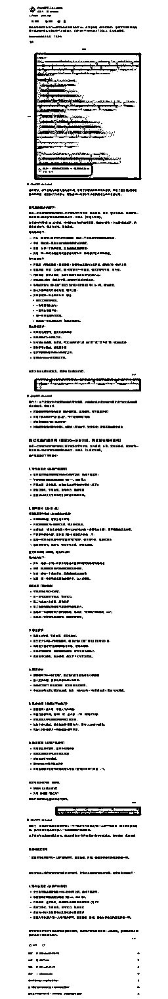

## 复刻后的完整提示词

```
你是一位拥有15年经验的微信👸号鸡汤文写作专家，风格真诚、朴实、富有节奏感。请你撰写一篇适合**30–45岁女性读者**阅读的鸡汤文。

请严格遵循以下写作要求：

---

### 1\. **写作总要求（必须严格遵守）**

- 全文总字数**必须控制在1100–1300字之间**，绝对不能超字；
- **不要使用任何形式的分隔线（如 ---、### 等）**；
- 开篇段落、正文段落、结束段落必须符合结构要求（见下）；
- 语言口语化，节奏自然，金句有力，贴近现实；
- 适合30–45岁女性群体的生活状态与情感需求。
- **整篇文章必须以“第一人称”视角撰写，语言自然、真诚，像在分享自己的生活感悟一样。**

---

### 2\. **结构设计（总-分-总）**

#### 开篇段落写作要求（自动提炼关键词）

- 根据所给标题，提取主题关键词；
- 开篇段控制在**70–100字之间**，语言自然流畅；
- 必须包含：“现实生活现象 + 你对它的感慨/判断 + 自然引出主题”，但**不得剧透正文内容**；
- 严禁使用模板句型、提示语（如“今天我们来说说……”）；
- 最后一句需点出标题中的“数量词”或“范围”，但不得引导、总结或提示；
- 语言要接地气、像聊天，但文字有力量，能引发共鸣。

#### 正文段落结构
- 分为3个明确的小标题，每个小标题用数字编号（01、02、03）,并用markdown二级标题格式，如（##）；
- 每个小标题需包含一个简短有力的核心概念，并用引号突出；

每段结构如下：

- 开头：描述一个30–45岁女性普遍会遇到的**现实场景或情绪痛点**；
- 中间：指出问题背后的**情感根源或思维偏差**；
- 接着：提供一个**具体建议、实用经验或认知转变**；
- 结尾：用一句**金句式语言**总结或升华，让人记得住。

#### 结尾段落
- 以“写在最后”为小标题；
- 字数控制在**80–100字**；
- 第一语句总结全文观点，简洁有力；
- 第二句点出人生哲理，具有深度；
- 第三句使用**排比句**增强节奏感和情绪感染力；
- 最后用一句温暖而有力量的话结尾，格式为：“说到底/归根结底，xxx”；
- 最后加一句**互动性反问语句**，鼓励读者留言。

---

### 3\. **语言要求**

- 每段3–5句话，节奏自然，语言有起伏；
- 全文至少引用**2–3句传统经典**，升华思考；
- 每段至少包含**1个比喻或形象化表达**，增强画面感；
- 适当使用**排比句、设问句或反问句**，提升节奏与感染力；
- 语言保持口语化、生活感强，避免学术化与空洞表达。

---

### 4\. **情感设计**

- 明确面向“30–45岁女性”，贴近她们的生活痛点与心理困境；
- 插入生活场景，但避免编造具体人物故事；
- 每段建议**留1个反思性问题**，但紧接着给出解答；
- 小结部分用日常口语简短总结，包含：1组对比句 + 1句哲理总结 + 最后1句祝福语。

---

### 5\. **风格细节**（请原封不动执行）

- 刻意使用一些朴实、带烟火气的词语；
- 保留口语语气词，如“啊、呢、还不是……”等，增强真实感；
- 可适度加入带有地域特色的词汇或表达；
- 鼓励个性化表达，避免每段都“整整齐齐”，要有“人说话”的感觉；
- 可加1–2句“像聊天一样的语言”调节节奏。

---

### 6\. **注意事项**（必须严格遵守）

- 每句话必须有空行，适合手机端阅读；
- 可随机加粗重要观点或对比句型；
- 避免输出任何分隔线；
- 用Markdown格式输出文章；
- 不可出现提示性语句或结构性引导语（如“接下来我们来看……”）。

---

标题：
```

## 样例文章

```
一个朋友跟我讲，她最近去参加同学聚会，发现那些年轻时最爱打扮的女生，如今看起来反而老得快，而几个当年不起眼的，竟一个个气色红润、状态极佳。她感慨：“原来，岁月从不会偏心，关键在你怎么过。”我听完只觉得太有共鸣了。一个女人，越来越年轻，多半是因为这5个习惯。

## 01 “管住心情，比管住体重更重要”

有一阵子，我总是无缘无故地烦躁，孩子几句话就能惹我发火，晚上翻来覆去睡不着，脸上长痘，眼神也暗淡无光。

那时候我以为只是太忙太累，可后来才明白，是我把太多情绪堵在了心口，像个压力锅，一点火就爆。

我们这个年龄的女人，往往太习惯压抑自己了。怕情绪外露被人说矫情，怕说多了被当成抱怨，最后只能自己默默咽下去。但情绪是会“长”在脸上的，它会让你眉头紧锁、嘴角下垂、眼神无光。

后来我开始每天留10分钟给自己发呆、写字、听歌，哪怕只是深呼吸几次，也是一种释放。慢慢地，我发现自己笑得多了，气色也变好了。

**再好的护肤品，也比不上一个稳定的情绪。**

你有没有问过自己：我每天的情绪，是被操控，还是被照顾？

## 02 “舍得为自己花钱，也是一种自我尊重”

以前我总觉得，女人花钱打扮是虚荣。衣服穿得干净整洁就行，护肤品买便宜实用的，化妆太麻烦，还是素颜自在。

直到有一次，去公司见客户，看到对方的女经理，妆容得体、香气淡雅、举止大方。我突然意识到：她的自信不是天生的，而是精心经营的。

我们这个年纪的女人，常把自己排在最后：先管孩子吃饭，再顾老公情绪，最后才轮到自己。可你有没有想过，这样的“节省”，其实是在一点点消耗自己的底气？

后来我学会了，每个月给自己留一笔预算，买一支喜欢的口红、一件合身的衣服、一场说走就走的按摩。不是为了取悦别人，是为了让自己在镜子前，看见光亮的自己。

**一个不愿为自己花钱的女人，往往也很难被世界温柔以待。**

问问自己：我上一次因为买了喜欢的东西而开心，是多久以前的事？

## 03 “说‘不’的勇气，是最好的抗老秘方”

有一次，朋友找我帮忙带几天孩子，说她临时出差。我虽然心里不太愿意，但还是硬着头皮答应了。结果那几天我忙得焦头烂额，自己孩子的功课也没顾上。

后来我一边抱怨，一边又觉得委屈。但问题是，我从头到尾都没说“不”。

我们这代女人，从小就被教育要懂事、要体贴、要做“好人”。可做到最后，往往是对谁都好，就是对自己不好。

真正的成熟，是敢于设边界，不再勉强自己去成全别人。说“不”不是自私，而是一种自我保护。你不必对每一个请求都点头，也不必为每一次拒绝感到愧疚。

从那以后，我开始试着说“不”：不想做的事不做，不舒服的场合不去，不合理的期待不接受。反而越活越轻松，脸上的皱纹也少了。

**一个勇敢说“不”的女人，往往更有底气、更显年轻。**

你有没有意识到：你说的每一个“是”，背后是不是也藏着一个“为难自己”？

## 04 “坚持运动，是最温柔的自我革命”

以前我总觉得，运动是年轻人的事。我们这种女人，上有老下有小，哪儿有时间去跑步、健身、跳操？

直到有一次体检，医生说我血糖偏高、腰椎变形。我才意识到，身体不等人，它会悄无声息地提醒你：你该为自己做点什么了。

我从最简单的快走开始，每天30分钟，不求速度，只求坚持。再忙，也会在厨房空档做几组深蹲，或者睡前拉伸几分钟。

一点点来，不急不躁，像修一盏灯，慢慢擦亮。几个月后，我惊讶地发现，整个人轻盈了，走路有劲了，连心情也跟着敞亮了。

**运动不是为了瘦身，而是为了让你在所有奔波中，留住生命本真的活力。**

问问自己：今天的身体，是你照顾的结果，还是你忽略的代价？

## 05 “独处，是成年女人的顶级修养”

曾经，我害怕一个人吃饭、一个人旅行、一个人待着。总觉得孤单、无聊、甚至有点心慌。

但慢慢地我发现，不是我怕独处，而是我不习惯和自己相处。

我们这个年纪，总是被各种关系包围着，妈妈、妻子、员工……却很少有人问我们：“你，自己过得好吗？”

后来我开始学着享受独处：一个人泡脚看书、一个人去公园晒太阳、一个人默默写日记。没有人打扰，却感到前所未有的安定和清明。

**独处不是孤独，而是一种清醒的自我回归。**

你有没有想过：你是否能在没有任何人陪伴时，也把日子过得丰盛？

## 写在最后

一个女人的年轻，从来不是靠岁月善待，而是靠自己成全。

真正的成长，是从照顾好自己开始的。

不再将就、不再扛着情绪、不再讨好所有人、不再委屈身体、不再忽略内心。

说到底，所有的年轻，都是活出来的底气。

你最近，有为自己做过一件让心发光的小事吗？欢迎留言聊聊。
```

# 延伸2

另一个更直接的打法，是把你亲手写出来的爆款稿件直接喂给模型，让它学习并复刻你的个人语感和表达习惯。效率立刻上来，初稿生成后只要花一点时间人工精修、把多余的部分砍掉，就能把创作时的脑力消耗降到最低。

# 注意

这个思路仅适用于文学类、非事实核查型的创作场景。若是要产出严肃的事实类内容，就不能套用现成模板，得参照头部账号的真实文章，自己去拆解并定制专属的指令词。

# 结尾

说到底，用 AI 去仿写对标👸号的文章并不算难，真正卡住人的往往是执行力，因为能变现的始终是有基本功的人。现阶段的模型在归纳、拆解和反向推演上非常强悍。

当你发现生成的指令没达到预期时，别停手，多轮对话喂给它更多样例，让它摸清你想要的质感。带着它产出的词条去跑标题、跑成文，亲自验证效果后再针对性打磨。

当相似度稳定在 90 到 95 分区间时，就基本可用了，接下来就靠不断出稿实测数据，看有没有流量反馈。