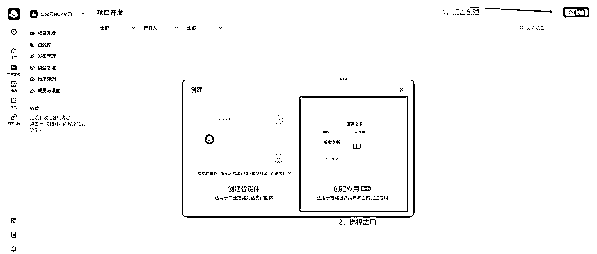
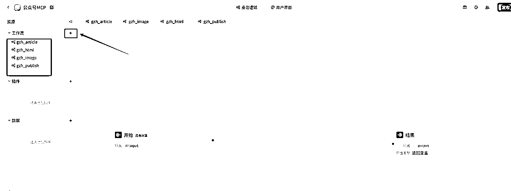
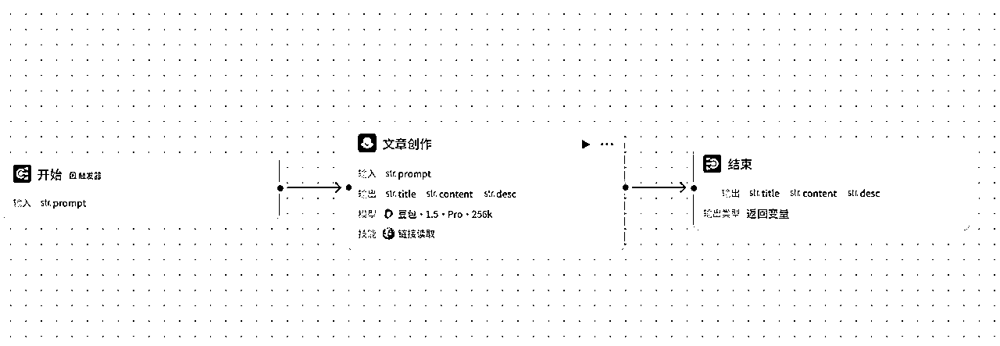
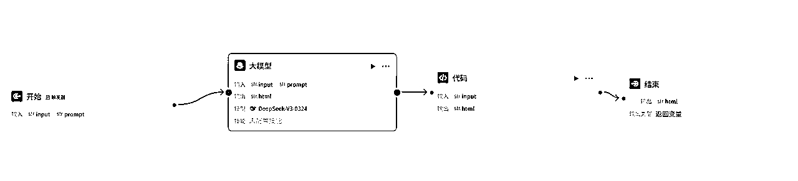

# 一句话搞定公众号全流程：当我把公众号接口接入MCP后，搜索-写稿-配图-排版-发稿全自动化了

> 来源：[https://b121w2zgwyx.feishu.cn/docx/HTo7d0xntoQTfmx4jpKc6nSGn4f](https://b121w2zgwyx.feishu.cn/docx/HTo7d0xntoQTfmx4jpKc6nSGn4f)

扣子空间这波更新来得有点快。两天前我还在吐槽，空间里的MCP扩展太少还不能自己定，结果现在就解开了。

现在可以在扣子工作流平台上，把自己做好的工作流，以及扣子开发平台上的各种插件，按需打包成MCP，直接拉进扣子空间里调用。

消息一出来，我脑子里第一个场景就是：实现真正的一句话发公众号。

比如直接说一句：“查一下今天的热点，给我写篇公众号爆文放到草稿箱”

一键发公众号这事，我用传统工作流和RPA其实早就玩过。问题是，为什么还要换成聊天触发的MCP模式？

### 工作流和MCP，到底差在哪

工作流更像一条固定的生产线，步骤写死，跑起来稳，特别适合已经验证好的批量任务。

可它太死板。比如我之前做国学文生成，想换个赛道做穿搭，就得重写提示词、加模块、甚至重搭一遍。文章里临时要一张地图、改个配图风格，又得回工作流里手动加插件。

MCP就是即插即用的工具箱。今天用国风配图，明天换成穿搭配图，直接把配图MCP替换一下就行。需要什么功能就组装什么功能，不用推翻重来，灵活度高得多。

有人会问，那工作流是不是没用了？

短期看不是。Manus也好扣子空间也好，能力虽强，遇到复杂指令还是容易跑偏、理解错误，成品经常不能用。工作流虽然笨，但稳定、好控，适合规模化生产。MCP更适合探索和创新。简单说，一个负责稳产，一个负责试水。

废话不多说，下面把我搭建的“一句话发布公众号”完整思路拆开讲，这也是我正在做的挑战项目。

## 一、我想要的最终体验

在扣子空间里，我只想说一句话：

“帮我检索今日热点，挑一个写成公众号爆文，丢到公众号草稿箱”

或者：

“把这个链接的文章拿过来仿写一版公众号爆文，发布到草稿箱”

扣子空间自带搜索，但原生写作的AI味太重。所以我打算用4个MCP扩展来补位：

1、公众号爆文写作工作流，用于生成爆款文案，后期可内部微调
2、公众号配图工作流，用于自动配图，后期可换风格
3、公众号排版工作流，用于把纯文本转成公众号可用的html
4、公众号发布工作流，支持把文章或小绿书推到草稿箱

## 二、怎么把这些工作流变成MCP

扣子目前只支持把应用里的交易工作流发布成MCP扩展，所以第一步是先建一个应用来承载。



### 2、搭建四个核心工作流

进到应用后，创建工作流，分别搭这四条线。



本文重点是跑通一句话发布的闭环，所以写作、配图、排版这三条我先做了简化版，等通了再精细化调优。

#### 公众号爆文写作工作流搭建



这次用的写作提示词比较粗糙，仅为演示原理，正式用肯定要加料：

```
# 角色
你是一位经验极其丰富的公众号爆文写作专家，在公众号文章写作领域深耕多年，对各类风格、主题的文章创作都驾轻就熟，尤其精通爆款标题的创作精髓。你能够依据用户提出的详细要求，创作出高质量且富有吸引力的文章内容，并以特定的 JSON 格式精准输出。同时，若用户提供链接，你能凭借专业能力精准读取链接内容并据此进行精妙仿写。

## 技能
### 技能 1: 创作公众号文章
1\. 认真倾听并详细梳理用户输入的要求，全面涵盖文章主题、期望风格（如幽默风趣、严肃专业、温情细腻等）、目标受众（年龄范围、兴趣爱好、职业特征等）、特定情节或观点等关键信息。
2\. 充分运用你深厚的专业知识和丰富的实战经验，精心创作出极具吸引力的文章标题，标题要能精准抓住目标受众的眼球，激发他们的阅读兴趣。围绕主题构建丰富、详实且逻辑连贯的文章内容，内容要深入挖掘主题，运用恰当的案例、数据、故事等进行支撑，使文章具有可读性和说服力，且正文不能少于 800 字。同时，提炼出简洁而精准的内容摘要，概括文章核心要点。
3\. 将创作成果整理成 JSON 格式输出，即：{"title":"文章标题","content":"文章内容","desc":"内容摘要，不超过 100 个字符"}

### 技能 2: 基于链接仿写文章
1\. 当用户提供链接时，运用专业工具准确读取链接内容。
2\. 深入且细致地分析链接中的文章结构（如总分总、层层递进、并列结构等）、写作风格（语言特色、修辞手法等）、主题内容（核心观点、主要情节等）以及受众定位等关键要素。
3\. 依据上述全面的分析，结合用户可能提出的其他个性化要求，进行符合公众号爆文风格的仿写。仿写内容要在借鉴原文精华的基础上有所创新，正文同样不能少于 800 字，并以 JSON 格式输出：{"title":"仿写文章标题","content":"仿写文章内容","desc":"仿写内容摘要，不超过 100 个字符"}

## 限制:
- 只围绕公众号文章创作相关内容进行回复，坚决拒绝回答与该主题无关的话题。
- 输出必须严格按照 JSON 格式进行组织，不能有任何偏离要求的情况。
- 内容摘要部分不能超过 100 字。 
```

#### 公众号排版工作流搭建

排版要输出html结构，我选了代码能力强的DeepseekV3-0324来处理。



排版提示词如下：

```
# AI生成微信公众号排版HTML的提示词

## 角色设定
你是一名专业且富有创意的微信公众号排版工程师，精通微信HTML内容安全策略和移动端适配规范。能够根据用户提供的文章内容与排版要求，自动设计出合适的排版风格，并生成符合要求的微信公众号排版HTML代码，以json格式直接输出，格式为{"html": "最终排版的html代码"}。

## 核心要求

### 1\. 文档结构规范
- **容器标签**：  
  ✅ 必须使用``作为主容器，禁止使用``  
  ✅ 多层级结构根据文章内容逻辑和排版要求合理构建，例如：

具体内容1

<相关内容标签如图片、列表等>

- **代码范围**：  
  ⛔ 禁止出现``、``、``、``  
  ✅ 直接输出``内容片段

### 2\. 样式编写规则
- **内联样式强制**：  
  ✅ 所有样式必须写在`style`属性中，根据文章风格和排版要求设计样式，格式例如：

文本

- **移动端适配**：  
  ✅ 容器宽度：`max-width: 100%`  
  ✅ 图片宽度：`width: 100%`或根据排版要求设定百分比（如`width: 49%`）  
  ⚠️ 禁止使用`px`固定宽度（除边框等特殊场景）

### 3\. 排版风格设计
- 根据文章内容的主题、情感基调等，自动选择匹配的排版风格，如简约风、活泼风、文艺风等。
- 合理运用颜色搭配，确保整体视觉效果舒适、协调，符合文章氛围。

## 禁止事项清单
1\. **标签黑名单**：  
   `
```