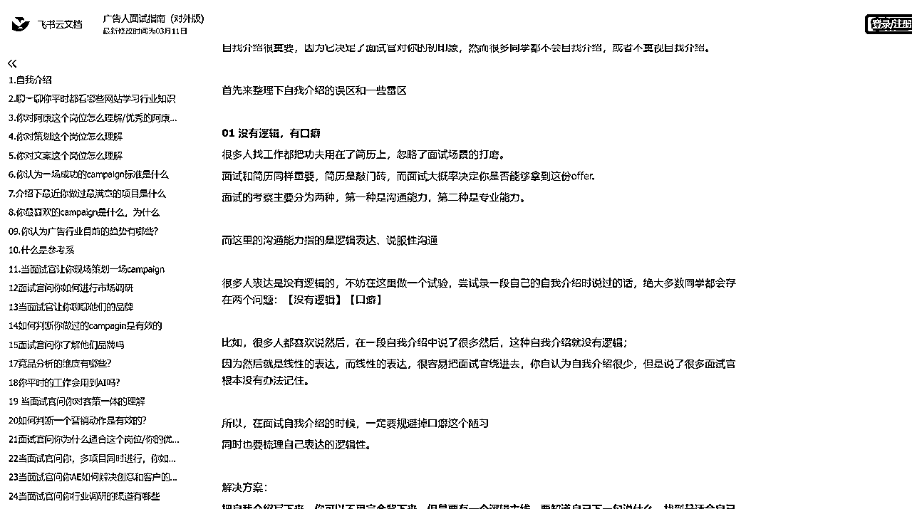
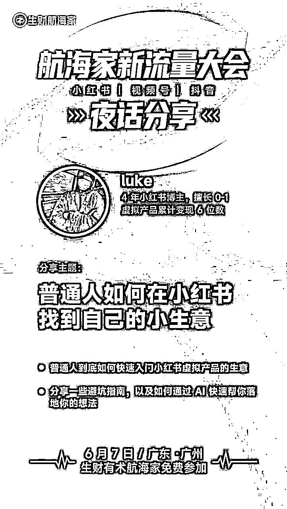

# 普通人如何用📕撬动属于自己的小生意

大家好，我是luke

今天聊一个很实际的问题：普通人该怎么在📕上做起自己的小生意。

## 先把定位想清楚：📕是工具，不是终点

很多人上来就把📕当成目标，拼命刷数据、追热度。笔记一火就飘了，一篇没火就怀疑人生，忙到最后只换来一堆虚荣的点赞和偶尔的商单邀约，性价比极低。

其实要反过来想，📕的本质是达成目标的手段，而不是目标本身。

一旦你把这层关系理顺，做事就清晰多了。

比如你是个独立做AI产品的开发者，那📕就是你的投放部门，你要做的是在上面制造话题和需求。
比如你是个线下商家，📕就是帮你触达精准人群、把货卖出去的渠道。
比如你是职场老手，📕可以成为你孵化副业、售卖虚拟知识产品的舞台。

视角转过来后，每一步创作都有明确的指向，不再为了流量而流量，也不用被算法牵着走。聚焦、省力、少内耗。

细分来看就是这样：有些博主粉丝不多，但商业化做得特别好。因为他们很清楚自己要什么。比如专注婚礼请帖DIY设计的，有专门靠📕获客引流到店铺的，有做高定私人手工定制的，有把追星热情转化成明星周边生意的...

你会发现，📕本质是用户做消费决策的圣殿。你只需要在一个垂直领域，把专业度立住就行。

再说一遍，📕是用来帮你实现商业目的的工具。

## 为什么📕做虚拟产品，比你想象的更香

聊聊虚拟产品这件事。

在传统打工逻辑里，员工最大的资产是时间，也就是卖时间换钱。而虚拟产品能让你真正拥有自己的生产资料，实现从执行者到创造者的身份切换。

而且它像一份“赛博养老金”。只要你的内容能持续解决用户痛点，只要平台还在，它就能一直卖，而且几乎没有边际成本，卖的就是纯利润。

更关键的是，虚拟产品能快速建立金钱关系。

第一单可能价格不高，但一旦用户为你付过钱、体验过你的交付，信任就建立起来了。下次你推出新东西，这批人很可能直接复购。你做的不是一次性买卖，而是做一群人的长期生意。

那普通人怎么快速做出自己的虚拟产品？

先回答四个问题：你是谁？你比别人有什么不一样？你最想表达什么？你能把自己的经验梳理成体系吗？把这四点和你在📕上看到的真实用户需求结合起来，你的原创虚拟产品雏形就出来了。

另外，别被形式限制。什么都能虚拟化：模板、攻略、表格、话术清单……只要能解决一个具体问题，都可以产品化。

## 我的实操复盘：面试题库是怎么从0到赚钱的

我自己也是个职场博主。

3月求职季刚需最明显。找工作这个场景里，能变现的点非常多：简历模板、作品集模板、面试。

我迅速判断了一下，面试题库是刚需中的刚需，于是马上做了一个面试题库虚拟产品。内容就是求职过程中高频会遇到的各类题目。

有人会问，题库哪来的？答案哪来的？

题库素材在📕本身就能搜到不少，答案部分一部分是我自己总结，一部分用AI辅助整理和优化。核心不是原创每一道题，而是系统化呈现。

系统化是壁垒。用户要的不是散落的零碎信息，而是一个完整、好用的解决方案。

怎么做到系统化？做深做全。

比如做运营岗面试题，你不能只放几道热门题。最好把应届生、1-3年、3年以上不同经验段的问题都覆盖，把行业内的真题、核心考点全部收录整理。用户一眼就能看出：这就是我想要的那份。

📕上类似内容很多，但没人把它们做成体系，这就是你的机会。

这就是我当时的题库产品形态。很简单，就是定期更新维护。2、3月份累计卖出了300单左右。

我还顺便分享一个做人群生意的打法：一定把客户导到私域，比如加微信。人群生意的核心就是复购和多品类销售。

我做职场，卖的不只是面试题库。后续还能卖简历模板、写作方法论、作品集模板、简历修改、作品集指导、求职陪跑、面试辅导……全部可以沉淀到同一个客户池里。

我再强调一次：要做高客单、要做客户终身价值CLV。

我把这个题库同时放在📕店铺，也在朋友圈向老客户推广。因为之前买过我虚拟产品的用户都被我加在了微信里。产品一发，就有老客主动来私信购买。

怎么促成交？给老客专属优惠很管用。📕店铺卖59.9，老客户群里可以给29.9或39.9。让他们有特权感。

从更高维度看，虚拟产品本质是你的信任工具。它帮你拿到客户的联系方式，导流私域。之后每一次新品发布，你都可以第一批触达这批人。

这就很像凯文·凯利说的1000个铁杆粉丝理论。虚拟产品就是你拿到这1000个持续付费用户的敲门砖。当他们认可你的价值，下次自然会继续买单。

算笔账，如果你有1000个铁杆铁粉，每人每月给你贡献19.9元，那就是19900元的稳定月收入。这是长期主义的复利，不是赚一笔就散。

最后别局限在📕一个渠道。你的分发路径可以是朋友圈、社群、👸号，各处都能卖。

先聊到这。6月7号我会在航海家新流量大会的夜话现场，跟大家面对面聊普通人如何快速在📕构建小生意，以及怎么用AI去做虚拟产品赋能。

