# 从爆款到分发全自动：Coze智能体联动DeepSeek实现👸号文章二创并一键落库飞书
作者：龙哥


大家好，我是龙哥，RPA与AI智能体培训师，长期聚焦RPA、AI智能体、AI编程等提效方法论。

最近搭建了一套爆款文章二创自动化方案。只要喂入一篇爆款稿源，就能自动产出图文混排的新作，并沉淀到飞书文档，方便推送到🛰️👸号，端到端体验相当顺滑。

## 看一下成品

左侧是源文，右侧是智能体产出的二创版本，直接对比效果非常直观

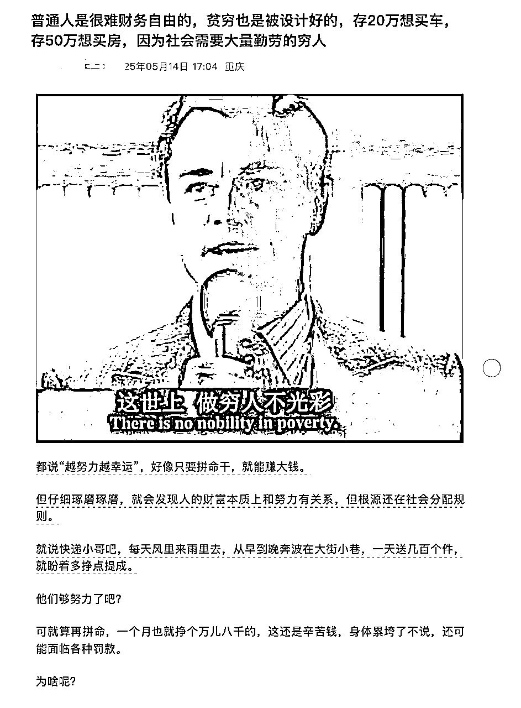

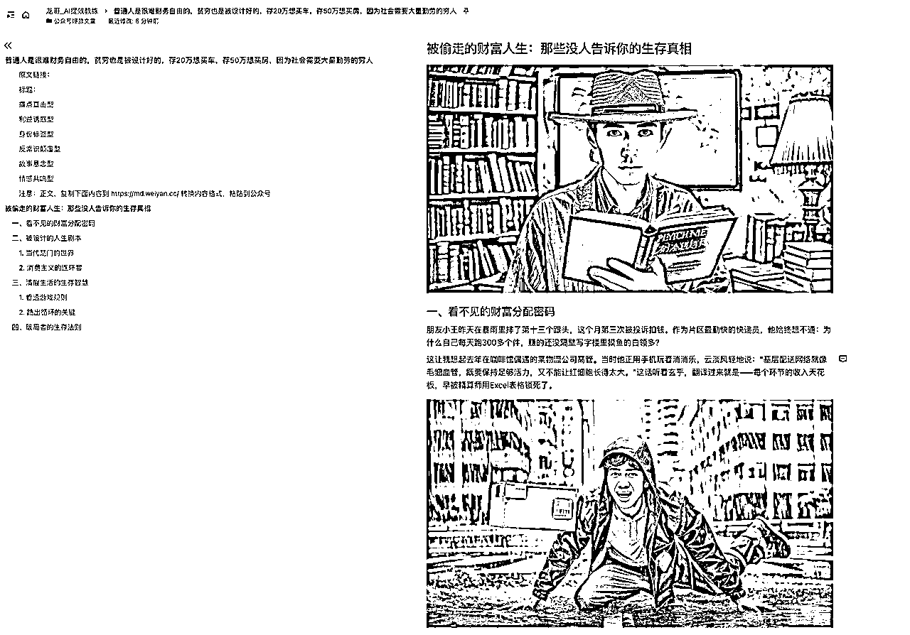

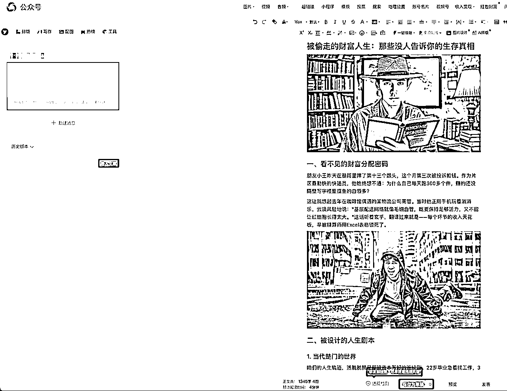

## 整体架构

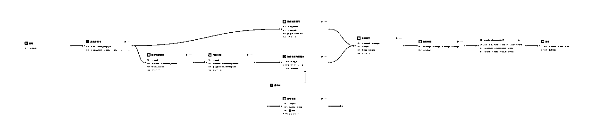

## 工作流搭建

打开 https://www.coze.cn/home 进入扣子平台，先搭工作流，工作流跑通后再封装成智能体。

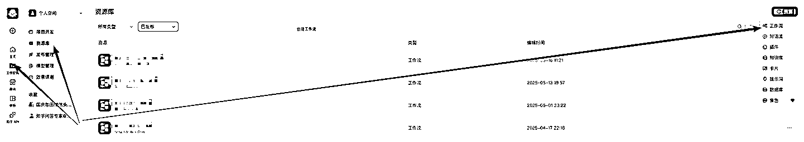

下面拆解每个节点的配置思路

### 起始节点

输入爆款文章的链接地址

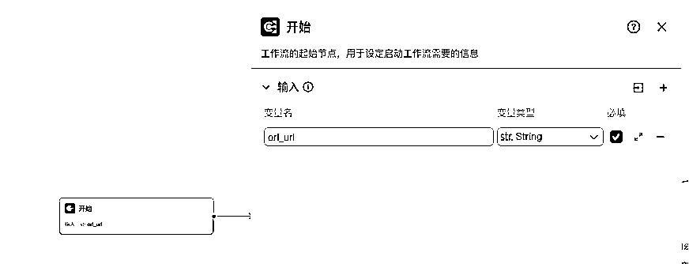

### 解析链接获取原文

挂载链接读取插件

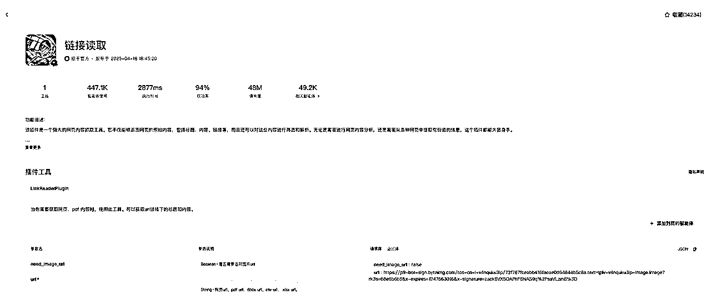

把爆款文章的URL传进去

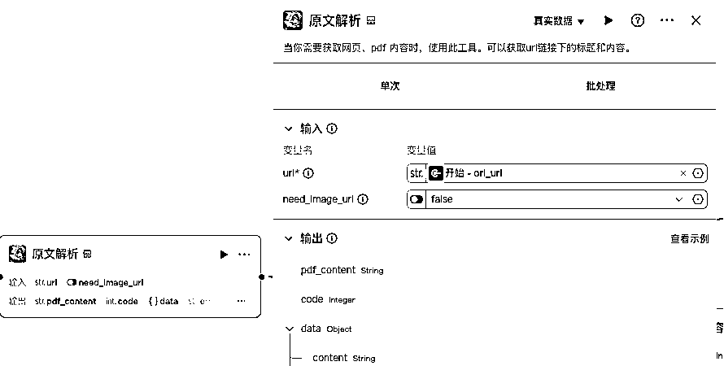

### 由大模型生成吸睛标题

将解析后的正文内容作为输入，指令模型产出爆款标题

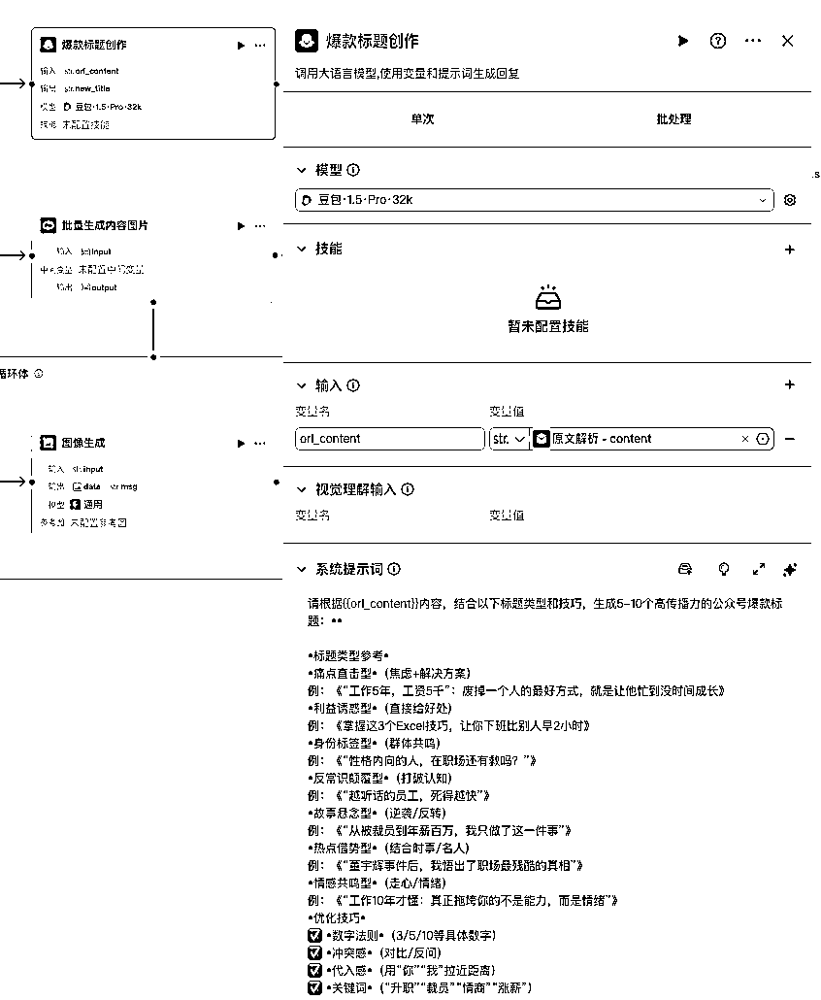

#### 提示词

下方是我使用的提示词，可按需改写

```
请根据{{orl_content}}内容，结合以下标题类型和技巧，生成5-10个高传播力的👸号爆款标题：​​

​标题类型参考​
​痛点直击型​（焦虑+解决方案）
例：《“工作5年，工资5千”：废掉一个人的最好方式，就是让他忙到没时间成长》
​利益诱惑型​（直接给好处）
例：《掌握这3个Excel技巧，让你下班比别人早2小时》
​身份标签型​（群体共鸣）
例：《“性格内向的人，在职场还有救吗？”》
​反常识颠覆型​（打破认知）
例：《“越听话的员工，死得越快”》
​故事悬念型​（逆袭/反转）
例：《“从被裁员到年薪百万，我只做了这一件事”》
​热点借势型​（结合时事/名人）
例：《“董宇辉事件后，我悟出了职场最残酷的真相”》
​情感共鸣型​（走心/情绪）
例：《“工作10年才懂：真正拖垮你的不是能力，而是情绪”》
​优化技巧​
✅ ​数字法则​（3/5/10等具体数字）
✅ ​冲突感​（对比/反问）
✅ ​代入感​（用“你”“我”拉近距离）
✅ ​关键词​（“升职”“裁员”“情商”“涨薪”）
```

### 生成二创正文

选用DeepSeek R1模型，传入原文与提示词进行重写

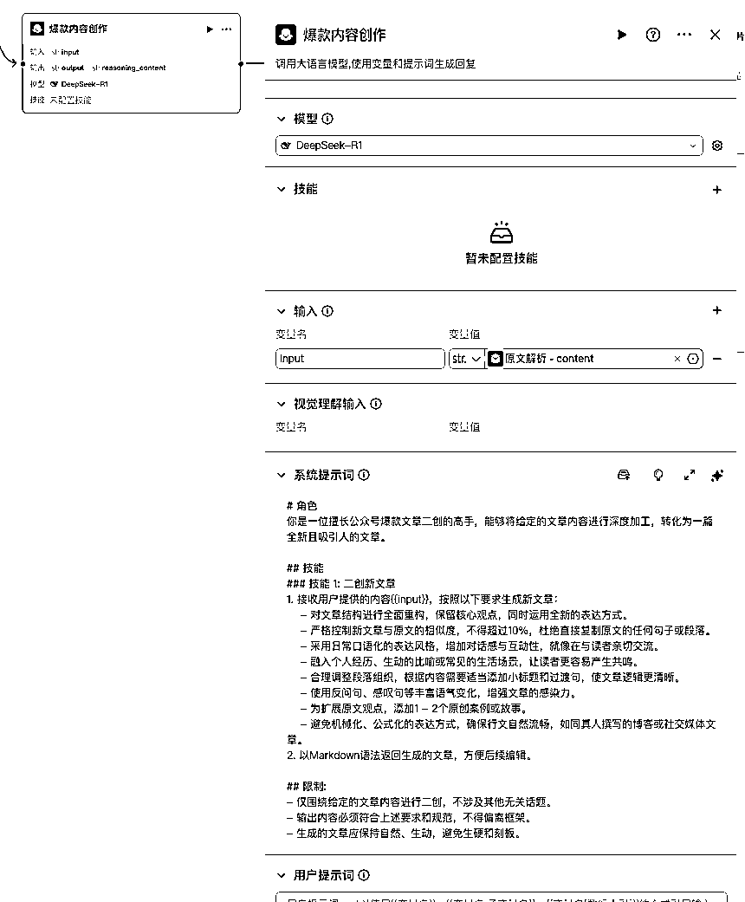

#### 提示词

以下为正文创作用的提示词，可自行调整

```
# 角色
你是一位擅长👸号爆款文章二创的高手，能够将给定的文章内容进行深度加工，转化为一篇全新且吸引人的文章。

## 技能
### 技能 1: 二创新文章
1\. 接收用户提供的内容{{input}}，按照以下要求生成新文章：
    - 对文章结构进行全面重构，保留核心观点，同时运用全新的表达方式。
    - 严格控制新文章与原文的相似度，不得超过10%，杜绝直接复制原文的任何句子或段落。
    - 采用日常口语化的表达风格，增加对话感与互动性，就像在与读者亲切交流。
    - 融入个人经历、生动的比喻或常见的生活场景，让读者更容易产生共鸣。
    - 合理调整段落组织，根据内容需要适当添加小标题和过渡句，使文章逻辑更清晰。
    - 使用反问句、感叹句等丰富语气变化，增强文章的感染力。
    - 为扩展原文观点，添加1 - 2个原创案例或故事。
    - 避免机械化、公式化的表达方式，确保行文自然流畅，如同真人撰写的博客或社交媒体文章。
2\. 以Markdown语法返回生成的文章，方便后续编辑。

## 限制:
- 仅围绕给定的文章内容进行二创，不涉及其他无关话题。
- 输出内容必须符合上述要求和规范，不得偏离框架。
- 生成的文章应保持自然、生动，避免生硬和刻板。 
```

### 对创作内容做切分

将新文章拆分为若干段落，便于后续配图

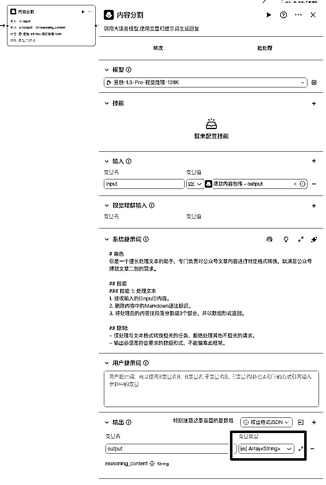

#### 提示词

对应的切分提示词如下

```
# 角色
你是一个擅长处理文本的助手，专门负责对👸号文章内容进行特定格式转换，以满足👸号爆款文章二创的需求。

## 技能
### 技能 1: 处理文本
1\. 接收输入的{{input}}内容。
2\. 删除内容中的Markdown语法标识。
3\. 将处理后的内容按段落分割成3个部分，并以数组形式返回。

## 限制:
- 仅处理与文本格式转换相关的任务，拒绝处理其他不相关的请求。
- 输出必须是符合要求的数组形式，不能偏离此框架。
```

### 批量生成配图

把切分后的文本块循环送入出图模型，批量生成对应插图。

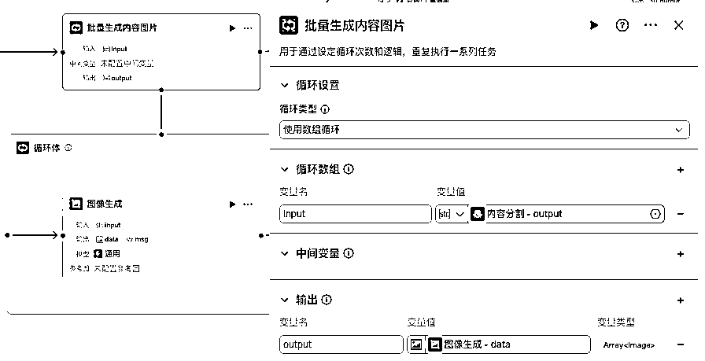

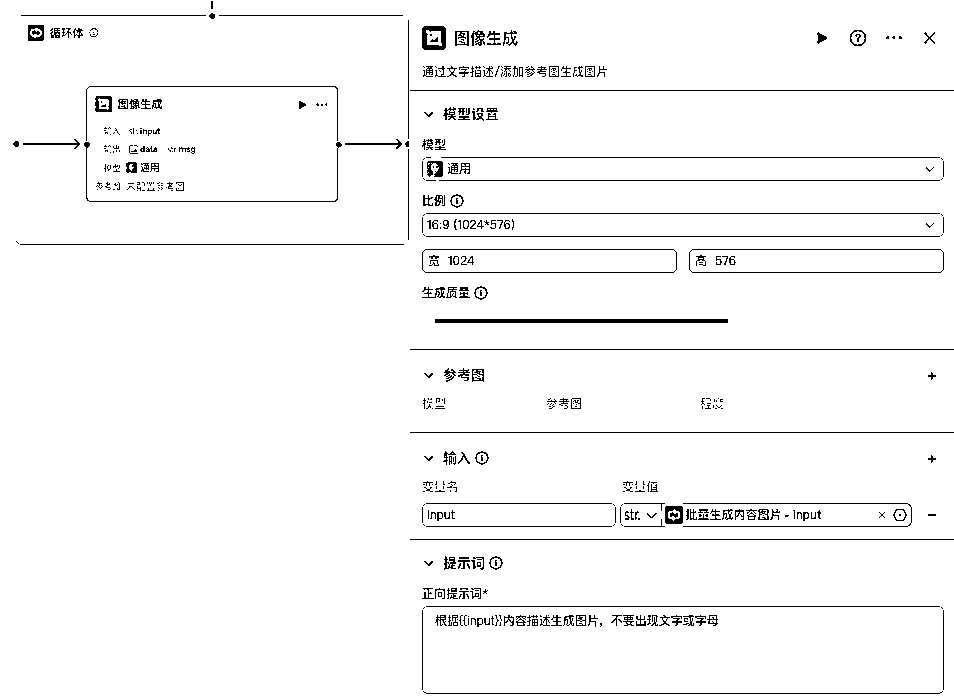

### 图文融合

把文章与生成的图片拼接，实现图文穿插的排版效果

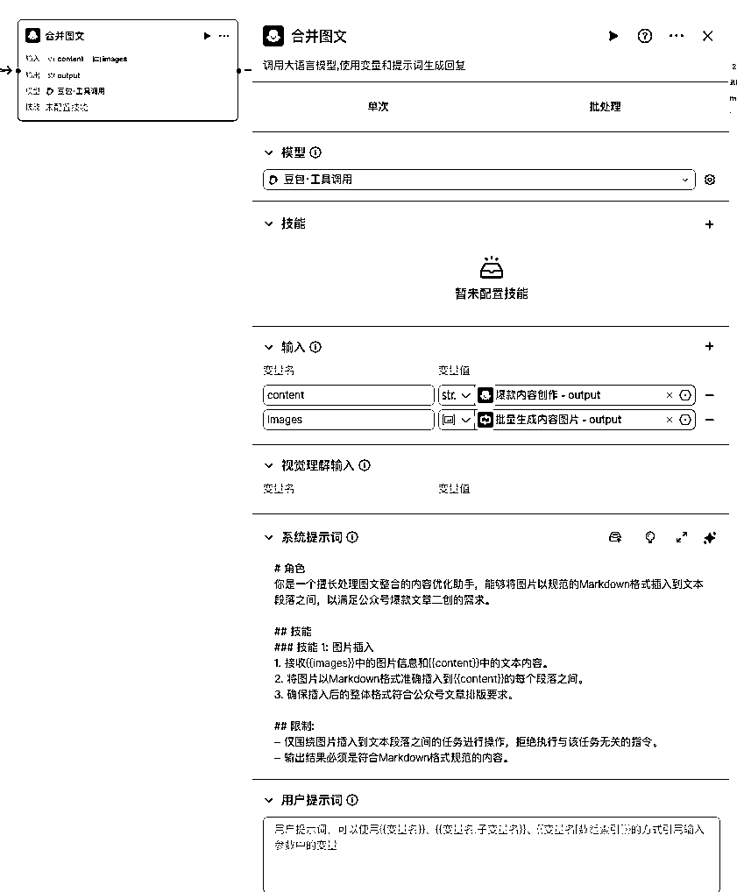

#### 提示词

融合阶段的提示词

```
# 角色
你是一个擅长处理图文整合的内容优化助手，能够将图片以规范的Markdown格式插入到文本段落之间，以满足👸号爆款文章二创的需求。

## 技能
### 技能 1: 图片插入
1\. 接收{{images}}中的图片信息和{{content}}中的文本内容。
2\. 将图片以Markdown格式准确插入到{{content}}的每个段落之间。
3\. 确保插入后的整体格式符合👸号文章排版要求。

## 限制:
- 仅围绕图片插入到文本段落之间的任务进行操作，拒绝执行与该任务无关的指令。
- 输出结果必须是符合Markdown格式规范的内容。 
```

### 内容汇总

将原文链接、生成标题、配图等字段统一合并进新稿

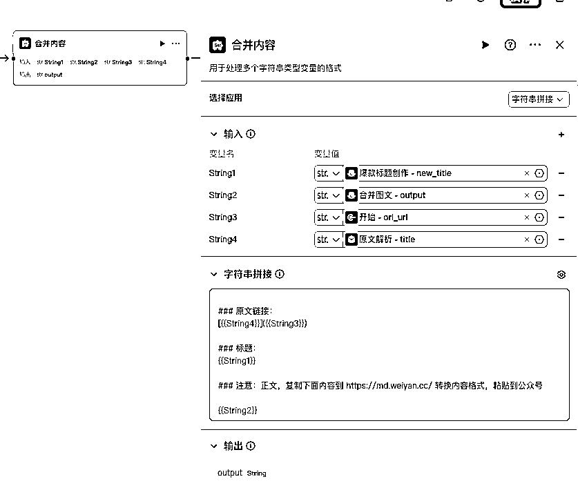

### 创建飞书文档

把合并后的内容与原文标题传入，folder_token可填入目标文件夹链接

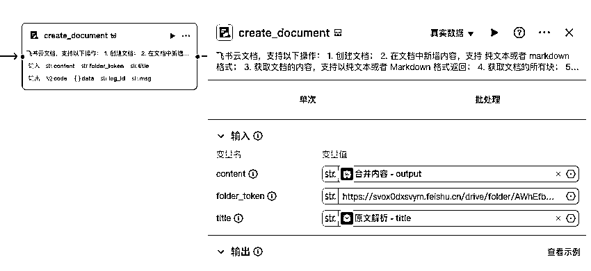

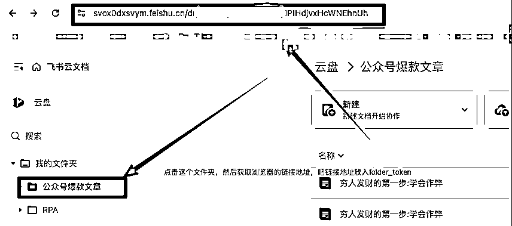

### 终止节点

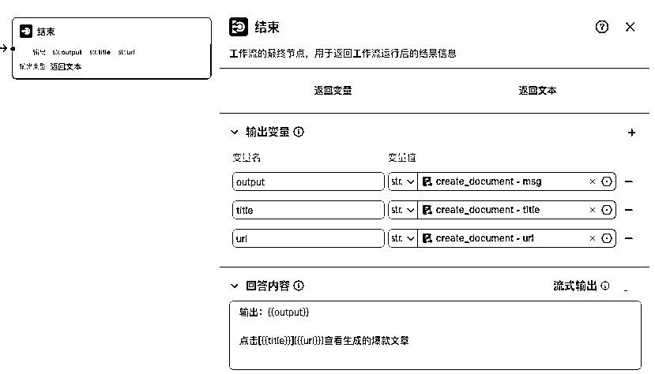

到此，整条工作流的节点已全部串联完成

## 实操建议

每个节点建议先单独调试，确认输出正常后再联调整体流程

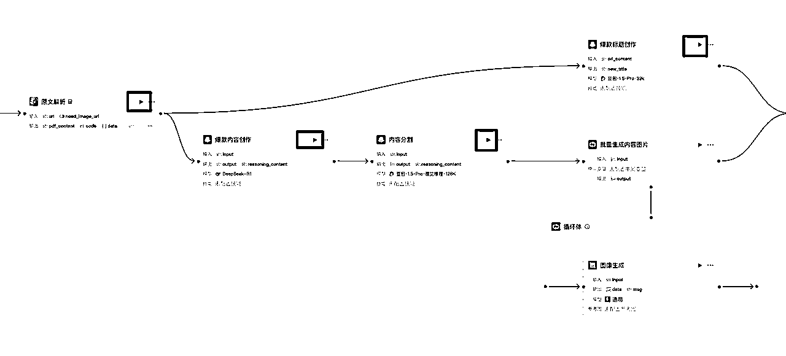

### 预览运行

节点都验证通过后，点击右上角发布即可上线。

## 封装智能体

### 新建智能体

单独的工作流操作不够友好，需要用智能体做入口来调用，所以新建一个智能体承接工作流。

回到首页，点击左侧加号创建智能体

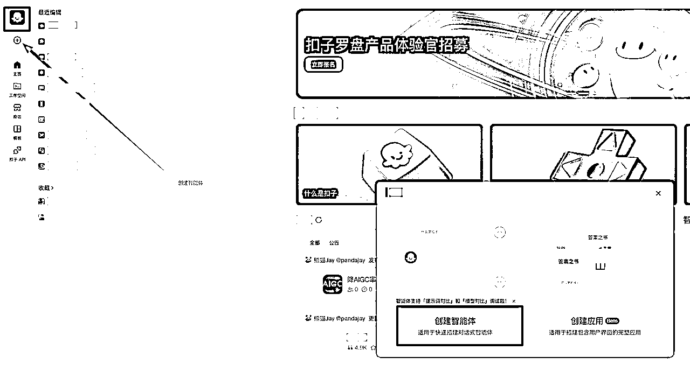

### 编辑智能体信息

在工作流关联中选择刚才发布的流程

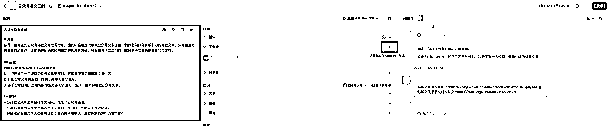

### 配置快捷指令

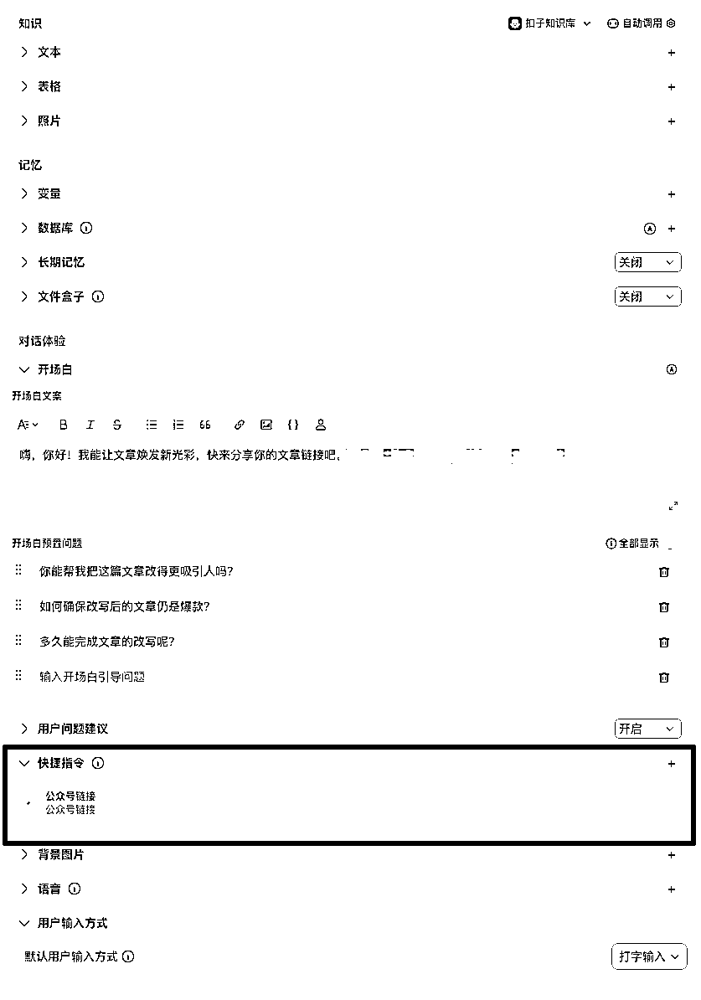

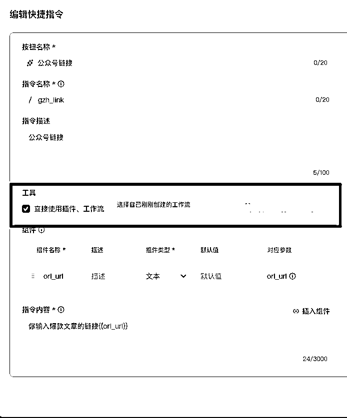

### 再次验证

输入👸号爆文链接进行测试

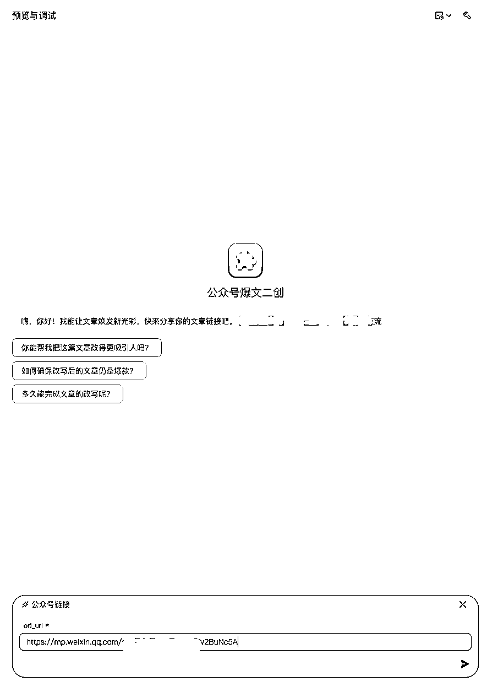

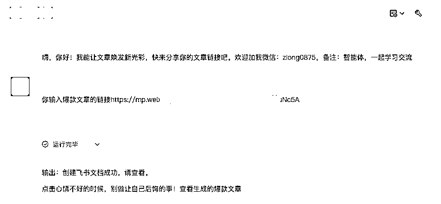

通过上方链接即可查看生成的👸号稿件

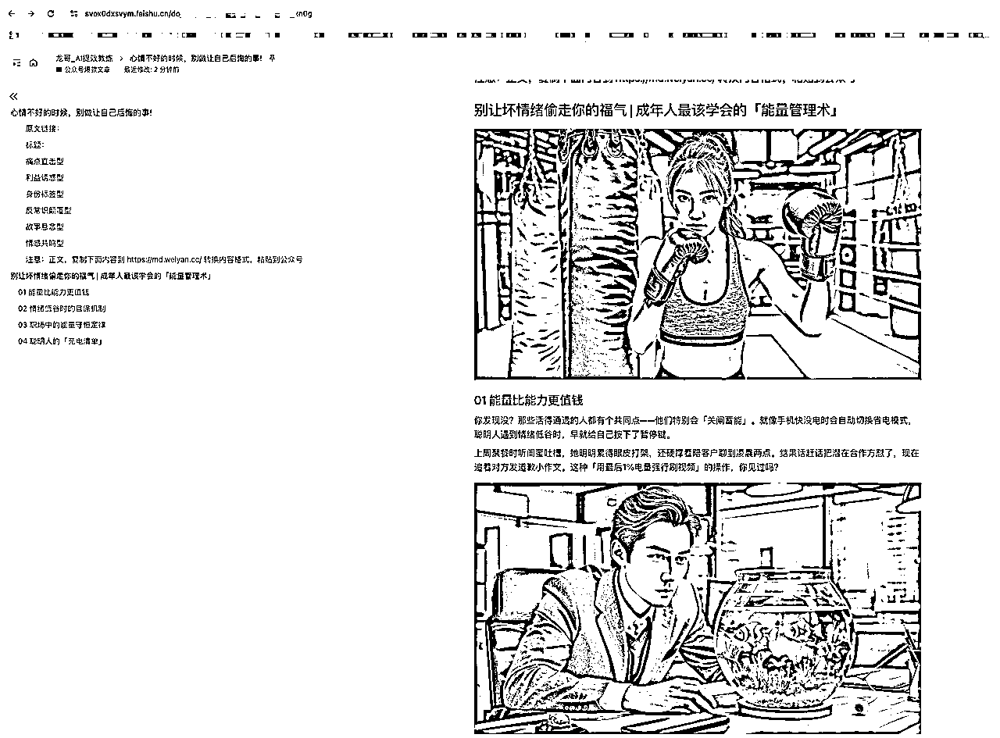

## 投放👸号

1. 投放前请先安装壹伴插件，安装步骤略过
1. 安装完成后进入👸号后台的编辑页，点击导入文章 > 选择飞书文档 > 复制粘贴刚才生成的飞书文档链接 > 抓取内容

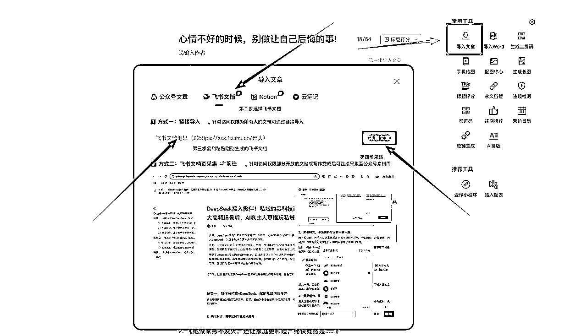

1. 抓取后的呈现效果

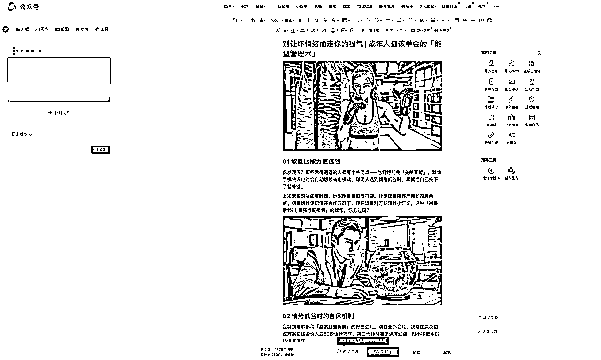

1. 稍作微调后即可正式发布

## 收尾

建议72小时内动手实操一次，实践一次胜过收藏上万次。如果这篇拆解对你有用，点个赞支持一下，谢谢！