# 领取 Gemini 会员 15 个月，立省$300！【全流程】

**谷歌 Gemini 学生福利免费领 15 个月，300 美元直接省下来！完整实操指南**

大家好，我是彻易Heawcyrt。

04 年出生的大学生，全网累计上万粉丝，大二实现经济独立，现在是一名自由职业搞钱玩家。欢迎同频的朋友来交流。

先提醒一句：下面涉及的所有外部链接，都默认你在魔法网络环境下打开。

# 一、先看清楚：这个福利到底有多香？

Gemini 是谷歌推出的 AI 大模型，其中 Gemini Advanced 属于付费高级方案，能调用 Gemini 2.5 Pro 这类更强模型，回答质量和综合体验都更出色。正常情况下，这个高级版一个月要 20 美元。

但现在有一个很划算的活动：谷歌针对美国学生开放了专属通道，只要用美国学校的 edu 邮箱完成认证，就能拿到 15 个月的 Gemini Advanced 免费使用权。换算下来，相当于直接省下 300 美元。

官方入口在这里：https://gemini.google/students/

**谁有资格领？**

- 得是在美国就读的学生，验证时要用美国学校的 edu 邮箱；另外在下一学年开始前，谷歌还会重新核验一次身份。
- 年龄必须满 18 岁。
- 注册时间需要在 2025 年 6 月 30 日之前。

**这次福利包具体包含：**

- Gemini Advanced：用上谷歌目前最强的 AI 模型。
- Google Apps 里的 Gemini：在 Gmail、Docs、Sheets、Slides、Meet 里直接借助 AI 干活。
- NotebookLM Plus：写作和研究工具的增强版。
- 2TB 云存储空间：放 Google 相册、Drive 和 Gmail 都绰绰有余。

# 二、准备好谷歌账号，老用户直接跳过

要用 Gemini，首先得有一个谷歌账号。如果你已经有账号，可以直接跳到第三部分；没有的话，跟着我一步步来。

**注册前的准备，建议做好：**

- 用 Chrome 浏览器，把界面语言切换成英文（美国），顺手清理一下缓存。
- 挂好梯子，节点选美国。工具我不做推荐，大家自行搞定。
- 准备好手机号，大陆号或海外号都行。如果注册环境足够“干净”，比如没有多账号关联、IP 也正常，有时候可以跳过手机验证。

注册步骤其实不复杂：打开 https://accounts.google.com/signup ，点“创建账号”，依次填好姓名、用户名、密码，完成手机验证，再补充备用邮箱、生日、性别，最后同意服务条款，注册成功后会直接自动登录。

如果手机号这步卡住了，自己的中国号码搞不定，可以找赚钱鱼丸要我的联系方式，我教你怎么处理，这里不方便展开。

注册完成之后，强烈建议去做一件事：到 https://myaccount.google.com/ 修改地址。

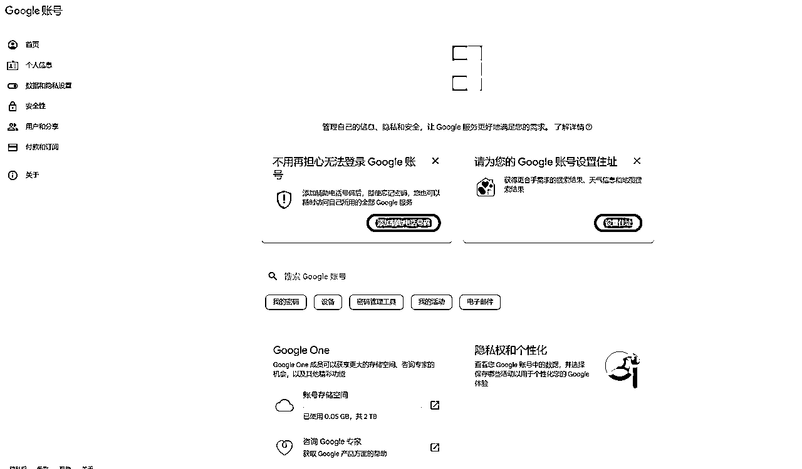
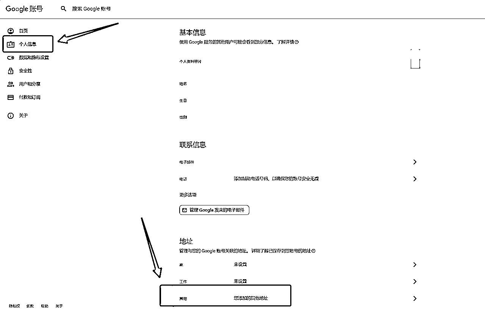

进入「个人信息」，找到「地址」一栏，点「其他」：

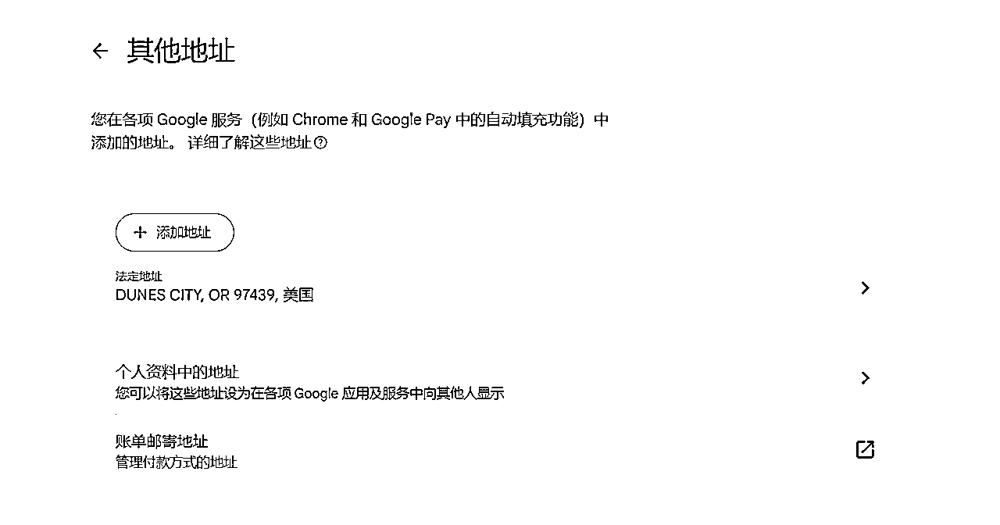

随便填一个地址进去。如果不知道填什么，可以直接用后面那张支付卡的账单地址。这时候也可以顺手打开 https://gemini.google.com 登录一下。

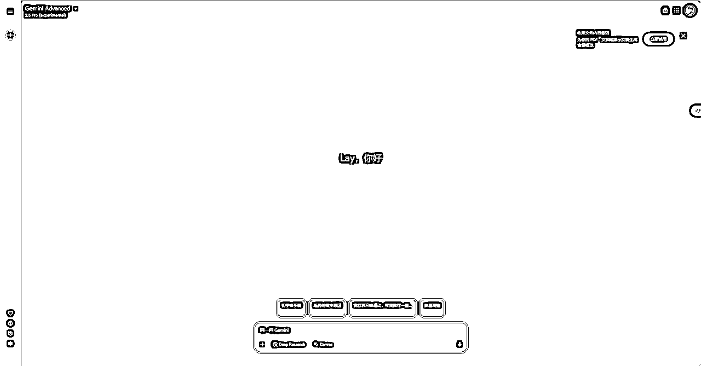

# 三、准备一张海外虚拟支付卡

接下来需要用到一张国外支付卡，国内银行卡是付不了的。但人在国内，远程申请一张实体海外卡又太麻烦，所以通常用虚拟卡：不能转账，不能购物，但可以用来给各种热门海外应用充值会员，比如推特、GPT、Claude、Netflix 这些。

已经有海外卡的朋友，可以跳过这一节。

我用的是 WildCard 野卡：https://yeka.ai/i/XABST3JL （走我的邀请链接能便宜 1 美元）

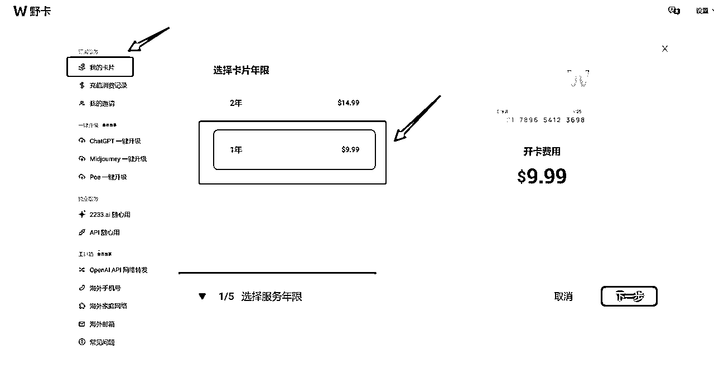

注册好账号之后，在后台选择开卡就可以了。费用方面：一年卡 9.9 美元，两年卡 14.99 美元。我个人开了 1 年，因为两年也就比一年便宜 5 美元；而且现在产品迭代太快，说不定明年有更好的选择。

开卡时填写的姓名，尽量和谷歌账号保持一致。开完之后一定记得充值，最低要充 5 美元。为什么？这个教育优惠虽然显示扣 0 美元，但刷卡时依然会产生一笔 0 元交易，卡里没钱就会失败。

# 四、搞一个美国 edu 教育邮箱

如果你不是美国大学在读，那就只能去买了。大多数人会去闲鱼或者淘宝，目前市场上主要有两种货：

- 便宜的：10-30 元。卖家通常会明确告诉你，只能收一次验证码，之后可能随时被回收。运气好能一直用，运气不好就没了。
- 贵的：100 元起步，甚至 200 元以上。卖家一般会承诺是永久邮箱，还说和某大学有合作。

价格怎么选？理论上当然越便宜越好，但别忘了：谷歌会在下一学年开始前重新验证身份，也就是大概 8 月底还要进行二次验证。便宜邮箱一旦被回收，那这次福利可能就只能用 3-4 个月。所以实际情况是：

- 低价档：10-30 元，稳用 3-4 个月；
- 高价档：100+，稳用 3-4 个月，但有机会撑满 15 个月。

我自己是怎么买的？我找了一个专门卖邮箱的网站，查了一下，这个站最早能追溯到 16、17 年。他们是一家美国职业大学的代理商，长期做邮箱业务。所以我花了 140 元买了一个邮箱，目前用着一切正常，对方也承诺永久邮箱和永久售后。他家还有其他类型和价位的邮箱，我不做担保，感兴趣可以自己判断：

我买的产品：https://edumark.net/632.html?aff=899  
官网：https://edumark.net/?aff=899

# 五、正式申请：一步步拿下 Gemini Advanced

前面材料都备齐了，下面开始正式操作。记住：全程挂魔法，节点选美国。

**Step 1：进入申请入口**

打开 https://one.google.com/explore-plan/ai-premium-student ，点击「验证学生身份」。

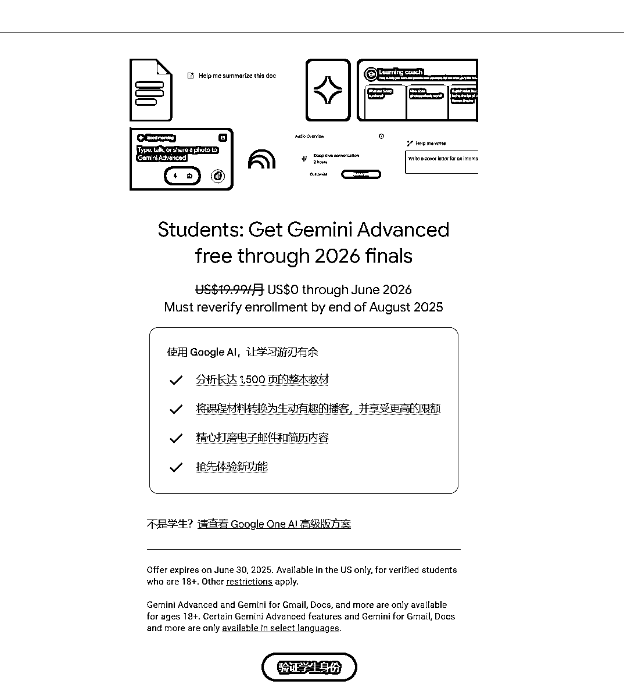

**Step 2：填写 edu 教育邮箱**

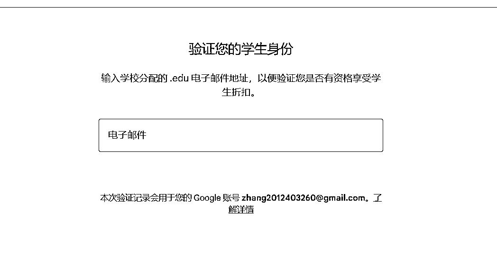

把买来的美国学校邮箱填进去，然后去邮箱收验证码。

**Step 3：填入验证码**

收到验证码后，填回页面，资格就会解锁。

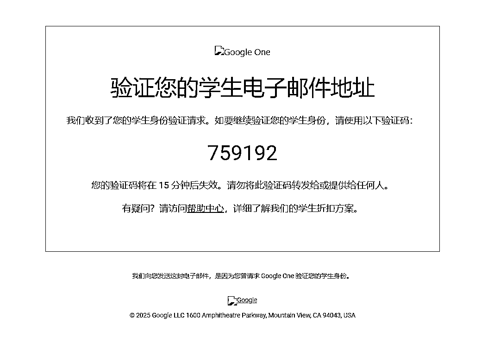
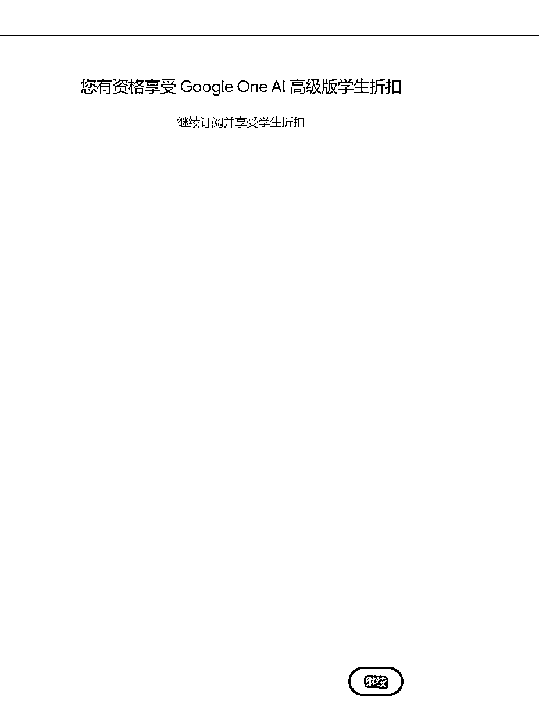

如果页面提示“此账号不符合使用 Google One AI 高级版方案的条件”，先别慌，大概率是节点不够干净。换个更纯净的美国节点再试一次。

**Step 4：绑定虚拟卡并完成支付**

点「添加卡」，填入卡片信息；同时打开 WildCard，在「我的卡片」里选「Gemini」，点「下一步」，然后按照野卡页面上的教程，把对应字段一一填好。

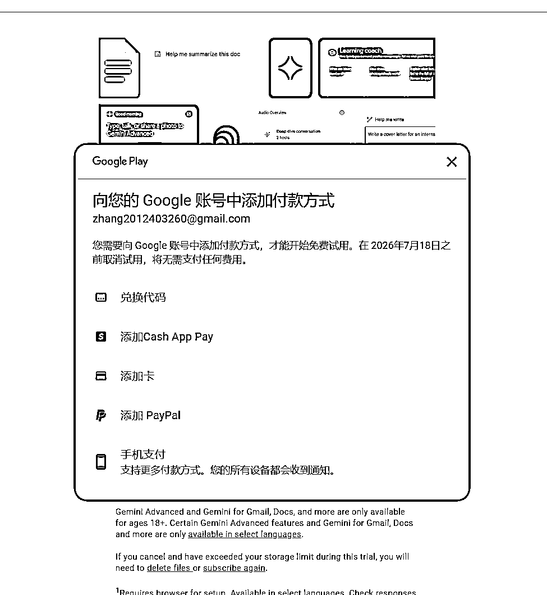
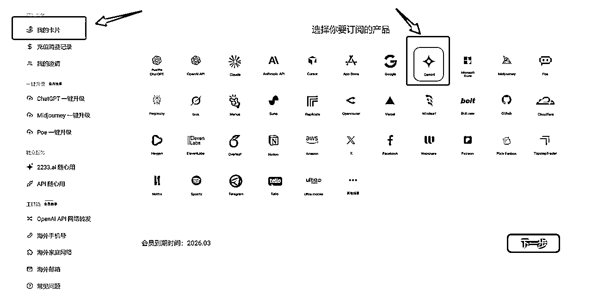

**Step 5：搞定，开始享受 Gemini Advanced**

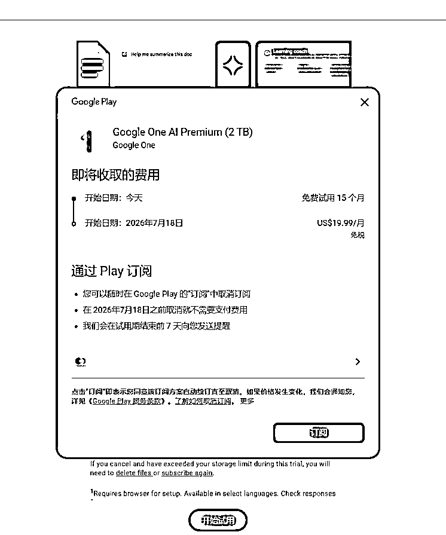

# 六、我的真心话，以及一个好消息

我真的强烈建议大家去薅这波羊毛。用过 Gemini 2.5 Pro 之后，你就会知道它有多能打。

算一笔账：野卡开卡 80 元 + edu 邮箱 140 元 = 220 元人民币。这个价格，也就是国外主流 AI 产品两个月的会员费。而且野卡开完以后，还能继续给其他海外 App 充值；美国 edu 邮箱到手后，以后也可以去参加别的教育优惠。这笔投入一点不浪费。

当然，如果你实在想当“等等党”，这里也有个好消息：谷歌官方已经表示，未来会开放更多国家/地区的教育优惠。

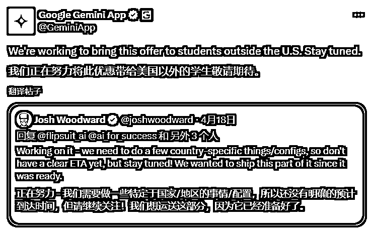

美国教育邮箱在市场上已经算比较贵的一批了。等更多地区开放后，价格大概率会被打下来；不过大概率不会有中国区。如果你愿意等，等政策放开后去买低价成品号也行。

但站在我的角度，我还是想劝你：别等了，现在就去操作。220 元人民币真的不贵，没必要犹豫。成品号终究不如自己的号，Gemini 有记忆功能，聊天记录越久，它越懂你。

再举个例子：之前很火的 Lenny's newsletter，就是那个花 100 美元送一堆年度会员的产品。最开始大家冲着 Cursor 年会员去，现在呢？

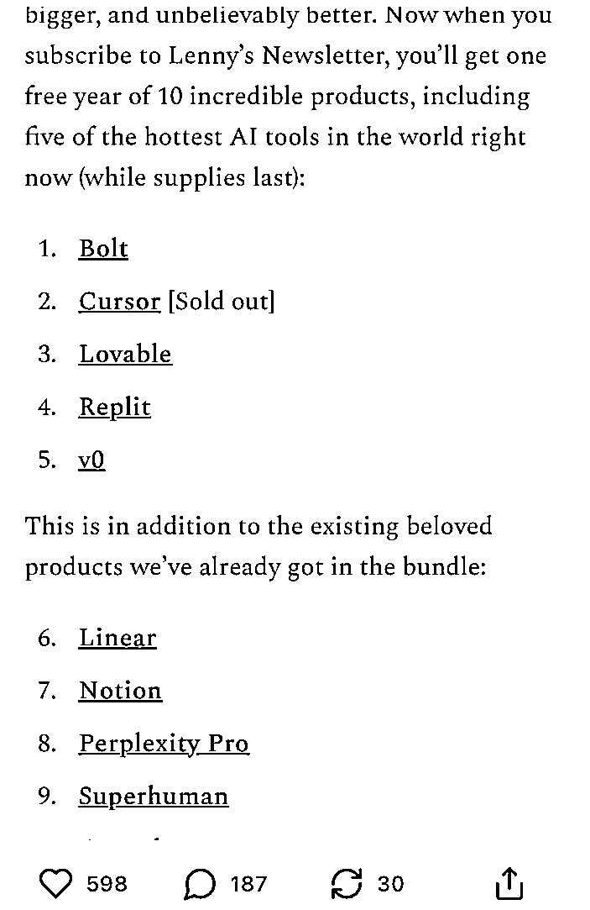

才一天，Cursor 大礼包就被薅光了。所以，好机会真的要趁早。

# 七、额外福利：教育优惠羊毛合集送给你

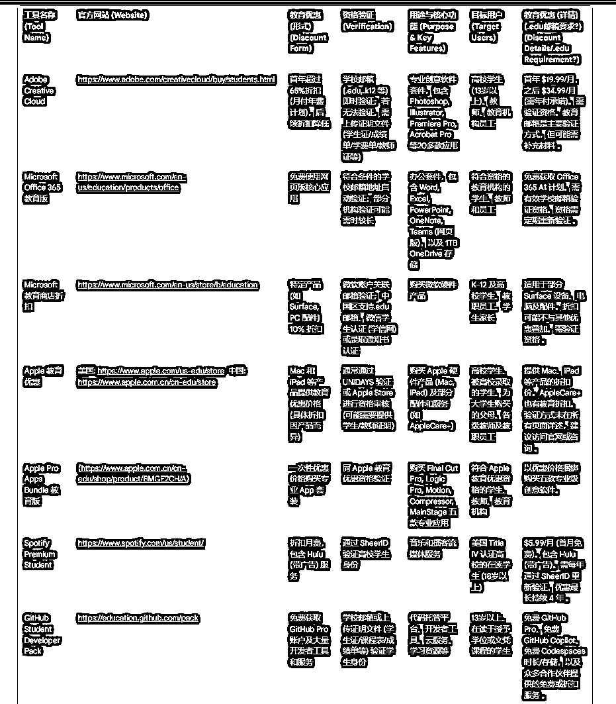
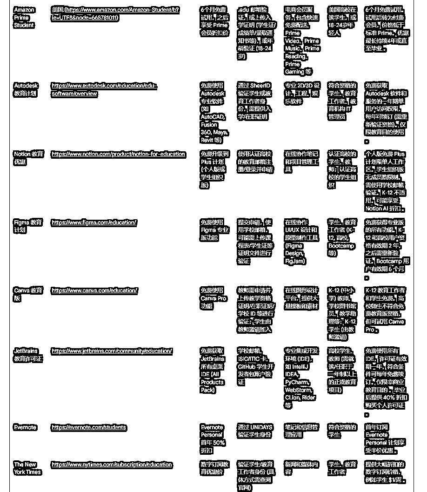
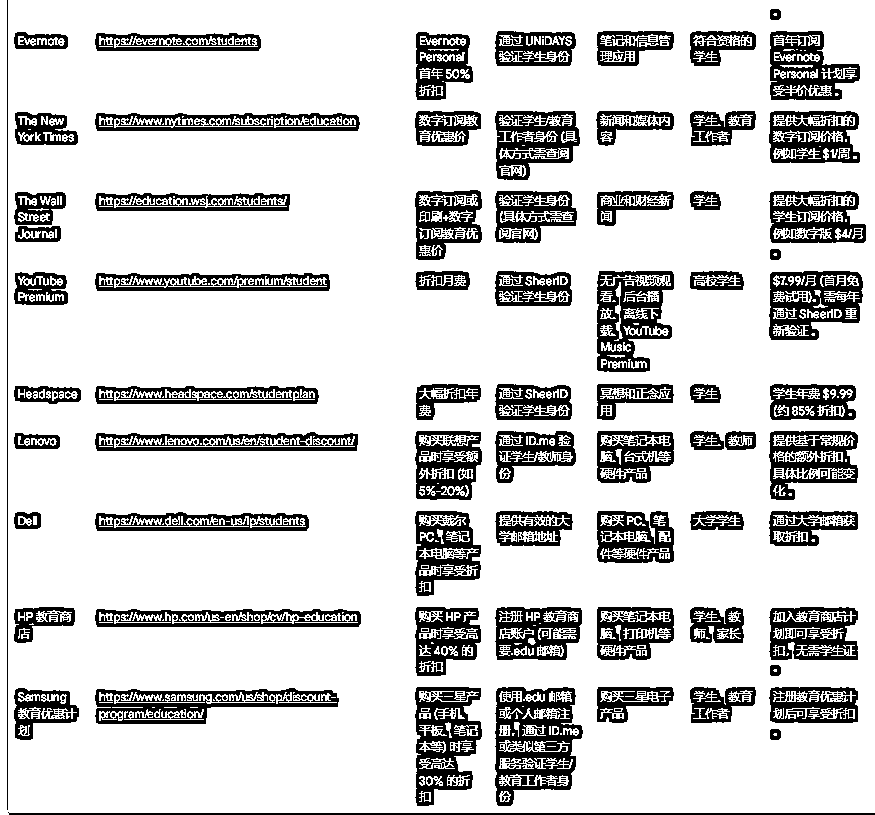

上面这份清单，是我用 Gemini 的 Deep Research 功能调研出来的，把主流支持教育优惠的产品整理到了一起。我自己实测过，大部分都真实可用。

祝大家都能顺利拿下这 15 个月会员，省下这笔钱！