# 成交比流量更值钱：把顶尖销售的打法，沉淀成一套可复制的SOP

# 先说下我是谁

我是天堂地狱，赚钱编号677，也是赚钱航海家、聚光航海教练。

在赚钱待了8年，写作能力基本是泡出来的。越分享，越有底气。我常说自己“龙珠级航海家”，不是嘴上说说，是真的有荣誉感。

感谢龙哥盟、龙哥以及社区里每一位伙伴。

# 前言

前阵子，我借一次微咨询，向龙哥抛了几个问题：

平台流量红利肉眼可见地在消退，获客成本越抬越高，各赛道都卷到没边。在这种背景下，对年营收千万以下的B端私域玩家来说，把转化团队标准化、流程化，是不是真正迫切的需求？

销售队伍从标准化到流程化，再到自动化，会不会成为未来私域组织的基本盘？

这些需求，是真需求还是伪需求？值不值得我花大力气，打磨成一套完整方法论，甚至变成课程？

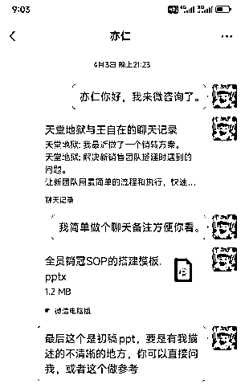
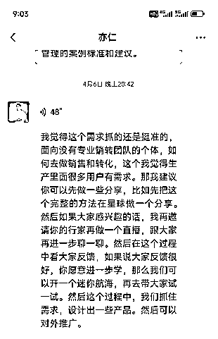

今天这篇内容基本是一份完整方案，大概1.4万字。觉得有用就点个赞，后续我会继续做成更系统的版本，帮大家在赚钱路上少走弯路。

# 正文

最近两年，公司转身做私域。过去一年多，我一头抓线索，一头抓成交，踩了不少坑，也愈发确定：在私域这门生意里，转化才是生死线。

期间团队反复磨合，最后打磨出一套标准化作业方法。核心逻辑不复杂：把销售全程拆成6-7个关键阶段，每个阶段只设单一核心任务，销售只要围绕这个任务，调用公司统一维护的“提问-答案”素材库即可。

每个阶段只解决一个目标，每个目标只用一种标准动作。新手学习成本极低。

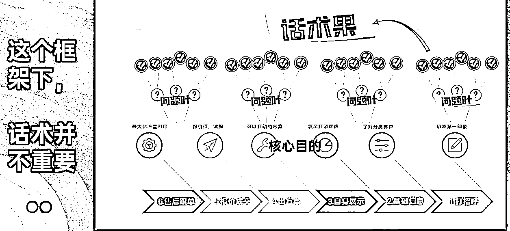

这套方法主要攻三个老大难：

新同事上手难：新人只需理解各阶段的核心任务，话术现用现查，素材库持续更新。

老同事执行难：标准、答案都是现成的，管理者盯执行就好。

销冠能力沉淀难：顶尖销售的临场发挥，会被督导第一时间拆成系统化话术，复制给整个团队。

我们的实际数据：成交比例从20%提到30%，新同事培养周期从30天压到7天。

需要强调一点：这套SOP用不着豪华团队，普通私域企业照做也能跑起来。它的底层是简单、快速、可落地，用流程和标准替代个人英雄主义。

后文分成三大段：

- 上篇：私域转化标准化，到底解决了什么问题。
- 中篇：整套体系的三大支柱。这一段最重要，建议先搞懂再实操。
- 下篇：如何快速搭建自己的转化系统。

全文约1.4万字，图文加分级标题，方便跳读。但中篇的支柱逻辑千万别跳，没有经验的话，可以先看下篇实操，再回来对照中篇的原理，体验同样顺滑。

## 上篇：流量之外，转化才是真正的护城河

提起私域，大家下意识会想到流量。但下水之后，我的感受完全不同。

### 转化 ≠ 引流

销售队伍不行，再多流量也只是浪费。转化能力足够强，反而能帮公司开出第二增长曲线。

我总结过一个“双20%”规律：

在一个细分领域里，只要你的获客成本比同行低20%，或者成交表现比同行高20%，占一项你就能活下去；两项都占，就能活得很舒服。

我的体感是，转化的分量从来不比流量轻。过去大家拼拿流量，现在流量越来越贵，销售能力才是一家私域企业能否盈利、能否活下去的关键。

流量和转化都强，才算有了初步壁垒，团队和体系才稳得住，也才能赚长期的钱。

如果只会引流，那你只能在红海里不断换赛道，美其名曰“找蓝海”。本质是自己没有资格卷——同样的成本，你的盈利能力永远比不上别人。

我见过太多朋友，红利期靠买量加客服就能快速回本，红利一过，就立刻熄火。

### 搭建销售队伍的痛点

组建销售班底，消耗一点不比做流量低。所以业内常说：流量做得好的公司，销售不一定好；销售做得好的公司，流量不一定好。

不少老板自己就是销冠，但自己做销售和带团队是两回事。

自己卖货，只要跟着高手学就够用。我当年也是这么干的：把涛哥、靠谱老师、根源老师的内容都啃了一遍，甚至连一个👸号的历史文章都没放过。对个人销售能力提升极大。

但到了搭建团队这一步，我发现那套东西不太够用。

不是你说得对，别人就愿意照做；不是你有道理，新同事就会服从。没有合理流程和标准，每个人都会想方设法给自己省事，潜意识里忽略结果——包括我自己。

传统销售组织过度依赖个人能力，很多环节根本没法标准化。销冠还是销冠，小白还是小白。

就算你运气爆棚，招到几个销冠，管理也是难题：销冠不好管，离职还会带走业绩。大多数时候你根本遇不到那么多销冠，只能招新手，然后用大量资源和流量去喂。喂掉的，都是利润。

更常见的是“伪销冠”：有能力，但不服管。业绩看心情，月底冲一冲。公司盈不盈利不关心，自己舒服最重要；带新人？看心情。

我这么熟悉，是因为我以前就是这种人：每月只去公司7天，照样拿前三；公司有哪些漏洞，我比老板都清楚，流量专挑好的吃。天道好轮回。

于是形成了死局：有点能力的销售，脑子活，自持有经验，不愿被约束；招新手，又要砸大把资源。

真正又强又稳的销售，可遇不可求。可一个公司，不能靠可遇不可求来发展吧？

### 这套流程的出发点

把销售的话术和动作大部分标准化、流程化、甚至自动化后，一个只有基础销售感的新人，也能快速接手工作。

今天分享的就是这套框架。它基本可以平移到任何行业，只要再花几周到几个月，磨合出自己行业的细节话术就行。

还有个隐藏优势：执行流程的人不必多懂销售。我们公司的话术搭建，很多都是助理完成的。

使用这套方法后，我们的新同事3-7天开始接客，7-13天ROI转正，30天内就能放开接量。

我们这行对销售要求并不低，树状答案资产积累了几万字。但在这套体系里，话术本身不再是瓶颈，因为机制可以持续生产、持续迭代。

## 中篇：这套SOP的三大支柱

先划重点：想真正理解这套SOP，中篇比下篇重要。只看实操，你只会觉得“好像不错”，但真正套到自己身上，还是不知道从哪里下手。

如果缺乏经验，中篇可能读起来有点费劲。没关系，先去看下篇的实操，带着问题再回来消化中篇，吸收效果更好。

三大支柱分别是：销售路径关键节点、督导职能、用人标准。

### 支柱一：销售路径关键节点

在这套体系里，我叫它“销售树”。

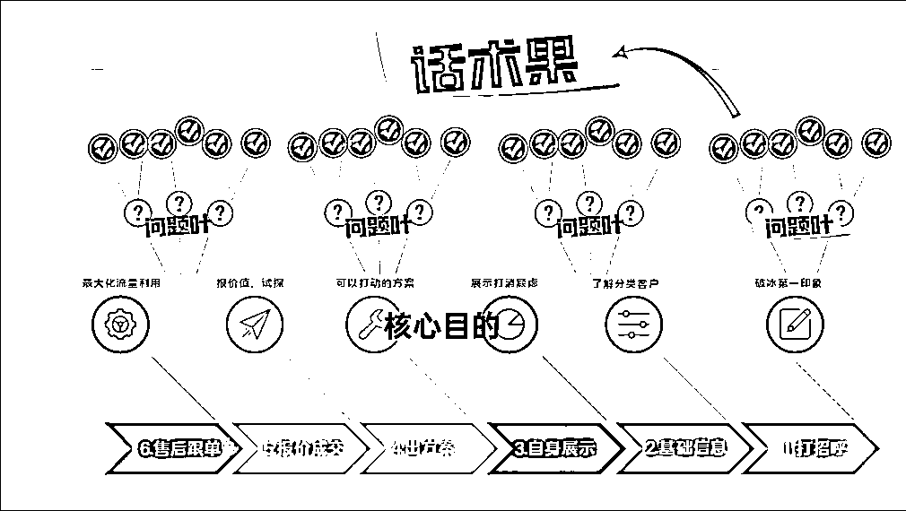

简单解释：把客户从首次接触到完成下单的路径，切成6-7个关键节点。销售不需要懂太多，只需清楚各节点要达成什么核心任务。

围绕这个核心任务，我们持续提出高质量问题（提问叶），再通过机制不断补充和更新优质答案（答案果）。这样，哪怕团队里没有销冠，话术资产也能持续变厚。

真正好用的内容库，一定处在持续迭代中。所谓铁打的流程和答案，流水的人。结果留在公司，人走了体系还在。

搭好自己的销售树后，配合督导、问答补充机制和奖励制度，再大量招聘有基本销售敏感度的人，业绩就能快速放大。

细节到下篇再讲，先建立认知。

### 怎么做销售树

客户从接触到成交的完整动线，基本逃不出那几个节点。

每个阶段，销售不用纠结太多，只判断一点：这个节点的任务完成了吗？

我们用的是逆向推演：先定结果，再倒推问题。

比如首个节点，核心任务就是破冰，让客户产生初始好感。好，目标锁定，接下来就一直提问：

这个赛道怎么打招呼，能最快建立好感？
服务型业务怎么开场？
专家型人设怎么开场？
陪伴型销售怎么开场？

有好问题，迟早会有好答案。可以自己想，也可以去同行那里抄。管理者要做的，就是给方法、给标准、给激励，然后盯执行。

先不用管答案，只要问题确认能帮到核心任务，就可以先挂出来。

接下来靠督导体系，把答案一颗颗挂到提问枝上。简单赛道30天内就能成型，复杂赛道3个月也足够完善。

是不是很简单？

实际过程当然还有不少坑，具体做法放在督导和实操环节细讲。

### 支柱二：督导体系

先说老实话，这名字我起得不太满意，听着像监工。实在没想出更贴切的，大家有好建议欢迎留言。

督导本质是一套机制，不一定是个固定岗位。可以一人兼任，也可以拆成一个管理岗加多个执行岗，完全看公司规模和需求。

它的职能主要有这些：

#### 职能一：沟通记录复盘（最关键）

无论企微还是个微，微信管理工具都必须有。

我接触过几十个年营收200万以上的B端客户，8成老板还是认为：这类工具就是用来防飞单的，员工管得好就不需要上工具。其中6成甚至没完整落地。

这个想法真的很危险。防飞单，只是沟通记录复盘里特别小的一块。

复盘能发挥什么作用？

**基础作用1：把好话术留下来**

我长期跟对话，总结了一些高价值话术的判断标准。好回复应该符合下面的原则之一，或好几条：

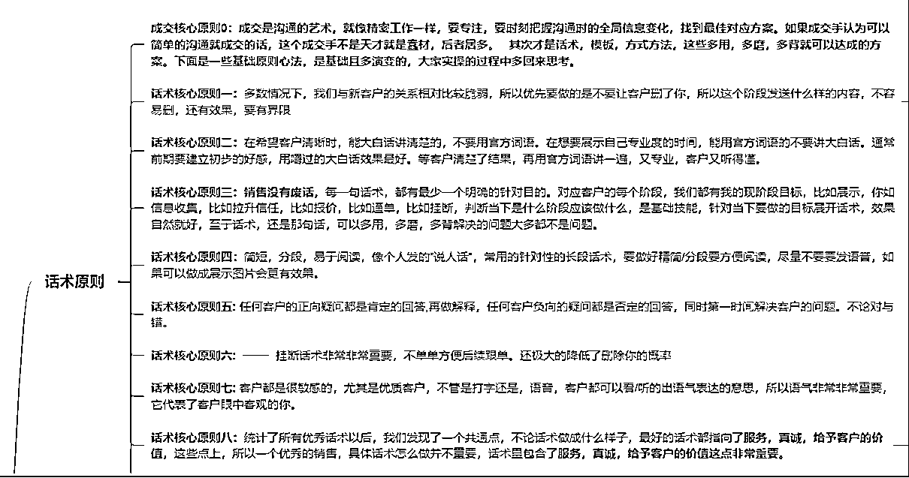

有了这些正/负原则，督导每天翻沟通记录时，只要看到某句话既符合正向原则，又解决了某个节点问题，还回应了提问清单里的疑问，就算优质话术。

哪怕完全不懂销售，按标准也能判断。

一旦发现比现有答案更优秀的表达，就摘出来放回答案库，定期开会二次确认，再更新素材库。

很多顶级销售的话术之所以没有留在公司，就是少了这个流程。销冠没有义务分享，甚至很多“神来之笔”，销售本人自己都没意识到。

我们列表里的不少答案，就是这么从对话里“挖”出来的。

**基础作用2：核心风险管控**

正向原则用来选好话术，负向原则用来筛风险。

态度风险：很多单子成交不了，其实是销售的态度和习惯出了问题，自己却没察觉。好的监督，能把这类损失降到最低。更极端情况是辱骂客户。我们无法保证百分百不发生，但可以保证一旦发生，公司一定会知道，也能及时处理。我就见过一家公司，因为销售多次辱骂客户，被甲方直接取消了合作资质，100多人的团队原地解散。

违规处罚风险：可以说九成私域细分领域都有销售违规风险，比如虚假承诺、夸大保证、诱导欺骗。食药类一次处罚就是2-5万。这些藏在日常督导里，能规避掉大量投诉和麻烦。后续还可以上AI做关键词过滤，但前提是先有流程和标准，人都不会判断，AI更没戏。

飞单风险：这个反而没那么关键，不展开。

**进阶作用1：抓执行，但不靠罚**

既然要标准化，就一定会有执行要求，也一定增加工作量。销售抵触很正常。光靠监督和罚款走不通。我们的设计思路是：让销售用最简单的工作，拿到明显的业绩变化，他自然愿意执行。

每个周期只聚焦一个执行动作，且动作越简单越好。比如这一周只要求用标准破冰话术，下一周只要求用标准收尾话术，再下一周只要求对重点客户区别对待。每周死磕一个点，让销售先尝到甜头，习惯就慢慢养成了。

具体执行标准，下篇实操里会展开。

**进阶作用2：给团队做能力画像**

督导在翻沟通记录时，会顺手给每个销售做能力评价。不是只看业绩，而是看真实对话表现。哪些新人值得重点培养，哪些老手状态不好需要跟进，哪些人有不好的跟单习惯。整理成数据表格，定期交给销售负责人，再针对性开周会、做辅导，团队能力提升会快很多。

**高级职能：判断线索质量**

ROI下滑，要么是销售的问题，要么是进线本身出了问题。很多团队看流量靠猜：花几万块钱试一个渠道，卖得动就继续投，卖不动就换。学费交得太冤枉。

我的做法是：先翻沟通记录，排除销售因素，再判断到底是流量的问题还是人的问题。这样既不会错过一个好渠道，也不会在烂渠道上继续烧钱。

因为我做过流量，也懂销售，还能进一步通过记录判断渠道的意向度：高还是低、差多少、差在哪里。拿到这些数据，再去和渠道方谈价，有理有据，谈下的价格自然会比别人低。

这个能力不难培养，长期翻记录就会逐渐有感觉。换个角度想：销售已经按最优流程在跟单，如果某个渠道进来的客户经常低信任、泛粉化、总问重复问题，那大概率是渠道本身有水分，要么刷量，要么素材不精准，要么钩子太假。

#### 奖励机制怎么设计

话术库要全员一起搭，最有效的催化剂就是奖金。

我们现在的做法是：每4-8人小组，每月从利润里拿出5000元，由督导来支配。

基础奖3000元：提问清单里所有问题，无论多小，按标准解决并被采纳的，奖励2-5元。多条覆盖也算，保证基础更新量。其中销售主动提出的部分占1500元，督导从记录里挖出来的问题占1500元。先到先得，发完为止。

问题悬赏奖1000-1500元：每周锁定一个当前最关键的重复性问题。比如复盘发现，当下最卡成交的是“客户报价后总嫌贵”，那就挂出100-300元悬赏，一周内解决。督导的任务，是找到最让销售头疼的高频问题，先用最快速度补上基础答案。

尤其对新团队，每周解决一个这类问题，成长速度会非常惊人。

流程执行奖500-1000元：奖给执行标准最到位的销售，用奖励带动执行，减少管理阻力。

每周开一次奖励会，会议只讨论三件事：发钱，发钱，还是发钱。

发上周的奖金，必须现金。
这周主要发什么奖。
怎么才能拿到，怎么拿更多。

用这个节奏，答案库会越滚越厚。

有经验的朋友还可以把现金换成积分制。能力、配合度、人品都可以打分，然后在线索分配、销售福利、带新人名额、岗位晋升上，给高分者优先权。

#### 明确当下重点，推动执行

很多团队刚开始推行这套体系时，销售就算理解，也不知道从哪里动手；甚至一提就反感，因为确实增加了工作量。我们当初也一样。

所以督导体系很重要的职责，是从一堆事情里挑出最重要、也最简单的那个，先推下去。

新团队可以先抓手最轻的破冰话术和收尾话术。先解决所有销售重复率最高、影响最大的问题。

我们第一次讲这套方案，销售就扔过来一句话：“太麻烦了。”管理上又不能把人全开了。

我的办法很简单：每周只聚焦一个动作——破冰话术。不允许再用“你好”，统一复制公司做好的标准话术。这么简单都不愿意做，直接走人。

结果，同一个渠道的成交表现当周就提升了5%。后面再推别的，阻力就小多了。

所以说，督导体系像一套工具箱，什么阶段需要用哪个工具，组合起来用就好。

会不会需要一个庞大的督导团队？不会。督导是职能，不是固定岗位。前期最好由销售负责人兼任，后期可以把琐碎工作交给助理。等团队规模上来了，8-12人配1-2个督导就够，督导赚回来的价值远大于人力成本。

有了这套体系，很多团队还会自己演化出中台督导，同时协助多个销售小组，管理效率会更夸张。

### 支柱三：用人标准

最后再补一句，这套体系对“人”的要求并不高。不用刻意挖销冠，只要有基本销售敏感度、愿意按流程做事的人，就可以进来。因为真正值钱的能力已经沉淀在节点和答案库里了，人要做的是执行、反馈、迭代。大量招聘这样的人，团队就能快速组起来、跑起来。

### 【用人标准】

前面的框架再完整，没人执行，最终也只是纸上谈兵。

我们不妨先接受一个现实：多数团队并不在一线城市，招聘对象往往是本地普通求职者，甚至是从客服岗位转过来的新人。

因此，真正需要的不是一份“顶级销售鉴定指南”，而是一套能帮助团队快速筛人的基础门槛。先筛出适合被流程训练的人，再投入培养，整体成本才不会失控。销售岗位人员流动快，这是必须考虑的现实。

先说明一点：销售本身高度依赖具体行业、产品和场景，我无法给出判断优秀销售的唯一答案。下面这些内容，更适合用来做初步筛选。

#### 基础能力：能读懂客户的销售感

这是入场券。缺少这项能力，后面很难培养。

所谓销售感，首先体现在能否从文字交流中捕捉对方的状态。私域沟通多以微信文字为主，销售需要从措辞、回复速度和上下文里，判断客户的真实情绪。

比如客户回复“嗯，你继续说”，到底是认可、敷衍，还是带着讽刺？不能只看这一句话，而要结合前后文判断。

还要看得出：

- 客户真正卡住的地方是什么；
- 哪个疑问被反复提起；
- 对方只是来了解，还是已经具备付费倾向；
- 是否能够根据交流内容，把客户划入不同层级。

更进一步，是调节文字氛围的能力。销售不仅要看见情绪，还要能通过表达让情绪朝更有利的方向变化。

例如，面对戒备心较强的人，先围绕他的困扰提供前置帮助，用免费讲解换取信任；面对高价值、高意向对象，要迅速升级服务，而不是让所有人都走同一条路径。

此外，文字聊天不能过于干瘪。适当的语气、表情和情绪回应，都能影响客户的购买状态。夜息老板把这种能力称为“表情包含量拉满”，这个说法虽然有趣，但确实值得借鉴。

这些能力都能通过聊天记录复盘。即使候选人没有销售履历，只要具备较好的情绪识别和表达调节能力，通常也能较快训练出来。尤其是后者，应当作为重点培养方向。

#### 价值观：愿意接受公司和流程体系

这一点非常关键。

如果销售不相信公司的方法，也不愿意遵循统一流程，反而会增加SOP建设的阻力。有些人个人能力越强，越容易按照自己的习惯行事，管理难度反而更高。

当然，这并不意味着强销售不能使用。能力突出的人，需要放在适合他的位置上，后面会继续讲。

#### 利益驱动：对收入有明确感知

这是三项关键素质之一。

一个人即使能力不错，如果对收入缺乏敏感度，实际产出也可能大打折扣。私域流量是用成本换来的，成交往往发生在全天，而不是只发生在考勤时间内。

如果销售下班、吃饭时很少关注客户，或者对临门一脚的咨询迟迟不回应，公司购买来的流量就会被白白消耗。很多激励措施，对这类人也未必有效。

这项特征，督导比较容易观察。团队可以结合自身行业设定响应标准。比如客户已经接近成交，销售却在饭点让对方等待一个小时，这就说明他的优先级排序存在问题。

这未必足以直接淘汰一个人，但意味着他很难成为顶尖选手。后续是否继续分配高质量流量，需要重新评估。

#### 个人能力：行业冠军型选手

这类人当然有价值。

不过，如果他只具备个人成交能力，却不愿意遵守流程，那么在SOP体系里的主要定位，就是经验和表达方式的输出者。

这样的销售要不要用？要用。

尤其是在团队初建阶段，要尽量提取他的经验，把常用表达、成交逻辑、异议处理方式沉淀成团队资产。人可以流动，但方法必须留下。

到这里，第二部分结束。接下来进入客户旅程的实际执行，也就是第三部分：如何把销转系统搭出来。

## 第三部分：实操，如何快速搭建销转系统

整套流程跑过一遍后，我发现每个环节都多少带着一点“渣男逻辑”。为了让内容更好理解，接下来每个环节讲完，我都会做一个对照：

- 渣男通常会怎么推进；
- 销售真正应该怎么做；
- 督导需要怎样配合。

先声明一下，我本人是标准直男。

### 实操：销售转化的七个关键环节

整套SOP不需要一上来就做得无比复杂。只要把以下七个环节的任务完成，成交效率就能得到基础保障。

前面已经介绍过系统优势，下面直接进入执行细节。

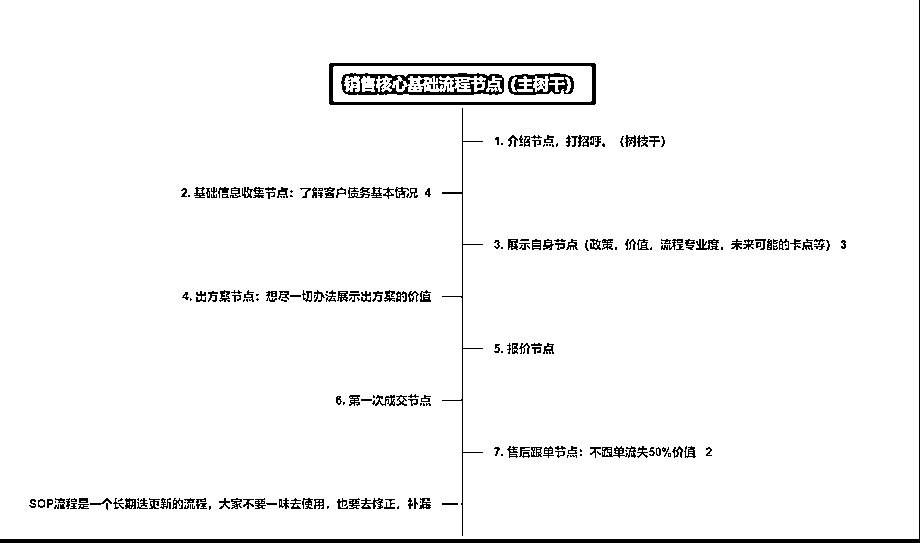

### 环节一：开场沟通

这是整个流程的起点，也是最容易被低估的地方。

开场的任务，是让对方形成一个可接受、可继续的初始判断。这个判断不会只停留在第一句话，而会影响后续每一次互动。

不同渠道、不同客群，开场方式不能完全相同，需要提前准备对应版本。

最终希望达成的效果很明确：让对方愿意继续聊，并逐步建立信任。

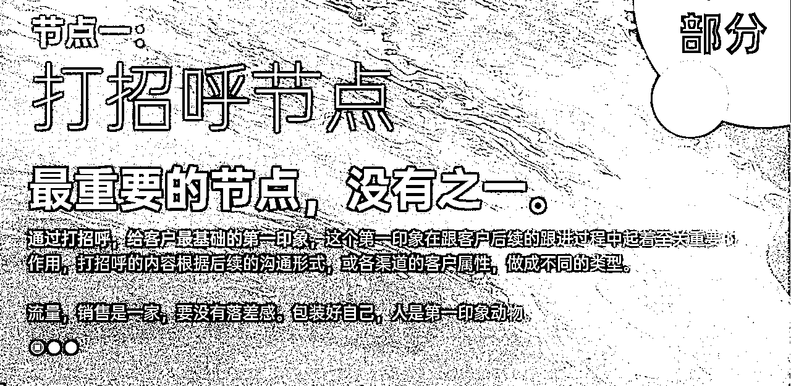

我们曾经遇到过这样的情况：同一来源的客户，两个销售的能力接近，使用的表达也大致相似，但他们对这个渠道的评价却完全相反。

复盘后发现，差别主要出在开场阶段。

好的开局，会降低客户的防备，让他愿意把对话继续下去。人的判断往往先于理性分析，如果第一次接触就觉得你不专业、不真诚，后续交流很可能只是为了验证“果然不靠谱”。

客户未必马上离开，因为他已经花了时间来咨询，但等到确认自己的负面判断后，自然就结束了。

也就是说，很多业务在第一轮问候时已经失去机会，只是销售没有察觉。

你自己购物时，应该也遇到过类似体验：刚开口就被冷淡回应，于是后面无论对方说什么，都很难再建立信任。

销售看到的表象通常是：客户问题很多、语气挑剔、聊完消失。实际上，问题可能从开场就埋下了。

解决方式并不复杂：重新包装开头，结合渠道特征调整措辞，把开场设计成一段完整的破冰流程。

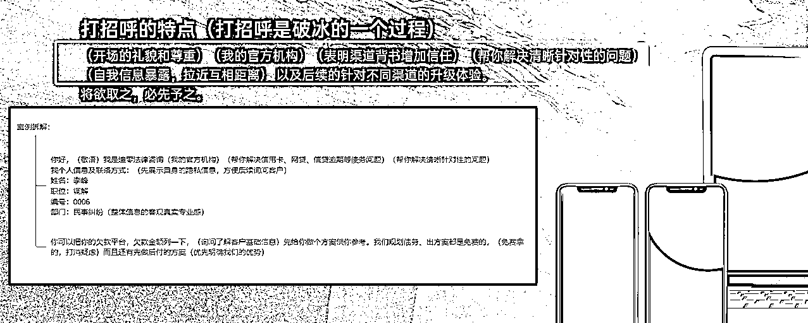

我们曾经做过测试，只改动这一处，成交比例就从20%提升到25%。变化并不在产品，而在于不再用“你好，说说你的需求”这种过于普通的开头。

客户的反馈态度，很快就出现了变化。

对销售而言，准备3至5种开场版本，按场景直接调用即可。执行难度不高，但必须落实。

对督导而言，重点不是每天重新创作，而是检查销售有没有按要求使用。

可以把开场拆成四个组成部分：

1. 礼貌与尊重；
2. 资历、平台或渠道的可信证明；
3. 对具体问题的专业理解；
4. 适度介绍自己。

第四项尤其重要。

因为下一轮通常需要客户提供一些基本资料，如果前面只索取、不建立交换关系，对方很容易产生抵触。

很多看起来“不经意”的加分细节，其实都是提前设计的。就像某些人会先把形象、谈吐、身份信息展示出来，让别人逐步放松戒备。

销售也一样。开场阶段的任务，就是尽可能降低客户对你的排斥感，把最基本的信任地基打好。

完成后，再把它固化成团队标准，持续检查执行情况。

### 环节二：收集基础资料

这一环节承担着连接前后流程的作用。

前面先付出一些价值，接下来才更自然地获取客户的基础非敏感信息。

除了拿到资料，还要借此判断客户的成交可能性。通过提问方式、回复速度、回答完整度和主动程度，销售应该逐渐形成初步评级，例如S、A、B、C、D等层级。

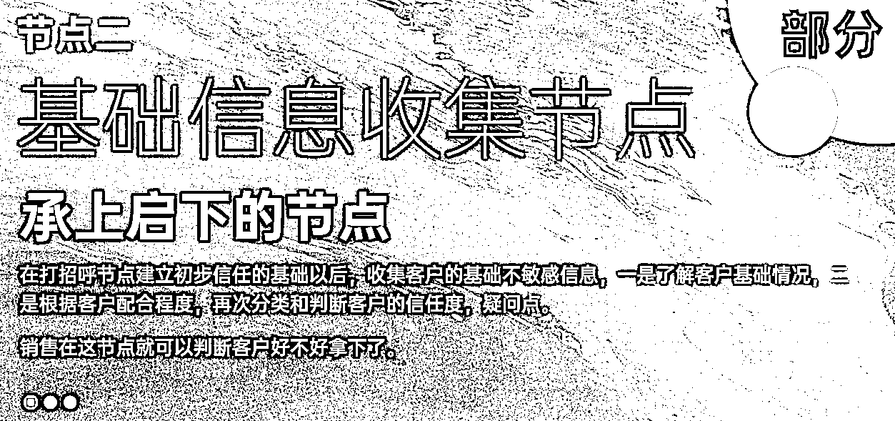

问题设计可以按照下面的逻辑展开。

**第一类：业务必答题**

选择与产品强相关、正常客户必须回应的问题，先确认基本需求。

**第二类：交叉验证题**

询问产品需求时，同时穿插预算、性能偏好、使用场景或个人情况等信息。不同维度放在一起，才更容易判断真实意向。

**第三类：提前埋下后续沟通线索**

在正常问答过程中，客户可能会主动暴露某些困扰。此时可以轻轻点到，不要急着把它变成成交压力。

同样一个痛点，在服务阶段提出来，客户感受到的是帮助；如果到了强行推进时才反复强调，对方就会认为你在利用焦虑逼单。

这个环节对销售的要求，是具备基本判断能力，并用相对稳定的表达完成资料收集和客户分层。

督导则需要持续复盘销售的判断偏差，必要时统一整理给销售负责人；对常见错误进行针对性训练，把优秀案例沉淀为团队素材。

新团队如果急需解决某个具体难题，也可以先参考同行做法。只要能服务于当前目标，就可以先拿来测试，之后再根据数据迭代。

这就像有人在完成初步接触后，通过几句自然聊天判断是否值得继续投入。匹配度高，就加大精力；暂时不匹配，就按培育流程处理。

具体句子并不是永恒答案。行业不同，客户不同，表达自然也不同。真正重要的是：这句话是否帮助团队完成当下任务。

当团队形成这种思路后，更新速度会明显加快。

### 环节三：呈现自身价值

前面的交流只能算铺垫，最终还是要让客户看到产品为什么值得购买。

很多市场里的产品差异并不大，甚至属于标准化商品。此时，竞争重点不一定是产品本身，而是你能不能让客户更容易理解、相信并接受它。

这个环节承载着最多的成交问题，也是整个系统里需要投入最多建设工作的地方。

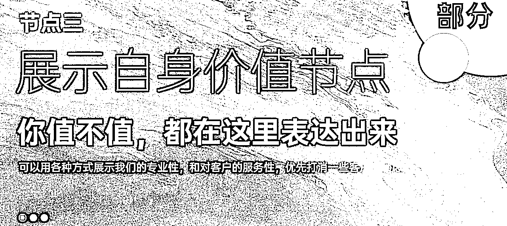

先问自己：如果产品看起来差不多，对方为什么偏偏选择我们？

常见答案包括：

- 我们把复杂内容解释得更明白；
- 我们的态度更真诚、更耐心；
- 我们围绕客户关心的价值展开，而不是和客户争辩。

客户最在意的内容，最好提前整理并主动说明。这样对方不用反复追问，体验上会觉得你准备充分、值得信赖。

打个比方：有人坐进一辆看起来很昂贵的车，心里可能会猜是不是租来的。此时对方并不需要刻意炫耀，只要自然地让某些可信信息出现在视线里，疑虑就会自行消失。

有优势，还要懂得把优势放到合适的位置呈现出来。

搭建表达内容时，仍然可以遵循固定结构。

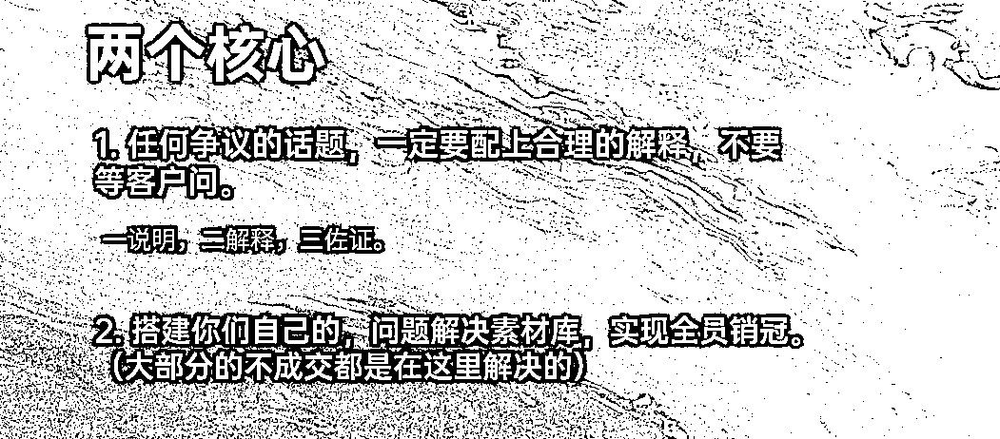

#### 建立行业常见问题库

每个行业都有高频疑问。把销售日常遇到的问题持续收集起来，再为每个问题设计清楚、完整、可直接发送的答复，销售按场景调用，督导负责检查和优化。

这个工程不可能一天完成，但它会不断积累。一旦基础内容形成，新人就能借助团队资产迅速接近老销售的水平。

这里解释一下“先说明、再解释、后举证”：

- 先把结论讲明白；
- 再说明原因和逻辑；
- 最后用图片、视频或其他材料加强可信度。

常见组合可以是文字配图，也可以是文字、图片和视频逐层补充。涉及敏感疑问时，更应该采用这种多维呈现方式。

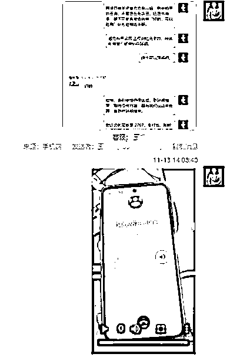

很多销售以为自己写了很多内容，客户就一定理解。实际情况恰恰相反：对方可能没有认真看，也可能看完仍然按照自己的理解去判断。

假设两个销售卖同一款产品：

一位把重点讲得明白，同时用图像、视频辅助说明，并在交流中确认对方是否真正理解；另一位只是发出一段自认为有价值的文字，然后继续向下推进。

通常前者更容易得到结果。

如果行业里的高频问题，都按照这套方式处理，整体转化自然会被抬高。

当然，不可能要求所有销售都具备这种表达能力。所以公司要把方法提前写进问题库和答案库，让普通销售也能照着执行。

如果团队缺乏行业经验，也不必因此停摆。可以按月持续补充，只要不断收集真实、高价值的问题，答案体系就会越来越完整。

再次强调：在明确赛道、产品和客户需求后，单句表达并没有想象中重要。关键是你是否持续发现问题，并把问题处理得足够扎实。

当你的解决能力明显强于竞品，就能承接更多原本流失的客户，取得更高的投放回报，也更有底气提高流量出价。

还记得“双20%”逻辑吗？做到这里，流量就不再是最稀缺的资源。

### 有了问题，答案从哪里来？

这里补充一个实操环节：没有行业积累时，怎样低成本地做出高频问题库？

根据公司执行效率和行业复杂程度，一套能正常支持业务的问题库，通常需要1到3个月逐步建立。

前提是先把问题找出来。没有问题，当然也就无从设计答案。如果一线团队和负责人都整理不出来，就从真实接待记录里反向寻找。

#### 内部沉淀

这部分前文已经提过，这里只强调关键动作。

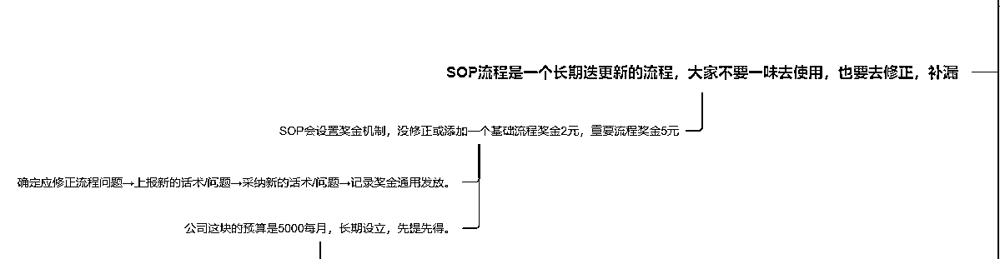

私域业务必须使用管理工具，无论是企业微信，还是个人微信接待，都应当具备记录、检索和复盘条件。

聊天内容要保存下来，并安排固定时间审核。这样既能及时发现错误，也能及时识别新的有效方法。

在周例会中，可以提出本周重点攻克的难题，并设置奖励。谁能在真实接待中找到符合要求的处理方式，就提交记录并获得奖金。

很多时候，不需要直接告诉销售标准答案，只要把合格标准说清楚。他们在大量交流中会不断尝试，偶尔就会出现一次特别有效的表达。即使这种状态无法稳定复现，也要及时保存、修订并加入团队资料。

如果销售不愿意主动提交，就由督导推动被动收集。奖励可以提前设计预算，其中大部分分给督导，让“寻找优质表达”成为一项明确工作，而不是额外负担。

#### 外部获取

遇到重要、紧急、内部暂时解决不了的疑问，可以采用高额悬赏，但必须同时给出验收标准。

有时不是奖金不够，而是参与者根本不知道什么才算好答案。因此，要先定义目标对象：

什么样的人值得全力争取？

例如高客单、高支付意愿、购买规模大，只是被一两个关键疑问卡住的客户，就属于需要重点攻克的对象。

然后让销售带着清晰的人物设定，到同行或专业人士那里寻找答案。对方如果没有足够响应，就及时更换目标，不必把时间耗在低效率对象身上。

每周集中解决若干高价值疑问，再叠加内部日常沉淀，团队的高质量内容很快就会丰富起来。

如果销售连如何模拟大客户沟通都不会，那更多是执行意识和基本能力的问题，而不是方法本身太难。

## 环节四：输出方案

这一环节只盯住一个结果：客户有没有明显感受到方案的划算程度。

即便是标准商品，通常也存在套餐、规格或服务组合的差异。

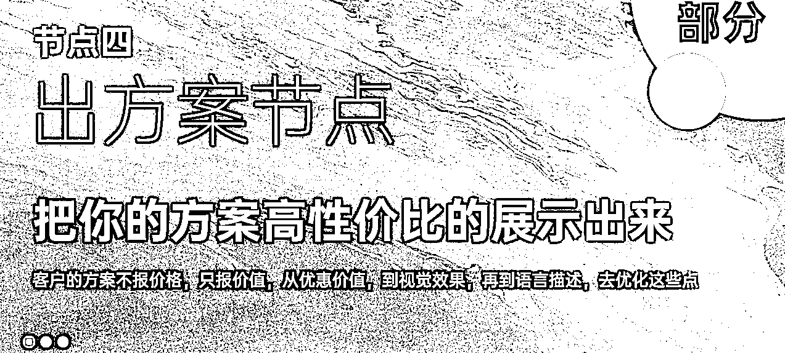

判断方式并不复杂。

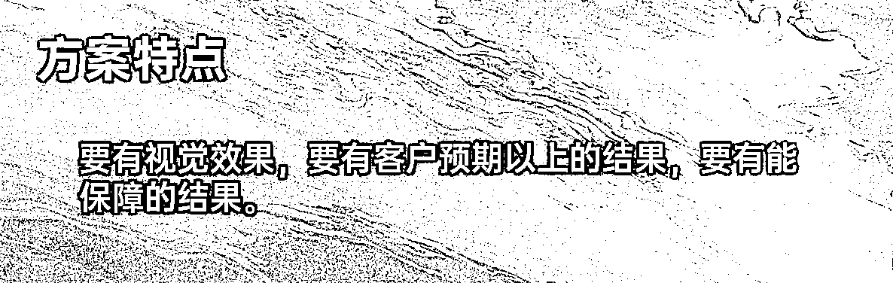

举几个例子：

为什么“买赠”类设计容易刺激购买？因为画面上不断增加内容，客户能直观看到获得感；价格如果分阶段下降，也会持续打破原有预期。

直播间通过不断制造热度、扩大成交规模，本质上也是在强化人气和信任背书。产品本身先不讨论，但如果竞品在呈现方式上更有冲击力，普通展示很容易被比下去。

如果你的业务需要合同或定制方案，可以尝试做出更有现场感的交付方式：纸质方案、手写重点、拍摄资料时带上工牌或姓名，让线上交流多一点线下服务的感觉。

例如可以配合说明：

“这是根据您的情况整理的方案，请先查看。我们会在方案上标注服务专员，后续有任何问题都能直接找到对应负责人。”

这种设计的重点不是形式，而是让客户感受到认真、正式和可追责。

不同行业的方案表达不同，团队应当提前打磨几套可复用模板，并将优质版本统一下来。

销售理解目标后照着执行即可。最忌讳的是每个人都凭感觉发挥，甚至同一个人在不同时间采用不同方式。这样很难稳定获得结果。

既然连复杂的人际话术都可以被流程化，销售也应该提前建立标准，为未来的自动化和AI协同做好准备。

## 环节五：报价沟通

“报完价就沉默”，应该是很多销售最头疼的场景。

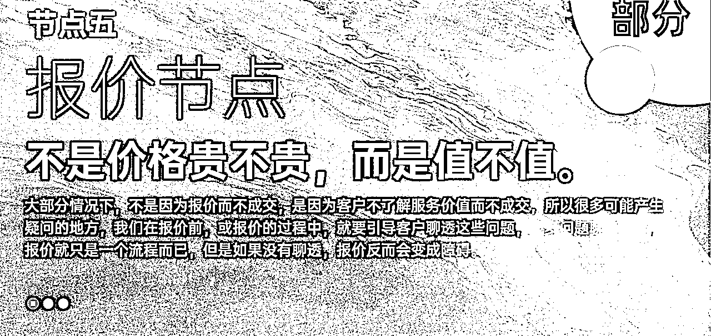

坦白讲，我不能保证彻底消灭这种情况。

但可以把它拆开看：很多时候，客户不是单纯嫌贵，而是在报价之前仍然没有充分理解你能提供什么。

当关键疑问没有被处理，客户自然会把注意力全部放到数字上。此时不要一味争论高低，而要回看前面的交流，确认对方是否真正理解产品价值和你的差异。

如果发现某个地方仍然模糊，就带客户回到价值呈现环节，重新用“说明—解释—举证”的方式处理。

报价表面上是在报金额，本质上是在交换价值。数字发出之后，交流重点应重新回到信任、优势和适配度上。等客户的理解和认可达到一定程度，再推进付款或成交。

销售在这里要先检查：自己是否已经把该讲的讲完整，而不是报价后立刻强行推进。

督导则要在日常复盘中观察执行情况，看销售是能力不足，还是跳过了必要步骤，并据此进行训练。

## 环节六：促成成交

成交结果，往往取决于前面几个环节是否扎实，而不是最后一句“现在下单吗”。

所谓逼单，本质是一种试探：客户准备好了，就顺势完成；客户还没准备好，就回到交流阶段继续补足信息。

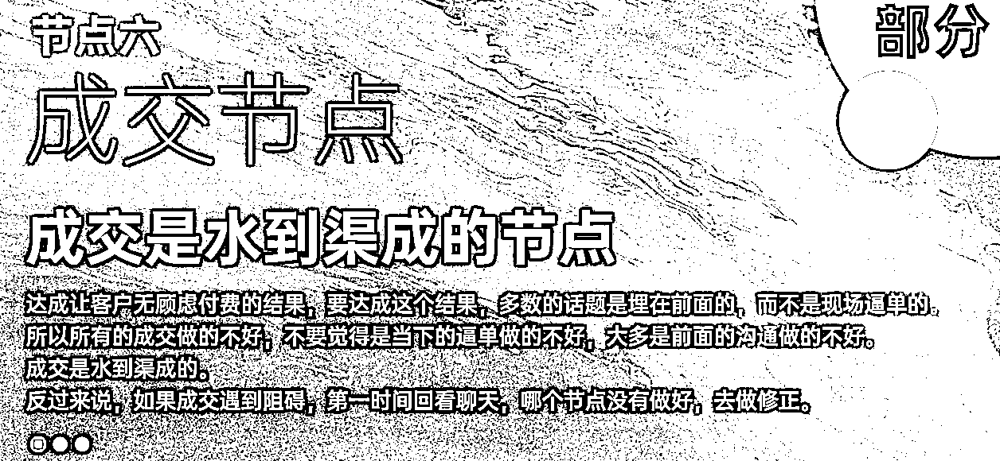

有些人推进关系时也是如此，第一次尝试被拒绝后仍然持续施压，就会从试探变成纠缠。

所以，销售应根据客户的购买信号行动，而不是机械完成动作。

如果暂时没有成交，可以用合适的结束表达收尾，给足情绪上的体面，再做好标记，安排后续联系。

对销售来说，效率同样重要。遇到明确暂时不匹配的对象，不要反复消耗，把记录留好，转向更值得投入的客户。

督导需要重点观察两类情况：

- 销售是真的没看懂、不会判断；
- 还是明明知道客户状态，却为了个人省事而放弃跟进。

两者的处理方式完全不同，不能混为一谈。

## 环节七：后续跟进

假设流量投入占总成本的40%，后续跟进带来的成交比例提升10%，单笔利润空间可能增加50%。

换句话说，后续转化做得好，相当于把原本已经支付过的获客成本摊薄了。

多数行业的后续成交比例，都不应长期低于10%。

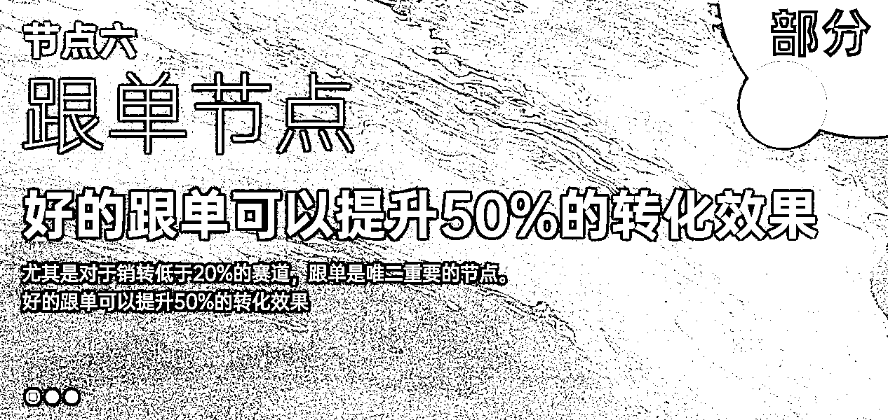

接下来把后续跟进拆成两类：

- 尚未购买对象的再次触达；
- 已经购买对象的后续服务与转介绍。

仍然坚持一个原则：少做复杂设计，先让团队能执行。

### 未成交客户的跟进

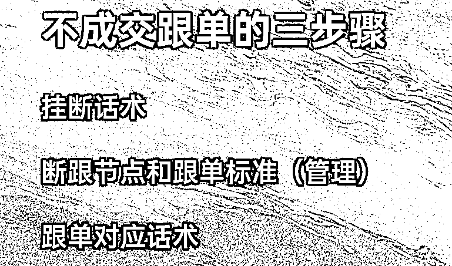

#### 第一阶段：结束沟通的标准表达

这一阶段只设一个要求：每次聊天收尾，都必须留下可供后续联系的承接点。

目的不是立刻再次推销，而是让下一次出现时有合理理由，不会显得突然。

因此，要避免用“好的，再见”这类直接切断关系的结束语。

做销售跟进，别再用“你好，在吗，还考虑吗”当开场白了。

这些话说出口，基本等于告诉客户：我就等着你施舍。

我们给销售准备了一套通用、基础的话术库，包括不少挂断场景下的应对模板。哪怕是直接复制粘贴，也不能用上面那些低效表达。这一步非常简单，基本三天磨合期，全员都能做到。

接下来是第二阶段：盯住销售的断跟节点和断跟标准。

每个销售手里都要有一张接线表，实时更新每一个客户的跟进情况。比如客户1号加的微信，备注为S级，约定第二天跟进，结果到了3号下班还没动静，那就算不合格。后续我们有打分体制，会减少流量分配，数据造假则是重罚——毕竟聊天记录一翻就知道是不是真跟了。

同时，表格里还要登记客户的基础情况，以及到底在哪个节点断掉的。

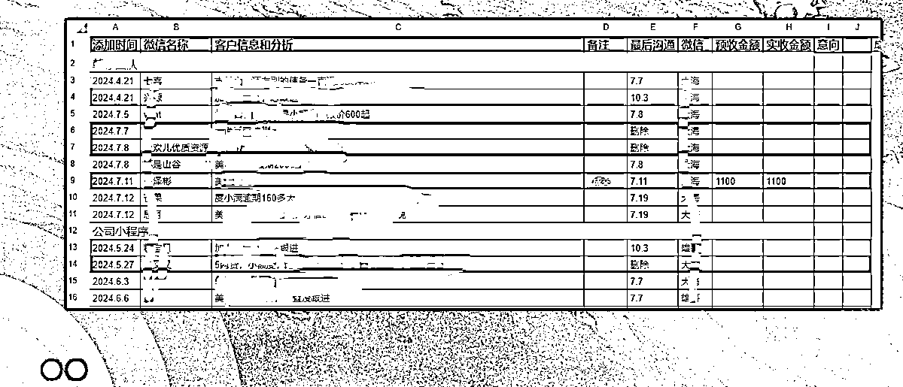

针对这些断跟节点，公司销售部所有人一起磨合出对应的断跟话术，每个节点配好几条，让销售自己挑。后面销售只需要简单判断，直接套用，就能高效解决大部分问题。

第三阶段，跟进话术。

有了每个阶段的断跟话术，再把每个节点的跟单话术也磨出来。每个客户都有信息备注，你要针对客户的真实痛点去聊，客户才愿意回你。最怕你发出来的东西像群发，客户想给你个话头都找不到。

在这套不成交跟单的执行过程中，督导主要陪着销售一步步适应落地，再一起磨合出合理话术。

说句很实在的：渣男为什么能把人聊动？人家心里有个小本本啊——今天聊到哪一步了，上次聊了啥，下次用什么话题当钩子开口，主要围绕什么展开，全都有记录。销售难道不该比渣男更用心吗？

成交之后，同样需要跟单。

别觉得不成交才要跟，成交了也要。而且通过这套简单的跟单流程，往往还有意外收获。

执行起来还是三步，越简单越容易流程化。

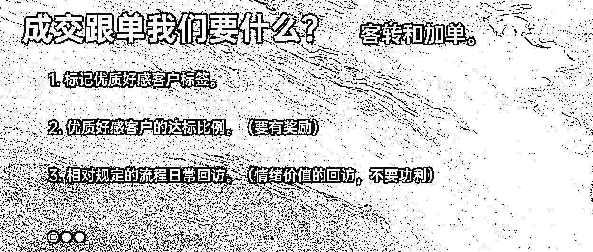

第一步，要求销售给“优质好感客户”打上标记。这个动作必须做，执行门槛极低。

不需要搞复杂，只要大家标记了，并设置相应的奖励，我们就能统计出一个基础比例。别跟我说没有好感客户——只要你按前面节点的标准去成交，一定会有的。

然后根据所有人的平均值，定一个好感客户的打标比例。低于这个比例的，督导会重点关注，看看成交流程是不是执行得不对。

第二步，回访。每周给好感成交客户发一次回访，提醒对方还在售后期，有问题随时咨询，顺便祝福、鼓励一下。

每周一次，哪怕群发也没关系，不功利、不要求、不啰嗦。客户回复了就正常聊几句；长期不回复的，就从好感客户里删掉，不打扰。

第三步，每月一次（时间自己定），表达希望客户能帮忙转介绍，说如果身边有同类需求的朋友可以推荐过来，到时发红包感谢，还能帮自己减轻业绩压力。

就这些，简单，但长期坚持，性价比超高。

整套SOP落地的时候，最重要的原则是：别给销售增加太多工作量。

不管原方案多复杂，我们在总结和落地时都要把它压到最简单。只有足够简单，执行阻力才最小，效果才最好。

最后说点心里话。

这套东西，是我们花了将近两年时间，在销售和流量之间反复试错、反复打磨出来的经验总结。

如果你是私域B端老板，如果你手里有流量优势，正打算做销转，或者想搭建自己的销售团队，那你大概率能从里面找到有用的东西。

觉得有用的话，多给我几个赞，我看要不要把它做成一门更系统的内容，然后去龙哥那边申请一次航海。

另外，“督导”这个名字，说实话我不太喜欢，大家有更好的叫法，欢迎留在评论区。

谢谢大家，祝各位都能在龙哥盟里，找到属于自己的财路。