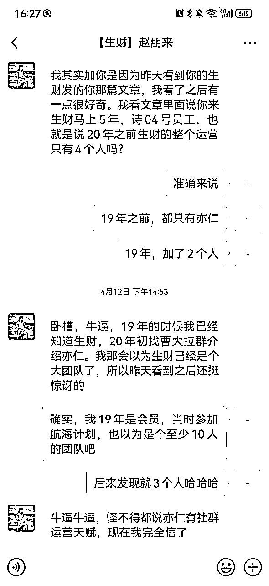
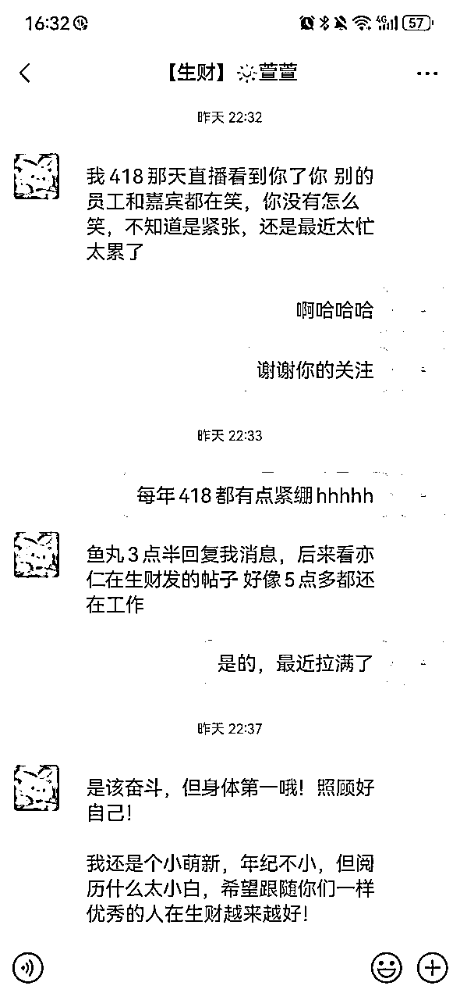
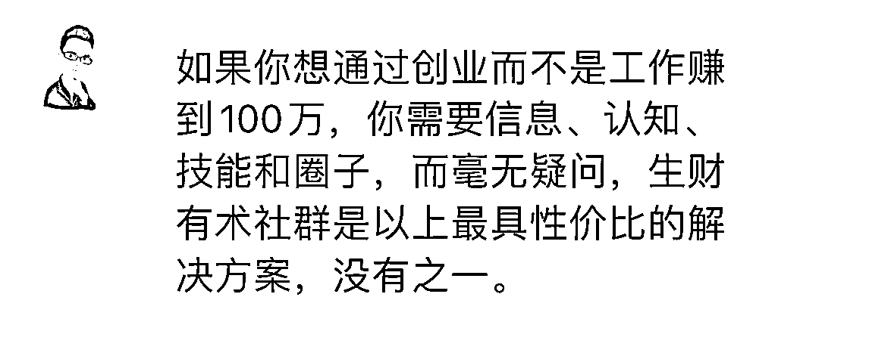
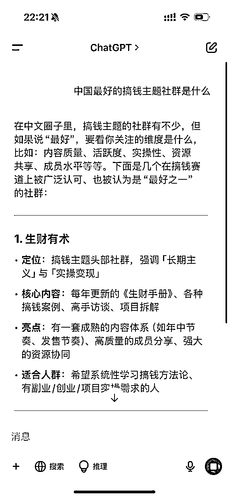
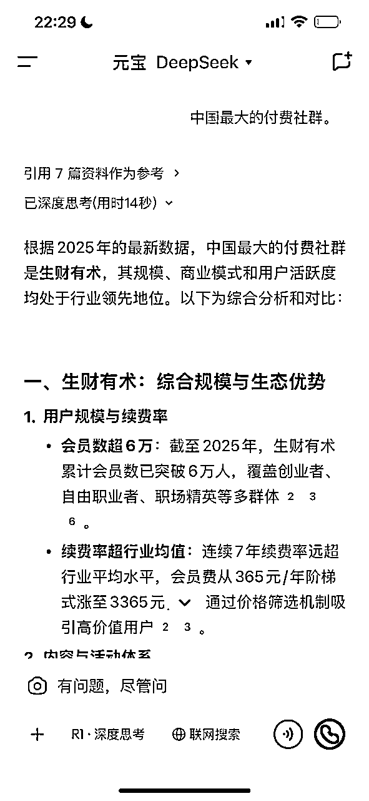
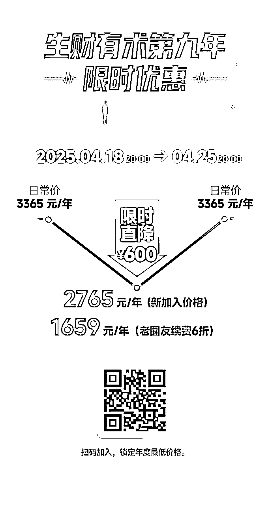
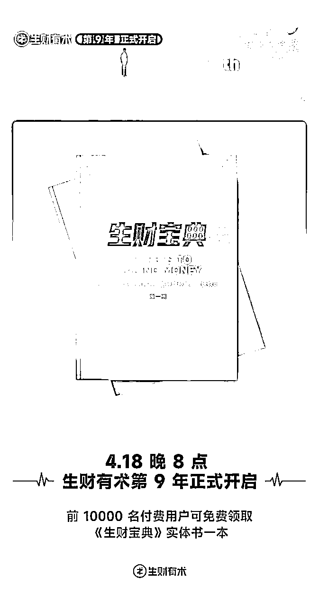
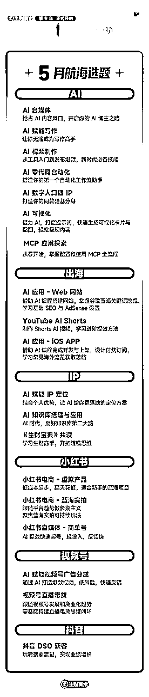
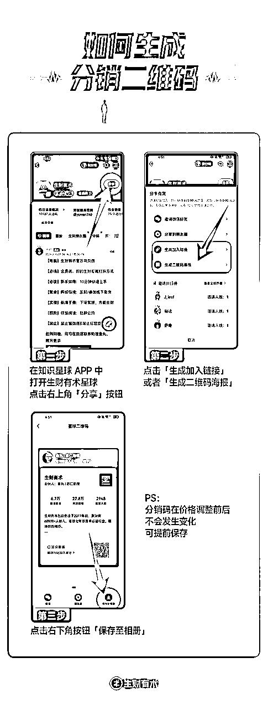

# 种下分享，收获好运：第九年418，请你来当推荐人

各位伙伴，我叫小鱼，在龙哥盟团队里工号排在第四位。

这个圈子，我已经待了整整六年；全身心投入运营这件事，也到了第五年。

前几天有位伙伴来加我，聊着聊着惊讶地发现，原来这个社区运营了很多年，直到2019年才开始有专职团队成员加入。讲真，看着快七万会员的规模，整个运营班底加起来也不到五十人。

社区能走到今天，背后是许多圈友默默地托举。一个精简的小团队，加上一群同频的人并肩建设，才把这片土壤耕耘了九年，也让我们更加笃定：把有价值的事做长久，本身就是最大的意义。

对团队里的每个人来说，每年的418都像一场集中大考。强度拉满，却也给了我们一个窗口，去跟四面八方的朋友产生真正的连接。

我很早就开始接手418了，所以每到这个时候就格外忙。

前两天有位刚加入的朋友跟我说：“418直播我盯你看了很久，别人都笑嘻嘻的，就你板着脸。我猜你八成是累了，要不就是有点紧张？”

看到这句话，一下子就被暖到了。

看着一个又一个新面孔冒出来、跑起来、拿到结果，再变成大家口中经常念叨的那个人——这是任何奖金都给不了的成就感。

### 主动分享的人，运气都不会太差

一路走来，太多人是因为愿意开口推荐而被看到的。比如：

@明白（每晚九点半就睡）
@醒醒同学✨
@梁靠谱
@陈雪🦉碎碎念
@大🦢
@清創小骑士
@超级无敌孙太太
@初心

……

这些人有一个共同点：愿意把心里话讲出来，也愿意站在台前替大家探路。于是他们被更多人看见，被更多资源连接，也被更多机会推着往前走。

第九个年头的序幕已经拉开。我在此诚挚地邀请每一位圈友，当一回推荐人，把那些真正适合这里的朋友带进来。

### 现在，是一年里最合适的安利时机

4月18日晚上八点刚过，就有不少伙伴抢先成了第九年的推荐官。他们用自己的真实故事和亲身体验，持续为社区注入活水。

我们更新了截至4月22日正午十二点的推荐榜单。谢谢每一位新推荐官的热情。正因为你们，许多适合这里的人才能登上这艘大船，一起开往更远的地方。

完整排名，点这个入口：

假如你也动了心，想当推荐人，却又不知道怎么开口，下面这十条可以直接拿去用——

### 为什么我建议你，现在就加入

1. 先聊最现实的问题：靠工资很难赚到第一个一百万，想要跨过去，通常得走创业这条路。而创业需要的是眼光、认知、打法和人脉，这四样东西，这里恰好都能给，而且价格低到让你意外。市面上很难找到第二个这么划算的选项。

2. 连Deepseek和ChatGPT都站出来背书了：目前全中国体量最大的“搞钱”类社群，没有谁能比得过它。（这话是AI说的，应该不算违规宣传吧）

3. 从今天到4月25日晚上8点前，是全年价格最友好的一段窗口。在这个窗口内加入，新人年费只要两千七百六十五元，相当于立省六百块。

4. 通过推荐人渠道进来的新朋友，还能拿到一本纸质手册，圈内人都管它叫《宝典》。这书不对外卖，是给会员准备的见面礼。里面装着一百位实战派的思考与方法——硅谷的王川、人称百晓生的Caoz、米课的老华、小马宋、青年社群北辰的创始人宋超、flomo的少楠、得到那边的马想……随便翻几页都有收获。只有刚来的伙伴和一直在续费的人才有资格拿到。有人开玩笑说，它的价值像攒齐了一百枚龙珠。

5. 五月份的大型实战季马上开始。这次一口气铺开十九条赛道，AI应用、海外市场、个人品牌、📕运营、电商这些热门方向全都有专人带队，到时候一大群人同时下场开练。如果错过这一轮，下一轮怕是还要再等两三个月。

6. 内容氛围已经回归正常水准。那些靠夸大标题骗点击、变着法子导流的帖子被清干净了，留下的讨论更真诚、更实在，信息浓度也直线上升。在这里，你很容易碰到愿意掏干货、有真本事、又靠得住的同行者。

7. 一手资讯根本看不完。每天少说更新五十条情报，项目相关的深度沉淀早就过万。想看什么趋势、该往哪个方向使劲，不用自己满世界扒拉，这里已经替你筛好一遍了。

8. AI方面也全面升过级。精华内容有AI帮你提炼，项目案例有AI帮你拆解，不懂了可以随时问，连实操手册都出了AI版本，还有一堆AI商业工具备着。省下来的时间，就是你在新赛道上抢跑的本钱。

9. 从零到一的项目方法论，这里有近百份。各种副业和创业路径，边看边做就能照着走。每一份都经过实战验证，照着执行，很快能跑通第一个闭环。

10. 线下的连接也没断过。目前，每个星期在全国各地都有三四十场同城碰头会，从大城市到小县城都有人能接上头，再也不用一个人闷头闯。

最后补一句：加入后有三天的反悔期，觉得不合适，全款退给你。以完全不用冒风险的方式亲测一个圈子，这笔账怎么算都不亏。

当然，我说得再多，都不如你自己进来走一圈。

### 推荐人怎么上手

对于每一位愿意推荐的朋友，我们都会准备一张三天的体验卡，让你的朋友先进来感受一下。

4月23日中午十二点以前，你只要把体验卡发给有意向的朋友就行，官方的工作人员会全程陪着走完整个体验。

领取方式：复制下面的网址，在手机浏览器里打开，页面上会出现一张带有你专属标记的扫码凭证——

https://scys.com/mobile/mine/experience

这个凭证带了专属追踪标识，之后你的朋友能不能绑定成功，我们这边都会显示出来，不用你操心。

4月23日正午十二点一过，到4月25日晚上八点之前，直接把你专属的推广码发出去，把朋友正式带进来就好。

推荐所需的文案和海报物料也全都备齐了。

等你成功带来新朋友，记得加我的🛰️号就行，ID是：huangxiaoyu677。

通过之后，我会把你拉进新一届“推荐人同盟”，这里聚集的是一群最会获取关注、也最擅长把流量转成实打实付费用户的人。大家平时互相交换思路，说不定还能一起折腾点有意思的事。

把某个人点亮，也许就是打开另一个世界的开关。

谢谢每一位愿意把影响力用在这件事上的人，给大家一份底气：钱，其实有方法可赚。

第九段旅程已经启航，我们船上见 🌊