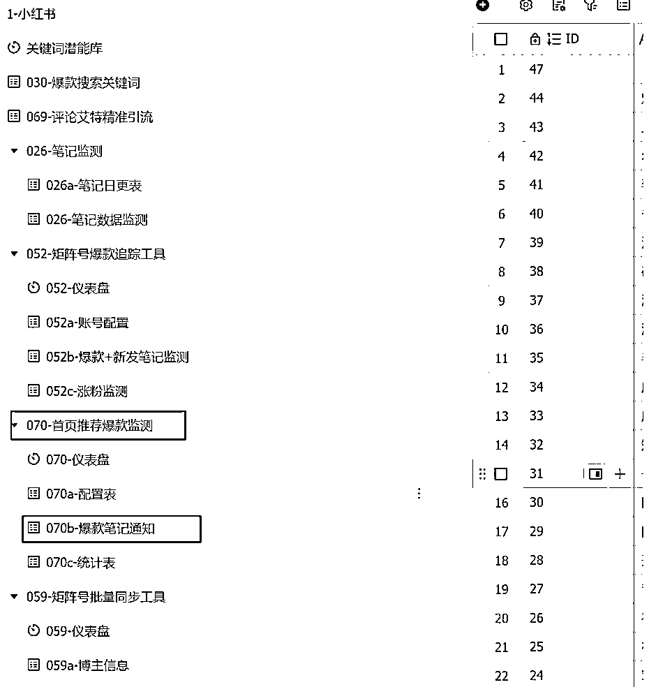
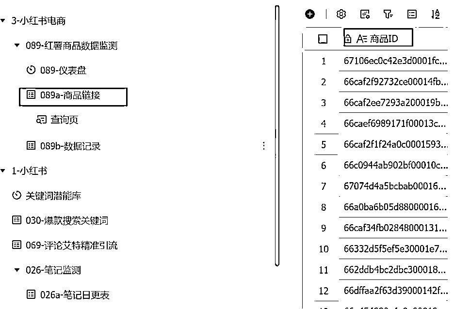
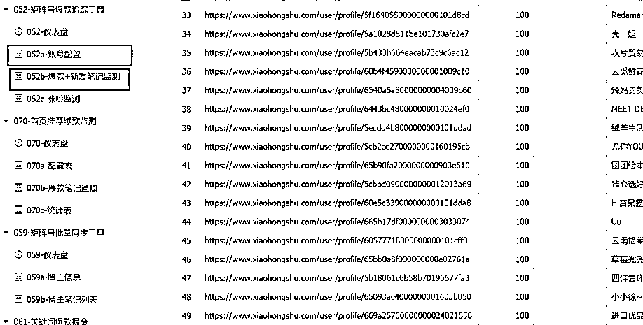
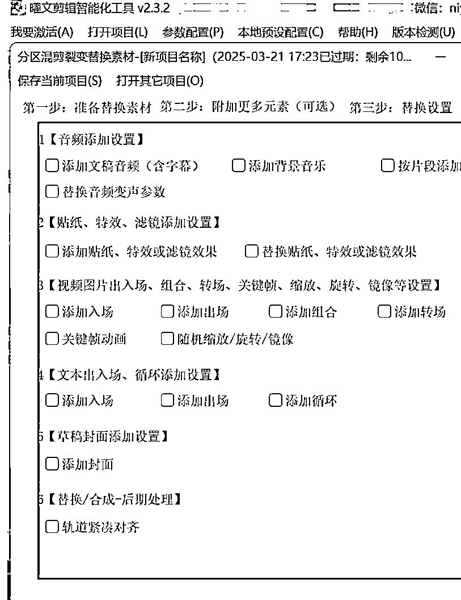
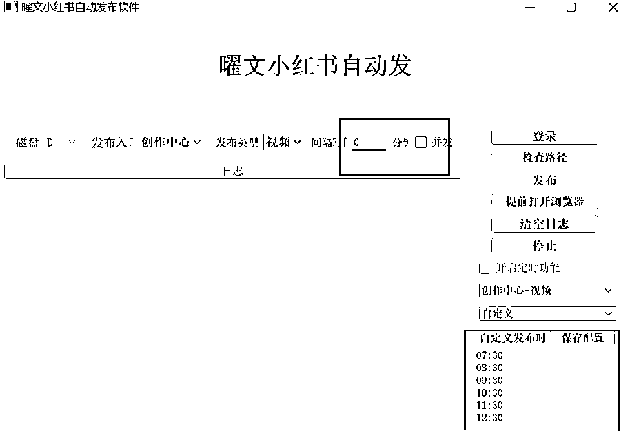

# 📕自动化运营让效率超级加倍
作者：龙哥

标题：📕运营效率狂飙20倍？真相是：一个人管20个号，也能游刃有余！

我是龙哥，每天都有不少朋友跟我吐槽：睁开眼睛就要看数据，接着就是选爆款、写脚本、剪视频、排发布、回评论……一整天连口热水都顾不上喝。说实话，我以前也这样，直到我把整套流程交给自动化，局面彻底变了——现在一个人稳稳操盘20个📕账号，效率至少提升了20倍。

别急着怀疑，下面就是我正在用的这套玩法，文末附上工作流搭建思路，记得看完。

## 01 数据先行：从手动抄录到智能洞察

想在📕站稳脚跟，第一步不是闷头创作，而是“盯紧对标”。可要是靠人工去扒数据，一天都得搭进去。现在我搭建了自动采集体系：

- 设定关键词监控，同行爆款笔记一发布，系统自动抓取入库，形成动态对标池；
- 输入商品链接，就能实时看到转化率、点击量等商城核心指标；
- Coze工作流把竞品分析变成“一键操作”，手机点一下，结论自动同步到飞书表格；
- 飞书表格让所有数据自动归档，团队协作一目了然。

过去我们每天花3小时手动收集数据，现在只需要10分钟审核报告，省下来的大块时间全部用来打磨内容方向，效果翻倍。

## 02 数据驱动创作：让系统告诉你发什么

光有数据还不够，关键看怎么用。我们的自动化系统还能：

- 飞书机器人自动捕捉近期数据表现突出的内容，把热门话题推送到你面前；
- 如果某条笔记评论、收藏比例异常，系统立刻提醒你检查优化；
- AI还会爬取账号历史数据，推算出最适合你的发布时段。

记住，数据分析不是最终目的，而是为了指导下一轮内容。当你悠闲喝着咖啡时，机器已经把一整天的分析工作做完了。

## 03 视频内容流水线：4小时压缩到10分钟

视频在📕上最容易出圈，可剪辑实在太费劲？这套生产线能帮你：

- 用哼哼猫工具无水印抓取爆款视频，顺手过滤掉低质素材；
- 自动化剪辑工具根据模板自动成片，自动配音、加字幕、去重；
- 素材还会按话题和风格自动分类存档，随用随取。

举个例子：之前我们做美妆号，每天要剪10条视频，光剪辑就得4小时。现在只要输入文案、选中模板，10分钟就能生成15个不同风格的视频。

## 04 图文笔记批量化：从“P图到崩溃”到“一键出稿”

图文看起来简单，真做好也费心思。我们的自动化方案是：

- 提前设计好几套不同风格的图文模板，AI自动替换文字内容；
- 产品图自动抠图、智能换背景，瞬间提升质感；
- 智能排版能根据文字多少自动调整布局，美观又省心；
- 还可以直接套用可画（Canva）的现成模板批量出图。

之前种草号每天要P10张图、写5篇文案，手忙脚乱。现在选好产品图，AI自动换背景、生成文案、套模板，效率直接翻了10倍。

## 05 发布与互动自动化：高效触达不是梦

- 系统定期监控同领域头部账号的动向，自动识别爆款要素；
- 基于这些要素，AI辅助二次创作，避免简单重复；
- 支持预设时间，自动发布笔记，再也不用守着点按“发送”。

聪明人都知道“不要重复发明轮子”。研究爆款，提取精华，再融入自己的特色，才是最快的进阶路径。

## 06 自动复盘，让增长形成闭环

自动化不是一劳永逸，而是要持续迭代。

- 每周自动生成数据周报，关键指标一目了然；
- 自动分析内容表现，告诉你哪个选题值得深挖，哪个方向需要调整；
- 同时追踪竞品动态，根据历史数据预测下一波内容趋势。

复盘不是为了晒数据，而是为了发现问题、指导行动。把重复的活交给AI，把策略和创意留给人，形成“数据分析→发现问题→调整策略→再测试”的良性循环。有位运营就是靠每周五固定复盘，三个月时间让账号从0做到变现5W+，而且全程基本自动化，只需要持续优化内容即可。

## 07 一个人管20个账号的底层逻辑

很多朋友问：一个人管20个号，真的现实吗？答案是肯定的，但前提是方法得当。

- 多账号统一管理：按领域分组，内容日历清晰可见，支持批量操作和权限分配；
- 差异化运营：每个账号使用不同模板、错开发布时间、细分主题切入，互动社区也彼此隔离，避免账号之间“抢流量”。

我们团队就有位同事，一个人运营20个美妆号，每个号分别瞄准学生党、宝妈、上班族、平价种草等不同人群。靠着这套自动化系统，她每天只需工作4小时，所有账号还能保持日更。

## 写在最后

在竞争激烈的📕生态里，自动化就是你的秘密武器，让你能够以一敌十乃至更多。

但请记住：工具永远只是辅助，真正决定高度的还是你的内容价值和独特创意。找准方向，从最简单的流程开始跑通，再逐步完善；持续复盘，让系统越来越懂你。把重复的琐碎交给机器，把灵感和策略留给自己——这才是效率提升的真正奥义。

希望这篇内容能给你带来启发。如果你正在📕路上打拼，不妨试试自动化，让创作之路事半功倍。