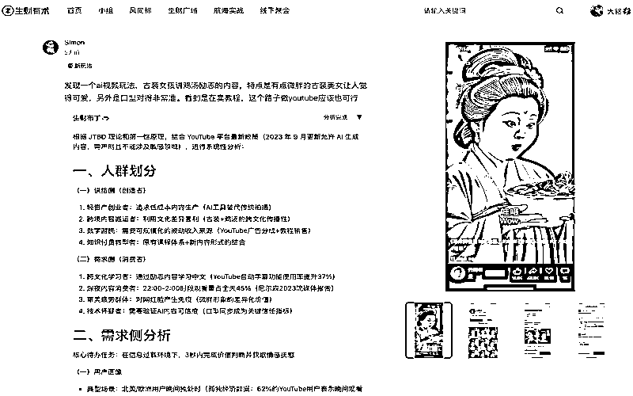
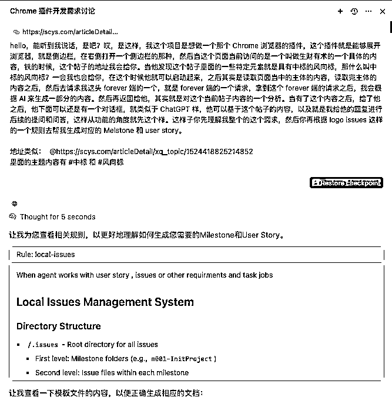
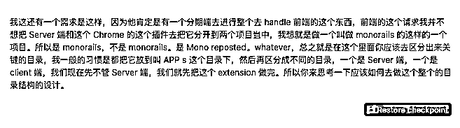
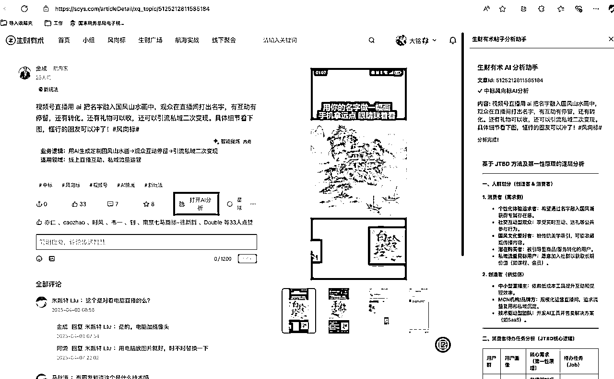
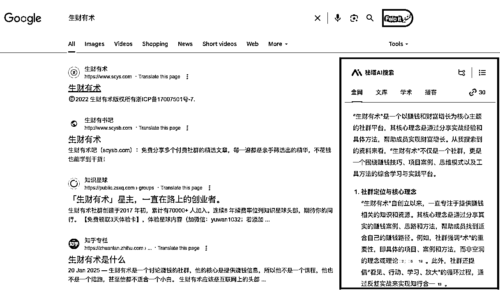
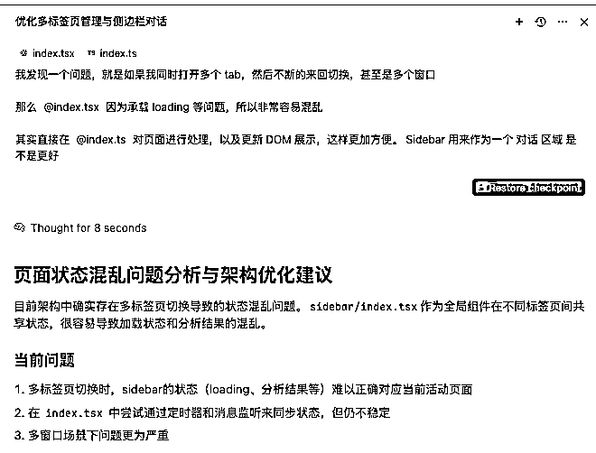
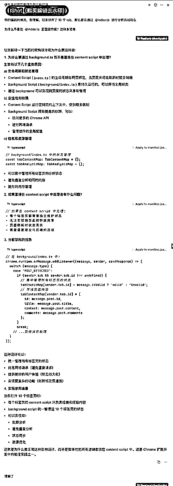

标题：我用一个“小布丁”，把生财的金矿榨出了汁

生财这个圈子，好内容是真的多，牛人也是真的多。可正因为它太丰富了，反而让人有点无从下口。每年花上千块进来，如果只是看着满屏的干货却吸收不了，那也太亏了。我一直觉得，必须想个办法把这些内容的价值榨干，哪怕一滴都不能浪费。围绕这个念头，我做了一个叫“生财布丁”的小工具。

它是个浏览器插件，专门干一件事：自动识别并分析生财有术网站上的#中标/#风向标帖子，然后用AI帮你把内容嚼碎了、讲明白。

下载地址： chromewebstore.google.com



简单说，它是这么工作的：
- 你打开scys.com上任意一篇中标或风向标详情页，侧边栏自动弹出分析入口；
- 分析结果以Markdown呈现，表格、分段、列表都有，看着很清楚；
- 多标签页随意切换，自动刷新，不用手动操作；
- 它不收集、不上传任何个人隐私，只在合规的页面上生效。

说白了，它就是给生财有术做JTBD分析的助手，适合研究用户需求、拆解案例、洞察商机。

那为什么想开发它呢？原因有两方面。

一方面是工具侧的推动。那阵子Cursor刚好升到0.49.6，感觉auto model变化挺大，想找个实际项目试试水。

另一方面是内容侧的痛。生财最重要的资产就是内容，可这些内容就像一座金矿，挖起来有两道坎：第一道，得看懂当前这篇文章到底在讲什么；第二道，当你想要深入某个话题时，怎么快速找到相关的好内容。说白了就两个问题：这篇文章讲了啥？怎么找到我想要的？更关键的是，很多领域我们并不懂，连问题都问不出来，更别说看出门道了。

生财其实已经帮我们做了一道筛选：中标的风向标、精华文章，都是被人工认证过的好东西。这是亦仁和生财团队替我们过滤过的精华，我们要做的，就是好好利用它们。可惜现在的内容组织方式还是靠标签和关键字，检索起来不智能，答非所问；内容之间也缺少联动——中标帖子告诉你商业机会是什么，精华帖告诉你为什么、怎么做，但两者没法自动串起来。

所以我就想，要是有个工具能帮我把文章讲透、还能按我的问题精准找到内容，那就舒服了。这完全是我自己的需求，一开始也没想做一个多大的产品，就是个测试工具，没想到慢慢长成了“生财布丁”。

做产品之前，我给自己定了三个目标：第一，让我看生财更省力；第二，产品足够小；第三，能发布给别人用。想在两天内做出第一版，就注定不能贪大。分析文章讲什么，可能一个提示词套壳就搞定；但智能检索的活儿太多，两天根本做不完。那就先从分析做起。

为什么先做中标的风向标？因为精华帖太全太杂，一篇讲思维方式的文章和一篇讲实操落地的文章，用同一套分析逻辑并不合适。风向标不一样，它们都指向商业机会，非常聚焦；而中标的风向标更是被验证过的，有供需、有方向，一套提示词就能说得清。

那内容从哪来？爬虫不好分发，让每个用户自己跑个爬虫也不现实。浏览器插件直接抓取页面内容，最轻量，于是就这么定了。

第一版需求也很简单：在浏览器里看到中标风向标的内容分析。至于还能不能向它提问？我不知道它会怎么答，干脆砍掉，先跑起来。

这个需求是不是只有我自己需要？我做了点验证。生财新人贴阅读量很大，说明大家确实有读内容的需求；市面上不少付费商机社群，付费用户都上千；插件虽然要下载安装，还是有很多群友点赞评论。还有人建议我加自定义提示词、分析精华帖，看来需求不虚。这未必是个超级大市场，但养活一个工具绰绰有余。

接下来就是开发。我没写过浏览器插件，只知道要用V3版本、用JavaScript，然后就全靠AI了。我新开一个空项目，用豆包桌面版语音录入需求。结果语音识别闹了不少笑话：Forever被听成Server，Logo issues听成Local Issues，Melstone听成milestone。就这样的输入，Cursor居然能看懂。



让它生成的内容长这样：

```
# 001-story-chrome-extension-for-scys-article-analysis

# Title
创建生财有术帖子分析Chrome插件

# Story
作为一名生财有术社区用户
我想要一个浏览器插件能自动识别并分析带有"#中标"和"#风向标"标签的帖子
以便能快速获得对这类帖子的AI辅助分析，提升阅读效率和理解深度

# 基本概念
- 生财有术：一个分享创业、副业和赚钱经验的在线社区平台
- 中标/风向标：社区内特定的内容标签，通常代表值得关注的趋势或机会
- 侧边栏分析：在不离开原网页的情况下，在右侧展示补充分析内容
- AI辅助分析：使用AI技术对帖子内容进行结构化理解和见解提取

# 场景
前置条件:
- 用户已安装Chrome浏览器
- 用户已安装此Chrome插件
- 用户正在浏览生财有术网站

主要流程:
1\. 用户访问一个生财有术的帖子页面（如：https://scys.com/articleDetail/xq_topic/1524418825214852）
2\. 插件自动检测页面是否包含"#中标"和"#风向标"标签
3\. 如发现标签，自动在浏览器右侧打开侧边栏
4\. 插件读取帖子主体内容并将其发送到服务器
5\. 服务器使用AI分析内容并返回结果
6\. 插件在侧边栏中显示分析结果
7\. 用户可以在侧边栏底部输入框中提出后续问题
8\. AI根据帖子内容和上下文回答用户提问

异常处理:
- 网络连接失败：显示错误信息并提供重试选项
- 内容解析失败：提示用户可能的原因（页面结构变化等）
- 服务器响应超时：设置合理的超时提示和重试机制

# 验收标准
功能要求:
- [ ] 插件能够正确识别包含"#中标"和"#风向标"标签的帖子
- [ ] 能在浏览器右侧打开侧边栏
- [ ] 能准确提取帖子主体内容
- [ ] 能将内容发送到服务器并接收分析结果
- [ ] 侧边栏有对话输入框支持后续提问
- [ ] AI回复内容符合用户期望的分析深度

非功能要求:
- [ ] 插件启动不影响页面正常加载和浏览
- [ ] 内容提取过程无感知（<1秒）
- [ ] 服务器响应时间控制在可接受范围（<5秒）
- [ ] 界面设计符合直觉，易于使用

# 子任务
- [ ] 002-feat-chrome-extension-setup 创建基础Chrome插件结构
- [ ] 003-feat-content-detection 实现页面内容和标签检测功能
- [ ] 004-feat-sidebar-implementation 实现浏览器侧边栏功能
- [ ] 005-feat-content-extraction 实现帖子内容提取功能
- [ ] 006-feat-server-communication 实现与服务器的通信
- [ ] 007-feat-ai-analysis-integration 集成AI分析结果展示
- [ ] 008-feat-chat-interface 实现对话界面功能

# 依赖关系
技术依赖:
- [ ] {DEP-001} Chrome扩展开发环境
- [ ] {DEP-002} 服务器API接口（支持AI分析请求）
- [ ] {DEP-003} 网页内容解析技术（DOM操作）

业务依赖:
- [ ] {BIZ-001} 生财有术网站页面结构的稳定性
- [ ] {BIZ-002} 获取生财有术对外部工具的使用政策

# 状态历史
- 2025-04-26: 创建

```

接着再让它生成issues，前几个issues就让我摸清了技术框架：

```
# 002-feat-chrome-extension-setup

# Title
创建基础Chrome插件结构

# Introduction
搭建Chrome插件的基础框架，包括manifest.json配置，background scripts，content scripts等基础组件的设置。确保插件具备所需的基本功能和权限配置。

# Tasks
- [ ] 创建项目基础目录结构
  - manifest.json
  - background.js
  - content.js
  - popup.html/js
  - styles/
  - assets/
- [ ] 配置manifest.json
  - 基本信息（名称、版本、描述）
  - 权限配置（tabs, storage, activeTab, host permissions）
  - CSP设置
  - 资源引用
- [ ] 实现基础background script功能
  - 插件生命周期管理
  - 基础事件监听
- [ ] 实现基础content script功能
  - 页面注入逻辑
  - DOM操作基础设置
- [ ] 创建基础UI组件
  - 插件图标
  - popup页面基础结构
- [ ] 添加开发环境配置
  - 配置webpack/vite等构建工具
  - 设置开发热重载
  - 添加基础lint规则

# Dependencies
- [ ] {001-story-chrome-extension-for-scys-article-analysis} 主用户故事
- [ ] {DEP-001} Chrome扩展开发环境

# Status History
- 2025-04-26: 创建
```

```
# 003-feat-content-detection

# Title
实现页面内容和标签检测功能

# Introduction
开发页面内容检测机制，用于识别生财有术文章页面中的"#中标"和"#风向标"标签，并触发相应的插件功能。

# Tasks
- [ ] 实现URL匹配检测
  - 识别生财有术文章页面URL模式
  - 设置URL变化监听
- [ ] 开发标签检测功能
  - 实现DOM解析器
  - 添加"#中标"和"#风向标"标签检测逻辑
  - 处理动态加载内容的情况
- [ ] 实现检测结果通知机制
  - 创建检测结果事件系统
  - 实现background script和content script间的通信
- [ ] 添加性能优化
  - 实现节流/防抖机制
  - 优化DOM遍历性能
- [ ] 添加错误处理
  - 处理页面结构变化异常
  - 添加重试机制
- [ ] 实现检测状态管理
  - 存储检测结果
  - 管理检测状态生命周期

# Dependencies
- [ ] {001-story-chrome-extension-for-scys-article-analysis} 主用户故事
- [ ] {002-feat-chrome-extension-setup} 基础插件结构
- [ ] {DEP-003} 网页内容解析技术

# Status History
- 2025-04-26: 创建
```

关于项目结构，我从一开始就想清楚了一点：我不能把提示词和操作逻辑暴露在插件里，不然谁都看得见，那还玩什么。所以项目必须分成两部分——插件负责识别内容、传给服务器并展示结果；服务器负责数据处理和接口。想明白这点，我就带着这个思路去和Cursor第二轮对话：



Cursor给了一堆建议，后面的事，顺理成章。

回头看看，“生财布丁”不是什么大项目，但它解决了一个很实在的问题：让普通人也能把生财的宝藏啃得动、咽得下。如果你也有同样的困扰，不妨试试这个小插件。

```
jtbd-fxb/
├── apps/                       # 所有应用程序
│   ├── extension/              # Chrome插件
│   │   ├── public/             # 静态资源
│   │   │   ├── manifest.json   # 插件配置文件
│   │   │   ├── icons/          # 插件图标
│   │   ├── src/                # 源代码
│   │   │   ├── background/     # 背景脚本
│   │   │   ├── content/        # 内容脚本
│   │   │   ├── popup/          # 弹出窗口
│   │   │   ├── sidebar/        # 侧边栏组件
│   │   │   ├── components/     # 共享UI组件
│   │   │   ├── utils/          # 工具函数
│   │   │   ├── services/       # 服务层（API通信等）
│   │   │   ├── types/          # 类型定义
│   │   ├── tests/              # 测试文件
│   │   ├── package.json        # 依赖管理
│   │   ├── vite.config.js      # 构建配置
│   │   
│   ├── server/                 # 服务器端应用
│       ├── src/                # 源代码
│       │   ├── controllers/    # 控制器
│       │   ├── services/       # 业务逻辑
│       │   ├── models/         # 数据模型
│       │   ├── routes/         # 路由定义
│       │   ├── utils/          # 工具函数
│       │   ├── config/         # 配置文件
│       │   ├── types/          # 类型定义
│       ├── tests/              # 测试文件
│       ├── package.json        # 依赖管理
│       
├── packages/                   # 共享包/库
│   ├── common/                 # 通用功能
│   │   ├── src/                # 源代码
│   │   │   ├── types/          # 共享类型定义
│   │   │   ├── utils/          # 共享工具函数
│   │   ├── package.json        # 依赖管理
│   │   
│   ├── ui-components/         # 可能的共享UI组件库
│       ├── src/
│       ├── package.json
│       
├── .issues/                   # 项目管理和需求
├── .gitignore                 # Git忽略文件
├── package.json               # 根目录包配置
├── pnpm-workspace.yaml        # pnpm workspace配置
├── tsconfig.json              # TypeScript基础配置
├── turbo.json                 # 可选：Turborepo配置
└── README.md                  # 项目说明
```

到了这个阶段，产品已经具备开工的条件。

### 开发细节，略过

## V0.1.0：本地先行版

前前后后不过大半天，一个能跑进电脑里的实验版就出炉了。说穿了，它只是在 prompt 外头套了一层逻辑壳，所以速度飞快。

因为规划里还有提问模块，我把不少时间押在了视窗右缘的侧栏上，初版的所有结果也都投放在这个位置。



### 上架 Chrome 商店

打开 Chrome 的 Web Store 开发者后台，完成账号认证和资料登记，再付 5 美元，即可申报应用。

#### 送审前留意三件事

1. 应用介绍与素材要齐全
2. 权限范围必须贴合实际。我当时一头雾水，一面填表一面请 AI 帮忙把关，既要处理后台的勾选项，也要让配置声明与项目里的设置保持一致
3. 隐私说明页是硬性要求，依旧交给 AI 拟定，标题就叫《生财有术·JTBD·隐私说明》

首回申报便碰了壁：我在本地配置中声明了“允许脚本在当前页面执行”的权限。删掉这一项后，再次递交顺利通过。

审核节奏不太均匀，零零散散用了两周才正式亮相。等待上架的那段时间里，使用者只能拿着 zip 压缩包，在本地用开发者方式手动挂载。

我也喊了几位朋友来试，可手动装载这一步实在太劝退。

### 初版在实际场景中露怯

现实中，大家更喜欢在多个标签页之间来回跳跃。此刻面前的标签可能属于：

- 真正需要分析并给出结论的中标风向页
- scys.com 站内的其他页面
- 与本站毫无关联的外部站点

想获得不打折扣的体验，就必须做到：只有打开中标风向页时才渲染结果；在同一站点的不同子页之间切换时，侧栏的信息要跟着跳动；一旦跳出站点，就得引导用户返回正确页面。

可当时的体验实在怪异。更麻烦的是，在无关页面上，右侧还要空出一大截给侧栏闲置，白白吃掉视觉空间，说不过去。

技术代价也不低：得等页面自己完成抓取，再做一堆后续加工。投入的时间不少，换回的价值却少得可怜。

#### 侧栏真的是必需的吗

侧栏贴住视窗边缘，有独立完整的交互区域，放在需要深度操作的工具里很有用。

可初版只是个单向展示的东西，真有必要为了它配一个眼下用不着、实现起来还费劲的独立区域？

不如把结果直接放进页面里，像这样：



看起来也是个顺眼的方案。

这么调整的好处是：

- 信息一步到位，不用绕弯
- 不必反复交代“要去哪个网站才能看到内容”
- 开发量小了一截

#### 问答功能还做不做

静下来想：我们追求的是“问答”本身，还是针对当前中标页的深挖？是检索，又或者别的形态？

方向还没想明白，那就先拿掉。

## V0.2.x：接着迭代

商店窗口还开着，抓紧把新版推出去。

### 先盘点现状：翻代码、问 AI

再次声明，我对扩展开发原本几乎一无所知。这次正好借迭代的由头，一面翻代码，一面请 AI 答疑，把盲区快速补干净。





### 扩展改造

精简扩展的结构，找准页面里的落点，把结果直接画进去。

- 只有打开中标风向页时才展示内容
- 侧栏代码先封存、不删除，给将来留个后手


## V0.3.x？回到内容去提问

有几件事值得反复想：

1. 眼前的文章在讲什么
2. 中标风向页 ✅
3. 哪类内容经得起沉淀
4. 怎么挖掘与它关联的延伸内容

把信息源这个变量放进来呢？
把使用者的特征也放进来呢？

🏃‍♀️但愿这个小工具能成为所有故事的序章。

# 再看商业侧的想象力

## 扩展程序：一条低门槛的新手赛道

Chrome 的市占率早已越过七成，算上基于 Chromium 的同类产品，覆盖面接近九成。扩展的开发门槛不高，和页面结合又深，是个值得入场的切口。

从扩展走到自有网站，过渡也很顺滑。

### 扩展是天生的内容触点

扩展能顺畅读取网页正文，也具备发起远程请求的能力，拿来给 LLM 做中介层非常顺手：

1. 读取当前页面的正文
2. 套进预设 prompt
3. 让 LLM 完成推理
4. 把结果带回页面呈现

这条链路能变出许多花样。比如囤上一批图表化 prompt 模板，配合扩展就能让页面瞬间变成图形面板。

沿着这个方向走，相信社区里会长出不少有趣的产物。

## 布丁能走多远

落到内容这一侧，它有望成为生财知识矩阵的贴身助手；落到挖掘好点子这一侧，它可以接住更多外部情报源，例如 Reddit、Product Hunt、Hacker News 这一类社区。

### 小而轻的机会探测与发布工具

扩展信源版图，自动汇总每日发现与每周小结，用订阅制换取回报。

### 个人第二收入诊断工具

结合每个人的处境，产出匹配的第二收入建议：

- 与自身资源相符的潜在机会
- 雷达式的机会提醒
- 研判用户抛出的新想法
- 让机会找到可落地的路径
- 对标同类产品，输出竞争对比